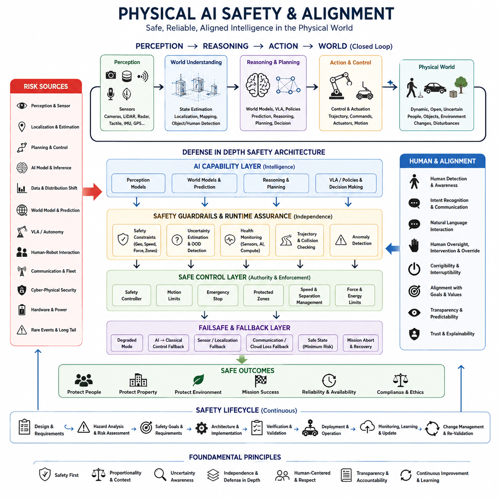
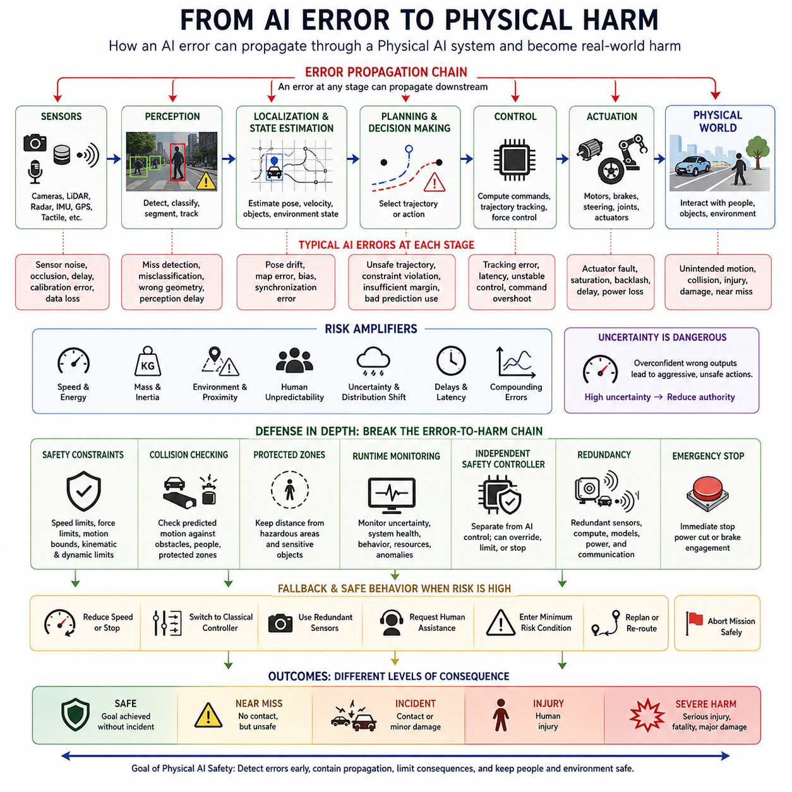
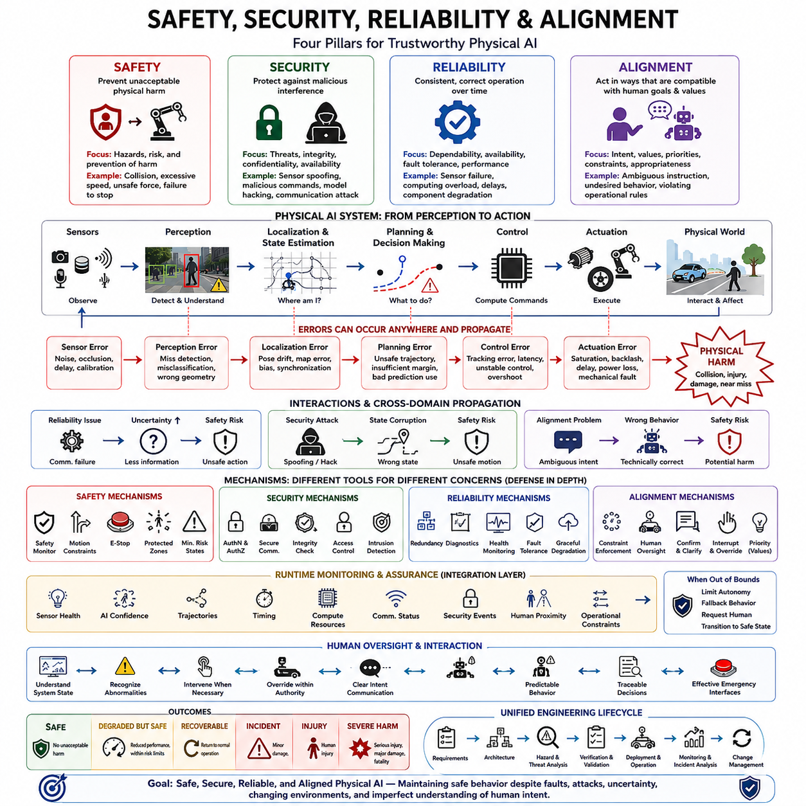
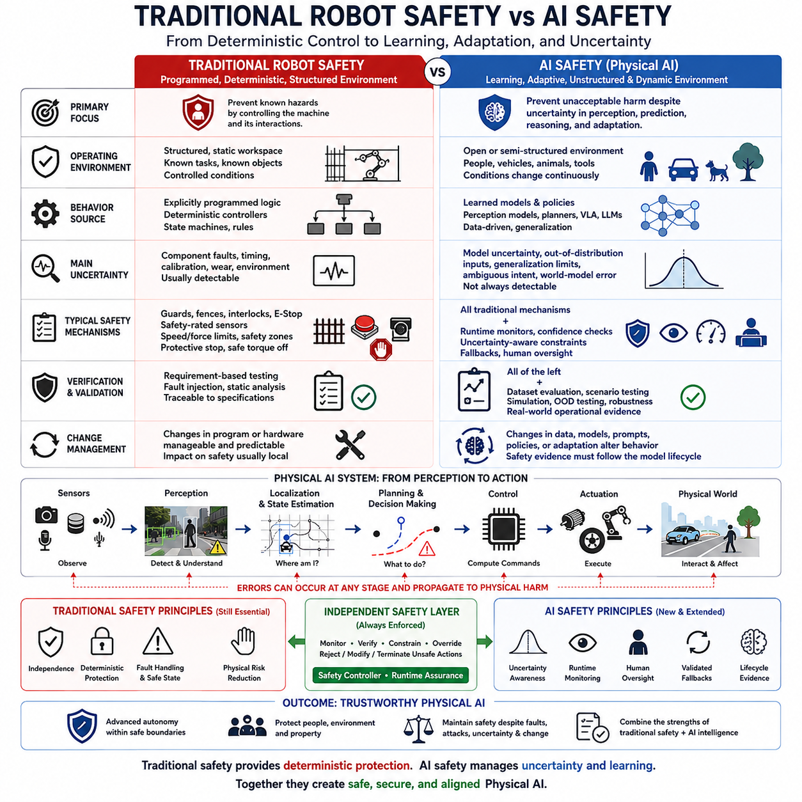
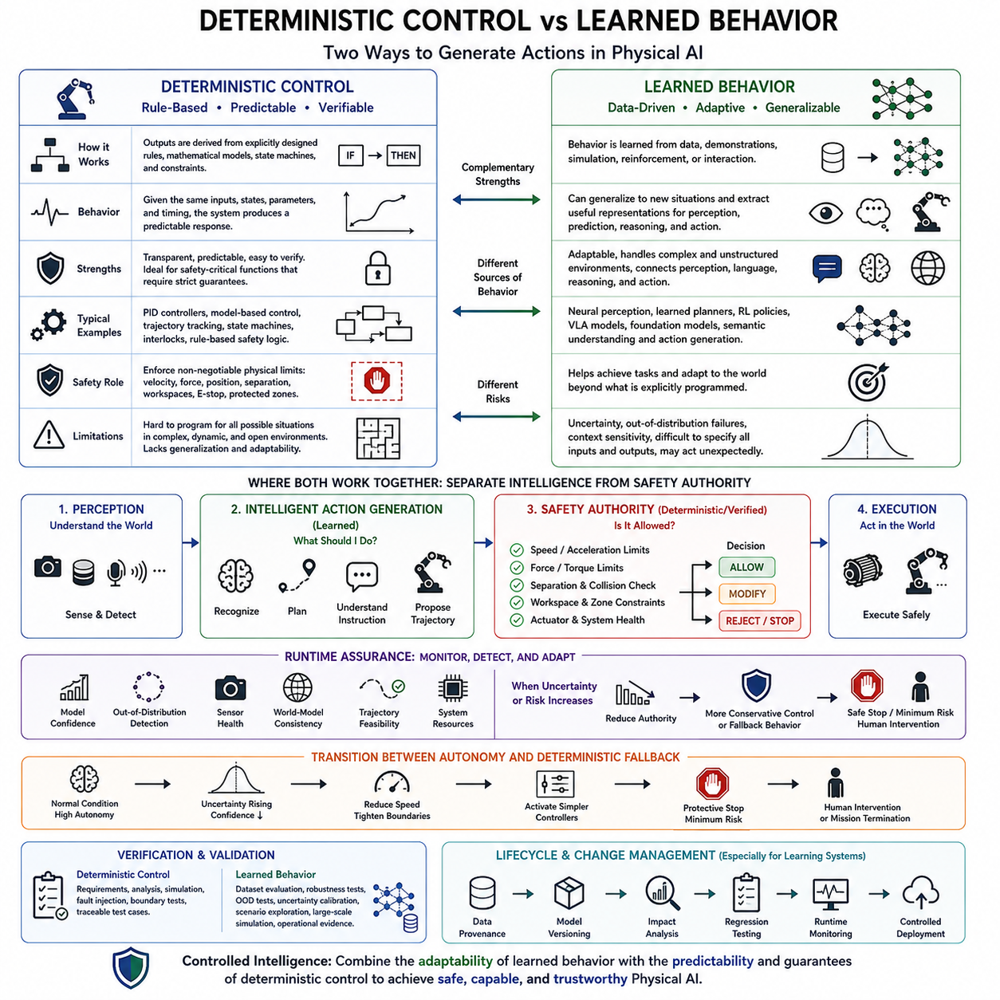
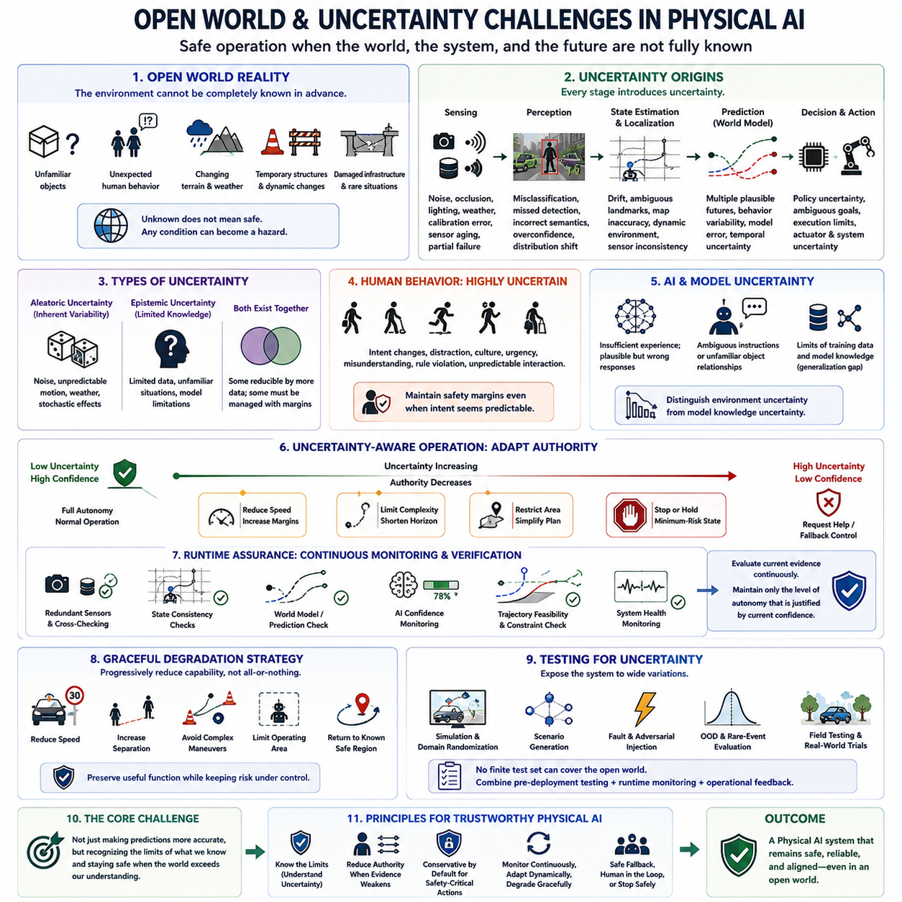
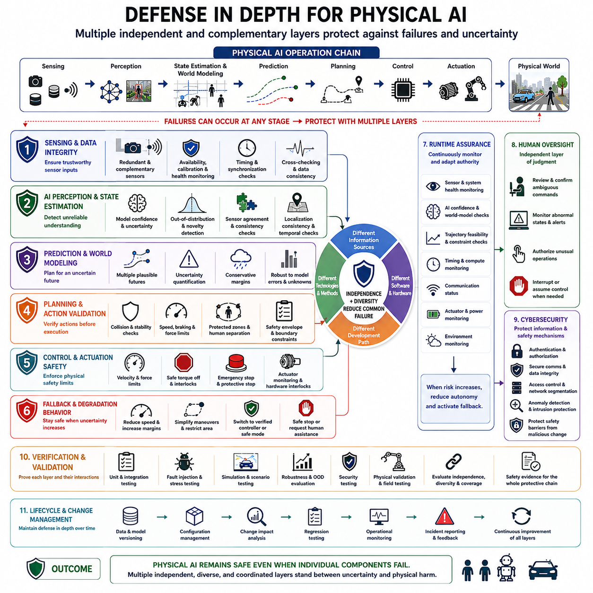
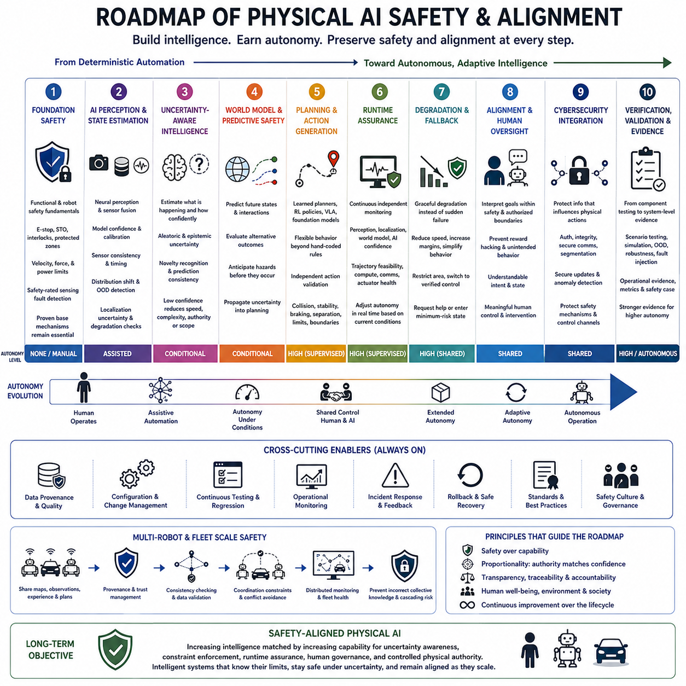

**Volume 10. Physical AI Safety and Alignment**


# Chapter 00. Introduction

##  

## 00.01. Why Safety is Fundamental to Physical AI

{width="7.268055555555556in" height="7.268055555555556in"}

Physical AI differs fundamentally from conventional digital AI because its decisions are converted into motion, force, heat, electrical power, and other physical effects. An incorrect prediction in a software service may produce inaccurate information, but an incorrect decision by an autonomous machine can create collisions, injuries, equipment damage, or environmental hazards. Safety must therefore be treated as a fundamental system property rather than an optional feature.

A Physical AI system continuously closes the loop between perception, reasoning, action, and the physical environment. Cameras, LiDAR, radar, tactile sensors, localization systems, and other sensors estimate the current state of the world, while learned models interpret that state and select actions. Actuators then change the environment, producing new observations and decisions. Errors can consequently propagate through this closed loop and become physical consequences.

The safety challenge becomes more difficult because Physical AI operates in environments that cannot be completely predicted during design or training. People move unexpectedly, objects change position, surfaces become slippery, sensors become obstructed, communication links fail, and unfamiliar situations appear. A safe system must therefore handle uncertainty and distribution shift while recognizing when its own knowledge or perception is insufficient for reliable action.

Traditional automation commonly relies on deterministic logic, predefined operating conditions, and carefully engineered safety boundaries. Physical AI increasingly introduces learned perception, world models, reinforcement learning, foundation models, and Vision-Language-Action models. These components can improve adaptability and generalization, but their behavior may not always be represented by simple deterministic rules. Safety engineering must therefore coexist with learned and probabilistic behavior.

Safety cannot be assigned to the AI model alone because physical harm normally emerges from interactions among multiple subsystems. A perception error may corrupt localization, localization uncertainty may distort planning, and an unsafe trajectory may then be executed by the controller. Mechanical limits, actuator faults, network delays, thermal conditions, or human behavior may further amplify the problem. Physical AI safety must consequently be addressed as a system-level property.

A useful safety architecture separates intelligent capability from the authority to produce unrestricted physical action. AI may generate predictions, plans, trajectories, or commands, while independent mechanisms verify whether those outputs remain inside defined safety constraints. Motion limits, protected zones, collision checks, safety controllers, emergency stops, and runtime monitors can restrict unsafe behavior even when the primary intelligent system produces an incorrect or uncertain decision.

Uncertainty is particularly important because a Physical AI system must distinguish between situations it understands and situations where its internal models are unreliable. Confidence estimation, out-of-distribution detection, sensor-health monitoring, prediction consistency, and anomaly detection provide evidence about whether normal autonomous operation should continue. When uncertainty becomes excessive, conservative behavior such as slowing, stopping, replanning, or requesting human assistance becomes part of intelligent operation.

Safety also requires explicit consideration of failure rather than assuming that every component will remain available. Sensors can fail, localization can degrade, AI inference can exceed timing limits, processors can overheat, batteries can approach critical levels, and communication with cloud or fleet infrastructure can disappear. Robust Physical AI therefore needs degraded operating modes, fallback controllers, minimum-risk conditions, mission-abort strategies, and clearly defined safe states.

Human interaction creates another essential dimension of safety. Robots frequently operate near workers, passengers, patients, pedestrians, operators, or other users whose intentions cannot be perfectly predicted. The machine must detect and track people while respecting separation, speed, force, and workspace constraints. It should also communicate its own intentions clearly so that humans can anticipate motion and intervene when necessary instead of being surprised by autonomous behavior.

Alignment extends this problem beyond collision avoidance. A physically capable AI system must translate human goals and instructions into actions that remain compatible with physical, operational, social, and safety constraints. A command may be technically achievable while still being unsafe in the current context. Physical alignment therefore requires the system to reason not only about what action can accomplish a goal, but also whether that action should be executed under existing conditions.

Runtime assurance becomes increasingly important as autonomy grows. Verification before deployment cannot enumerate every combination of environment, human behavior, model uncertainty, component degradation, and rare event that may occur during operation. Independent runtime monitoring can continuously evaluate perception health, system resources, trajectories, safety envelopes, world-model consistency, and AI confidence, allowing protective mechanisms to intervene when behavior approaches unacceptable boundaries.

Safety must also persist throughout the system lifecycle. Training data, model updates, software revisions, sensor replacements, environmental changes, and continual learning can alter behavior after initial validation. Logging, traceability, scenario-based testing, field evidence, change management, and repeated verification are therefore necessary to demonstrate that safety assumptions remain valid. Certification of adaptive Physical AI ultimately depends on maintaining evidence as the system evolves.

The fundamental objective is not to eliminate intelligence in order to obtain safety, but to make increasing intelligence compatible with controlled physical authority. Perception, prediction, reasoning, world models, VLA policies, and autonomous learning can expand what machines are capable of doing, while safety architectures determine the conditions under which those capabilities may act. Physical AI becomes trustworthy when intelligence, uncertainty management, runtime assurance, fallback behavior, and human oversight operate as one integrated system.

피지컬 AI(Physical AI)는 그 의사결정이 움직임, 힘, 열, 전력 및 기타 물리적 효과로 변환된다는 점에서 기존의 디지털 AI(Digital AI)와 근본적으로 다르다. 소프트웨어 서비스의 잘못된 예측은 부정확한 정보를 생성하는 데 그칠 수 있지만, 자율 기계(Autonomous Machine)의 잘못된 의사결정은 충돌, 부상, 장비 손상 또는 환경적 위험을 초래할 수 있다. 따라서 안전(Safety)은 선택적으로 추가되는 기능이 아니라 시스템의 근본적인 속성으로 다루어져야 한다.

피지컬 AI 시스템(Physical AI System)은 인지(Perception), 추론(Reasoning), 행동(Action), 물리적 환경(Physical Environment) 사이에서 지속적으로 폐루프(Closed Loop)를 형성한다. 카메라(Camera), 라이다(LiDAR), 레이더(Radar), 촉각 센서(Tactile Sensor), 위치추정 시스템(Localization System) 등의 센서는 현재 세계의 상태를 추정하며, 학습 모델(Learned Model)은 그 상태를 해석하고 행동을 선택한다. 이후 액추에이터(Actuator)가 환경을 변화시키면서 새로운 관측과 의사결정이 발생한다. 따라서 오류는 이러한 폐루프를 통해 전파되어 실제 물리적 결과로 이어질 수 있다.

피지컬 AI는 설계나 학습 단계에서 완전하게 예측할 수 없는 환경에서 동작하기 때문에 안전 문제는 더욱 어려워진다. 사람은 예상하지 못한 방향으로 움직이고, 물체의 위치는 변하며, 표면은 미끄러워질 수 있고, 센서는 가려지거나 통신 연결이 끊어질 수 있으며, 학습 과정에서 경험하지 못한 새로운 상황이 나타날 수 있다. 따라서 안전한 시스템은 불확실성(Uncertainty)과 분포 변화(Distribution Shift)를 처리하면서 자신의 지식이나 인지가 신뢰할 수 있는 행동을 수행하기에 부족한 상황을 스스로 인식해야 한다.

전통적인 자동화(Traditional Automation)는 일반적으로 결정론적 논리(Deterministic Logic), 사전에 정의된 운영 조건(Predefined Operating Conditions), 세밀하게 설계된 안전 경계(Safety Boundary)에 의존한다. 반면 피지컬 AI는 학습 기반 인지(Learned Perception), 월드 모델(World Model), 강화학습(Reinforcement Learning), 파운데이션 모델(Foundation Model), 비전-언어-행동 모델(Vision-Language-Action Model, VLA)을 점차 도입하고 있다. 이러한 구성요소는 적응성과 일반화 능력을 향상시키지만, 그 행동을 항상 단순한 결정론적 규칙으로 표현할 수 있는 것은 아니다. 따라서 안전 공학(Safety Engineering)은 학습 기반 및 확률적 행동(Probabilistic Behavior)과 함께 작동할 수 있어야 한다.

안전은 AI 모델(AI Model) 하나에만 맡길 수 없다. 실제 물리적 피해는 일반적으로 여러 하위 시스템(Subsystem)의 상호작용에서 발생하기 때문이다. 인지 오류(Perception Error)는 위치추정(Localization)을 손상시킬 수 있고, 위치추정의 불확실성은 경로 계획(Planning)을 왜곡할 수 있으며, 그 결과 안전하지 않은 궤적(Trajectory)이 제어기(Controller)에 의해 실행될 수 있다. 여기에 기계적 한계, 액추에이터 고장, 네트워크 지연, 열적 상태 또는 인간의 행동이 문제를 더욱 증폭시킬 수 있다. 따라서 피지컬 AI 안전(Physical AI Safety)은 시스템 수준의 속성(System-Level Property)으로 다루어져야 한다.

유용한 안전 아키텍처(Safety Architecture)는 지능적 능력(Intelligent Capability)과 제한 없는 물리적 행동을 수행할 권한(Physical Action Authority)을 분리한다. AI는 예측, 계획, 궤적 또는 명령을 생성할 수 있지만, 독립적인 안전 메커니즘(Independent Safety Mechanism)은 이러한 출력이 정의된 안전 제약조건(Safety Constraint) 내부에 존재하는지를 검증한다. 동작 제한(Motion Limit), 보호 구역(Protected Zone), 충돌 검사(Collision Check), 안전 제어기(Safety Controller), 비상 정지(Emergency Stop), 런타임 모니터(Runtime Monitor)는 주요 지능 시스템이 잘못되거나 불확실한 결정을 생성하더라도 위험한 행동을 제한할 수 있다.

불확실성(Uncertainty)은 피지컬 AI 시스템이 자신이 이해하고 있는 상황과 내부 모델을 신뢰하기 어려운 상황을 구별해야 한다는 점에서 특히 중요하다. 신뢰도 추정(Confidence Estimation), 분포 외 탐지(Out-of-Distribution Detection, OOD Detection), 센서 상태 모니터링(Sensor Health Monitoring), 예측 일관성(Prediction Consistency), 이상 탐지(Anomaly Detection)는 정상적인 자율 운용을 계속할 수 있는지를 판단하는 근거를 제공한다. 불확실성이 지나치게 증가하면 감속, 정지, 재계획(Replanning), 인간 지원 요청과 같은 보수적 행동(Conservative Behavior)이 지능적 운용의 일부가 되어야 한다.

안전은 모든 구성요소가 항상 정상적으로 작동한다고 가정하는 것이 아니라 고장(Failure)을 명시적으로 고려해야 한다. 센서는 고장날 수 있고, 위치추정 성능은 저하될 수 있으며, AI 추론(Inference)은 허용된 시간 제한을 초과할 수 있다. 프로세서는 과열될 수 있고, 배터리는 위험 수준까지 감소할 수 있으며, 클라우드(Cloud) 또는 플릿(Fleet) 인프라와의 통신이 끊어질 수도 있다. 따라서 강건한 피지컬 AI(Robust Physical AI)는 성능 저하 운용 모드(Degraded Mode), 폴백 제어기(Fallback Controller), 최소 위험 상태(Minimum-Risk Condition), 임무 중단 전략(Mission-Abort Strategy), 명확하게 정의된 안전 상태(Safe State)를 갖추어야 한다.

인간과의 상호작용(Human Interaction)은 또 다른 핵심적인 안전 차원을 형성한다. 로봇은 작업자, 승객, 환자, 보행자, 운영자 또는 다른 사용자 주변에서 동작하는 경우가 많으며, 이들의 의도를 완벽하게 예측할 수는 없다. 기계는 사람을 탐지하고 추적하면서 거리, 속도, 힘 및 작업 공간에 관한 제약조건을 준수해야 한다. 또한 로봇은 자신의 의도(Robot Intent)를 명확하게 전달하여 인간이 자율 행동에 놀라는 대신 움직임을 예측하고 필요한 경우 개입할 수 있도록 해야 한다.

정렬(Alignment)은 이러한 문제를 단순한 충돌 회피(Collision Avoidance) 이상의 영역으로 확장한다. 물리적 능력을 가진 AI 시스템은 인간의 목표와 명령을 물리적, 운영적, 사회적, 안전 제약조건에 부합하는 행동으로 변환해야 한다. 어떤 명령은 기술적으로 수행 가능하더라도 현재 상황에서는 안전하지 않을 수 있다. 따라서 물리적 정렬(Physical Alignment)은 어떤 행동이 목표를 달성할 수 있는지를 판단하는 것뿐만 아니라 현재 조건에서 그 행동을 실제로 실행해야 하는지를 추론할 수 있어야 한다.

자율성(Autonomy)이 증가할수록 런타임 보증(Runtime Assurance)의 중요성도 커진다. 배치 이전 검증(Pre-Deployment Verification)만으로는 실제 운용 중 발생할 수 있는 환경, 인간 행동, 모델 불확실성, 구성요소 성능 저하 및 희귀 사건(Rare Event)의 모든 조합을 검증할 수 없다. 독립적인 런타임 모니터링(Independent Runtime Monitoring)은 인지 상태, 시스템 자원, 궤적, 안전 영역(Safety Envelope), 월드 모델 일관성(World-Model Consistency), AI 신뢰도를 지속적으로 평가하고 행동이 허용할 수 없는 경계에 접근할 경우 보호 메커니즘이 개입할 수 있도록 한다.

안전은 또한 시스템의 전체 생명주기(System Lifecycle)에 걸쳐 유지되어야 한다. 학습 데이터(Training Data), 모델 업데이트(Model Update), 소프트웨어 수정, 센서 교체, 환경 변화 및 지속학습(Continual Learning)은 최초 검증 이후에도 시스템의 행동을 변화시킬 수 있다. 따라서 로깅(Logging), 추적성(Traceability), 시나리오 기반 시험(Scenario-Based Testing), 현장 운용 증거(Field Evidence), 변경 관리(Change Management), 반복적인 검증이 필요하다. 적응형 피지컬 AI(Adaptive Physical AI)의 인증(Certification)은 궁극적으로 시스템이 진화하는 과정에서도 안전에 관한 증거를 지속적으로 유지할 수 있는 능력에 달려 있다.

궁극적인 목표는 안전을 확보하기 위해 지능(Intelligence)을 제거하는 것이 아니라, 증가하는 지능을 통제된 물리적 행동 권한(Controlled Physical Authority)과 양립할 수 있도록 만드는 것이다. 인지, 예측, 추론, 월드 모델(World Model), VLA 정책(VLA Policy), 자율학습(Autonomous Learning)은 기계가 수행할 수 있는 능력의 범위를 확장하며, 안전 아키텍처(Safety Architecture)는 이러한 능력이 어떤 조건에서 실제 행동으로 이어질 수 있는지를 결정한다. 지능, 불확실성 관리(Uncertainty Management), 런타임 보증(Runtime Assurance), 폴백 행동(Fallback Behavior), 인간 감독(Human Oversight)이 하나의 통합 시스템으로 작동할 때 피지컬 AI는 신뢰할 수 있는 시스템으로 발전할 수 있다.

##  

## 00.02. From AI Error to Physical Harm

{width="7.268055555555556in" height="7.268055555555556in"}

An AI error becomes fundamentally different when intelligence is connected to a physical system. In a digital application, an incorrect classification, prediction, or generated response may remain an informational failure. In Physical AI, the same type of computational error can influence motors, wheels, manipulators, vehicles, or other actuators. Information therefore becomes physical action, creating a direct pathway from model error to real-world harm.

The transition from error to harm usually occurs through a chain rather than through a single isolated failure. A sensor produces observations, perception models interpret them, localization estimates the system state, planning selects a trajectory or action, and control converts that decision into actuator commands. An error introduced at any stage can propagate downstream. Safety analysis must therefore examine complete causal chains instead of evaluating individual AI components independently.

Perception errors provide a clear example of this propagation. A vision model may fail to detect a pedestrian, incorrectly classify an obstacle, or estimate the geometry of an object inaccurately. The planner may then construct a trajectory under the false assumption that the path is clear. If no independent safety mechanism detects the discrepancy, the controller can execute a technically valid command that produces an unsafe physical motion.

Localization and state-estimation errors create another pathway from computation to physical danger. A robot may incorrectly estimate its position, orientation, velocity, or relationship to nearby objects because of sensor degradation, map errors, poor synchronization, or environmental ambiguity. Even when the planner and controller operate correctly according to their inputs, an incorrect estimated state can cause the resulting motion to violate real physical boundaries.

Planning errors can transform an otherwise accurate understanding of the environment into unsafe behavior. A planner may select a trajectory that passes too close to a person, violates a speed constraint, enters a restricted area, or leaves insufficient braking distance. Learned planners and generalist policies may introduce additional uncertainty because their decisions can depend on patterns learned from data rather than exclusively on explicitly programmed safety rules.

Control and actuation determine whether an unsafe decision becomes actual physical energy. Errors in trajectory tracking, actuator commands, force control, timing, or low-level control can cause deviations from intended behavior. Mechanical inertia, vehicle mass, manipulator payload, speed, and actuator power determine how serious those deviations may become. Physical harm therefore depends not only on whether an error occurs, but also on the energy and authority available to the system.

The physical environment can amplify small computational errors. A modest localization offset may be insignificant in an open area but dangerous beside a staircase, machine, vehicle, or person. A short perception delay may have little consequence at low speed but become critical during high-speed operation. Risk is therefore contextual: the same AI error can produce radically different outcomes depending on exposure, environment, operating speed, system mass, and proximity to hazards.

Errors can also compound over time. A world model may slightly mispredict another agent\'s motion, causing the planner to choose a suboptimal trajectory. The resulting movement changes subsequent observations, which may further increase prediction uncertainty and produce additional planning errors. In closed-loop Physical AI, repeated small inaccuracies can accumulate into significant divergence between the system\'s internal representation and the actual physical world.

Uncertainty becomes dangerous when the system treats an unreliable estimate as if it were certain. AI models may produce confident outputs for unfamiliar environments, unusual objects, degraded sensor inputs, or situations outside their training distribution. A safety-oriented system must therefore evaluate not only the predicted answer but also the reliability of that prediction. High uncertainty should reduce physical authority rather than encourage aggressive autonomous action.

Human interaction makes error propagation particularly important because people are dynamic, diverse, and difficult to predict precisely. A robot may correctly detect a person but incorrectly infer their intention, future motion, or awareness of the robot. Safe behavior therefore requires margins that account for prediction error and human unpredictability. Slower motion, greater separation, explicit communication, and conservative planning can prevent uncertain interpretations from becoming harmful interactions.

Not every AI error should be allowed to reach the actuator. Defense-in-depth architectures introduce independent barriers between intelligent decisions and physical execution. Safety constraints, collision checking, protected zones, speed limits, force limits, runtime monitors, and independent safety controllers can reject or modify unsafe commands. These mechanisms break the causal chain so that a failure in the primary AI does not automatically become a failure of the entire physical system.

When normal autonomous operation can no longer be trusted, the system requires controlled fallback behavior. Depending on the situation, this may include reducing speed, stopping motion, switching from AI control to a simpler classical controller, using redundant sensors, requesting human assistance, or entering a predefined minimum-risk condition. The objective is to prevent uncertainty, degradation, or component failure from continuing unchecked until physical harm occurs.

Understanding the path from AI error to physical harm changes the meaning of AI safety. Accuracy alone is insufficient because two models with similar error rates may create very different physical risks. Safety depends on where errors occur, whether they can propagate, how much physical authority the system possesses, what hazards are exposed, and which barriers can interrupt the sequence. Evaluation must therefore connect model performance to system behavior and real-world consequences.

Physical AI safety can ultimately be understood as the engineering discipline of controlling this error-to-harm pathway. Perception, localization, prediction, planning, control, hardware, humans, and the environment form one interconnected causal system. The goal is not to assume that errors can be eliminated completely, but to detect them, contain their propagation, limit their physical consequences, and maintain safe behavior when intelligence becomes uncertain or fails.

AI 오류(AI Error)는 지능이 물리적 시스템(Physical System)에 연결될 때 근본적으로 다른 의미를 갖게 된다. 디지털 애플리케이션(Digital Application)에서는 잘못된 분류, 예측 또는 생성된 응답이 정보적 실패(Informational Failure)에 머물 수 있다. 그러나 피지컬 AI(Physical AI)에서는 동일한 유형의 계산 오류가 모터, 바퀴, 매니퓰레이터(Manipulator), 차량 또는 기타 액추에이터(Actuator)에 영향을 줄 수 있다. 따라서 정보는 물리적 행동으로 변환되며, 모델 오류(Model Error)에서 현실 세계의 물리적 피해(Physical Harm)로 이어지는 직접적인 경로가 형성된다.

오류에서 피해로의 전환은 일반적으로 하나의 독립된 고장이 아니라 연속적인 인과 사슬(Causal Chain)을 통해 발생한다. 센서는 관측 정보를 생성하고, 인지 모델(Perception Model)은 이를 해석하며, 위치추정(Localization)은 시스템 상태를 추정한다. 이후 계획(Planning)은 궤적이나 행동을 선택하고, 제어(Control)는 그 결정을 액추에이터 명령으로 변환한다. 어느 단계에서 발생한 오류라도 이후 단계로 전파될 수 있으므로 안전 분석(Safety Analysis)은 개별 AI 구성요소를 독립적으로 평가하는 대신 전체 인과 사슬을 분석해야 한다.

인지 오류(Perception Error)는 이러한 오류 전파를 보여주는 명확한 사례이다. 비전 모델(Vision Model)이 보행자를 탐지하지 못하거나, 장애물을 잘못 분류하거나, 물체의 형상을 부정확하게 추정할 수 있다. 그러면 계획기(Planner)는 경로가 비어 있다는 잘못된 가정을 기반으로 궤적을 생성할 수 있다. 이러한 불일치를 독립적인 안전 메커니즘(Independent Safety Mechanism)이 탐지하지 못하면 제어기는 기술적으로는 유효하지만 실제로는 위험한 물리적 움직임을 실행할 수 있다.

위치추정(Localization)과 상태 추정(State Estimation)의 오류 역시 계산상의 오류가 물리적 위험으로 전환되는 또 다른 경로를 만든다. 센서 성능 저하, 지도 오류, 불완전한 시간 동기화(Time Synchronization), 환경적 모호성 때문에 로봇은 자신의 위치, 방향, 속도 또는 주변 물체와의 관계를 잘못 추정할 수 있다. 계획기와 제어기가 입력에 따라 올바르게 작동하더라도 잘못된 상태 추정은 결과적인 움직임이 실제 물리적 경계를 침범하도록 만들 수 있다.

계획 오류(Planning Error)는 정확하게 인식된 환경조차 위험한 행동으로 변환할 수 있다. 계획기는 사람과 지나치게 가까운 궤적을 선택하거나, 속도 제약조건을 위반하거나, 제한 구역에 진입하거나, 충분한 제동 거리(Braking Distance)를 확보하지 못할 수 있다. 학습 기반 계획기(Learned Planner)와 범용 정책(Generalist Policy)은 명시적으로 프로그래밍된 안전 규칙만이 아니라 데이터에서 학습된 패턴에 의존할 수 있기 때문에 추가적인 불확실성을 발생시킬 수 있다.

제어(Control)와 구동(Actuation)은 위험한 결정이 실제 물리적 에너지(Physical Energy)로 전환되는지를 결정한다. 궤적 추종(Trajectory Tracking), 액추에이터 명령, 힘 제어(Force Control), 타이밍 또는 저수준 제어(Low-Level Control)의 오류는 의도한 행동에서 벗어난 움직임을 발생시킬 수 있다. 기계적 관성(Mechanical Inertia), 차량 질량, 매니퓰레이터 페이로드(Payload), 속도 및 액추에이터 출력은 이러한 편차가 얼마나 심각한 결과를 발생시킬지를 결정한다. 따라서 물리적 피해는 오류 발생 여부뿐 아니라 시스템이 보유한 에너지와 행동 권한(Action Authority)에 의해서도 결정된다.

물리적 환경(Physical Environment)은 작은 계산 오류를 증폭시킬 수 있다. 작은 위치추정 오차는 넓은 공간에서는 중요하지 않을 수 있지만 계단, 기계, 차량 또는 사람 가까이에서는 위험할 수 있다. 짧은 인지 지연(Perception Delay)도 저속에서는 거의 영향을 주지 않을 수 있지만 고속 운용에서는 치명적인 문제가 될 수 있다. 따라서 위험(Risk)은 상황 의존적이며, 동일한 AI 오류라도 노출도(Exposure), 환경, 운용 속도, 시스템 질량 및 위험요소와의 거리에 따라 완전히 다른 결과를 발생시킬 수 있다.

오류는 시간이 지나면서 누적될 수도 있다. 월드 모델(World Model)이 다른 에이전트(Agent)의 움직임을 조금 잘못 예측하면 계획기는 최적이 아닌 궤적을 선택할 수 있다. 그 결과 발생한 움직임은 이후 관측 자체를 변화시키고, 이는 다시 예측 불확실성을 증가시켜 추가적인 계획 오류를 발생시킬 수 있다. 폐루프 피지컬 AI(Closed-Loop Physical AI)에서는 반복되는 작은 부정확성이 누적되어 시스템의 내부 표현(Internal Representation)과 실제 물리적 세계 사이에 상당한 차이를 발생시킬 수 있다.

불확실성(Uncertainty)은 시스템이 신뢰하기 어려운 추정 결과를 확실한 정보처럼 취급할 때 위험해진다. AI 모델은 익숙하지 않은 환경, 비정상적인 물체, 성능이 저하된 센서 입력 또는 학습 분포 밖의 상황에서도 높은 신뢰도의 출력을 생성할 수 있다. 따라서 안전 지향 시스템(Safety-Oriented System)은 예측 결과뿐 아니라 그 예측의 신뢰성(Reliability)까지 평가해야 한다. 높은 불확실성은 공격적인 자율 행동을 허용하는 것이 아니라 시스템의 물리적 행동 권한을 감소시키는 방향으로 작용해야 한다.

인간과의 상호작용(Human Interaction)은 사람이 동적이고 다양하며 정확하게 예측하기 어렵기 때문에 오류 전파(Error Propagation)를 특히 중요하게 만든다. 로봇은 사람을 정확하게 탐지하더라도 그 사람의 의도, 미래 움직임 또는 로봇에 대한 인지 상태를 잘못 추론할 수 있다. 따라서 안전한 행동은 예측 오류와 인간 행동의 불확실성을 고려한 안전 여유(Safety Margin)를 필요로 한다. 저속 이동, 더 큰 안전거리, 명확한 의사소통 및 보수적 계획(Conservative Planning)은 불확실한 해석이 위험한 상호작용으로 전환되는 것을 방지할 수 있다.

모든 AI 오류가 액추에이터까지 전달되도록 허용해서는 안 된다. 심층 방어 아키텍처(Defense-in-Depth Architecture)는 지능적 의사결정과 물리적 실행 사이에 독립적인 안전 장벽(Safety Barrier)을 배치한다. 안전 제약조건(Safety Constraint), 충돌 검사(Collision Checking), 보호 구역(Protected Zone), 속도 제한(Speed Limit), 힘 제한(Force Limit), 런타임 모니터(Runtime Monitor), 독립 안전 제어기(Independent Safety Controller)는 위험한 명령을 거부하거나 수정할 수 있다. 이러한 메커니즘은 주요 AI의 실패가 전체 물리 시스템의 실패로 직접 이어지지 않도록 인과 사슬을 차단한다.

정상적인 자율 운용(Autonomous Operation)을 더 이상 신뢰할 수 없는 경우 시스템에는 통제된 폴백 행동(Fallback Behavior)이 필요하다. 상황에 따라 감속, 동작 정지, AI 제어에서 보다 단순한 전통적 제어기(Classical Controller)로의 전환, 중복 센서(Redundant Sensor)의 활용, 인간 지원 요청 또는 사전에 정의된 최소 위험 상태(Minimum-Risk Condition)로의 전환이 포함될 수 있다. 목적은 불확실성, 성능 저하 또는 구성요소 고장이 통제되지 않은 상태로 지속되어 물리적 피해로 이어지는 것을 방지하는 것이다.

AI 오류에서 물리적 피해로 이어지는 경로를 이해하면 AI 안전(AI Safety)의 의미도 달라진다. 정확도(Accuracy)만으로는 충분하지 않다. 비슷한 오류율을 가진 두 모델도 완전히 다른 수준의 물리적 위험을 발생시킬 수 있기 때문이다. 안전은 오류가 어디에서 발생하는지, 오류가 다른 단계로 전파될 수 있는지, 시스템이 얼마나 큰 물리적 행동 권한을 가지고 있는지, 어떤 위험요소에 노출되어 있는지, 그리고 어떤 안전 장벽이 오류의 연쇄를 차단할 수 있는지에 따라 결정된다. 따라서 평가는 모델 성능(Model Performance)을 시스템 행동(System Behavior) 및 실제 세계의 결과(Real-World Consequences)와 연결해야 한다.

궁극적으로 피지컬 AI 안전(Physical AI Safety)은 AI 오류에서 물리적 피해로 이어지는 경로를 통제하는 공학적 체계로 이해할 수 있다. 인지(Perception), 위치추정(Localization), 예측(Prediction), 계획(Planning), 제어(Control), 하드웨어(Hardware), 인간(Human), 환경(Environment)은 하나의 상호 연결된 인과 시스템(Interconnected Causal System)을 형성한다. 목표는 오류를 완전히 제거할 수 있다고 가정하는 것이 아니라 오류를 탐지하고, 전파를 억제하며, 물리적 결과를 제한하고, 지능이 불확실해지거나 실패하더라도 안전한 행동을 유지하는 것이다.

##  

## 00.03. Safety Security Reliability and Alignment

Safety, security, reliability, and alignment are closely related but distinct properties of Physical AI systems. Safety concerns preventing unacceptable physical harm, security protects the system against malicious interference, reliability concerns consistent and correct operation over time, and alignment ensures that autonomous behavior remains compatible with human goals and constraints. A trustworthy Physical AI architecture must address all four simultaneously rather than treating them as interchangeable concepts.

Safety focuses primarily on the consequences of system behavior in the physical world. A robot may create danger through excessive speed, unexpected motion, collision, unstable manipulation, unsafe force, or failure to stop when required. Safety engineering therefore identifies hazards, evaluates exposure and severity, establishes acceptable risk levels, and introduces mechanisms that prevent faults or AI errors from producing unacceptable physical consequences.

Security addresses intentional threats that can compromise the integrity, confidentiality, or availability of the Physical AI system. Attackers may manipulate sensor inputs, communication channels, software, models, maps, commands, or fleet infrastructure. Because compromised information can ultimately influence actuators, cybersecurity in Physical AI becomes cyber-physical security. A digital intrusion may therefore progress beyond data loss and directly create dangerous motion or physical disruption.

Reliability describes the ability of the system to perform its intended functions consistently under specified operating conditions and over an expected period of operation. Sensors, processors, communication links, power systems, software, AI models, and mechanical components must remain sufficiently dependable. Reliability engineering addresses failures, degradation, timing problems, resource exhaustion, environmental stress, and component lifetime before they accumulate into mission failure or unsafe behavior.

Safety and reliability overlap, but they are not identical. A system can be unreliable without being unsafe if every failure causes a controlled stop, while a highly reliable system can still contain a design flaw that repeatedly produces dangerous behavior. Reliability reduces the frequency of failures, whereas safety controls their consequences. Physical AI therefore requires both dependable operation and mechanisms that preserve acceptable risk when dependable operation cannot be guaranteed.

Security and safety are similarly interconnected. A safety mechanism designed only for accidental faults may be ineffective when an intelligent adversary deliberately attempts to bypass it. Spoofed localization, manipulated camera inputs, malicious commands, compromised model updates, or denial of communication can create conditions that resemble ordinary failures while having different causes. Safety analysis must therefore consider security threats capable of violating physical safety assumptions.

Alignment introduces a different question: even if the system is functioning correctly, securely, and reliably, is it pursuing the right objective in the right way? A robot can execute an instruction accurately while violating an unstated human expectation, social constraint, operational rule, or safety priority. Physical alignment requires autonomous systems to interpret human intent within the context of physical consequences rather than treating task completion as the only measure of success.

Alignment becomes especially important when Physical AI uses foundation models, Vision-Language-Action models, learned policies, or autonomous reasoning. Natural-language instructions can be ambiguous, incomplete, or conflicting, while learned policies may discover actions that technically satisfy a goal without respecting its intended constraints. The system therefore needs hierarchical priorities in which safety requirements and operational boundaries can override lower-level task objectives.

The four properties also differ in their characteristic failure questions. Safety asks whether an action can cause unacceptable harm. Security asks whether an unauthorized actor can manipulate the system or its information. Reliability asks whether the system will continue to perform its intended function correctly. Alignment asks whether the intended function and resulting behavior remain consistent with human goals, values, instructions, and contextual expectations.

These properties interact strongly during real operation. A communication failure may begin as a reliability problem, remove access to fleet coordination, increase uncertainty, and eventually become a safety risk. A cyberattack may corrupt localization, causing the planner to generate an unsafe trajectory. An ambiguous instruction may create an alignment problem that becomes a safety problem when executed physically. Classification by category is therefore useful, but system analysis must also examine cross-domain propagation.

A robust architecture assigns different mechanisms to these different concerns. Safety may use independent monitors, motion constraints, emergency stops, protected zones, and minimum-risk states. Security may use authentication, authorization, secure communication, integrity verification, access control, and intrusion detection. Reliability may use redundancy, diagnostics, health monitoring, fault tolerance, and graceful degradation, while alignment may use constraint enforcement, human oversight, command confirmation, and interruptibility.

Independence between protection mechanisms is important because a single intelligent component should not be responsible for both creating an action and declaring that action safe. An AI planner may propose a trajectory, while an independent safety controller verifies speed, separation, collision, and motion constraints. Security mechanisms protect the integrity of both components, reliability mechanisms maintain their availability, and alignment mechanisms ensure that accepted actions remain consistent with authorized human objectives.

Runtime monitoring provides a common integration layer across all four domains. The system can continuously observe sensor health, AI confidence, trajectories, timing, computational resources, communication status, security events, human proximity, and operational constraints. When monitored variables move outside acceptable boundaries, runtime assurance mechanisms can restrict autonomy, invoke fallback behavior, request human intervention, or transition the machine toward a predefined safe state.

Human oversight connects safety and alignment particularly strongly. Operators must be able to understand important system states, recognize abnormal behavior, intervene when necessary, and override autonomous decisions within appropriate authority boundaries. Predictable robot behavior, clear intent communication, traceable decisions, and effective emergency interfaces help humans maintain meaningful supervisory control without requiring continuous manual operation of the autonomous system.

The relationship among safety, security, reliability, and alignment can therefore be understood as a layered foundation for trustworthy Physical AI. Reliability helps the system continue operating correctly, security protects it against intentional compromise, alignment guides autonomous capability toward acceptable human objectives, and safety limits unacceptable physical consequences when any of the other properties are imperfect. None of these dimensions can substitute completely for another.

As Physical AI systems become more autonomous, adaptive, connected, and physically capable, these four disciplines must converge within a unified engineering lifecycle. Requirements, architecture, hazard analysis, threat analysis, reliability assessment, AI evaluation, verification, runtime monitoring, incident analysis, and change management must reinforce one another. Trustworthy Physical AI emerges when safe behavior remains protected despite faults, attacks, uncertainty, changing environments, and imperfect understanding of human intent.

{width="7.268055555555556in" height="7.268055555555556in"}

##  

## 00.04. Traditional Robot Safety vs AI Safety

{width="7.268055555555556in" height="7.268055555555556in"}

Traditional robot safety was developed primarily for machines whose behavior could be constrained by predefined programs, deterministic controllers, fixed workspaces, and known operating procedures. Hazards were managed by limiting human access, restricting motion, defining safety zones, monitoring hardware faults, and forcing the machine into a safe state when predefined conditions were violated. This approach remains essential, but Physical AI introduces behaviors that cannot always be described completely in advance.

Industrial robots traditionally achieve safety by controlling the relationship between the machine and its environment. Guards, fences, interlocks, emergency stops, safety-rated sensors, speed limits, force limits, and separation monitoring reduce exposure to dangerous motion. When operating conditions are well defined, engineers can identify hazardous states and implement deterministic mechanisms that prevent or terminate them before unacceptable physical consequences occur.

Traditional safety engineering assumes that the behavior of the control system can be analyzed through specifications, state machines, failure modes, timing constraints, and predictable responses to faults. Verification can demonstrate whether defined requirements are satisfied under specified conditions. Even complex control software is generally expected to produce repeatable behavior for equivalent inputs, making traceability between requirements, implementation, testing, and safety evidence comparatively direct.

AI safety introduces a different source of uncertainty because learned behavior is derived partly from data rather than entirely from explicitly programmed rules. A perception model may generalize differently across environments, a learned planner may encounter situations outside its training distribution, and a VLA policy may interpret an instruction differently depending on context. The safety problem therefore includes uncertainty about what the model has learned and how it will behave in unfamiliar situations.

This distinction is particularly important for perception. Traditional safety functions often rely on sensors with explicitly characterized detection capabilities and failure responses. AI-based perception may recognize complex objects and situations far beyond simple threshold logic, but its failure boundaries can be difficult to specify exhaustively. Occlusion, lighting, weather, unusual objects, sensor artifacts, and distribution shift can change model performance without producing a conventional hardware fault.

AI models can also fail while the computing system appears technically healthy. The processor may operate normally, memory may contain no detectable fault, communication may remain available, and all sensors may produce valid data, yet the model can still generate an incorrect classification, prediction, trajectory, or action. Conventional diagnostics designed to detect component faults are therefore insufficient for identifying every unsafe AI behavior.

Traditional robot safety frequently separates humans from hazardous machinery or allows collaboration only under carefully constrained conditions. Physical AI increasingly operates in open or semi-structured environments where people, vehicles, animals, equipment, and environmental conditions change continuously. Safety boundaries consequently become dynamic rather than purely geometric, requiring the system to reason about motion, intent, uncertainty, predicted interaction, and changing levels of exposure.

Deterministic safety mechanisms nevertheless remain indispensable in AI-enabled robots. Emergency stops, safe torque off, speed limits, force limits, protective stops, safety zones, and independent safety controllers provide constraints that do not depend entirely on the correctness of the AI. Physical AI safety should therefore extend traditional robot safety rather than replace it, preserving proven protective mechanisms while adding methods capable of supervising learned and adaptive behavior.

A key architectural principle is separation between AI control and safety control. The AI system may optimize navigation, manipulation, task execution, or interaction, but an independent safety layer can enforce non-negotiable physical constraints. If an AI-generated trajectory exceeds speed limits, violates separation requirements, predicts collision, or leaves an approved operational boundary, the safety layer should restrict, modify, reject, or terminate the requested action.

AI safety also requires explicit treatment of uncertainty. Traditional control logic commonly produces a defined result from a defined state, whereas learned models often produce estimates with varying confidence. A Physical AI system should recognize low-confidence perception, out-of-distribution inputs, inconsistent world-model predictions, and anomalous actions. Increasing uncertainty should progressively reduce autonomy or physical authority rather than remaining invisible until a failure becomes obvious.

Runtime assurance therefore becomes a major bridge between traditional safety and AI safety. Instead of relying exclusively on pre-deployment verification, runtime monitors continuously evaluate whether the AI remains within an acceptable safety envelope. They can observe sensor health, model confidence, trajectories, timing, computational resources, localization consistency, environmental conditions, and operational constraints while independent mechanisms intervene when boundaries are approached or violated.

Verification methods must also evolve. Traditional robot safety can often validate explicitly specified functions through requirement-based testing and fault injection. AI-enabled systems additionally require dataset evaluation, scenario-based testing, simulation, rare-event analysis, robustness assessment, out-of-distribution testing, uncertainty calibration, and real-world operational evidence. No finite test set can demonstrate every possible behavior of an adaptive system operating in an open environment.

Change management becomes more difficult because AI behavior can change when training data, model weights, prompts, policies, foundation models, or adaptation mechanisms change. A modification that improves average task performance may alter rare safety-critical behavior. Safety evidence must therefore follow the model lifecycle, connecting data provenance, model versions, validation results, deployment configuration, runtime observations, incidents, and subsequent updates.

The distinction between traditional robot safety and AI safety should therefore not be understood as a replacement of old engineering by new AI techniques. Traditional safety provides deterministic protection, independence, fault handling, and physical risk reduction. AI safety adds mechanisms for learned-model failure, uncertainty, generalization, adaptive behavior, world-model error, and autonomous reasoning. Physical AI requires these two traditions to operate together as complementary layers.

The resulting safety philosophy combines predictable protective mechanisms with intelligent but continuously supervised autonomy. AI can provide perception, reasoning, prediction, adaptation, and general-purpose behavior, while conventional safety engineering establishes boundaries that intelligence cannot freely violate. Trustworthy Physical AI emerges when advanced autonomy is surrounded by independent monitoring, constrained physical authority, verified fallback behavior, and lifecycle evidence capable of maintaining safety even when learned behavior is imperfect.

전통적인 로봇 안전(Traditional Robot Safety)은 주로 사전에 정의된 프로그램, 결정론적 제어기(Deterministic Controller), 고정된 작업 공간, 알려진 운영 절차에 의해 행동을 제한할 수 있는 기계를 대상으로 발전해 왔다. 위험은 인간의 접근 제한, 동작 제한, 안전 구역(Safety Zone) 설정, 하드웨어 고장 감시, 사전에 정의된 조건 위반 시 안전 상태(Safe State)로의 전환을 통해 관리되었다. 이러한 접근법은 여전히 필수적이지만, 피지컬 AI(Physical AI)는 항상 사전에 완전하게 기술할 수 없는 행동을 새롭게 도입한다.

산업용 로봇(Industrial Robot)은 전통적으로 기계와 주변 환경 사이의 관계를 통제함으로써 안전을 확보한다. 가드(Guard), 펜스(Fence), 인터록(Interlock), 비상 정지(Emergency Stop), 안전 등급 센서(Safety-Rated Sensor), 속도 제한, 힘 제한, 분리 거리 모니터링(Separation Monitoring)은 위험한 움직임에 대한 노출을 감소시킨다. 운용 조건이 명확하게 정의된 경우 엔지니어는 위험 상태(Hazardous State)를 식별하고, 허용할 수 없는 물리적 결과가 발생하기 전에 이를 방지하거나 종료하는 결정론적 메커니즘을 구현할 수 있다.

전통적인 안전 공학(Traditional Safety Engineering)은 제어 시스템의 행동을 사양(Specification), 상태 머신(State Machine), 고장 모드(Failure Mode), 타이밍 제약조건(Timing Constraint), 고장에 대한 예측 가능한 대응을 통해 분석할 수 있다고 가정한다. 검증(Verification)을 통해 정의된 요구사항이 지정된 조건에서 충족되는지를 입증할 수 있다. 복잡한 제어 소프트웨어도 동일한 입력에 대해 반복 가능한 행동을 생성할 것으로 기대되므로 요구사항, 구현, 시험 및 안전 증거(Safety Evidence) 사이의 추적성(Traceability)을 비교적 직접적으로 확보할 수 있다.

AI 안전(AI Safety)은 학습된 행동이 명시적으로 프로그래밍된 규칙만으로 결정되는 것이 아니라 부분적으로 데이터에서 형성되기 때문에 새로운 종류의 불확실성(Uncertainty)을 발생시킨다. 인지 모델(Perception Model)은 환경에 따라 서로 다른 방식으로 일반화할 수 있고, 학습 기반 계획기(Learned Planner)는 학습 분포 밖의 상황을 경험할 수 있으며, VLA 정책(VLA Policy)은 상황에 따라 동일한 명령을 다르게 해석할 수 있다. 따라서 안전 문제에는 모델이 무엇을 학습했는지와 익숙하지 않은 상황에서 어떻게 행동할 것인지에 관한 불확실성도 포함된다.

이러한 차이는 인지(Perception)에서 특히 중요하다. 전통적인 안전 기능은 명시적으로 규정된 탐지 성능과 고장 대응 특성을 가진 센서에 의존하는 경우가 많다. AI 기반 인지(AI-Based Perception)는 단순한 임계값 논리(Threshold Logic)를 훨씬 넘어 복잡한 물체와 상황을 인식할 수 있지만, 그 실패 경계(Failure Boundary)를 완전하게 규정하기는 어렵다. 가림(Occlusion), 조명, 날씨, 비정상적인 물체, 센서 아티팩트(Sensor Artifact), 분포 변화(Distribution Shift)는 전통적인 하드웨어 고장을 발생시키지 않으면서도 모델 성능을 변화시킬 수 있다.

AI 모델(AI Model)은 컴퓨팅 시스템이 기술적으로 정상적인 상태에서도 실패할 수 있다. 프로세서가 정상적으로 동작하고, 메모리에서 탐지 가능한 오류가 없으며, 통신이 정상적으로 유지되고, 모든 센서가 유효한 데이터를 생성하더라도 모델은 잘못된 분류, 예측, 궤적 또는 행동을 생성할 수 있다. 따라서 구성요소의 고장을 탐지하도록 설계된 전통적인 진단(Diagnostics)만으로는 모든 위험한 AI 행동을 식별하기에 충분하지 않다.

전통적인 로봇 안전은 위험한 기계와 인간을 물리적으로 분리하거나, 엄격하게 제한된 조건에서만 협업을 허용하는 경우가 많다. 반면 피지컬 AI는 사람, 차량, 동물, 장비 및 환경 조건이 지속적으로 변화하는 개방형 또는 반구조화 환경(Open or Semi-Structured Environment)에서 점차 운용되고 있다. 따라서 안전 경계(Safety Boundary)는 단순한 기하학적 경계가 아니라 동적으로 변화해야 하며, 시스템은 움직임, 의도(Intent), 불확실성, 예측된 상호작용 및 변화하는 노출 수준을 함께 추론해야 한다.

그러나 결정론적 안전 메커니즘(Deterministic Safety Mechanism)은 AI 기반 로봇에서도 여전히 필수적이다. 비상 정지(Emergency Stop), 안전 토크 차단(Safe Torque Off), 속도 제한, 힘 제한, 보호 정지(Protective Stop), 안전 구역 및 독립 안전 제어기(Independent Safety Controller)는 AI의 정확성에 전적으로 의존하지 않는 제약조건을 제공한다. 따라서 피지컬 AI 안전은 전통적인 로봇 안전을 대체하는 것이 아니라 이를 확장해야 하며, 검증된 보호 메커니즘을 유지하면서 학습 및 적응 행동을 감독할 수 있는 새로운 방법을 추가해야 한다.

핵심적인 아키텍처 원칙은 AI 제어(AI Control)와 안전 제어(Safety Control)를 분리하는 것이다. AI 시스템은 내비게이션(Navigation), 조작(Manipulation), 작업 수행 또는 상호작용을 최적화할 수 있지만, 독립적인 안전 계층(Independent Safety Layer)은 반드시 준수해야 하는 물리적 제약조건을 강제할 수 있다. AI가 생성한 궤적이 속도 제한을 초과하거나, 분리 거리 요구사항을 위반하거나, 충돌이 예측되거나, 승인된 운용 경계(Operational Boundary)를 벗어난다면 안전 계층은 해당 행동을 제한, 수정, 거부 또는 종료해야 한다.

AI 안전은 또한 불확실성(Uncertainty)을 명시적으로 다룰 것을 요구한다. 전통적인 제어 논리는 일반적으로 정의된 상태에서 정의된 결과를 생성하지만, 학습 모델(Learned Model)은 서로 다른 신뢰도(Confidence)를 가진 추정 결과를 생성하는 경우가 많다. 피지컬 AI 시스템은 낮은 신뢰도의 인지, 분포 외 입력(Out-of-Distribution Input), 일관되지 않은 월드 모델 예측(World-Model Prediction), 비정상적인 행동을 인식해야 한다. 불확실성이 증가하면 실패가 명확하게 나타날 때까지 이를 무시하는 것이 아니라 자율성 또는 물리적 행동 권한(Physical Authority)을 점진적으로 감소시켜야 한다.

따라서 런타임 보증(Runtime Assurance)은 전통적인 안전과 AI 안전을 연결하는 핵심적인 가교가 된다. 배치 이전 검증(Pre-Deployment Verification)에만 의존하는 대신 런타임 모니터(Runtime Monitor)는 AI가 허용 가능한 안전 영역(Safety Envelope) 안에서 유지되고 있는지를 지속적으로 평가한다. 센서 상태, 모델 신뢰도, 궤적, 타이밍, 계산 자원, 위치추정 일관성(Localization Consistency), 환경 조건 및 운영 제약조건을 관찰하고, 경계에 접근하거나 이를 위반할 경우 독립적인 메커니즘이 개입할 수 있다.

검증 방법(Verification Method) 역시 발전해야 한다. 전통적인 로봇 안전은 요구사항 기반 시험(Requirement-Based Testing)과 결함 주입(Fault Injection)을 통해 명시적으로 정의된 기능을 검증할 수 있는 경우가 많다. AI 기반 시스템에는 추가적으로 데이터셋 평가(Dataset Evaluation), 시나리오 기반 시험(Scenario-Based Testing), 시뮬레이션(Simulation), 희귀 사건 분석(Rare-Event Analysis), 강건성 평가(Robustness Assessment), 분포 외 시험(Out-of-Distribution Testing), 불확실성 보정(Uncertainty Calibration), 실제 운용 증거(Real-World Operational Evidence)가 필요하다. 개방된 환경에서 동작하는 적응형 시스템(Adaptive System)의 모든 가능한 행동을 유한한 시험 집합만으로 입증할 수는 없다.

AI의 행동은 학습 데이터(Training Data), 모델 가중치(Model Weight), 프롬프트(Prompt), 정책(Policy), 파운데이션 모델(Foundation Model) 또는 적응 메커니즘(Adaptation Mechanism)이 변경될 때 달라질 수 있기 때문에 변경 관리(Change Management) 역시 더욱 어려워진다. 평균적인 작업 성능을 향상시키는 변경이라도 드물게 발생하는 안전 중요 행동(Safety-Critical Behavior)을 변화시킬 수 있다. 따라서 안전 증거는 데이터 출처(Data Provenance), 모델 버전, 검증 결과, 배치 구성, 런타임 관측, 사고 및 이후의 업데이트를 연결하면서 전체 모델 생명주기(Model Lifecycle)를 따라 관리되어야 한다.

따라서 전통적인 로봇 안전(Traditional Robot Safety)과 AI 안전(AI Safety)의 차이를 기존 공학을 새로운 AI 기술이 대체하는 것으로 이해해서는 안 된다. 전통적인 안전은 결정론적 보호(Deterministic Protection), 독립성(Independence), 고장 처리(Fault Handling), 물리적 위험 감소를 제공한다. AI 안전은 학습 모델의 실패, 불확실성, 일반화(Generalization), 적응 행동(Adaptive Behavior), 월드 모델 오류(World-Model Error), 자율 추론(Autonomous Reasoning)에 대응하는 메커니즘을 추가한다. 피지컬 AI에서는 이 두 가지 안전 체계가 상호 보완적인 계층으로 함께 작동해야 한다.

결과적으로 피지컬 AI의 안전 철학(Safety Philosophy)은 예측 가능한 보호 메커니즘과 지능적이지만 지속적으로 감독되는 자율성(Supervised Autonomy)을 결합하는 방향으로 발전한다. AI는 인지, 추론, 예측, 적응 및 범용 행동을 제공할 수 있지만, 전통적인 안전 공학은 지능이 자유롭게 위반할 수 없는 경계를 설정한다. 고도화된 자율성이 독립적인 모니터링(Independent Monitoring), 제한된 물리적 행동 권한(Constrained Physical Authority), 검증된 폴백 행동(Verified Fallback Behavior), 전체 생명주기에 걸친 안전 증거에 의해 보호될 때 신뢰할 수 있는 피지컬 AI(Trustworthy Physical AI)를 구현할 수 있다.

##  

## 00.05. Deterministic Control vs Learned Behavior

{width="7.268055555555556in" height="7.268055555555556in"}

Deterministic control and learned behavior represent two fundamentally different ways of generating actions in Physical AI. Deterministic controllers derive outputs from explicitly designed rules, mathematical models, state machines, and constraints, while learned systems derive behavior from patterns captured in data or experience. Modern robots increasingly combine both approaches because predictability and adaptability are simultaneously required for safe operation.

In deterministic control, engineers explicitly define how the system should respond to measurable states and inputs. Given equivalent initial conditions, sensor values, controller parameters, and timing assumptions, the system is expected to produce a predictable response. PID controllers, model-based controllers, trajectory trackers, state machines, interlocks, and rule-based safety logic exemplify this philosophy, making behavior comparatively transparent and suitable for systematic verification.

This predictability is particularly valuable for safety-critical functions. Maximum velocity, acceleration, steering angle, joint position, actuator force, braking behavior, protected zones, and emergency-stop responses can be represented as explicit constraints. Engineers can analyze whether these limits are satisfied and determine how the controller reacts when they are violated. Deterministic mechanisms therefore provide strong foundations for enforcing non-negotiable physical boundaries.

However, deterministic control becomes increasingly difficult when the environment contains complexity that cannot be represented efficiently through predefined rules. A mobile robot operating among people, vehicles, obstacles, changing terrain, and unfamiliar objects may encounter an enormous number of possible situations. Explicitly programming an appropriate response for every combination produces rapidly increasing complexity and still cannot anticipate every condition encountered in an open world.

Learned behavior addresses this limitation by allowing models and policies to extract useful representations and action strategies from data, demonstrations, simulation, reinforcement signals, or interaction. Neural perception models can recognize complex objects, learned planners can evaluate high-dimensional situations, and Vision-Language-Action models can connect semantic instructions with physical actions. This enables generalization beyond the narrow conditions explicitly encoded by engineers.

The advantage of learned behavior is therefore adaptability, but adaptability introduces uncertainty. A model may perform well on its training distribution while responding unexpectedly to unfamiliar objects, unusual lighting, rare human behavior, sensor degradation, or new environments. Unlike a conventional software fault, the model may remain computationally healthy while producing an incorrect decision. The boundary between normal and unsafe behavior can consequently become difficult to specify completely.

Learned behavior can also be probabilistic or context dependent. Small differences in observations, model state, prompts, memory, or environmental context may alter predictions and actions. Foundation models and VLA policies further expand this behavioral space by combining perception, language, reasoning, and action generation. Their flexibility is valuable for general-purpose robotics, but it makes exhaustive specification of every possible input-to-action relationship impractical.

The distinction between deterministic and learned systems should not be reduced to a choice between old and new technology. Deterministic control is strongest where requirements can be explicitly specified and strict guarantees are required, while learned behavior is strongest where perception, prediction, semantic understanding, adaptation, and generalization dominate. Physical AI architectures can assign different responsibilities to each approach according to their strengths.

A useful architecture therefore separates intelligent action generation from safety authority. Learned models may recognize the environment, predict future states, select goals, or propose trajectories, while deterministic or independently verified mechanisms enforce physical constraints. The AI can answer what action appears effective, but a safety controller determines whether that action is permissible within speed, force, separation, workspace, collision, and operational limits.

This separation becomes especially important when AI confidence decreases. A learned planner may propose a trajectory even when perception is uncertain or the environment is outside its training distribution. Runtime assurance can monitor confidence, out-of-distribution conditions, sensor health, world-model consistency, trajectory feasibility, and system resources. When uncertainty rises, the architecture can reduce the authority granted to learned behavior and move toward more conservative control.

The transition between learned autonomy and deterministic fallback should itself be carefully engineered. Under normal conditions, the AI may receive substantial freedom to optimize performance and adapt to complex situations. When confidence, system health, or environmental conditions deteriorate, speed can be reduced, operating boundaries tightened, or simpler controllers activated. Severe violations may trigger protective stopping, minimum-risk behavior, human intervention, or mission termination.

Verification also differs between the two approaches. Deterministic controllers can often be evaluated against explicit requirements using analysis, simulation, fault injection, boundary testing, and traceable test cases. Learned behavior additionally requires dataset evaluation, robustness testing, uncertainty calibration, out-of-distribution testing, scenario exploration, simulation at scale, and operational evidence because correct behavior cannot be inferred solely from source code or control equations.

The distinction becomes more complex when learning continues after deployment. Online adaptation, continual learning, policy updates, new foundation models, or changing prompts can modify behavior without changing the mechanical system. A previously validated operating assumption may therefore become invalid. Model versioning, data provenance, change impact analysis, regression testing, runtime monitoring, and controlled deployment become essential parts of the safety lifecycle for adaptive Physical AI.

Ultimately, deterministic control and learned behavior should form complementary layers rather than competing architectures. Learning expands what the robot can perceive, understand, predict, and accomplish, while deterministic and independently assured mechanisms constrain how that intelligence may affect the physical world. This combination allows Physical AI to gain adaptability without granting unrestricted authority to behavior whose complete response space cannot be known in advance.

The central design principle is therefore controlled intelligence: increase learning and autonomy where they provide meaningful capability, while preserving explicit boundaries around safety-critical physical actions. A trustworthy Physical AI system does not require every intelligent behavior to be deterministic. Instead, it ensures that uncertain learned behavior operates inside an architecture capable of monitoring, constraining, overriding, degrading, and safely terminating physical action when necessary.

결정론적 제어(Deterministic Control)와 학습된 행동(Learned Behavior)은 피지컬 AI(Physical AI)에서 행동을 생성하는 근본적으로 서로 다른 두 가지 방식을 나타낸다. 결정론적 제어기는 명시적으로 설계된 규칙, 수학적 모델, 상태 머신(State Machine), 제약조건을 기반으로 출력을 생성하는 반면, 학습 시스템은 데이터나 경험에서 획득한 패턴을 기반으로 행동을 생성한다. 현대의 로봇은 안전한 운용을 위해 예측 가능성(Predictability)과 적응성(Adaptability)이 동시에 필요하기 때문에 두 가지 접근법을 점차 결합하고 있다.

결정론적 제어에서는 엔지니어가 측정 가능한 상태와 입력에 대해 시스템이 어떻게 반응해야 하는지를 명시적으로 정의한다. 동일한 초기 조건, 센서 값, 제어기 파라미터 및 타이밍 조건이 주어진다면 시스템은 예측 가능한 반응을 생성할 것으로 기대된다. PID 제어기(PID Controller), 모델 기반 제어기(Model-Based Controller), 궤적 추종기(Trajectory Tracker), 상태 머신, 인터록(Interlock), 규칙 기반 안전 로직(Rule-Based Safety Logic)은 이러한 철학을 대표하며, 행동을 비교적 투명하게 만들고 체계적인 검증(Verification)을 가능하게 한다.

이러한 예측 가능성은 안전 중요 기능(Safety-Critical Function)에서 특히 중요하다. 최대 속도, 가속도, 조향각, 관절 위치, 액추에이터 힘, 제동 동작, 보호 구역(Protected Zone), 비상 정지(Emergency Stop) 반응은 명시적인 제약조건으로 표현할 수 있다. 엔지니어는 이러한 제한이 충족되는지를 분석하고 위반될 경우 제어기가 어떻게 반응하는지를 결정할 수 있다. 따라서 결정론적 메커니즘(Deterministic Mechanism)은 반드시 준수해야 하는 물리적 경계(Physical Boundary)를 강제하는 강력한 기반을 제공한다.

그러나 사전에 정의된 규칙으로 효율적으로 표현할 수 없는 복잡성이 환경에 포함되면 결정론적 제어는 점점 어려워진다. 사람, 차량, 장애물, 변화하는 지형 및 익숙하지 않은 물체 사이에서 운용되는 이동 로봇(Mobile Robot)은 매우 많은 가능한 상황을 경험할 수 있다. 모든 조합에 적절한 대응을 명시적으로 프로그래밍하면 복잡성이 급격히 증가하며, 그럼에도 개방된 세계(Open World)에서 발생하는 모든 조건을 사전에 예측할 수는 없다.

학습된 행동(Learned Behavior)은 모델과 정책(Policy)이 데이터, 시연(Demonstration), 시뮬레이션(Simulation), 강화 신호(Reinforcement Signal) 또는 상호작용에서 유용한 표현과 행동 전략을 추출하도록 함으로써 이러한 한계를 해결한다. 신경망 기반 인지 모델(Neural Perception Model)은 복잡한 물체를 인식할 수 있고, 학습 기반 계획기(Learned Planner)는 고차원 상황을 평가할 수 있으며, 비전-언어-행동 모델(Vision-Language-Action Model, VLA)은 의미적 명령(Semantic Instruction)을 물리적 행동과 연결할 수 있다. 이를 통해 엔지니어가 명시적으로 정의한 제한된 조건을 넘어 일반화(Generalization)할 수 있다.

따라서 학습된 행동의 장점은 적응성(Adaptability)이지만, 적응성은 동시에 불확실성(Uncertainty)을 발생시킨다. 모델은 학습 분포(Training Distribution)에서는 우수하게 작동하면서도 익숙하지 않은 물체, 비정상적인 조명, 드문 인간 행동, 센서 성능 저하 또는 새로운 환경에서는 예상하지 못한 반응을 보일 수 있다. 기존 소프트웨어 고장과 달리 모델은 계산적으로 정상적인 상태를 유지하면서도 잘못된 결정을 생성할 수 있다. 결과적으로 정상 행동과 위험 행동 사이의 경계(Failure Boundary)를 완전하게 정의하기 어려워질 수 있다.

학습된 행동은 확률적(Probabilistic)이거나 상황 의존적(Context-Dependent)일 수도 있다. 관측, 모델 상태, 프롬프트(Prompt), 메모리 또는 환경적 맥락의 작은 차이가 예측과 행동을 변화시킬 수 있다. 파운데이션 모델(Foundation Model)과 VLA 정책(VLA Policy)은 인지, 언어, 추론 및 행동 생성을 결합하면서 이러한 행동 공간(Behavioral Space)을 더욱 확장한다. 이러한 유연성은 범용 로보틱스(General-Purpose Robotics)에 유용하지만 가능한 모든 입력과 행동의 관계를 완전하게 명세하는 것을 현실적으로 어렵게 만든다.

결정론적 시스템과 학습 시스템의 차이를 기존 기술과 새로운 기술 중 하나를 선택하는 문제로 단순화해서는 안 된다. 결정론적 제어는 요구사항을 명시적으로 정의할 수 있고 엄격한 보장이 필요한 영역에서 가장 강점을 가지며, 학습된 행동은 인지, 예측, 의미 이해(Semantic Understanding), 적응 및 일반화가 중요한 영역에서 강점을 가진다. 피지컬 AI 아키텍처(Physical AI Architecture)는 각각의 장점에 따라 서로 다른 책임을 두 접근법에 할당할 수 있다.

따라서 유용한 아키텍처는 지능적 행동 생성(Intelligent Action Generation)과 안전 권한(Safety Authority)을 분리한다. 학습 모델은 환경을 인식하고, 미래 상태를 예측하며, 목표를 선택하거나 궤적을 제안할 수 있지만, 결정론적이거나 독립적으로 검증된 메커니즘은 물리적 제약조건을 강제한다. AI는 어떤 행동이 효과적인지를 제안할 수 있지만, 안전 제어기(Safety Controller)는 해당 행동이 속도, 힘, 분리 거리, 작업 공간, 충돌 및 운용 제한 내에서 허용될 수 있는지를 결정한다.

이러한 분리는 AI 신뢰도(AI Confidence)가 감소할 때 특히 중요해진다. 학습 기반 계획기는 인지가 불확실하거나 환경이 학습 분포 밖에 존재하는 상황에서도 궤적을 제안할 수 있다. 런타임 보증(Runtime Assurance)은 신뢰도, 분포 외 조건(Out-of-Distribution Condition), 센서 상태, 월드 모델 일관성(World-Model Consistency), 궤적 실행 가능성(Trajectory Feasibility), 시스템 자원을 모니터링할 수 있다. 불확실성이 증가하면 아키텍처는 학습된 행동에 부여된 권한을 감소시키고 더욱 보수적인 제어(Conservative Control)로 전환할 수 있다.

학습 기반 자율성(Learned Autonomy)과 결정론적 폴백(Deterministic Fallback) 사이의 전환 자체도 신중하게 설계되어야 한다. 정상적인 조건에서는 AI에 복잡한 상황을 최적화하고 적응할 수 있는 상당한 자유도를 부여할 수 있다. 그러나 신뢰도, 시스템 상태 또는 환경 조건이 악화되면 속도를 낮추고, 운용 경계를 축소하거나, 보다 단순한 제어기를 활성화할 수 있다. 심각한 위반 상황에서는 보호 정지(Protective Stop), 최소 위험 행동(Minimum-Risk Behavior), 인간 개입(Human Intervention) 또는 임무 종료(Mission Termination)를 실행할 수 있다.

검증(Verification) 방식 역시 두 접근법에서 차이를 가진다. 결정론적 제어기는 명시적인 요구사항을 기준으로 분석, 시뮬레이션, 결함 주입(Fault Injection), 경계 시험(Boundary Testing), 추적 가능한 테스트 케이스를 이용하여 평가할 수 있는 경우가 많다. 학습된 행동은 추가적으로 데이터셋 평가(Dataset Evaluation), 강건성 시험(Robustness Testing), 불확실성 보정(Uncertainty Calibration), 분포 외 시험(Out-of-Distribution Testing), 시나리오 탐색(Scenario Exploration), 대규모 시뮬레이션 및 실제 운용 증거(Operational Evidence)를 필요로 한다. 올바른 행동을 소스 코드나 제어 방정식만으로 판단할 수 없기 때문이다.

배치 이후에도 학습이 계속되면 두 방식의 차이는 더욱 복잡해진다. 온라인 적응(Online Adaptation), 지속학습(Continual Learning), 정책 업데이트(Policy Update), 새로운 파운데이션 모델 또는 변화하는 프롬프트는 기계 시스템 자체를 변경하지 않고도 행동을 변화시킬 수 있다. 따라서 이전에 검증된 운용 가정이 더 이상 유효하지 않을 수 있다. 모델 버전 관리(Model Versioning), 데이터 출처(Data Provenance), 변경 영향 분석(Change Impact Analysis), 회귀 시험(Regression Testing), 런타임 모니터링(Runtime Monitoring), 통제된 배치(Controlled Deployment)가 적응형 피지컬 AI(Adaptive Physical AI)의 안전 생명주기에서 필수적인 요소가 된다.

궁극적으로 결정론적 제어(Deterministic Control)와 학습된 행동(Learned Behavior)은 서로 경쟁하는 아키텍처가 아니라 상호 보완적인 계층(Complementary Layer)을 형성해야 한다. 학습은 로봇이 인지하고, 이해하고, 예측하고, 수행할 수 있는 범위를 확장하는 반면, 결정론적이고 독립적으로 보증된 메커니즘(Independently Assured Mechanism)은 이러한 지능이 물리적 세계에 영향을 미칠 수 있는 방식을 제한한다. 이러한 결합을 통해 피지컬 AI는 전체 행동 공간을 사전에 완전히 알 수 없는 학습 행동에 무제한의 권한을 부여하지 않으면서도 적응성을 확보할 수 있다.

따라서 핵심적인 설계 원칙은 통제된 지능(Controlled Intelligence)이다. 의미 있는 능력을 제공하는 영역에서는 학습과 자율성을 확대하면서도 안전 중요 물리 행동(Safety-Critical Physical Action)에는 명시적인 경계를 유지해야 한다. 신뢰할 수 있는 피지컬 AI(Trustworthy Physical AI)는 모든 지능적 행동이 결정론적일 것을 요구하지 않는다. 대신 불확실한 학습 행동이 필요할 때 물리적 행동을 모니터링하고, 제한하고, 무효화하며, 성능을 단계적으로 낮추고, 안전하게 종료할 수 있는 아키텍처 내부에서 동작하도록 보장해야 한다.

##  

## 00.06. Open World and Uncertainty Challenges

{width="7.268055555555556in" height="7.268055555555556in"}

Physical AI operates in an open world where the environment cannot be completely specified before deployment. Unlike a controlled industrial cell, an autonomous robot may encounter unfamiliar objects, unexpected human behavior, changing terrain, weather, temporary structures, damaged infrastructure, or situations absent from its training data. Safety must therefore address not only known hazards, but also uncertainty about conditions the system has never experienced.

An open-world environment differs from a closed-world assumption because the system cannot assume that every relevant object, event, or state belongs to a predefined set of possibilities. A robot may encounter new object categories, unusual combinations of familiar objects, unexpected obstacles, or previously unseen interactions. The absence of a recognized label cannot be interpreted as the absence of danger, making unknown conditions an explicit part of Physical AI reasoning.

Uncertainty begins at sensing because every measurement represents the physical world imperfectly. Cameras are affected by lighting, glare, darkness, weather, and occlusion; LiDAR and radar contain noise and environmental artifacts; localization sensors can drift or lose references. Calibration errors, synchronization problems, sensor aging, contamination, and partial failure further influence observations. Physical AI must reason from incomplete and imperfect evidence rather than from an exact representation of reality.

Perception models introduce additional uncertainty when converting sensor measurements into semantic understanding. A model may incorrectly classify an object, miss a partially visible person, misunderstand unusual geometry, or assign high confidence to an unfamiliar input. Distribution shift is especially important because operational environments rarely reproduce the statistical conditions of training data exactly. Reliable perception therefore requires awareness of both prediction quality and the limits of model knowledge.

State estimation and localization add another layer of uncertainty. Position, orientation, velocity, object tracks, occupancy, and environmental state are estimates rather than absolute truths. Errors can arise from GNSS degradation, SLAM drift, ambiguous landmarks, dynamic scenes, imperfect maps, or inconsistent sensors. Planning based on a single apparently precise state can consequently be dangerous when the underlying estimate actually contains substantial uncertainty.

Prediction extends uncertainty into the future. Physical AI must often anticipate where pedestrians, vehicles, robots, or manipulated objects will move and how the environment may change. Future behavior is inherently uncertain because multiple outcomes can be plausible from the same observation. A safe world model should therefore represent alternative futures, confidence, and temporal uncertainty rather than assuming that one predicted trajectory will necessarily occur.

Human behavior creates particularly difficult open-world uncertainty. People can change direction suddenly, ignore expected traffic patterns, misunderstand robot intentions, enter restricted areas, or interact with machines in unanticipated ways. Their behavior is influenced by context, attention, culture, urgency, and individual decisions that may not be directly observable. Physical AI must consequently maintain safety margins even when human intent appears predictable.

Learned policies and foundation models introduce epistemic uncertainty about the capabilities of the AI itself. A model may have insufficient experience with a situation, yet still generate a plausible-looking response. Vision-Language-Action models can also face ambiguous instructions, unfamiliar object relationships, or tasks requiring knowledge beyond their training. The system must distinguish between uncertainty in the environment and uncertainty caused by limitations in its own learned representation.

Aleatoric uncertainty and epistemic uncertainty provide a useful conceptual distinction. Aleatoric uncertainty arises from inherent variability or noise in the world, such as unpredictable pedestrian motion or noisy measurements. Epistemic uncertainty arises from incomplete knowledge, limited training data, inadequate models, or unfamiliar situations. Additional observations may reduce epistemic uncertainty, while some aleatoric uncertainty must instead be managed through conservative decisions and safety margins.

Out-of-distribution detection is therefore important but cannot solve the open-world problem alone. A system may identify that an observation differs from its training distribution, but determining whether that difference is dangerous remains another challenge. Unknown situations can also appear gradually rather than as obvious anomalies. Physical AI needs multiple indicators, including model confidence, sensor agreement, prediction consistency, novelty detection, and runtime behavioral monitoring.

Uncertainty should influence the authority granted to autonomous behavior. When perception is reliable and environmental conditions remain within validated boundaries, the system may operate with normal autonomy. As uncertainty increases, speed, force, planning horizon, operating region, or maneuver complexity can be reduced. If uncertainty exceeds acceptable limits, the system can stop, enter a minimum-risk condition, request human assistance, or transfer control to a verified fallback mechanism.

Runtime assurance is essential because open-world conditions cannot be fully validated before deployment. Runtime monitors can compare redundant sensors, detect inconsistent state estimates, evaluate world-model predictions, monitor AI confidence, verify trajectory feasibility, and observe system health. Rather than assuming that the AI remains trustworthy continuously, the architecture repeatedly evaluates whether current evidence still supports the level of autonomy being exercised.

Open-world safety also requires graceful degradation rather than a binary choice between full autonomy and complete failure. Loss of one sensor, degraded localization, uncertain perception, communication failure, or unfamiliar terrain may justify progressively restricted operation. The robot can reduce speed, enlarge separation margins, avoid complex maneuvers, limit its operating area, or return to a known region. Degradation becomes a deliberate safety strategy for preserving useful capability without accepting uncontrolled risk.

Testing must reflect this uncertainty rather than focusing only on nominal scenarios. Simulation, domain randomization, scenario generation, fault injection, adversarial conditions, rare-event exploration, out-of-distribution evaluation, and field testing can expose the system to broader variation. However, no finite validation program can enumerate the complete open world. Safety evidence must therefore combine pre-deployment testing with runtime monitoring and operational feedback.

The fundamental challenge of open-world Physical AI is not simply making predictions more accurate, but enabling the system to recognize the limits of what it knows. Intelligence must include awareness of uncertainty, mechanisms for reducing authority when evidence becomes weak, and safe responses to situations that cannot be confidently interpreted. A trustworthy system is therefore not one that assumes it can understand everything, but one that remains safe when the world exceeds its understanding.

피지컬 AI(Physical AI)는 배치(Deployment) 이전에 환경을 완전하게 정의할 수 없는 오픈 월드(Open World)에서 동작한다. 통제된 산업용 작업 셀과 달리 자율 로봇(Autonomous Robot)은 익숙하지 않은 물체, 예상하지 못한 인간 행동, 변화하는 지형과 날씨, 임시 구조물, 손상된 인프라 또는 학습 데이터에 존재하지 않았던 상황을 만날 수 있다. 따라서 안전(Safety)은 알려진 위험뿐만 아니라 시스템이 한 번도 경험하지 못한 조건에 대한 불확실성(Uncertainty)까지 다루어야 한다.

오픈 월드 환경(Open-World Environment)은 시스템이 모든 관련 물체, 사건 또는 상태가 사전에 정의된 가능성의 집합에 속한다고 가정할 수 없다는 점에서 폐쇄 세계 가정(Closed-World Assumption)과 다르다. 로봇은 새로운 물체 범주, 익숙한 물체들의 비정상적인 조합, 예상하지 못한 장애물 또는 이전에 경험하지 못한 상호작용을 만날 수 있다. 인식된 레이블(Label)이 없다는 사실을 위험이 없다는 의미로 해석할 수 없으므로 알려지지 않은 조건(Unknown Condition)은 피지컬 AI 추론(Physical AI Reasoning)의 명시적인 일부가 되어야 한다.

불확실성(Uncertainty)은 모든 측정이 물리적 세계를 불완전하게 표현하기 때문에 센싱(Sensing) 단계에서부터 시작된다. 카메라는 조명, 눈부심, 어둠, 날씨 및 가림(Occlusion)의 영향을 받고, 라이다(LiDAR)와 레이더(Radar)는 노이즈와 환경적 아티팩트(Environmental Artifact)를 포함하며, 위치추정 센서는 드리프트(Drift)가 발생하거나 기준 정보를 잃을 수 있다. 보정 오류(Calibration Error), 동기화 문제, 센서 노화, 오염 및 부분적인 고장도 관측에 영향을 미친다. 따라서 피지컬 AI는 현실의 정확한 표현이 아니라 불완전하고 불확실한 증거를 기반으로 추론해야 한다.

인지 모델(Perception Model)은 센서 측정값을 의미적 이해(Semantic Understanding)로 변환하는 과정에서 추가적인 불확실성을 발생시킨다. 모델은 물체를 잘못 분류하거나, 부분적으로 가려진 사람을 탐지하지 못하거나, 비정상적인 형상을 잘못 이해하거나, 익숙하지 않은 입력에 높은 신뢰도를 부여할 수 있다. 특히 실제 운용 환경은 학습 데이터의 통계적 조건을 정확하게 재현하지 않기 때문에 분포 변화(Distribution Shift)가 중요하다. 따라서 신뢰할 수 있는 인지는 예측 품질뿐만 아니라 모델 지식의 한계까지 인식해야 한다.

상태 추정(State Estimation)과 위치추정(Localization)은 또 다른 불확실성 계층을 추가한다. 위치, 방향, 속도, 객체 추적(Object Track), 점유 상태(Occupancy), 환경 상태는 절대적인 사실이 아니라 추정값이다. GNSS 성능 저하, SLAM 드리프트(SLAM Drift), 모호한 랜드마크, 동적 장면, 불완전한 지도 또는 센서 간 불일치로 오류가 발생할 수 있다. 따라서 실제 추정값에 상당한 불확실성이 포함되어 있음에도 하나의 정밀한 상태값만을 기준으로 계획(Planning)하는 것은 위험할 수 있다.

예측(Prediction)은 불확실성을 미래로 확장한다. 피지컬 AI는 보행자, 차량, 로봇 또는 조작되는 물체가 어디로 움직일지, 그리고 환경이 어떻게 변화할지를 예측해야 하는 경우가 많다. 동일한 관측에서도 여러 미래 결과가 가능하기 때문에 미래 행동은 본질적으로 불확실하다. 따라서 안전한 월드 모델(World Model)은 하나의 예측 궤적이 반드시 실현된다고 가정하는 대신 여러 가능한 미래(Alternative Futures), 신뢰도(Confidence), 시간적 불확실성(Temporal Uncertainty)을 표현해야 한다.

인간 행동(Human Behavior)은 특히 어려운 오픈 월드 불확실성을 발생시킨다. 사람은 갑자기 방향을 바꾸거나, 예상된 교통 규칙을 따르지 않거나, 로봇의 의도를 잘못 이해하거나, 제한 구역에 진입하거나, 예상하지 못한 방식으로 기계와 상호작용할 수 있다. 인간 행동은 상황, 주의력, 문화, 긴급성 및 직접 관측할 수 없는 개인의 판단에 영향을 받는다. 따라서 피지컬 AI는 인간의 의도가 예측 가능해 보이는 상황에서도 충분한 안전 여유(Safety Margin)를 유지해야 한다.

학습 정책(Learned Policy)과 파운데이션 모델(Foundation Model)은 AI 자체의 능력에 대한 인식론적 불확실성(Epistemic Uncertainty)을 추가한다. 모델은 특정 상황에 대한 경험이 충분하지 않더라도 그럴듯해 보이는 응답을 생성할 수 있다. 비전-언어-행동 모델(Vision-Language-Action Model, VLA) 역시 모호한 명령, 익숙하지 않은 객체 관계 또는 학습 범위를 넘어서는 지식이 필요한 작업을 만날 수 있다. 따라서 시스템은 환경에서 발생하는 불확실성과 자체 학습 표현의 한계에서 발생하는 불확실성을 구별해야 한다.

우연적 불확실성(Aleatoric Uncertainty)과 인식론적 불확실성(Epistemic Uncertainty)은 이러한 문제를 구분하는 유용한 개념이다. 우연적 불확실성은 예측하기 어려운 보행자 움직임이나 측정 노이즈와 같이 세계 자체의 본질적인 변동성 또는 잡음에서 발생한다. 인식론적 불확실성은 불완전한 지식, 제한된 학습 데이터, 부적절한 모델 또는 익숙하지 않은 상황에서 발생한다. 추가적인 관측은 인식론적 불확실성을 감소시킬 수 있지만, 일부 우연적 불확실성은 보수적인 의사결정(Conservative Decision)과 안전 여유를 통해 관리해야 한다.

따라서 분포 외 탐지(Out-of-Distribution Detection, OOD Detection)는 중요하지만 오픈 월드 문제 전체를 해결할 수는 없다. 시스템은 관측이 학습 분포와 다르다는 사실을 탐지할 수 있지만, 그러한 차이가 실제로 위험한지를 판단하는 것은 또 다른 문제이다. 알려지지 않은 상황은 명확한 이상 현상으로 갑자기 나타나는 것이 아니라 점진적으로 발생할 수도 있다. 따라서 피지컬 AI는 모델 신뢰도, 센서 간 일치성(Sensor Agreement), 예측 일관성(Prediction Consistency), 신규성 탐지(Novelty Detection), 런타임 행동 모니터링(Runtime Behavioral Monitoring) 등 여러 지표를 함께 활용해야 한다.

불확실성(Uncertainty)은 자율 행동에 부여되는 권한(Authority)에 직접 영향을 주어야 한다. 인지가 신뢰할 수 있고 환경 조건이 검증된 경계 안에 있을 때 시스템은 정상적인 자율성(Normal Autonomy)으로 동작할 수 있다. 불확실성이 증가하면 속도, 힘, 계획 범위(Planning Horizon), 운용 영역 또는 기동 복잡성을 감소시킬 수 있다. 불확실성이 허용 가능한 한계를 초과하면 시스템은 정지하거나 최소 위험 상태(Minimum-Risk Condition)로 전환하고, 인간의 지원을 요청하거나 검증된 폴백 메커니즘(Verified Fallback Mechanism)으로 제어를 이전할 수 있다.

오픈 월드 조건은 배치 이전에 완전히 검증할 수 없기 때문에 런타임 보증(Runtime Assurance)이 필수적이다. 런타임 모니터(Runtime Monitor)는 중복 센서(Redundant Sensor)를 비교하고, 일관되지 않은 상태 추정을 탐지하며, 월드 모델 예측을 평가하고, AI 신뢰도를 모니터링하며, 궤적 실행 가능성(Trajectory Feasibility)과 시스템 상태를 확인할 수 있다. 아키텍처는 AI가 지속적으로 신뢰할 수 있다고 가정하는 대신 현재의 증거가 실제로 실행 중인 자율성 수준을 계속 정당화할 수 있는지를 반복적으로 평가해야 한다.

오픈 월드 안전(Open-World Safety)은 완전한 자율성과 완전한 실패 사이의 이분법적 선택이 아니라 점진적 성능 저하(Graceful Degradation)를 필요로 한다. 하나의 센서 손실, 위치추정 성능 저하, 불확실한 인지, 통신 장애 또는 익숙하지 않은 지형은 점진적으로 제한된 운용을 요구할 수 있다. 로봇은 속도를 줄이고, 분리 거리(Separation Margin)를 확대하며, 복잡한 기동을 피하고, 운용 영역을 제한하거나, 이미 알고 있는 영역으로 복귀할 수 있다. 성능 저하는 통제되지 않은 위험을 수용하지 않으면서 유용한 기능을 유지하기 위한 의도적인 안전 전략(Safety Strategy)이 된다.

시험(Testing) 역시 정상적인 시나리오에만 집중하는 것이 아니라 이러한 불확실성을 반영해야 한다. 시뮬레이션(Simulation), 도메인 무작위화(Domain Randomization), 시나리오 생성(Scenario Generation), 결함 주입(Fault Injection), 적대적 조건(Adversarial Condition), 희귀 사건 탐색(Rare-Event Exploration), 분포 외 평가(Out-of-Distribution Evaluation), 현장 시험(Field Testing)은 시스템을 더욱 광범위한 변화에 노출시킬 수 있다. 그러나 어떠한 유한한 검증 프로그램도 완전한 오픈 월드를 모두 열거할 수 없다. 따라서 안전 증거(Safety Evidence)는 배치 이전 시험, 런타임 모니터링 및 실제 운용 피드백(Operational Feedback)을 결합해야 한다.

오픈 월드 피지컬 AI(Open-World Physical AI)의 근본적인 과제는 단순히 예측 정확도(Prediction Accuracy)를 높이는 것이 아니라 시스템이 자신이 알고 있는 것의 한계를 인식하도록 만드는 것이다. 지능(Intelligence)은 불확실성을 인식하는 능력, 증거의 신뢰성이 약해질 때 행동 권한을 감소시키는 메커니즘, 그리고 확실하게 해석할 수 없는 상황에 대한 안전한 대응을 포함해야 한다. 따라서 신뢰할 수 있는 시스템(Trustworthy System)은 모든 것을 이해할 수 있다고 가정하는 시스템이 아니라, 세계가 자신의 이해 범위를 넘어서는 상황에서도 안전을 유지할 수 있는 시스템이다.

##  

## 00.07. Defense in Depth for Physical AI

{width="7.268055555555556in" height="7.268055555555556in"}

Defense in depth for Physical AI is the principle that no single model, controller, sensor, or safety mechanism should be trusted as the only barrier against physical harm. Autonomous systems operate through chains of perception, prediction, planning, control, and actuation, so failures can arise at many points. Multiple independent and complementary protection layers are therefore needed to detect, contain, and interrupt unsafe behavior before it reaches the physical world.

The need for layered protection becomes stronger as robots incorporate learned perception, world models, foundation models, VLA policies, and adaptive planning. These components provide powerful capabilities but can fail in ways that conventional hardware diagnostics do not detect. A model may be computationally healthy while misunderstanding the environment. Defense in depth assumes that intelligent components will sometimes be wrong and designs the surrounding system to remain safe despite those errors.

The first defensive layer begins with sensing and data integrity. Cameras, LiDAR, radar, tactile sensors, localization systems, and other inputs should be monitored for availability, calibration, timing, consistency, and degradation. Redundant or complementary sensing can provide independent evidence about important hazards. Cross-checking measurements reduces the probability that one corrupted, obstructed, delayed, or failed sensor becomes the sole basis for a safety-critical physical decision.

A second layer addresses AI perception and state estimation. Model confidence, out-of-distribution detection, sensor agreement, localization consistency, novelty detection, and temporal consistency can reveal conditions in which the system\'s internal representation may be unreliable. The objective is not to prove that every perception is correct, but to recognize when available evidence is too weak or contradictory to justify normal autonomous authority.

Prediction and world modeling require another protective layer because future states are inherently uncertain. A robot may incorrectly predict pedestrian motion, vehicle trajectories, object dynamics, or the consequences of its own actions. Safety-aware prediction should represent multiple plausible futures and evaluate uncertainty rather than relying entirely on one forecast. Conservative margins can protect the system when future evolution cannot be estimated with sufficient confidence.

Planning provides an additional opportunity to prevent unsafe behavior before commands reach low-level control. Candidate trajectories and actions can be checked against collision constraints, speed limits, braking distance, protected zones, stability conditions, human separation, and operational boundaries. Learned planners may propose flexible solutions, but an independent validation mechanism should determine whether the proposed action remains inside an acceptable safety envelope.

Control and actuation require protections that remain effective even if higher-level intelligence fails. Deterministic safety controllers, safe torque off, velocity and force limits, emergency stops, protective stops, actuator monitoring, and hardware interlocks can restrict physical energy directly. These mechanisms are particularly valuable because they can provide a final barrier between erroneous software decisions and dangerous motion, force, or mechanical interaction.

Independence between layers is a central requirement of effective defense in depth. If the same AI model generates an action, evaluates its own confidence, and decides whether the action is safe, a common failure may defeat all three functions simultaneously. Important safety decisions should therefore use sufficiently independent mechanisms, information sources, software paths, hardware resources, or engineering principles so that one failure does not automatically compromise every protective barrier.

Diversity complements independence by reducing common-mode failures. A neural perception system can be cross-checked by geometric constraints, a learned trajectory planner can be supervised by deterministic collision checking, and a semantic world model can be compared with direct sensor measurements. Different technologies have different failure characteristics. Combining them carefully makes it more difficult for a single erroneous assumption to propagate through the complete system without detection.

Runtime assurance connects these layers during actual operation. Continuous monitoring can evaluate sensor health, localization, AI confidence, world-model consistency, trajectory feasibility, computational timing, communication status, actuator health, and environmental conditions. When one or more indicators deteriorate, runtime assurance can progressively restrict the autonomy granted to the primary AI rather than waiting for a catastrophic failure to become visible.

Fallback behavior forms another critical defensive layer. When normal autonomy cannot be justified, the system should have predefined alternatives such as reducing speed, increasing separation, simplifying maneuvers, switching to a verified controller, restricting the operating area, stopping safely, or requesting human assistance. The fallback itself must be validated because an emergency transition that introduces unstable or unpredictable behavior cannot serve as a credible safety barrier.

Human oversight provides protection for situations that automated mechanisms cannot confidently resolve. Operators may confirm ambiguous commands, review abnormal system states, authorize unusual operations, interrupt autonomous behavior, or assume control under defined conditions. Human intervention should not compensate for weak engineering, but it can provide an additional independent layer when uncertainty, novelty, conflicting objectives, or unexpected environmental conditions exceed automated capabilities.

Cybersecurity must also participate in defense in depth because compromised information can bypass otherwise sound safety logic. Authentication, authorization, secure communication, integrity checking, trusted software updates, access control, network segmentation, and anomaly detection protect the information on which physical decisions depend. Safety barriers themselves must be protected against malicious modification so that attackers cannot simply disable or manipulate the mechanisms intended to prevent harm.

Defense in depth extends beyond runtime architecture into verification and lifecycle management. Individual layers should be tested independently and in combination through scenario testing, fault injection, simulation, robustness evaluation, security testing, and physical validation. Engineers must examine whether one layer truly catches failures escaping another and whether common dependencies create hidden single points of failure. Safety evidence should demonstrate the effectiveness of the complete protective chain.

Updates to data, models, policies, software, sensors, or hardware can change the relationships among defensive layers. A new perception model may alter confidence characteristics, while a planner update may generate trajectories that stress existing safety checks differently. Configuration management, regression testing, model versioning, change impact analysis, operational monitoring, and incident feedback are therefore necessary to preserve defense in depth throughout the system lifecycle.

The central philosophy is that Physical AI should remain safe even when individual components are imperfect. Intelligence may fail, sensors may degrade, communications may disappear, models may encounter unfamiliar situations, and humans may behave unexpectedly. Trustworthy Physical AI emerges when independent sensing, monitoring, constraints, safety control, fallback behavior, cybersecurity, human oversight, and lifecycle assurance form multiple barriers between uncertainty and physical harm.

피지컬 AI(Physical AI)의 심층 방어(Defense in Depth)는 어떠한 단일 모델, 제어기, 센서 또는 안전 메커니즘도 물리적 피해(Physical Harm)를 방지하는 유일한 장벽으로 신뢰해서는 안 된다는 원칙이다. 자율 시스템은 인지(Perception), 예측(Prediction), 계획(Planning), 제어(Control), 구동(Actuation)의 연쇄 과정을 통해 동작하므로 여러 지점에서 실패가 발생할 수 있다. 따라서 위험한 행동이 물리적 세계에 도달하기 전에 이를 탐지하고, 억제하고, 차단하기 위해 독립적이고 상호 보완적인 여러 보호 계층(Protection Layer)이 필요하다.

로봇에 학습 기반 인지(Learned Perception), 월드 모델(World Model), 파운데이션 모델(Foundation Model), VLA 정책(VLA Policy), 적응형 계획(Adaptive Planning)이 도입될수록 계층화된 보호(Layered Protection)의 필요성은 더욱 커진다. 이러한 구성요소는 강력한 기능을 제공하지만 기존의 하드웨어 진단(Hardware Diagnostics)으로 탐지하기 어려운 방식으로 실패할 수 있다. 모델은 계산적으로 정상인 상태에서도 환경을 잘못 이해할 수 있다. 심층 방어는 지능형 구성요소가 때때로 잘못될 수 있음을 전제로 하고, 이러한 오류에도 주변 시스템이 안전을 유지하도록 설계한다.

첫 번째 방어 계층(Defensive Layer)은 센싱(Sensing)과 데이터 무결성(Data Integrity)에서 시작된다. 카메라, 라이다(LiDAR), 레이더(Radar), 촉각 센서(Tactile Sensor), 위치추정 시스템(Localization System) 및 기타 입력은 가용성, 보정(Calibration), 타이밍, 일관성 및 성능 저하 여부를 모니터링해야 한다. 중복 또는 상호 보완적 센싱(Redundant or Complementary Sensing)은 중요한 위험요소에 대한 독립적인 증거를 제공할 수 있다. 측정값을 교차 검증(Cross-Checking)하면 하나의 손상되거나 가려지거나 지연되거나 고장난 센서가 안전 중요 물리적 의사결정의 유일한 근거가 될 가능성을 줄일 수 있다.

두 번째 계층은 AI 인지(AI Perception)와 상태 추정(State Estimation)을 다룬다. 모델 신뢰도(Model Confidence), 분포 외 탐지(Out-of-Distribution Detection), 센서 간 일치성(Sensor Agreement), 위치추정 일관성(Localization Consistency), 신규성 탐지(Novelty Detection), 시간적 일관성(Temporal Consistency)은 시스템 내부 표현(Internal Representation)을 신뢰하기 어려운 조건을 식별하는 데 활용할 수 있다. 목표는 모든 인지 결과가 정확하다는 것을 입증하는 것이 아니라, 이용 가능한 증거가 너무 약하거나 서로 모순되어 정상적인 자율 권한(Autonomous Authority)을 정당화하기 어려운 상황을 인식하는 것이다.

예측(Prediction)과 월드 모델링(World Modeling)은 미래 상태가 본질적으로 불확실하기 때문에 또 다른 보호 계층을 필요로 한다. 로봇은 보행자의 움직임, 차량 궤적, 물체 동역학(Object Dynamics) 또는 자신의 행동이 가져올 결과를 잘못 예측할 수 있다. 안전 지향 예측(Safety-Aware Prediction)은 하나의 예측 결과에 전적으로 의존하기보다는 여러 가능한 미래(Multiple Plausible Futures)와 불확실성을 표현해야 한다. 미래의 변화를 충분한 신뢰도로 추정할 수 없을 때는 보수적인 안전 여유(Conservative Margin)를 통해 시스템을 보호할 수 있다.

계획(Planning)은 명령이 저수준 제어(Low-Level Control)에 도달하기 전에 위험한 행동을 방지할 수 있는 또 하나의 기회를 제공한다. 후보 궤적(Candidate Trajectory)과 행동은 충돌 제약조건, 속도 제한, 제동 거리(Braking Distance), 보호 구역(Protected Zone), 안정성 조건, 인간과의 분리 거리(Human Separation), 운용 경계(Operational Boundary)를 기준으로 검사할 수 있다. 학습 기반 계획기(Learned Planner)는 유연한 해결책을 제안할 수 있지만, 독립적인 검증 메커니즘(Independent Validation Mechanism)이 제안된 행동이 허용 가능한 안전 영역(Safety Envelope) 내부에 있는지를 판단해야 한다.

제어(Control)와 구동(Actuation)은 상위 수준의 지능이 실패하더라도 효과적으로 작동하는 보호 기능을 필요로 한다. 결정론적 안전 제어기(Deterministic Safety Controller), 안전 토크 차단(Safe Torque Off), 속도 및 힘 제한, 비상 정지(Emergency Stop), 보호 정지(Protective Stop), 액추에이터 모니터링(Actuator Monitoring), 하드웨어 인터록(Hardware Interlock)은 물리적 에너지를 직접 제한할 수 있다. 이러한 메커니즘은 잘못된 소프트웨어 의사결정과 위험한 움직임, 힘 또는 기계적 상호작용 사이에 최종적인 장벽을 제공할 수 있다는 점에서 특히 중요하다.

계층 간 독립성(Independence)은 효과적인 심층 방어(Defense in Depth)의 핵심 요구사항이다. 동일한 AI 모델이 행동을 생성하고, 자신의 신뢰도를 평가하며, 그 행동이 안전한지까지 판단한다면 하나의 공통 고장(Common Failure)이 세 가지 기능을 동시에 무력화할 수 있다. 따라서 중요한 안전 의사결정에는 충분히 독립적인 메커니즘, 정보원(Information Source), 소프트웨어 경로, 하드웨어 자원 또는 공학적 원리를 사용하여 하나의 실패가 모든 보호 장벽을 자동으로 손상시키지 않도록 해야 한다.

다양성(Diversity)은 공통 원인 고장(Common-Mode Failure)을 감소시킴으로써 독립성을 보완한다. 신경망 기반 인지 시스템(Neural Perception System)은 기하학적 제약조건(Geometric Constraint)으로 교차 검증할 수 있고, 학습 기반 궤적 계획기는 결정론적 충돌 검사(Deterministic Collision Checking)를 통해 감독할 수 있으며, 의미적 월드 모델(Semantic World Model)은 직접적인 센서 측정값과 비교할 수 있다. 서로 다른 기술은 서로 다른 실패 특성을 갖기 때문에 이를 신중하게 결합하면 하나의 잘못된 가정이 탐지되지 않은 채 전체 시스템을 통과하기 어려워진다.

런타임 보증(Runtime Assurance)은 실제 운용 중 이러한 계층들을 서로 연결한다. 지속적인 모니터링(Continuous Monitoring)은 센서 상태, 위치추정, AI 신뢰도, 월드 모델 일관성(World-Model Consistency), 궤적 실행 가능성(Trajectory Feasibility), 계산 타이밍, 통신 상태, 액추에이터 상태 및 환경 조건을 평가할 수 있다. 하나 이상의 지표가 악화되면 런타임 보증은 치명적인 실패가 명확하게 나타날 때까지 기다리지 않고 주요 AI에 부여된 자율성(Autonomy)을 점진적으로 제한할 수 있다.

폴백 행동(Fallback Behavior)은 또 다른 핵심 방어 계층을 형성한다. 정상적인 자율 운용을 더 이상 정당화할 수 없을 경우 시스템에는 감속, 분리 거리 확대, 기동 단순화, 검증된 제어기(Verified Controller)로의 전환, 운용 영역 제한, 안전 정지(Safe Stop), 인간 지원 요청 등의 사전에 정의된 대안이 필요하다. 비상 전환 과정 자체가 불안정하거나 예측 불가능한 행동을 발생시킨다면 신뢰할 수 있는 안전 장벽이 될 수 없으므로 폴백 자체도 반드시 검증되어야 한다.

인간 감독(Human Oversight)은 자동화된 메커니즘만으로 확실하게 해결할 수 없는 상황에 대한 추가적인 보호를 제공한다. 운영자는 모호한 명령을 확인하고, 비정상적인 시스템 상태를 검토하며, 특수한 운용을 승인하고, 자율 행동을 중단하거나, 정의된 조건에서 제어권을 인수할 수 있다. 인간 개입(Human Intervention)이 부족한 공학적 설계를 보완하는 수단이 되어서는 안 되지만, 불확실성, 신규성(Novelty), 충돌하는 목표 또는 예상하지 못한 환경 조건이 자동화 시스템의 능력을 넘어서는 경우 추가적인 독립 방어 계층이 될 수 있다.

사이버보안(Cybersecurity) 역시 손상된 정보가 정상적으로 설계된 안전 로직(Safety Logic)을 우회할 수 있기 때문에 심층 방어에 포함되어야 한다. 인증(Authentication), 권한 부여(Authorization), 보안 통신(Secure Communication), 무결성 검사(Integrity Checking), 신뢰할 수 있는 소프트웨어 업데이트(Trusted Software Update), 접근 제어(Access Control), 네트워크 분할(Network Segmentation), 이상 탐지(Anomaly Detection)는 물리적 의사결정이 의존하는 정보를 보호한다. 공격자가 피해 방지를 위해 설계된 메커니즘 자체를 비활성화하거나 조작하지 못하도록 안전 장벽 역시 악의적인 변경으로부터 보호되어야 한다.

심층 방어(Defense in Depth)는 런타임 아키텍처(Runtime Architecture)를 넘어 검증(Verification)과 생명주기 관리(Lifecycle Management)까지 확장된다. 개별 계층은 시나리오 시험(Scenario Testing), 결함 주입(Fault Injection), 시뮬레이션(Simulation), 강건성 평가(Robustness Evaluation), 보안 시험(Security Testing), 물리적 검증(Physical Validation)을 통해 독립적으로 그리고 결합된 상태로 시험되어야 한다. 엔지니어는 한 계층을 통과한 실패를 다른 계층이 실제로 탐지하는지, 공통 의존성이 숨겨진 단일 고장점(Single Point of Failure)을 만드는지를 검토해야 한다. 안전 증거(Safety Evidence)는 전체 보호 사슬의 효과성을 입증해야 한다.

데이터, 모델, 정책(Policy), 소프트웨어, 센서 또는 하드웨어의 업데이트는 방어 계층 사이의 관계를 변화시킬 수 있다. 새로운 인지 모델은 신뢰도 특성을 변화시킬 수 있으며, 계획기 업데이트는 기존 안전 검사가 이전과 다른 방식으로 처리해야 하는 궤적을 생성할 수 있다. 따라서 전체 시스템 생명주기에 걸쳐 심층 방어를 유지하기 위해 구성 관리(Configuration Management), 회귀 시험(Regression Testing), 모델 버전 관리(Model Versioning), 변경 영향 분석(Change Impact Analysis), 운용 모니터링(Operational Monitoring), 사고 피드백(Incident Feedback)이 필요하다.

핵심 철학은 개별 구성요소가 완벽하지 않더라도 피지컬 AI(Physical AI)가 안전을 유지해야 한다는 것이다. 지능은 실패할 수 있고, 센서는 성능이 저하될 수 있으며, 통신은 끊어질 수 있고, 모델은 익숙하지 않은 상황을 만날 수 있으며, 인간은 예상하지 못한 행동을 할 수 있다. 독립적인 센싱, 모니터링, 제약조건, 안전 제어(Safety Control), 폴백 행동, 사이버보안, 인간 감독 및 생명주기 보증(Lifecycle Assurance)이 불확실성과 물리적 피해 사이에 여러 개의 방어 장벽을 형성할 때 신뢰할 수 있는 피지컬 AI(Trustworthy Physical AI)를 구현할 수 있다.

##  

## 00.08. Roadmap of Physical AI Safety and Alignment

{width="7.268055555555556in" height="7.268055555555556in"}

The roadmap of Physical AI safety and alignment describes how protection must evolve as robots move from deterministic automation toward adaptive, reasoning, and increasingly autonomous systems. Safety can no longer be treated as a final protective layer added after intelligence is developed. It must mature together with perception, world modeling, planning, learning, physical capability, and autonomy so that increasing intelligence does not produce uncontrolled physical authority.

The starting point is conventional functional and robot safety, where hazards are controlled through deterministic mechanisms with well-defined behavior. Emergency stops, safe torque off, interlocks, protected zones, velocity limits, force limits, safety-rated sensing, and fault monitoring establish the physical foundation. These mechanisms remain important throughout the roadmap because advanced AI should inherit proven safety barriers rather than replace them with learned behavior.

The next stage extends safety into AI-enabled perception and state estimation. Autonomous machines increasingly depend on neural networks to detect people, classify objects, estimate traversability, understand scenes, and fuse multimodal sensor information. Safety engineering must therefore evaluate model confidence, sensor consistency, distribution shift, calibration, timing, localization uncertainty, and perception degradation rather than relying only on conventional hardware diagnostics.

As autonomy expands, uncertainty-aware intelligence becomes a central requirement. Physical AI must estimate not only what is happening but also how confidently it understands the current situation. Aleatoric and epistemic uncertainty, out-of-distribution detection, novelty recognition, prediction consistency, and sensor agreement become inputs to operational decisions. Low confidence should progressively reduce speed, maneuver complexity, operating authority, or the permissible scope of autonomous action.

World models introduce the ability to reason about temporal evolution rather than responding only to the present observation. Robots can predict future states, evaluate alternative outcomes, anticipate interactions, and estimate the consequences of candidate actions. Safety must evolve accordingly from reactive protection toward predictive safety, where potential hazards are identified before they enter immediate collision or control boundaries and uncertainty is propagated into planning decisions.

Planning and action generation form the next critical transition. Learned planners, reinforcement-learning policies, foundation models, and Vision-Language-Action models can generate flexible behavior that cannot be exhaustively specified in advance. Their outputs should therefore pass through independent action validation. Collision constraints, stability, braking distance, human separation, force limits, operational boundaries, and safety envelopes determine whether an intelligent proposal is permitted to become physical action.

Runtime assurance becomes increasingly important as systems operate beyond conditions that can be completely validated before deployment. Independent monitors continuously evaluate perception health, localization consistency, world-model predictions, AI confidence, trajectory feasibility, computation, communication, and actuator status. Runtime assurance transforms safety from a static certification activity into a continuous process that determines how much autonomy can safely be exercised under current conditions.

The roadmap must also develop graceful degradation and fallback behavior. A trustworthy robot should not move directly from full autonomous capability to uncontrolled failure when sensors degrade, localization becomes uncertain, communication disappears, or AI confidence collapses. Instead, it can progressively reduce speed, increase margins, simplify behavior, restrict its operating region, switch to verified control, request human assistance, or enter a minimum-risk state.

Alignment becomes more important as Physical AI progresses from executing predefined tasks toward interpreting goals and generating its own intermediate actions. A system may satisfy the literal form of an instruction while violating safety requirements, operational rules, social expectations, or the user\'s actual intention. Physical alignment therefore requires objectives to be interpreted within a hierarchy in which safety constraints and authorized boundaries remain superior to task optimization.

Human oversight must evolve alongside autonomy rather than disappearing as machines become more capable. Early systems may require frequent supervision, while advanced systems may operate independently for long periods but escalate ambiguous, novel, or high-risk situations. Meaningful human control requires understandable system states, clear robot intent, appropriate authorization, traceable decisions, effective intervention mechanisms, and well-defined transitions between autonomous and supervised operation.

Cybersecurity becomes inseparable from safety as robots become connected to fleet systems, on-premise infrastructure, cloud services, remote operators, and shared models. Compromised commands, maps, sensor streams, model updates, or policies can directly influence physical behavior. Authentication, authorization, integrity protection, network segmentation, secure updates, anomaly detection, and protected safety channels must therefore mature together with autonomous capability.

Verification and validation must similarly progress from component testing toward system-level evidence. Deterministic functions can often be evaluated against explicit requirements, while learned systems require dataset analysis, scenario testing, simulation, robustness evaluation, fault injection, out-of-distribution testing, uncertainty calibration, and operational evidence. Increasing autonomy demands stronger evidence that interactions among AI, control, hardware, humans, and environments remain acceptably safe.

Adaptive and continually learning systems create a further stage in the roadmap because safety cannot be assumed to remain unchanged after deployment. New data, model versions, policies, prompts, environments, and learned experiences can modify behavior. Data provenance, configuration management, regression testing, change impact analysis, controlled deployment, runtime monitoring, incident feedback, and rollback capability are required to maintain a traceable safety case throughout continuous evolution.

At higher levels of autonomy, safety and alignment must become properties of the overall intelligence architecture rather than isolated engineering functions. Perception, world models, semantic reasoning, planning, learning, control, runtime assurance, cybersecurity, and human governance must exchange information about confidence, constraints, risk, and authority. Intelligence management must determine not only what the system can do, but how much autonomy should be granted under each operational condition.

For multi-robot and fleet-scale Physical AI, the roadmap expands from individual safety toward collective safety. Robots may share maps, observations, learned experience, world-state information, and coordinated plans. A local error can therefore influence other agents if shared information is trusted without verification. Fleet architectures require provenance, trust management, consistency checking, coordination constraints, distributed monitoring, and mechanisms that prevent incorrect collective knowledge from producing coordinated physical harm.

The long-term objective is safety-aligned Physical AI in which increasing intelligence is matched by increasingly capable mechanisms for uncertainty awareness, constraint enforcement, runtime assurance, human governance, and controlled physical authority. Progress should therefore be measured not only by how independently a robot can perceive, reason, learn, and act, but by whether it can recognize its limits, preserve safety under uncertainty, and remain aligned as its capabilities expand.

피지컬 AI 안전 및 정렬(Physical AI Safety and Alignment)의 로드맵은 로봇이 결정론적 자동화(Deterministic Automation)에서 적응적이고 추론하며 점점 더 자율적인 시스템으로 발전함에 따라 보호 체계가 어떻게 진화해야 하는지를 설명한다. 안전(Safety)은 더 이상 지능 개발이 완료된 이후 추가되는 최종 보호 계층으로 취급할 수 없다. 증가하는 지능이 통제되지 않은 물리적 행동 권한(Physical Authority)으로 이어지지 않도록 인지(Perception), 월드 모델링(World Modeling), 계획(Planning), 학습(Learning), 물리적 능력 및 자율성(Autonomy)과 함께 발전해야 한다.

출발점은 기존의 기능 안전(Functional Safety)과 로봇 안전(Robot Safety)이며, 여기에서는 명확하게 정의된 행동을 가진 결정론적 메커니즘(Deterministic Mechanism)을 통해 위험요소(Hazard)를 통제한다. 비상 정지(Emergency Stop), 안전 토크 차단(Safe Torque Off), 인터록(Interlock), 보호 구역(Protected Zone), 속도 제한, 힘 제한, 안전 등급 센싱(Safety-Rated Sensing), 고장 모니터링(Fault Monitoring)은 물리적 안전의 기반을 형성한다. 첨단 AI는 학습된 행동으로 이러한 검증된 안전 장벽을 대체하는 것이 아니라 계승해야 하므로, 이러한 메커니즘은 로드맵 전체에서 계속 중요하다.

다음 단계에서는 안전을 AI 기반 인지(AI-Enabled Perception)와 상태 추정(State Estimation)으로 확장한다. 자율 기계는 사람 탐지, 객체 분류, 주행 가능성(Traversability) 추정, 장면 이해(Scene Understanding), 멀티모달 센서 정보 융합을 위해 점점 더 신경망(Neural Network)에 의존한다. 따라서 안전 공학(Safety Engineering)은 기존의 하드웨어 진단에만 의존하지 않고 모델 신뢰도(Model Confidence), 센서 일관성, 분포 변화(Distribution Shift), 보정(Calibration), 타이밍, 위치추정 불확실성(Localization Uncertainty), 인지 성능 저하를 평가해야 한다.

자율성이 확대되면서 불확실성 인식 지능(Uncertainty-Aware Intelligence)이 핵심 요구사항이 된다. 피지컬 AI는 현재 어떤 일이 발생하고 있는지를 추정할 뿐만 아니라 현재 상황을 얼마나 확실하게 이해하고 있는지도 평가해야 한다. 우연적 불확실성(Aleatoric Uncertainty), 인식론적 불확실성(Epistemic Uncertainty), 분포 외 탐지(Out-of-Distribution Detection), 신규성 인식(Novelty Recognition), 예측 일관성(Prediction Consistency), 센서 간 일치성(Sensor Agreement)은 운용 의사결정의 입력이 된다. 낮은 신뢰도는 속도, 기동 복잡성, 운용 권한 또는 허용되는 자율 행동의 범위를 점진적으로 감소시켜야 한다.

월드 모델(World Model)은 현재의 관측에만 반응하는 것을 넘어 시간적 변화(Temporal Evolution)를 추론할 수 있는 능력을 제공한다. 로봇은 미래 상태를 예측하고, 대안적인 결과를 평가하며, 상호작용을 예상하고, 후보 행동의 결과를 추정할 수 있다. 이에 따라 안전은 즉각적인 충돌이나 제어 경계에 진입한 이후 대응하는 반응형 보호(Reactive Protection)에서 잠재적 위험이 발생하기 전에 이를 식별하는 예측적 안전(Predictive Safety)로 발전해야 하며, 불확실성도 계획 의사결정으로 전달되어야 한다.

계획(Planning)과 행동 생성(Action Generation)은 다음의 중요한 전환점을 형성한다. 학습 기반 계획기(Learned Planner), 강화학습 정책(Reinforcement-Learning Policy), 파운데이션 모델(Foundation Model), 비전-언어-행동 모델(Vision-Language-Action Model, VLA)은 사전에 완전히 명세할 수 없는 유연한 행동을 생성할 수 있다. 따라서 이러한 출력은 독립적인 행동 검증(Independent Action Validation)을 통과해야 한다. 충돌 제약조건, 안정성, 제동 거리, 인간과의 분리 거리, 힘 제한, 운용 경계 및 안전 영역(Safety Envelope)을 기준으로 지능이 제안한 행동을 실제 물리적 행동으로 허용할 것인지 결정해야 한다.

시스템이 배치 이전에 완전히 검증할 수 없는 조건에서 운용될수록 런타임 보증(Runtime Assurance)의 중요성이 증가한다. 독립적인 모니터(Independent Monitor)는 인지 상태, 위치추정 일관성, 월드 모델 예측, AI 신뢰도, 궤적 실행 가능성(Trajectory Feasibility), 계산 상태, 통신 및 액추에이터 상태를 지속적으로 평가한다. 런타임 보증은 안전을 정적인 인증 활동(Static Certification Activity)에서 현재 조건에서 어느 정도의 자율성을 안전하게 행사할 수 있는지를 지속적으로 판단하는 동적인 과정으로 변화시킨다.

로드맵은 점진적 성능 저하(Graceful Degradation)와 폴백 행동(Fallback Behavior)도 발전시켜야 한다. 신뢰할 수 있는 로봇은 센서 성능이 저하되거나, 위치추정이 불확실해지거나, 통신이 끊기거나, AI 신뢰도가 급격히 감소했을 때 완전한 자율 운용에서 통제되지 않은 실패로 즉시 전환되어서는 안 된다. 대신 속도를 점진적으로 낮추고, 안전 여유를 확대하며, 행동을 단순화하고, 운용 영역을 제한하거나, 검증된 제어(Verified Control)로 전환하고, 인간의 지원을 요청하거나, 최소 위험 상태(Minimum-Risk State)로 진입할 수 있어야 한다.

정렬(Alignment)은 피지컬 AI가 사전에 정의된 작업을 실행하는 수준에서 목표를 해석하고 자체적으로 중간 행동을 생성하는 수준으로 발전할수록 더욱 중요해진다. 시스템은 명령의 문자적인 요구를 충족하면서도 안전 요구사항, 운영 규칙, 사회적 기대 또는 사용자의 실제 의도(User Intent)를 위반할 수 있다. 따라서 물리적 정렬(Physical Alignment)은 안전 제약조건과 승인된 운용 경계가 작업 최적화(Task Optimization)보다 우선하는 계층적 구조 안에서 목표를 해석하도록 요구한다.

인간 감독(Human Oversight)은 기계의 능력이 향상된다고 해서 사라지는 것이 아니라 자율성과 함께 발전해야 한다. 초기 시스템은 빈번한 감독이 필요할 수 있지만, 고도화된 시스템은 장시간 독립적으로 동작하면서 모호하거나 새롭거나 위험도가 높은 상황만 인간에게 에스컬레이션(Escalation)할 수 있다. 의미 있는 인간 통제(Meaningful Human Control)를 위해서는 이해 가능한 시스템 상태, 명확한 로봇 의도, 적절한 권한 부여, 추적 가능한 의사결정, 효과적인 개입 메커니즘, 자율 운용과 감독 운용 사이의 명확한 전환이 필요하다.

로봇이 플릿 시스템(Fleet System), 온프레미스 인프라(On-Premise Infrastructure), 클라우드 서비스(Cloud Service), 원격 운영자(Remote Operator), 공유 모델과 연결될수록 사이버보안(Cybersecurity)은 안전과 분리할 수 없게 된다. 손상된 명령, 지도, 센서 스트림, 모델 업데이트 또는 정책은 물리적 행동에 직접 영향을 줄 수 있다. 따라서 인증(Authentication), 권한 부여(Authorization), 무결성 보호(Integrity Protection), 네트워크 분할(Network Segmentation), 보안 업데이트(Secure Update), 이상 탐지(Anomaly Detection), 보호된 안전 채널(Protected Safety Channel)은 자율 능력과 함께 발전해야 한다.

검증 및 확인(Verification and Validation) 역시 구성요소 시험에서 시스템 수준의 증거(System-Level Evidence)로 발전해야 한다. 결정론적 기능은 명시적인 요구사항을 기준으로 평가할 수 있는 경우가 많지만, 학습 시스템에는 데이터셋 분석(Dataset Analysis), 시나리오 시험(Scenario Testing), 시뮬레이션(Simulation), 강건성 평가(Robustness Evaluation), 결함 주입(Fault Injection), 분포 외 시험(Out-of-Distribution Testing), 불확실성 보정(Uncertainty Calibration), 실제 운용 증거(Operational Evidence)가 추가적으로 필요하다. 자율성이 증가할수록 AI, 제어, 하드웨어, 인간 및 환경의 상호작용이 허용 가능한 수준의 안전을 유지한다는 더욱 강력한 증거가 요구된다.

적응형 및 지속학습 시스템(Adaptive and Continually Learning System)은 배치 이후에도 안전이 변하지 않는다고 가정할 수 없기 때문에 로드맵의 한층 더 발전된 단계를 형성한다. 새로운 데이터, 모델 버전, 정책, 프롬프트(Prompt), 환경 및 학습 경험은 시스템 행동을 변화시킬 수 있다. 따라서 지속적인 진화 과정에서 추적 가능한 안전 논증(Safety Case)을 유지하기 위해 데이터 출처(Data Provenance), 구성 관리(Configuration Management), 회귀 시험(Regression Testing), 변경 영향 분석(Change Impact Analysis), 통제된 배치(Controlled Deployment), 런타임 모니터링, 사고 피드백(Incident Feedback), 롤백 기능(Rollback Capability)이 필요하다.

더 높은 수준의 자율성에서는 안전(Safety)과 정렬(Alignment)이 독립된 공학 기능이 아니라 전체 지능 아키텍처(Intelligence Architecture)의 속성이 되어야 한다. 인지, 월드 모델, 의미 추론(Semantic Reasoning), 계획, 학습, 제어, 런타임 보증, 사이버보안, 인간 거버넌스(Human Governance)는 신뢰도, 제약조건, 위험 및 행동 권한에 관한 정보를 서로 교환해야 한다. 지능 관리(Intelligence Management)는 시스템이 무엇을 할 수 있는지를 결정하는 것을 넘어 각각의 운용 조건에서 어느 정도의 자율성을 허용해야 하는지까지 결정해야 한다.

다중 로봇 및 플릿 규모 피지컬 AI(Multi-Robot and Fleet-Scale Physical AI)에서는 로드맵이 개별 안전(Individual Safety)에서 집단 안전(Collective Safety)으로 확장된다. 로봇은 지도, 관측 정보, 학습 경험, 월드 상태(World State), 협력 계획(Coordinated Plan)을 공유할 수 있다. 따라서 공유된 정보를 검증 없이 신뢰하면 하나의 로컬 오류(Local Error)가 다른 에이전트에 영향을 미칠 수 있다. 플릿 아키텍처에는 데이터 출처 추적(Provenance), 신뢰 관리(Trust Management), 일관성 검사(Consistency Checking), 협력 제약조건(Coordination Constraint), 분산 모니터링(Distributed Monitoring), 잘못된 집단 지식이 협력된 물리적 피해로 이어지는 것을 방지하는 메커니즘이 필요하다.

장기적인 목표는 증가하는 지능에 대응하여 불확실성 인식(Uncertainty Awareness), 제약조건 강제(Constraint Enforcement), 런타임 보증(Runtime Assurance), 인간 거버넌스(Human Governance), 통제된 물리적 행동 권한(Controlled Physical Authority)이 함께 발전하는 안전 정렬 피지컬 AI(Safety-Aligned Physical AI)를 구현하는 것이다. 따라서 발전 수준은 로봇이 얼마나 독립적으로 인지하고, 추론하고, 학습하고, 행동할 수 있는지만으로 평가해서는 안 된다. 자신의 한계를 인식하고, 불확실성 속에서도 안전을 유지하며, 능력이 확장되는 과정에서도 인간의 의도와 안전 요구사항에 지속적으로 정렬될 수 있는지가 핵심적인 발전 기준이 되어야 한다.
