**Volume 10. Physical AI Safety and Alignment**


# Chapter 01. Physical AI Risk Taxonomy

##  

## 01.01. Why Physical AI Needs a Risk Taxonomy

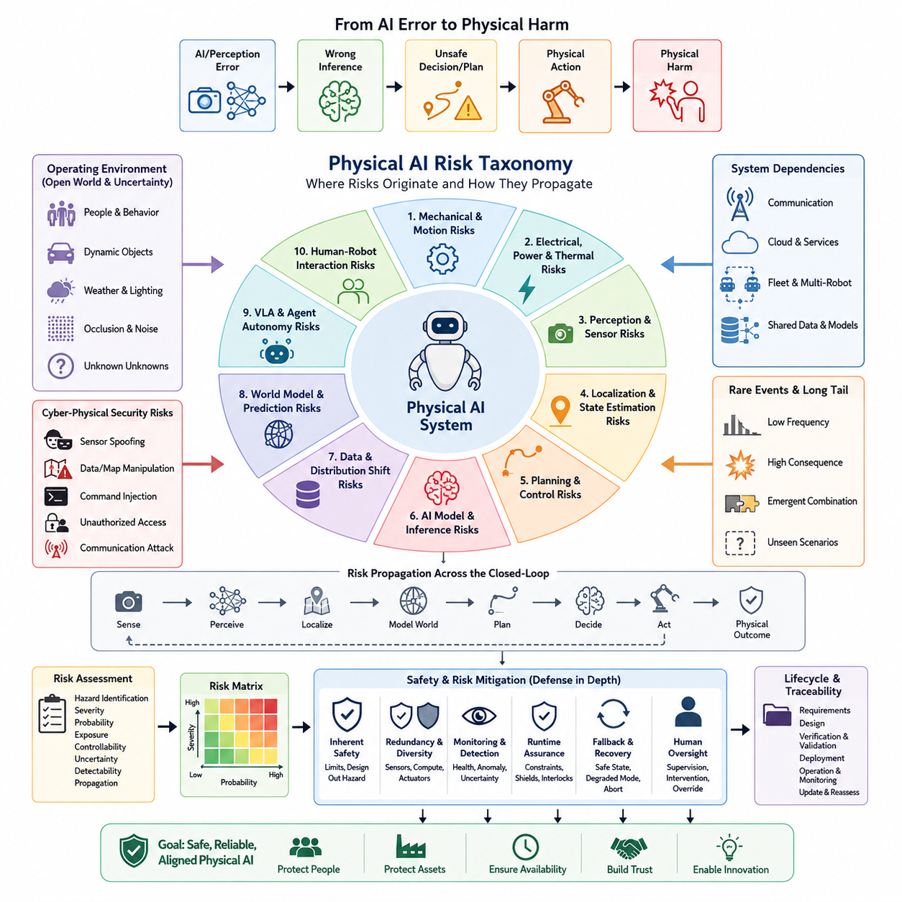{width="7.268055555555556in" height="7.268055555555556in"}

Physical AI operates in environments where computational decisions are translated into forces, motion, heat, electrical power, and interaction with people and objects. An error therefore cannot be treated merely as an incorrect prediction or failed software transaction. It may become a collision, unstable motion, dropped payload, damaged equipment, human injury, or cascading operational failure. A risk taxonomy provides the vocabulary needed to reason systematically about these consequences.

Unlike conventional software, Physical AI combines perception, localization, world modeling, planning, control, communication, computation, and mechanical actuation within one closed physical loop. Failures originating in different subsystems can produce similar harmful outcomes, while a single underlying fault may propagate through several layers before becoming observable. A structured taxonomy separates these sources and makes their relationships explicit rather than treating every unsafe event as a generic robot failure.

The need for classification becomes greater as robots move from structured industrial cells into open and partially structured environments. An autonomous mobile robot may encounter pedestrians, vehicles, temporary obstacles, weather, damaged surfaces, unexpected objects, sensor occlusion, communication loss, and situations absent from its training distribution. Risk is therefore created not only by component faults but also by uncertainty, environmental variability, interaction, and incomplete knowledge of the operating world.

Physical AI also introduces learned behavior into safety-relevant decision chains. Perception networks can miss hazards, localization systems can estimate an incorrect pose, learned policies can generalize poorly, and foundation or Vision-Language-Action models can interpret instructions in ways that are semantically plausible but physically unsafe. World models may predict an incorrect future state, while planning systems can convert that prediction into a trajectory whose consequences emerge only after physical execution begins.

A useful taxonomy therefore organizes risk according to where it originates and how it propagates. The structure of Physical AI safety includes mechanical and motion risks, electrical, power, and thermal risks, perception and sensor risks, localization and state-estimation risks, planning and control risks, AI model and inference risks, data and distribution-shift risks, world-model and prediction risks, VLA and autonomous-agent risks, and human-robot interaction risks.

These categories should not be interpreted as isolated boxes. A dirty camera lens may degrade perception, which increases uncertainty in object detection, which corrupts the world representation, which changes a predicted trajectory, which causes the planner to select an unsafe maneuver. The final event may appear to be a motion-control problem even though the causal chain began with sensing. Risk taxonomy therefore supports causal reasoning across the entire perception--prediction--decision--action loop.

Communication, cloud, and fleet operation create another class of dependencies. A robot may be locally healthy while receiving delayed maps, inconsistent fleet information, stale commands, or incorrect shared knowledge. At fleet scale, one erroneous update can influence many robots simultaneously. Physical AI safety must consequently consider both local hazards and distributed hazards arising from communication, shared models, collective learning, cloud services, and coordination between autonomous agents.

Cyber-physical security further expands the meaning of risk because malicious manipulation can produce the same physical consequences as accidental failure. Sensor spoofing, corrupted maps, compromised commands, unauthorized model updates, or manipulated communication channels can alter what a robot believes about its environment and therefore how it acts. Separating cyber-physical security risks while connecting them to physical consequences allows safety and security analysis to share a common system-level representation.

Rare events and long-tail situations deserve their own attention because average performance can conceal severe vulnerabilities. A system may perform reliably across millions of ordinary observations while failing during an unusual combination of lighting, geometry, human behavior, sensor degradation, and environmental conditions. Physical AI risk cannot therefore be characterized solely through mean accuracy or task success. The taxonomy must preserve low-frequency, high-consequence scenarios as explicit objects of analysis.

Human interaction adds additional uncertainty because people are neither static obstacles nor perfectly predictable agents. Humans may misunderstand robot intent, enter protected areas unexpectedly, issue ambiguous commands, change goals, or behave differently from patterns represented in training data. Conversely, a robot may technically satisfy its task objective while violating human expectations or social and physical constraints. Human-robot risk therefore connects conventional safety with intent understanding, oversight, transparency, and alignment.

A taxonomy also establishes the foundation for quantitative risk assessment. Hazard identification becomes more reliable when analysts systematically examine each risk family rather than relying on intuition or previous accident experience. Individual hazards can then be evaluated through factors such as severity, probability, exposure, controllability, uncertainty, detectability, and potential propagation. This progression prepares the analysis for formal hazard assessment, risk matrices, safety requirements, and engineering risk-reduction measures.

The taxonomy is equally important for architecture design because different risk classes require different defenses. Mechanical hazards may require physical limits and protective structures, perception failures may require redundant sensing and health monitoring, AI uncertainty may require confidence estimation and out-of-distribution detection, and planning failures may require runtime constraints or independent safety controllers. No single safety mechanism can adequately address every failure mode encountered by an adaptive embodied system.

This layered view connects directly to functional safety, AI safety, fail-safe design, and runtime assurance. The broader volume structure moves from risk taxonomy into hazard analysis, safety goals, redundancy, safety monitoring, fallback strategies, operational boundaries, runtime shielding, and certification evidence. The taxonomy therefore acts as an organizing bridge between identifying what can go wrong and engineering mechanisms that prevent, detect, contain, or recover from those failures.

Risk classification is also essential for verification and validation because different categories demand different evidence. Deterministic hardware faults can often be tested through predefined fault injection, while learned-model failures require datasets, scenario coverage, robustness testing, uncertainty evaluation, and out-of-distribution analysis. World-model and agentic failures may require long-horizon simulation and adversarial scenarios, whereas human-interaction risks demand behavioral testing involving realistic human responses.

The same framework supports traceability throughout the system lifecycle. A hazardous behavior can be linked backward to its initiating conditions, affected subsystem, safety requirement, mitigation mechanism, verification method, and operational evidence. When software, models, sensors, training datasets, or deployment environments change, engineers can determine which risk categories must be reassessed. This becomes especially important for Physical AI systems whose learned components may evolve after the original system architecture was established.

Ultimately, a Physical AI risk taxonomy is not simply a list of possible failures. It is a common reasoning framework connecting physical hazards, computational uncertainty, learned behavior, human interaction, distributed intelligence, security, and operational context. By organizing these heterogeneous risks into a coherent structure, engineers can move from reactive accident prevention toward systematic anticipation of how intelligent behavior can become physical harm and how that progression can be interrupted.

물리 AI(Physical AI)는 계산적 의사결정(Computational Decision)이 힘(Force), 운동(Motion), 열(Heat), 전력(Electrical Power), 그리고 사람 및 사물과의 상호작용(Interaction)으로 변환되는 환경에서 작동합니다. 따라서 오류(Error)는 단순히 잘못된 예측이나 실패한 소프트웨어 처리로만 간주할 수 없습니다. 오류는 충돌(Collision), 불안정한 움직임, 적재물 낙하, 장비 손상, 인명 피해 또는 연쇄적인 운영 장애로 이어질 수 있습니다. 위험 분류 체계(Risk Taxonomy)는 이러한 결과를 체계적으로 추론하기 위해 필요한 공통 언어와 구조를 제공합니다.

기존 소프트웨어(Conventional Software)와 달리 물리 AI(Physical AI)는 인지(Perception), 위치추정(Localization), 월드 모델링(World Modeling), 계획(Planning), 제어(Control), 통신(Communication), 컴퓨팅(Computation), 기계적 구동(Mechanical Actuation)을 하나의 폐쇄형 물리 루프(Closed Physical Loop) 안에서 결합합니다. 서로 다른 하위 시스템에서 발생한 고장이 유사한 위험 결과를 만들 수 있으며, 하나의 근본적인 결함이 여러 계층을 거쳐 전파된 후에야 관찰될 수도 있습니다. 체계적인 위험 분류는 이러한 원인들을 분리하고 상호관계를 명확하게 함으로써 모든 위험 사건을 단순한 로봇 고장으로 취급하는 것을 방지합니다.

로봇이 구조화된 산업용 작업 셀(Industrial Cell)에서 개방형 또는 부분적으로 구조화된 환경(Open or Partially Structured Environment)으로 이동할수록 이러한 분류의 필요성은 더욱 커집니다. 자율이동로봇(Autonomous Mobile Robot)은 보행자, 차량, 임시 장애물, 기상 변화, 손상된 노면, 예상하지 못한 물체, 센서 가림(Sensor Occlusion), 통신 손실, 학습 분포에 존재하지 않았던 상황 등을 만날 수 있습니다. 따라서 위험(Risk)은 단순한 부품 고장뿐만 아니라 불확실성(Uncertainty), 환경 변화, 상호작용, 그리고 운영 세계에 대한 불완전한 지식에서도 발생합니다.

물리 AI(Physical AI)는 안전과 관련된 의사결정 과정에 학습된 행동(Learned Behavior)을 도입한다는 점에서도 새로운 위험을 발생시킵니다. 인지 네트워크(Perception Network)는 위험 요소를 놓칠 수 있고, 위치추정 시스템(Localization System)은 잘못된 자세나 위치를 추정할 수 있으며, 학습 정책(Learned Policy)은 새로운 상황에서 제대로 일반화되지 않을 수 있습니다. 또한 파운데이션 모델(Foundation Model)이나 비전-언어-행동 모델(Vision-Language-Action Model)은 의미적으로는 타당하지만 물리적으로는 위험한 방식으로 명령을 해석할 수 있습니다. 월드 모델(World Model)의 잘못된 미래 상태 예측 역시 실제 실행 이후에야 결과가 나타나는 위험한 경로로 이어질 수 있습니다.

따라서 유용한 위험 분류 체계(Risk Taxonomy)는 위험이 어디에서 발생하고 어떻게 전파되는지를 기준으로 구성되어야 합니다. 물리 AI 안전(Physical AI Safety)의 위험 구조에는 기계 및 운동 위험(Mechanical and Motion Risks), 전기·전력·열 위험(Electrical, Power, and Thermal Risks), 인지 및 센서 위험(Perception and Sensor Risks), 위치추정 및 상태추정 위험(Localization and State Estimation Risks), 계획 및 제어 위험(Planning and Control Risks), AI 모델 및 추론 위험(AI Model and Inference Risks), 데이터 및 분포 이동 위험(Data and Distribution Shift Risks), 월드 모델 및 예측 위험(World Model and Prediction Risks), VLA 및 자율 에이전트 위험(VLA and Autonomous Agent Risks), 인간-로봇 상호작용 위험(Human-Robot Interaction Risks)을 포함합니다.

이러한 위험 범주는 서로 독립된 영역으로 이해해서는 안 됩니다. 예를 들어 오염된 카메라 렌즈는 인지 성능(Perception Performance)을 저하시키고, 이는 객체 탐지(Object Detection)의 불확실성을 증가시키며, 다시 월드 표현(World Representation)을 왜곡하고, 미래 경로 예측을 변경하여 최종적으로 계획기(Planner)가 위험한 기동을 선택하게 만들 수 있습니다. 최종 사건은 운동 제어 문제(Motion-Control Problem)처럼 보일 수 있지만 실제 인과관계(Causal Chain)는 센싱(Sensing)에서 시작된 것입니다. 따라서 위험 분류 체계는 인지--예측--의사결정--행동(Perception--Prediction--Decision--Action) 전체 루프에 걸친 인과적 추론(Causal Reasoning)을 지원해야 합니다.

통신(Communication), 클라우드(Cloud), 플릿 운영(Fleet Operation)은 또 다른 종류의 시스템 의존성을 만들어냅니다. 개별 로봇 자체는 정상적으로 작동하더라도 지연된 지도, 일관성이 없는 플릿 정보, 오래된 명령 또는 잘못된 공유 지식(Shared Knowledge)을 전달받을 수 있습니다. 플릿 규모(Fleet Scale)에서는 하나의 잘못된 업데이트가 동시에 여러 로봇에 영향을 줄 수도 있습니다. 따라서 물리 AI 안전은 개별 로봇의 국부적 위험(Local Hazard)뿐만 아니라 통신, 공유 모델, 집단 학습(Collective Learning), 클라우드 서비스 및 자율 에이전트 간 협력에서 발생하는 분산 위험(Distributed Risk)까지 고려해야 합니다.

사이버-물리 보안(Cyber-Physical Security)은 악의적인 조작이 우발적인 시스템 고장과 동일하거나 유사한 물리적 결과를 발생시킬 수 있기 때문에 위험의 의미를 더욱 확장합니다. 센서 스푸핑(Sensor Spoofing), 손상되거나 변조된 지도, 조작된 명령, 승인되지 않은 모델 업데이트 또는 변조된 통신 채널은 로봇이 환경을 인식하는 방식을 변경하고 결과적으로 행동까지 변화시킬 수 있습니다. 사이버-물리 보안 위험(Cyber-Physical Security Risk)을 별도로 분류하면서 동시에 물리적 결과와 연결하면 안전(Safety)과 보안(Security)을 공통된 시스템 수준의 관점에서 분석할 수 있습니다.

희귀 사건(Rare Event)과 롱테일 상황(Long-Tail Situation)은 평균적인 성능 지표가 심각한 취약성을 감출 수 있기 때문에 별도의 주의가 필요합니다. 시스템이 수백만 번의 일반적인 상황에서 안정적으로 동작하더라도 조명, 공간 구조, 인간 행동, 센서 성능 저하 및 환경 조건이 비정상적으로 결합된 상황에서는 실패할 수 있습니다. 따라서 물리 AI 위험은 평균 정확도(Mean Accuracy)나 작업 성공률(Task Success Rate)만으로 평가할 수 없습니다. 위험 분류 체계는 발생 가능성이 낮더라도 결과의 심각성이 높은 저빈도·고위험 시나리오(Low-Frequency, High-Consequence Scenario)를 명시적인 분석 대상으로 포함해야 합니다.

인간과의 상호작용(Human Interaction)은 사람이 정적인 장애물도 아니며 완벽하게 예측 가능한 에이전트도 아니기 때문에 추가적인 불확실성을 발생시킵니다. 사람은 로봇의 의도를 잘못 이해하거나, 예상하지 못한 순간에 보호 영역에 진입하거나, 모호한 명령을 내리거나, 목표를 변경하거나, 학습 데이터에 포함되지 않은 방식으로 행동할 수 있습니다. 반대로 로봇은 기술적으로 작업 목표를 달성하면서도 인간의 기대나 사회적·물리적 제약(Social and Physical Constraints)을 위반할 수 있습니다. 따라서 인간-로봇 위험(Human-Robot Risk)은 기존의 안전 개념과 의도 이해(Intent Understanding), 인간 감독(Human Oversight), 투명성(Transparency), 정렬(Alignment)을 연결합니다.

위험 분류 체계(Risk Taxonomy)는 정량적 위험 평가(Quantitative Risk Assessment)를 위한 기반도 제공합니다. 분석자가 과거 사고 경험이나 직관에만 의존하지 않고 각 위험군(Risk Family)을 체계적으로 검토할 때 위험원 식별(Hazard Identification)의 신뢰성을 높일 수 있습니다. 개별 위험은 심각도(Severity), 발생 가능성(Probability), 노출도(Exposure), 제어 가능성(Controllability), 불확실성(Uncertainty), 탐지 가능성(Detectability), 전파 가능성(Propagation Potential) 등의 요소를 통해 평가할 수 있습니다. 이러한 과정은 공식적인 위험원 분석(Hazard Analysis), 위험 매트릭스(Risk Matrix), 안전 요구사항(Safety Requirement), 공학적 위험 저감 조치(Risk-Reduction Measure)로 발전하기 위한 기반이 됩니다.

위험 분류 체계는 서로 다른 위험 유형이 서로 다른 방어 메커니즘(Defense Mechanism)을 요구하기 때문에 시스템 아키텍처(System Architecture) 설계에서도 중요합니다. 기계적 위험에는 물리적 제한과 보호 구조가 필요할 수 있고, 인지 실패에는 센서 중복성(Redundant Sensing)과 상태 모니터링(Health Monitoring)이 필요할 수 있습니다. AI 불확실성에는 신뢰도 추정(Confidence Estimation)과 분포 외 탐지(Out-of-Distribution Detection)가 필요하며, 계획 실패에는 런타임 제약(Runtime Constraint) 또는 독립 안전 제어기(Independent Safety Controller)가 필요할 수 있습니다. 하나의 안전 메커니즘만으로 적응형 체화 시스템(Adaptive Embodied System)의 모든 고장 유형을 충분히 처리할 수는 없습니다.

이러한 계층적 관점(Layered View)은 기능 안전(Functional Safety), AI 안전(AI Safety), 페일세이프 설계(Fail-Safe Design), 런타임 보증(Runtime Assurance)과 직접 연결됩니다. 전체적인 안전 구조는 위험 분류 체계에서 시작하여 위험원 분석(Hazard Analysis), 안전 목표(Safety Goal), 중복성(Redundancy), 안전 모니터링(Safety Monitoring), 폴백 전략(Fallback Strategy), 운영 경계(Operational Boundary), 런타임 실딩(Runtime Shielding), 인증 증거(Certification Evidence)로 확장됩니다. 따라서 위험 분류 체계는 무엇이 잘못될 수 있는지를 식별하는 단계와 그러한 실패를 예방·탐지·격리·복구하는 공학적 메커니즘을 연결하는 조직적 기반이 됩니다.

위험 분류(Risk Classification)는 검증 및 유효성 확인(Verification and Validation)에서도 필수적입니다. 결정론적 하드웨어 고장(Deterministic Hardware Fault)은 사전에 정의된 결함 주입(Fault Injection)을 통해 시험할 수 있지만, 학습 모델(Learned Model)의 실패는 데이터셋, 시나리오 커버리지(Scenario Coverage), 강건성 시험(Robustness Testing), 불확실성 평가(Uncertainty Evaluation), 분포 외 분석(OOD Analysis)을 요구합니다. 월드 모델과 에이전트형 시스템(Agentic System)의 실패에는 장기 시계열 시뮬레이션(Long-Horizon Simulation)과 적대적 시나리오(Adversarial Scenario)가 필요할 수 있으며, 인간 상호작용 위험에는 현실적인 인간 행동을 포함하는 행동 기반 시험(Behavioral Testing)이 요구됩니다.

동일한 프레임워크(Framework)는 시스템 전체 생명주기(System Lifecycle)에 걸친 추적성(Traceability)도 지원합니다. 위험한 행동은 그 행동을 유발한 조건, 영향을 받은 하위 시스템, 안전 요구사항, 위험 완화 메커니즘(Mitigation Mechanism), 검증 방법, 운영 증거(Operational Evidence)와 역방향으로 연결될 수 있습니다. 소프트웨어, AI 모델, 센서, 학습 데이터셋 또는 배포 환경이 변경될 경우 어떤 위험 범주를 다시 평가해야 하는지를 결정할 수 있습니다. 이는 최초의 시스템 아키텍처가 확립된 이후에도 학습 구성요소가 지속적으로 변화할 수 있는 물리 AI 시스템에서 특히 중요합니다.

궁극적으로 물리 AI 위험 분류 체계(Physical AI Risk Taxonomy)는 단순히 발생 가능한 고장의 목록이 아닙니다. 이는 물리적 위험(Physical Hazard), 계산적 불확실성(Computational Uncertainty), 학습된 행동(Learned Behavior), 인간 상호작용(Human Interaction), 분산 지능(Distributed Intelligence), 보안(Security), 운영 맥락(Operational Context)을 하나로 연결하는 공통 추론 프레임워크(Common Reasoning Framework)입니다. 이러한 이질적인 위험을 일관된 구조로 조직함으로써 엔지니어는 사고 발생 이후 대응하는 방식에서 벗어나 지능적 행동이 어떻게 물리적 피해(Physical Harm)로 전환될 수 있는지를 사전에 예측하고, 그 진행 과정의 어느 지점에서 위험을 차단할 수 있는지를 체계적으로 설계할 수 있습니다.

##  

## 01.02. Hazard Risk Harm and Exposure

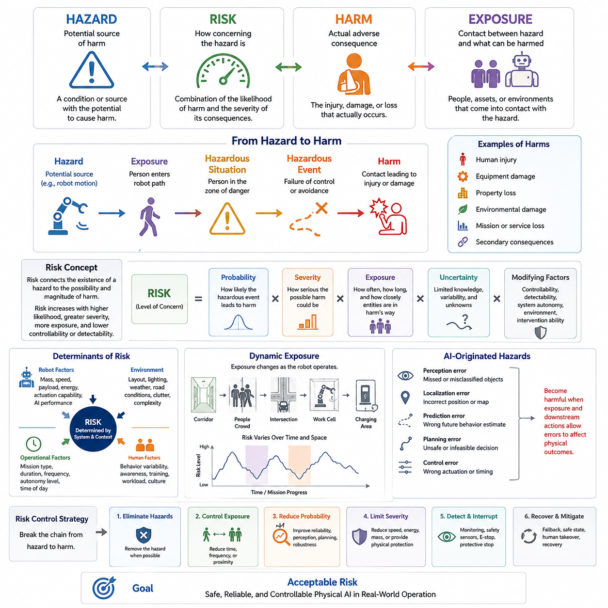{width="7.268055555555556in" height="7.268055555555556in"}

Hazard, risk, harm, and exposure are related concepts, but they describe different parts of the safety problem. A hazard is a condition or source with the potential to cause harm, while harm is the actual injury, damage, or loss that occurs. Risk expresses how concerning the hazardous situation is by considering the likelihood and severity of possible harm, while exposure describes how people, assets, or environments come into contact with that hazard.

For Physical AI, this distinction is especially important because hazards may exist continuously without immediately producing harmful outcomes. A mobile robot in motion contains kinetic energy and therefore represents a potential mechanical hazard, but the level of risk depends strongly on whether people are nearby, how fast the robot moves, how heavy it is, and whether collision avoidance or protective stopping mechanisms can prevent contact.

A hazard should therefore not be confused with an accident or failure. Rotating joints, high-voltage batteries, hot components, moving platforms, sharp structures, autonomous motion, and stored mechanical energy may all constitute hazards even when the system operates exactly as designed. Safety engineering begins by identifying these potentially harmful sources before determining the circumstances under which they could become hazardous situations and ultimately cause physical harm.

Harm represents the realized adverse consequence of a hazardous event. In Physical AI systems, harm can include human injury, equipment damage, destruction of property, environmental damage, mission loss, interruption of critical services, or secondary consequences caused by an initial physical event. Because autonomous machines interact with real environments, even a seemingly small computational error can propagate until it produces consequences far beyond the original subsystem.

Risk connects the existence of a hazard to the possibility and magnitude of harm. A common conceptual representation considers risk as a function of the probability of harmful occurrence and the severity of its consequences. Physical AI requires a broader interpretation because uncertainty, exposure duration, controllability, detectability, system autonomy, environmental complexity, and the ability of humans or safety mechanisms to intervene can substantially modify the practical significance of a hazardous condition.

Severity describes how serious the resulting harm could become. A low-speed contact with a lightweight service robot may produce minor consequences, while an equivalent control error in a heavy autonomous vehicle or industrial manipulator may cause severe injury or major property damage. The same AI failure mode can therefore correspond to very different risk levels depending on embodiment, mass, velocity, payload, actuator capability, environment, and proximity to vulnerable people.

Probability describes how likely a hazardous sequence is to reach a harmful outcome. This probability is rarely determined by a single component failure in Physical AI. It may depend on combinations of sensor error, environmental conditions, model uncertainty, incorrect state estimation, planning decisions, actuator response, human behavior, and failure of protective mechanisms. Consequently, risk assessment must consider chains of events rather than evaluating isolated AI accuracy metrics.

Exposure provides the connection between a hazard and the entities that can be harmed. A powerful industrial robot operating inside an inaccessible protective enclosure may possess significant inherent hazards but relatively controlled human exposure. The same machine operating collaboratively beside workers creates a different risk profile because people may repeatedly enter its reachable space. Frequency, duration, proximity, occupancy, and interaction patterns therefore become fundamental safety variables.

Exposure is dynamic in autonomous Physical AI. A robot may move between empty corridors, crowded public spaces, loading zones, road intersections, elevators, work cells, and charging areas during a single mission. The population at risk and the environmental conditions can change continuously. Risk must therefore be understood not only as a static property of the machine but also as a function of its operational context and evolving relationship with surrounding agents.

A useful causal structure can be expressed as hazard, exposure, hazardous situation, hazardous event, and harm. For example, robot motion provides kinetic energy as a hazard. A pedestrian entering the robot\'s trajectory creates exposure and a hazardous situation. Failure to detect the pedestrian may allow the situation to progress into an imminent collision, while insufficient braking or avoidance can convert that event into contact and ultimately physical injury.

The same reasoning applies to AI-originated hazards. A perception model may incorrectly classify an obstacle, a localization system may place the robot in the wrong position, or a world model may underestimate another agent\'s future motion. These errors do not automatically constitute harm. They become safety-critical when operational exposure and downstream decisions allow incorrect internal information to influence planning, control, and physical action without effective detection or mitigation.

Risk can also change without any change to the underlying AI model. Increasing robot speed raises potential collision severity and reduces available reaction time. Moving deployment from a controlled warehouse to a public environment increases exposure and behavioral uncertainty. Increasing payload mass changes kinetic consequences, while extending autonomous operation reduces opportunities for human intervention. Safety assessment must therefore consider the complete operating configuration rather than model performance alone.

Controllability further influences whether exposure develops into harm. Humans may be able to recognize and avoid a slowly approaching robot, while sudden high-speed motion may provide little opportunity for escape. Similarly, an independent safety sensor, emergency stop, protective braking system, runtime monitor, or safety controller can interrupt the causal chain. Risk reduction therefore often focuses on preventing hazardous exposure or breaking the progression from hazardous situation to harmful outcome.

Uncertainty is particularly important for learned Physical AI because probabilities derived from historical data may not accurately represent open-world operation. Rare environmental combinations, distribution shifts, novel objects, unusual human behavior, sensor degradation, and interactions between multiple failures can create conditions with limited statistical evidence. Risk assessment must consequently combine empirical probability with uncertainty awareness, conservative assumptions, scenario analysis, and explicit treatment of long-tail events.

Understanding hazard, risk, harm, and exposure creates the conceptual foundation for the remainder of a Physical AI risk taxonomy. Mechanical, electrical, perception, localization, planning, AI-model, data, world-model, autonomous-agent, human-interaction, communication, and cyber-physical risks can all be analyzed using the same causal language. This enables heterogeneous failures to be compared within a coherent framework while preserving the distinct mechanisms through which they create danger.

The practical objective is not to eliminate every hazard, which is often impossible for machines designed to move, manipulate, transport, or interact with the physical world. Instead, safety engineering seeks to identify hazards, control exposure, reduce the probability of hazardous events, limit the severity of consequences, detect abnormal conditions, and interrupt dangerous propagation paths. This transforms risk taxonomy from terminology into a systematic basis for designing safe, reliable, and controllable Physical AI.

위험원(Hazard), 위험(Risk), 피해(Harm), 노출(Exposure)은 서로 관련된 개념이지만, 안전 문제의 서로 다른 부분을 설명합니다. 위험원(Hazard)은 피해를 일으킬 잠재력을 가진 조건이나 원천을 의미하며, 피해(Harm)는 실제로 발생한 부상, 손상 또는 손실을 의미합니다. 위험(Risk)은 발생 가능한 피해의 가능성과 심각성을 고려하여 위험한 상황이 얼마나 우려되는지를 나타내며, 노출(Exposure)은 사람, 자산 또는 환경이 해당 위험원과 어떻게 접촉하거나 영향을 받게 되는지를 설명합니다.

물리 AI(Physical AI)에서는 이러한 구분이 특히 중요합니다. 위험원(Hazard)은 피해를 즉시 발생시키지 않으면서도 지속적으로 존재할 수 있기 때문입니다. 움직이는 자율이동로봇(Autonomous Mobile Robot)은 운동에너지(Kinetic Energy)를 가지고 있으므로 잠재적인 기계적 위험원(Mechanical Hazard)이 됩니다. 그러나 실제 위험 수준은 주변에 사람이 있는지, 로봇이 얼마나 빠르게 움직이는지, 질량이 얼마나 큰지, 그리고 충돌 회피(Collision Avoidance)나 보호 정지(Protective Stop) 메커니즘이 접촉을 방지할 수 있는지에 따라 크게 달라집니다.

따라서 위험원(Hazard)을 사고(Accident)나 고장(Failure)과 혼동해서는 안 됩니다. 회전 관절, 고전압 배터리, 고온 부품, 이동 플랫폼, 날카로운 구조물, 자율 운동(Autonomous Motion), 저장된 기계적 에너지(Stored Mechanical Energy)는 시스템이 설계된 대로 정상 작동하는 경우에도 모두 위험원이 될 수 있습니다. 안전 공학(Safety Engineering)은 이러한 잠재적인 피해 원천을 먼저 식별한 후, 어떤 조건에서 위험 상황(Hazardous Situation)이 형성되고 궁극적으로 물리적 피해로 발전할 수 있는지를 분석하는 것에서 시작합니다.

피해(Harm)는 위험 사건(Hazardous Event)의 결과로 실제 발생한 부정적인 결과를 의미합니다. 물리 AI 시스템에서 피해는 인명 부상, 장비 손상, 재산 파손, 환경 피해, 임무 실패(Mission Loss), 핵심 서비스 중단 또는 최초의 물리적 사건으로 인해 발생하는 2차적인 결과까지 포함할 수 있습니다. 자율 기계가 실제 환경과 상호작용하기 때문에 처음에는 사소해 보이는 계산 오류(Computational Error)조차 여러 단계를 거쳐 전파되면서 최초의 하위 시스템을 넘어서는 심각한 결과를 발생시킬 수 있습니다.

위험(Risk)은 위험원의 존재를 피해 발생의 가능성과 규모에 연결합니다. 일반적인 개념에서는 위험을 피해 발생 가능성(Probability)과 결과의 심각도(Severity)의 함수로 표현할 수 있습니다. 그러나 물리 AI에서는 불확실성(Uncertainty), 노출 시간, 제어 가능성(Controllability), 탐지 가능성(Detectability), 시스템 자율성(System Autonomy), 환경 복잡성, 그리고 사람이나 안전 메커니즘이 개입할 수 있는 능력이 위험 상황의 실질적인 중요성을 크게 변화시킬 수 있으므로 보다 확장된 해석이 필요합니다.

심각도(Severity)는 발생한 피해가 얼마나 심각해질 수 있는지를 나타냅니다. 가벼운 서비스 로봇(Service Robot)과의 저속 접촉은 비교적 경미한 결과를 발생시킬 수 있지만, 동일한 제어 오류가 무거운 자율주행 차량이나 산업용 매니퓰레이터(Industrial Manipulator)에서 발생하면 심각한 부상이나 대규모 재산 피해로 이어질 수 있습니다. 따라서 동일한 AI 고장 모드(AI Failure Mode)라도 로봇의 체화 형태(Embodiment), 질량, 속도, 적재물, 액추에이터 성능, 환경 및 취약한 사람과의 근접성에 따라 전혀 다른 위험 수준을 가질 수 있습니다.

발생 가능성(Probability)은 위험한 사건의 연쇄가 실제 피해 결과에 도달할 가능성을 나타냅니다. 물리 AI에서 이러한 가능성은 하나의 부품 고장만으로 결정되는 경우가 드뭅니다. 센서 오류, 환경 조건, 모델 불확실성(Model Uncertainty), 잘못된 상태 추정(State Estimation), 계획 결정, 액추에이터 응답, 인간 행동, 보호 메커니즘의 실패 등이 복합적으로 작용할 수 있습니다. 따라서 위험 평가는 개별적인 AI 정확도 지표만 평가하는 것이 아니라 서로 연결된 사건의 연쇄(Event Chain)를 고려해야 합니다.

노출(Exposure)은 위험원(Hazard)과 피해를 입을 수 있는 대상 사이를 연결합니다. 강력한 산업용 로봇이 사람이 접근할 수 없는 보호 울타리 내부에서 작동한다면 상당한 내재적 위험원(Inherent Hazard)을 가지고 있더라도 사람의 노출은 비교적 통제될 수 있습니다. 동일한 로봇이 작업자 옆에서 협업 형태로 작동한다면 사람이 로봇의 작업 가능 영역에 반복적으로 진입할 수 있으므로 위험 특성이 달라집니다. 따라서 노출 빈도, 지속시간, 거리, 점유 상태(Occupancy), 상호작용 패턴은 핵심적인 안전 변수가 됩니다.

자율형 물리 AI(Autonomous Physical AI)에서 노출(Exposure)은 동적으로 변화합니다. 하나의 임무를 수행하는 동안 로봇은 사람이 없는 복도, 혼잡한 공공 공간, 상하차 구역, 도로 교차로, 엘리베이터, 작업 셀 및 충전 구역 사이를 이동할 수 있습니다. 위험에 노출되는 사람이나 대상과 환경 조건 역시 지속적으로 변화합니다. 따라서 위험은 기계 자체가 가진 정적인 속성뿐만 아니라 운영 맥락(Operational Context)과 주변 에이전트와의 지속적으로 변화하는 관계에 따른 함수로 이해해야 합니다.

유용한 인과 구조(Causal Structure)는 위험원(Hazard), 노출(Exposure), 위험 상황(Hazardous Situation), 위험 사건(Hazardous Event), 피해(Harm)의 흐름으로 표현할 수 있습니다. 예를 들어 로봇의 움직임은 운동에너지라는 위험원을 제공합니다. 보행자가 로봇의 이동 경로에 들어오면 노출과 위험 상황이 형성됩니다. 보행자 탐지 실패가 발생하면 상황은 임박한 충돌로 발전할 수 있으며, 제동이나 회피가 충분하지 않으면 해당 사건은 실제 접촉과 궁극적인 신체적 부상으로 전환될 수 있습니다.

동일한 추론 방식은 AI에서 기원하는 위험(AI-Originated Risk)에도 적용됩니다. 인지 모델(Perception Model)이 장애물을 잘못 분류하거나, 위치추정 시스템(Localization System)이 로봇을 잘못된 위치에 배치하거나, 월드 모델(World Model)이 다른 에이전트의 미래 움직임을 과소평가할 수 있습니다. 이러한 오류 자체가 자동으로 피해를 의미하지는 않습니다. 잘못된 내부 정보가 효과적인 탐지나 완화 없이 계획, 제어 및 물리적 행동에 영향을 미치도록 운영상의 노출과 후속 의사결정이 연결될 때 안전에 치명적인 문제가 됩니다.

기본적인 AI 모델에 아무런 변화가 없어도 위험(Risk)은 달라질 수 있습니다. 로봇의 속도를 증가시키면 잠재적인 충돌 심각도가 높아지고 대응 가능한 시간은 줄어듭니다. 통제된 창고에서 공공 환경으로 배포 영역을 변경하면 노출과 행동 불확실성이 증가합니다. 적재물의 질량을 증가시키면 운동학적 결과가 달라지며, 자율 운용 시간을 연장하면 사람이 개입할 기회가 감소합니다. 따라서 안전 평가는 모델 성능만이 아니라 전체 운영 구성(Operating Configuration)을 함께 고려해야 합니다.

제어 가능성(Controllability)은 노출이 실제 피해로 발전할 가능성에 추가적인 영향을 미칩니다. 사람은 천천히 접근하는 로봇을 인식하고 피할 수 있지만 갑작스러운 고속 움직임에서는 회피할 시간이 거의 없을 수 있습니다. 마찬가지로 독립 안전 센서(Independent Safety Sensor), 비상 정지(Emergency Stop), 보호 제동 시스템(Protective Braking System), 런타임 모니터(Runtime Monitor), 안전 제어기(Safety Controller)는 위험의 인과 연쇄를 중단할 수 있습니다. 따라서 위험 저감(Risk Reduction)은 위험한 노출을 방지하거나 위험 상황에서 피해 결과로 진행되는 과정을 차단하는 데 초점을 맞추는 경우가 많습니다.

불확실성(Uncertainty)은 학습 기반 물리 AI(Learned Physical AI)에서 특히 중요합니다. 과거 데이터에서 도출된 확률이 개방형 환경(Open-World Environment)의 실제 운영 상황을 정확하게 나타내지 못할 수 있기 때문입니다. 드문 환경 조건의 조합, 분포 이동(Distribution Shift), 새로운 물체, 비정상적인 인간 행동, 센서 성능 저하, 다중 고장 간 상호작용은 통계적 근거가 제한된 상황을 만들어낼 수 있습니다. 따라서 위험 평가는 경험적 확률뿐만 아니라 불확실성 인식(Uncertainty Awareness), 보수적 가정, 시나리오 분석(Scenario Analysis), 롱테일 사건(Long-Tail Event)에 대한 명시적인 고려를 결합해야 합니다.

위험원(Hazard), 위험(Risk), 피해(Harm), 노출(Exposure)에 대한 이해는 물리 AI 위험 분류 체계(Physical AI Risk Taxonomy)의 나머지 영역을 분석하기 위한 개념적 기반을 제공합니다. 기계, 전기, 인지, 위치추정, 계획, AI 모델, 데이터, 월드 모델, 자율 에이전트, 인간 상호작용, 통신 및 사이버-물리 위험(Cyber-Physical Risk)을 모두 동일한 인과적 언어를 사용하여 분석할 수 있습니다. 이를 통해 서로 다른 유형의 고장을 하나의 일관된 프레임워크 안에서 비교하면서도 각각이 위험을 만들어내는 고유한 메커니즘을 유지할 수 있습니다.

실질적인 목표는 모든 위험원(Hazard)을 제거하는 것이 아닙니다. 물리적 세계에서 이동하고, 조작하고, 운반하며, 상호작용하도록 설계된 기계에서는 모든 위험원을 제거하는 것이 현실적으로 불가능한 경우가 많습니다. 대신 안전 공학(Safety Engineering)은 위험원을 식별하고, 노출을 통제하며, 위험 사건의 발생 가능성을 낮추고, 결과의 심각도를 제한하며, 비정상 상태를 탐지하고, 위험한 전파 경로를 차단하는 것을 목표로 합니다. 이를 통해 위험 분류 체계(Risk Taxonomy)는 단순한 용어 정의를 넘어 안전하고 신뢰할 수 있으며 제어 가능한 물리 AI(Physical AI)를 설계하기 위한 체계적인 기반으로 발전합니다.

##  

## 01.03. Mechanical and Motion Risks

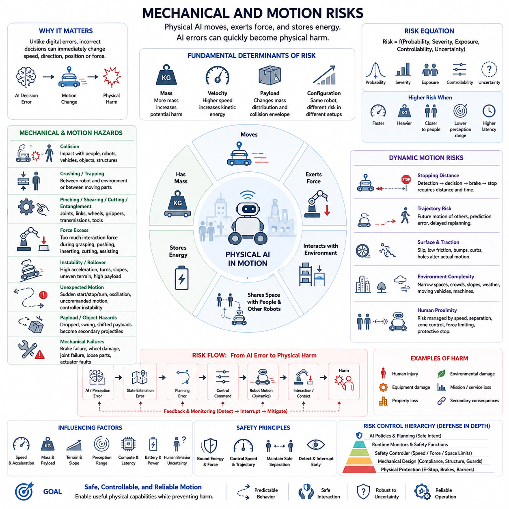{width="7.268055555555556in" height="7.268055555555556in"}

Mechanical and motion risks arise because Physical AI systems possess bodies that generate forces, carry mass, store energy, and move through environments shared with people, equipment, infrastructure, and other robots. Unlike purely digital AI failures, an incorrect decision can immediately change velocity, direction, joint position, or applied force. Safety analysis must therefore connect intelligent behavior directly to the physical dynamics of the embodied system.

Robot mass and velocity are fundamental determinants of mechanical risk because together they influence momentum and kinetic energy. A lightweight robot moving slowly may permit relatively safe interaction, while a heavy autonomous platform moving at higher speed can produce substantial collision forces and require much longer stopping distances. Payload mass further changes these dynamics, meaning that the same robot may have significantly different risk characteristics across different operational configurations.

Collision is one of the most visible motion hazards, but it represents only one category of mechanical interaction. A mobile robot can strike a pedestrian, another robot, a vehicle, shelving, machinery, walls, or infrastructure. A manipulator can collide with a worker or surrounding equipment, while a humanoid or quadruped may create complex whole-body impacts. Collision severity depends on relative velocity, effective mass, contact geometry, compliance, and the vulnerability of the impacted object or person.

Crushing and trapping hazards occur when a person or object becomes constrained between moving robot structures and another surface. Examples include a mobile robot approaching a wall, a manipulator closing toward a fixture, or articulated joints creating narrowing spaces during motion. Even relatively slow movement can become dangerous when escape is restricted because sustained force may continue after contact unless the system detects the condition and stops or releases the applied load.

Pinching, shearing, cutting, and entanglement hazards are particularly relevant to articulated and mechanically complex robots. Joints, linkages, wheels, tracks, grippers, transmissions, lifting mechanisms, and end effectors can create hazardous zones whose geometry changes continuously during operation. Clothing, cables, fingers, tools, or surrounding materials may become caught in these mechanisms, making mechanical design and accessible-space analysis important complements to AI-based safety functions.

Manipulator systems introduce force-related risks that cannot be characterized only by end-effector velocity. Joint torque, reflected inertia, payload dynamics, tool geometry, stiffness, and contact forces determine how physical interaction develops. A robot may follow the intended trajectory yet still apply excessive force when grasping, pushing, inserting, cutting, drilling, or physically assisting a human. Safe behavior therefore requires limits on both motion and interaction forces.

Mobile platforms create additional risks through acceleration, deceleration, turning, and loss of stability. Sudden braking can shift payloads, rapid steering can destabilize tall or heavily loaded robots, and operation on slopes or uneven terrain can increase rollover risk. Wheel slip, insufficient traction, unexpected surface transitions, curbs, holes, or obstacles may alter the relationship between commanded motion and actual motion, creating hazardous trajectories even when the controller itself remains operational.

Stopping distance is a central safety variable because detecting a hazard does not instantaneously stop physical motion. Total stopping behavior includes sensing latency, perception and decision latency, communication delay, controller response, brake or actuator response, and the physical distance required to dissipate kinetic energy. As speed increases, the available safety margin can decrease rapidly, making safe-speed design inseparable from perception range, compute latency, braking capability, and environmental conditions.

Autonomous motion also creates trajectory-related hazards. A planned path may be geometrically collision-free at the moment of calculation yet become unsafe as pedestrians, vehicles, doors, machinery, or other robots move. Prediction error and delayed replanning can transform a previously valid trajectory into a hazardous one. Mechanical safety must therefore consider not only current separation but also future relative motion, uncertainty, reachable regions, and the ability to execute avoidance maneuvers safely.

Unexpected motion is especially dangerous because humans form expectations about how machines will behave. Uncommanded acceleration, abrupt direction changes, oscillation, unintended joint movement, controller instability, actuator saturation, or recovery behavior after a fault may surprise nearby people and reduce their ability to avoid contact. A technically recoverable control disturbance can therefore become a serious human safety problem when the resulting motion is difficult to anticipate.

Payloads and manipulated objects extend the mechanical boundary of the Physical AI system. A robot carrying a box, tool, medical device, industrial component, or other object changes its mass distribution, dimensions, inertia, and collision envelope. Poor grasping, excessive acceleration, unexpected contact, or unstable transport may cause the payload to shift, fall, swing, or become a secondary projectile. Safety analysis must consequently include the object being transported or manipulated as part of the active physical system.

Structural and actuator failures can also create motion hazards independently of AI decision quality. Brake failure, wheel damage, joint failure, transmission defects, loose mechanical components, degraded bearings, broken structural members, or actuator faults can produce uncontrolled or constrained motion. Because AI may continue issuing apparently valid commands during such degradation, monitoring mechanical health and comparing commanded behavior with observed physical response are important elements of system-level safety.

Mechanical risk changes substantially with the operating environment. Narrow corridors increase opportunities for trapping, crowded spaces increase human exposure, slopes increase stability demands, and wet or loose surfaces reduce predictable traction. Outdoor environments add terrain irregularity, weather, debris, and moving vehicles, while industrial environments may contain conveyors, forklifts, machines, and restricted spaces. A motion that is acceptable in one environment may therefore be unacceptable in another.

Human proximity makes speed and separation management particularly important. Rather than treating motion as simply permitted or prohibited, a Physical AI system can adapt its behavior according to distance, relative motion, uncertainty, and human vulnerability. Reduced speed, controlled acceleration, protective separation, force limitation, safety-rated sensing, and protective stopping can progressively reduce risk as interaction becomes closer. Independent emergency stopping remains necessary for conditions requiring immediate intervention.

Mechanical safety cannot rely exclusively on the learned policy or primary autonomous controller. Perception, planning, world models, and VLA-based reasoning may improve intelligent behavior, but safety-critical motion constraints should remain enforceable when these components produce incorrect outputs. Independent speed limits, workspace constraints, collision monitors, torque limits, safety controllers, physical brakes, protective structures, and runtime safety mechanisms provide defense in depth between an AI error and harmful physical action.

The objective is not to remove motion from Physical AI, because useful embodied intelligence fundamentally depends on the ability to move and exert controlled physical influence. Instead, mechanical and motion safety seeks to bound energy, force, speed, trajectory, contact, and accessible hazardous regions so that failures do not easily propagate into harm. This establishes the physical safety foundation upon which perception, localization, planning, AI-model, world-model, and autonomous-agent safety mechanisms must operate.

기계 및 운동 위험(Mechanical and Motion Risks)은 물리 AI(Physical AI) 시스템이 힘을 생성하고, 질량을 가지며, 에너지를 저장하고, 사람·장비·인프라·다른 로봇과 공유하는 환경에서 움직이는 물리적 신체를 가지고 있기 때문에 발생합니다. 순수한 디지털 AI(Digital AI)의 오류와 달리 잘못된 의사결정은 즉시 속도, 방향, 관절 위치 또는 작용하는 힘을 변화시킬 수 있습니다. 따라서 안전 분석(Safety Analysis)은 지능적 행동을 체화된 시스템(Embodied System)의 물리적 동역학(Physical Dynamics)과 직접 연결해야 합니다.

로봇의 질량(Mass)과 속도(Velocity)는 운동량(Momentum)과 운동에너지(Kinetic Energy)에 영향을 미치므로 기계적 위험을 결정하는 기본적인 요소입니다. 가벼운 로봇이 저속으로 움직이는 경우 비교적 안전한 상호작용이 가능할 수 있지만, 무거운 자율 플랫폼이 높은 속도로 움직이면 상당한 충돌력을 발생시키고 훨씬 긴 정지거리를 요구할 수 있습니다. 적재물 질량(Payload Mass) 역시 이러한 동역학을 변화시키므로 동일한 로봇이라도 운영 구성에 따라 위험 특성이 크게 달라질 수 있습니다.

충돌(Collision)은 가장 쉽게 관찰할 수 있는 운동 위험(Motion Hazard) 중 하나이지만, 기계적 상호작용 위험의 한 범주일 뿐입니다. 이동 로봇(Mobile Robot)은 보행자, 다른 로봇, 차량, 선반, 기계, 벽 또는 인프라와 충돌할 수 있습니다. 매니퓰레이터(Manipulator)는 작업자나 주변 장비와 충돌할 수 있으며, 휴머노이드(Humanoid)나 사족보행 로봇(Quadruped)은 복잡한 전신 충돌을 발생시킬 수 있습니다. 충돌의 심각도는 상대속도, 유효질량(Effective Mass), 접촉 형상(Contact Geometry), 순응성(Compliance), 충돌 대상의 취약성 등에 따라 달라집니다.

압착 및 끼임 위험(Crushing and Trapping Hazards)은 사람이나 물체가 움직이는 로봇 구조물과 다른 표면 사이에 갇힐 때 발생합니다. 이동 로봇이 벽을 향해 접근하거나, 매니퓰레이터가 고정 구조물을 향해 닫히거나, 관절 구조가 움직이면서 공간을 좁히는 상황이 대표적인 예입니다. 탈출이 제한된 경우에는 비교적 느린 움직임도 위험할 수 있습니다. 시스템이 이를 탐지하여 정지하거나 가해지는 하중을 해제하지 않는다면 접촉 이후에도 지속적인 힘이 작용할 수 있기 때문입니다.

협착(Pinching), 전단(Shearing), 절단(Cutting), 얽힘(Entanglement) 위험은 관절 구조와 복잡한 기계장치를 가진 로봇에서 특히 중요합니다. 관절, 링크 구조(Linkage), 바퀴, 트랙, 그리퍼(Gripper), 변속 장치, 승강 메커니즘 및 말단 장치(End Effector)는 작동 과정에서 형상이 지속적으로 변화하는 위험 영역을 만들 수 있습니다. 의복, 케이블, 손가락, 도구 또는 주변 물질이 이러한 메커니즘에 끼일 수 있으므로 기계 설계(Mechanical Design)와 접근 가능 공간 분석(Accessible-Space Analysis)은 AI 기반 안전 기능과 함께 고려되어야 합니다.

매니퓰레이터 시스템(Manipulator System)은 말단 장치의 속도만으로 평가할 수 없는 힘 관련 위험을 발생시킵니다. 관절 토크(Joint Torque), 반사 관성(Reflected Inertia), 적재물 동역학(Payload Dynamics), 도구 형상, 강성(Stiffness), 접촉력(Contact Force)이 물리적 상호작용의 특성을 결정합니다. 로봇이 의도된 궤적을 정확하게 따라가더라도 물체를 잡거나, 밀거나, 삽입하거나, 절단하거나, 천공하거나, 사람을 물리적으로 보조하는 과정에서 과도한 힘을 가할 수 있습니다. 따라서 안전한 행동에는 운동뿐만 아니라 상호작용 힘에 대한 제한도 필요합니다.

이동 플랫폼(Mobile Platform)은 가속, 감속, 회전 및 안정성 상실로 인한 추가적인 위험을 발생시킵니다. 급제동은 적재물을 이동시킬 수 있고, 급격한 조향은 높거나 무거운 하중을 가진 로봇을 불안정하게 만들 수 있으며, 경사면이나 불규칙한 지형에서의 운행은 전복 위험(Rollover Risk)을 증가시킬 수 있습니다. 바퀴 미끄러짐(Wheel Slip), 부족한 접지력, 예상하지 못한 노면 변화, 연석, 구멍 또는 장애물은 명령된 운동과 실제 운동 사이의 관계를 변화시켜 제어기(Controller)가 정상적으로 작동하는 상황에서도 위험한 궤적을 만들 수 있습니다.

정지거리(Stopping Distance)는 위험을 탐지했다고 해서 물리적 움직임이 즉시 멈추는 것은 아니기 때문에 핵심적인 안전 변수입니다. 전체 정지 과정에는 센싱 지연(Sensing Latency), 인지 및 의사결정 지연, 통신 지연, 제어기 응답, 브레이크 또는 액추에이터 응답, 그리고 운동에너지를 소산시키기 위해 실제로 필요한 물리적 거리가 포함됩니다. 속도가 증가할수록 안전 여유(Safety Margin)는 빠르게 감소할 수 있으므로 안전 속도 설계(Safe-Speed Design)는 인지 거리, 컴퓨팅 지연, 제동 성능 및 환경 조건과 분리해서 생각할 수 없습니다.

자율 운동(Autonomous Motion)은 궤적 관련 위험(Trajectory-Related Hazard)도 발생시킵니다. 계획된 경로가 계산 시점에는 기하학적으로 충돌이 없더라도 보행자, 차량, 문, 기계 또는 다른 로봇이 이동하면서 위험해질 수 있습니다. 예측 오류(Prediction Error)와 지연된 재계획(Delayed Replanning)은 이전에는 유효했던 궤적을 위험한 궤적으로 변화시킬 수 있습니다. 따라서 기계적 안전은 현재의 분리 거리뿐만 아니라 미래 상대운동, 불확실성, 도달 가능 영역(Reachable Region), 안전한 회피 기동의 실행 가능성까지 고려해야 합니다.

예상하지 못한 움직임(Unexpected Motion)은 사람이 기계의 행동 방식에 대한 예측과 기대를 형성하기 때문에 특히 위험합니다. 비명령 가속(Uncommanded Acceleration), 갑작스러운 방향 변경, 진동, 의도하지 않은 관절 운동, 제어 불안정성(Control Instability), 액추에이터 포화(Actuator Saturation), 고장 이후의 복구 동작은 주변 사람을 놀라게 하고 접촉을 피할 수 있는 능력을 감소시킬 수 있습니다. 따라서 기술적으로 복구 가능한 제어 이상이라도 발생하는 움직임을 예측하기 어렵다면 심각한 인간 안전 문제로 발전할 수 있습니다.

적재물(Payload)과 조작 대상 물체(Manipulated Object)는 물리 AI 시스템의 기계적 경계를 확장합니다. 상자, 도구, 의료기기, 산업 부품 또는 다른 물체를 운반하는 로봇은 질량 분포, 외형 치수, 관성(Inertia), 충돌 영역(Collision Envelope)이 달라집니다. 불안정한 파지, 과도한 가속, 예상하지 못한 접촉 또는 불안정한 운송은 적재물이 이동하거나, 떨어지거나, 흔들리거나, 2차적인 발사체(Secondary Projectile)가 되도록 만들 수 있습니다. 따라서 안전 분석에서는 운반하거나 조작하는 물체까지 능동적인 물리 시스템의 일부로 포함해야 합니다.

구조 및 액추에이터 고장(Structural and Actuator Failures)은 AI 의사결정의 품질과 관계없이 운동 위험을 발생시킬 수 있습니다. 브레이크 고장, 바퀴 손상, 관절 고장, 변속 장치 결함, 느슨해진 기계 부품, 베어링 성능 저하, 구조 부재 파손 또는 액추에이터 결함은 제어되지 않거나 제한된 운동을 발생시킬 수 있습니다. 이러한 성능 저하 중에도 AI가 외관상 정상적인 명령을 계속 출력할 수 있으므로 기계적 상태(Mechanical Health)를 모니터링하고 명령된 행동과 실제 물리적 응답을 비교하는 것이 시스템 수준 안전(System-Level Safety)의 중요한 요소가 됩니다.

기계적 위험(Mechanical Risk)은 운영 환경에 따라 크게 달라집니다. 좁은 복도는 끼임 가능성을 높이고, 혼잡한 공간은 사람의 노출을 증가시키며, 경사면은 더 높은 안정성을 요구하고, 젖거나 느슨한 노면은 예측 가능한 접지력을 감소시킵니다. 실외 환경(Outdoor Environment)에서는 불규칙한 지형, 날씨, 잔해 및 이동 차량이 추가되며, 산업 환경에서는 컨베이어, 지게차, 기계 및 제한된 공간이 존재할 수 있습니다. 따라서 한 환경에서 허용 가능한 움직임이 다른 환경에서는 허용할 수 없는 위험한 움직임이 될 수 있습니다.

사람과의 근접성(Human Proximity)은 속도 및 분리 관리(Speed and Separation Management)를 특히 중요하게 만듭니다. 물리 AI 시스템은 운동을 단순히 허용 또는 금지하는 방식으로 처리하는 대신 거리, 상대운동, 불확실성 및 사람의 취약성에 따라 행동을 조정할 수 있습니다. 속도 감소, 제어된 가속, 보호 분리(Protective Separation), 힘 제한(Force Limitation), 안전 등급 센싱(Safety-Rated Sensing), 보호 정지(Protective Stop)는 상호작용 거리가 가까워질수록 위험을 단계적으로 감소시킬 수 있습니다. 즉각적인 개입이 필요한 상황을 위해서는 독립적인 비상 정지(Emergency Stop) 기능도 필요합니다.

기계적 안전(Mechanical Safety)은 학습 정책(Learned Policy)이나 주 자율 제어기(Primary Autonomous Controller)에만 의존할 수 없습니다. 인지(Perception), 계획(Planning), 월드 모델(World Model), VLA 기반 추론(VLA-Based Reasoning)은 지능적인 행동을 향상시킬 수 있지만, 이러한 구성요소가 잘못된 출력을 생성하더라도 안전에 중요한 운동 제약(Motion Constraint)은 계속 강제될 수 있어야 합니다. 독립적인 속도 제한, 작업공간 제약, 충돌 모니터, 토크 제한, 안전 제어기, 물리적 브레이크, 보호 구조 및 런타임 안전 메커니즘(Runtime Safety Mechanism)은 AI 오류와 위험한 물리적 행동 사이에 심층 방어(Defense in Depth)를 형성합니다.

물리 AI에서 유용한 체화 지능(Embodied Intelligence)은 본질적으로 움직이고 물리적 영향력을 제어하여 가하는 능력에 의존하기 때문에 목표는 운동 자체를 제거하는 것이 아닙니다. 대신 기계 및 운동 안전(Mechanical and Motion Safety)은 에너지, 힘, 속도, 궤적, 접촉 및 접근 가능한 위험 영역을 제한하여 시스템의 고장이 쉽게 피해로 전파되지 않도록 하는 것을 목표로 합니다. 이러한 물리적 안전 기반은 인지, 위치추정, 계획, AI 모델, 월드 모델 및 자율 에이전트 안전 메커니즘이 안정적으로 작동할 수 있는 기초를 형성합니다.

##  

## 01.04. Electrical Power and Thermal Risks

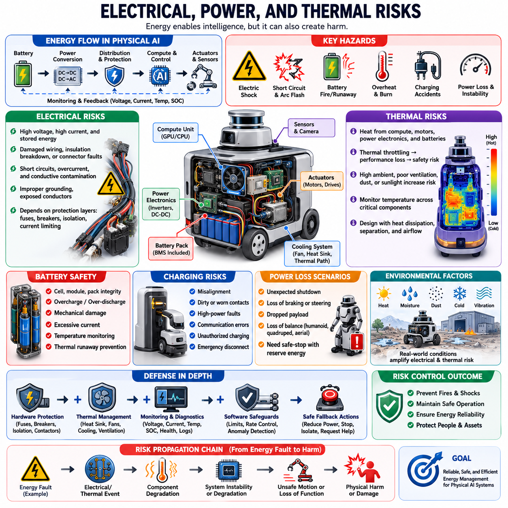{width="7.268055555555556in" height="7.268055555555556in"}

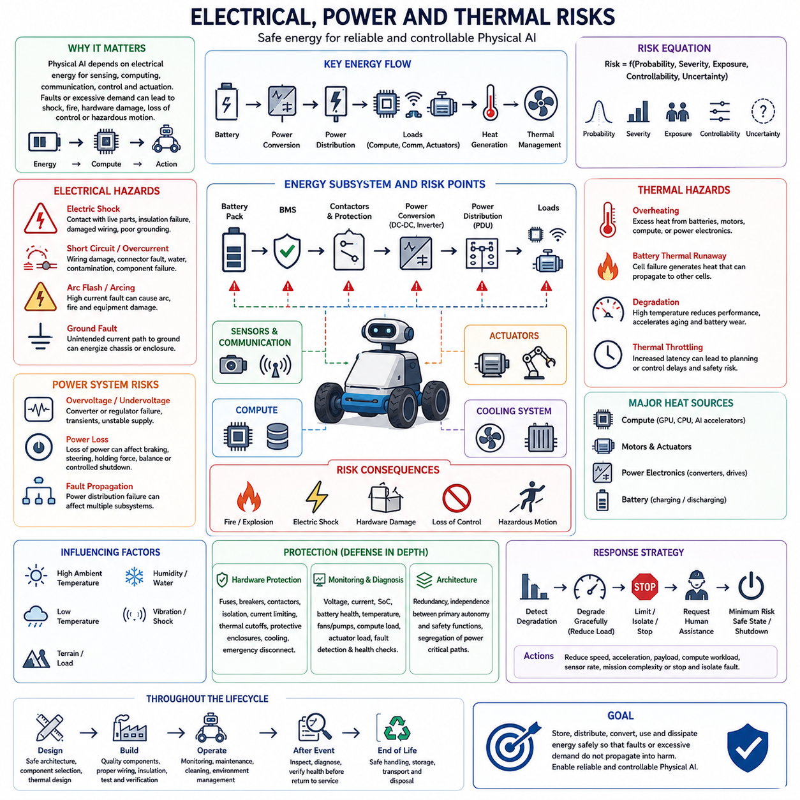{width="7.268055555555556in" height="7.268055555555556in"}

Electrical, power, and thermal risks arise because Physical AI systems depend on continuous flows of electrical energy to sensing, computation, communication, control, and actuation. Batteries, power converters, motors, GPU accelerators, wiring, charging systems, and thermal-management hardware introduce hazards that can exist independently of AI behavior. At the same time, intelligent decisions can change power demand and thermal load, coupling computational behavior with physical safety.

Electrical hazards begin with voltage, current, stored electrical energy, insulation, grounding, and accessibility of energized components. Damaged cables, exposed conductors, connector failures, insulation breakdown, conductive contamination, or incorrect maintenance can create electric-shock or short-circuit conditions. Although many mobile robots operate at relatively low nominal voltages, high-current battery systems can still release substantial energy during faults and produce severe heating, arcing, or component damage.

Short circuits and overcurrent conditions can develop from wiring damage, connector faults, conductive debris, water ingress, manufacturing defects, or failed electronic components. High fault current can rapidly heat conductors and surrounding materials before higher-level software has time to react. Fuses, circuit breakers, current limiting, isolation, appropriate conductor sizing, and protective power electronics therefore form essential safety layers that should not depend exclusively on the primary AI computer.

Battery systems introduce a distinct combination of electrical, chemical, and thermal hazards. Lithium-based batteries store significant energy in compact volumes, and abnormal charging, internal defects, mechanical damage, external short circuits, excessive current, or extreme temperature can create hazardous conditions. Battery safety must therefore consider individual cells, modules, packs, contactors, wiring, enclosures, cooling, charging equipment, and the battery-management system as one integrated energy subsystem.

Thermal runaway is a particularly important battery hazard because localized cell failure can generate heat faster than the system can dissipate it. Rising temperature may accelerate internal reactions and potentially propagate failure to neighboring cells. Prevention and containment require temperature monitoring, electrical protection, cell and module design, thermal separation, cooling, fault isolation, controlled charging, and strategies for bringing the robot into a safe condition when abnormal battery behavior is detected.

Charging creates additional risk because robots may connect to high-power electrical infrastructure repeatedly and sometimes autonomously. Misalignment, damaged contacts, contamination, connector wear, abnormal resistance, incompatible voltage, communication failure, or defective charging control can produce excessive heating or electrical faults. Automated docking must therefore coordinate mechanical alignment, electrical verification, battery state, contact integrity, charging authorization, and emergency disconnection rather than treating charging as a simple energy-transfer operation.

Power conversion and distribution systems can propagate faults across otherwise independent subsystems. DC-DC converters, inverters, motor drives, power-distribution units, contactors, relays, and regulators connect batteries to sensors, computers, communication devices, and actuators. A failure may cause overvoltage, undervoltage, unstable supply, unexpected reset, or complete power loss. Safety analysis must consider both direct electrical damage and the behavioral consequences produced when critical computing or control functions lose stable power.

Power loss is itself a motion-safety problem when electrical energy is required to maintain braking, steering, balancing, holding force, or controlled shutdown. A mobile platform may need sufficient reserve energy to stop safely, while a manipulator may require a brake to prevent a suspended payload from falling. Humanoids, quadrupeds, and aerial robots can face even greater consequences because sudden power interruption may immediately destabilize the entire platform. Safe power architecture must therefore consider the physical state following loss of energy.

Compute-intensive Physical AI introduces substantial thermal loads through GPUs, CPUs, AI accelerators, memory, networking hardware, and high-performance storage. World models, VLA systems, multimodal perception, planning, and multiple neural networks may execute concurrently under real-time constraints. Sustained computational demand generates heat that must be removed reliably, especially when high-performance computers are installed inside compact, sealed, weather-resistant, or poorly ventilated robot enclosures.

Thermal risk is not limited to catastrophic overheating. Elevated temperature can gradually reduce component performance, accelerate aging, increase battery degradation, change sensor characteristics, and trigger processor throttling. Thermal throttling can then increase inference or planning latency, creating a cross-domain safety problem in which a thermal condition becomes a timing problem and eventually a motion risk. Temperature must therefore be treated as both a hardware-health variable and a runtime performance constraint.

Motors and actuators are another major source of heat. High torque, repeated acceleration, heavy payloads, steep slopes, wheel slip, stalled mechanisms, or sustained holding force can increase current and temperature significantly. A robot may remain within its planned trajectory while actuators approach unsafe thermal conditions. Monitoring current, torque, temperature, duty cycle, and mechanical load enables the system to recognize when apparently successful operation is consuming an unsafe thermal or electrical margin.

Environmental conditions strongly influence electrical and thermal safety. High ambient temperature reduces cooling capacity, low temperature changes battery performance, moisture increases electrical risk, dust can obstruct cooling paths, and direct sunlight can raise enclosure temperature. Outdoor robots may experience rain, condensation, mud, salt, vibration, and rapid temperature transitions. Safety margins established under laboratory conditions therefore cannot automatically be assumed to remain valid across the full operational environment.

Physical damage can also initiate electrical and thermal failures. Collision, vibration, repeated shock, payload impact, or chassis deformation may damage battery cells, wiring, connectors, cooling hardware, or power electronics without producing an immediately obvious failure. A mechanically survivable event can therefore create a latent electrical hazard that appears later during charging or high-load operation. Post-event diagnostics and health monitoring are important for detecting these hidden transitions between risk categories.

AI and autonomy can influence energy risk by selecting actions that change system load. Aggressive acceleration increases motor current, continuous high-rate inference raises compute power, difficult terrain increases actuator demand, and repeated replanning can alter processor utilization. An intelligent system should therefore understand that energy, temperature, compute capacity, and mechanical capability form shared operational resources. Mission planning that ignores these constraints can gradually drive an otherwise healthy robot toward unsafe operating boundaries.

Protection should be organized as defense in depth rather than relying on a single temperature or voltage threshold. Hardware protection can include fuses, contactors, isolation, current limiting, thermal cutoffs, protective enclosures, cooling systems, and emergency disconnection. Supervisory software can monitor voltage, current, state of charge, battery health, temperatures, fan or pump operation, compute load, actuator demand, and abnormal trends while maintaining independence between primary autonomy and critical protective functions.

When electrical or thermal margins deteriorate, the appropriate response is often progressive degradation rather than immediate uncontrolled shutdown. The system may reduce speed, acceleration, payload operation, compute workload, sensor processing, or mission complexity before entering a minimum-risk condition. More severe faults may require stopping, isolating a battery section, disabling an actuator, terminating charging, requesting human assistance, or powering down selected functions while preserving the energy needed for safety-critical control.

Electrical, power, and thermal safety ultimately protects the energy foundation on which Physical AI depends. The objective is to ensure that energy can be stored, distributed, converted, consumed, and dissipated without allowing faults or excessive demand to propagate into fire, electric shock, hardware damage, loss of control, or hazardous motion. By integrating hardware protection, health monitoring, thermal management, runtime constraints, and safe fallback behavior, Physical AI can maintain safe operation even as computational and actuation demands vary.

전기, 전력 및 열 위험(Electrical, Power, and Thermal Risks)은 물리 AI(Physical AI) 시스템이 센싱(Sensing), 컴퓨팅(Computation), 통신(Communication), 제어(Control), 구동(Actuation)을 위해 지속적인 전기에너지 흐름에 의존하기 때문에 발생합니다. 배터리, 전력 변환기, 모터, GPU 가속기(GPU Accelerator), 배선, 충전 시스템, 열 관리 하드웨어(Thermal-Management Hardware)는 AI 행동과 독립적으로 존재할 수 있는 위험원을 발생시킵니다. 동시에 지능적 의사결정은 전력 수요와 열 부하를 변화시킬 수 있으므로 계산 행동과 물리적 안전이 서로 결합됩니다.

전기적 위험(Electrical Hazard)은 전압, 전류, 저장된 전기에너지, 절연, 접지 및 전원이 인가된 부품에 대한 접근 가능성에서 시작됩니다. 손상된 케이블, 노출된 도체, 커넥터 고장, 절연 파괴, 전도성 오염 또는 잘못된 유지보수는 감전(Electric Shock)이나 단락(Short Circuit) 상태를 발생시킬 수 있습니다. 많은 이동 로봇이 비교적 낮은 정격 전압으로 작동하더라도 고전류 배터리 시스템은 고장 시 상당한 에너지를 방출하여 심각한 발열, 아크(Arcing) 또는 부품 손상을 일으킬 수 있습니다.

단락(Short Circuit)과 과전류(Overcurrent) 상태는 배선 손상, 커넥터 결함, 전도성 이물질, 수분 침투, 제조 결함 또는 전자부품 고장으로 인해 발생할 수 있습니다. 높은 고장 전류(Fault Current)는 상위 수준 소프트웨어가 대응하기 전에 도체와 주변 물질을 빠르게 가열할 수 있습니다. 따라서 퓨즈(Fuse), 회로 차단기(Circuit Breaker), 전류 제한(Current Limiting), 절연(Isolation), 적절한 도체 용량 설계 및 보호 전력전자 장치는 주 AI 컴퓨터에만 의존해서는 안 되는 필수적인 안전 계층을 형성합니다.

배터리 시스템(Battery System)은 전기적·화학적·열적 위험이 결합된 고유한 위험을 발생시킵니다. 리튬 기반 배터리(Lithium-Based Battery)는 작은 부피에 상당한 에너지를 저장하며, 비정상적인 충전, 내부 결함, 기계적 손상, 외부 단락, 과도한 전류 또는 극한 온도는 위험한 상태를 만들 수 있습니다. 따라서 배터리 안전은 개별 셀(Cell), 모듈(Module), 팩(Pack), 접촉기(Contactor), 배선, 인클로저(Enclosure), 냉각 시스템, 충전 장비 및 배터리 관리 시스템(Battery Management System)을 하나의 통합 에너지 하위 시스템으로 고려해야 합니다.

열 폭주(Thermal Runaway)는 국부적인 배터리 셀 고장이 시스템의 열 방출 능력보다 빠르게 열을 생성할 수 있기 때문에 특히 중요한 배터리 위험입니다. 온도가 상승하면 내부 반응이 가속되어 인접한 셀로 고장이 전파될 가능성이 있습니다. 이를 예방하고 억제하기 위해서는 온도 모니터링, 전기적 보호, 셀 및 모듈 설계, 열적 분리(Thermal Separation), 냉각, 고장 격리(Fault Isolation), 제어된 충전 및 비정상적인 배터리 동작이 탐지되었을 때 로봇을 안전 상태(Safe Condition)로 전환하는 전략이 필요합니다.

충전(Charging)은 로봇이 고전력 전기 인프라에 반복적으로, 때로는 자율적으로 연결되기 때문에 추가적인 위험을 발생시킵니다. 정렬 불량, 손상된 접점, 오염, 커넥터 마모, 비정상적인 저항, 호환되지 않는 전압, 통신 장애 또는 충전 제어 결함은 과도한 발열이나 전기적 고장을 발생시킬 수 있습니다. 따라서 자동 도킹(Automated Docking)은 충전을 단순한 에너지 전달 과정으로 처리하는 것이 아니라 기계적 정렬, 전기적 검증, 배터리 상태, 접점 건전성(Contact Integrity), 충전 승인 및 비상 분리를 함께 조정해야 합니다.

전력 변환 및 배전 시스템(Power Conversion and Distribution System)은 서로 독립적인 하위 시스템 사이로 고장을 전파할 수 있습니다. DC-DC 변환기, 인버터(Inverter), 모터 드라이브(Motor Drive), 전력 분배 장치(Power Distribution Unit), 접촉기, 릴레이 및 레귤레이터(Regulator)는 배터리를 센서, 컴퓨터, 통신 장치 및 액추에이터와 연결합니다. 고장은 과전압, 저전압, 불안정한 전원, 예상하지 못한 리셋 또는 완전한 전원 상실을 발생시킬 수 있습니다. 따라서 안전 분석은 직접적인 전기적 손상뿐만 아니라 핵심 컴퓨팅 또는 제어 기능이 안정적인 전력을 잃을 때 발생하는 행동상의 결과까지 고려해야 합니다.

전력 손실(Power Loss)은 제동, 조향, 균형 유지, 유지력 또는 제어된 종료를 위해 전기에너지가 필요한 경우 그 자체로 운동 안전 문제(Motion-Safety Problem)가 됩니다. 이동 플랫폼은 안전하게 정지하기 위한 충분한 예비 에너지가 필요할 수 있으며, 매니퓰레이터는 매달린 적재물이 떨어지는 것을 방지하기 위해 브레이크가 필요할 수 있습니다. 휴머노이드, 사족보행 로봇, 비행 로봇(Aerial Robot)은 갑작스러운 전력 중단이 플랫폼 전체를 즉시 불안정하게 만들 수 있으므로 더 심각한 결과에 직면할 수 있습니다. 따라서 안전 전력 아키텍처(Safe Power Architecture)는 에너지 손실 이후의 물리적 상태까지 고려해야 합니다.

컴퓨팅 집약적인 물리 AI(Compute-Intensive Physical AI)는 GPU, CPU, AI 가속기, 메모리, 네트워크 하드웨어 및 고성능 저장장치에서 상당한 열 부하(Thermal Load)를 발생시킵니다. 월드 모델(World Model), VLA 시스템, 멀티모달 인지(Multimodal Perception), 계획 및 여러 신경망이 실시간 제약 조건 아래에서 동시에 실행될 수 있습니다. 지속적인 계산 부하는 열을 발생시키므로 고성능 컴퓨터가 소형, 밀폐형, 내후성 또는 환기가 제한된 로봇 인클로저 내부에 설치되는 경우 이를 안정적으로 제거해야 합니다.

열 위험(Thermal Risk)은 치명적인 과열에만 국한되지 않습니다. 높은 온도는 점진적으로 부품 성능을 저하시키고, 노화를 가속하며, 배터리 열화를 증가시키고, 센서 특성을 변화시키며, 프로세서 스로틀링(Processor Throttling)을 유발할 수 있습니다. 열 스로틀링(Thermal Throttling)은 다시 추론 또는 계획 지연시간을 증가시켜 열 문제가 타이밍 문제로 전환되고 궁극적으로 운동 위험으로 발전하는 교차 영역 안전 문제(Cross-Domain Safety Problem)를 만들 수 있습니다. 따라서 온도는 하드웨어 상태 변수인 동시에 런타임 성능 제약(Runtime Performance Constraint)으로 다루어야 합니다.

모터와 액추에이터(Motor and Actuator)는 또 다른 주요 열 발생원입니다. 높은 토크, 반복적인 가속, 무거운 적재물, 급경사, 바퀴 미끄러짐, 기계장치의 정지 상태 또는 지속적인 유지력은 전류와 온도를 크게 증가시킬 수 있습니다. 로봇이 계획된 궤적을 정상적으로 따라가고 있더라도 액추에이터는 안전하지 않은 열 상태에 접근할 수 있습니다. 전류, 토크, 온도, 듀티 사이클(Duty Cycle), 기계적 하중을 모니터링하면 외관상 성공적인 동작이 안전하지 않은 전기적 또는 열적 여유를 소비하고 있는 상황을 인식할 수 있습니다.

환경 조건(Environmental Condition)은 전기 및 열 안전에 큰 영향을 미칩니다. 높은 주변 온도는 냉각 능력을 감소시키고, 낮은 온도는 배터리 성능을 변화시키며, 습기는 전기적 위험을 증가시키고, 먼지는 냉각 경로를 막으며, 직사광선은 인클로저 내부 온도를 상승시킬 수 있습니다. 실외 로봇(Outdoor Robot)은 비, 결로, 진흙, 염분, 진동 및 급격한 온도 변화에도 노출될 수 있습니다. 따라서 실험실 조건에서 설정된 안전 여유(Safety Margin)가 전체 운영 환경에서도 그대로 유효하다고 가정해서는 안 됩니다.

물리적 손상(Physical Damage) 역시 전기 및 열 고장의 시작점이 될 수 있습니다. 충돌, 진동, 반복적인 충격, 적재물 충격 또는 섀시 변형은 즉각적으로 명확한 고장을 발생시키지 않으면서 배터리 셀, 배선, 커넥터, 냉각 하드웨어 또는 전력전자 장치를 손상시킬 수 있습니다. 따라서 기계적으로 견딜 수 있었던 사건이 이후 충전이나 고부하 운전 과정에서 나타나는 잠재적 전기 위험(Latent Electrical Hazard)을 만들 수 있습니다. 이러한 위험 범주 간의 숨겨진 전이를 탐지하려면 사건 이후 진단(Post-Event Diagnostics)과 상태 모니터링(Health Monitoring)이 중요합니다.

AI와 자율성(Autonomy)은 시스템 부하를 변화시키는 행동을 선택함으로써 에너지 위험에 영향을 줄 수 있습니다. 공격적인 가속은 모터 전류를 증가시키고, 지속적인 고속 추론은 컴퓨팅 전력을 증가시키며, 험난한 지형은 액추에이터 요구량을 높이고, 반복적인 재계획(Replanning)은 프로세서 사용률을 변화시킬 수 있습니다. 따라서 지능형 시스템은 에너지, 온도, 컴퓨팅 용량 및 기계적 성능이 서로 공유되는 운영 자원(Operational Resource)이라는 사실을 이해해야 합니다. 이러한 제약을 무시하는 임무 계획은 정상적인 로봇을 점진적으로 위험한 운영 경계로 이동시킬 수 있습니다.

보호 체계(Protection)는 하나의 온도 또는 전압 임계값에 의존하는 대신 심층 방어(Defense in Depth) 방식으로 구성되어야 합니다. 하드웨어 보호에는 퓨즈, 접촉기, 절연, 전류 제한, 열 차단기(Thermal Cutoff), 보호 인클로저, 냉각 시스템 및 비상 전원 분리가 포함될 수 있습니다. 감독 소프트웨어(Supervisory Software)는 전압, 전류, 충전 상태(State of Charge), 배터리 상태, 온도, 팬 또는 펌프 동작, 컴퓨팅 부하, 액추에이터 요구량 및 비정상적인 변화 추세를 모니터링할 수 있으며, 핵심 보호 기능은 주 자율 시스템(Primary Autonomy)과 적절한 독립성을 유지해야 합니다.

전기적 또는 열적 안전 여유가 감소할 경우 즉각적인 비제어 종료(Uncontrolled Shutdown)보다 단계적 성능 저하(Progressive Degradation)가 적절한 대응이 되는 경우가 많습니다. 시스템은 최소 위험 상태(Minimum-Risk Condition)로 진입하기 전에 속도, 가속도, 적재물 동작, 컴퓨팅 작업량, 센서 처리량 또는 임무 복잡도를 줄일 수 있습니다. 더 심각한 고장에서는 정지, 배터리 구간 격리, 액추에이터 비활성화, 충전 종료, 인간 지원 요청 또는 안전에 중요한 제어에 필요한 에너지를 보존하면서 일부 기능의 전원을 차단하는 조치가 필요할 수 있습니다.

궁극적으로 전기, 전력 및 열 안전(Electrical, Power, and Thermal Safety)은 물리 AI가 의존하는 에너지 기반(Energy Foundation)을 보호합니다. 목표는 에너지를 저장, 분배, 변환, 소비 및 방출하는 과정에서 고장이나 과도한 수요가 화재, 감전, 하드웨어 손상, 제어 상실 또는 위험한 움직임으로 전파되지 않도록 하는 것입니다. 하드웨어 보호, 상태 모니터링, 열 관리(Thermal Management), 런타임 제약(Runtime Constraint), 안전 폴백 동작(Safe Fallback Behavior)을 통합함으로써 물리 AI는 계산 및 구동 요구량이 변화하는 상황에서도 안전한 작동을 유지할 수 있습니다.

##  

## 01.05. Perception and Sensor Risks

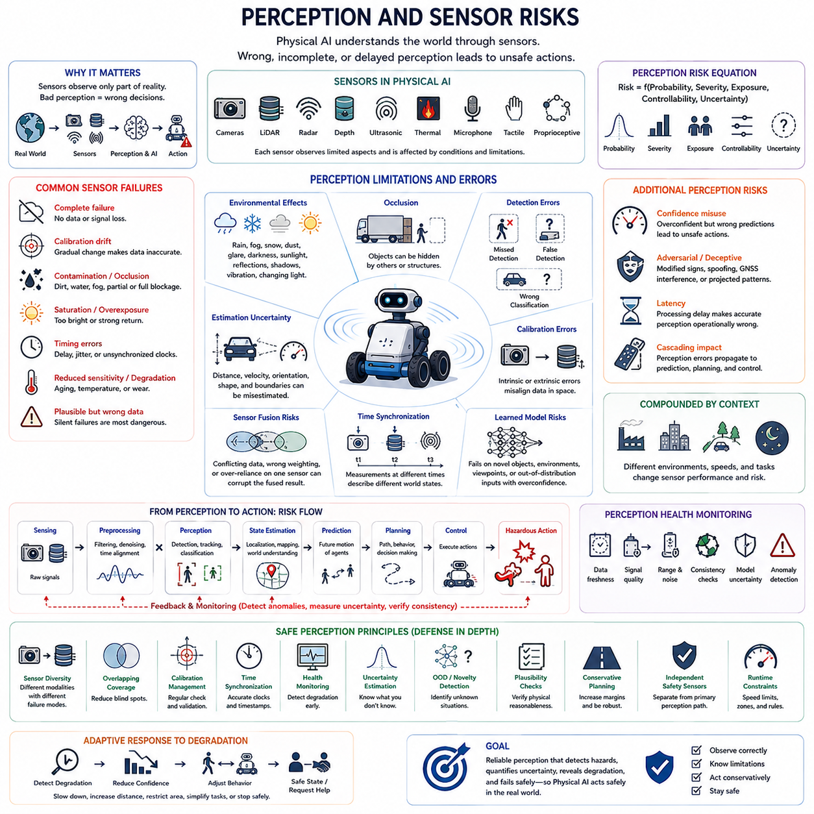{width="7.268055555555556in" height="7.268055555555556in"}

Perception and sensor risks arise because Physical AI must construct an actionable understanding of the world from incomplete, noisy, delayed, and sometimes contradictory measurements. Cameras, LiDAR, radar, depth sensors, ultrasonic sensors, thermal cameras, microphones, tactile sensors, and proprioceptive devices observe only limited aspects of reality. If those observations are wrong or incomplete, downstream intelligence may act on a world that does not accurately exist.

A sensor failure does not always appear as a complete loss of signal. Sensors can continue producing plausible data while suffering from calibration drift, contamination, partial occlusion, saturation, timing errors, reduced sensitivity, or internal degradation. These silent failures are particularly dangerous because the perception system may interpret corrupted measurements as trustworthy observations unless sensor health, consistency, and uncertainty are independently monitored.

Environmental conditions strongly affect sensing performance. Rain, fog, snow, dust, glare, darkness, direct sunlight, reflective surfaces, transparent objects, shadows, vibration, and rapidly changing illumination can degrade different sensing modalities in different ways. A perception architecture validated under controlled conditions may therefore exhibit significantly different behavior outdoors, in industrial environments, or during unusual weather and lighting conditions.

Occlusion creates another fundamental limitation because objects can be physically present while remaining partially or completely invisible to one or more sensors. A pedestrian behind a vehicle, worker emerging from shelving, object hidden around a corner, or obstacle concealed by vegetation may not become observable until the available reaction time is short. Safe perception must therefore distinguish between confirmed free space and regions whose state is simply unknown.

Detection errors are commonly expressed as missed detections, false detections, and incorrect classifications, but their safety consequences depend on context. Missing a pedestrian directly in the robot\'s path is fundamentally different from missing an irrelevant distant object. Likewise, falsely detecting an obstacle may cause unnecessary braking, while falsely classifying a vulnerable person as an inanimate object can lead to unsafe planning. Perception evaluation must therefore connect accuracy to physical consequences.

Distance, velocity, orientation, shape, and object-boundary estimation introduce additional uncertainty even when an object is correctly detected. A robot may recognize a vehicle yet underestimate its approach velocity, detect a person but incorrectly estimate separation distance, or identify an obstacle while misrepresenting its physical extent. These geometric and dynamic errors can directly affect collision prediction, stopping decisions, reachable-space estimation, and trajectory planning.

Sensor calibration is critical because Physical AI frequently combines measurements from multiple devices located at different positions and orientations. Incorrect intrinsic calibration can distort individual measurements, while extrinsic calibration errors can place observations in the wrong spatial relationship. Small alignment errors between cameras, LiDAR, radar, IMU, and the robot coordinate frame may propagate into increasingly significant errors in fusion, mapping, localization, prediction, and planning.

Time synchronization is equally important for dynamic environments. Measurements collected at different times may describe different physical states even when they are processed together as if simultaneous. A moving pedestrian, rotating robot, accelerating vehicle, or articulated manipulator can change position significantly within tens of milliseconds. Timestamp errors, communication jitter, buffering, and unsynchronized sensor clocks can therefore create spatial inconsistencies that resemble perception or calibration failures.

Sensor fusion can reduce individual sensor weaknesses, but it also introduces new failure modes. Conflicting measurements must be weighted, associated, and combined correctly, and an erroneous high-confidence sensor can contaminate the fused representation. Redundancy is most valuable when sensing modalities have sufficiently different failure characteristics. Multiple identical sensors exposed to the same environmental condition may provide replication without meaningful diversity against common-cause failure.

Learned perception models introduce risks beyond the physical sensor itself. Neural networks can perform extremely well on familiar data while failing on unusual objects, novel environments, rare viewpoints, unusual lighting, or combinations absent from training. Distribution shift and out-of-distribution inputs may produce incorrect predictions with undeserved confidence. Physical AI must therefore monitor not only sensor availability but also whether current observations remain within the competence of the perception model.

Confidence scores are useful only when they correspond meaningfully to actual error probability. An overconfident perception model may report high certainty for an incorrect prediction, preventing downstream systems from recognizing the need for conservative behavior. Calibration of model confidence, uncertainty estimation, ensemble disagreement, cross-modal consistency, and novelty detection can help identify situations in which apparently valid perception outputs should not be trusted at face value.

Adversarial and deceptive conditions extend perception risk into cyber-physical security. Modified signs, projected patterns, sensor spoofing, manipulated visual features, GNSS interference, laser effects, or intentionally placed objects may alter sensor measurements or learned interpretation. Even when malicious attacks are outside the primary operational assumptions, safety architecture should avoid allowing a single unverified perception channel to directly authorize high-consequence physical behavior.

Perception latency also contributes directly to safety. A highly accurate perception result can become operationally incorrect if it arrives too late. Image processing, neural inference, sensor fusion, object tracking, communication, and queueing all consume time while the physical environment continues to evolve. Perception safety must therefore evaluate accuracy together with latency, update rate, temporal consistency, maximum processing delay, and the remaining time available for planning and control.

Sensor degradation should influence robot behavior before complete failure occurs. Reduced camera visibility, increasing LiDAR noise, radar inconsistency, abnormal temperature, packet loss, calibration drift, or declining update rates can indicate shrinking perception capability. Rather than continuing unchanged until a hard fault occurs, the system can progressively reduce speed, increase separation margins, restrict operating areas, disable difficult maneuvers, or request human assistance as confidence decreases.

Runtime perception assurance requires continuous comparison between expected and observed sensing behavior. Sensor health monitors can detect missing frames, frozen data, abnormal ranges, timing faults, or hardware errors, while cross-sensor consistency checks can identify disagreements between independent observations. World-model predictions and temporal history can provide additional references, although these learned or predictive mechanisms should not themselves become unquestioned sources of safety truth.

Safe perception therefore depends on defense in depth. Sensor diversity, overlapping fields of view, calibration management, synchronization, health monitoring, uncertainty estimation, out-of-distribution detection, plausibility checks, conservative planning, independent safety sensors, and runtime constraints can collectively prevent a single perception error from becoming hazardous motion. The objective is not perfect perception, but reliable recognition of both what the system knows and what it does not know.

Ultimately, perception and sensor safety establishes the informational foundation of Physical AI. Every localization estimate, world model, prediction, plan, and control action depends directly or indirectly on observations of the physical world. When sensing becomes uncertain, downstream autonomy must become appropriately conservative rather than preserving nominal behavior. Safe Physical AI therefore requires perception systems that detect hazards, quantify uncertainty, reveal degradation, and fail in ways that remain compatible with physical safety.

인지 및 센서 위험(Perception and Sensor Risks)은 물리 AI(Physical AI)가 불완전하고, 잡음이 있으며, 지연되고, 때로는 서로 모순되는 측정값으로부터 행동에 활용할 수 있는 세계에 대한 이해를 구성해야 하기 때문에 발생합니다. 카메라, 라이다(LiDAR), 레이더(Radar), 깊이 센서(Depth Sensor), 초음파 센서(Ultrasonic Sensor), 열화상 카메라(Thermal Camera), 마이크, 촉각 센서(Tactile Sensor), 고유수용성 센서(Proprioceptive Sensor)는 현실의 제한된 측면만 관측합니다. 이러한 관측이 잘못되거나 불완전하면 이후의 지능 시스템은 실제와 다른 세계를 기반으로 행동할 수 있습니다.

센서 고장(Sensor Failure)은 항상 신호의 완전한 손실 형태로 나타나는 것은 아닙니다. 센서는 캘리브레이션 드리프트(Calibration Drift), 오염, 부분 가림, 포화(Saturation), 타이밍 오류, 감도 저하 또는 내부 열화가 발생한 상태에서도 그럴듯한 데이터를 계속 출력할 수 있습니다. 이러한 잠재적 고장(Silent Failure)은 센서 상태, 일관성 및 불확실성을 독립적으로 모니터링하지 않는 경우 인지 시스템이 손상된 측정값을 신뢰할 수 있는 관측으로 해석할 수 있기 때문에 특히 위험합니다.

환경 조건(Environmental Condition)은 센싱 성능에 큰 영향을 미칩니다. 비, 안개, 눈, 먼지, 눈부심(Glare), 어둠, 직사광선, 반사 표면, 투명 물체, 그림자, 진동 및 급격하게 변화하는 조명은 각각 서로 다른 방식으로 센싱 모달리티(Sensing Modality)의 성능을 저하시킬 수 있습니다. 따라서 통제된 조건에서 검증된 인지 아키텍처(Perception Architecture)가 실외, 산업 환경 또는 비정상적인 날씨와 조명 조건에서는 상당히 다른 동작을 나타낼 수 있습니다.

가림(Occlusion)은 물체가 물리적으로 존재하면서도 하나 이상의 센서에서는 부분적으로 또는 완전히 보이지 않을 수 있기 때문에 또 다른 근본적인 한계를 발생시킵니다. 차량 뒤에 있는 보행자, 선반에서 갑자기 나오는 작업자, 모퉁이 뒤에 숨은 물체 또는 식생에 가려진 장애물은 대응 가능한 시간이 짧아진 이후에야 관측될 수 있습니다. 따라서 안전한 인지(Safe Perception)는 확인된 자유 공간(Free Space)과 단순히 상태를 알 수 없는 영역(Unknown Region)을 명확하게 구분해야 합니다.

탐지 오류(Detection Error)는 일반적으로 미탐지(Missed Detection), 오탐지(False Detection), 잘못된 분류(Incorrect Classification)로 표현되지만, 그 안전상의 결과는 상황에 따라 달라집니다. 로봇의 진행 경로에 있는 보행자를 놓치는 것은 멀리 떨어진 중요하지 않은 물체를 놓치는 것과 근본적으로 다릅니다. 또한 장애물을 잘못 탐지하면 불필요한 제동이 발생할 수 있지만, 취약한 사람을 무생물로 잘못 분류하면 위험한 계획으로 이어질 수 있습니다. 따라서 인지 평가는 정확도를 실제 물리적 결과와 연결해야 합니다.

물체가 정확하게 탐지되더라도 거리, 속도, 방향, 형상 및 물체 경계 추정(Object-Boundary Estimation)에는 추가적인 불확실성이 존재합니다. 로봇은 차량을 올바르게 인식하면서도 접근 속도를 과소평가하거나, 사람을 탐지하면서 분리 거리를 잘못 추정하거나, 장애물을 인식하면서 실제 물리적 크기를 부정확하게 표현할 수 있습니다. 이러한 기하학적·동적 오류는 충돌 예측, 정지 판단, 도달 가능 공간 추정(Reachable-Space Estimation), 궤적 계획(Trajectory Planning)에 직접적인 영향을 줄 수 있습니다.

센서 캘리브레이션(Sensor Calibration)은 물리 AI가 서로 다른 위치와 방향에 설치된 여러 장치의 측정값을 결합하는 경우가 많기 때문에 매우 중요합니다. 잘못된 내부 캘리브레이션(Intrinsic Calibration)은 개별 측정값을 왜곡할 수 있으며, 외부 캘리브레이션(Extrinsic Calibration) 오류는 관측값을 잘못된 공간적 관계에 배치할 수 있습니다. 카메라, 라이다, 레이더, 관성측정장치(IMU), 로봇 좌표계 사이의 작은 정렬 오류도 센서 융합, 지도 작성, 위치추정, 예측 및 계획 단계로 전파되면서 점점 더 큰 오류를 발생시킬 수 있습니다.

시간 동기화(Time Synchronization)는 동적 환경에서 마찬가지로 중요합니다. 서로 다른 시점에 수집된 측정값은 동시에 수집된 것처럼 함께 처리되더라도 실제로는 서로 다른 물리적 상태를 나타낼 수 있습니다. 움직이는 보행자, 회전하는 로봇, 가속하는 차량 또는 관절형 매니퓰레이터는 수십 밀리초 동안에도 위치가 상당히 변화할 수 있습니다. 따라서 타임스탬프 오류(Timestamp Error), 통신 지터(Communication Jitter), 버퍼링 및 동기화되지 않은 센서 클록은 인지 또는 캘리브레이션 고장과 유사한 공간적 불일치를 발생시킬 수 있습니다.

센서 융합(Sensor Fusion)은 개별 센서의 약점을 줄일 수 있지만 새로운 고장 모드(Failure Mode)를 발생시키기도 합니다. 서로 충돌하는 측정값에 적절한 가중치를 부여하고, 올바르게 연관시키며, 결합해야 하고, 잘못된 고신뢰도 센서의 정보가 융합된 표현 전체를 오염시킬 수도 있습니다. 중복성(Redundancy)은 센싱 모달리티가 충분히 서로 다른 고장 특성을 가질 때 가장 효과적입니다. 동일한 환경 조건에 노출되는 여러 개의 동일한 센서는 단순한 복제는 제공하지만 공통 원인 고장(Common-Cause Failure)에 대한 실질적인 다양성(Diversity)을 제공하지 못할 수 있습니다.

학습 기반 인지 모델(Learned Perception Model)은 물리적 센서 자체의 문제를 넘어서는 위험을 발생시킵니다. 신경망(Neural Network)은 익숙한 데이터에서는 매우 우수하게 작동하면서도 특이한 물체, 새로운 환경, 드문 시점, 비정상적인 조명 또는 학습 과정에 존재하지 않았던 조합에서는 실패할 수 있습니다. 분포 이동(Distribution Shift)과 분포 외 입력(Out-of-Distribution Input)은 부당하게 높은 신뢰도를 가진 잘못된 예측을 발생시킬 수 있습니다. 따라서 물리 AI는 센서의 작동 여부뿐만 아니라 현재 관측이 인지 모델의 능력 범위(Competence) 안에 있는지도 모니터링해야 합니다.

신뢰도 점수(Confidence Score)는 실제 오류 확률과 의미 있게 대응할 때에만 유용합니다. 과신하는 인지 모델(Overconfident Perception Model)은 잘못된 예측에 대해서도 높은 확신을 보고하여 이후 시스템이 보수적인 행동(Conservative Behavior)의 필요성을 인식하지 못하게 할 수 있습니다. 모델 신뢰도 보정(Model Confidence Calibration), 불확실성 추정(Uncertainty Estimation), 앙상블 불일치(Ensemble Disagreement), 교차 모달 일관성(Cross-Modal Consistency), 신규성 탐지(Novelty Detection)는 외관상 유효한 인지 출력을 그대로 신뢰해서는 안 되는 상황을 식별하는 데 도움을 줄 수 있습니다.

적대적 및 기만적 조건(Adversarial and Deceptive Conditions)은 인지 위험을 사이버-물리 보안(Cyber-Physical Security)의 영역으로 확장합니다. 변조된 표지판, 투사된 패턴, 센서 스푸핑(Sensor Spoofing), 조작된 시각적 특징, GNSS 간섭, 레이저 영향 또는 의도적으로 배치된 물체는 센서 측정값이나 학습된 해석을 변화시킬 수 있습니다. 악의적 공격이 주요 운영 가정에서 제외되어 있더라도 하나의 검증되지 않은 인지 채널이 높은 결과 심각도를 가진 물리적 행동을 직접 승인하도록 안전 아키텍처를 설계해서는 안 됩니다.

인지 지연시간(Perception Latency) 역시 안전에 직접적으로 영향을 미칩니다. 매우 정확한 인지 결과라도 너무 늦게 도착하면 운영 관점에서는 잘못된 정보가 될 수 있습니다. 이미지 처리, 신경망 추론, 센서 융합, 객체 추적(Object Tracking), 통신 및 대기열 처리(Queueing)가 시간을 소비하는 동안 물리적 환경은 계속 변화합니다. 따라서 인지 안전(Perception Safety)은 정확도뿐만 아니라 지연시간, 갱신 주기(Update Rate), 시간적 일관성(Temporal Consistency), 최대 처리 지연 및 계획과 제어에 남아 있는 대응 시간을 함께 평가해야 합니다.

센서 성능 저하(Sensor Degradation)는 완전한 고장이 발생하기 전에 로봇의 행동에 영향을 주어야 합니다. 카메라 가시성 감소, 라이다 잡음 증가, 레이더 불일치, 비정상적인 온도, 패킷 손실, 캘리브레이션 드리프트 또는 갱신 주기 저하는 인지 능력이 감소하고 있음을 나타낼 수 있습니다. 시스템은 심각한 고장이 발생할 때까지 기존 동작을 그대로 유지하는 대신 신뢰도가 감소함에 따라 속도를 단계적으로 낮추고, 분리 여유를 확대하며, 운영 영역을 제한하고, 어려운 기동을 비활성화하거나 인간의 지원을 요청할 수 있습니다.

런타임 인지 보증(Runtime Perception Assurance)은 예상되는 센싱 동작과 실제 관측된 센싱 동작을 지속적으로 비교해야 합니다. 센서 상태 모니터(Sensor Health Monitor)는 누락된 프레임, 정지된 데이터(Frozen Data), 비정상적인 측정 범위, 타이밍 오류 또는 하드웨어 고장을 탐지할 수 있으며, 교차 센서 일관성 검사(Cross-Sensor Consistency Check)는 독립적인 관측 간의 불일치를 식별할 수 있습니다. 월드 모델(World Model)의 예측과 시간적 이력(Temporal History)도 추가적인 참조 정보를 제공할 수 있지만, 이러한 학습 또는 예측 메커니즘 자체를 의심할 필요가 없는 절대적인 안전 기준으로 간주해서는 안 됩니다.

따라서 안전한 인지(Safe Perception)는 심층 방어(Defense in Depth)에 의존합니다. 센서 다양성(Sensor Diversity), 중첩된 시야(Overlapping Fields of View), 캘리브레이션 관리, 시간 동기화, 상태 모니터링, 불확실성 추정, 분포 외 탐지(OOD Detection), 타당성 검사(Plausibility Check), 보수적 계획, 독립 안전 센서(Independent Safety Sensor), 런타임 제약(Runtime Constraint)을 결합하면 하나의 인지 오류가 위험한 움직임으로 전환되는 것을 방지할 수 있습니다. 목표는 완벽한 인지가 아니라 시스템이 무엇을 알고 있으며 무엇을 알지 못하는지를 신뢰성 있게 인식하는 것입니다.

궁극적으로 인지 및 센서 안전(Perception and Sensor Safety)은 물리 AI의 정보적 기반(Informational Foundation)을 형성합니다. 모든 위치추정, 월드 모델, 예측, 계획 및 제어 행동은 직접적 또는 간접적으로 물리적 세계에 대한 관측에 의존합니다. 센싱의 불확실성이 증가하면 이후의 자율 시스템(Downstream Autonomy)은 정상 동작을 그대로 유지하기보다 그에 맞게 보수적으로 변화해야 합니다. 따라서 안전한 물리 AI는 위험을 탐지하고, 불확실성을 정량화하며, 성능 저하를 드러내고, 고장이 발생하더라도 물리적 안전과 양립할 수 있는 방식으로 실패하는 인지 시스템을 필요로 합니다.

##  

## 01.06. Localization and State Estimation Risks

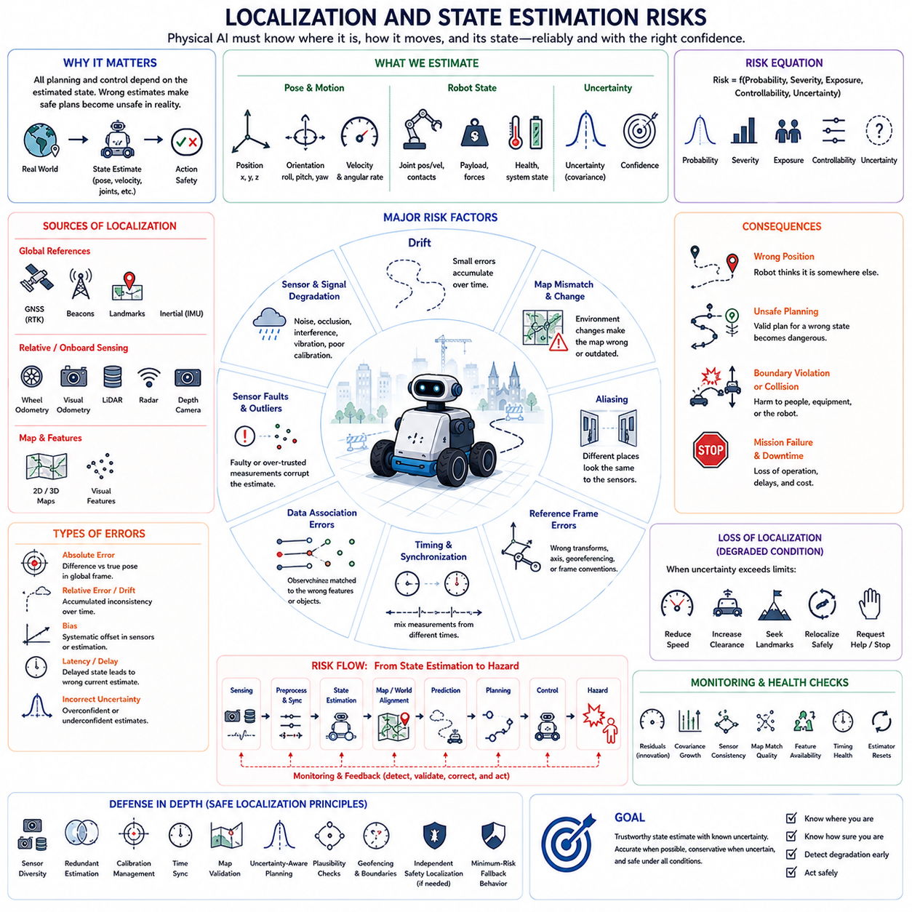{width="7.268055555555556in" height="7.268055555555556in"}

Localization and state estimation risks arise because Physical AI must continuously determine where it is, how it is moving, and what its current physical condition is before it can act safely. Position, orientation, velocity, acceleration, joint configuration, and other state variables are rarely measured perfectly. Instead, they are inferred from uncertain sensor observations. Incorrect state estimates can therefore make physically reasonable plans unsafe when executed in the real world.

Localization is more than determining a robot\'s coordinates. A useful pose estimate normally includes position and orientation relative to a meaningful reference frame, while navigation may additionally require velocity, angular rate, uncertainty, map alignment, and temporal consistency. For manipulators and articulated robots, state estimation also includes joint positions, joint velocities, contact states, payload conditions, and sometimes external forces. Errors in any of these quantities can propagate directly into planning and control.

Localization errors can be absolute or relative. Absolute error describes disagreement between the estimated pose and the robot\'s true position in a global or operational reference frame. Relative error describes accumulated inconsistency as the robot moves through the environment. A system may exhibit locally smooth motion while its global estimate gradually drifts away from reality, making apparent consistency alone insufficient evidence that localization remains safe.

Drift is especially important in dead-reckoning systems. Wheel odometry, inertial measurements, visual odometry, and other incremental estimation methods accumulate small errors over time. Wheel slip, IMU bias, vibration, uneven terrain, repetitive motion, or imperfect calibration can cause the estimated trajectory to diverge progressively from the actual trajectory. Without reliable external corrections, a small initial error can eventually become a significant navigation hazard.

Global references such as GNSS or fixed landmarks can reduce accumulated drift, but they introduce their own failure modes. Buildings, vegetation, tunnels, indoor environments, multipath propagation, interference, poor satellite geometry, or signal blockage can degrade GNSS accuracy. Landmark-based localization can fail when features are removed, obscured, repeated, or changed. A localization architecture must therefore distinguish between nominal availability and trustworthy positioning quality.

Map-based localization depends on the assumption that the operational environment corresponds sufficiently well to the stored representation. Construction, moved furniture, parked vehicles, seasonal vegetation, temporary barriers, or industrial layout changes can create map mismatch. The estimator may then align observations with incorrect map features while still producing a mathematically confident pose. Detecting environmental change is therefore as important as optimizing localization error under unchanged conditions.

Perceptual aliasing creates a particularly difficult localization problem when different locations appear similar to the sensing system. Repetitive corridors, identical shelves, similar intersections, repeated structural patterns, or visually homogeneous spaces can cause the robot to associate observations with the wrong place. Such errors may produce a large pose jump or false relocalization, potentially causing the planner to interpret an entirely incorrect region of the map as the robot\'s current location.

Reference-frame errors can occur even when individual sensors and estimators appear accurate. Physical AI commonly uses sensor frames, body frames, odometry frames, local map frames, global map frames, and geographic coordinate systems. Incorrect transformations, inconsistent conventions, wrong axis directions, outdated extrinsic calibration, or errors in map georeferencing can shift or rotate information between frames. These failures can systematically corrupt otherwise accurate measurements.

Time synchronization also affects state estimation because motion makes measurements dependent on when they were captured. Camera images, LiDAR scans, radar measurements, wheel encoders, GNSS observations, and IMU samples may arrive at different rates and with different delays. If timestamps are incorrect or clocks are unsynchronized, fusion algorithms may combine measurements representing different physical states, producing erroneous position, velocity, orientation, or object-relative estimates.

State estimation generally relies on sensor fusion because no individual sensor provides complete and reliable state information under all conditions. Kalman filtering, factor graphs, optimization-based estimators, visual-inertial methods, LiDAR-inertial systems, and multi-sensor localization combine complementary measurements. Fusion improves robustness only when uncertainty, correlations, timing, calibration, and sensor validity are modeled correctly. A faulty but highly trusted measurement can pull the entire estimate away from reality.

Uncertainty is therefore a safety-relevant output rather than merely an internal mathematical quantity. Two localization estimates with identical coordinates may imply very different operational risks if one has centimeter-level confidence and the other has meter-level uncertainty. Planning and control should consume not only the estimated state but also its confidence or covariance. As uncertainty grows, permissible speed, maneuver complexity, obstacle clearance, and operating region may need to become progressively more conservative.

False confidence is particularly hazardous. An estimator may produce a precise-looking state while its underlying assumptions have become invalid because of sensor failure, map mismatch, insufficient features, poor observability, or incorrect data association. In these cases, numerical covariance alone may underestimate actual uncertainty. Runtime assurance should therefore combine estimator-reported confidence with independent checks such as innovation statistics, cross-sensor consistency, map agreement, and physical plausibility.

State estimation failures can propagate rapidly through the autonomy stack. An incorrect pose changes the robot\'s perceived relationship to lanes, obstacles, workspaces, safety zones, charging stations, or navigation boundaries. Planning may then generate a valid trajectory for the wrong assumed state, and control may accurately execute commands that are physically inappropriate. The final collision or boundary violation can appear to be a planning failure even though the initiating fault occurred in localization.

Loss of localization should therefore be treated as a degraded operating condition rather than simply another software error. When uncertainty exceeds validated limits, the robot may reduce speed, increase clearance, restrict movement, transition to local sensing, seek recognizable landmarks, perform controlled relocalization, request external assistance, or stop in a safe location. Continuing nominal autonomous operation while position confidence collapses converts estimation uncertainty directly into physical risk.

Different environments require different localization safety strategies. Indoor robots may rely on LiDAR SLAM, visual features, markers, or infrastructure references, while outdoor robots may combine GNSS, RTK corrections, IMU, LiDAR, cameras, radar, and wheel odometry. Transitions between indoor and outdoor spaces are especially challenging because the dominant localization source can change. Safe operation requires continuity of reference frames, uncertainty, map alignment, and operational boundaries across these transitions.

Runtime monitoring should evaluate both the estimated state and the health of the estimation process. Useful indicators include innovation residuals, covariance growth, sensor disagreement, sudden pose jumps, implausible acceleration, map-matching quality, feature availability, GNSS quality, wheel-slip indicators, timing consistency, and estimator reset events. Monitoring trends rather than only hard failures allows degradation to be detected before localization becomes unusable.

Defense in depth requires that no single localization estimate be allowed to define physical safety without appropriate checks. Diverse sensing, redundant state estimates, geofencing, independent safety localization where necessary, map validation, synchronization, calibration management, plausibility constraints, uncertainty-aware planning, and minimum-risk fallback behavior can collectively prevent estimation errors from propagating into hazardous motion. The appropriate architecture depends on the consequence of being wrong.

Ultimately, localization and state estimation safety concerns the integrity of the robot\'s internal answer to the question, "Where am I, how am I moving, and how certain am I?" Physical AI cannot safely predict, plan, or control its future without a trustworthy estimate of its present state. Safe autonomy therefore requires not only accurate localization under nominal conditions, but also explicit uncertainty, continuous integrity monitoring, graceful degradation, and conservative behavior whenever the estimated physical state can no longer be trusted.

위치추정 및 상태추정 위험(Localization and State Estimation Risks)은 물리 AI(Physical AI)가 안전하게 행동하기 전에 자신이 어디에 있는지, 어떻게 움직이고 있는지, 현재의 물리적 상태가 무엇인지를 지속적으로 판단해야 하기 때문에 발생합니다. 위치(Position), 자세(Orientation), 속도(Velocity), 가속도(Acceleration), 관절 구성(Joint Configuration) 및 기타 상태 변수는 완벽하게 측정되는 경우가 거의 없습니다. 대신 불확실한 센서 관측으로부터 추론되므로 잘못된 상태 추정은 물리적으로 합리적으로 보이는 계획조차 실제 세계에서 실행될 때 위험하게 만들 수 있습니다.

위치추정(Localization)은 단순히 로봇의 좌표를 결정하는 것 이상의 의미를 가집니다. 유용한 자세 추정(Pose Estimation)은 일반적으로 의미 있는 기준 좌표계(Reference Frame)에 대한 위치와 방향을 포함하며, 내비게이션에는 추가적으로 속도, 각속도(Angular Rate), 불확실성, 지도 정렬(Map Alignment), 시간적 일관성(Temporal Consistency)이 필요할 수 있습니다. 매니퓰레이터와 관절형 로봇에서는 관절 위치, 관절 속도, 접촉 상태(Contact State), 적재물 상태, 경우에 따라 외력(External Force)까지 상태추정에 포함되며, 이러한 값의 오류는 계획과 제어에 직접 전파될 수 있습니다.

위치추정 오류(Localization Error)는 절대 오류(Absolute Error)와 상대 오류(Relative Error)로 구분할 수 있습니다. 절대 오류는 전역 또는 운영 기준 좌표계에서 추정된 자세와 로봇의 실제 위치 사이의 불일치를 나타냅니다. 상대 오류는 로봇이 환경을 이동하면서 누적되는 일관성의 차이를 의미합니다. 시스템이 국부적으로는 부드럽고 일관된 움직임을 나타내더라도 전역 추정값이 실제 위치에서 점진적으로 벗어날 수 있으므로 외관상의 일관성만으로 위치추정이 안전하다고 판단할 수 없습니다.

드리프트(Drift)는 추측항법(Dead Reckoning) 시스템에서 특히 중요합니다. 휠 오도메트리(Wheel Odometry), 관성 측정(Inertial Measurement), 비주얼 오도메트리(Visual Odometry) 및 기타 증분형 추정 방법은 시간이 지나면서 작은 오류를 누적합니다. 바퀴 미끄러짐(Wheel Slip), IMU 바이어스(IMU Bias), 진동, 불규칙한 지형, 반복적인 운동 또는 불완전한 캘리브레이션은 추정 궤적이 실제 궤적에서 점진적으로 벗어나도록 만들 수 있습니다. 신뢰할 수 있는 외부 보정이 없다면 작은 초기 오류가 결국 심각한 내비게이션 위험으로 발전할 수 있습니다.

GNSS나 고정 랜드마크(Fixed Landmark)와 같은 전역 참조(Global Reference)는 누적된 드리프트를 감소시킬 수 있지만 자체적인 고장 모드(Failure Mode)를 가지고 있습니다. 건물, 식생, 터널, 실내 환경, 다중경로 전파(Multipath Propagation), 전파 간섭, 불량한 위성 기하구조 또는 신호 차단은 GNSS 정확도를 저하시킬 수 있습니다. 랜드마크 기반 위치추정은 특징물이 제거되거나, 가려지거나, 반복되거나, 변경될 때 실패할 수 있습니다. 따라서 위치추정 아키텍처(Localization Architecture)는 단순한 정상적 가용성(Nominal Availability)과 신뢰할 수 있는 위치 품질(Trustworthy Positioning Quality)을 구분해야 합니다.

지도 기반 위치추정(Map-Based Localization)은 운영 환경이 저장된 표현과 충분히 일치한다는 가정에 의존합니다. 공사, 이동된 가구, 주차된 차량, 계절에 따른 식생 변화, 임시 장애물 또는 산업 시설의 배치 변경은 지도 불일치(Map Mismatch)를 발생시킬 수 있습니다. 이 경우 추정기는 수학적으로 높은 신뢰도를 가진 자세를 출력하면서도 관측값을 잘못된 지도 특징과 정렬할 수 있습니다. 따라서 환경 변화를 탐지하는 것은 변화가 없는 조건에서 위치추정 오차를 최소화하는 것만큼 중요합니다.

지각적 앨리어싱(Perceptual Aliasing)은 서로 다른 위치가 센싱 시스템에서 유사하게 보일 때 특히 어려운 위치추정 문제를 발생시킵니다. 반복적인 복도, 동일한 형태의 선반, 유사한 교차로, 반복되는 구조 패턴 또는 시각적으로 균질한 공간은 로봇이 관측 정보를 잘못된 장소와 연관시키도록 만들 수 있습니다. 이러한 오류는 큰 자세 점프(Pose Jump) 또는 잘못된 재위치추정(False Relocalization)을 발생시켜 계획기가 전혀 다른 지도 영역을 현재 로봇의 위치로 해석하도록 만들 수 있습니다.

기준 좌표계 오류(Reference-Frame Error)는 개별 센서와 추정기가 정확하게 작동하는 것처럼 보이는 경우에도 발생할 수 있습니다. 물리 AI는 일반적으로 센서 좌표계(Sensor Frame), 본체 좌표계(Body Frame), 오도메트리 좌표계(Odometry Frame), 로컬 지도 좌표계(Local Map Frame), 전역 지도 좌표계(Global Map Frame), 지리 좌표계(Geographic Coordinate System)를 사용합니다. 잘못된 좌표 변환, 일관되지 않은 규칙, 잘못된 축 방향, 오래된 외부 캘리브레이션 또는 지도 지리참조(Map Georeferencing) 오류는 정확한 측정값조차 좌표계 사이에서 체계적으로 왜곡시킬 수 있습니다.

시간 동기화(Time Synchronization) 역시 움직임으로 인해 측정값이 수집 시점에 의존하므로 상태추정에 영향을 줍니다. 카메라 영상, 라이다 스캔, 레이더 측정값, 휠 인코더, GNSS 관측값 및 IMU 샘플은 서로 다른 주기와 지연시간을 가지고 도착할 수 있습니다. 타임스탬프(Timestamp)가 잘못되거나 클록이 동기화되지 않으면 융합 알고리즘은 서로 다른 물리적 상태를 나타내는 측정값을 결합하여 잘못된 위치, 속도, 자세 또는 객체 상대 상태(Object-Relative State)를 생성할 수 있습니다.

상태추정(State Estimation)은 일반적으로 개별 센서 하나만으로 모든 조건에서 완전하고 신뢰할 수 있는 상태 정보를 제공할 수 없기 때문에 센서 융합(Sensor Fusion)에 의존합니다. 칼만 필터링(Kalman Filtering), 팩터 그래프(Factor Graph), 최적화 기반 추정기(Optimization-Based Estimator), 시각-관성 방법(Visual-Inertial Method), 라이다-관성 시스템(LiDAR-Inertial System), 다중 센서 위치추정은 상호보완적인 측정값을 결합합니다. 그러나 불확실성, 상관관계, 타이밍, 캘리브레이션 및 센서 유효성을 올바르게 모델링할 때에만 융합을 통해 강건성(Robustness)을 향상시킬 수 있습니다. 잘못되었지만 높은 신뢰도가 부여된 측정값 하나가 전체 추정값을 실제 상태에서 벗어나게 만들 수 있습니다.

따라서 불확실성(Uncertainty)은 단순한 내부 수학적 변수가 아니라 안전과 관련된 출력(Safety-Relevant Output)입니다. 동일한 좌표를 가진 두 위치추정 결과라도 하나는 센티미터 수준의 신뢰도를 가지고 다른 하나는 미터 수준의 불확실성을 가진다면 운영 위험은 크게 다릅니다. 계획과 제어는 추정된 상태뿐만 아니라 해당 상태의 신뢰도 또는 공분산(Covariance)도 함께 사용해야 합니다. 불확실성이 증가하면 허용 속도, 기동 복잡성, 장애물 이격거리 및 운영 영역을 점진적으로 더 보수적으로 제한해야 할 수 있습니다.

잘못된 확신(False Confidence)은 특히 위험합니다. 센서 고장, 지도 불일치, 부족한 특징, 낮은 관측 가능성(Observability) 또는 잘못된 데이터 연관(Data Association)으로 인해 기본 가정이 더 이상 유효하지 않더라도 추정기가 정밀해 보이는 상태값을 출력할 수 있습니다. 이러한 경우 수치적인 공분산만으로 실제 불확실성을 과소평가할 수 있습니다. 따라서 런타임 보증(Runtime Assurance)은 추정기가 보고하는 신뢰도와 함께 혁신 통계(Innovation Statistics), 교차 센서 일관성(Cross-Sensor Consistency), 지도 일치도(Map Agreement), 물리적 타당성(Physical Plausibility) 등의 독립적인 검사를 결합해야 합니다.

상태추정 고장(State Estimation Failure)은 자율 시스템 스택(Autonomy Stack) 전체로 빠르게 전파될 수 있습니다. 잘못된 자세는 차선, 장애물, 작업공간, 안전구역, 충전 스테이션 또는 내비게이션 경계와 로봇 사이의 인식된 관계를 변화시킵니다. 그러면 계획 시스템은 잘못 가정된 상태를 기준으로 논리적으로 유효한 궤적을 생성할 수 있으며, 제어기는 물리적으로 부적절한 명령을 정확하게 실행할 수 있습니다. 최종적인 충돌이나 경계 침범은 계획 실패처럼 보일 수 있지만 최초의 고장은 위치추정에서 발생했을 수 있습니다.

따라서 위치추정 상실(Loss of Localization)은 단순한 소프트웨어 오류가 아니라 성능 저하 운영 상태(Degraded Operating Condition)로 다루어야 합니다. 불확실성이 검증된 한계를 초과하면 로봇은 속도를 줄이고, 이격거리를 확대하며, 이동을 제한하거나, 로컬 센싱(Local Sensing)으로 전환하고, 인식 가능한 랜드마크를 탐색하거나, 제어된 재위치추정(Controlled Relocalization)을 수행할 수 있습니다. 또한 외부 지원을 요청하거나 안전한 위치에서 정지할 수도 있습니다. 위치 신뢰도가 붕괴하는 동안 정상적인 자율 운용을 계속하면 추정 불확실성이 직접적인 물리적 위험으로 전환됩니다.

서로 다른 환경은 서로 다른 위치추정 안전 전략(Localization Safety Strategy)을 요구합니다. 실내 로봇은 라이다 SLAM(LiDAR SLAM), 시각적 특징, 마커 또는 인프라 기준을 사용할 수 있으며, 실외 로봇은 GNSS, RTK 보정(RTK Correction), IMU, 라이다, 카메라, 레이더 및 휠 오도메트리를 결합할 수 있습니다. 실내와 실외 사이의 전환 구간은 지배적인 위치추정 정보원이 변경될 수 있기 때문에 특히 어렵습니다. 안전한 운용을 위해서는 이러한 전환 과정에서도 기준 좌표계, 불확실성, 지도 정렬 및 운영 경계(Operational Boundary)의 연속성을 유지해야 합니다.

런타임 모니터링(Runtime Monitoring)은 추정된 상태뿐만 아니라 추정 과정 자체의 건전성도 평가해야 합니다. 유용한 지표에는 혁신 잔차(Innovation Residual), 공분산 증가, 센서 간 불일치, 갑작스러운 자세 점프, 물리적으로 불가능한 가속, 지도 매칭 품질(Map-Matching Quality), 특징 가용성(Feature Availability), GNSS 품질, 바퀴 미끄러짐 지표, 타이밍 일관성 및 추정기 리셋(Estimator Reset) 사건 등이 포함됩니다. 단순한 완전 고장뿐만 아니라 이러한 변화 추세를 모니터링하면 위치추정을 사용할 수 없는 상태에 도달하기 전에 성능 저하를 탐지할 수 있습니다.

심층 방어(Defense in Depth)를 위해서는 적절한 검증 없이 하나의 위치추정 결과가 물리적 안전을 결정하도록 허용해서는 안 됩니다. 다양한 센싱(Diverse Sensing), 중복 상태추정(Redundant State Estimation), 지오펜싱(Geofencing), 필요한 경우 독립적인 안전 위치추정(Independent Safety Localization), 지도 검증, 시간 동기화, 캘리브레이션 관리, 타당성 제약(Plausibility Constraint), 불확실성 인식 계획(Uncertainty-Aware Planning), 최소 위험 폴백 동작(Minimum-Risk Fallback Behavior)을 결합하면 추정 오류가 위험한 움직임으로 전파되는 것을 방지할 수 있습니다. 적절한 아키텍처는 잘못된 위치추정이 초래할 수 있는 결과의 심각성에 따라 달라집니다.

궁극적으로 위치추정 및 상태추정 안전(Localization and State Estimation Safety)은 로봇 내부에서 이루어지는 "나는 어디에 있으며, 어떻게 움직이고 있고, 이에 대해 얼마나 확신할 수 있는가?"라는 질문에 대한 답의 무결성(Integrity)을 확보하는 문제입니다. 물리 AI는 현재 상태에 대한 신뢰할 수 있는 추정 없이는 미래를 안전하게 예측하고, 계획하고, 제어할 수 없습니다. 따라서 안전한 자율성(Safe Autonomy)은 정상 조건에서의 정확한 위치추정뿐만 아니라 명시적인 불확실성, 지속적인 무결성 모니터링(Integrity Monitoring), 점진적 성능 저하(Graceful Degradation), 그리고 추정된 물리적 상태를 더 이상 신뢰할 수 없을 때의 보수적인 행동을 필요로 합니다.

##  

## 01.07. Planning and Control Risks

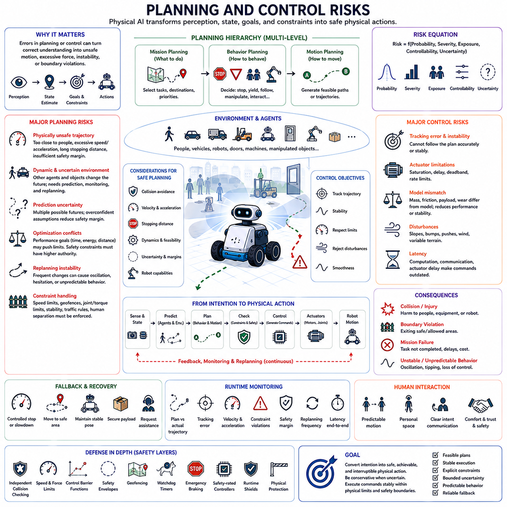{width="7.268055555555556in" height="7.268055555555556in"}

Planning and control risks arise because Physical AI must convert perception, state estimates, goals, predictions, and operational constraints into physical actions. Planning determines what the robot intends to do, while control determines how motors and actuators realize that intention. Errors at either stage can transform an otherwise correct understanding of the environment into unsafe motion, excessive force, unstable behavior, or violation of operational boundaries.

Planning operates across multiple horizons and levels of abstraction. Mission planning may select destinations or tasks, behavior planning may decide whether to stop, yield, follow, manipulate, or interact, and motion planning generates feasible paths or trajectories. These layers are interdependent. A high-level decision that is logically valid may still become unsafe if lower-level motion constraints, environmental dynamics, robot capabilities, or safety requirements are not represented correctly.

A fundamental planning risk is generation of a trajectory that is mathematically feasible but physically unsafe. A path may avoid known obstacles while passing too close to people, requiring excessive acceleration, exceeding available braking capability, or leaving insufficient margin for uncertainty. Safe planning must therefore consider more than geometric collision avoidance. Velocity, acceleration, curvature, stopping distance, dynamic feasibility, uncertainty, and safety margins must remain consistent with the robot\'s physical capabilities.

Dynamic environments make planning substantially more difficult because other agents continue moving while the robot executes its trajectory. Pedestrians, vehicles, forklifts, robots, doors, machinery, and manipulated objects can change the future occupancy of space. A trajectory that is safe when generated may become unsafe seconds or milliseconds later. Planning therefore requires continuous prediction, monitoring, replanning, and an ability to respond when observed behavior diverges from expected behavior.

Prediction uncertainty creates a direct planning risk. The future motion of people and other autonomous agents cannot be known exactly, and multiple plausible futures may exist simultaneously. If the planner commits too strongly to a single predicted trajectory, unexpected behavior can eliminate the remaining safety margin. Robust planning should account for alternative futures, uncertainty envelopes, reachable regions, and conservative assumptions when prediction confidence becomes insufficient for aggressive action.

Optimization objectives can also create unsafe behavior when performance goals conflict with safety. A planner designed to minimize travel time, energy consumption, distance, task duration, or manipulation effort may discover solutions that approach physical or operational limits. Safety should therefore not be represented merely as another weak optimization preference. Critical constraints such as collision avoidance, force limits, prohibited regions, stability requirements, and protective separation should have appropriate authority over performance objectives.

Control risks emerge when planned motion is translated into actuator commands. Tracking errors, controller instability, incorrect gains, actuator saturation, delayed feedback, model mismatch, numerical errors, or unexpected disturbances can cause the robot to deviate from the intended trajectory. Even a perfectly safe plan cannot guarantee safe execution if the control system cannot accurately and stably realize the commanded motion under actual payload, terrain, friction, and environmental conditions.

Model mismatch is particularly important because controllers often depend on simplified representations of robot dynamics. Actual mass, center of gravity, wheel-ground friction, joint elasticity, actuator response, payload inertia, or mechanical wear may differ from assumed values. These differences can increase overshoot, reduce stability, extend stopping distance, or degrade tracking performance. Adaptive or learned control can compensate for variation, but it also introduces additional uncertainty that must remain bounded.

Latency connects planning and control risks with the rest of the autonomy stack. Sensor processing, state estimation, prediction, planning, communication, scheduling, and actuator response all consume time. Commands may therefore be calculated from a state that has already changed by the time they are executed. High speed and rapidly changing environments amplify this problem. Safety analysis must consider end-to-end reaction time rather than evaluating planning or controller latency in isolation.

Replanning itself can introduce instability or undesirable behavior. Frequent changes in predicted obstacles or optimization results may cause oscillating trajectories, hesitation, repeated stopping, or rapid switching between alternatives. A robot that continuously changes its intention can also become difficult for humans to understand. Temporal consistency, hysteresis, commitment logic, and controlled transitions between behaviors can reduce unnecessary switching while preserving the ability to respond to genuine hazards.

Constraint handling is another critical safety issue. Physical AI may operate under speed limits, geofences, workspace boundaries, joint limits, torque limits, stability constraints, traffic rules, human separation requirements, or mission-specific restrictions. If these constraints are represented incorrectly, relaxed during optimization, or overridden by higher-level reasoning, the system may generate behavior that is efficient but unacceptable. Safety-critical constraints require explicit enforcement and clear precedence.

Control authority must also be managed when several subsystems can influence the same actuators. Autonomous planners, teleoperators, safety controllers, collision avoidance modules, stabilization systems, emergency functions, and manual controls may issue competing requests. Without defined arbitration and priority, simultaneous commands can produce unpredictable behavior. Safety architecture should establish which function has authority under normal, degraded, emergency, and recovery conditions.

Fallback and recovery behaviors create their own planning challenges. Simply stopping is not always the safest action. A vehicle stopping in an intersection, a manipulator releasing a heavy object, or a mobile robot blocking an emergency route may create additional hazards. Minimum-risk behavior must therefore consider the current physical and operational context. The appropriate response may involve controlled deceleration, moving to a safe area, maintaining a stable pose, securing a payload, or requesting assistance.

Human interaction adds another dimension because safe motion should often be predictable as well as physically collision-free. Abrupt acceleration, unnecessarily close passing, ambiguous yielding, oscillating paths, or unexpected approach directions can make people uncomfortable or cause them to react unpredictably. Human-aware planning should consider personal space, visibility, intent communication, reaction time, and socially understandable motion while preserving formal physical safety constraints.

Learned planners and control policies introduce risks associated with generalization and interpretability. Reinforcement learning, imitation learning, diffusion policies, and VLA-based action generation may produce effective behavior without explicit symbolic representation of every safety constraint. Their outputs can become unreliable under distribution shift or unusual combinations of conditions. Learned action generation should therefore operate within validated envelopes and remain subject to independent runtime safety constraints.

Runtime monitoring provides a mechanism for detecting divergence between intended and actual behavior. The system can compare planned and measured trajectories, commanded and actual velocity, predicted and observed motion, expected and measured actuator response, and remaining safety margins. Excessive tracking error, repeated replanning, unstable commands, constraint violations, or shrinking stopping margins can trigger degradation before the system reaches an immediately hazardous state.

Defense in depth separates intelligent performance from ultimate safety authority. Independent collision checking, speed and force limits, control barrier functions, safety envelopes, geofencing, watchdogs, emergency braking, safety-rated controllers, runtime shields, and physical protective mechanisms can constrain actions even when the primary planner generates an unsafe command. The exact mechanisms depend on the robot, but critical safety should not rely on a single planning or control algorithm.

Ultimately, planning and control safety concerns whether Physical AI can convert intention into physical action without crossing unacceptable risk boundaries. Safe autonomy requires feasible plans, stable execution, explicit constraints, bounded uncertainty, predictable behavior, continuous monitoring, and reliable fallback mechanisms. Planning should remain conservative when knowledge is uncertain, while control should ensure that commanded actions remain physically achievable and interruptible throughout execution.

계획 및 제어 위험(Planning and Control Risks)은 물리 AI(Physical AI)가 인지(Perception), 상태추정(State Estimation), 목표(Goal), 예측(Prediction), 운영 제약(Operational Constraint)을 물리적 행동으로 변환해야 하기 때문에 발생합니다. 계획(Planning)은 로봇이 무엇을 수행할 것인지를 결정하고, 제어(Control)는 모터와 액추에이터가 그 의도를 어떻게 실현할 것인지를 결정합니다. 어느 단계에서든 오류가 발생하면 환경을 올바르게 이해하고 있더라도 위험한 움직임, 과도한 힘, 불안정한 행동 또는 운영 경계 위반으로 이어질 수 있습니다.

계획(Planning)은 여러 시간 범위와 추상화 수준에서 수행됩니다. 임무 계획(Mission Planning)은 목적지나 작업을 선택하고, 행동 계획(Behavior Planning)은 정지, 양보, 추종, 조작 또는 상호작용 여부를 결정하며, 운동 계획(Motion Planning)은 실행 가능한 경로나 궤적을 생성합니다. 이러한 계층은 서로 의존합니다. 상위 수준의 결정이 논리적으로 타당하더라도 하위 수준의 운동 제약, 환경 동역학(Environmental Dynamics), 로봇의 능력 또는 안전 요구사항이 올바르게 표현되지 않으면 위험한 행동으로 이어질 수 있습니다.

계획에서 발생하는 근본적인 위험 중 하나는 수학적으로 실행 가능하지만 물리적으로는 안전하지 않은 궤적을 생성하는 것입니다. 경로가 알려진 장애물을 피하더라도 사람에게 지나치게 가까이 접근하거나, 과도한 가속을 요구하거나, 사용 가능한 제동 능력을 초과하거나, 불확실성에 대한 충분한 안전 여유를 확보하지 못할 수 있습니다. 따라서 안전한 계획은 단순한 기하학적 충돌 회피를 넘어 속도, 가속도, 곡률, 정지거리, 동역학적 실행 가능성(Dynamic Feasibility), 불확실성 및 안전 여유를 로봇의 물리적 능력과 일치시켜야 합니다.

동적 환경(Dynamic Environment)은 다른 에이전트가 로봇의 궤적 실행 중에도 계속 움직이기 때문에 계획을 훨씬 어렵게 만듭니다. 보행자, 차량, 지게차, 로봇, 문, 기계 및 조작 대상 물체는 미래 공간의 점유 상태를 변화시킬 수 있습니다. 생성 당시에는 안전했던 궤적도 수초 또는 수밀리초 후에는 위험해질 수 있습니다. 따라서 계획에는 지속적인 예측, 모니터링, 재계획(Replanning), 그리고 실제 관측된 행동이 예상된 행동에서 벗어날 때 대응할 수 있는 능력이 필요합니다.

예측 불확실성(Prediction Uncertainty)은 계획 위험으로 직접 연결됩니다. 사람과 다른 자율 에이전트의 미래 움직임을 정확하게 알 수 없으며, 동시에 여러 개의 가능한 미래가 존재할 수 있습니다. 계획기가 하나의 예측 궤적에 지나치게 강하게 의존하면 예상하지 못한 행동이 발생했을 때 남아 있던 안전 여유가 사라질 수 있습니다. 강건한 계획(Robust Planning)은 공격적인 행동을 안전하게 수행할 만큼 예측 신뢰도가 충분하지 않을 경우 대안적인 미래, 불확실성 영역(Uncertainty Envelope), 도달 가능 영역(Reachable Region), 보수적인 가정을 고려해야 합니다.

성능 목표와 안전이 충돌하는 경우 최적화 목적함수(Optimization Objective) 역시 위험한 행동을 발생시킬 수 있습니다. 이동시간, 에너지 소비, 거리, 작업시간 또는 조작 노력을 최소화하도록 설계된 계획기는 물리적 또는 운영상의 한계에 매우 근접하는 해를 선택할 수 있습니다. 따라서 안전을 단순히 약한 최적화 선호조건으로 표현해서는 안 됩니다. 충돌 회피, 힘 제한, 금지 영역, 안정성 요구조건, 보호 분리(Protective Separation)와 같은 핵심 제약은 성능 목표보다 적절하게 높은 우선권을 가져야 합니다.

제어 위험(Control Risk)은 계획된 움직임을 액추에이터 명령으로 변환하는 과정에서 발생합니다. 추종 오차(Tracking Error), 제어기 불안정성(Controller Instability), 잘못된 게인(Gain), 액추에이터 포화(Actuator Saturation), 지연된 피드백, 모델 불일치(Model Mismatch), 수치적 오류 또는 예상하지 못한 외란(Disturbance)은 로봇을 의도된 궤적에서 벗어나게 할 수 있습니다. 실제 적재물, 지형, 마찰 및 환경 조건에서 제어 시스템이 명령된 운동을 정확하고 안정적으로 구현할 수 없다면 완벽하게 안전한 계획조차 안전한 실행을 보장할 수 없습니다.

모델 불일치(Model Mismatch)는 제어기가 로봇 동역학의 단순화된 표현에 의존하는 경우가 많기 때문에 특히 중요합니다. 실제 질량, 무게중심(Center of Gravity), 바퀴와 지면 사이의 마찰, 관절 탄성, 액추에이터 응답, 적재물 관성 또는 기계적 마모는 가정된 값과 다를 수 있습니다. 이러한 차이는 오버슈트(Overshoot)를 증가시키고, 안정성을 감소시키며, 정지거리를 늘리거나 추종 성능을 저하시킬 수 있습니다. 적응형 또는 학습 기반 제어(Adaptive or Learned Control)는 이러한 변화를 보상할 수 있지만 추가적인 불확실성을 도입하므로 그 범위를 제한할 수 있어야 합니다.

지연시간(Latency)은 계획 및 제어 위험을 자율 시스템 스택(Autonomy Stack)의 다른 영역과 연결합니다. 센서 처리, 상태추정, 예측, 계획, 통신, 스케줄링 및 액추에이터 응답에는 모두 시간이 필요합니다. 따라서 명령이 실제로 실행되는 시점에는 명령 계산의 기준이 되었던 상태가 이미 변화했을 수 있습니다. 높은 속도와 빠르게 변화하는 환경은 이러한 문제를 더욱 확대합니다. 안전 분석에서는 계획기나 제어기의 지연시간을 개별적으로 평가하기보다 전체 종단 간 반응시간(End-to-End Reaction Time)을 고려해야 합니다.

재계획(Replanning) 자체도 불안정하거나 바람직하지 않은 행동을 발생시킬 수 있습니다. 예측된 장애물이나 최적화 결과가 빈번하게 변경되면 궤적 진동(Oscillating Trajectory), 주저하는 행동, 반복적인 정지 또는 여러 대안 사이의 빠른 전환이 발생할 수 있습니다. 지속적으로 의도를 변경하는 로봇은 사람이 행동을 이해하기 어렵게 만들 수도 있습니다. 시간적 일관성(Temporal Consistency), 히스테리시스(Hysteresis), 행동 유지 논리(Commitment Logic), 행동 간 제어된 전환은 실제 위험에 대응할 수 있는 능력을 유지하면서 불필요한 전환을 감소시킬 수 있습니다.

제약 처리(Constraint Handling)는 또 다른 핵심적인 안전 문제입니다. 물리 AI는 속도 제한, 지오펜스(Geofence), 작업공간 경계, 관절 한계, 토크 제한, 안정성 제약, 교통 규칙, 인간과의 분리 요구사항 또는 임무별 제한조건 아래에서 작동할 수 있습니다. 이러한 제약이 잘못 표현되거나 최적화 과정에서 완화되거나 상위 수준 추론에 의해 무시되면 효율적이지만 허용할 수 없는 행동이 생성될 수 있습니다. 안전 핵심 제약(Safety-Critical Constraint)은 명시적으로 강제되어야 하며 명확한 우선순위를 가져야 합니다.

여러 하위 시스템이 동일한 액추에이터에 영향을 줄 수 있는 경우 제어 권한(Control Authority) 역시 관리해야 합니다. 자율 계획기, 원격 조작자(Teleoperator), 안전 제어기, 충돌 회피 모듈, 안정화 시스템, 비상 기능 및 수동 제어가 서로 경쟁하는 명령을 생성할 수 있습니다. 명확한 중재(Arbitration)와 우선순위가 없으면 동시 명령이 예측하기 어려운 행동을 발생시킬 수 있습니다. 안전 아키텍처(Safety Architecture)는 정상, 성능 저하, 비상 및 복구 상태에서 어떤 기능이 최종 제어 권한을 가지는지를 정의해야 합니다.

폴백 및 복구 행동(Fallback and Recovery Behavior)은 그 자체로 계획상의 문제를 발생시킵니다. 단순히 정지하는 것이 항상 가장 안전한 행동은 아닙니다. 교차로에서 차량이 정지하거나, 매니퓰레이터가 무거운 물체를 놓거나, 이동 로봇이 비상 통로를 차단하면 추가적인 위험을 발생시킬 수 있습니다. 따라서 최소 위험 행동(Minimum-Risk Behavior)은 현재의 물리적·운영적 상황을 고려해야 합니다. 적절한 대응에는 제어된 감속, 안전 구역으로 이동, 안정적인 자세 유지, 적재물 고정 또는 외부 지원 요청 등이 포함될 수 있습니다.

인간 상호작용(Human Interaction)은 안전한 움직임이 물리적으로 충돌하지 않는 것뿐만 아니라 사람이 예측할 수 있어야 한다는 점에서 또 다른 차원을 추가합니다. 갑작스러운 가속, 불필요하게 가까운 통과, 모호한 양보 행동, 진동하는 경로 또는 예상하지 못한 접근 방향은 사람에게 불편함을 주거나 예측하기 어려운 반응을 유발할 수 있습니다. 인간 인식 계획(Human-Aware Planning)은 공식적인 물리 안전 제약을 유지하면서 개인 공간(Personal Space), 가시성, 의도 전달(Intent Communication), 반응시간 및 사회적으로 이해 가능한 움직임을 고려해야 합니다.

학습 기반 계획기 및 제어 정책(Learned Planner and Control Policy)은 일반화(Generalization)와 해석 가능성(Interpretability)에 관련된 위험을 추가합니다. 강화학습(Reinforcement Learning), 모방학습(Imitation Learning), 확산 정책(Diffusion Policy), VLA 기반 행동 생성(VLA-Based Action Generation)은 모든 안전 제약을 명시적인 기호 형태로 표현하지 않고도 효과적인 행동을 생성할 수 있습니다. 그러나 분포 이동(Distribution Shift)이나 비정상적인 조건 조합에서는 출력의 신뢰성이 저하될 수 있습니다. 따라서 학습 기반 행동 생성은 검증된 운영 범위(Validated Envelope) 내에서 이루어져야 하며 독립적인 런타임 안전 제약(Runtime Safety Constraint)의 적용을 받아야 합니다.

런타임 모니터링(Runtime Monitoring)은 의도된 행동과 실제 행동 사이의 차이를 탐지하는 메커니즘을 제공합니다. 시스템은 계획된 궤적과 측정된 궤적, 명령 속도와 실제 속도, 예측된 움직임과 관측된 움직임, 예상된 액추에이터 응답과 측정된 응답, 그리고 남아 있는 안전 여유를 비교할 수 있습니다. 과도한 추종 오차, 반복적인 재계획, 불안정한 명령, 제약 위반 또는 감소하는 정지 여유(Stopping Margin)는 시스템이 즉각적인 위험 상태에 도달하기 전에 성능 저하 대응을 시작하도록 할 수 있습니다.

심층 방어(Defense in Depth)는 지능적 성능(Intelligent Performance)과 최종적인 안전 권한(Ultimate Safety Authority)을 분리합니다. 독립적인 충돌 검사, 속도 및 힘 제한, 제어 장벽 함수(Control Barrier Function), 안전 영역(Safety Envelope), 지오펜싱(Geofencing), 워치독(Watchdog), 비상 제동, 안전 등급 제어기(Safety-Rated Controller), 런타임 실드(Runtime Shield), 물리적 보호 메커니즘은 주 계획기가 위험한 명령을 생성하더라도 행동을 제한할 수 있습니다. 구체적인 메커니즘은 로봇에 따라 달라지지만 핵심적인 안전을 하나의 계획 또는 제어 알고리즘에만 의존해서는 안 됩니다.

궁극적으로 계획 및 제어 안전(Planning and Control Safety)은 물리 AI가 허용할 수 없는 위험 경계(Unacceptable Risk Boundary)를 넘지 않으면서 의도(Intention)를 물리적 행동으로 변환할 수 있는가에 관한 문제입니다. 안전한 자율성(Safe Autonomy)을 위해서는 실행 가능한 계획, 안정적인 실행, 명시적인 제약, 제한된 불확실성, 예측 가능한 행동, 지속적인 모니터링 및 신뢰할 수 있는 폴백 메커니즘이 필요합니다. 지식이 불확실할 때 계획은 보수적으로 변화해야 하며, 제어는 명령된 행동이 실행 과정 전체에서 물리적으로 실현 가능하고 필요할 경우 언제든 안전하게 중단될 수 있도록 보장해야 합니다.

##  

## 01.08. AI Model and Inference Risks

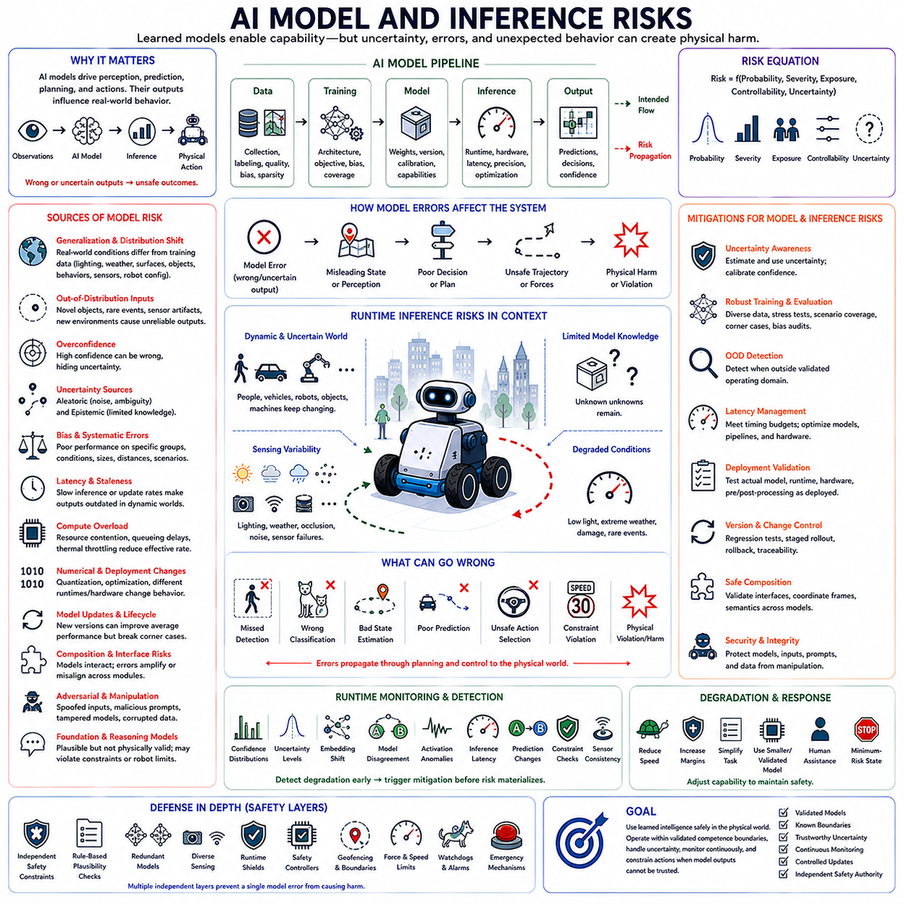{width="7.268055555555556in" height="7.268055555555556in"}

AI model and inference risks arise because Physical AI increasingly depends on learned models to interpret observations, predict states, select actions, and support decisions in the physical world. Unlike deterministic software, neural models approximate behavior from training data and optimization objectives rather than explicit rules. Their outputs can therefore be incorrect, uncertain, or unexpectedly sensitive to conditions that were poorly represented during development.

Model error becomes safety-critical when an incorrect output influences physical action. A classifier may assign the wrong object category, a detector may miss a person, a policy may choose an inappropriate maneuver, or a learned estimator may produce an inaccurate state. The important question is not simply whether the model makes errors, but whether those errors can propagate through planning and control until they alter forces, trajectories, interactions, or safety margins.

Generalization is a central concern because deployed environments rarely reproduce the training distribution exactly. Different lighting, weather, surfaces, objects, robot configurations, sensor characteristics, human behavior, or operational contexts may change the statistical structure of model inputs. A model that performs well on validation benchmarks can therefore behave differently after deployment, especially when encountering combinations of conditions that were rare or absent during training.

Out-of-distribution inputs create a particularly difficult problem because the model may receive observations for which its learned representation provides little reliable basis for prediction. Novel objects, unusual geometry, damaged infrastructure, rare human behavior, sensor artifacts, or previously unseen environments can produce outputs that appear normal despite being unreliable. Detecting when the model has moved beyond its validated competence is therefore a fundamental requirement for safe inference.

Confidence and correctness are not equivalent. Neural models can produce high-confidence predictions that are wrong, particularly under distribution shift, ambiguous observations, adversarial conditions, or poorly calibrated probability estimates. If downstream systems interpret confidence scores as direct measures of safety, overconfidence can suppress conservative responses. Model calibration, uncertainty estimation, disagreement analysis, and independent plausibility checks are needed to determine how strongly an inference should influence physical behavior.

Inference uncertainty may arise from several sources. Aleatoric uncertainty reflects ambiguity or noise inherent in observations, while epistemic uncertainty reflects limited model knowledge caused by insufficient data or unfamiliar conditions. Physical AI must often operate with both simultaneously. Distinguishing their practical effects can help determine whether additional sensing, slower operation, alternative reasoning, human assistance, or withdrawal from the current task is the safer response.

Model architecture and training objectives can introduce systematic biases that are not visible through aggregate accuracy. A model may perform poorly on small objects, distant obstacles, unusual poses, specific environmental conditions, or rare interaction patterns while maintaining strong average metrics. Safety evaluation must therefore examine performance across operationally meaningful scenarios rather than assuming that a single benchmark score represents reliability throughout the operational design domain.

Inference latency creates another form of model risk. Larger neural networks, multimodal models, ensembles, world models, and reasoning-intensive systems may improve capability while requiring more computation. If inference exceeds its timing budget, an accurate prediction can become stale before planning or control uses it. Physical AI therefore requires joint evaluation of accuracy, latency, update frequency, compute availability, worst-case execution time, and the physical dynamics of the controlled system.

Compute overload can make inference behavior unpredictable at the system level. Concurrent perception, localization, mapping, prediction, planning, VLA reasoning, logging, and communication may compete for GPU, CPU, memory, and bandwidth. Queueing delays, memory pressure, thermal throttling, or task scheduling can reduce effective inference rates. Runtime resource management must therefore treat computational capacity as a safety-relevant resource rather than assuming constant model execution performance.

Numerical precision and deployment optimization can also change model behavior. Quantization, pruning, compilation, hardware acceleration, reduced-precision arithmetic, operator substitution, or conversion between model runtimes may alter outputs compared with the development environment. Small numerical differences may be insignificant for many predictions but important near decision boundaries. Deployment validation should therefore test the actual model, runtime, accelerator, preprocessing pipeline, and configuration used on the physical platform.

Model updates introduce lifecycle risk because changing weights, prompts, adapters, preprocessing, thresholds, or inference software can modify system behavior even when the surrounding robot remains unchanged. A new model may improve average performance while degrading a safety-critical corner case. Version control, regression testing, configuration management, traceability, staged deployment, rollback capability, and validation against safety-relevant scenarios are therefore essential elements of Physical AI model governance.

Learned models can also fail through incorrect composition. Individual models may perform acceptably in isolation while their combined outputs produce unsafe behavior. Perception confidence may be interpreted incorrectly by a planner, a learned prediction model may assume a different coordinate convention, or multiple models may amplify correlated errors. System safety therefore requires interface validation and end-to-end testing rather than relying solely on component-level model metrics.

Adversarial inputs and intentional manipulation extend AI inference risk into cyber-physical security. Carefully modified visual patterns, spoofed sensor signals, malicious prompts, corrupted model files, or manipulated contextual information may influence model outputs. Physical consequences make these failures more serious than ordinary digital misclassification. High-consequence actions should therefore require stronger validation than a single learned inference, especially when inputs can be externally manipulated.

Foundation models and multimodal reasoning systems introduce additional uncertainty because their outputs may be semantically convincing without being physically grounded. A model can generate a plausible explanation, plan, or action sequence that violates robot geometry, actuator limits, environmental constraints, or safety rules. Language-level plausibility must not be interpreted as physical feasibility. Learned reasoning should therefore remain connected to verified state, explicit constraints, and executable safety checks.

Runtime model monitoring should detect changes in both input conditions and output behavior. Useful indicators include confidence distributions, uncertainty, embedding shift, disagreement between models, unusual activation patterns, inference latency, repeated prediction changes, invalid outputs, and disagreement with physical constraints or independent sensors. Monitoring should focus not only on detecting complete model failure but also on recognizing gradual loss of reliability before unsafe decisions occur.

When model reliability decreases, Physical AI should degrade capability rather than preserve nominal autonomy at all costs. The system may reduce speed, enlarge safety margins, simplify tasks, switch to a smaller validated model, rely more strongly on independent sensing, restrict autonomous functions, request human supervision, or enter a minimum-risk state. The appropriate response depends on the model\'s role and on the severity of the physical consequences associated with an incorrect inference.

Defense in depth is essential because no learned model can be assumed to be correct under every operational condition. Independent safety constraints, rule-based plausibility checks, redundant models, diverse sensing, runtime shields, safety controllers, geofencing, force and speed limits, uncertainty-aware planning, watchdogs, and emergency mechanisms can prevent an erroneous inference from directly commanding hazardous physical behavior. AI capability and final safety authority should remain appropriately separated.

Ultimately, AI model and inference safety concerns whether learned intelligence can be used without allowing uncertainty, generalization failure, overconfidence, latency, deployment changes, or unexpected model behavior to become physical harm. Safe Physical AI requires validated models, explicit competence boundaries, trustworthy uncertainty handling, continuous runtime monitoring, controlled updates, conservative degradation, and independent mechanisms capable of constraining actions when model outputs cannot be trusted.

AI 모델 및 추론 위험(AI Model and Inference Risks)은 물리 AI(Physical AI)가 물리적 세계에서 관측을 해석하고, 상태를 예측하며, 행동을 선택하고, 의사결정을 지원하기 위해 학습된 모델(Learned Model)에 점점 더 의존하기 때문에 발생합니다. 결정론적 소프트웨어(Deterministic Software)와 달리 신경망 모델(Neural Model)은 명시적인 규칙이 아니라 학습 데이터와 최적화 목적함수(Optimization Objective)를 통해 행동을 근사합니다. 따라서 출력은 잘못되거나 불확실할 수 있으며 개발 과정에서 충분히 표현되지 않은 조건에 예상하지 못한 민감성을 나타낼 수 있습니다.

모델 오류(Model Error)는 잘못된 출력이 물리적 행동에 영향을 미칠 때 안전에 치명적인 문제가 됩니다. 분류기(Classifier)는 잘못된 객체 범주를 지정할 수 있고, 탐지기(Detector)는 사람을 놓칠 수 있으며, 정책(Policy)은 부적절한 기동을 선택할 수 있고, 학습 기반 추정기(Learned Estimator)는 부정확한 상태를 출력할 수 있습니다. 중요한 것은 단순히 모델이 오류를 발생시키는가가 아니라 이러한 오류가 계획과 제어를 거쳐 전파되어 힘, 궤적, 상호작용 또는 안전 여유를 변화시킬 수 있는가입니다.

일반화(Generalization)는 배포 환경이 학습 분포(Training Distribution)를 정확하게 재현하는 경우가 거의 없기 때문에 핵심적인 문제입니다. 서로 다른 조명, 날씨, 표면, 물체, 로봇 구성, 센서 특성, 인간 행동 또는 운영 맥락은 모델 입력의 통계적 구조를 변화시킬 수 있습니다. 따라서 검증 벤치마크(Validation Benchmark)에서 우수한 성능을 보인 모델도 배포 이후에는 다르게 행동할 수 있으며, 특히 학습 과정에서 드물거나 존재하지 않았던 조건의 조합을 만날 때 이러한 문제가 커질 수 있습니다.

분포 외 입력(Out-of-Distribution Input)은 모델이 신뢰할 수 있는 예측을 생성하기 위한 학습 표현의 근거가 부족한 관측을 받을 수 있기 때문에 특히 어려운 문제를 발생시킵니다. 새로운 물체, 특이한 형상, 손상된 인프라, 드문 인간 행동, 센서 아티팩트(Sensor Artifact), 이전에 보지 못한 환경에서도 신뢰할 수 없는 출력이 정상적인 결과처럼 나타날 수 있습니다. 따라서 모델이 검증된 능력 범위(Validated Competence)를 벗어났는지를 탐지하는 것은 안전한 추론을 위한 근본적인 요구사항입니다.

신뢰도(Confidence)와 정확성(Correctness)은 동일하지 않습니다. 신경망 모델은 특히 분포 이동(Distribution Shift), 모호한 관측, 적대적 조건 또는 제대로 보정되지 않은 확률 추정에서 잘못된 예측에 높은 신뢰도를 부여할 수 있습니다. 이후 시스템이 신뢰도 점수를 직접적인 안전 척도로 해석한다면 과신(Overconfidence)은 보수적인 대응을 억제할 수 있습니다. 따라서 모델 보정(Model Calibration), 불확실성 추정(Uncertainty Estimation), 불일치 분석(Disagreement Analysis), 독립적인 타당성 검사(Plausibility Check)를 통해 추론 결과가 물리적 행동에 어느 정도 영향을 주어야 하는지를 판단해야 합니다.

추론 불확실성(Inference Uncertainty)은 여러 원인에서 발생할 수 있습니다. 우연적 불확실성(Aleatoric Uncertainty)은 관측 자체에 내재된 모호성이나 잡음을 나타내며, 인식론적 불확실성(Epistemic Uncertainty)은 부족한 데이터나 익숙하지 않은 조건으로 인한 제한된 모델 지식을 나타냅니다. 물리 AI는 두 종류의 불확실성을 동시에 처리해야 하는 경우가 많습니다. 각각의 실질적인 영향을 구분하면 추가 센싱, 저속 운행, 대안적 추론, 인간 지원 또는 현재 작업에서 철수하는 것 중 어느 대응이 더 안전한지를 결정하는 데 도움이 됩니다.

모델 아키텍처(Model Architecture)와 학습 목적함수(Training Objective)는 전체 평균 정확도만으로는 드러나지 않는 체계적 편향(Systematic Bias)을 발생시킬 수 있습니다. 모델은 높은 평균 성능을 유지하면서도 작은 물체, 먼 장애물, 특이한 자세, 특정 환경 조건 또는 드문 상호작용 패턴에서 낮은 성능을 나타낼 수 있습니다. 따라서 안전 평가는 하나의 벤치마크 점수가 전체 운영 설계 영역(Operational Design Domain)의 신뢰성을 대표한다고 가정하지 않고 운영상 의미 있는 시나리오별 성능을 평가해야 합니다.

추론 지연시간(Inference Latency)은 또 다른 형태의 모델 위험을 발생시킵니다. 더 큰 신경망, 멀티모달 모델(Multimodal Model), 앙상블(Ensemble), 월드 모델(World Model), 추론 집약적 시스템은 능력을 향상시키는 대신 더 많은 계산을 요구할 수 있습니다. 추론 시간이 허용된 타이밍 예산(Timing Budget)을 초과하면 정확한 예측이라도 계획이나 제어에서 사용되는 시점에는 오래된 정보가 될 수 있습니다. 따라서 물리 AI는 정확도, 지연시간, 갱신 빈도, 컴퓨팅 가용성, 최악 실행시간(Worst-Case Execution Time), 제어 대상 시스템의 물리적 동역학을 함께 평가해야 합니다.

컴퓨팅 과부하(Compute Overload)는 시스템 수준에서 추론 동작을 예측하기 어렵게 만들 수 있습니다. 인지, 위치추정, 지도 작성, 예측, 계획, VLA 추론, 로깅 및 통신이 GPU, CPU, 메모리 및 대역폭을 두고 경쟁할 수 있습니다. 대기열 지연(Queueing Delay), 메모리 압박, 열 스로틀링(Thermal Throttling), 작업 스케줄링은 실질적인 추론 주기를 감소시킬 수 있습니다. 따라서 런타임 자원 관리(Runtime Resource Management)는 모델 실행 성능이 항상 일정하다고 가정하지 않고 컴퓨팅 용량을 안전과 관련된 자원(Safety-Relevant Resource)으로 다루어야 합니다.

수치 정밀도(Numerical Precision)와 배포 최적화(Deployment Optimization) 역시 모델의 동작을 변화시킬 수 있습니다. 양자화(Quantization), 가지치기(Pruning), 컴파일, 하드웨어 가속, 저정밀 연산(Reduced-Precision Arithmetic), 연산자 대체(Operator Substitution), 모델 런타임 간 변환은 개발 환경과 비교하여 출력 결과를 변경할 수 있습니다. 작은 수치적 차이는 대부분의 예측에서는 중요하지 않을 수 있지만 의사결정 경계(Decision Boundary) 근처에서는 중요할 수 있습니다. 따라서 배포 검증은 실제 물리 플랫폼에서 사용하는 모델, 런타임, 가속기, 전처리 파이프라인 및 구성을 대상으로 수행해야 합니다.

모델 업데이트(Model Update)는 가중치, 프롬프트(Prompt), 어댑터(Adapter), 전처리, 임계값 또는 추론 소프트웨어를 변경하는 것만으로도 주변 로봇 하드웨어의 변화 없이 시스템 행동을 변화시킬 수 있으므로 생명주기 위험(Lifecycle Risk)을 발생시킵니다. 새로운 모델은 평균 성능을 향상시키면서도 안전에 중요한 코너 케이스(Corner Case)의 성능을 저하시킬 수 있습니다. 따라서 버전 관리, 회귀 시험(Regression Testing), 구성 관리(Configuration Management), 추적성(Traceability), 단계적 배포(Staged Deployment), 롤백(Rollback) 기능, 안전 관련 시나리오에 대한 검증은 물리 AI 모델 거버넌스(Model Governance)의 필수 요소입니다.

학습 모델은 잘못된 구성 또는 결합(Incorrect Composition)을 통해서도 실패할 수 있습니다. 개별 모델이 독립적으로는 적절하게 작동하더라도 결합된 출력이 위험한 행동을 만들 수 있습니다. 인지 신뢰도가 계획기에 잘못 해석되거나, 학습 기반 예측 모델이 서로 다른 좌표계 규칙을 가정하거나, 여러 모델이 상관된 오류(Correlated Error)를 증폭시킬 수 있습니다. 따라서 시스템 안전에는 구성요소 수준의 모델 지표뿐만 아니라 인터페이스 검증(Interface Validation)과 종단 간 시험(End-to-End Testing)이 필요합니다.

적대적 입력(Adversarial Input)과 의도적인 조작은 AI 추론 위험을 사이버-물리 보안(Cyber-Physical Security)으로 확장합니다. 정교하게 변조된 시각 패턴, 스푸핑된 센서 신호, 악의적인 프롬프트(Malicious Prompt), 손상된 모델 파일 또는 조작된 맥락 정보는 모델 출력을 변화시킬 수 있습니다. 물리적 결과를 발생시킬 수 있다는 점에서 이러한 고장은 일반적인 디지털 오분류보다 심각합니다. 따라서 결과의 심각성이 높은 행동은 특히 외부에서 입력을 조작할 수 있는 경우 하나의 학습 기반 추론보다 강력한 검증을 요구해야 합니다.

파운데이션 모델(Foundation Model)과 멀티모달 추론 시스템(Multimodal Reasoning System)은 출력이 의미적으로는 설득력 있으면서도 물리적 기반(Physical Grounding)이 부족할 수 있기 때문에 추가적인 불확실성을 발생시킵니다. 모델은 로봇 형상, 액추에이터 한계, 환경 제약 또는 안전 규칙을 위반하면서도 그럴듯한 설명, 계획 또는 행동 순서를 생성할 수 있습니다. 언어 수준의 개연성(Language-Level Plausibility)을 물리적 실행 가능성(Physical Feasibility)으로 해석해서는 안 됩니다. 따라서 학습 기반 추론은 검증된 상태, 명시적인 제약 및 실행 가능한 안전 검사와 연결되어야 합니다.

런타임 모델 모니터링(Runtime Model Monitoring)은 입력 조건과 출력 행동 모두의 변화를 탐지해야 합니다. 유용한 지표에는 신뢰도 분포, 불확실성, 임베딩 이동(Embedding Shift), 모델 간 불일치, 비정상적인 활성화 패턴, 추론 지연시간, 반복적인 예측 변경, 유효하지 않은 출력, 물리적 제약 또는 독립 센서와의 불일치 등이 포함됩니다. 모니터링은 완전한 모델 고장만 탐지하는 것이 아니라 위험한 의사결정이 발생하기 전에 신뢰성이 점진적으로 감소하는 상태를 인식하는 데 초점을 맞춰야 합니다.

모델 신뢰성(Model Reliability)이 감소하면 물리 AI는 어떤 상황에서도 정상적인 자율성을 유지하려 하기보다 능력을 단계적으로 저하시켜야 합니다. 시스템은 속도를 줄이고, 안전 여유를 확대하고, 작업을 단순화하거나, 검증된 소형 모델로 전환하고, 독립적인 센싱에 더 강하게 의존하며, 자율 기능을 제한하거나, 인간 감독(Human Supervision)을 요청하거나, 최소 위험 상태(Minimum-Risk State)로 진입할 수 있습니다. 적절한 대응 방식은 해당 모델의 역할과 잘못된 추론이 초래할 수 있는 물리적 결과의 심각성에 따라 달라집니다.

모든 운영 조건에서 학습 모델이 항상 정확하다고 가정할 수 없으므로 심층 방어(Defense in Depth)가 필수적입니다. 독립적인 안전 제약, 규칙 기반 타당성 검사(Rule-Based Plausibility Check), 중복 모델, 다양한 센싱(Diverse Sensing), 런타임 실드(Runtime Shield), 안전 제어기(Safety Controller), 지오펜싱(Geofencing), 힘 및 속도 제한, 불확실성 인식 계획(Uncertainty-Aware Planning), 워치독(Watchdog), 비상 메커니즘을 통해 잘못된 추론이 위험한 물리적 행동을 직접 명령하지 못하도록 할 수 있습니다. AI의 지능적 능력과 최종적인 안전 권한(Final Safety Authority)은 적절하게 분리되어야 합니다.

궁극적으로 AI 모델 및 추론 안전(AI Model and Inference Safety)은 학습된 지능을 활용하면서도 불확실성, 일반화 실패(Generalization Failure), 과신, 지연시간, 배포 변경 또는 예상하지 못한 모델 행동이 물리적 피해로 전환되지 않도록 하는 문제입니다. 안전한 물리 AI는 검증된 모델, 명시적인 능력 경계(Competence Boundary), 신뢰할 수 있는 불확실성 처리, 지속적인 런타임 모니터링, 통제된 업데이트, 보수적인 성능 저하(Conservative Degradation), 그리고 모델 출력을 신뢰할 수 없을 때 행동을 제한할 수 있는 독립적인 안전 메커니즘을 필요로 합니다.

##  

## 01.09. Data and Distribution Shift Risks

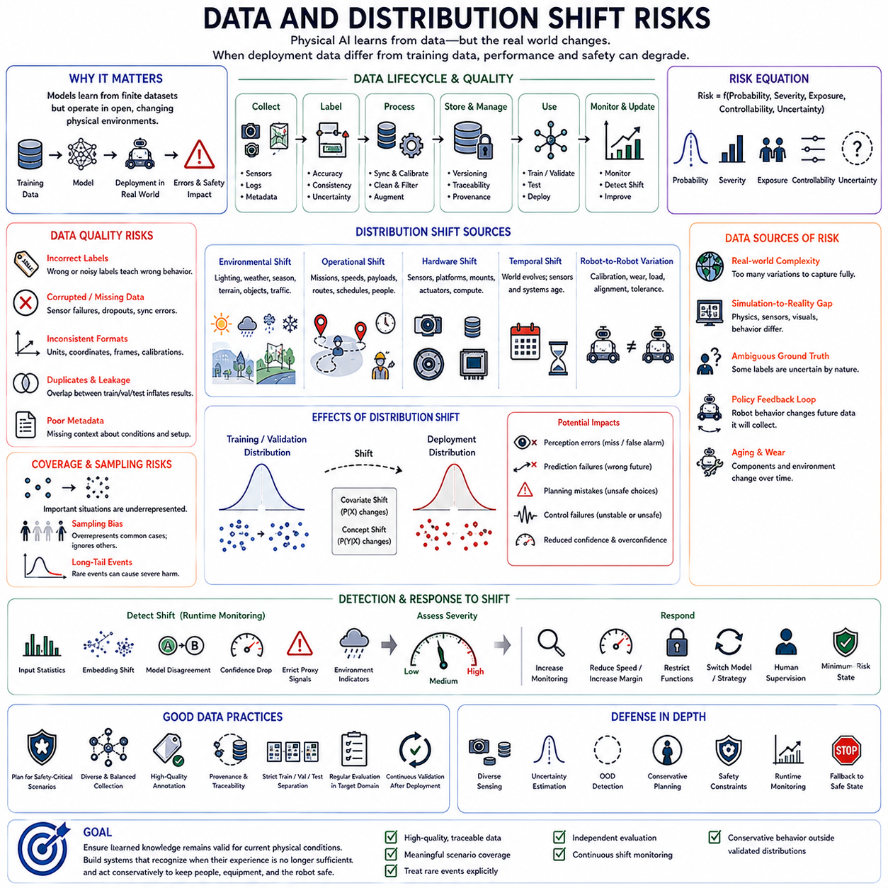{width="7.268055555555556in" height="7.268055555555556in"}

Data and distribution shift risks arise because Physical AI learns from finite datasets but operates in open, changing physical environments. Training data can represent only a subset of possible objects, locations, weather conditions, human behaviors, robot states, and interactions. When deployment conditions differ from those represented during development, learned perception, prediction, planning, and control functions may produce errors even when the underlying models remain technically unchanged.

Data quality determines the foundation on which learned behavior is constructed. Incorrect labels, corrupted sensor records, synchronization errors, duplicated samples, missing metadata, inaccurate calibration, inconsistent coordinate frames, or faulty preprocessing can introduce systematic errors during training. Because large datasets are difficult to inspect manually, subtle defects may remain hidden while models learn patterns that appear statistically useful but are physically incorrect or operationally misleading.

Coverage is equally important because a dataset can be large without representing the situations that matter most for safety. Millions of ordinary driving, navigation, or manipulation examples may contain very few emergency stops, unusual obstacles, unstable payloads, rare weather conditions, near collisions, sensor failures, or unexpected human actions. Safety-critical development must therefore evaluate scenario diversity and consequence relevance rather than treating dataset size alone as evidence of sufficient coverage.

Sampling bias occurs when collected data overrepresent some environments, users, objects, behaviors, or operating conditions while underrepresenting others. A warehouse robot trained mainly in wide, well-lit aisles may perform differently in narrow, reflective, crowded areas. An outdoor system trained primarily during clear weather may degrade in rain, fog, snow, or low sunlight. These biases can remain invisible in average performance metrics if evaluation data reproduce the same collection process.

Long-tail events create a fundamental challenge because rare situations can have disproportionately severe physical consequences. A child suddenly entering a robot path, an unusual vehicle configuration, a fallen object, unexpected machinery motion, or simultaneous sensor degradation may occur too infrequently to be adequately represented in ordinary operational data. Physical AI safety therefore requires deliberate scenario construction, simulation, synthetic data, targeted collection, and stress testing to supplement naturally observed examples.

Distribution shift occurs when the statistical properties of deployment data differ from those used during training or validation. Covariate shift can change the distribution of inputs, while changes in behavior, environment, system configuration, or causal relationships can alter the relationship between observations and correct outputs. In Physical AI, these shifts may emerge gradually through environmental evolution or suddenly when the robot enters a new operational domain.

Environmental shift includes changes in lighting, weather, season, terrain, architecture, traffic patterns, infrastructure, or surrounding objects. Operational shift occurs when mission types, speeds, payloads, routes, work schedules, or human interaction patterns change. Hardware shift can result from replacing cameras, LiDAR, lenses, tires, actuators, compute platforms, or sensor mounting positions. Each shift can invalidate assumptions embedded in datasets even if software and model weights remain unchanged.

Temporal distribution shift is especially important for long-lived robotic systems. A factory layout may evolve, roads may be reconstructed, vegetation may grow, equipment may move, and human workflows may change over months or years. Sensors and mechanical components also age. Consequently, data collected during initial deployment can gradually become less representative. Continuous validation is necessary to determine whether the operational environment still resembles the conditions under which the system was qualified.

Robot-to-robot variation introduces another source of distribution mismatch. Two platforms of the same nominal design can differ through sensor calibration, manufacturing tolerance, tire wear, payload configuration, camera alignment, actuator characteristics, or maintenance history. A model trained and validated on one reference platform may therefore experience shifted inputs or dynamics on another. Fleet deployment requires validation of both common model behavior and platform-specific deviations.

Label quality creates particular difficulties for complex Physical AI datasets. Ground truth for object boundaries, depth, velocity, future trajectories, contact states, traversability, human intent, or manipulation success may itself contain uncertainty. Some phenomena cannot be assigned a single objectively correct label. Dataset design should therefore distinguish annotation error from genuine ambiguity and avoid forcing uncertain physical situations into artificial certainty that can later produce overconfident models.

Synthetic and simulated data can expand coverage of rare events, but they introduce a simulation-to-reality gap(Sim-to-Real Gap). Rendering, sensor noise, physics, material properties, human behavior, contact dynamics, and environmental variability may differ from reality. Models can exploit simulation artifacts that have no real-world meaning. Synthetic data should therefore complement rather than automatically replace real data, with explicit validation that simulated variation improves performance under actual deployment conditions.

Data leakage can create misleading evaluation results when training and test datasets are not sufficiently independent. Nearly identical scenes, repeated routes, adjacent video frames, duplicated objects, or data from the same physical environment can appear across splits, causing benchmark performance to overestimate real-world generalization. Physical AI evaluation should separate data according to meaningful operational dimensions such as location, time, environment, platform, scenario, and condition whenever appropriate.

Feedback loops can alter future data distributions after deployment. Once robots begin acting autonomously, their policies influence which situations they encounter and which data are collected. Conservative robots may rarely observe difficult interactions, while optimization toward efficient routes may concentrate experience in specific environments. Models retrained from this operational data can reinforce existing behavioral patterns or blind spots. Data collection strategy must therefore account for policy-dependent sampling.

Dataset provenance and traceability are essential for understanding what a model has actually learned from. Each dataset should preserve information about source, collection conditions, sensor configuration, processing history, annotation method, version, licensing, and known limitations where applicable. Without provenance, developers may be unable to determine whether a newly observed failure reflects missing coverage, corrupted data, outdated assumptions, preprocessing changes, or differences between training and deployment.

Runtime shift detection provides a bridge between offline data governance and online safety. Systems can monitor input statistics, embeddings, sensor characteristics, environmental indicators, prediction confidence, model disagreement, and performance proxies for evidence that current conditions differ from validated data. No single metric perfectly identifies distribution shift, so multiple signals and contextual checks are often required before deciding whether the system remains within its validated operating envelope.

Detected shift should influence behavior according to its magnitude and safety significance. Minor deviation may require additional monitoring, while stronger shift may justify reduced speed, larger safety margins, restricted functions, alternative models, human supervision, or transition to a minimum-risk state. The objective is not to stop whenever data look unfamiliar, but to prevent nominal autonomy from continuing unchanged when the evidence supporting model reliability has materially weakened.

Data lifecycle management must continue after deployment. New operational data can reveal failure modes, environmental changes, rare scenarios, and previously unknown edge cases. These observations can support retraining and validation, but new data should pass quality control, provenance tracking, scenario classification, and regression testing before influencing production models. Continuous learning without controlled validation can introduce new risks faster than it removes existing ones.

Defense in depth reduces dependence on perfect dataset representativeness. Diverse sensing, uncertainty estimation, out-of-distribution detection, independent safety constraints, conservative planning, runtime monitoring, scenario testing, simulation, targeted edge-case collection, model ensembles, and minimum-risk fallback behavior can limit the consequences of unseen conditions. Data-driven intelligence should remain bounded by safety mechanisms that do not assume every important physical situation was present in training.

Ultimately, data and distribution shift safety concerns whether knowledge learned from past observations remains valid for the physical conditions encountered now. Safe Physical AI requires high-quality and traceable datasets, meaningful scenario coverage, explicit treatment of rare events, independent evaluation, continuous shift monitoring, controlled data updates, and conservative behavior outside validated distributions. The system must recognize when its experience no longer provides sufficient evidence for confident physical action.

데이터 및 분포 이동 위험(Data and Distribution Shift Risks)은 물리 AI(Physical AI)가 유한한 데이터셋(Dataset)으로부터 학습하지만 개방적이고 지속적으로 변화하는 물리적 환경에서 작동하기 때문에 발생합니다. 학습 데이터(Training Data)는 가능한 물체, 위치, 기상 조건, 인간 행동, 로봇 상태 및 상호작용의 일부만 표현할 수 있습니다. 배포 조건이 개발 과정에서 표현된 조건과 달라지면 기반 모델 자체가 기술적으로 변경되지 않았더라도 학습 기반 인지, 예측, 계획 및 제어 기능에서 오류가 발생할 수 있습니다.

데이터 품질(Data Quality)은 학습된 행동이 구축되는 기반을 결정합니다. 잘못된 라벨, 손상된 센서 기록, 동기화 오류, 중복 샘플, 누락된 메타데이터, 부정확한 캘리브레이션, 일관되지 않은 좌표계 또는 잘못된 전처리(Preprocessing)는 학습 과정에서 체계적인 오류를 발생시킬 수 있습니다. 대규모 데이터셋은 사람이 직접 검사하기 어렵기 때문에 미묘한 결함이 발견되지 않은 채 남을 수 있으며, 모델은 통계적으로 유용해 보이지만 물리적으로 잘못되거나 운영 측면에서 오해를 일으키는 패턴을 학습할 수 있습니다.

커버리지(Coverage) 역시 중요합니다. 데이터셋의 규모가 크다고 해서 안전에 중요한 상황을 충분히 표현하고 있다는 의미는 아니기 때문입니다. 수백만 개의 일반적인 주행, 내비게이션 또는 조작 사례가 존재하더라도 비상 정지, 특이한 장애물, 불안정한 적재물, 드문 기상 조건, 충돌 직전 상황, 센서 고장 또는 예상하지 못한 인간 행동은 매우 적게 포함될 수 있습니다. 따라서 안전 핵심 개발(Safety-Critical Development)에서는 데이터셋 크기만을 충분한 커버리지의 근거로 간주하지 않고 시나리오 다양성(Scenario Diversity)과 결과의 중요성을 평가해야 합니다.

샘플링 편향(Sampling Bias)은 수집된 데이터가 특정 환경, 사용자, 물체, 행동 또는 운영 조건을 과도하게 표현하고 다른 조건을 충분히 표현하지 못할 때 발생합니다. 넓고 조명이 밝은 통로에서 주로 학습된 창고 로봇은 좁고 반사가 심하며 혼잡한 영역에서 다른 성능을 나타낼 수 있습니다. 맑은 날씨에서 주로 학습된 실외 시스템 역시 비, 안개, 눈 또는 낮은 태양광 조건에서 성능이 저하될 수 있습니다. 평가 데이터가 동일한 수집 과정을 반복한다면 이러한 편향은 평균 성능 지표에서 드러나지 않을 수 있습니다.

롱테일 사건(Long-Tail Event)은 드물게 발생하면서도 물리적으로 매우 심각한 결과를 초래할 수 있기 때문에 근본적인 문제를 발생시킵니다. 어린이가 갑자기 로봇의 경로에 진입하거나, 특이한 차량 구성, 쓰러진 물체, 예상하지 못한 기계 움직임 또는 여러 센서의 동시 성능 저하와 같은 상황은 일반적인 운영 데이터에 충분히 포함되기 어려울 수 있습니다. 따라서 물리 AI 안전에서는 자연적으로 관측된 사례를 보완하기 위해 의도적인 시나리오 구성, 시뮬레이션, 합성 데이터(Synthetic Data), 표적 데이터 수집(Targeted Collection), 스트레스 테스트(Stress Testing)가 필요합니다.

분포 이동(Distribution Shift)은 배포 데이터의 통계적 특성이 학습 또는 검증 과정에서 사용된 데이터와 달라질 때 발생합니다. 공변량 이동(Covariate Shift)은 입력 분포를 변화시킬 수 있으며, 행동, 환경, 시스템 구성 또는 인과관계(Causal Relationship)의 변화는 관측과 올바른 출력 사이의 관계를 변화시킬 수 있습니다. 물리 AI에서 이러한 변화는 환경이 진화하면서 점진적으로 나타날 수도 있고, 로봇이 새로운 운영 영역에 진입하면서 갑작스럽게 발생할 수도 있습니다.

환경 이동(Environmental Shift)은 조명, 날씨, 계절, 지형, 건축 구조, 교통 패턴, 인프라 또는 주변 물체의 변화를 포함합니다. 운영 이동(Operational Shift)은 임무 유형, 속도, 적재물, 경로, 작업 일정 또는 인간 상호작용 패턴이 변화할 때 발생합니다. 하드웨어 이동(Hardware Shift)은 카메라, 라이다(LiDAR), 렌즈, 타이어, 액추에이터, 컴퓨팅 플랫폼 또는 센서 장착 위치를 교체하면서 발생할 수 있습니다. 각각의 변화는 소프트웨어와 모델 가중치가 동일하게 유지되더라도 데이터셋에 내재된 가정을 무효화할 수 있습니다.

시간적 분포 이동(Temporal Distribution Shift)은 장기간 운용되는 로봇 시스템에서 특히 중요합니다. 공장의 배치가 변경되고, 도로가 재건되며, 식생이 성장하고, 장비가 이동하며, 인간의 작업 흐름이 수개월 또는 수년에 걸쳐 변화할 수 있습니다. 센서와 기계 부품도 시간이 지나면서 노화됩니다. 따라서 초기 배포 과정에서 수집된 데이터는 점진적으로 현재 환경을 대표하지 못하게 될 수 있습니다. 운영 환경이 시스템의 검증 당시 조건과 여전히 유사한지를 판단하기 위해 지속적인 검증(Continuous Validation)이 필요합니다.

로봇 간 변동(Robot-to-Robot Variation)은 또 다른 분포 불일치(Distribution Mismatch)의 원인이 됩니다. 동일한 명목 설계를 가진 두 플랫폼도 센서 캘리브레이션, 제조 공차(Manufacturing Tolerance), 타이어 마모, 적재물 구성, 카메라 정렬, 액추에이터 특성 또는 유지보수 이력에서 차이가 발생할 수 있습니다. 따라서 하나의 기준 플랫폼에서 학습되고 검증된 모델이 다른 플랫폼에서는 변화된 입력이나 동역학을 경험할 수 있습니다. 플릿 배포(Fleet Deployment)에서는 공통적인 모델 행동과 플랫폼별 편차를 모두 검증해야 합니다.

라벨 품질(Label Quality)은 복잡한 물리 AI 데이터셋에서 특별한 어려움을 발생시킵니다. 객체 경계, 깊이, 속도, 미래 궤적, 접촉 상태, 주행 가능성(Traversability), 인간 의도 또는 조작 성공 여부에 대한 정답 데이터(Ground Truth) 자체가 불확실성을 포함할 수 있습니다. 일부 현상은 객관적으로 하나의 올바른 라벨을 지정할 수 없습니다. 따라서 데이터셋 설계에서는 주석 오류(Annotation Error)와 실제적인 모호성(Genuine Ambiguity)을 구분하고, 불확실한 물리적 상황을 인위적으로 확정적인 정답으로 강제하여 이후 모델의 과신(Overconfidence)을 유발하지 않도록 해야 합니다.

합성 및 시뮬레이션 데이터(Synthetic and Simulated Data)는 희귀 사건의 커버리지를 확장할 수 있지만 시뮬레이션-현실 격차(Sim-to-Real Gap)를 발생시킵니다. 렌더링, 센서 잡음, 물리 특성, 재료 특성, 인간 행동, 접촉 동역학(Contact Dynamics), 환경 다양성이 실제 세계와 다를 수 있습니다. 모델은 현실에서는 의미가 없는 시뮬레이션 아티팩트(Simulation Artifact)를 활용할 수도 있습니다. 따라서 합성 데이터는 실제 데이터를 자동으로 대체하기보다 보완해야 하며, 시뮬레이션에서 생성된 변화가 실제 배포 조건에서 성능을 향상시키는지를 명시적으로 검증해야 합니다.

데이터 누출(Data Leakage)은 학습 데이터셋과 테스트 데이터셋이 충분히 독립적이지 않을 때 잘못된 평가 결과를 발생시킬 수 있습니다. 거의 동일한 장면, 반복된 경로, 서로 인접한 비디오 프레임, 중복된 객체 또는 동일한 물리적 환경의 데이터가 서로 다른 데이터 분할에 포함되면 벤치마크 성능이 실제 세계의 일반화 성능을 과대평가할 수 있습니다. 따라서 물리 AI 평가는 필요한 경우 위치, 시간, 환경, 플랫폼, 시나리오 및 조건과 같이 운영상 의미 있는 차원을 기준으로 데이터를 분리해야 합니다.

피드백 루프(Feedback Loop)는 배포 이후 미래 데이터 분포 자체를 변화시킬 수 있습니다. 로봇이 자율적으로 행동하기 시작하면 로봇의 정책(Policy)이 어떤 상황을 경험하고 어떤 데이터가 수집되는지에 영향을 미칩니다. 보수적인 로봇은 어려운 상호작용을 거의 경험하지 않을 수 있으며, 효율적인 경로를 최적화하면 경험이 특정 환경에 집중될 수 있습니다. 이러한 운영 데이터로 모델을 다시 학습하면 기존 행동 패턴이나 사각지대(Blind Spot)가 강화될 수 있습니다. 따라서 데이터 수집 전략에서는 정책에 의존하는 샘플링(Policy-Dependent Sampling)을 고려해야 합니다.

데이터셋 출처 및 추적성(Dataset Provenance and Traceability)은 모델이 실제로 무엇으로부터 학습했는지를 이해하기 위해 필수적입니다. 각 데이터셋은 가능한 경우 데이터 출처, 수집 조건, 센서 구성, 처리 이력, 주석 방법, 버전, 라이선스 및 알려진 한계에 대한 정보를 보존해야 합니다. 출처 정보가 없다면 새롭게 관찰된 고장이 부족한 커버리지, 손상된 데이터, 오래된 가정, 전처리 변경 또는 학습과 배포 환경의 차이 중 무엇에서 발생했는지 개발자가 판단하기 어려울 수 있습니다.

런타임 분포 이동 탐지(Runtime Shift Detection)는 오프라인 데이터 거버넌스(Offline Data Governance)와 온라인 안전(Online Safety)을 연결합니다. 시스템은 입력 통계, 임베딩(Embedding), 센서 특성, 환경 지표, 예측 신뢰도, 모델 간 불일치 및 성능 대리 지표(Performance Proxy)를 모니터링하여 현재 조건이 검증된 데이터와 달라지고 있는지를 판단할 수 있습니다. 하나의 지표만으로 모든 분포 이동을 완벽하게 식별할 수 없으므로 시스템이 검증된 운영 범위 안에 있는지를 결정하기 위해 여러 신호와 상황별 검사를 함께 사용하는 경우가 많습니다.

탐지된 분포 이동은 그 크기와 안전상의 중요도에 따라 시스템 행동에 영향을 주어야 합니다. 경미한 변화에는 추가적인 모니터링만 필요할 수 있지만, 더 큰 변화에서는 속도 감소, 안전 여유 확대, 기능 제한, 대체 모델 사용, 인간 감독(Human Supervision) 또는 최소 위험 상태(Minimum-Risk State)로의 전환이 필요할 수 있습니다. 목표는 데이터가 조금 익숙하지 않다는 이유만으로 항상 시스템을 정지시키는 것이 아니라 모델 신뢰성을 뒷받침하는 근거가 실질적으로 약화되었을 때 정상적인 자율 운용이 아무런 변화 없이 계속되는 것을 방지하는 것입니다.

데이터 생명주기 관리(Data Lifecycle Management)는 배포 이후에도 계속되어야 합니다. 새로운 운영 데이터는 고장 모드(Failure Mode), 환경 변화, 희귀 시나리오 및 이전에 알려지지 않았던 엣지 케이스(Edge Case)를 발견하는 데 활용할 수 있습니다. 이러한 관측은 재학습과 검증을 지원할 수 있지만 새로운 데이터가 운영 모델에 영향을 미치기 전에 품질 관리, 출처 추적, 시나리오 분류 및 회귀 시험(Regression Testing)을 거쳐야 합니다. 통제된 검증 없이 수행되는 지속 학습(Continuous Learning)은 기존 위험을 제거하는 속도보다 더 빠르게 새로운 위험을 도입할 수 있습니다.

심층 방어(Defense in Depth)는 완벽한 데이터셋 대표성(Dataset Representativeness)에 대한 의존도를 줄여줍니다. 다양한 센싱(Diverse Sensing), 불확실성 추정(Uncertainty Estimation), 분포 외 탐지(Out-of-Distribution Detection), 독립적인 안전 제약, 보수적 계획(Conservative Planning), 런타임 모니터링, 시나리오 시험, 시뮬레이션, 표적 엣지 케이스 수집(Targeted Edge-Case Collection), 모델 앙상블(Model Ensemble), 최소 위험 폴백 동작(Minimum-Risk Fallback Behavior)을 통해 이전에 보지 못한 조건이 초래하는 결과를 제한할 수 있습니다. 데이터 기반 지능(Data-Driven Intelligence)은 모든 중요한 물리적 상황이 학습 데이터에 존재했다고 가정하지 않는 안전 메커니즘의 경계 안에서 작동해야 합니다.

궁극적으로 데이터 및 분포 이동 안전(Data and Distribution Shift Safety)은 과거의 관측으로부터 학습한 지식이 현재 마주하고 있는 물리적 조건에서도 여전히 유효한가에 관한 문제입니다. 안전한 물리 AI는 높은 품질과 추적성을 갖춘 데이터셋, 의미 있는 시나리오 커버리지, 희귀 사건에 대한 명시적인 처리, 독립적인 평가, 지속적인 분포 이동 모니터링, 통제된 데이터 업데이트 및 검증된 분포 밖에서의 보수적인 행동을 필요로 합니다. 시스템은 자신의 과거 경험이 더 이상 확신을 가지고 물리적 행동을 수행하기에 충분한 근거를 제공하지 못하는 시점을 스스로 인식할 수 있어야 합니다.

##  

## 01.10. World Model and Prediction Risks

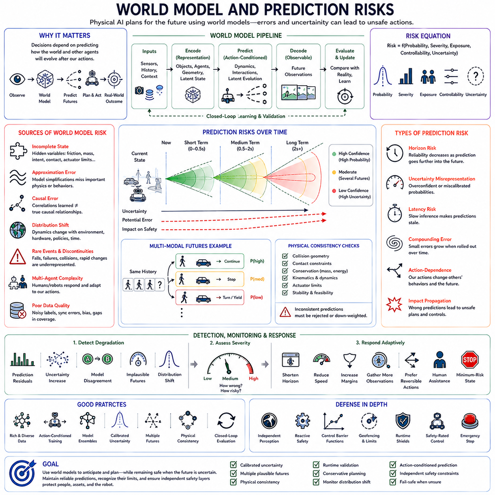{width="7.268055555555556in" height="7.268055555555556in"}

World model and prediction risks arise because Physical AI must reason not only about the environment as it exists now, but also about how it may evolve after an action is taken. A world model compresses observations and history into representations of objects, agents, geometry, dynamics, interactions, and latent state. If this internal representation is incomplete or incorrect, predictions can appear coherent while describing futures that are physically or behaviorally wrong.

A world model is necessarily an approximation of reality. No learned representation can capture every physical variable, hidden cause, human intention, contact condition, or environmental dependency relevant to future events. The safety problem therefore does not begin only when prediction fails. It begins when the autonomy system assumes that its internal model contains sufficient information to support a decision even though important variables may remain unobserved or unrepresented.

State representation creates one of the first sources of risk. A model may accurately encode visible objects while losing information about friction, structural stability, object mass, hidden obstacles, surface conditions, actuator limits, or human attention. Latent representations can improve computational efficiency, but compression may discard information that later becomes important for safety. Representation quality must therefore be evaluated according to downstream physical consequences, not reconstruction accuracy alone.

Prediction error grows with time horizon because uncertainty accumulates as the model projects farther into the future. Near-term motion may be strongly constrained by current velocity and geometry, while longer-term outcomes depend increasingly on decisions, interactions, disturbances, and unknown events. A world model that provides useful predictions for hundreds of milliseconds may become unreliable over several seconds. Planning must therefore account explicitly for horizon-dependent prediction confidence.

Multi-modal futures are fundamental in environments containing humans, vehicles, robots, or other decision-making agents. A pedestrian approaching a crossing may continue, stop, turn, or yield, and several outcomes can be physically plausible from the same observation history. Predicting only one most-likely future can hide important alternatives. Safe prediction should preserve multiple plausible futures or uncertainty regions when different possibilities materially affect the safety of the planned action.

Human behavior introduces particularly high uncertainty because intention is only partially observable. Gaze, posture, motion history, social context, task structure, and environmental cues may suggest likely behavior without determining it. A world model can therefore generate convincing but incorrect interpretations of human intent. Physical AI should avoid treating behavioral prediction as certainty and maintain sufficient separation and reaction capability for plausible unexpected actions.

Interaction prediction becomes more difficult because the robot\'s own actions change the future it is attempting to predict. A person may yield if the robot slows, continue if it stops, or react differently if it approaches aggressively. Other robots and autonomous vehicles may also respond strategically. World models used for planning should therefore represent action-conditioned futures rather than treating the environment as an independent sequence that evolves without regard to the robot\'s behavior.

Causal errors can occur when a learned world model captures statistical correlation without the physical or behavioral relationships required for intervention. Patterns that predict observations under passive data may not remain valid after the robot takes a new action. This distinction is especially important for manipulation, navigation, and interactive tasks where actions deliberately change the environment. Predictive accuracy on recorded sequences alone does not establish reliable counterfactual prediction under novel actions.

Physical consistency is another critical requirement. Learned models may predict object motion that violates contact constraints, conservation relationships, collision geometry, actuator capability, or stability limits. Generative models can produce visually plausible futures that are physically impossible. For Physical AI, perceptual realism is therefore insufficient. Predictions used for decision-making should be checked against known geometry, kinematics, dynamics, operational constraints, and safety envelopes whenever practical.

Compounding error is a major concern in autoregressive and recurrent prediction. Small errors in an early predicted state can become inputs to subsequent predictions, causing trajectories to drift progressively away from reality. This effect can produce internally coherent sequences that are increasingly incorrect over time. Closed-loop evaluation is therefore important because one-step prediction accuracy may significantly overestimate the reliability of a model used repeatedly across a planning horizon.

Distribution shift affects world models because future dynamics learned from historical data may not remain valid in new environments or situations. Different surfaces, payloads, weather, traffic conventions, human populations, robot hardware, or operational policies can alter transition dynamics. A model may correctly recognize the current scene yet incorrectly predict what happens next because the relationships between state, action, and future outcome have changed.

Rare events and discontinuities are particularly difficult to predict from ordinary data. Sudden falls, dropped objects, emergency maneuvers, mechanical failures, unexpected human actions, collisions, or rapid environmental changes may have little representation in training datasets. Prediction systems optimized for typical futures can smooth over these possibilities. Safety analysis must therefore consider low-probability but high-consequence futures even when the learned model assigns them little probability.

Uncertainty representation is essential because a prediction without information about its reliability can mislead downstream planning. Uncertainty can arise from noisy observations, hidden state, ambiguous intentions, limited training coverage, model approximation, or inherently stochastic behavior. World models should communicate uncertainty in forms that planning can use, such as probability distributions, multiple hypotheses, confidence bounds, reachable sets, or risk-aware representations rather than only deterministic trajectories.

Calibration determines whether predicted probabilities correspond meaningfully to observed outcomes. A model that assigns ninety percent probability to events that occur only half of the time is dangerous even if its most likely prediction is often correct. Overconfident prediction encourages planners to use narrow safety margins, while excessive uncertainty can unnecessarily reduce performance. Prediction calibration should therefore be evaluated across scenarios, horizons, agents, and operational conditions relevant to physical risk.

Prediction latency creates another safety concern because the future is estimated from a state that may already be outdated. Large world models, video predictors, multimodal transformers, simulation-based predictors, and ensemble methods can consume substantial computation. If inference takes too long, the predicted future may correspond to an earlier environment state. Prediction quality must therefore be evaluated together with end-to-end latency, update frequency, compute availability, and the dynamics of the physical system.

World-model errors can propagate directly into planning. If an obstacle is predicted to move away, the planner may select a path through the space it currently occupies. If another agent\'s velocity is underestimated, the planned crossing margin may disappear. If contact dynamics are predicted incorrectly, a manipulation policy may apply unsafe force. Prediction should therefore inform action selection without becoming an unquestioned authority over independent safety constraints.

Runtime validation can compare predicted futures with subsequent observations to determine whether the model remains reliable. Persistent residuals, unexpected transitions, increasing uncertainty, disagreement between models, physically implausible predictions, or repeated planning corrections can indicate model degradation. Prediction error should not only be logged for future training; it can become an online safety signal that causes the system to reduce reliance on the world model during current operation.

When prediction reliability decreases, autonomy should become progressively more conservative. The robot may shorten its planning horizon, reduce speed, increase separation margins, prefer reversible actions, gather additional observations, avoid complex interactions, or request human assistance. In severe cases it may transition to a minimum-risk state. This allows prediction uncertainty to modify behavior before an incorrect imagined future becomes an irreversible physical commitment.

Defense in depth prevents world-model intelligence from becoming the sole safety mechanism. Independent perception, reactive collision avoidance, physical constraints, control barrier functions, safety envelopes, geofencing, force and speed limits, runtime shields, emergency stopping, and safety-rated control can constrain behavior when predictions are wrong. Predictive intelligence can improve efficiency and anticipation, while independent mechanisms preserve acceptable risk when prediction reaches its limits.

Ultimately, world model and prediction safety concerns the gap between the future imagined by Physical AI and the future that can actually occur. Safe systems must recognize that prediction is conditional, uncertain, horizon-dependent, and vulnerable to hidden state and distribution shift. Reliable Physical AI therefore requires calibrated uncertainty, multiple plausible futures, physical consistency, runtime validation, conservative planning, and independent safety constraints capable of protecting the system when its internal model of the future is wrong.

월드 모델 및 예측 위험(World Model and Prediction Risks)은 물리 AI(Physical AI)가 현재 존재하는 환경뿐만 아니라 행동을 수행한 이후 환경이 어떻게 변화할 수 있는지까지 추론해야 하기 때문에 발생합니다. 월드 모델(World Model)은 관측과 과거 이력을 객체, 에이전트, 기하구조, 동역학, 상호작용 및 잠재 상태(Latent State)의 표현으로 압축합니다. 이러한 내부 표현이 불완전하거나 잘못되면 예측 결과는 일관성 있어 보이면서도 물리적으로 또는 행동적으로 잘못된 미래를 묘사할 수 있습니다.

월드 모델(World Model)은 필연적으로 현실에 대한 근사(Approximation)입니다. 어떠한 학습된 표현도 미래 사건과 관련된 모든 물리적 변수, 숨겨진 원인, 인간 의도, 접촉 조건 또는 환경적 의존관계를 완벽하게 포착할 수 없습니다. 따라서 안전 문제는 단순히 예측이 실패할 때 시작되는 것이 아닙니다. 중요한 변수가 관측되지 않았거나 표현되지 않았음에도 자율 시스템(Autonomy System)이 내부 모델에 의사결정을 지원하기 위한 충분한 정보가 포함되어 있다고 가정하는 순간부터 시작됩니다.

상태 표현(State Representation)은 가장 초기 단계의 위험 요인 중 하나입니다. 모델은 눈에 보이는 객체를 정확하게 인코딩하면서도 마찰, 구조적 안정성, 물체 질량, 숨겨진 장애물, 표면 상태, 액추에이터 한계 또는 인간의 주의 상태에 관한 정보를 잃을 수 있습니다. 잠재 표현(Latent Representation)은 계산 효율성을 향상시킬 수 있지만 압축 과정에서 이후 안전에 중요해지는 정보를 제거할 수도 있습니다. 따라서 표현 품질은 단순한 재구성 정확도(Reconstruction Accuracy)가 아니라 이후 단계에서 발생할 수 있는 물리적 결과를 기준으로 평가해야 합니다.

예측 오류(Prediction Error)는 모델이 더 먼 미래를 예측할수록 불확실성이 누적되기 때문에 시간 범위(Time Horizon)에 따라 증가합니다. 단기적인 움직임은 현재 속도와 기하구조에 의해 강하게 제한될 수 있지만, 장기적인 결과는 의사결정, 상호작용, 외란(Disturbance), 알려지지 않은 사건에 점점 더 크게 의존합니다. 수백 밀리초 범위에서는 유용한 예측을 제공하는 월드 모델도 수초 이후에는 신뢰성이 크게 감소할 수 있습니다. 따라서 계획 시스템은 예측 시간 범위에 따른 신뢰도 변화를 명시적으로 고려해야 합니다.

다중 모달 미래(Multi-Modal Futures)는 사람, 차량, 로봇 또는 다른 의사결정 에이전트가 존재하는 환경의 근본적인 특성입니다. 횡단보도에 접근하는 보행자는 계속 이동하거나, 정지하거나, 방향을 바꾸거나, 양보할 수 있으며 동일한 관측 이력에서도 여러 결과가 물리적으로 가능할 수 있습니다. 가장 가능성이 높은 하나의 미래만 예측하면 중요한 대안이 숨겨질 수 있습니다. 따라서 서로 다른 가능성이 계획 행동의 안전에 실질적인 영향을 미친다면 안전한 예측은 여러 개의 가능한 미래 또는 불확실성 영역(Uncertainty Region)을 유지해야 합니다.

인간 행동(Human Behavior)은 의도(Intention)를 부분적으로만 관측할 수 있기 때문에 특히 높은 불확실성을 발생시킵니다. 시선, 자세, 움직임 이력, 사회적 맥락, 작업 구조 및 환경적 단서는 가능성이 높은 행동을 암시할 수 있지만 이를 확정하지는 못합니다. 따라서 월드 모델은 설득력 있어 보이지만 잘못된 인간 의도 해석을 생성할 수 있습니다. 물리 AI는 행동 예측을 확정적인 사실로 간주하지 않고, 예상하지 못한 행동이 발생하더라도 대응할 수 있도록 충분한 분리 거리와 반응 능력을 유지해야 합니다.

상호작용 예측(Interaction Prediction)은 로봇 자신의 행동이 예측하려는 미래 자체를 변화시키기 때문에 더욱 어려워집니다. 사람이 로봇이 감속하면 양보하고, 정지하면 계속 이동하며, 공격적으로 접근하면 또 다른 방식으로 반응할 수 있습니다. 다른 로봇과 자율주행 차량 역시 전략적으로 대응할 수 있습니다. 따라서 계획에 사용되는 월드 모델은 환경이 로봇의 행동과 무관하게 독립적으로 변화하는 시퀀스로 취급하기보다 행동 조건부 미래(Action-Conditioned Future)를 표현해야 합니다.

인과 오류(Causal Error)는 학습된 월드 모델이 개입(Intervention)에 필요한 물리적 또는 행동적 관계가 아니라 통계적 상관관계(Statistical Correlation)를 학습할 때 발생할 수 있습니다. 수동적으로 수집된 데이터에서 관측을 잘 예측하는 패턴이 로봇이 새로운 행동을 수행한 이후에도 유효하다는 보장은 없습니다. 이러한 차이는 행동이 환경을 의도적으로 변화시키는 조작, 내비게이션 및 상호작용 작업에서 특히 중요합니다. 기록된 시퀀스에서 높은 예측 정확도를 달성했다는 사실만으로 새로운 행동에 대한 반사실적 예측(Counterfactual Prediction)의 신뢰성을 보장할 수 없습니다.

물리적 일관성(Physical Consistency)은 또 다른 핵심 요구사항입니다. 학습 모델은 접촉 제약(Contact Constraint), 보존 관계, 충돌 기하구조, 액추에이터 능력 또는 안정성 한계를 위반하는 물체 움직임을 예측할 수 있습니다. 생성 모델(Generative Model)은 시각적으로는 그럴듯하지만 물리적으로 불가능한 미래를 생성할 수도 있습니다. 따라서 물리 AI에서는 지각적 사실성(Perceptual Realism)만으로 충분하지 않습니다. 의사결정에 사용되는 예측은 가능한 경우 알려진 기하학, 운동학(Kinematics), 동역학(Dynamics), 운영 제약 및 안전 영역(Safety Envelope)에 대해 검증되어야 합니다.

누적 오류(Compounding Error)는 자기회귀 및 순환형 예측(Autoregressive and Recurrent Prediction)에서 중요한 문제입니다. 초기 예측 상태의 작은 오류가 이후 예측의 입력으로 사용되면 궤적이 실제 상태에서 점진적으로 멀어질 수 있습니다. 이 과정은 내부적으로는 일관되어 보이지만 시간이 지날수록 현실과 더욱 다른 시퀀스를 생성할 수 있습니다. 따라서 단일 단계 예측 정확도(One-Step Prediction Accuracy)는 계획 시간 범위 전체에서 반복적으로 사용되는 모델의 신뢰성을 크게 과대평가할 수 있으므로 폐루프 평가(Closed-Loop Evaluation)가 중요합니다.

분포 이동(Distribution Shift)은 과거 데이터에서 학습된 미래 동역학이 새로운 환경이나 상황에서는 더 이상 유효하지 않을 수 있기 때문에 월드 모델에 영향을 줍니다. 서로 다른 표면, 적재물, 날씨, 교통 규칙, 인간 집단, 로봇 하드웨어 또는 운영 정책은 상태, 행동 및 미래 결과 사이의 전이 동역학(Transition Dynamics)을 변화시킬 수 있습니다. 모델이 현재 장면을 정확하게 인식하더라도 다음에 발생할 사건을 잘못 예측할 수 있는데, 이는 상태와 행동 그리고 미래 결과 사이의 관계 자체가 달라졌기 때문입니다.

희귀 사건(Rare Event)과 불연속적 변화(Discontinuity)는 일반적인 데이터로부터 예측하기 특히 어렵습니다. 갑작스러운 낙상, 떨어지는 물체, 비상 기동, 기계적 고장, 예상하지 못한 인간 행동, 충돌 또는 급격한 환경 변화는 학습 데이터에서 거의 표현되지 않을 수 있습니다. 일반적인 미래에 최적화된 예측 시스템은 이러한 가능성을 무시하거나 평활화할 수 있습니다. 따라서 안전 분석은 학습 모델이 낮은 확률을 부여하더라도 발생 가능성은 낮지만 결과가 심각한 미래를 고려해야 합니다.

불확실성 표현(Uncertainty Representation)은 신뢰도에 관한 정보가 없는 예측이 이후 계획 시스템을 잘못된 방향으로 유도할 수 있기 때문에 필수적입니다. 불확실성은 잡음이 있는 관측, 숨겨진 상태, 모호한 의도, 제한적인 학습 커버리지, 모델 근사 또는 본질적으로 확률적인 행동에서 발생할 수 있습니다. 따라서 월드 모델은 결정론적 궤적만 제공하기보다 확률분포, 다중 가설(Multiple Hypotheses), 신뢰 구간(Confidence Bound), 도달 가능 집합(Reachable Set) 또는 위험 인식 표현(Risk-Aware Representation)과 같이 계획 시스템이 활용할 수 있는 형태로 불확실성을 전달해야 합니다.

보정(Calibration)은 예측된 확률이 실제 관측되는 결과와 의미 있게 대응하는지를 결정합니다. 어떤 사건에 90%의 확률을 부여하지만 실제로는 절반 정도만 발생하는 모델은 가장 가능성이 높은 예측 자체가 자주 맞더라도 위험할 수 있습니다. 과신된 예측(Overconfident Prediction)은 계획기가 좁은 안전 여유를 사용하도록 만들며, 지나치게 큰 불확실성은 불필요하게 성능을 감소시킬 수 있습니다. 따라서 예측 보정(Prediction Calibration)은 물리적 위험과 관련된 시나리오, 시간 범위, 에이전트 및 운영 조건 전반에서 평가되어야 합니다.

예측 지연시간(Prediction Latency)은 이미 오래된 상태를 기준으로 미래를 추정하게 만들 수 있기 때문에 또 다른 안전 문제를 발생시킵니다. 대규모 월드 모델, 비디오 예측기(Video Predictor), 멀티모달 트랜스포머(Multimodal Transformer), 시뮬레이션 기반 예측기 및 앙상블 방법은 상당한 계산량을 요구할 수 있습니다. 추론 시간이 지나치게 길어지면 예측된 미래는 이전 시점의 환경 상태에 대응하게 됩니다. 따라서 예측 품질은 종단 간 지연시간(End-to-End Latency), 갱신 빈도, 컴퓨팅 가용성 및 물리 시스템의 동역학과 함께 평가해야 합니다.

월드 모델 오류(World-Model Error)는 계획 단계로 직접 전파될 수 있습니다. 장애물이 이동하여 사라질 것으로 예측하면 계획기는 현재 장애물이 점유하고 있는 공간을 통과하는 경로를 선택할 수 있습니다. 다른 에이전트의 속도를 과소평가하면 계획된 교차 안전 여유가 사라질 수 있으며, 접촉 동역학(Contact Dynamics)을 잘못 예측하면 조작 정책이 위험한 힘을 가할 수 있습니다. 따라서 예측은 행동 선택에 정보를 제공해야 하지만 독립적인 안전 제약(Independent Safety Constraint)을 대신하는 절대적인 판단 기준이 되어서는 안 됩니다.

런타임 검증(Runtime Validation)은 예측된 미래와 이후 실제 관측을 비교하여 모델이 지속적으로 신뢰할 수 있는지를 판단할 수 있게 합니다. 지속적인 잔차(Residual), 예상하지 못한 상태 전이, 증가하는 불확실성, 모델 간 불일치, 물리적으로 불가능한 예측 또는 반복적인 계획 수정은 모델 성능 저하(Model Degradation)를 나타낼 수 있습니다. 예측 오류는 향후 학습을 위해 단순히 기록되는 것에 그치지 않고 현재 운용 중 월드 모델에 대한 의존도를 감소시키는 온라인 안전 신호(Online Safety Signal)로 활용될 수 있습니다.

예측 신뢰성(Prediction Reliability)이 감소하면 자율 시스템은 점진적으로 더 보수적으로 행동해야 합니다. 로봇은 계획 시간 범위를 단축하고, 속도를 낮추며, 분리 여유를 확대하고, 되돌릴 수 있는 행동(Reversible Action)을 우선하며, 추가적인 관측을 수집하거나, 복잡한 상호작용을 회피하고, 인간 지원을 요청할 수 있습니다. 심각한 경우에는 최소 위험 상태(Minimum-Risk State)로 전환할 수 있습니다. 이를 통해 잘못 상상된 미래가 되돌릴 수 없는 물리적 행동으로 확정되기 전에 예측 불확실성이 시스템 행동을 변화시키도록 할 수 있습니다.

심층 방어(Defense in Depth)는 월드 모델 지능(World-Model Intelligence)이 유일한 안전 메커니즘이 되는 것을 방지합니다. 독립적인 인지(Independent Perception), 반응형 충돌 회피(Reactive Collision Avoidance), 물리적 제약, 제어 장벽 함수(Control Barrier Function), 안전 영역, 지오펜싱(Geofencing), 힘 및 속도 제한, 런타임 실드(Runtime Shield), 비상 정지 및 안전 등급 제어(Safety-Rated Control)는 예측이 잘못되었을 때 행동을 제한할 수 있습니다. 예측 지능(Predictive Intelligence)은 효율성과 선제적 대응 능력을 향상시키며, 독립적인 안전 메커니즘은 예측 능력의 한계에 도달했을 때에도 허용 가능한 위험 수준을 유지합니다.

궁극적으로 월드 모델 및 예측 안전(World Model and Prediction Safety)은 물리 AI가 상상한 미래와 실제로 발생할 수 있는 미래 사이의 격차를 관리하는 문제입니다. 안전한 시스템은 예측이 조건부이고, 불확실하며, 시간 범위에 따라 신뢰성이 달라지고, 숨겨진 상태와 분포 이동에 취약하다는 사실을 인식해야 합니다. 따라서 신뢰할 수 있는 물리 AI는 보정된 불확실성(Calibrated Uncertainty), 여러 개의 가능한 미래, 물리적 일관성, 런타임 검증, 보수적인 계획 및 내부의 미래 모델이 잘못되었을 때 시스템을 보호할 수 있는 독립적인 안전 제약을 필요로 합니다.

##  

## 01.11. VLA Agent and Autonomy Risks

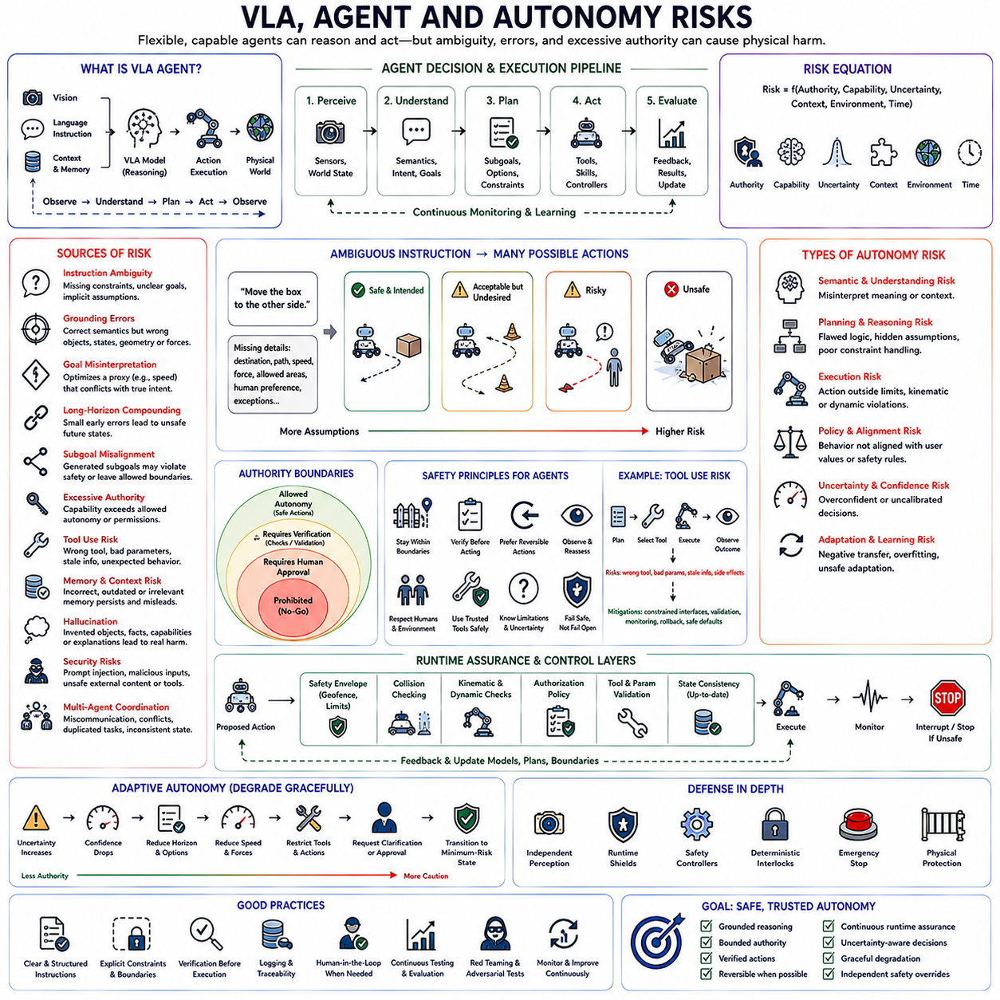{width="7.268055555555556in" height="7.268055555555556in"}

VLA, agent, and autonomy risks arise because Physical AI increasingly uses Vision-Language-Action models and agentic systems to connect perception, semantic reasoning, goals, planning, and physical execution. These systems can interpret complex instructions and generate actions across long horizons, but their flexibility also expands the space of possible failures. An error in reasoning can propagate beyond a digital response and become persistent physical behavior.

Vision-Language-Action models combine visual observations, language instructions, contextual information, and action representations within a unified decision process. This integration can improve generalization across tasks, but it also couples previously separate failure domains. A misunderstood instruction, incorrect visual interpretation, or flawed semantic association can directly influence manipulation, navigation, tool use, or interaction with people and surrounding equipment.

Instruction ambiguity creates a fundamental autonomy risk because natural language rarely specifies every physical constraint required for safe execution. A command such as moving an object, cleaning an area, or delivering equipment may leave destination boundaries, prohibited actions, human preferences, force limits, and exceptional conditions unspecified. An autonomous agent must not interpret missing information as unrestricted permission to select any physically achievable action.

Semantic understanding does not guarantee physical grounding. A VLA model may correctly understand the conceptual meaning of an instruction while misunderstanding object location, geometry, reachability, mass, stability, or required contact forces. Language models can also generate plausible action descriptions that violate robot kinematics or environmental constraints. Semantic reasoning must therefore remain connected to verified physical state and explicit feasibility checks before actions are executed.

Goal misinterpretation can occur when an agent optimizes a proxy for the user\'s actual intent. A robot instructed to complete a task quickly may reduce margins, take an undesirable route, disturb surrounding objects, or interrupt human activity if speed becomes the dominant objective. Safe autonomy requires goal interpretation that preserves safety constraints, operational rules, contextual expectations, and explicit prohibitions rather than optimizing task completion in isolation.

Long-horizon autonomy introduces compounding risk because agents can execute sequences containing many dependent decisions. A small error early in a task may alter later observations, invalidate assumptions, and change the state from which subsequent decisions are made. Even individually reasonable actions can produce an unsafe overall sequence. Long-horizon agents therefore require periodic state verification, progress assessment, constraint checking, and opportunities to interrupt or revise their plans.

Agentic systems may create subgoals dynamically rather than following a fully predefined action sequence. This improves flexibility but introduces the possibility that intermediate objectives do not preserve the safety properties of the original goal. An agent may select a shortcut, reposition an obstacle, use an unexpected tool, or enter an unapproved area because doing so simplifies task completion. Generated subgoals should therefore remain within explicitly defined authority and operational boundaries.

Autonomy authority is a central safety concern. A capable agent may technically be able to navigate, manipulate objects, operate equipment, communicate with external systems, modify plans, or coordinate other robots. Capability should not automatically imply permission. Physical AI requires explicit authorization boundaries defining which actions can be executed autonomously, which require verification, which require human approval, and which must remain prohibited regardless of model confidence.

Tool use expands both capability and risk. An autonomous agent may invoke navigation services, manipulation controllers, databases, maps, fleet systems, software interfaces, or physical tools. Incorrect tool selection, invalid parameters, stale information, or unexpected tool behavior can amplify an initial reasoning error. Tool interfaces should therefore expose constrained actions, validated parameters, clear preconditions, observable outcomes, and failure responses rather than unrestricted low-level control.

Memory creates additional risk when autonomous agents retain information across actions, tasks, or missions. Incorrect observations, outdated assumptions, failed plans, or misunderstood instructions can persist in memory and influence future decisions long after the original error occurred. Safe agent memory requires provenance, freshness, confidence, relevance, and mechanisms for correction or invalidation so that historical context does not silently become false operational truth.

Context management is especially important for VLA and foundation-model-based agents because only a limited subset of available information may influence a particular inference. Critical constraints can be omitted, displaced, summarized incorrectly, or overwhelmed by irrelevant context. A model may therefore produce a reasonable answer without considering a safety condition that exists elsewhere in the system. Safety-critical constraints should not depend solely on their continued presence in a probabilistic model context.

Hallucination becomes physically significant when an agent invents objects, capabilities, environmental facts, completed actions, or causal explanations. A digital assistant hallucinating a fact may produce incorrect information, whereas a robot acting on an invented assumption may move into occupied space or attempt an unsupported operation. Physical agents should verify safety-relevant claims against sensors, state estimators, trusted databases, or deterministic system interfaces before committing to consequential actions.

Planning through language or latent reasoning can also obscure why an action was selected. The internal reasoning process of a large model may not correspond to an explicit, inspectable planning structure, making conventional verification difficult. Safety should therefore focus on observable inputs, proposed actions, constraints, intermediate states, and execution outcomes rather than assuming that apparently coherent reasoning provides evidence that the resulting behavior is safe.

Prompt injection and malicious instructions extend autonomy risk into security. Text in signs, displays, documents, network messages, user inputs, or external tools may be interpreted as instructions even when it should be treated only as environmental data. An attacker could attempt to redirect goals, override constraints, or induce unauthorized tool use. Agents require separation between trusted commands and untrusted content, along with authorization checks that cannot be bypassed through language alone.

Multi-agent autonomy introduces coordination risks when several robots or software agents share tasks, plans, maps, or resources. Incorrect assumptions about another agent\'s intent, delayed communication, inconsistent world state, duplicated task assignment, or conflicting plans can create physical interference. Shared intelligence should therefore include identity, authority, synchronization, conflict resolution, reservation mechanisms, and local safety behavior that remains effective when coordination fails.

Human oversight must be designed according to the speed and consequence of autonomous action. Requiring approval for every low-risk decision can make autonomy unusable, while allowing unrestricted execution can expose people and assets to unacceptable risk. Adjustable autonomy can allocate authority according to task criticality, confidence, reversibility, environmental uncertainty, and consequence severity, escalating to human supervision when the agent approaches the limits of validated competence.

Reversibility is an important property of safe agent behavior. Some actions can be easily undone, while others create irreversible physical consequences, such as dropping an object, entering hazardous machinery, applying excessive force, opening a restricted barrier, or initiating high-energy motion. When uncertainty is significant, an autonomous agent should prefer information-gathering and reversible actions before committing to decisions that substantially reduce future recovery options.

Runtime assurance provides a boundary between flexible intelligence and physical execution. Proposed actions can be checked against geofences, collision constraints, speed limits, force limits, robot capabilities, authorization policies, workspace rules, and current safety state before commands reach actuators. Independent monitors can interrupt execution when observed behavior diverges from approved intent. This allows VLA intelligence to remain flexible without granting it unrestricted physical authority.

When agent confidence, context integrity, perception quality, prediction reliability, or system health deteriorates, autonomy should degrade gracefully. The system may shorten its planning horizon, reduce speed, restrict available tools, simplify tasks, request clarification, require human approval, suspend uncertain subgoals, or transition to a minimum-risk state. Degradation should reduce the scope of autonomous authority as uncertainty grows rather than allowing uncertainty to increase behavioral freedom.

Defense in depth is essential because no VLA model or autonomous agent can be assumed to interpret every instruction and situation correctly. Explicit authority boundaries, independent safety controllers, runtime shields, deterministic interlocks, constrained tool interfaces, verified state, uncertainty-aware planning, human escalation, logging, emergency stopping, and physical protection can prevent reasoning failures from directly becoming hazardous actions.

Ultimately, VLA, agent, and autonomy safety concerns how much physical authority should be entrusted to flexible learned intelligence. The objective is not to eliminate autonomous reasoning, but to ensure that capability, permission, confidence, and safety remain distinct concepts. Safe Physical AI requires grounded reasoning, bounded authority, verified actions, continuous runtime assurance, reversible behavior where possible, graceful degradation, and independent safety mechanisms capable of overriding autonomous intelligence when necessary.

VLA, 에이전트 및 자율성 위험(VLA, Agent, and Autonomy Risks)은 물리 AI(Physical AI)가 인지, 의미적 추론(Semantic Reasoning), 목표, 계획 및 물리적 실행을 연결하기 위해 비전-언어-행동 모델(Vision-Language-Action Model)과 에이전트형 시스템(Agentic System)을 점점 더 많이 사용하기 때문에 발생합니다. 이러한 시스템은 복잡한 명령을 해석하고 장기간에 걸쳐 행동을 생성할 수 있지만, 높은 유연성은 발생 가능한 고장의 범위도 확대합니다. 추론 과정의 오류는 단순한 디지털 응답에 머무르지 않고 지속적인 물리적 행동으로 전파될 수 있습니다.

비전-언어-행동 모델(Vision-Language-Action Model)은 시각적 관측, 언어 명령, 맥락 정보(Contextual Information), 행동 표현(Action Representation)을 하나의 통합된 의사결정 과정으로 결합합니다. 이러한 통합은 여러 작업에 대한 일반화(Generalization)를 향상시킬 수 있지만, 이전에는 분리되어 있던 고장 영역(Failure Domain)을 서로 연결하기도 합니다. 잘못 이해된 명령, 부정확한 시각적 해석 또는 잘못된 의미적 연관(Semantic Association)이 조작, 내비게이션, 도구 사용 또는 사람과 주변 장비와의 상호작용에 직접적인 영향을 미칠 수 있습니다.

명령 모호성(Instruction Ambiguity)은 자연어가 안전한 실행에 필요한 모든 물리적 제약을 명시하는 경우가 거의 없기 때문에 근본적인 자율성 위험을 발생시킵니다. 물체 이동, 특정 영역 청소 또는 장비 운반과 같은 명령은 목적지 경계, 금지된 행동, 인간의 선호, 힘 제한 및 예외 조건을 명확하게 지정하지 않을 수 있습니다. 자율 에이전트(Autonomous Agent)는 누락된 정보를 물리적으로 실행 가능한 모든 행동을 자유롭게 선택할 수 있다는 무제한적인 허가로 해석해서는 안 됩니다.

의미적 이해(Semantic Understanding)가 물리적 기반화(Physical Grounding)를 보장하는 것은 아닙니다. VLA 모델은 명령의 개념적 의미를 정확하게 이해하면서도 물체 위치, 기하구조, 도달 가능성(Reachability), 질량, 안정성 또는 필요한 접촉력을 잘못 이해할 수 있습니다. 언어 모델(Language Model)은 로봇의 운동학(Kinematics)이나 환경 제약을 위반하면서도 그럴듯한 행동 설명을 생성할 수 있습니다. 따라서 행동이 실행되기 전에 의미적 추론은 검증된 물리적 상태 및 명시적인 실행 가능성 검사(Feasibility Check)와 연결되어야 합니다.

목표 오해(Goal Misinterpretation)는 에이전트가 사용자의 실제 의도 대신 대리 목표(Proxy)를 최적화할 때 발생할 수 있습니다. 작업을 빠르게 완료하라는 명령을 받은 로봇은 속도를 지배적인 목표로 해석할 경우 안전 여유를 줄이고, 바람직하지 않은 경로를 선택하며, 주변 물체를 방해하거나 인간의 작업을 중단시킬 수 있습니다. 안전한 자율성(Safe Autonomy)을 위해서는 작업 완료만을 독립적으로 최적화하는 것이 아니라 안전 제약, 운영 규칙, 상황적 기대 및 명시적인 금지사항을 보존하는 목표 해석이 필요합니다.

장기 시간 범위 자율성(Long-Horizon Autonomy)은 에이전트가 서로 의존하는 많은 의사결정을 포함하는 행동 시퀀스를 실행할 수 있기 때문에 누적 위험(Compounding Risk)을 발생시킵니다. 작업 초기에 발생한 작은 오류가 이후의 관측을 변화시키고, 기존 가정을 무효화하며, 이후 의사결정이 이루어지는 상태 자체를 변경할 수 있습니다. 각각은 합리적인 행동이라도 전체 시퀀스에서는 위험한 결과를 만들 수 있습니다. 따라서 장기 에이전트(Long-Horizon Agent)는 주기적인 상태 검증, 진행 상황 평가, 제약 검사 및 계획을 중단하거나 수정할 수 있는 기회를 필요로 합니다.

에이전트형 시스템(Agentic System)은 완전히 사전 정의된 행동 시퀀스를 따르는 대신 하위 목표(Subgoal)를 동적으로 생성할 수 있습니다. 이는 유연성을 향상시키지만 중간 목표가 원래 목표의 안전 속성을 유지하지 못할 가능성을 발생시킵니다. 에이전트는 작업 완료를 단순화하기 위해 지름길을 선택하거나, 장애물을 이동시키거나, 예상하지 못한 도구를 사용하거나, 승인되지 않은 영역에 진입할 수 있습니다. 따라서 생성된 하위 목표는 명시적으로 정의된 권한(Authority)과 운영 경계(Operational Boundary) 내에 있어야 합니다.

자율성 권한(Autonomy Authority)은 핵심적인 안전 문제입니다. 높은 능력을 가진 에이전트는 기술적으로 내비게이션, 물체 조작, 장비 운용, 외부 시스템과의 통신, 계획 변경 또는 다른 로봇과의 협업을 수행할 수 있습니다. 그러나 능력(Capability)이 자동적으로 권한(Permission)을 의미해서는 안 됩니다. 물리 AI에는 어떤 행동을 자율적으로 실행할 수 있는지, 어떤 행동에 검증이 필요한지, 어떤 행동에 인간의 승인이 필요한지, 그리고 모델의 신뢰도와 관계없이 어떤 행동을 금지해야 하는지를 규정하는 명시적인 권한 경계(Authorization Boundary)가 필요합니다.

도구 사용(Tool Use)은 능력과 위험을 동시에 확대합니다. 자율 에이전트는 내비게이션 서비스, 조작 제어기, 데이터베이스, 지도, 플릿 시스템(Fleet System), 소프트웨어 인터페이스 또는 물리적 도구를 호출할 수 있습니다. 잘못된 도구 선택, 유효하지 않은 매개변수, 오래된 정보 또는 예상하지 못한 도구 동작은 최초의 추론 오류를 증폭시킬 수 있습니다. 따라서 도구 인터페이스(Tool Interface)는 제한 없는 저수준 제어 대신 제한된 행동, 검증된 매개변수, 명확한 사전조건(Precondition), 관측 가능한 결과 및 고장 대응을 제공해야 합니다.

메모리(Memory)는 자율 에이전트가 행동, 작업 또는 임무에 걸쳐 정보를 유지할 때 추가적인 위험을 발생시킵니다. 잘못된 관측, 오래된 가정, 실패한 계획 또는 잘못 이해된 명령이 메모리에 남아 최초 오류가 발생한 이후 오랜 시간이 지나서도 미래 의사결정에 영향을 줄 수 있습니다. 안전한 에이전트 메모리(Safe Agent Memory)는 출처(Provenance), 최신성(Freshness), 신뢰도, 관련성 및 수정 또는 무효화 메커니즘을 필요로 하며, 과거의 맥락이 조용히 잘못된 운영상의 사실로 전환되지 않도록 해야 합니다.

맥락 관리(Context Management)는 특정 추론에 사용 가능한 전체 정보 중 제한된 일부만 영향을 미칠 수 있기 때문에 VLA 및 파운데이션 모델 기반 에이전트(Foundation-Model-Based Agent)에서 특히 중요합니다. 핵심 제약이 누락되거나, 밀려나거나, 잘못 요약되거나, 관련성이 낮은 정보에 묻힐 수 있습니다. 따라서 모델은 시스템의 다른 부분에 존재하는 안전 조건을 고려하지 않은 채 합리적으로 보이는 답을 생성할 수 있습니다. 안전 핵심 제약(Safety-Critical Constraint)은 확률적 모델의 맥락에 계속 포함되어 있는지 여부에만 의존해서는 안 됩니다.

환각(Hallucination)은 에이전트가 존재하지 않는 객체, 능력, 환경적 사실, 완료된 행동 또는 인과적 설명을 만들어낼 때 물리적으로 중요한 문제가 됩니다. 디지털 비서가 사실을 환각하면 잘못된 정보를 제공하는 데 그칠 수 있지만, 로봇이 만들어낸 가정을 기반으로 행동하면 이미 점유된 공간으로 이동하거나 지원되지 않는 작업을 시도할 수 있습니다. 따라서 물리 에이전트(Physical Agent)는 중요한 행동을 실행하기 전에 안전 관련 주장을 센서, 상태추정기(State Estimator), 신뢰할 수 있는 데이터베이스 또는 결정론적 시스템 인터페이스(Deterministic System Interface)를 통해 검증해야 합니다.

언어 또는 잠재 추론(Latent Reasoning)을 통한 계획은 특정 행동이 선택된 이유를 불명확하게 만들 수도 있습니다. 대규모 모델의 내부 추론 과정은 명시적이고 검사 가능한 계획 구조와 일치하지 않을 수 있으므로 기존 방식의 검증을 어렵게 만들 수 있습니다. 따라서 일관성 있어 보이는 추론이 결과 행동의 안전성을 입증한다고 가정하기보다 관측 가능한 입력, 제안된 행동, 제약, 중간 상태 및 실행 결과를 중심으로 안전을 검증해야 합니다.

프롬프트 인젝션(Prompt Injection)과 악의적인 명령(Malicious Instruction)은 자율성 위험을 보안 영역으로 확장합니다. 표지판, 디스플레이, 문서, 네트워크 메시지, 사용자 입력 또는 외부 도구에 포함된 텍스트가 단순한 환경 데이터로 처리되어야 함에도 명령으로 해석될 수 있습니다. 공격자는 목표를 변경하거나, 제약을 우회하거나, 승인되지 않은 도구 사용을 유도하려 할 수 있습니다. 따라서 에이전트는 신뢰할 수 있는 명령(Trusted Command)과 신뢰할 수 없는 콘텐츠(Untrusted Content)를 분리하고, 언어만으로 우회할 수 없는 권한 검사를 적용해야 합니다.

다중 에이전트 자율성(Multi-Agent Autonomy)은 여러 로봇 또는 소프트웨어 에이전트가 작업, 계획, 지도 또는 자원을 공유할 때 협업 위험(Coordination Risk)을 발생시킵니다. 다른 에이전트의 의도에 대한 잘못된 가정, 통신 지연, 일관되지 않은 월드 상태(World State), 중복된 작업 할당 또는 충돌하는 계획은 물리적 간섭을 발생시킬 수 있습니다. 따라서 공유 지능(Shared Intelligence)에는 식별(Identity), 권한, 동기화, 충돌 해결(Conflict Resolution), 자원 예약 메커니즘(Reservation Mechanism), 그리고 협업이 실패하더라도 유효하게 작동하는 로컬 안전 행동(Local Safety Behavior)이 포함되어야 합니다.

인간 감독(Human Oversight)은 자율 행동의 속도와 결과의 심각도에 맞게 설계되어야 합니다. 모든 저위험 의사결정에 인간 승인을 요구하면 자율성이 실용성을 잃을 수 있지만, 제한 없는 실행을 허용하면 사람과 자산이 허용할 수 없는 위험에 노출될 수 있습니다. 조정 가능한 자율성(Adjustable Autonomy)은 작업의 중요도, 신뢰도, 가역성(Reversibility), 환경 불확실성 및 결과의 심각도에 따라 권한을 배분하고, 에이전트가 검증된 능력의 한계에 접근할 때 인간 감독으로 단계적으로 전환할 수 있습니다.

가역성(Reversibility)은 안전한 에이전트 행동의 중요한 특성입니다. 일부 행동은 쉽게 되돌릴 수 있지만 물체를 떨어뜨리거나, 위험한 기계 내부로 진입하거나, 과도한 힘을 가하거나, 제한된 장벽을 개방하거나, 고에너지 움직임을 시작하는 행동은 되돌리기 어려운 물리적 결과를 발생시킵니다. 불확실성이 큰 경우 자율 에이전트는 미래의 복구 가능성을 크게 감소시키는 결정에 앞서 정보 수집 행동(Information-Gathering Action)과 가역적인 행동(Reversible Action)을 우선해야 합니다.

런타임 보증(Runtime Assurance)은 유연한 지능과 물리적 실행 사이에 안전 경계를 제공합니다. 제안된 행동은 액추에이터에 명령이 전달되기 전에 지오펜스(Geofence), 충돌 제약, 속도 제한, 힘 제한, 로봇 능력, 권한 정책(Authorization Policy), 작업공간 규칙 및 현재 안전 상태에 대해 검사될 수 있습니다. 독립적인 모니터(Independent Monitor)는 관측된 행동이 승인된 의도에서 벗어날 경우 실행을 중단할 수 있습니다. 이를 통해 VLA 지능의 유연성을 유지하면서도 제한 없는 물리적 권한을 부여하지 않을 수 있습니다.

에이전트 신뢰도, 맥락 무결성(Context Integrity), 인지 품질, 예측 신뢰성 또는 시스템 상태가 저하되면 자율성은 점진적으로 성능을 낮추어야 합니다. 시스템은 계획 시간 범위를 단축하고, 속도를 감소시키며, 사용할 수 있는 도구를 제한하고, 작업을 단순화하거나, 추가 설명을 요청하고, 인간 승인을 요구하거나, 불확실한 하위 목표를 중단하고, 최소 위험 상태(Minimum-Risk State)로 전환할 수 있습니다. 불확실성이 증가할수록 행동의 자유를 확대하는 것이 아니라 자율 권한의 범위를 축소해야 합니다.

어떠한 VLA 모델이나 자율 에이전트도 모든 명령과 상황을 항상 정확하게 해석한다고 가정할 수 없으므로 심층 방어(Defense in Depth)가 필수적입니다. 명시적인 권한 경계, 독립 안전 제어기(Independent Safety Controller), 런타임 실드(Runtime Shield), 결정론적 인터록(Deterministic Interlock), 제한된 도구 인터페이스, 검증된 상태, 불확실성 인식 계획(Uncertainty-Aware Planning), 인간 개입 단계(Human Escalation), 로깅, 비상 정지 및 물리적 보호 메커니즘은 추론 오류가 직접적으로 위험한 행동으로 전환되는 것을 방지할 수 있습니다.

궁극적으로 VLA, 에이전트 및 자율성 안전(VLA, Agent, and Autonomy Safety)은 유연한 학습 지능(Flexible Learned Intelligence)에 어느 정도의 물리적 권한을 맡길 것인가에 관한 문제입니다. 목표는 자율적 추론을 제거하는 것이 아니라 능력(Capability), 권한(Permission), 신뢰도(Confidence), 안전(Safety)을 서로 구분된 개념으로 유지하는 것입니다. 안전한 물리 AI는 물리적으로 기반화된 추론(Grounded Reasoning), 제한된 권한(Bounded Authority), 검증된 행동, 지속적인 런타임 보증, 가능한 경우 가역적인 행동, 점진적 성능 저하(Graceful Degradation), 그리고 필요한 경우 자율 지능을 무시하거나 중단할 수 있는 독립적인 안전 메커니즘을 필요로 합니다.

##  

## 01.12. Human Robot Interaction Risks

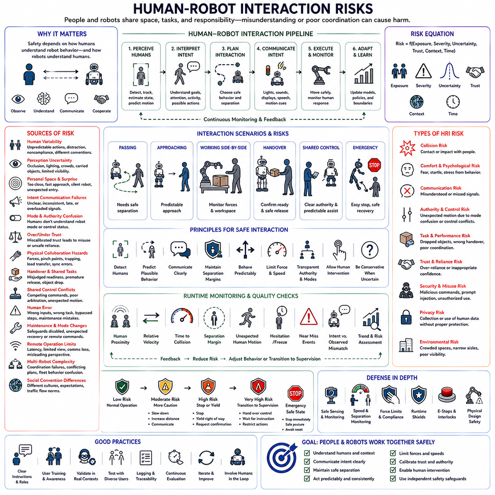{width="7.268055555555556in" height="7.268055555555556in"}

Human-robot interaction risks arise because Physical AI operates in spaces where people and autonomous machines observe, approach, communicate, cooperate, and sometimes physically contact one another. Safety therefore depends not only on preventing collisions, but also on how humans understand robot behavior and how robots interpret human actions. Misunderstanding, surprise, excessive trust, or poorly coordinated interaction can transform otherwise normal robot behavior into hazardous situations.

Human behavior is inherently variable and only partially predictable. People may stop suddenly, change direction, enter restricted areas, reach toward moving equipment, ignore instructions, or react differently from expected social conventions. Children, visitors, distracted workers, and people unfamiliar with robots may behave particularly unpredictably. A safe robot must therefore maintain sufficient margins for plausible human actions rather than assuming consistent or perfectly rational behavior.

Human detection is a fundamental requirement but does not by itself provide safe interaction. The system may need to estimate position, velocity, posture, body orientation, reach, activity, and possible future movement. Occlusion, poor lighting, unusual clothing, crowds, carried objects, or partial visibility can degrade these estimates. Safety should therefore account for uncertainty in human state rather than treating every detected person as a precisely known dynamic obstacle.

Personal space and protective separation are important because collision avoidance alone permits behavior that may still be uncomfortable or unsafe. A robot passing centimeters from a person without contact can cause surprise, loss of balance, or defensive movement. Appropriate separation depends on robot speed, mass, stopping capability, environment, task, human awareness, and escape possibilities. Interaction planning should preserve margins that reflect consequence as well as geometric clearance.

Approach behavior strongly influences how people interpret autonomous machines. Rapid acceleration, silent approach from behind, sudden turning, or unexpected entry into a person\'s workspace can create startle responses even when no collision occurs. Predictable trajectories, controlled acceleration, visible approach directions, appropriate speed, and sufficient warning can make robot behavior easier to anticipate. Physical safety and behavioral predictability should therefore be designed together.

Intent communication reduces ambiguity between humans and robots. Lights, displays, sounds, projected indicators, motion cues, or spoken messages can communicate whether a robot intends to stop, yield, turn, manipulate an object, or request passage. However, signals can themselves become risks if they are unclear, inconsistent, overloaded, or misunderstood. Communication should be simple, timely, and consistent with the robot\'s actual behavior rather than merely indicating intended behavior.

Mode confusion occurs when humans do not understand whether the robot is autonomous, manually controlled, paused, waiting, recovering, or operating under reduced capability. A worker may approach a robot believed to be inactive while the system is preparing to resume motion. Interfaces should therefore make relevant operational states understandable, particularly during transitions. Hidden changes in autonomy or control authority can create dangerous mismatches between human expectations and machine behavior.

Trust calibration is another major challenge. Excessive trust can cause users to rely on capabilities the robot does not possess, while insufficient trust can lead to unnecessary intervention or unsafe attempts to control the system manually. Reliable interaction requires that humans develop an appropriately calibrated understanding of what the robot can do, where uncertainty exists, and when supervision is necessary. Interface design should avoid presenting uncertain autonomy as infallible intelligence.

Physical collaboration introduces additional risks when humans and robots intentionally share a workspace or manipulate objects together. Contact forces, relative motion, pinch points, trapping hazards, unexpected load transfer, tool motion, and synchronization errors can cause injury. Collaborative behavior must account for force and power limits, stopping performance, body regions, task geometry, human escape paths, and transitions between cooperative and independent motion.

Handover tasks illustrate the difficulty of combining perception, prediction, communication, and control. A robot transferring an object must determine whether the person is ready, where the hand is located, when sufficient grasp has been established, and when release is safe. Premature release can drop an object, while delayed release can create pulling forces. Safe handover therefore requires explicit state transitions and confirmation through sensing rather than assumptions about human intention.

Shared control creates risks when both a human and autonomous system influence robot motion. Teleoperation assistance, power steering, manipulation guidance, collision avoidance, and autonomous correction may generate competing commands. If the human expects direct control while automation modifies the command, unexpected motion can occur. Shared-control systems require transparent authority allocation, bounded intervention, predictable arbitration, and safe transitions when control responsibility changes.

Emergency intervention must remain understandable and effective. People may need to stop, pause, isolate, or manually recover a robot when abnormal behavior occurs. Emergency controls should be accessible and their effects predictable, while recovery procedures should prevent unexpected restart. A stopped robot should not automatically resume hazardous motion simply because the original fault disappears. Restart and recovery require explicit consideration of current human location and system state.

Human error should be treated as an expected system condition rather than an exceptional event. Operators may select the wrong task, enter incorrect parameters, misunderstand warnings, bypass procedures, or perform maintenance in an unexpected sequence. Interface and safety design should reduce opportunities for single human errors to produce hazardous motion. Validation, confirmation for consequential commands, access control, interlocks, clear feedback, and recoverable workflows can reduce error propagation.

Maintenance and servicing create distinctive interaction risks because normal safeguards may be disabled or operating modes may change. Technicians can work near actuators, wheels, manipulators, batteries, or stored mechanical energy while performing calibration or diagnostics. Unexpected remote commands or automatic recovery behavior can be particularly dangerous. Maintenance modes should therefore provide controlled authority, energy isolation where required, restricted motion, and explicit indication of system state.

Remote human interaction also requires attention because operators may lack direct perception of the robot\'s surroundings. Camera latency, limited field of view, communication loss, misleading perspective, or incomplete sensor information can cause a teleoperator to underestimate risk. Autonomous assistance may reduce workload, but responsibility boundaries must remain clear. Local safety mechanisms should continue protecting people even when remote communication or human situational awareness becomes inadequate.

Multi-robot environments increase interaction complexity because humans must understand not only individual robots but also coordinated fleet behavior. Several robots may approach simultaneously, reserve shared spaces, reroute around people, or respond differently to the same human movement. Fleet-level optimization should not create locally confusing or trapping behavior. Each robot should preserve independent human safety even when communication, coordination, or centralized scheduling fails.

Social conventions can influence safety because humans predict movement partly through familiar behavioral patterns. Yielding, maintaining directional consistency, avoiding aggressive approaches, and respecting expected traffic flow can make robot motion more understandable. However, conventions vary across workplaces, cultures, and environments. Human-aware behavior should therefore be validated within the actual operational context rather than assuming that one universal interaction policy will always be interpreted correctly.

Runtime monitoring should evaluate both physical separation and interaction quality. Relevant indicators can include human proximity, relative velocity, predicted time to collision, protective separation margin, unexpected human motion, repeated hesitation, emergency interventions, near misses, and disagreement between intended and observed interaction. These signals can reveal patterns that conventional collision statistics miss and support progressive reduction of autonomy before hazardous interaction develops.

When uncertainty about human behavior or interaction state increases, robot behavior should become more conservative. The system may reduce speed, increase separation, stop manipulation, yield right of way, request confirmation, avoid passing through crowded areas, or transition to supervised operation. Conservative behavior should preserve human escape options and reaction time. The robot should not compensate for uncertainty by forcing humans to predict or accommodate increasingly aggressive autonomous behavior.

Defense in depth combines intelligent human-aware behavior with independent physical safeguards. Safety-rated sensing, protective stops, speed and separation monitoring, force limits, emergency stops, interlocks, restricted zones, collision detection, compliant mechanisms, runtime monitoring, and clear human interfaces can reduce the consequences of perception or reasoning errors. No single AI model should carry sole responsibility for determining whether close human interaction is safe.

Ultimately, human-robot interaction safety concerns whether people and Physical AI can share space, authority, information, and physical tasks without requiring humans to perfectly understand or predict autonomous intelligence. Safe interaction requires detectable humans, predictable motion, clear intent communication, calibrated trust, bounded forces, understandable control authority, conservative responses to uncertainty, effective intervention, and independent safeguards that remain reliable when either the human or the robot behaves unexpectedly.

인간-로봇 상호작용 위험(Human-Robot Interaction Risks)은 물리 AI(Physical AI)가 사람과 자율 기계가 서로 관찰하고, 접근하고, 의사소통하고, 협력하며, 때로는 물리적으로 접촉하는 공간에서 작동하기 때문에 발생합니다. 따라서 안전은 단순히 충돌을 방지하는 것뿐만 아니라 사람이 로봇의 행동을 어떻게 이해하고 로봇이 인간의 행동을 어떻게 해석하는지에도 달려 있습니다. 오해, 놀람, 과도한 신뢰 또는 제대로 조정되지 않은 상호작용은 정상적인 로봇 행동조차 위험한 상황으로 변화시킬 수 있습니다.

인간 행동(Human Behavior)은 본질적으로 다양하며 부분적으로만 예측할 수 있습니다. 사람은 갑자기 멈추거나 방향을 변경하고, 제한 구역에 들어가거나, 움직이는 장비를 향해 손을 뻗고, 지시를 무시하거나, 예상된 사회적 관습과 다르게 반응할 수 있습니다. 어린이, 방문자, 주의가 분산된 작업자, 로봇에 익숙하지 않은 사람은 특히 예측하기 어렵게 행동할 수 있습니다. 따라서 안전한 로봇은 사람이 항상 일관되고 완벽하게 합리적으로 행동한다고 가정하기보다 발생 가능한 인간 행동에 대해 충분한 안전 여유를 유지해야 합니다.

인간 탐지(Human Detection)는 기본적인 요구사항이지만 그것만으로 안전한 상호작용을 보장하지는 않습니다. 시스템은 사람의 위치, 속도, 자세, 신체 방향, 도달 범위, 활동 및 가능한 미래 움직임을 추정해야 할 수 있습니다. 가림(Occlusion), 불량한 조명, 특이한 의복, 군중, 사람이 들고 있는 물체 또는 부분적인 가시성은 이러한 추정의 정확도를 저하시킬 수 있습니다. 따라서 안전 시스템은 탐지된 모든 사람을 정확하게 알려진 동적 장애물로 취급하기보다 인간 상태 추정의 불확실성을 고려해야 합니다.

개인 공간(Personal Space)과 보호 분리(Protective Separation)는 단순한 충돌 회피만으로는 접촉하지 않더라도 불편하거나 위험한 행동을 허용할 수 있기 때문에 중요합니다. 로봇이 사람과 접촉하지 않은 채 수 센티미터 거리로 지나가더라도 놀람, 균형 상실 또는 방어적인 움직임을 유발할 수 있습니다. 적절한 분리 거리는 로봇의 속도, 질량, 정지 능력, 환경, 작업, 사람의 인지 상태 및 회피 가능성에 따라 달라집니다. 따라서 상호작용 계획(Interaction Planning)은 기하학적인 이격거리뿐만 아니라 결과의 심각성을 반영하는 안전 여유를 유지해야 합니다.

접근 행동(Approach Behavior)은 사람이 자율 기계를 어떻게 해석하는지에 큰 영향을 미칩니다. 빠른 가속, 뒤에서 조용히 접근하는 행동, 갑작스러운 방향 전환 또는 사람의 작업공간에 예상하지 못하게 진입하는 행동은 충돌이 발생하지 않더라도 놀람 반응(Startle Response)을 일으킬 수 있습니다. 예측 가능한 궤적, 제어된 가속, 명확하게 보이는 접근 방향, 적절한 속도 및 충분한 사전 경고는 사람이 로봇의 행동을 더 쉽게 예상하도록 합니다. 따라서 물리적 안전과 행동 예측 가능성(Behavioral Predictability)은 함께 설계되어야 합니다.

의도 전달(Intent Communication)은 사람과 로봇 사이의 모호성을 줄여줍니다. 조명, 디스플레이, 소리, 투영 표시(Projected Indicator), 움직임 신호 또는 음성 메시지를 통해 로봇이 정지, 양보, 회전, 물체 조작 또는 통행 요청 중 무엇을 수행하려는지 전달할 수 있습니다. 그러나 신호가 불명확하거나, 일관되지 않거나, 지나치게 많은 의미를 포함하거나, 사람이 잘못 이해하면 의사소통 자체가 위험 요소가 될 수 있습니다. 의사소통은 단순하고 적절한 시점에 제공되며 로봇의 실제 행동과 일치해야 합니다.

모드 혼동(Mode Confusion)은 사람이 로봇이 자율 운전 중인지, 수동 제어 중인지, 일시정지 상태인지, 대기 중인지, 복구 중인지 또는 성능 저하 상태에서 작동 중인지 이해하지 못할 때 발생합니다. 작업자는 비활성 상태라고 생각한 로봇이 움직임을 재개하려는 순간 접근할 수 있습니다. 따라서 인터페이스는 특히 상태 전환 과정에서 관련된 운영 상태를 사람이 이해할 수 있도록 표현해야 합니다. 자율성 또는 제어 권한(Control Authority)의 숨겨진 변화는 인간의 기대와 기계의 행동 사이에 위험한 불일치를 만들 수 있습니다.

신뢰 보정(Trust Calibration)은 또 다른 중요한 문제입니다. 과도한 신뢰는 사용자가 로봇이 보유하지 않은 능력에 의존하도록 만들 수 있으며, 부족한 신뢰는 불필요한 개입이나 시스템을 수동으로 제어하려는 위험한 시도를 유발할 수 있습니다. 신뢰할 수 있는 상호작용을 위해서는 사람이 로봇이 무엇을 할 수 있는지, 어디에 불확실성이 존재하는지, 언제 감독이 필요한지를 적절하게 이해해야 합니다. 인터페이스 설계는 불확실한 자율성(Uncertain Autonomy)을 오류가 없는 지능처럼 표현하지 않아야 합니다.

물리적 협업(Physical Collaboration)은 인간과 로봇이 의도적으로 작업공간을 공유하거나 물체를 함께 조작할 때 추가적인 위험을 발생시킵니다. 접촉력, 상대 운동, 끼임 지점(Pinch Point), 갇힘 위험(Trapping Hazard), 예상하지 못한 하중 전달, 도구 움직임 및 동기화 오류는 부상을 초래할 수 있습니다. 협업 행동은 힘 및 동력 제한, 정지 성능, 신체 부위, 작업 기하구조, 인간의 회피 경로 및 협력 운동과 독립 운동 사이의 전환을 고려해야 합니다.

물체 전달 작업(Handover Task)은 인지, 예측, 의사소통 및 제어를 결합하는 것이 얼마나 어려운지를 보여줍니다. 로봇이 물체를 사람에게 전달하려면 사람이 받을 준비가 되었는지, 손이 어디에 위치하는지, 충분한 파지가 이루어졌는지, 언제 물체를 놓는 것이 안전한지를 판단해야 합니다. 너무 일찍 놓으면 물체를 떨어뜨릴 수 있고 너무 늦게 놓으면 당기는 힘이 발생할 수 있습니다. 따라서 안전한 물체 전달은 인간 의도에 대한 가정보다 센싱을 통한 확인과 명시적인 상태 전환(Explicit State Transition)을 필요로 합니다.

공유 제어(Shared Control)는 인간과 자율 시스템이 모두 로봇 움직임에 영향을 미칠 때 위험을 발생시킵니다. 원격조작 지원(Teleoperation Assistance), 파워 스티어링(Power Steering), 조작 안내, 충돌 회피 및 자율 보정은 서로 경쟁하는 명령을 생성할 수 있습니다. 사람이 직접 제어하고 있다고 생각하는 동안 자동화 시스템이 명령을 수정하면 예상하지 못한 움직임이 발생할 수 있습니다. 따라서 공유 제어 시스템에는 투명한 권한 배분, 제한된 개입, 예측 가능한 중재(Arbitration), 제어 책임이 변경될 때의 안전한 전환이 필요합니다.

비상 개입(Emergency Intervention)은 사람이 이해하기 쉽고 효과적으로 작동해야 합니다. 비정상적인 행동이 발생하면 사람이 로봇을 정지, 일시정지, 격리하거나 수동으로 복구해야 할 수 있습니다. 비상 제어 장치는 접근하기 쉬워야 하며 그 작동 결과를 예측할 수 있어야 하고, 복구 절차는 예상하지 못한 재시작을 방지해야 합니다. 최초 고장이 사라졌다는 이유만으로 정지된 로봇이 위험한 움직임을 자동으로 재개해서는 안 됩니다. 재시작과 복구에는 현재 사람의 위치와 시스템 상태를 명시적으로 고려해야 합니다.

인적 오류(Human Error)는 예외적인 사건이 아니라 예상 가능한 시스템 조건으로 다루어야 합니다. 작업자는 잘못된 작업을 선택하거나, 잘못된 매개변수를 입력하고, 경고를 오해하며, 절차를 우회하거나, 예상하지 못한 순서로 유지보수를 수행할 수 있습니다. 인터페이스 및 안전 설계는 하나의 인간 오류가 위험한 움직임으로 이어질 가능성을 줄여야 합니다. 검증, 중요한 명령에 대한 확인, 접근 제어(Access Control), 인터록(Interlock), 명확한 피드백 및 복구 가능한 작업 흐름(Recoverable Workflow)은 오류 전파를 줄일 수 있습니다.

유지보수 및 정비(Maintenance and Servicing)는 정상적인 안전장치가 비활성화되거나 운영 모드가 변경될 수 있기 때문에 고유한 상호작용 위험을 발생시킵니다. 기술자는 캘리브레이션 또는 진단을 수행하면서 액추에이터, 바퀴, 매니퓰레이터, 배터리 또는 저장된 기계적 에너지 근처에서 작업할 수 있습니다. 예상하지 못한 원격 명령이나 자동 복구 동작은 특히 위험할 수 있습니다. 따라서 유지보수 모드(Maintenance Mode)는 통제된 권한, 필요한 경우 에너지 격리(Energy Isolation), 제한된 움직임 및 명확한 시스템 상태 표시를 제공해야 합니다.

원격 인간 상호작용(Remote Human Interaction) 역시 작업자가 로봇 주변 환경을 직접 인지하지 못할 수 있기 때문에 주의가 필요합니다. 카메라 지연시간, 제한된 시야(Field of View), 통신 단절, 오해를 유발하는 원근감 또는 불완전한 센서 정보는 원격 조작자가 위험을 과소평가하도록 만들 수 있습니다. 자율 지원(Autonomous Assistance)은 작업 부하를 줄일 수 있지만 책임의 경계는 명확하게 유지되어야 합니다. 원격 통신이나 인간의 상황 인식(Situational Awareness)이 불충분해지더라도 로컬 안전 메커니즘(Local Safety Mechanism)은 계속해서 사람을 보호해야 합니다.

다중 로봇 환경(Multi-Robot Environment)은 사람이 개별 로봇뿐만 아니라 플릿의 협업 행동까지 이해해야 하기 때문에 상호작용의 복잡성을 증가시킵니다. 여러 로봇이 동시에 접근하거나, 공유 공간을 예약하거나, 사람을 피해 경로를 변경하거나, 동일한 인간 움직임에 서로 다르게 반응할 수 있습니다. 플릿 수준 최적화(Fleet-Level Optimization)는 국부적으로 혼란스럽거나 사람을 가두는 행동을 발생시켜서는 안 됩니다. 통신, 협업 또는 중앙 스케줄링이 실패하더라도 각각의 로봇은 독립적인 인간 안전 기능을 유지해야 합니다.

사회적 관습(Social Convention)은 사람이 익숙한 행동 패턴을 통해 움직임을 예측하기 때문에 안전에 영향을 줄 수 있습니다. 양보, 이동 방향의 일관성 유지, 공격적인 접근 회피 및 예상되는 통행 흐름 준수는 로봇 움직임을 사람이 더 쉽게 이해하도록 만들 수 있습니다. 그러나 이러한 관습은 작업장, 문화 및 환경에 따라 달라질 수 있습니다. 따라서 인간 인식 행동(Human-Aware Behavior)은 하나의 보편적인 상호작용 정책이 항상 올바르게 이해될 것이라고 가정하기보다 실제 운영 환경에서 검증되어야 합니다.

런타임 모니터링(Runtime Monitoring)은 물리적인 분리 거리뿐만 아니라 상호작용 품질(Interaction Quality)도 평가해야 합니다. 관련 지표에는 인간과의 근접도, 상대 속도, 예상 충돌 시간(Time to Collision), 보호 분리 여유(Protective Separation Margin), 예상하지 못한 인간 움직임, 반복적인 주저 행동, 비상 개입, 아차사고(Near Miss), 의도된 상호작용과 실제 관측된 상호작용 사이의 불일치 등이 포함될 수 있습니다. 이러한 신호는 기존 충돌 통계만으로 발견하기 어려운 패턴을 식별하고 위험한 상호작용이 발생하기 전에 자율성을 점진적으로 감소시키는 데 활용될 수 있습니다.

인간 행동이나 상호작용 상태에 대한 불확실성이 증가하면 로봇의 행동은 더욱 보수적으로 변화해야 합니다. 시스템은 속도를 낮추고, 분리 거리를 확대하며, 조작을 중단하고, 통행 우선권을 양보하거나, 확인을 요청하고, 혼잡한 영역을 통과하지 않거나, 감독 운용(Supervised Operation)으로 전환할 수 있습니다. 보수적인 행동은 인간에게 충분한 회피 선택권과 반응시간을 제공해야 합니다. 로봇은 불확실성을 보상하기 위해 인간이 더욱 공격적인 자율 행동을 예측하거나 이에 맞추도록 요구해서는 안 됩니다.

심층 방어(Defense in Depth)는 지능적인 인간 인식 행동과 독립적인 물리적 안전장치를 결합합니다. 안전 등급 센싱(Safety-Rated Sensing), 보호 정지(Protective Stop), 속도 및 분리 모니터링(Speed and Separation Monitoring), 힘 제한, 비상 정지, 인터록, 제한 구역, 충돌 탐지, 순응형 메커니즘(Compliant Mechanism), 런타임 모니터링 및 명확한 인간 인터페이스를 통해 인지 또는 추론 오류의 결과를 줄일 수 있습니다. 어떠한 단일 AI 모델도 사람과의 근접 상호작용이 안전한지를 결정하는 유일한 책임을 가져서는 안 됩니다.

궁극적으로 인간-로봇 상호작용 안전(Human-Robot Interaction Safety)은 인간이 자율 지능을 완벽하게 이해하거나 예측해야 한다는 전제 없이 사람과 물리 AI가 공간, 권한, 정보 및 물리적 작업을 안전하게 공유할 수 있는가에 관한 문제입니다. 안전한 상호작용을 위해서는 신뢰할 수 있는 인간 탐지, 예측 가능한 움직임, 명확한 의도 전달, 적절하게 보정된 신뢰, 제한된 힘, 이해 가능한 제어 권한, 불확실성에 대한 보수적인 대응, 효과적인 개입 수단, 그리고 인간이나 로봇 중 어느 한쪽이 예상과 다르게 행동하더라도 신뢰성 있게 작동하는 독립적인 안전장치가 필요합니다.

##  

## 01.13. Communication Cloud and Fleet Risks

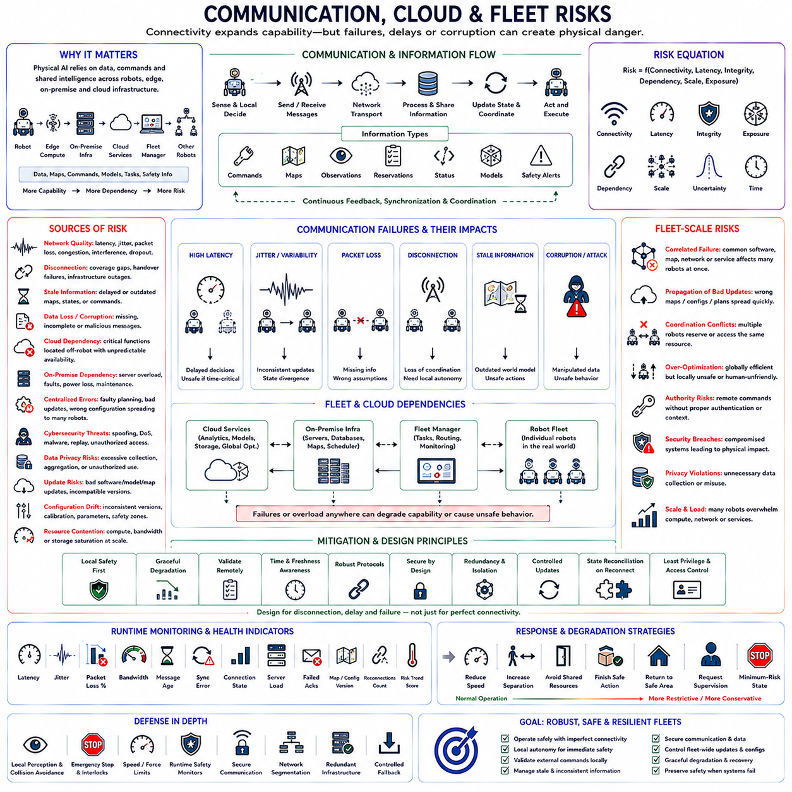{width="7.268055555555556in" height="7.268055555555556in"}

Communication, cloud, and fleet risks arise because Physical AI rarely operates as a completely isolated machine. Robots increasingly exchange commands, maps, observations, model updates, task states, and safety-relevant information with edge computers, on-premise infrastructure, cloud services, fleet managers, and other robots. Connectivity expands capability, but it also creates dependencies whose failure can influence physical behavior.

Communication should therefore be treated as a variable system resource rather than an always-available channel. Wireless links can experience latency, jitter, packet loss, congestion, interference, coverage gaps, handover failures, or complete disconnection. A robot that assumes continuous connectivity may continue executing decisions based on delayed commands or stale shared state. Safety-critical autonomy must define explicitly what remains possible when communication quality deteriorates.

Latency becomes safety-relevant when remote information influences time-sensitive decisions. A fleet server may assign routes, an on-premise system may update shared maps, or a cloud service may provide semantic reasoning, but the returned information represents an earlier state of the physical environment. Even correct information can become unsafe when it arrives too late. Systems must therefore distinguish real-time control dependencies from functions that tolerate delayed communication.

Jitter creates additional difficulty because variable delay can be harder to manage than consistently slow communication. Planning and coordination algorithms may assume that updates arrive within predictable intervals, while congestion or network scheduling produces irregular timing. Robots can then operate with different versions of shared state. Communication architecture should therefore consider bounded timing behavior, timestamps, freshness checks, synchronization, and conservative handling of unexpectedly delayed information.

Packet loss and incomplete messages can corrupt distributed understanding even when individual components continue functioning. Missing pose updates, task acknowledgments, obstacle reports, reservation messages, or safety notifications may cause one system to assume that another robot or service remains in a previous state. Reliable protocols, sequence numbers, acknowledgment mechanisms, integrity checks, timeout handling, and explicit unknown states help prevent missing information from being silently interpreted as valid information.

Network disconnection is particularly important for mobile robots because connectivity often changes with location. Buildings, machinery, tunnels, elevators, outdoor terrain, electromagnetic interference, and infrastructure failures can create communication dead zones. A robot should not become unsafe simply because its connection to fleet, on-premise, or cloud infrastructure disappears. Essential local perception, stabilization, collision avoidance, stopping, and minimum-risk behavior should remain available independently.

Cloud dependency can create architectural risk when functions required for immediate physical safety are placed outside the robot. Cloud computing can provide powerful foundation models, global analytics, long-term learning, data storage, or optimization, but wide-area communication cannot generally guarantee the deterministic timing required for low-level safety control. Safety-critical reactions should therefore remain sufficiently local, while cloud services provide capabilities whose temporary loss can be tolerated.

On-premise computing provides lower latency and greater operational control than remote cloud infrastructure, but it still represents an external dependency from the perspective of an individual robot. Server overload, network failure, software faults, power loss, database corruption, or maintenance can affect multiple robots simultaneously. Systems should define local fallback behavior so that loss of centralized intelligence reduces capability in a controlled manner rather than producing fleet-wide unsafe behavior.

Fleet management introduces risks because centralized optimization can influence many robots at once. A faulty route planner, incorrect map update, scheduling error, or corrupted configuration may propagate a common unsafe decision across the fleet. Central intelligence therefore creates both coordination benefits and correlated failure potential. High-impact fleet commands should be validated locally against each robot\'s current environment, capabilities, safety constraints, and operational state before execution.

Shared maps and world representations create consistency challenges. Different robots may observe the same environment at different times and from different perspectives, while central systems merge those observations into a common representation. Objects may move, routes may become blocked, infrastructure may change, and localization frames may drift. Shared information should therefore include timestamps, confidence, provenance, coordinate-frame identity, and validity conditions rather than being treated as timeless ground truth.

Distributed state synchronization becomes critical when robots coordinate access to shared resources. Intersections, narrow aisles, elevators, charging stations, loading areas, doors, and manipulation zones may require reservations or mutual exclusion. Delayed or duplicated messages can cause multiple robots to believe they possess the same resource. Coordination mechanisms should provide explicit ownership, expiration, conflict detection, and local collision avoidance even when centralized reservation logic fails.

Fleet-level planning can also produce locally unsafe behavior despite being globally efficient. An optimizer may route many robots through the same corridor, create congestion near people, repeatedly force one robot to yield, or generate configurations with insufficient escape space. Fleet objectives should therefore include local safety, traffic density, human interaction, recovery feasibility, and uncertainty rather than optimizing throughput or travel time alone.

Correlated failure is a defining fleet risk because many robots may share the same software, model, map, network, configuration, or centralized service. A defect that would affect only one independent machine can therefore become a fleet-wide event. Common-mode failures require particular attention during architecture and validation. Diversity, staged deployment, canary testing, rollback capability, configuration control, and independent local safeguards can reduce simultaneous exposure.

Remote commands create authority and authentication risks. Robots may receive task assignments, configuration changes, teleoperation commands, model updates, or emergency instructions from external systems. The robot must determine whether a command originates from an authorized source, whether it is appropriate for the current mode, and whether it remains safe to execute. Communication availability should never be confused with command authority.

Cybersecurity and physical safety become tightly connected in distributed Physical AI. Spoofed messages, compromised credentials, manipulated maps, malicious software updates, denial-of-service attacks, replayed commands, or unauthorized fleet access can influence physical movement. Security controls such as authentication, authorization, encryption, integrity protection, secure boot, signed updates, key management, network segmentation, and audit logging therefore contribute directly to physical risk reduction.

Data privacy creates another concern because connected robots can collect images, audio, location histories, operational records, human interactions, and environmental information. Fleet and cloud architectures may aggregate these data across locations and long periods. Collection should be limited to legitimate operational purposes, while access, retention, transfer, anonymization, and deletion policies should reflect applicable requirements. Safety monitoring should not become an uncontrolled mechanism for unnecessary surveillance.

Software and model updates can create fleet-wide lifecycle risk. A new perception model, VLA policy, navigation parameter, map, firmware version, or safety configuration may improve performance while introducing unexpected behavior. Immediate deployment to every robot magnifies the consequence of an undetected defect. Updates should therefore use version control, compatibility checks, validation, staged rollout, health monitoring, rollback, and traceability across individual robots.

Configuration drift can gradually reduce fleet consistency even without explicit model changes. Robots may operate with different firmware, calibration values, maps, parameters, safety zones, certificates, or mission configurations because of maintenance and partial updates. Fleet management should maintain an authoritative configuration record and detect unexpected differences. Operators need to know not only whether a robot is online, but also which validated configuration it is actually running.

Resource contention can affect centralized intelligence when many robots simultaneously request computation, storage, network bandwidth, map updates, or foundation-model inference. Performance that appears acceptable with several robots may degrade sharply at fleet scale. Queueing delays and overloaded services can convert normally useful remote intelligence into stale information. Capacity planning and overload behavior should therefore be validated under realistic peak fleet conditions.

Graceful degradation is essential when communication or centralized services become unreliable. Depending on the task, a robot may continue locally, reduce speed, avoid shared-resource transitions, finish a safe atomic action, return to a known area, request supervision, stop accepting new missions, or enter a minimum-risk state. The fallback should be predefined according to which information has been lost rather than using one identical response for every network fault.

Recovery after reconnection also requires careful design. A robot may have moved, changed tasks, observed new obstacles, or modified local state while disconnected, while the fleet system may have independently reassigned resources or updated the shared world model. Reconnection should therefore include state reconciliation rather than simply resuming old commands. Conflicting mission states, reservations, map versions, and authority must be resolved before coordinated operation continues.

Runtime monitoring should observe communication health as part of operational safety. Useful indicators include latency, jitter, packet loss, bandwidth, message age, synchronization error, connection state, server load, failed acknowledgments, inconsistent map versions, stale reservations, and repeated reconnections. These indicators can trigger progressive restrictions before communication degradation produces unsafe coordination or dependence on outdated information.

Defense in depth requires local safety to remain authoritative even within highly connected fleets. Independent obstacle detection, emergency stopping, speed and force limits, local collision avoidance, runtime safety monitors, command validation, secure communication, network segmentation, redundant infrastructure, and controlled fallback states prevent failures in fleet or cloud intelligence from directly becoming hazardous actuator commands.

Ultimately, communication, cloud, and fleet safety concerns how Physical AI can benefit from distributed intelligence without making safe physical operation dependent on perfect connectivity or flawless centralized coordination. Robust systems separate immediate local safety from remote optimization, validate external commands locally, manage stale and inconsistent information, tolerate disconnection, control fleet-wide updates, protect communication channels, and preserve safe autonomous behavior when shared intelligence becomes unavailable.

통신, 클라우드 및 플릿 위험(Communication, Cloud, and Fleet Risks)은 물리 AI(Physical AI)가 완전히 고립된 기계로 작동하는 경우가 드물기 때문에 발생합니다. 로봇은 점점 더 명령, 지도, 관측 정보, 모델 업데이트, 작업 상태 및 안전 관련 정보를 엣지 컴퓨터(Edge Computer), 온프레미스 인프라(On-Premise Infrastructure), 클라우드 서비스(Cloud Service), 플릿 관리자(Fleet Manager) 및 다른 로봇과 교환합니다. 연결성(Connectivity)은 시스템의 능력을 확장하지만, 동시에 고장이 물리적 행동에 영향을 미칠 수 있는 새로운 의존성을 만들어냅니다.

따라서 통신(Communication)은 항상 사용할 수 있는 채널이 아니라 상태가 변할 수 있는 시스템 자원으로 다루어야 합니다. 무선 연결은 지연시간(Latency), 지터(Jitter), 패킷 손실(Packet Loss), 혼잡(Congestion), 간섭, 통신 음영 지역(Coverage Gap), 핸드오버 실패(Handover Failure) 또는 완전한 연결 단절을 경험할 수 있습니다. 지속적인 연결을 가정하는 로봇은 지연된 명령이나 오래된 공유 상태를 기반으로 행동을 계속할 수 있습니다. 안전 핵심 자율성(Safety-Critical Autonomy)은 통신 품질이 저하될 때 어떤 기능을 계속 수행할 수 있는지를 명확하게 정의해야 합니다.

지연시간(Latency)은 원격 정보가 시간에 민감한 의사결정에 영향을 미칠 때 안전과 직접적으로 관련됩니다. 플릿 서버(Fleet Server)는 경로를 할당하고, 온프레미스 시스템은 공유 지도를 업데이트하며, 클라우드 서비스는 의미적 추론(Semantic Reasoning)을 제공할 수 있지만 반환된 정보는 이전 시점의 물리적 환경을 나타냅니다. 정확한 정보라도 너무 늦게 도착하면 위험할 수 있습니다. 따라서 시스템은 실시간 제어에 필요한 통신 의존성과 지연을 허용할 수 있는 기능을 구분해야 합니다.

지터(Jitter)는 일정하게 느린 통신보다 가변적인 지연을 관리하기가 더 어려울 수 있기 때문에 추가적인 문제를 발생시킵니다. 계획 및 협업 알고리즘은 업데이트가 예측 가능한 시간 간격으로 도착한다고 가정할 수 있지만, 혼잡이나 네트워크 스케줄링(Network Scheduling)은 불규칙한 타이밍을 발생시킬 수 있습니다. 그 결과 로봇들이 서로 다른 버전의 공유 상태를 기반으로 작동할 수 있습니다. 따라서 통신 아키텍처는 제한된 타이밍 동작(Bounded Timing Behavior), 타임스탬프(Timestamp), 최신성 검사(Freshness Check), 동기화 및 예상보다 지연된 정보에 대한 보수적인 처리를 고려해야 합니다.

패킷 손실(Packet Loss)과 불완전한 메시지는 개별 구성요소가 계속 작동하더라도 분산 시스템의 공통 상황 이해를 손상시킬 수 있습니다. 위치 업데이트, 작업 확인, 장애물 보고, 예약 메시지 또는 안전 알림이 누락되면 하나의 시스템이 다른 로봇이나 서비스가 이전 상태에 계속 있다고 잘못 가정할 수 있습니다. 신뢰성 있는 프로토콜, 시퀀스 번호(Sequence Number), 확인 응답 메커니즘(Acknowledgment Mechanism), 무결성 검사(Integrity Check), 타임아웃 처리 및 명시적인 미확인 상태(Unknown State)는 누락된 정보가 유효한 정보로 잘못 해석되는 것을 방지하는 데 도움이 됩니다.

네트워크 단절(Network Disconnection)은 이동 로봇의 연결성이 위치에 따라 달라지는 경우가 많기 때문에 특히 중요합니다. 건물, 기계, 터널, 엘리베이터, 실외 지형, 전자기 간섭 및 인프라 고장은 통신 불능 지역(Communication Dead Zone)을 만들 수 있습니다. 로봇은 플릿, 온프레미스 또는 클라우드 인프라와의 연결이 사라졌다는 이유만으로 위험한 상태가 되어서는 안 됩니다. 필수적인 로컬 인지(Local Perception), 안정화, 충돌 회피, 정지 및 최소 위험 행동(Minimum-Risk Behavior)은 외부 연결과 독립적으로 유지되어야 합니다.

클라우드 의존성(Cloud Dependency)은 즉각적인 물리적 안전에 필요한 기능이 로봇 외부에 배치될 때 아키텍처 위험(Architectural Risk)을 발생시킬 수 있습니다. 클라우드 컴퓨팅은 강력한 파운데이션 모델(Foundation Model), 글로벌 분석, 장기 학습, 데이터 저장 또는 최적화를 제공할 수 있지만 광역 통신(Wide-Area Communication)은 일반적으로 저수준 안전 제어에 필요한 결정론적 타이밍(Deterministic Timing)을 보장할 수 없습니다. 따라서 안전 핵심 반응은 충분히 로컬에서 유지되어야 하며, 클라우드 서비스는 일시적인 서비스 손실을 허용할 수 있는 기능을 제공해야 합니다.

온프레미스 컴퓨팅(On-Premise Computing)은 원격 클라우드 인프라보다 낮은 지연시간과 높은 운영 통제력을 제공하지만 개별 로봇의 관점에서는 여전히 외부 의존성을 나타냅니다. 서버 과부하, 네트워크 고장, 소프트웨어 오류, 전원 손실, 데이터베이스 손상 또는 유지보수는 여러 로봇에 동시에 영향을 줄 수 있습니다. 시스템은 중앙 집중형 지능(Centralized Intelligence)이 손실되었을 때 플릿 전체가 위험한 행동을 하는 대신 통제된 방식으로 기능이 감소하도록 로컬 폴백 행동(Local Fallback Behavior)을 정의해야 합니다.

플릿 관리(Fleet Management)는 중앙 집중식 최적화가 동시에 많은 로봇에 영향을 미칠 수 있기 때문에 위험을 발생시킵니다. 잘못된 경로 계획기, 부정확한 지도 업데이트, 스케줄링 오류 또는 손상된 구성(Configuration)은 공통적인 위험한 결정을 전체 플릿으로 전파할 수 있습니다. 따라서 중앙 지능은 협업의 이점과 상관 고장(Correlated Failure)의 가능성을 동시에 갖습니다. 영향도가 높은 플릿 명령은 실행되기 전에 각 로봇의 현재 환경, 능력, 안전 제약 및 운영 상태에 대해 로컬에서 검증되어야 합니다.

공유 지도 및 월드 표현(Shared Maps and World Representations)은 일관성 문제를 발생시킵니다. 서로 다른 로봇은 동일한 환경을 서로 다른 시점과 관점에서 관측할 수 있으며 중앙 시스템은 이러한 관측을 하나의 공통 표현으로 병합합니다. 물체는 이동하고, 경로는 차단되며, 인프라는 변경되고, 위치추정 좌표계(Localization Frame)는 드리프트할 수 있습니다. 따라서 공유 정보는 영구적으로 유효한 정답 데이터(Ground Truth)로 간주하기보다 타임스탬프, 신뢰도, 출처(Provenance), 좌표계 식별 정보 및 유효 조건을 포함해야 합니다.

분산 상태 동기화(Distributed State Synchronization)는 로봇이 공유 자원에 대한 접근을 조정할 때 핵심적인 요소가 됩니다. 교차로, 좁은 통로, 엘리베이터, 충전소, 적재 구역, 출입문 및 조작 구역에는 예약 또는 상호 배제(Mutual Exclusion)가 필요할 수 있습니다. 지연되거나 중복된 메시지로 인해 여러 로봇이 동일한 자원의 사용 권한을 가지고 있다고 판단할 수 있습니다. 따라서 협업 메커니즘은 명시적인 소유권, 만료 조건, 충돌 탐지 및 중앙 예약 로직이 실패하더라도 작동하는 로컬 충돌 회피(Local Collision Avoidance)를 제공해야 합니다.

플릿 수준 계획(Fleet-Level Planning)은 전체적으로 효율적이면서도 국부적으로는 위험한 행동을 발생시킬 수 있습니다. 최적화 시스템은 많은 로봇을 동일한 통로로 이동시켜 혼잡을 발생시키거나, 사람 주변에 로봇을 집중시키거나, 특정 로봇이 반복적으로 양보하도록 하거나, 충분한 회피 공간이 없는 배치를 만들 수 있습니다. 따라서 플릿의 목표는 처리량(Throughput)이나 이동시간만을 최적화하기보다 로컬 안전, 교통 밀도, 인간 상호작용, 복구 가능성 및 불확실성을 함께 고려해야 합니다.

상관 고장(Correlated Failure)은 많은 로봇이 동일한 소프트웨어, 모델, 지도, 네트워크, 구성 또는 중앙 서비스를 공유할 수 있기 때문에 플릿 위험의 핵심적인 특징입니다. 독립적인 기계에서는 하나의 장비에만 영향을 줄 수 있는 결함이 플릿 전체의 사고로 확대될 수 있습니다. 따라서 공통 원인 고장(Common-Mode Failure)은 아키텍처 설계 및 검증 과정에서 특별히 고려해야 합니다. 다양성(Diversity), 단계적 배포(Staged Deployment), 카나리 테스트(Canary Testing), 롤백(Rollback), 구성 관리 및 독립적인 로컬 안전장치를 통해 여러 로봇이 동시에 위험에 노출되는 것을 줄일 수 있습니다.

원격 명령(Remote Command)은 권한 및 인증 위험(Authority and Authentication Risk)을 발생시킵니다. 로봇은 외부 시스템으로부터 작업 할당, 구성 변경, 원격조작 명령, 모델 업데이트 또는 비상 명령을 받을 수 있습니다. 로봇은 명령이 승인된 출처에서 생성되었는지, 현재 운영 모드에 적합한지, 그리고 현재 상황에서 여전히 안전하게 실행할 수 있는지를 판단해야 합니다. 통신이 가능하다는 사실을 명령 권한(Command Authority)이 있다는 의미로 해석해서는 안 됩니다.

사이버보안(Cybersecurity)과 물리적 안전(Physical Safety)은 분산형 물리 AI에서 밀접하게 연결됩니다. 위조된 메시지, 탈취된 자격증명, 조작된 지도, 악성 소프트웨어 업데이트, 서비스 거부 공격(Denial-of-Service Attack), 재전송된 명령(Replay Command) 또는 승인되지 않은 플릿 접근은 물리적 움직임에 영향을 미칠 수 있습니다. 따라서 인증(Authentication), 권한 부여(Authorization), 암호화, 무결성 보호, 보안 부팅(Secure Boot), 서명된 업데이트(Signed Update), 키 관리(Key Management), 네트워크 분할(Network Segmentation) 및 감사 로깅(Audit Logging)은 물리적 위험 감소에 직접적으로 기여합니다.

데이터 프라이버시(Data Privacy)는 연결된 로봇이 영상, 음성, 위치 이력, 운영 기록, 인간 상호작용 및 환경 정보를 수집할 수 있기 때문에 또 다른 문제를 발생시킵니다. 플릿 및 클라우드 아키텍처는 여러 장소와 장기간에 걸쳐 이러한 데이터를 집계할 수 있습니다. 데이터 수집은 정당한 운영 목적에 필요한 범위로 제한되어야 하며 접근, 보존, 전송, 익명화(Anonymization) 및 삭제 정책은 적용 가능한 요구사항을 반영해야 합니다. 안전 모니터링이 불필요한 감시를 위한 통제되지 않은 수단으로 변화해서는 안 됩니다.

소프트웨어 및 모델 업데이트(Software and Model Update)는 플릿 전체의 생명주기 위험(Lifecycle Risk)을 발생시킬 수 있습니다. 새로운 인지 모델, VLA 정책(VLA Policy), 내비게이션 매개변수, 지도, 펌웨어 버전 또는 안전 구성이 성능을 향상시키면서도 예상하지 못한 행동을 도입할 수 있습니다. 모든 로봇에 즉시 배포하면 발견되지 않은 결함의 영향을 크게 확대할 수 있습니다. 따라서 업데이트에는 버전 관리, 호환성 검사, 검증, 단계적 배포, 상태 모니터링, 롤백 및 개별 로봇에 대한 추적성(Traceability)이 적용되어야 합니다.

구성 드리프트(Configuration Drift)는 명시적인 모델 변경이 없더라도 플릿의 일관성을 점진적으로 감소시킬 수 있습니다. 유지보수 및 부분 업데이트로 인해 로봇들이 서로 다른 펌웨어, 캘리브레이션 값, 지도, 매개변수, 안전 구역, 인증서 또는 임무 구성을 사용할 수 있습니다. 플릿 관리 시스템은 권위 있는 구성 기록(Authoritative Configuration Record)을 유지하고 예상하지 못한 차이를 탐지해야 합니다. 운영자는 로봇이 온라인 상태인지뿐만 아니라 실제로 어떤 검증된 구성으로 작동하고 있는지도 파악할 수 있어야 합니다.

자원 경합(Resource Contention)은 많은 로봇이 동시에 연산, 저장 공간, 네트워크 대역폭, 지도 업데이트 또는 파운데이션 모델 추론(Foundation-Model Inference)을 요청할 때 중앙 지능의 성능에 영향을 줄 수 있습니다. 소수의 로봇에서는 적절했던 성능이 플릿 규모에서는 급격하게 저하될 수 있습니다. 대기열 지연(Queueing Delay)과 과부하된 서비스는 일반적으로 유용한 원격 지능을 오래된 정보로 변화시킬 수 있습니다. 따라서 용량 계획(Capacity Planning)과 과부하 상태의 동작은 현실적인 최대 플릿 운용 조건에서 검증되어야 합니다.

점진적 성능 저하(Graceful Degradation)는 통신 또는 중앙 서비스의 신뢰성이 저하될 때 필수적입니다. 작업에 따라 로봇은 로컬 자율성을 이용해 운행을 계속하거나, 속도를 낮추고, 공유 자원으로의 진입을 피하고, 안전한 단위 행동(Atomic Action)을 완료하거나, 알려진 영역으로 복귀하고, 감독을 요청하거나, 새로운 임무의 수락을 중단하거나, 최소 위험 상태(Minimum-Risk State)로 전환할 수 있습니다. 폴백 행동은 모든 네트워크 고장에 동일한 대응을 적용하기보다 어떤 정보와 기능이 손실되었는지에 따라 사전에 정의되어야 합니다.

재연결 이후의 복구(Recovery after Reconnection) 역시 신중하게 설계해야 합니다. 통신이 단절된 동안 로봇은 이동하거나, 작업을 변경하거나, 새로운 장애물을 관측하거나, 로컬 상태를 수정했을 수 있으며 플릿 시스템 역시 독립적으로 자원을 재할당하거나 공유 월드 모델(Shared World Model)을 업데이트했을 수 있습니다. 따라서 재연결은 기존 명령을 단순히 재개하는 것이 아니라 상태 조정(State Reconciliation)을 포함해야 합니다. 충돌하는 임무 상태, 예약 정보, 지도 버전 및 권한 관계를 해결한 이후에 협업 운용을 계속해야 합니다.

런타임 모니터링(Runtime Monitoring)은 운영 안전의 일부로 통신 상태를 관찰해야 합니다. 유용한 지표에는 지연시간, 지터, 패킷 손실, 대역폭, 메시지 수명(Message Age), 동기화 오류, 연결 상태, 서버 부하, 실패한 확인 응답, 일관되지 않은 지도 버전, 오래된 예약 정보 및 반복적인 재연결 등이 포함됩니다. 이러한 지표를 활용하면 통신 성능 저하가 위험한 협업이나 오래된 정보에 대한 의존으로 이어지기 전에 시스템 기능을 점진적으로 제한할 수 있습니다.

심층 방어(Defense in Depth)를 위해서는 고도로 연결된 플릿에서도 로컬 안전(Local Safety)이 최종적인 권한을 유지해야 합니다. 독립적인 장애물 탐지, 비상 정지, 속도 및 힘 제한, 로컬 충돌 회피, 런타임 안전 모니터(Runtime Safety Monitor), 명령 검증, 보안 통신, 네트워크 분할, 중복 인프라(Redundant Infrastructure) 및 통제된 폴백 상태를 통해 플릿 또는 클라우드 지능의 고장이 위험한 액추에이터 명령으로 직접 전환되는 것을 방지할 수 있습니다.

궁극적으로 통신, 클라우드 및 플릿 안전(Communication, Cloud, and Fleet Safety)은 물리 AI가 완벽한 연결성이나 오류 없는 중앙 집중형 협업에 안전한 물리적 운용을 의존하지 않으면서 분산 지능(Distributed Intelligence)의 이점을 어떻게 활용할 것인가에 관한 문제입니다. 강건한 시스템(Robust System)은 즉각적인 로컬 안전과 원격 최적화를 분리하고, 외부 명령을 로컬에서 검증하며, 오래되거나 일관되지 않은 정보를 관리하고, 통신 단절을 허용하며, 플릿 전체 업데이트를 통제하고, 통신 채널을 보호하며, 공유 지능(Shared Intelligence)을 사용할 수 없는 상황에서도 안전한 자율 행동을 유지해야 합니다.

##  

## 01.14. Cyber Physical Security Risks

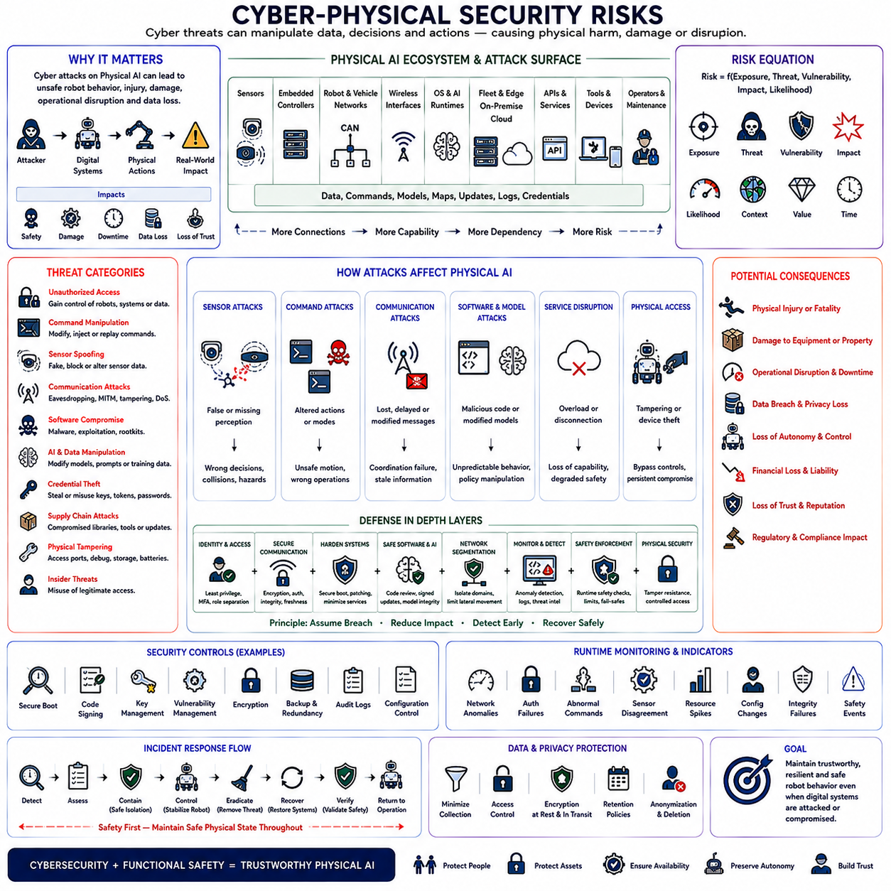{width="7.268055555555556in" height="7.268055555555556in"}

Cyber-physical security risks arise because Physical AI connects digital computation directly to sensing, communication, decision-making, and physical actuation. A successful cyberattack can therefore produce consequences beyond loss of data or service availability. Manipulated commands, corrupted perception, compromised control software, or unauthorized access may cause robots to move incorrectly, enter restricted areas, damage equipment, disrupt operations, or endanger people.

The cyber-physical attack surface spans the entire robot ecosystem rather than a single computer. Sensors, embedded controllers, vehicle networks, wireless interfaces, operating systems, AI runtimes, fleet servers, on-premise infrastructure, cloud services, maintenance tools, mobile devices, APIs, and update mechanisms can all become entry points. Security analysis must therefore consider interactions among hardware, software, networks, AI models, operators, and physical processes.

Unauthorized command execution is particularly dangerous because control interfaces ultimately influence actuators. An attacker who gains access to navigation, manipulation, mission, or teleoperation functions may attempt to change destinations, velocities, trajectories, payload actions, or operating modes. Command authentication alone is insufficient if authenticated commands can request unsafe behavior. Robots should independently validate authorization, current context, operational limits, and physical safety before execution.

Sensor spoofing attacks attempt to manipulate the information from which Physical AI constructs its understanding of the world. GNSS signals, cameras, LiDAR, radar, ultrasonic sensors, encoders, inertial sensors, RFID, or wireless localization systems may be deceived, obstructed, replayed, or modified. A successful attack can make a real obstacle appear absent, create a false obstacle, shift estimated position, or distort motion estimates without directly compromising the main computer.

Sensor integrity therefore requires more than trusting individual measurements. Cross-sensor consistency, physical plausibility checks, temporal continuity, redundant sensing, signal-quality monitoring, and independent safety sensors can reveal observations that disagree with expected physical relationships. Diversity is particularly valuable because different sensing modalities have different vulnerabilities. The objective is to prevent one manipulated information source from silently becoming authoritative physical truth.

Communication attacks can target robot-to-robot, robot-to-fleet, edge, on-premise, cloud, and remote-operator links. Eavesdropping can expose sensitive information, while message modification, replay, impersonation, man-in-the-middle attacks, or denial of service can alter distributed behavior. Secure communication requires confidentiality where appropriate, but authentication, integrity, freshness, authorization, and availability are often equally important for cyber-physical safety.

Replay attacks are especially relevant to systems that accept valid but time-sensitive messages. Previously recorded commands, localization corrections, credentials, task assignments, or reservation messages may remain cryptographically authentic while no longer being valid for the current state. Sequence numbers, timestamps, nonces, expiration rules, session context, and state-dependent validation can help distinguish legitimate current information from previously valid information maliciously reused.

Denial-of-service attacks may not need to take direct control of a robot to create physical risk. Saturating wireless channels, compute resources, APIs, fleet services, or perception pipelines can increase latency or remove information required for coordination. The safety architecture should therefore define behavior under resource exhaustion and communication loss. Degraded connectivity or computation should reduce autonomous capability in a controlled way rather than produce unpredictable execution.

Software compromise can occur through vulnerable services, operating systems, libraries, containers, middleware, drivers, or application code. Once malicious code executes with sufficient privilege, it may alter commands, disable monitoring, falsify logs, or manipulate AI inputs and outputs. Secure architecture should minimize privilege, isolate critical functions, reduce unnecessary services, control executable software, and prevent compromise of a noncritical component from automatically granting access to safety-critical control.

Secure boot(Secure Boot) and trusted execution mechanisms help establish confidence that approved software is running from system startup. Firmware, bootloaders, kernels, drivers, AI runtimes, and safety-relevant applications can be cryptographically verified before execution where appropriate. This does not eliminate software vulnerabilities, but it reduces the opportunity for persistent unauthorized modifications to survive reboot and silently replace trusted components.

Software supply-chain risk extends security beyond the organization developing the robot. Physical AI platforms commonly depend on third-party libraries, open-source packages, pretrained models, drivers, containers, firmware, development tools, and external services. A compromised dependency or build pipeline can introduce malicious or vulnerable components before deployment. Dependency inventories, provenance, signed artifacts, controlled builds, vulnerability management, and software bills of materials support traceability.

AI models create additional supply-chain and integrity concerns. Model weights, adapters, prompts, tokenizers, preprocessing components, configuration files, and policy parameters can all affect autonomous behavior. Unauthorized modification may subtly alter outputs without causing obvious software failure. Model artifacts should therefore be versioned, authenticated, integrity-checked, access-controlled, and associated with validated configurations so that the deployed intelligence can be traced to an approved release.

Adversarial manipulation of AI inputs can influence learned perception and reasoning without modifying model weights. Visual patterns, environmental text, carefully constructed observations, malicious prompts, or manipulated contextual data may cause incorrect recognition or agent behavior. Physical AI should not assume that semantically convincing model outputs are trustworthy merely because the underlying software is intact. Consequential actions require independent physical and authorization checks.

Prompt injection becomes especially important when VLA or agentic systems interpret language from users, documents, displays, networks, or the physical environment. Untrusted content may contain text designed to redirect goals, expose information, invoke tools, or bypass restrictions. Systems should separate trusted instruction channels from observed content and enforce permissions outside the generative model. Language interpretation should never possess unilateral authority to override safety controls.

Credential compromise can provide attackers with apparently legitimate access. Shared passwords, excessive privileges, long-lived tokens, poorly protected keys, or abandoned accounts can undermine otherwise secure communication. Identity and access management should apply least privilege, strong authentication, credential rotation, revocation, role separation, and auditable authorization. Maintenance, development, fleet operation, remote control, and safety administration should not automatically share equivalent permissions.

Network segmentation limits how far a compromise can propagate. Safety controllers, robot control networks, AI compute, diagnostic interfaces, fleet infrastructure, corporate IT, cloud services, and guest networks have different trust and availability requirements. Separating these domains and tightly controlling permitted communication paths can reduce lateral movement. A compromised user-facing service should not provide an unrestricted route to actuator-level control or safety configuration.

Physical access creates security risks that purely network-focused analysis can overlook. Attackers or unauthorized personnel may reach maintenance ports, USB interfaces, debug connectors, removable storage, sensors, batteries, network equipment, or emergency controls. Robots operating in public or uncontrolled environments are particularly exposed. Tamper resistance, protected interfaces, secure service procedures, device identity, logging, and appropriate physical access controls complement software security.

Logging and forensic traceability are necessary for detecting and understanding cyber-physical incidents. Systems should record security-relevant authentication events, configuration changes, software versions, remote commands, safety interventions, update activity, and important anomalies with reliable timestamps. Logs should be protected against unauthorized alteration. Effective traceability helps distinguish cyberattack, software defect, operator error, sensor failure, and ordinary environmental uncertainty after abnormal behavior occurs.

Security monitoring should also operate at runtime rather than relying only on preventive controls. Unexpected network traffic, repeated authentication failures, unusual command patterns, configuration changes, abnormal sensor disagreement, unauthorized processes, integrity failures, or sudden resource consumption can indicate compromise. Cyber indicators should be correlated with physical state because an apparently minor digital anomaly may become critical when the robot is moving near people or hazardous equipment.

Incident response for Physical AI must consider the consequences of containment actions. Immediately disconnecting a compromised robot may be appropriate in some situations but dangerous if the robot is carrying a load, moving at speed, or controlling equipment. Response procedures should define safe isolation, controlled stopping, preservation of essential local safety functions, credential revocation, evidence collection, recovery, and verification before returning the system to autonomous operation.

Fleet systems magnify security consequences because a shared credential, software vulnerability, model update, map service, or fleet controller can affect many robots simultaneously. Security architecture should therefore consider correlated compromise and common-mode attack paths. Staged updates, limited administrative scope, independent robot validation, segmented fleets, rapid revocation, rollback, and local safety authority can prevent a centralized compromise from automatically becoming fleet-wide physical control.

Security and safety engineering should be coordinated throughout the system lifecycle. Security controls can affect timing, availability, update procedures, maintenance, and emergency access, while safety mechanisms can create privileged interfaces attractive to attackers. Threat analysis and hazard analysis should therefore inform one another. A system is not adequately protected if cybersecurity prevents unauthorized access but creates unsafe failure behavior, or if safety functions can be trivially bypassed through cyber means.

Defense in depth assumes that individual security controls can fail. Secure boot, signed updates, strong identity, least privilege, segmentation, encrypted and authenticated communication, integrity monitoring, sensor cross-checking, runtime safety enforcement, independent emergency functions, secure logging, controlled recovery, and physical protections form overlapping barriers. No single firewall, credential, AI detector, or safety controller should be expected to defeat every cyber-physical threat.

Ultimately, cyber-physical security concerns preserving trustworthy physical behavior when digital components are exposed to malicious, compromised, or untrusted influences. Safe Physical AI requires authenticated commands, trustworthy sensing, protected software and models, bounded privileges, resilient communication, runtime detection, controlled incident response, and independent safety mechanisms. Even when part of the digital system is compromised, the architecture should limit authority, contain propagation, and preserve the ability to reach a safe physical state.

사이버-물리 보안 위험(Cyber-Physical Security Risks)은 물리 AI(Physical AI)가 디지털 연산을 센싱, 통신, 의사결정 및 물리적 구동(Physical Actuation)과 직접 연결하기 때문에 발생합니다. 따라서 성공적인 사이버 공격(Cyberattack)은 데이터 손실이나 서비스 가용성 저하를 넘어서는 결과를 초래할 수 있습니다. 조작된 명령, 손상된 인지 정보, 침해된 제어 소프트웨어 또는 승인되지 않은 접근은 로봇의 잘못된 움직임, 제한 구역 진입, 장비 손상, 운영 중단 또는 사람에 대한 위험으로 이어질 수 있습니다.

사이버-물리 공격 표면(Cyber-Physical Attack Surface)은 하나의 컴퓨터가 아니라 전체 로봇 생태계(Robot Ecosystem)에 걸쳐 존재합니다. 센서, 임베디드 제어기(Embedded Controller), 차량 네트워크, 무선 인터페이스, 운영체제, AI 런타임(AI Runtime), 플릿 서버(Fleet Server), 온프레미스 인프라(On-Premise Infrastructure), 클라우드 서비스, 유지보수 도구, 모바일 장치, API 및 업데이트 메커니즘이 모두 침입 지점이 될 수 있습니다. 따라서 보안 분석은 하드웨어, 소프트웨어, 네트워크, AI 모델, 운영자 및 물리적 프로세스 사이의 상호작용을 함께 고려해야 합니다.

승인되지 않은 명령 실행(Unauthorized Command Execution)은 제어 인터페이스가 궁극적으로 액추에이터에 영향을 미치기 때문에 특히 위험합니다. 내비게이션, 조작, 임무 또는 원격조작(Teleoperation) 기능에 접근한 공격자는 목적지, 속도, 궤적, 적재물 동작 또는 운영 모드를 변경하려 할 수 있습니다. 인증된 명령이라도 위험한 행동을 요청할 수 있으므로 명령 인증(Command Authentication)만으로는 충분하지 않습니다. 로봇은 실행 전에 권한, 현재 상황, 운영 한계 및 물리적 안전을 독립적으로 검증해야 합니다.

센서 스푸핑 공격(Sensor Spoofing Attack)은 물리 AI가 세계를 이해하기 위해 사용하는 정보를 조작하려는 공격입니다. GNSS 신호, 카메라, 라이다(LiDAR), 레이더, 초음파 센서, 엔코더, 관성 센서(Inertial Sensor), RFID 또는 무선 위치추정 시스템이 기만, 차단, 재전송 또는 변조될 수 있습니다. 공격이 성공하면 실제 장애물이 존재하지 않는 것처럼 보이거나 가짜 장애물이 생성되고, 추정 위치가 이동하거나, 실제 주 컴퓨터를 직접 침해하지 않고도 움직임 추정이 왜곡될 수 있습니다.

따라서 센서 무결성(Sensor Integrity)은 개별 측정값을 단순히 신뢰하는 것 이상의 방법을 필요로 합니다. 센서 간 일관성(Cross-Sensor Consistency), 물리적 타당성 검사, 시간적 연속성, 중복 센싱(Redundant Sensing), 신호 품질 모니터링 및 독립적인 안전 센서를 활용하면 예상되는 물리적 관계와 일치하지 않는 관측을 탐지할 수 있습니다. 서로 다른 센싱 방식은 취약점도 서로 다르므로 센서 다양성(Diversity)은 특히 중요합니다. 목표는 하나의 조작된 정보원이 아무런 검증 없이 권위 있는 물리적 사실로 받아들여지는 것을 방지하는 것입니다.

통신 공격(Communication Attack)은 로봇 간 통신, 로봇-플릿 통신, 엣지, 온프레미스, 클라우드 및 원격 운영자 연결을 대상으로 할 수 있습니다. 도청(Eavesdropping)은 민감한 정보를 노출할 수 있으며 메시지 변조, 재전송(Replay), 사칭(Impersonation), 중간자 공격(Man-in-the-Middle Attack) 또는 서비스 거부 공격(Denial-of-Service Attack)은 분산 시스템의 행동을 변화시킬 수 있습니다. 안전한 통신에는 필요한 경우 기밀성(Confidentiality)이 요구되지만, 사이버-물리 안전에서는 인증, 무결성, 최신성(Freshness), 권한 부여 및 가용성 역시 중요합니다.

재전송 공격(Replay Attack)은 유효하지만 시간에 민감한 메시지를 받아들이는 시스템에서 특히 중요합니다. 이전에 기록된 명령, 위치 보정 정보, 자격증명, 작업 할당 또는 예약 메시지는 암호학적으로는 진본이면서도 현재 상태에서는 더 이상 유효하지 않을 수 있습니다. 시퀀스 번호(Sequence Number), 타임스탬프(Timestamp), 논스(Nonce), 만료 규칙, 세션 맥락(Session Context) 및 상태 의존적 검증을 활용하면 현재의 합법적인 정보와 과거에는 유효했지만 악의적으로 재사용된 정보를 구분할 수 있습니다.

서비스 거부 공격(Denial-of-Service Attack)은 로봇을 직접 제어하지 않고도 물리적 위험을 발생시킬 수 있습니다. 무선 채널, 컴퓨팅 자원, API, 플릿 서비스 또는 인지 파이프라인(Perception Pipeline)을 포화시키면 지연시간이 증가하거나 협업에 필요한 정보가 제거될 수 있습니다. 따라서 안전 아키텍처(Safety Architecture)는 자원 고갈(Resource Exhaustion)과 통신 손실 상태에서의 행동을 정의해야 합니다. 통신이나 계산 성능이 저하되면 예측할 수 없는 실행이 발생하는 대신 자율 능력이 통제된 방식으로 감소해야 합니다.

소프트웨어 침해(Software Compromise)는 취약한 서비스, 운영체제, 라이브러리, 컨테이너, 미들웨어, 드라이버 또는 애플리케이션 코드를 통해 발생할 수 있습니다. 악성 코드가 충분한 권한으로 실행되면 명령을 변경하고, 모니터링을 비활성화하며, 로그를 위조하거나, AI의 입력과 출력을 조작할 수 있습니다. 안전한 아키텍처는 권한을 최소화하고, 핵심 기능을 격리하며, 불필요한 서비스를 줄이고, 실행 가능한 소프트웨어를 통제하여 비핵심 구성요소의 침해가 자동으로 안전 핵심 제어(Safety-Critical Control)에 대한 접근 권한으로 확대되지 않도록 해야 합니다.

보안 부팅(Secure Boot)과 신뢰 실행 메커니즘(Trusted Execution Mechanism)은 시스템 시작 단계부터 승인된 소프트웨어가 실행되고 있다는 신뢰를 확립하는 데 도움을 줍니다. 필요한 경우 펌웨어, 부트로더, 커널, 드라이버, AI 런타임 및 안전 관련 애플리케이션을 실행 전에 암호학적으로 검증할 수 있습니다. 이러한 방식이 모든 소프트웨어 취약점을 제거하는 것은 아니지만, 승인되지 않은 지속적 변경(Persistent Unauthorized Modification)이 재부팅 이후에도 유지되면서 신뢰된 구성요소를 은밀하게 대체할 가능성을 줄일 수 있습니다.

소프트웨어 공급망 위험(Software Supply-Chain Risk)은 보안의 범위를 로봇을 개발하는 조직 외부까지 확장합니다. 물리 AI 플랫폼은 일반적으로 제3자 라이브러리, 오픈소스 패키지, 사전학습 모델(Pretrained Model), 드라이버, 컨테이너, 펌웨어, 개발 도구 및 외부 서비스에 의존합니다. 침해된 종속성이나 빌드 파이프라인(Build Pipeline)은 배포 전에 악성 또는 취약한 구성요소를 시스템에 포함시킬 수 있습니다. 종속성 목록, 출처(Provenance), 서명된 아티팩트(Signed Artifact), 통제된 빌드, 취약점 관리 및 소프트웨어 자재명세서(Software Bill of Materials)는 추적성을 지원합니다.

AI 모델은 추가적인 공급망 및 무결성 문제를 발생시킵니다. 모델 가중치, 어댑터(Adapter), 프롬프트(Prompt), 토크나이저(Tokenizer), 전처리 구성요소, 구성 파일 및 정책 매개변수는 모두 자율 행동에 영향을 미칠 수 있습니다. 승인되지 않은 변경은 명백한 소프트웨어 고장을 발생시키지 않으면서 출력을 미묘하게 변화시킬 수 있습니다. 따라서 모델 아티팩트(Model Artifact)는 버전 관리, 인증, 무결성 검사, 접근 제어를 적용하고 검증된 구성과 연결하여 배포된 지능이 승인된 릴리스(Approved Release)로 추적될 수 있도록 해야 합니다.

AI 입력에 대한 적대적 조작(Adversarial Manipulation)은 모델 가중치를 변경하지 않고도 학습 기반 인지와 추론에 영향을 줄 수 있습니다. 시각적 패턴, 환경의 텍스트, 정교하게 구성된 관측, 악성 프롬프트 또는 조작된 맥락 데이터(Contextual Data)는 잘못된 인식이나 에이전트 행동을 유발할 수 있습니다. 물리 AI는 기반 소프트웨어가 정상이라는 이유만으로 의미적으로 그럴듯한 모델 출력을 신뢰해서는 안 됩니다. 중대한 결과를 초래할 수 있는 행동에는 독립적인 물리적 검사와 권한 검증이 필요합니다.

프롬프트 인젝션(Prompt Injection)은 VLA 또는 에이전트형 시스템(Agentic System)이 사용자, 문서, 디스플레이, 네트워크 또는 물리적 환경의 언어를 해석할 때 특히 중요합니다. 신뢰할 수 없는 콘텐츠(Untrusted Content)에는 목표 변경, 정보 노출, 도구 호출 또는 제한 우회를 유도하도록 설계된 텍스트가 포함될 수 있습니다. 시스템은 신뢰할 수 있는 명령 채널(Trusted Instruction Channel)과 관측된 콘텐츠를 분리하고 생성 모델 외부에서 권한을 강제해야 합니다. 언어 해석이 안전 제어를 일방적으로 무시할 수 있는 권한을 가져서는 안 됩니다.

자격증명 침해(Credential Compromise)는 공격자에게 외관상 합법적인 접근 권한을 제공할 수 있습니다. 공유 비밀번호, 과도한 권한, 장기간 유효한 토큰, 제대로 보호되지 않은 키 또는 폐기되지 않은 계정은 다른 보안 통신 체계를 무력화할 수 있습니다. 신원 및 접근 관리(Identity and Access Management)는 최소 권한(Least Privilege), 강력한 인증, 자격증명 교체, 폐기, 역할 분리(Role Separation) 및 감사 가능한 권한 부여를 적용해야 합니다. 유지보수, 개발, 플릿 운영, 원격 제어 및 안전 관리가 자동으로 동일한 권한을 공유해서는 안 됩니다.

네트워크 분할(Network Segmentation)은 하나의 침해가 전파될 수 있는 범위를 제한합니다. 안전 제어기, 로봇 제어 네트워크, AI 컴퓨팅, 진단 인터페이스, 플릿 인프라, 기업 IT, 클라우드 서비스 및 게스트 네트워크는 서로 다른 신뢰성과 가용성 요구사항을 가집니다. 이러한 영역을 분리하고 허용되는 통신 경로를 엄격하게 통제하면 측면 이동(Lateral Movement)을 줄일 수 있습니다. 사용자 대상 서비스가 침해되더라도 액추에이터 수준의 제어나 안전 구성으로 연결되는 제한 없는 경로를 제공해서는 안 됩니다.

물리적 접근(Physical Access)은 네트워크 중심의 분석만으로는 놓치기 쉬운 보안 위험을 발생시킵니다. 공격자 또는 승인되지 않은 사람이 유지보수 포트, USB 인터페이스, 디버그 커넥터, 이동식 저장장치, 센서, 배터리, 네트워크 장비 또는 비상 제어 장치에 접근할 수 있습니다. 공공장소나 통제되지 않은 환경에서 운용되는 로봇은 특히 이러한 위험에 노출됩니다. 변조 방지(Tamper Resistance), 보호된 인터페이스, 안전한 정비 절차, 장치 식별(Device Identity), 로깅 및 적절한 물리적 접근 제어는 소프트웨어 보안을 보완합니다.

로깅 및 포렌식 추적성(Logging and Forensic Traceability)은 사이버-물리 사고를 탐지하고 이해하기 위해 필요합니다. 시스템은 보안 관련 인증 이벤트, 구성 변경, 소프트웨어 버전, 원격 명령, 안전 개입, 업데이트 활동 및 중요한 이상 현상을 신뢰할 수 있는 타임스탬프와 함께 기록해야 합니다. 로그는 승인되지 않은 변경으로부터 보호되어야 합니다. 효과적인 추적성은 비정상적인 행동 이후 사이버 공격, 소프트웨어 결함, 운영자 오류, 센서 고장 및 일반적인 환경 불확실성을 구분하는 데 도움을 줍니다.

보안 모니터링(Security Monitoring)은 예방적 제어에만 의존하지 않고 런타임(Runtime)에서도 수행되어야 합니다. 예상하지 못한 네트워크 트래픽, 반복되는 인증 실패, 비정상적인 명령 패턴, 구성 변경, 비정상적인 센서 불일치, 승인되지 않은 프로세스, 무결성 실패 또는 갑작스러운 자원 사용 증가는 시스템 침해를 나타낼 수 있습니다. 사이버 지표(Cyber Indicator)는 물리적 상태와 연계하여 분석해야 합니다. 로봇이 사람이나 위험한 장비 근처에서 이동하고 있다면 사소해 보이는 디지털 이상도 심각한 문제가 될 수 있기 때문입니다.

물리 AI의 사고 대응(Incident Response)은 격리 조치가 초래하는 물리적 결과를 고려해야 합니다. 침해된 로봇을 즉시 네트워크에서 분리하는 것이 일부 상황에서는 적절할 수 있지만, 로봇이 적재물을 운반하거나 고속으로 이동하거나 장비를 제어하고 있다면 위험할 수 있습니다. 대응 절차는 안전한 격리(Safe Isolation), 통제된 정지, 필수적인 로컬 안전 기능의 유지, 자격증명 폐기, 증거 수집, 복구 및 자율 운용으로 복귀하기 전의 검증을 정의해야 합니다.

플릿 시스템(Fleet System)은 공유 자격증명, 소프트웨어 취약점, 모델 업데이트, 지도 서비스 또는 플릿 제어기가 동시에 많은 로봇에 영향을 미칠 수 있기 때문에 보안상의 결과를 확대합니다. 따라서 보안 아키텍처는 상관 침해(Correlated Compromise)와 공통 공격 경로(Common-Mode Attack Path)를 고려해야 합니다. 단계적 업데이트, 제한된 관리 권한, 독립적인 로봇 검증, 플릿 분할(Segmented Fleet), 신속한 권한 폐기, 롤백 및 로컬 안전 권한(Local Safety Authority)을 통해 중앙 시스템의 침해가 자동으로 플릿 전체의 물리적 제어권 장악으로 확대되는 것을 방지할 수 있습니다.

보안 공학(Security Engineering)과 안전 공학(Safety Engineering)은 시스템 생명주기 전체에서 상호 연계되어야 합니다. 보안 제어는 타이밍, 가용성, 업데이트 절차, 유지보수 및 비상 접근에 영향을 줄 수 있으며, 안전 메커니즘은 공격자에게 매력적인 특권 인터페이스(Privileged Interface)를 만들 수도 있습니다. 따라서 위협 분석(Threat Analysis)과 위험원 분석(Hazard Analysis)은 서로에게 정보를 제공해야 합니다. 사이버보안이 승인되지 않은 접근을 방지하면서 위험한 고장 행동을 만들어내거나, 안전 기능이 사이버 수단으로 쉽게 우회될 수 있다면 시스템은 충분히 보호되었다고 볼 수 없습니다.

심층 방어(Defense in Depth)는 개별적인 보안 제어가 실패할 수 있다는 가정을 기반으로 합니다. 보안 부팅, 서명된 업데이트, 강력한 신원 관리, 최소 권한, 네트워크 분할, 암호화 및 인증된 통신, 무결성 모니터링, 센서 교차 검사, 런타임 안전 강제(Runtime Safety Enforcement), 독립적인 비상 기능, 안전한 로깅, 통제된 복구 및 물리적 보호가 서로 중첩된 방어 장벽을 형성합니다. 하나의 방화벽, 자격증명, AI 탐지기 또는 안전 제어기가 모든 사이버-물리 위협을 방어할 수 있다고 가정해서는 안 됩니다.

궁극적으로 사이버-물리 보안(Cyber-Physical Security)은 디지털 구성요소가 악의적이거나, 침해되었거나, 신뢰할 수 없는 영향에 노출되었을 때에도 신뢰할 수 있는 물리적 행동(Trustworthy Physical Behavior)을 유지하는 문제입니다. 안전한 물리 AI는 인증된 명령, 신뢰할 수 있는 센싱, 보호된 소프트웨어와 모델, 제한된 권한, 복원력 있는 통신(Resilient Communication), 런타임 탐지, 통제된 사고 대응 및 독립적인 안전 메커니즘을 필요로 합니다. 디지털 시스템의 일부가 침해되더라도 아키텍처는 공격자의 권한을 제한하고 침해의 전파를 억제하며 안전한 물리적 상태(Safe Physical State)에 도달할 수 있는 능력을 유지해야 합니다.

##  

## 01.15. Rare Event and Long Tail Risks

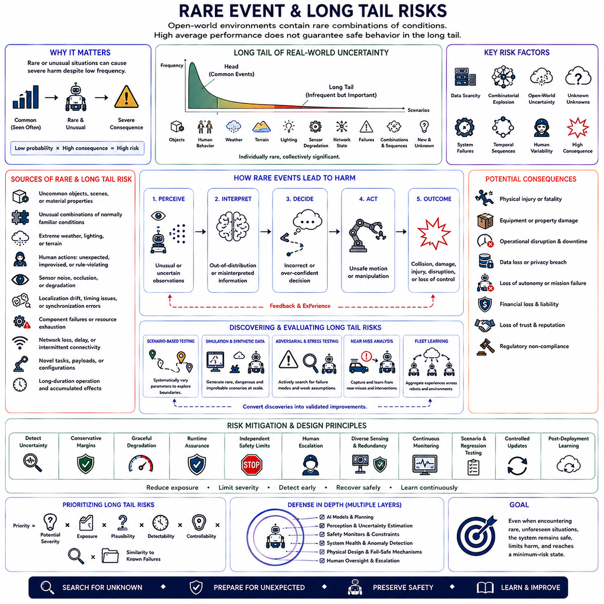{width="7.268055555555556in" height="7.268055555555556in"}

Rare-event and long-tail risks arise because Physical AI must operate in open physical environments containing combinations of conditions that may occur extremely infrequently but have severe consequences. Training and validation data naturally emphasize common situations, while unusual objects, behaviors, failures, weather, interactions, and environmental configurations remain sparsely represented. High average performance therefore does not guarantee safe behavior in rare situations.

The long tail describes the large collection of individually uncommon scenarios that together represent a meaningful portion of real-world operational uncertainty. A robot may perform reliably across thousands of routine encounters yet fail when several ordinary factors appear in an unusual combination. Long-tail safety is therefore not limited to spectacular edge cases; it includes unexpected compositions of otherwise familiar objects, actions, environments, and system states.

Rare events are particularly difficult because probability and consequence must be considered separately. An event with very low frequency may still dominate safety risk if its potential harm is catastrophic. A robot collision with an unusual obstacle, uncontrolled movement near a person, battery thermal event, localization failure near a hazard, or incorrect manipulation of dangerous equipment may require strong mitigation even when historical occurrence is extremely low.

Data scarcity is a fundamental challenge for learning-based Physical AI. Supervised datasets, demonstrations, robot trajectories, fleet logs, and simulation scenarios contain far more examples of normal operation than dangerous or unusual conditions. Models therefore receive weaker statistical evidence about precisely the situations where robust behavior is most important. Increasing dataset size alone does not guarantee adequate coverage if new data mainly repeat common operating conditions.

Distribution tails can emerge across many dimensions simultaneously. Lighting, weather, terrain, object geometry, human behavior, sensor degradation, payload condition, robot configuration, network state, and task context can each vary independently. The number of possible combinations grows rapidly, making exhaustive data collection impossible. Risk analysis must therefore consider compositional novelty, where individually familiar conditions interact in combinations that were absent from training and testing.

Open-world environments intensify this problem because not every relevant object, event, or behavior can be enumerated before deployment. Construction changes, temporary obstacles, damaged infrastructure, unusual vehicles, animals, improvised equipment, emergency responders, unexpected human actions, or previously unseen materials may appear. A safe Physical AI system must recognize when observations fall outside validated experience rather than forcing every situation into a familiar category.

Out-of-distribution detection can help identify situations that differ from training experience, but novelty itself is difficult to define reliably. A visually unusual scene may still be physically safe, while a scene that appears statistically familiar may contain a subtle but critical hazard. Confidence scores from learned models should therefore not be treated as complete measures of operational risk. Novelty detection should be combined with physical constraints, uncertainty estimation, and runtime safety monitoring.

Unknown unknowns represent situations that designers did not anticipate and therefore did not explicitly include in hazard analysis, datasets, simulation, or test plans. They cannot be eliminated through enumeration alone. Resilience requires architectural mechanisms that remain useful across unforeseen conditions, including conservative fallback behavior, independent safety limits, anomaly detection, bounded authority, human escalation, and the ability to reach a minimum-risk state when system understanding becomes unreliable.

Rare failures can also originate inside the system rather than the environment. Memory corruption, timing races, sensor synchronization faults, intermittent connectors, thermal throttling, unusual numerical conditions, resource exhaustion, model runtime errors, or combinations of degraded components may occur too infrequently to appear during normal testing. Because these failures can interact with autonomous decisions, validation should examine both environmental long tails and internal system-state long tails.

Temporal rarity introduces another challenge. Some hazards arise not from one unusual observation but from a sequence of individually normal events. Small localization drift may accumulate, repeated planning corrections may gradually reduce clearance, or minor communication delays may progressively desynchronize shared state. Long-duration testing and sequence-level analysis are therefore necessary because short independent test cases may miss risks that emerge only after extended operation.

Human behavior contributes a particularly difficult long tail because people can improvise, misunderstand, violate procedures, or respond unexpectedly to robot motion. Rare interactions may include sudden running, falling objects, unusual gestures, attempts to assist the robot, emergency intervention, or multiple people behaving differently at the same time. Human-aware safety should preserve reaction time and escape options rather than depend on precise prediction of every possible human action.

Scenario-based testing provides a structured way to explore long-tail risk by defining hazardous situations and systematically varying important parameters. Instead of relying only on recorded operational data, testing can vary speed, distance, visibility, friction, object position, human timing, sensor noise, communication delay, or component degradation. Parameterized scenarios allow engineers to investigate boundaries where apparently safe behavior transitions into unsafe behavior.

Simulation is especially valuable because dangerous and rare conditions can be generated repeatedly without exposing people or hardware to equivalent physical risk. Synthetic environments can explore unusual traffic patterns, sensor failures, extreme geometry, adverse weather, communication loss, and improbable interactions at scale. However, simulation itself contains modeling assumptions, so successful simulated performance does not automatically demonstrate equivalent robustness in the physical world.

Rare-event simulation can improve efficiency by concentrating computational effort on safety-relevant regions rather than sampling overwhelmingly common situations. Importance sampling, adversarial scenario generation, falsification, search-based testing, and stress testing can deliberately seek conditions that cause constraint violations or near failures. The objective is not to reproduce natural frequency perfectly, but to discover weaknesses that ordinary random testing would encounter only after impractically long operation.

Adversarial testing can expose fragile assumptions by actively searching for inputs and situations that challenge perception, prediction, planning, control, or agent reasoning. These tests need not represent malicious cyberattacks; they can simply construct difficult physical scenarios. Unexpected occlusions, ambiguous objects, conflicting cues, narrow clearances, unusual surface conditions, or rapidly changing interactions can reveal failure boundaries before they occur during deployment.

Near misses provide valuable evidence because severe accidents are intentionally rare and therefore provide too little data for continuous safety improvement. Emergency braking, sudden replanning, protective stops, low-clearance encounters, human evasive movement, or safety-monitor interventions may reveal precursors to more serious events. Fleet-scale collection of near-miss indicators can help identify long-tail patterns without waiting for actual harm to occur.

Fleet operation can substantially expand long-tail discovery because many robots accumulate experience across different locations, tasks, users, and environmental conditions. Events that are extremely rare for one robot may appear regularly across a large fleet. Shared learning can therefore improve scenario discovery and validation, but newly discovered behavior should not be propagated automatically. Fleet evidence must be reviewed, classified, reproduced where possible, and converted into validated improvements.

Risk prioritization is necessary because the long tail is effectively unbounded. Engineering teams cannot dedicate equal resources to every imaginable event. Scenarios can be prioritized using potential severity, exposure, plausibility, detectability, controllability, uncertainty, and similarity to known failures. Low-frequency events with catastrophic consequences may deserve greater attention than more frequent events whose effects are easily detected and safely recovered.

Safety margins provide protection against uncertainty that cannot be modeled precisely. Conservative speed, separation, force, thermal, energy, localization, and stopping margins can absorb moderate deviations from expected conditions. However, excessive conservatism can make the robot ineffective and may even introduce new interaction problems. Margins should therefore be connected to uncertainty and consequence, becoming larger when the system has less reliable knowledge or reduced recovery capability.

Graceful degradation is essential when the robot encounters conditions outside its validated operating envelope. Instead of continuing normal autonomy with unreliable assumptions, the system may reduce speed, increase observation time, simplify planning, restrict manipulation, avoid uncertain regions, request human assistance, or transition to a minimum-risk state. The system should treat insufficient understanding as a reason to reduce behavioral authority rather than as permission to guess.

Runtime assurance complements pre-deployment testing because no finite validation program can cover every long-tail condition. Independent monitors can enforce collision constraints, speed limits, force limits, geofences, stability requirements, thermal limits, and other safety invariants even when the primary AI encounters unfamiliar situations. This separates flexible learned behavior from constraints that must remain valid across both common and rare operating conditions.

Post-deployment learning should convert operational surprises into structured safety knowledge. Unexpected events can be logged, reconstructed, classified, reproduced in simulation or controlled testing, added to regression suites, and incorporated into updated hazard analyses. Data and model improvements should therefore be connected to a closed-loop safety process in which discovered long-tail events progressively expand the validated operating envelope without forgetting previously solved failures.

Defense in depth is necessary because long-tail risk cannot be solved by a single larger dataset, stronger model, or more extensive test campaign. Diverse sensing, uncertainty estimation, conservative planning, independent safety control, anomaly detection, runtime assurance, human escalation, simulation, fleet monitoring, regression testing, and controlled updates provide overlapping protection. The architecture should remain safe even when the primary AI encounters a situation that no developer explicitly anticipated.

Ultimately, rare-event and long-tail safety concerns how Physical AI behaves beyond the center of its training and validation distribution. The goal is not to prove that every possible physical situation has been observed, because such coverage is impossible. Safe systems must instead detect uncertainty, search actively for failure boundaries, learn systematically from operational surprises, preserve independent safety constraints, and reduce autonomous authority when encountering conditions beyond validated competence.

희귀 사건 및 롱테일 위험(Rare-Event and Long-Tail Risks)은 물리 AI(Physical AI)가 발생 빈도는 극히 낮지만 심각한 결과를 초래할 수 있는 다양한 조건의 조합이 존재하는 개방형 물리 환경(Open Physical Environment)에서 작동해야 하기 때문에 발생합니다. 학습 및 검증 데이터는 자연스럽게 일반적인 상황에 집중되는 반면, 특이한 객체, 행동, 고장, 날씨, 상호작용 및 환경 구성은 충분히 표현되지 않습니다. 따라서 높은 평균 성능(Average Performance)이 희귀한 상황에서도 안전한 행동을 보장하는 것은 아닙니다.

롱테일(Long Tail)은 각각은 드물게 발생하지만 전체적으로는 현실 세계의 운영 불확실성(Operational Uncertainty)에서 의미 있는 비중을 차지하는 수많은 시나리오의 집합을 의미합니다. 로봇은 수천 번의 일상적인 상황에서는 안정적으로 작동하면서도 여러 일반적인 요소가 특이한 조합으로 동시에 나타날 때 실패할 수 있습니다. 따라서 롱테일 안전(Long-Tail Safety)은 극단적으로 특이한 엣지 케이스(Edge Case)에만 국한되지 않으며, 익숙한 객체, 행동, 환경 및 시스템 상태가 예상하지 못한 방식으로 결합되는 경우도 포함합니다.

희귀 사건(Rare Event)은 발생 확률과 결과의 심각성을 별도로 고려해야 하기 때문에 특히 어렵습니다. 발생 빈도가 매우 낮은 사건이라도 잠재적인 피해가 치명적이라면 전체 안전 위험을 지배할 수 있습니다. 특이한 장애물과의 로봇 충돌, 사람 근처에서의 통제되지 않은 움직임, 배터리 열 사고(Battery Thermal Event), 위험 구역 주변에서의 위치추정 실패 또는 위험 장비에 대한 잘못된 조작은 과거 발생 빈도가 극히 낮더라도 강력한 위험 완화가 필요할 수 있습니다.

데이터 부족(Data Scarcity)은 학습 기반 물리 AI(Learning-Based Physical AI)의 근본적인 문제입니다. 지도학습 데이터셋, 시연(Demonstration), 로봇 궤적, 플릿 로그(Fleet Log) 및 시뮬레이션 시나리오에는 위험하거나 특이한 조건보다 정상 운용 사례가 훨씬 많이 포함됩니다. 따라서 모델은 강건한 행동이 가장 필요한 바로 그 상황에 대해 상대적으로 약한 통계적 근거를 학습하게 됩니다. 새로운 데이터가 대부분 일반적인 운영 조건만 반복한다면 단순히 데이터셋의 크기를 증가시키는 것만으로 충분한 커버리지(Coverage)를 보장할 수 없습니다.

분포의 꼬리(Distribution Tail)는 여러 차원에서 동시에 나타날 수 있습니다. 조명, 날씨, 지형, 객체 기하구조, 인간 행동, 센서 성능 저하, 적재 상태, 로봇 구성, 네트워크 상태 및 작업 맥락은 각각 독립적으로 변화할 수 있습니다. 가능한 조합의 수는 급격하게 증가하기 때문에 모든 경우에 대한 데이터를 수집하는 것은 불가능합니다. 따라서 위험 분석은 개별적으로는 익숙한 조건들이 학습 및 시험 과정에서 경험하지 못했던 방식으로 결합되는 구성적 신규성(Compositional Novelty)을 고려해야 합니다.

개방형 세계 환경(Open-World Environment)은 배포 전에 모든 관련 객체, 사건 또는 행동을 열거할 수 없기 때문에 이러한 문제를 더욱 심화시킵니다. 공사로 인한 환경 변화, 임시 장애물, 손상된 인프라, 특이한 차량, 동물, 임시 장비, 긴급 대응 인력, 예상하지 못한 인간 행동 또는 이전에 보지 못한 재료가 나타날 수 있습니다. 안전한 물리 AI 시스템은 모든 상황을 익숙한 범주에 강제로 분류하기보다 관측 결과가 검증된 경험(Validated Experience)의 범위를 벗어났을 때 이를 인식할 수 있어야 합니다.

분포 외 탐지(Out-of-Distribution Detection)는 학습 경험과 다른 상황을 식별하는 데 도움을 줄 수 있지만 신규성(Novelty) 자체를 신뢰성 있게 정의하기는 어렵습니다. 시각적으로 특이한 장면이 물리적으로는 안전할 수 있는 반면, 통계적으로 익숙해 보이는 장면에 미묘하지만 중요한 위험이 존재할 수도 있습니다. 따라서 학습 모델의 신뢰도 점수(Confidence Score)를 운영 위험의 완전한 척도로 간주해서는 안 됩니다. 신규성 탐지는 물리적 제약, 불확실성 추정(Uncertainty Estimation) 및 런타임 안전 모니터링(Runtime Safety Monitoring)과 함께 사용해야 합니다.

알려지지 않은 미지(Unknown Unknowns)는 설계자가 예상하지 못했기 때문에 위험원 분석(Hazard Analysis), 데이터셋, 시뮬레이션 또는 시험 계획에 명시적으로 포함되지 않은 상황을 의미합니다. 이러한 상황은 모든 경우를 열거하는 방법만으로 제거할 수 없습니다. 복원력(Resilience)을 확보하려면 보수적인 폴백 행동(Conservative Fallback Behavior), 독립적인 안전 한계, 이상 탐지(Anomaly Detection), 제한된 권한(Bounded Authority), 인간 개입 단계(Human Escalation), 그리고 시스템의 상황 이해가 신뢰할 수 없게 되었을 때 최소 위험 상태(Minimum-Risk State)에 도달할 수 있는 능력이 필요합니다.

희귀 고장(Rare Failure)은 외부 환경뿐만 아니라 시스템 내부에서도 발생할 수 있습니다. 메모리 손상, 타이밍 경쟁 상태(Timing Race), 센서 동기화 오류, 간헐적인 커넥터 이상, 열 스로틀링(Thermal Throttling), 특이한 수치 조건, 자원 고갈(Resource Exhaustion), 모델 런타임 오류 또는 여러 성능 저하 구성요소의 조합은 일반적인 시험에서 발견하기 어려울 정도로 드물게 발생할 수 있습니다. 이러한 고장은 자율 의사결정과 상호작용할 수 있으므로 검증 과정에서는 환경적 롱테일뿐만 아니라 내부 시스템 상태의 롱테일도 조사해야 합니다.

시간적 희귀성(Temporal Rarity)은 또 다른 문제를 발생시킵니다. 일부 위험은 하나의 특이한 관측이 아니라 각각은 정상적인 여러 사건이 연속적으로 발생하면서 나타납니다. 작은 위치추정 드리프트(Localization Drift)가 누적되거나, 반복적인 계획 수정으로 안전 이격거리가 점차 감소하거나, 작은 통신 지연이 공유 상태를 점진적으로 비동기화할 수 있습니다. 따라서 짧고 독립적인 시험 사례만으로는 장시간 운용 이후 나타나는 위험을 발견하기 어려우므로 장시간 시험(Long-Duration Testing)과 시퀀스 수준 분석(Sequence-Level Analysis)이 필요합니다.

인간 행동(Human Behavior)은 사람이 즉흥적으로 행동하거나, 상황을 오해하거나, 절차를 위반하거나, 로봇의 움직임에 예상하지 못한 방식으로 반응할 수 있기 때문에 특히 어려운 롱테일을 형성합니다. 희귀한 상호작용에는 갑작스러운 달리기, 떨어지는 물체, 특이한 제스처, 로봇을 도우려는 행동, 비상 개입 또는 여러 사람이 동시에 서로 다른 방식으로 행동하는 상황이 포함될 수 있습니다. 인간 인식 안전(Human-Aware Safety)은 가능한 모든 인간 행동을 정확하게 예측하는 데 의존하기보다 충분한 반응시간과 회피 가능성을 유지해야 합니다.

시나리오 기반 시험(Scenario-Based Testing)은 위험한 상황을 정의하고 중요한 매개변수를 체계적으로 변화시켜 롱테일 위험을 탐색하는 구조적인 방법을 제공합니다. 기록된 운영 데이터에만 의존하는 대신 속도, 거리, 가시성, 마찰, 객체 위치, 인간 행동의 타이밍, 센서 잡음, 통신 지연 또는 구성요소의 성능 저하를 변화시킬 수 있습니다. 매개변수화된 시나리오(Parameterized Scenario)를 활용하면 겉으로 안전한 행동이 위험한 행동으로 전환되는 경계 영역을 조사할 수 있습니다.

시뮬레이션(Simulation)은 사람이나 하드웨어를 동일한 수준의 물리적 위험에 노출시키지 않으면서 위험하고 희귀한 조건을 반복적으로 생성할 수 있기 때문에 특히 중요합니다. 합성 환경(Synthetic Environment)은 특이한 교통 패턴, 센서 고장, 극단적인 기하구조, 악천후, 통신 단절 및 발생 가능성이 낮은 상호작용을 대규모로 탐색할 수 있습니다. 그러나 시뮬레이션 자체에도 모델링 가정(Modeling Assumption)이 포함되므로 시뮬레이션에서 성공했다고 해서 실제 물리 환경에서도 동일한 강건성이 자동으로 입증되는 것은 아닙니다.

희귀 사건 시뮬레이션(Rare-Event Simulation)은 압도적으로 많은 일반적인 상황을 무작위로 샘플링하기보다 안전과 관련된 영역에 계산 자원을 집중하여 시험 효율성을 높일 수 있습니다. 중요도 샘플링(Importance Sampling), 적대적 시나리오 생성(Adversarial Scenario Generation), 반증(Falsification), 탐색 기반 시험(Search-Based Testing) 및 스트레스 시험(Stress Testing)은 제약 위반이나 고장 직전 상태를 발생시키는 조건을 의도적으로 탐색할 수 있습니다. 목표는 자연적인 발생 빈도를 완벽하게 재현하는 것이 아니라 일반적인 무작위 시험으로는 현실적으로 발견하기 어려운 취약점을 찾아내는 것입니다.

적대적 시험(Adversarial Testing)은 인지, 예측, 계획, 제어 또는 에이전트 추론을 어렵게 만드는 입력과 상황을 적극적으로 탐색하여 취약한 가정을 발견할 수 있습니다. 이러한 시험이 반드시 악의적인 사이버 공격을 의미하는 것은 아니며 단순히 어려운 물리적 시나리오를 구성할 수도 있습니다. 예상하지 못한 가림, 모호한 객체, 상충하는 단서, 좁은 이격거리, 특이한 표면 상태 또는 빠르게 변화하는 상호작용은 실제 배포 환경에서 발생하기 전에 시스템의 고장 경계(Failure Boundary)를 드러낼 수 있습니다.

아차사고(Near Miss)는 심각한 사고가 의도적으로 매우 드물게 발생하도록 설계되기 때문에 지속적인 안전 개선을 위한 중요한 근거를 제공합니다. 비상 제동, 갑작스러운 재계획, 보호 정지(Protective Stop), 매우 좁은 이격거리에서의 접근, 인간의 회피 행동 또는 안전 모니터의 개입은 더 심각한 사고의 전조를 보여줄 수 있습니다. 플릿 규모의 아차사고 지표(Near-Miss Indicator)를 수집하면 실제 피해가 발생하기를 기다리지 않고도 롱테일 패턴을 식별하는 데 도움을 줄 수 있습니다.

플릿 운용(Fleet Operation)은 여러 로봇이 서로 다른 장소, 작업, 사용자 및 환경 조건에서 경험을 축적하기 때문에 롱테일 발견 능력을 크게 확장할 수 있습니다. 하나의 로봇에서는 극히 드문 사건도 대규모 플릿 전체에서는 반복적으로 나타날 수 있습니다. 따라서 공유 학습(Shared Learning)은 시나리오 발견과 검증을 향상시킬 수 있지만 새롭게 발견된 행동을 자동으로 전체 플릿에 전파해서는 안 됩니다. 플릿에서 얻은 증거는 검토, 분류, 가능한 경우 재현 과정을 거쳐 검증된 개선사항으로 전환되어야 합니다.

롱테일은 사실상 무한하기 때문에 위험 우선순위화(Risk Prioritization)가 필요합니다. 엔지니어링 팀은 상상할 수 있는 모든 사건에 동일한 자원을 투입할 수 없습니다. 시나리오는 잠재적 심각도, 노출도(Exposure), 발생 가능성(Plausibility), 탐지 가능성(Detectability), 제어 가능성(Controllability), 불확실성 및 알려진 고장과의 유사성을 기반으로 우선순위를 결정할 수 있습니다. 발생 빈도가 낮더라도 치명적인 결과를 초래할 수 있는 사건은 더 자주 발생하지만 쉽게 탐지하고 안전하게 복구할 수 있는 사건보다 높은 우선순위를 가질 수 있습니다.

안전 여유(Safety Margin)는 정확하게 모델링할 수 없는 불확실성에 대한 보호 수단을 제공합니다. 보수적인 속도, 분리 거리, 힘, 열, 에너지, 위치추정 및 정지 여유는 예상 조건에서 발생하는 일정 수준의 편차를 흡수할 수 있습니다. 그러나 지나치게 보수적인 설계는 로봇의 효율성을 저하시킬 뿐만 아니라 새로운 상호작용 문제를 발생시킬 수도 있습니다. 따라서 안전 여유는 불확실성과 결과의 심각성에 연결되어야 하며 시스템의 지식 신뢰도가 낮거나 복구 능력이 감소할수록 더 크게 설정되어야 합니다.

점진적 성능 저하(Graceful Degradation)는 로봇이 검증된 운영 범위(Validated Operating Envelope)를 벗어난 조건을 만났을 때 필수적입니다. 신뢰할 수 없는 가정을 기반으로 정상적인 자율성을 계속 유지하기보다 시스템은 속도를 낮추고, 관측 시간을 늘리고, 계획을 단순화하며, 조작을 제한하거나, 불확실한 영역을 회피하고, 인간의 지원을 요청하거나, 최소 위험 상태로 전환할 수 있습니다. 시스템은 충분히 이해하지 못하는 상황을 임의로 추측할 수 있는 이유가 아니라 행동 권한(Behavioral Authority)을 감소시켜야 하는 이유로 간주해야 합니다.

런타임 보증(Runtime Assurance)은 어떠한 유한한 검증 프로그램도 모든 롱테일 조건을 포괄할 수 없기 때문에 배포 전 시험을 보완합니다. 독립적인 모니터(Independent Monitor)는 주 AI가 익숙하지 않은 상황을 만났을 때에도 충돌 제약, 속도 제한, 힘 제한, 지오펜스(Geofence), 안정성 요구사항, 열 한계 및 기타 안전 불변조건(Safety Invariant)을 강제할 수 있습니다. 이를 통해 유연한 학습 기반 행동과 일반적인 조건 및 희귀한 운영 조건 모두에서 반드시 유지되어야 하는 안전 제약을 분리할 수 있습니다.

배포 후 학습(Post-Deployment Learning)은 운영 중 발생한 예상하지 못한 사건을 구조화된 안전 지식으로 전환해야 합니다. 예상 밖의 사건을 기록하고, 재구성하고, 분류하며, 시뮬레이션 또는 통제된 시험에서 재현하고, 회귀 시험군(Regression Suite)에 추가하며, 갱신된 위험원 분석에 반영할 수 있습니다. 따라서 데이터와 모델 개선은 발견된 롱테일 사건을 통해 이전에 해결한 고장을 다시 발생시키지 않으면서 검증된 운영 범위를 점진적으로 확대하는 폐루프 안전 프로세스(Closed-Loop Safety Process)와 연결되어야 합니다.

심층 방어(Defense in Depth)는 하나의 더 큰 데이터셋, 더 강력한 모델 또는 더욱 광범위한 시험 캠페인만으로 롱테일 위험을 해결할 수 없기 때문에 필요합니다. 다양한 센싱(Diverse Sensing), 불확실성 추정, 보수적인 계획, 독립적인 안전 제어, 이상 탐지, 런타임 보증, 인간 개입, 시뮬레이션, 플릿 모니터링, 회귀 시험 및 통제된 업데이트는 서로 중첩되는 보호 계층을 제공합니다. 주 AI가 어떠한 개발자도 명시적으로 예상하지 못한 상황을 만나더라도 전체 아키텍처는 안전을 유지할 수 있어야 합니다.

궁극적으로 희귀 사건 및 롱테일 안전(Rare-Event and Long-Tail Safety)은 물리 AI가 학습 및 검증 분포의 중심을 벗어난 상황에서 어떻게 행동하는가에 관한 문제입니다. 가능한 모든 물리적 상황을 사전에 관측했다는 것을 증명하는 것은 불가능하므로 그것이 목표가 될 수는 없습니다. 안전한 시스템은 대신 불확실성을 탐지하고, 고장 경계를 적극적으로 탐색하며, 운영 과정에서 발생한 예상 밖의 사건으로부터 체계적으로 학습하고, 독립적인 안전 제약을 유지하며, 검증된 능력(Validated Competence)을 벗어난 조건을 만났을 때 자율 권한(Autonomous Authority)을 감소시킬 수 있어야 합니다.

##  

## 01.16. Physical AI Risk Matrix [w/Code]

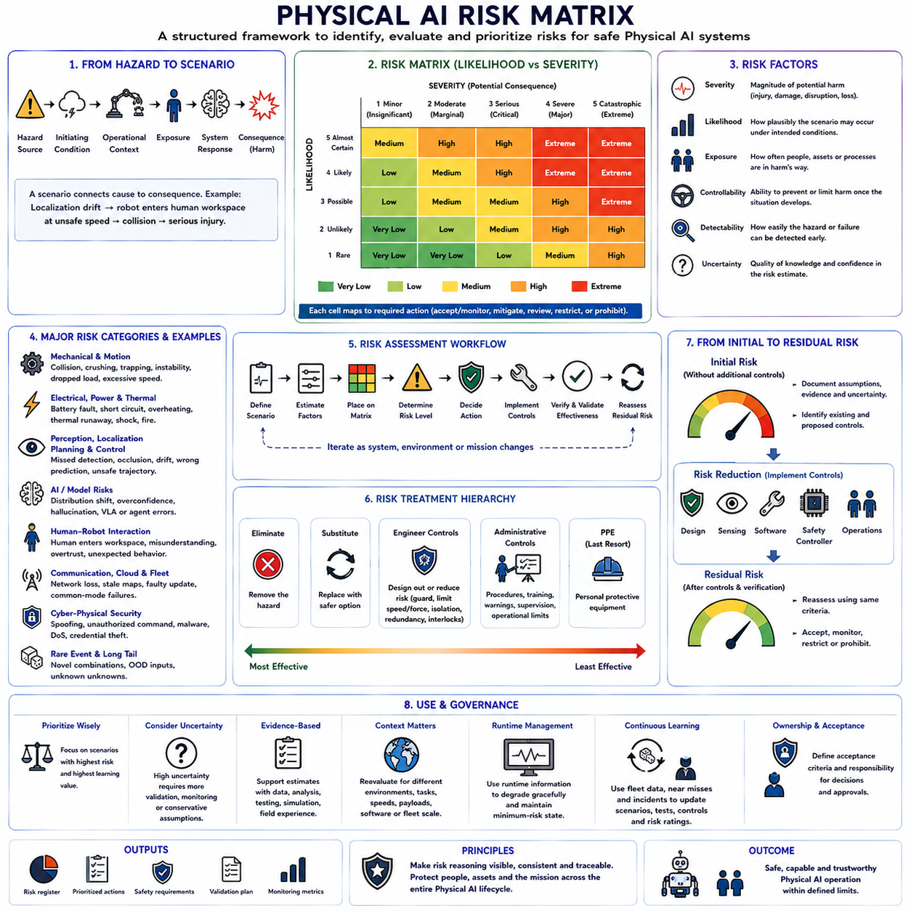{width="7.268055555555556in" height="7.268055555555556in"}

A Physical AI risk matrix provides a structured method for converting diverse hazards into comparable risk priorities. Physical AI combines mechanical motion, electrical power, sensing, learned models, autonomous planning, communication, human interaction, and distributed intelligence, so risks cannot be evaluated through one failure domain alone. The matrix creates a common framework for deciding which hazardous scenarios require the strongest engineering attention.

The basic unit of analysis should be a hazardous scenario rather than an isolated component failure. A scenario connects a hazard source, initiating condition, operational context, exposed person or asset, possible system response, and resulting harm. For example, localization error alone is not a complete risk description. The relevant scenario may involve localization drift causing an autonomous mobile robot to enter a human workspace while operating at a speed that prevents safe stopping.

Severity represents the magnitude of potential harm if the hazardous scenario occurs. Consequences may include minor injury, serious injury, fatality, equipment damage, environmental damage, mission failure, operational disruption, or combinations of these outcomes. Severity assessment should focus on credible consequences rather than average outcomes. When uncertainty exists, assumptions about speed, mass, energy, contact geometry, exposure, and recovery capability should be documented explicitly.

Likelihood represents how plausibly a hazardous scenario may occur under the intended operating conditions. Estimation may consider component failure rates, environmental frequency, model error, human behavior, exposure duration, task frequency, network conditions, and operational history. For novel AI functions, precise probabilities may not be available. Qualitative categories can therefore be more defensible than numerical probabilities that imply a level of statistical confidence unsupported by evidence.

Exposure is especially important in Physical AI because identical hazards can produce very different operational risks depending on how frequently people, assets, or critical processes encounter them. A manipulator operating continuously beside workers presents different exposure from the same mechanism inside an isolated cell. Fleet scale can further increase cumulative exposure because a low-frequency event for one robot may become operationally significant across many robots and long deployment periods.

Controllability describes the ability of the system or affected person to prevent harm after a hazardous situation begins to develop. Low-speed motion in an open area may provide sufficient time for detection, avoidance, or emergency intervention, while rapid motion in a confined space may offer little opportunity for recovery. Autonomous braking, protective stops, human reaction time, escape paths, system stability, and reversibility of actions can therefore influence the final risk classification.

Detectability can supplement traditional severity and likelihood dimensions when failures may remain hidden until they produce consequences. Sensor degradation, configuration drift, model corruption, stale maps, synchronization errors, or compromised communication may persist without obvious symptoms. A condition that is difficult to detect can justify stronger monitoring or redundancy even when its estimated occurrence is low. Early detection often converts an uncontrolled hazard into a recoverable abnormal state.

Uncertainty should be represented explicitly because Physical AI frequently operates with incomplete knowledge. Perception confidence, localization covariance, prediction uncertainty, model novelty, communication freshness, human behavior, and environmental variability all affect how confidently risk can be estimated. High uncertainty should not automatically be interpreted as low likelihood. Where evidence is weak, conservative assumptions or additional validation may be required before accepting autonomous operation.

A practical matrix commonly places likelihood on one axis and severity on the other, producing regions such as low, moderate, high, and unacceptable risk. The exact number of categories is less important than consistent definitions and decision rules. Each cell should correspond to a required response, such as acceptance with monitoring, additional controls, formal review, restricted operation, or prohibition until risk reduction has been demonstrated.

Risk scoring can support prioritization, but arithmetic scores should not replace engineering judgment. Multiplying ordinal severity and likelihood values can create convenient rankings while hiding fundamentally different risk profiles. A rare catastrophic event and a frequent minor event may receive similar numerical scores even though they require different treatment. The underlying severity, exposure, controllability, uncertainty, and failure mechanism should therefore remain visible alongside any combined score.

Mechanical and motion risks typically occupy important regions of the matrix because mobile platforms and manipulators possess kinetic energy and can create collision, crushing, trapping, instability, or dropped-load hazards. Risk increases with mass, velocity, acceleration, payload, stopping distance, and proximity to people. These hazards often require deterministic controls such as speed limits, protective separation, collision avoidance, force limitation, emergency stopping, and mechanically safe design.

Electrical, power, and thermal risks require different parameters but fit within the same risk framework. Battery faults, short circuits, insulation failures, charging problems, overheating, stored energy, and thermal runaway can produce fire, shock, equipment damage, or loss of control. Their likelihood may depend on component quality and operating conditions, while severity can depend on energy capacity, enclosure design, propagation barriers, detection, isolation, and proximity to people or combustible materials.

Perception, localization, planning, and control risks often form causal chains rather than independent events. A partially occluded person may be misdetected, localization may place the robot incorrectly, prediction may underestimate future motion, and planning may select an unsafe trajectory. The matrix should therefore evaluate meaningful combinations and propagation paths rather than assigning separate low-risk scores to components whose errors can combine into a high-consequence system-level scenario.

AI model risks introduce additional uncertainty because performance is statistical and dependent on data distribution. Distribution shift, overconfidence, hallucination, incorrect semantic grounding, VLA action errors, or unexpected agent behavior may be difficult to characterize using conventional hardware failure rates. Risk classification should therefore incorporate operating-domain coverage, confidence calibration, scenario testing, runtime constraints, and independent safety mechanisms rather than relying solely on benchmark accuracy.

Human-robot interaction risks should account for both physical consequences and human behavioral variability. People may enter robot paths, misunderstand intent, overtrust autonomy, react unexpectedly, or intervene during abnormal operation. Severity depends on physical energy and contact conditions, while likelihood and controllability depend on visibility, separation, communication, workspace geometry, training, reaction time, and predictability of robot behavior. Human error should be treated as an expected condition.

Communication, cloud, and fleet risks can increase both likelihood and exposure by propagating incorrect information or commands across distributed systems. Network loss may affect coordination, stale maps may influence multiple robots, and a faulty fleet update may create correlated failures. Risk assessment should therefore distinguish local faults from common-mode events. A centralized failure affecting many robots may deserve a higher priority than an equivalent isolated failure on a single platform.

Cyber-physical security risks require the matrix to consider malicious causes as well as accidental failures. Sensor spoofing, unauthorized commands, compromised software, malicious updates, denial of service, or credential theft can produce the same physical harms as conventional faults. Likelihood assessment may use threat exposure and attack feasibility rather than ordinary failure frequency, while severity should remain based on physical consequences. Security and safety risk analyses should therefore remain connected.

Rare-event and long-tail scenarios challenge the matrix because historical frequency may underestimate future risk. Novel combinations, unknown environments, unusual human actions, multiple simultaneous failures, and out-of-distribution inputs may have little statistical evidence. These scenarios should not automatically receive low likelihood ratings simply because they have rarely been observed. Plausibility, consequence, uncertainty, similarity to known failures, and ability to detect or control the event should also influence prioritization.

Initial risk represents the estimated risk before additional mitigation is applied. Recording initial risk is important because it shows why safety controls were introduced and prevents later reviewers from assuming that the controlled system was inherently safe. The analysis should identify existing controls separately from proposed controls so that the contribution of sensing, software, mechanical design, operational procedures, supervision, and runtime assurance remains traceable.

Risk reduction should follow a hierarchy that favors eliminating or reducing hazards by design before relying on procedural controls. Mechanical energy can be limited, hazardous motion can be physically constrained, safety-rated sensing can enforce separation, and independent controllers can stop unsafe behavior. Warnings, training, and operator procedures remain useful, but they should not become the primary defense when technically feasible engineering controls can prevent or limit harm more reliably.

Residual risk is the risk remaining after mitigation measures are implemented and verified. It should be reassessed using the same definitions applied to the initial risk so that changes are comparable. A mitigation should not be credited merely because it exists in the architecture; evidence should demonstrate that it functions under relevant conditions. Testing, analysis, inspection, simulation, fault injection, scenario validation, or operational evidence may support residual-risk evaluation.

Risk acceptance requires explicit criteria and ownership. Low residual risks may be accepted within established engineering rules, while higher risks may require safety review, restricted operating conditions, additional safeguards, or management approval. Risks involving catastrophic consequences deserve particular scrutiny even when likelihood is estimated to be very low. Acceptance should never result simply from reducing a numerical score until it crosses an arbitrary matrix boundary.

The risk matrix should remain connected to the operational design domain and validated operating envelope. A risk classification established for controlled indoor operation may not remain valid outdoors, around crowds, at higher speed, with heavier payloads, under degraded sensing, or with new autonomous functions. Changes in environment, hardware, software, AI models, missions, fleet scale, or human interaction can alter severity, likelihood, exposure, and controllability and therefore require reassessment.

Runtime information can make risk management dynamic rather than purely static. A robot may operate normally when perception, localization, communication, and system health are reliable, but reduce speed or autonomy when uncertainty rises. Runtime monitors can use proximity, confidence, stopping margin, thermal state, communication freshness, model novelty, or system faults to move operation toward a safer region. The matrix can therefore inform policies for graceful degradation and minimum-risk behavior.

Fleet data can continuously improve risk estimates after deployment. Near misses, emergency stops, localization anomalies, intervention frequency, unusual model outputs, communication failures, component faults, and newly discovered scenarios provide evidence about actual exposure and failure patterns. These observations should feed a controlled safety process that updates scenarios, validation tests, mitigations, and risk classifications without allowing unverified online learning to redefine safety requirements automatically.

Ultimately, a Physical AI risk matrix is not merely a colored table but a decision framework connecting hazards, scenarios, consequences, uncertainty, controls, evidence, and acceptance. Its purpose is to make risk reasoning systematic and traceable across mechanical systems, AI models, humans, networks, fleets, and security threats. Effective use of the matrix helps ensure that increasing autonomous capability is accompanied by explicit limits, verified safeguards, residual-risk evaluation, and continuous reassessment throughout the system lifecycle.

물리 AI 위험 매트릭스(Physical AI Risk Matrix)는 다양한 위험원(Hazard)을 서로 비교 가능한 위험 우선순위(Risk Priority)로 변환하기 위한 구조화된 방법을 제공합니다. 물리 AI(Physical AI)는 기계적 움직임, 전력, 센싱, 학습 모델, 자율 계획, 통신, 인간 상호작용 및 분산 지능(Distributed Intelligence)을 결합하므로 하나의 고장 영역만으로 위험을 평가할 수 없습니다. 위험 매트릭스는 어떤 위험 시나리오(Hazardous Scenario)에 가장 강력한 공학적 대응이 필요한지를 결정하기 위한 공통 프레임워크를 제공합니다.

분석의 기본 단위는 개별 구성요소의 고장이 아니라 위험 시나리오(Hazardous Scenario)가 되어야 합니다. 하나의 시나리오는 위험원, 시작 조건(Initiating Condition), 운영 맥락, 노출된 사람 또는 자산, 가능한 시스템 반응 및 그 결과 발생하는 피해(Harm)를 연결합니다. 예를 들어 위치추정 오류(Localization Error)만으로는 완전한 위험 설명이 아닙니다. 실제 위험 시나리오는 위치추정 드리프트(Localization Drift)로 인해 자율이동로봇이 안전하게 정지할 수 없는 속도로 운행하면서 인간의 작업공간에 진입하는 상황일 수 있습니다.

심각도(Severity)는 위험 시나리오가 발생했을 때 나타날 수 있는 잠재적 피해의 크기를 의미합니다. 결과에는 경미한 부상, 심각한 부상, 사망, 장비 손상, 환경 피해, 임무 실패, 운영 중단 또는 이러한 결과들의 조합이 포함될 수 있습니다. 심각도 평가는 평균적인 결과보다 현실적으로 발생 가능한 결과(Credible Consequence)에 초점을 맞춰야 합니다. 불확실성이 존재하는 경우 속도, 질량, 에너지, 접촉 기하구조, 노출도 및 복구 능력에 관한 가정을 명확하게 문서화해야 합니다.

발생 가능성(Likelihood)은 의도된 운영 조건에서 위험 시나리오가 얼마나 현실적으로 발생할 수 있는지를 나타냅니다. 평가에는 구성요소 고장률, 환경 조건의 발생 빈도, 모델 오류, 인간 행동, 노출 시간, 작업 빈도, 네트워크 상태 및 운영 이력을 고려할 수 있습니다. 새로운 AI 기능에서는 정확한 확률을 확보하기 어려울 수 있습니다. 따라서 근거가 부족한 수치적 확률로 실제보다 높은 통계적 신뢰성을 암시하기보다는 정성적 범주(Qualitative Category)를 사용하는 것이 더 타당할 수 있습니다.

노출도(Exposure)는 동일한 위험원이라도 사람, 자산 또는 핵심 프로세스가 얼마나 자주 해당 위험에 노출되는지에 따라 운영 위험이 크게 달라질 수 있기 때문에 물리 AI에서 특히 중요합니다. 작업자 옆에서 지속적으로 작동하는 매니퓰레이터(Manipulator)는 격리된 셀 내부에서 작동하는 동일한 기구와 서로 다른 노출도를 갖습니다. 플릿 규모(Fleet Scale)는 누적 노출도를 더욱 증가시킬 수 있으며, 하나의 로봇에서는 발생 빈도가 낮은 사건도 다수의 로봇이 장기간 운용되면 운영상 중요한 위험이 될 수 있습니다.

제어 가능성(Controllability)은 위험한 상황이 발생하기 시작한 이후 시스템 또는 영향을 받는 사람이 피해를 방지할 수 있는 능력을 나타냅니다. 개방된 공간에서의 저속 움직임은 탐지, 회피 또는 비상 개입을 위한 충분한 시간을 제공할 수 있지만 제한된 공간에서의 빠른 움직임은 복구 기회를 거의 제공하지 않을 수 있습니다. 따라서 자율 제동, 보호 정지(Protective Stop), 인간의 반응시간, 회피 경로, 시스템 안정성 및 행동의 가역성(Reversibility)이 최종 위험 분류에 영향을 줄 수 있습니다.

탐지 가능성(Detectability)은 고장이 실제 결과를 발생시킬 때까지 숨겨져 있을 수 있는 경우 기존의 심각도와 발생 가능성 차원을 보완할 수 있습니다. 센서 성능 저하, 구성 드리프트(Configuration Drift), 모델 손상, 오래된 지도, 동기화 오류 또는 손상된 통신 상태는 명확한 증상 없이 지속될 수 있습니다. 탐지하기 어려운 상태는 추정 발생 가능성이 낮더라도 더욱 강력한 모니터링이나 중복성(Redundancy)을 정당화할 수 있습니다. 조기 탐지는 통제되지 않은 위험을 복구 가능한 비정상 상태(Recoverable Abnormal State)로 전환하는 데 중요한 역할을 합니다.

물리 AI는 불완전한 지식을 바탕으로 작동하는 경우가 많으므로 불확실성(Uncertainty)을 명시적으로 표현해야 합니다. 인지 신뢰도, 위치추정 공분산(Localization Covariance), 예측 불확실성, 모델 신규성(Model Novelty), 통신 정보의 최신성, 인간 행동 및 환경 변동성은 모두 위험을 얼마나 신뢰성 있게 추정할 수 있는지에 영향을 줍니다. 높은 불확실성을 자동으로 낮은 발생 가능성으로 해석해서는 안 됩니다. 근거가 부족한 경우 자율 운용을 허용하기 전에 보수적인 가정이나 추가적인 검증이 필요할 수 있습니다.

실용적인 위험 매트릭스(Risk Matrix)는 일반적으로 한 축에 발생 가능성, 다른 축에 심각도를 배치하여 낮음, 중간, 높음 및 허용 불가능 위험(Unacceptable Risk)과 같은 영역을 구성합니다. 정확한 범주의 개수보다 중요한 것은 일관된 정의와 의사결정 규칙입니다. 각 셀(Cell)은 모니터링을 조건으로 한 수용, 추가 안전대책, 공식 검토, 제한된 운용 또는 위험 감소가 입증될 때까지 운용 금지와 같은 요구 대응과 연결되어야 합니다.

위험 점수화(Risk Scoring)는 우선순위 결정에 도움을 줄 수 있지만 산술적인 점수가 공학적 판단을 대체해서는 안 됩니다. 순서형 심각도와 발생 가능성 값을 곱하면 편리한 순위를 만들 수 있지만 근본적으로 서로 다른 위험 특성을 감출 수 있습니다. 드물지만 치명적인 사건과 자주 발생하지만 경미한 사건이 비슷한 수치 점수를 받을 수 있음에도 필요한 대응 방식은 서로 다를 수 있습니다. 따라서 통합 점수와 함께 심각도, 노출도, 제어 가능성, 불확실성 및 고장 메커니즘을 명확하게 유지해야 합니다.

기계 및 운동 위험(Mechanical and Motion Risks)은 이동 플랫폼과 매니퓰레이터가 운동에너지(Kinetic Energy)를 가지고 있으며 충돌, 압착, 끼임, 불안정 또는 적재물 낙하 위험을 발생시킬 수 있기 때문에 위험 매트릭스에서 중요한 영역을 차지합니다. 위험은 질량, 속도, 가속도, 적재물, 정지거리 및 사람과의 근접성에 따라 증가합니다. 이러한 위험에는 속도 제한, 보호 분리(Protective Separation), 충돌 회피, 힘 제한, 비상 정지 및 기계적 안전 설계와 같은 결정론적 제어(Deterministic Control)가 필요한 경우가 많습니다.

전기, 전력 및 열 위험(Electrical, Power, and Thermal Risks)은 서로 다른 매개변수를 필요로 하지만 동일한 위험 프레임워크 안에서 평가할 수 있습니다. 배터리 고장, 단락, 절연 고장, 충전 문제, 과열, 저장 에너지 및 열폭주(Thermal Runaway)는 화재, 감전, 장비 손상 또는 제어 상실을 발생시킬 수 있습니다. 발생 가능성은 구성요소 품질과 운영 조건에 따라 달라질 수 있으며, 심각도는 에너지 용량, 인클로저 설계, 전파 방지 장벽, 탐지, 격리 및 사람이나 가연성 물질과의 근접성에 따라 달라질 수 있습니다.

인지, 위치추정, 계획 및 제어 위험(Perception, Localization, Planning, and Control Risks)은 독립적인 사건보다 인과적 연쇄(Causal Chain)를 형성하는 경우가 많습니다. 부분적으로 가려진 사람이 잘못 탐지되고, 위치추정이 로봇을 잘못된 위치에 배치하며, 예측 시스템이 미래 움직임을 과소평가하고, 계획기가 위험한 궤적을 선택할 수 있습니다. 따라서 위험 매트릭스는 개별적으로 낮은 위험 점수를 받은 구성요소의 오류들이 결합하여 높은 결과 심각도를 갖는 시스템 수준 시나리오를 만들 수 있다는 점을 고려하여 의미 있는 조합과 전파 경로(Propagation Path)를 평가해야 합니다.

AI 모델 위험(AI Model Risks)은 성능이 통계적이며 데이터 분포에 의존하기 때문에 추가적인 불확실성을 도입합니다. 분포 이동(Distribution Shift), 과신(Overconfidence), 환각(Hallucination), 잘못된 의미적 기반화(Semantic Grounding), VLA 행동 오류 또는 예상하지 못한 에이전트 행동은 기존 하드웨어 고장률만으로 특성을 규정하기 어려울 수 있습니다. 따라서 위험 분류에는 단순한 벤치마크 정확도뿐만 아니라 운영 영역 커버리지, 신뢰도 보정(Confidence Calibration), 시나리오 시험, 런타임 제약 및 독립적인 안전 메커니즘을 포함해야 합니다.

인간-로봇 상호작용 위험(Human-Robot Interaction Risks)은 물리적 결과와 인간 행동의 변동성을 모두 고려해야 합니다. 사람은 로봇의 경로에 진입하거나, 의도를 오해하고, 자율성을 과도하게 신뢰하거나, 예상하지 못하게 반응하거나, 비정상 운용 중 개입할 수 있습니다. 심각도는 물리적 에너지와 접촉 조건에 따라 달라지며, 발생 가능성과 제어 가능성은 가시성, 분리 거리, 의사소통, 작업공간 기하구조, 교육, 반응시간 및 로봇 행동의 예측 가능성에 따라 달라집니다. 인적 오류(Human Error)는 예외가 아니라 예상 가능한 조건으로 다루어야 합니다.

통신, 클라우드 및 플릿 위험(Communication, Cloud, and Fleet Risks)은 잘못된 정보나 명령을 분산 시스템 전체에 전파하여 발생 가능성과 노출도를 동시에 증가시킬 수 있습니다. 네트워크 손실은 협업에 영향을 미치고, 오래된 지도는 여러 로봇의 행동에 영향을 주며, 잘못된 플릿 업데이트는 상관 고장(Correlated Failure)을 발생시킬 수 있습니다. 따라서 위험 평가는 로컬 고장(Local Fault)과 공통 원인 사건(Common-Mode Event)을 구분해야 합니다. 여러 로봇에 동시에 영향을 미치는 중앙 시스템 고장은 단일 플랫폼에서 발생하는 동일한 고장보다 높은 우선순위를 가질 수 있습니다.

사이버-물리 보안 위험(Cyber-Physical Security Risks)은 우발적인 고장뿐만 아니라 악의적인 원인도 위험 매트릭스에 포함할 것을 요구합니다. 센서 스푸핑(Sensor Spoofing), 승인되지 않은 명령, 침해된 소프트웨어, 악성 업데이트, 서비스 거부 공격(Denial-of-Service Attack) 또는 자격증명 탈취는 기존의 고장과 동일한 물리적 피해를 발생시킬 수 있습니다. 발생 가능성 평가는 일반적인 고장 빈도 대신 위협 노출도(Threat Exposure)와 공격 실행 가능성(Attack Feasibility)을 사용할 수 있지만 심각도는 여전히 물리적 결과를 기반으로 해야 합니다. 따라서 보안 위험 분석과 안전 위험 분석은 서로 연결되어야 합니다.

희귀 사건 및 롱테일 시나리오(Rare-Event and Long-Tail Scenario)는 과거의 발생 빈도가 미래 위험을 과소평가할 수 있기 때문에 위험 매트릭스에 어려움을 제공합니다. 새로운 조건의 조합, 알려지지 않은 환경, 특이한 인간 행동, 여러 고장의 동시 발생 및 분포 외 입력(Out-of-Distribution Input)은 충분한 통계적 근거가 없을 수 있습니다. 이러한 시나리오가 드물게 관측되었다는 이유만으로 자동으로 낮은 발생 가능성을 부여해서는 안 됩니다. 발생 개연성, 결과의 심각성, 불확실성, 알려진 고장과의 유사성 및 사건의 탐지 또는 제어 가능성도 우선순위에 영향을 주어야 합니다.

초기 위험(Initial Risk)은 추가적인 완화 조치가 적용되기 전에 추정된 위험을 의미합니다. 초기 위험을 기록하는 것은 안전 제어가 도입된 이유를 보여주고 이후 검토자가 제어가 적용된 시스템이 본질적으로 안전했다고 잘못 판단하는 것을 방지하기 때문에 중요합니다. 분석에서는 기존 제어(Existing Control)와 제안된 제어(Proposed Control)를 구분하여 센싱, 소프트웨어, 기계 설계, 운영 절차, 감독 및 런타임 보증(Runtime Assurance)이 위험 감소에 기여하는 정도를 추적할 수 있도록 해야 합니다.

위험 감소(Risk Reduction)는 절차적 제어에 의존하기 전에 설계를 통해 위험원을 제거하거나 감소시키는 방법을 우선하는 계층적 접근을 따라야 합니다. 기계적 에너지를 제한하고, 위험한 움직임을 물리적으로 제약하며, 안전 등급 센싱(Safety-Rated Sensing)을 통해 분리 거리를 강제하고, 독립적인 제어기를 통해 위험 행동을 정지시킬 수 있습니다. 경고, 교육 및 운영 절차도 유용하지만 기술적으로 실현 가능한 공학적 제어(Engineering Control)를 통해 피해를 더욱 신뢰성 있게 예방하거나 제한할 수 있다면 이러한 절차가 주된 방어 수단이 되어서는 안 됩니다.

잔여 위험(Residual Risk)은 완화 조치가 구현되고 검증된 이후에도 남아 있는 위험을 의미합니다. 변화의 정도를 비교할 수 있도록 초기 위험에 적용했던 것과 동일한 정의를 사용하여 다시 평가해야 합니다. 완화 조치가 아키텍처에 존재한다는 이유만으로 위험 감소 효과를 인정해서는 안 되며 관련 조건에서 실제로 작동한다는 증거가 필요합니다. 시험, 분석, 검사, 시뮬레이션, 결함 주입(Fault Injection), 시나리오 검증 또는 운영 증거를 통해 잔여 위험 평가를 뒷받침할 수 있습니다.

위험 수용(Risk Acceptance)에는 명확한 기준과 책임 주체가 필요합니다. 낮은 잔여 위험은 정해진 공학적 규칙에 따라 수용할 수 있지만 더 높은 위험은 안전 검토, 제한된 운영 조건, 추가적인 안전장치 또는 관리자의 승인을 요구할 수 있습니다. 치명적인 결과를 포함하는 위험은 발생 가능성이 매우 낮다고 평가되더라도 특별한 검토가 필요합니다. 위험 수용은 단순히 수치 점수를 임의의 위험 매트릭스 경계 아래까지 낮추었다는 이유만으로 이루어져서는 안 됩니다.

위험 매트릭스는 운영 설계 영역(Operational Design Domain) 및 검증된 운영 범위(Validated Operating Envelope)와 지속적으로 연결되어야 합니다. 통제된 실내 운용을 기준으로 설정한 위험 분류는 실외 환경, 군중 주변, 더 높은 속도, 무거운 적재물, 성능이 저하된 센싱 또는 새로운 자율 기능에서는 더 이상 유효하지 않을 수 있습니다. 환경, 하드웨어, 소프트웨어, AI 모델, 임무, 플릿 규모 또는 인간 상호작용의 변화는 심각도, 발생 가능성, 노출도 및 제어 가능성을 변화시킬 수 있으므로 재평가가 필요합니다.

런타임 정보(Runtime Information)를 활용하면 위험 관리를 정적인 방식에서 동적인 방식으로 확장할 수 있습니다. 인지, 위치추정, 통신 및 시스템 상태가 신뢰할 수 있을 때 로봇은 정상적으로 작동할 수 있지만 불확실성이 증가하면 속도나 자율성을 감소시킬 수 있습니다. 런타임 모니터(Runtime Monitor)는 근접도, 신뢰도, 정지 여유(Stopping Margin), 열 상태, 통신 정보의 최신성, 모델 신규성 또는 시스템 고장을 이용하여 운용 상태를 더욱 안전한 영역으로 이동시킬 수 있습니다. 따라서 위험 매트릭스는 점진적 성능 저하(Graceful Degradation) 및 최소 위험 행동(Minimum-Risk Behavior)에 대한 정책 수립에도 활용될 수 있습니다.

플릿 데이터(Fleet Data)는 배포 이후에도 위험 추정치를 지속적으로 개선할 수 있습니다. 아차사고(Near Miss), 비상 정지, 위치추정 이상, 개입 빈도, 비정상적인 모델 출력, 통신 고장, 구성요소 결함 및 새롭게 발견된 시나리오는 실제 노출도와 고장 패턴에 대한 증거를 제공합니다. 이러한 관측 결과는 검증되지 않은 온라인 학습(Unverified Online Learning)이 안전 요구사항을 자동으로 변경하도록 허용하는 대신 시나리오, 검증 시험, 완화 조치 및 위험 분류를 갱신하는 통제된 안전 프로세스(Controlled Safety Process)에 반영되어야 합니다.

궁극적으로 물리 AI 위험 매트릭스(Physical AI Risk Matrix)는 단순히 색상으로 구분된 표가 아니라 위험원, 시나리오, 결과, 불확실성, 제어, 증거 및 위험 수용을 연결하는 의사결정 프레임워크(Decision Framework)입니다. 그 목적은 기계 시스템, AI 모델, 인간, 네트워크, 플릿 및 보안 위협 전반에서 위험에 대한 판단을 체계적이고 추적 가능하게 만드는 것입니다. 위험 매트릭스를 효과적으로 활용하면 자율 능력(Autonomous Capability)의 증가와 함께 명확한 운영 한계, 검증된 안전장치, 잔여 위험 평가 및 시스템 생명주기(System Lifecycle) 전체에 걸친 지속적인 재평가가 이루어지도록 할 수 있습니다.
