**Volume 10. Physical AI Safety and Alignment**

# Chapter 02. Functional Safety for Physical AI

## 02.01. Functional Safety Fundamentals

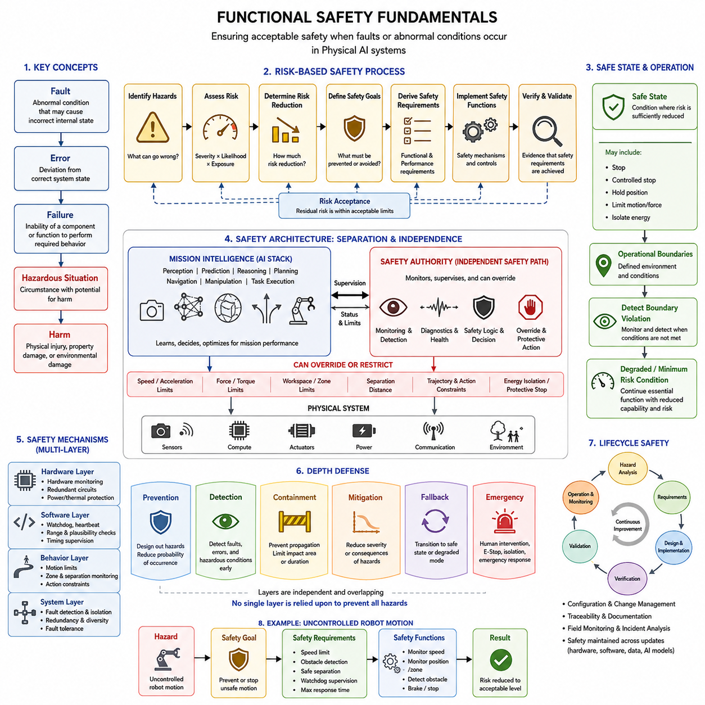{width="7.268055555555556in" height="7.268055555555556in"}

기능 안전(Functional Safety)은 결함(fault), 고장(failure), 또는 비정상 운용 조건(abnormal operating conditions)이 발생하더라도 시스템이 허용 가능한 수준의 안전 상태를 유지하도록 보장하는 분야이다. 물리 AI(Physical AI)에서는 계산에 의한 의사결정이 움직임, 힘, 에너지, 사람 및 환경과의 상호작용에 직접 영향을 미치므로 이 원칙이 특히 중요하다. 따라서 안전은 AI 모델이 정상적으로 얼마나 잘 동작하는가에만 의존해서는 안 되며, 구성요소가 잘못 동작할 때 어떤 일이 발생하는지도 다루어야 한다.

전통적인 제품 안전(product safety)은 일반적으로 기계적 설계, 가드(guard), 물리적 분리(physical separation), 또는 본질적으로 안전한 구성요소를 통해 위험원(hazard)을 제거하는 것에서 시작한다. 기능 안전(Functional Safety)은 전기·전자·프로그램 가능 시스템과 소프트웨어 제어 기능을 이용하여 위험(risk)을 감소시킴으로써 이러한 조치를 보완한다. 안전 기능(safety function)은 위험한 상태를 감지하고, 로봇의 행동을 제한하며, 보호 정지(protective stop)를 실행하거나 에너지를 격리하고, 시스템을 사전에 정의된 안전 상태(safe state)로 전환할 수 있다.

기능 안전(Functional Safety)의 기본적인 구분에는 결함(fault), 오류(error), 고장(failure), 위험원(hazard), 피해(harm)가 있다. 결함(fault)은 잘못된 내부 상태를 발생시킬 수 있는 비정상적인 조건이며, 오류(error)는 그 결과로 시스템 내부에서 발생한 정상 상태로부터의 편차이다. 고장(failure)은 구성요소나 기능이 요구된 동작을 더 이상 제공하지 못하는 상태를 의미한다. 이러한 고장은 위험 상황(hazardous situation)에 기여할 수 있으며, 충분한 노출(exposure)이 발생하면 신체적 상해, 재산 피해 또는 환경적 피해로 이어질 수 있다.

따라서 기능 안전(Functional Safety)은 모든 고장을 제거한다는 불가능한 목표가 아니라 위험 기반(risk-based) 접근법을 따른다. 엔지니어는 위험 상황을 식별하고 심각도(severity)와 발생 가능성(likelihood)을 평가하며, 필요한 위험 감소량(risk reduction)을 결정하고 이를 달성할 수 있는 안전 기능을 할당한다. 허용 가능한 잔여 위험(residual risk)은 적용 분야, 운용 환경, 사람의 노출 정도, 시스템 에너지, 위험 사건의 제어 가능성(controllability), 관련 규제 및 안전 요구사항에 따라 결정된다.

이러한 사고 과정은 위험원(hazard)을 안전 목표(safety goal), 안전 요구사항(safety requirement), 안전 메커니즘(safety mechanism), 검증 증거(verification evidence), 운용 제어(operational control)로 연결하는 안전 체계(safety chain)를 형성한다. 예를 들어 제어되지 않은 로봇 움직임이 위험 사건이라면, 안전 목표는 그러한 움직임을 방지하거나 적시에 종료하도록 요구할 수 있다. 여기에서 속도 제한, 제동 동작, 장애물 감지, 감시 장치 감독(watchdog supervision), 독립적인 정지 경로, 진단 범위(diagnostic coverage), 최대 허용 응답시간 등의 요구사항이 도출될 수 있다.

물리 AI(Physical AI)는 중요한 행동의 상당 부분이 완전히 결정론적인 알고리즘(deterministic algorithm)이 아니라 학습 모델(learned model)에서 생성되기 때문에 이러한 구조를 더욱 복잡하게 만든다. 인식 네트워크(perception network)는 객체를 잘못 분류할 수 있고, 월드 모델(world model)은 미래 상태를 잘못 예측할 수 있으며, 학습 정책(learned policy)은 명시적으로 프로그래밍된 적이 없는 행동을 선택할 수 있다. 따라서 기능 안전은 확률적 지능(probabilistic intelligence)을 이해 가능하고 시험 가능하며 감독 대상 AI 구성요소로부터 충분히 독립적인 공학적 제약(engineered constraint)으로 둘러싸야 한다.

유용한 아키텍처 원칙은 임무 지능(mission intelligence)과 안전 권한(safety authority)을 분리하는 것이다. AI 스택(AI stack)은 인식, 예측, 추론, 계획, 내비게이션, 조작 또는 작업 최적화를 수행할 수 있으며, 독립적인 안전 경로(independent safety path)는 제안되거나 실행되는 행동이 허용된 경계 안에 있는지를 감시한다. 필요한 경우 안전 경로는 AI 추론의 성공 여부에 의존하지 않고 정상 제어기(nominal controller)를 무시하거나, 움직임을 제한하고, 성능 저하 운용(degraded operation)을 요청하거나, 보호 전환(protective transition)을 명령할 수 있어야 한다.

독립성(independence)이 중요한 이유는 기능을 단순히 복제한다고 해서 반드시 독립적인 보호 기능이 확보되는 것은 아니기 때문이다. 유사한 데이터셋으로 학습된 두 개의 인식 모델은 동일한 분포 변화(distribution shift)에서 동시에 실패할 수 있으며, 동일한 컴퓨팅 플랫폼에서 실행되는 두 개의 소프트웨어 프로세스도 하나의 하드웨어 결함으로 동시에 사용할 수 없게 될 수 있다. 따라서 기능 안전은 중복성(redundancy)을 평가할 때 공통 원인 고장(common-cause failure), 체계적 결함(systematic fault), 공유 자원, 종속성, 진단 범위 및 아키텍처 다양성(architectural diversity)을 함께 고려한다.

안전 메커니즘(safety mechanism)은 물리 AI 시스템의 여러 계층에서 작동한다. 하드웨어 메커니즘은 전압, 온도, 메모리 무결성(memory integrity), 통신 링크, 액추에이터 상태 및 프로세서 상태를 감시할 수 있다. 소프트웨어 메커니즘은 감시 장치(watchdog), 타당성 검사(plausibility check), 범위 검사(range check), 타이밍 감시(timing supervision), 하트비트 모니터링(heartbeat monitoring), 상태 기계 제약(state-machine constraint), 일관성 검사(consistency test)를 사용할 수 있다. 행동 계층에서는 속도, 가속도, 힘, 작업공간, 분리 거리, 궤적 또는 허용 가능한 행동을 제한할 수 있다.

타이밍(timing) 자체도 안전 속성(safety property)이다. 위험원을 감지하더라도 감지, 판단, 통신 및 작동이 너무 늦어 허용할 수 없는 결과를 방지하지 못한다면 충분하지 않다. 따라서 기능 안전 분석은 센싱에서 계산을 거쳐 물리적 반응으로 이어지는 전체 반응 체인(reaction chain)을 고려한다. 최대 지연시간(maximum latency), 제동 거리, 액추에이터 동역학, 통신 지연, 처리 지터(processing jitter), 센서 갱신 주기 및 불확실성 마진(uncertainty margin)은 개별 성능 사양이 아니라 하나의 통합된 안전 문제로 평가해야 한다.

안전 상태(safe state)의 개념은 기능 안전의 또 다른 기반이다. 안전 상태란 허용할 수 없는 위험이 충분히 감소된 시스템 상태를 의미하지만, 이것이 항상 즉시 모든 전원을 차단하거나 모든 기능을 정지시키는 것을 의미하지는 않는다. 정지된 산업용 로봇은 움직임을 비활성화함으로써 안전해질 수 있지만, 자율주행 차량이나 비행 로봇(aerial robot)은 정지하기 전에 제어된 기동(controlled maneuver)이 필요할 수 있다. 따라서 안전 설계는 물리적 상황과 시스템 동역학에 따라 적절한 안전 행동을 정의해야 한다.

일부 시스템은 완전히 안전한 상태로 즉시 전환할 수 없으며, 대신 최소 위험 상태(minimum-risk condition) 또는 성능 저하 운용 모드(degraded operating mode)가 필요하다. 부분적인 인식 기능 손실을 경험한 이동 로봇은 속도를 낮추고, 분리 안전 여유를 확대하고, 운용 영역을 제한하거나, 알려진 위치로 복귀할 수 있다. 이는 기존의 고장 안전(fail-safe) 개념과 함께 고장 시 운용 지속(fail-operational) 및 결함 허용(fault-tolerant) 개념을 도입하며, 충분한 안전 능력이 유지되는 경우에만 필수 기능을 계속 수행하도록 한다.

기능 안전은 명확하게 정의된 운용 경계(operational boundary)에도 의존한다. 특정 환경 안에서 안전하게 동작하는 것으로 입증된 시스템이 그 환경 밖에서도 자동으로 안전하다고 가정할 수는 없다. 지형, 조명, 날씨, 사람의 밀도, 통신 품질, 위치 추정 가용성, 적재량, 속도, 온도 및 센서 가시성(sensor visibility)은 안전 가정의 유효성을 변화시킬 수 있다. 따라서 물리 AI는 명시적인 운용 조건과 이러한 조건이 위반되었음을 감지하는 메커니즘을 필요로 한다.

안전은 최종 단계의 시험이 아니라 수명주기 속성(lifecycle property)으로 다루어야 한다. 위험 분석(hazard analysis)은 아키텍처에 영향을 주고, 요구사항은 구현을 안내하며, 검증(verification)은 요구사항이 올바르게 구현되었는지를 확인하고, 유효성 확인(validation)은 결과 시스템이 의도된 환경에서 충분한 안전성을 제공하는지를 판단한다. 구성 관리(configuration management), 추적성(traceability), 변경 관리(change control), 현장 모니터링, 유지보수, 사고 분석 및 회귀 시험(regression testing)은 하드웨어, 소프트웨어, 데이터 및 AI 모델이 발전하더라도 안전 논증(safety argument)을 유지하도록 한다.

이러한 수명주기 관점은 적응형 시스템(adaptive system)과 학습 기반 시스템(learning-enabled system)에서 특히 중요하다. 모델 업데이트는 인터페이스와 기존 소프트웨어가 변경되지 않더라도 시스템 행동을 변화시킬 수 있다. 새로운 학습 데이터, 미세조정(fine-tuning), 양자화(quantization), 센서 전처리 변경 또는 다른 컴퓨팅 하드웨어에 대한 배포는 성능과 고장 특성을 변화시킬 수 있다. 따라서 기능 안전은 통제된 모델 릴리스(model release), 재현 가능한 구성, 안전 회귀 시험(safety regression test), 변경 사항이 기존의 안전 가정을 무효화하지 않았음을 입증하는 증거를 요구한다.

검증 증거(verification evidence)는 AI의 평균 정확도를 넘어 확장되어야 한다. 높은 벤치마크 성능을 가진 인식 모델이라도 안전이 중요한 상황에서 오류가 집중된다면 허용할 수 없는 위험을 발생시킬 수 있다. 평가는 위험 시나리오, 경계 조건(boundary condition), 센서 성능 저하, 희귀 사건(rare event), 타이밍 고장, 복합 결함(combination of faults), 서브시스템 간 상호작용을 조사해야 한다. 따라서 안전 논증은 분석적 방법, 시뮬레이션, 결함 주입(fault injection), 통제된 물리 시험, 시나리오 기반 시험 및 실제 운용 증거를 결합한다.

그 결과 만들어지는 아키텍처는 심층 방어(defense in depth)로 이해하는 것이 가장 적절하다. 하나의 센서, AI 모델, 제어기, 모니터 또는 비상 메커니즘이 모든 위험 사건을 방지할 것이라고 기대해서는 안 된다. 대신 예방(prevention), 감지(detection), 격리(containment), 완화(mitigation), 폴백(fallback), 비상 대응(emergency response)이 서로 중첩되는 보호 계층을 형성한다. 하나의 계층이 실패하거나 가정 범위를 벗어난 조건에 직면하더라도 다른 계층이 그 실패가 허용할 수 없는 물리적 결과로 전파될 가능성을 감소시켜야 한다.

따라서 기능 안전(Functional Safety)은 보다 광범위한 물리 AI 안전(Physical AI Safety)을 구축하기 위한 공학적 기반을 제공한다. 기능 안전만으로 불확실성, 분포 변화, 자율적 추론, 정렬(alignment), 창발적 행동(emergent behavior)과 관련된 모든 문제를 해결할 수는 없지만, 위험원, 요구사항, 독립성, 진단, 결함 허용, 안전 상태, 검증 및 수명주기 보증(lifecycle assurance)을 위한 체계적인 방법을 확립한다. 이러한 원칙은 더욱 강력한 체화 지능(embodied intelligence)에 높은 수준의 물리적 자율성을 부여하기 전에 반드시 갖추어야 할 신뢰 가능한 안전 기반(safety substrate)을 형성한다.

## 02.02. Hazard Analysis and Risk Assessment

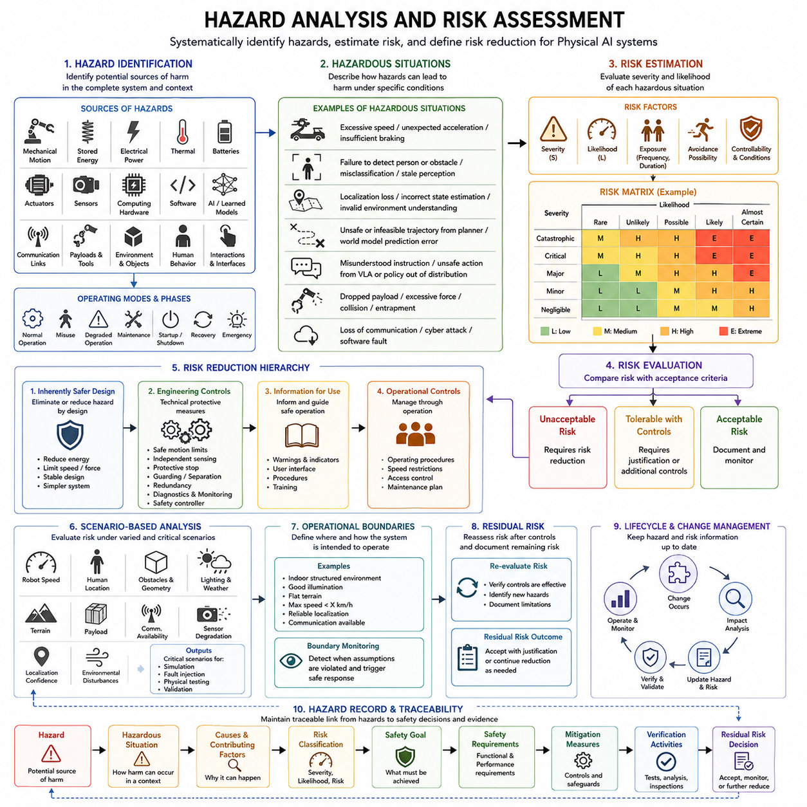{width="7.268055555555556in" height="7.268055555555556in"}

위험원 분석(Hazard Analysis)과 위험 평가(Risk Assessment)는 물리 AI(Physical AI) 시스템이 어떤 방식으로 피해(harm)를 유발할 수 있는지를 식별하고, 관련 위험(risk)이 허용 가능한지를 판단하기 위한 체계적인 절차를 확립한다. 이러한 분석은 상세 구현 이전부터 시작되어 시스템의 전체 수명주기(system lifecycle)에 걸쳐 지속된다. 물리적 위험원, 시스템 행동, 운용 조건, 고장, 사람의 노출, AI 불확실성을 명시적인 안전 의사결정과 연결하여 아키텍처와 공학적 요구사항을 수립하는 기반을 제공한다.

위험원(hazard)은 피해를 발생시킬 잠재적인 원천이며, 위험 상황(hazardous situation)은 사람, 재산 또는 환경이 해당 위험원에 노출되는 상황을 의미한다. 위험(risk)은 심각도(severity)와 발생 확률(probability of occurrence) 등의 요소를 고려하여 잠재적 결과의 중요성을 나타낸다. 이러한 개념을 명확히 구분하면 구성요소의 고장, 시스템의 불안전한 상태, 그리고 그 결과로 발생하는 물리적 피해를 동일한 사건으로 취급하는 오류를 방지할 수 있다.

위험원 식별(hazard identification)은 AI 모델만이 아니라 전체 물리 AI 시스템을 검토하는 것에서 시작한다. 관련 위험원에는 기계적 움직임, 저장 에너지, 전력, 열적 조건, 배터리, 액추에이터, 센서, 통신 링크, 컴퓨팅 하드웨어, 소프트웨어, 학습 모델, 적재물 및 도구 등이 포함된다. 또한 주변 객체와의 상호작용, 환경 조건 및 합리적으로 예측 가능한 사람의 행동도 고려해야 한다. 위험은 정상적으로 동작하는 여러 구성요소 사이의 상호작용에서도 발생할 수 있기 때문이다.

이동형 및 체화 시스템(embodied system)에서는 움직임(motion)이 핵심적인 위험원이다. 과도한 속도, 예상하지 못한 가속, 불안정한 궤적, 불충분한 제동 거리, 제어되지 않은 회전, 조작력, 적재물 낙하 또는 의도하지 않은 액추에이터 명령은 위험 상황을 발생시킬 수 있다. 따라서 분석에서는 움직임 명령이 올바른지만 확인하는 것이 아니라 비정상적인 움직임을 물리 시스템이 안전하게 감지하고, 제한하고, 중단하며, 복구할 수 있는지도 평가해야 한다.

물리 AI(Physical AI)는 인식(perception)과 상태 추정(state estimation)을 통해 추가적인 위험 경로를 만든다. 로봇은 사람을 감지하지 못하거나, 장애물을 잘못 분류하거나, 거리를 부정확하게 추정하거나, 위치 추정(localization)을 상실하거나, 주행 가능성(traversability)을 잘못 판단하거나, 오래된 센서 정보를 사용할 수 있다. 이러한 오류가 계획이나 제어로 전파되면 안전 문제가 된다. 따라서 위험원 분석은 인식 정확도를 독립적인 머신러닝 지표로 평가하는 데 그치지 않고 사건의 연쇄(chain of events)를 분석해야 한다.

계획(planning), 예측(prediction), 월드 모델(world model)은 또 다른 안전 문제를 발생시킨다. 계획기는 동역학적으로 실행 불가능한 궤적을 생성할 수 있으며, 월드 모델은 다른 객체의 움직임을 과소평가하거나 중요한 환경적 제약을 표현하지 못할 수 있다. 예측 오류는 계획 구간(planning horizon)에 걸쳐 누적되어 이후 의사결정에 영향을 줄 수 있다. 따라서 위험 평가는 추정된 세계 상태에서 예측된 미래를 거쳐 실제 물리적 행동으로 이어지는 과정에서 불확실성이 어떻게 전파되는지를 고려해야 한다.

비전-언어-행동 모델(Vision-Language-Action Model), 파운데이션 모델(Foundation Model), 범용 정책(generalist policy)은 복잡한 학습 표현과 개방형 명령에 따라 출력을 생성할 수 있기 때문에 분석 범위를 더욱 확장한다. 명령을 잘못 이해하거나, 생성된 행동이 물리적 제약을 위반하거나, 학습 분포 밖에서 정책이 예측하기 어려운 행동을 보일 수 있다. 핵심적인 안전 질문은 단순히 모델이 오류를 발생시키는가가 아니라 그 오류가 후단의 제약을 통과하여 위험한 물리적 행동으로 이어질 수 있는가이다.

위험원 분석은 정상 운용(normal operation)뿐만 아니라 합리적으로 예측 가능한 오사용(reasonably foreseeable misuse), 성능 저하 운용(degraded operation), 유지보수, 기동, 종료, 복구 및 비상 조건을 고려해야 한다. 정상적인 자율 내비게이션에서는 안전한 로봇도 충전, 수동 이동, 원격 운용, 소프트웨어 업데이트, 센서 보정, 적재물 설치 또는 고장 후 복구 과정에서는 다른 위험을 발생시킬 수 있다. 따라서 수명주기의 다양한 운용 모드가 위험원 분석의 중요한 차원이 된다.

위험 추정(risk estimation)은 각각의 위험 상황을 그 결과와 주변 조건에 따라 평가한다. 심각도(severity)는 잠재적인 피해 규모를 나타내며, 확률(probability)은 위험한 사건의 연쇄가 발생할 가능성을 나타낸다. 선택한 안전 프레임워크에 따라 노출 빈도(exposure frequency), 노출 지속시간, 환경 조건, 회피 가능성 및 사람이나 시스템이 상황을 제어할 수 있는 능력도 평가에 영향을 줄 수 있다.

위험 추정은 충분한 근거가 없는 상황에서 정확한 사고 발생 빈도를 예측하는 것과 혼동해서는 안 된다. 물리 AI 개발 초기에는 특히 희귀 사건(rare event)과 새로운 학습 행동에 대해 정밀한 수치적 확률을 뒷받침할 충분한 현장 데이터가 없는 경우가 많다. 따라서 근거가 없는 수치적 정밀성을 제시하기보다 가정, 불확실성 및 근거를 명확하게 표현하는 정성적(qualitative) 또는 반정량적(semi-quantitative) 분류가 더 타당할 수 있다.

위험 매트릭스(risk matrix)는 심각도와 발생 가능성의 조합을 위험 범주로 구성하여 팀이 위험원의 우선순위를 정하고 추가적인 위험 감소가 필요한 영역을 판단하도록 지원한다. 그러나 위험 매트릭스는 안전을 증명하는 수단이 아니라 의사결정 지원 도구(decision aid)이다. 범주 경계, 확률 추정 및 심각도 정의에 사용되는 가정이 달라지면 실제 물리적 위험은 동일하더라도 동일한 위험원이 서로 다른 범주로 분류될 수 있으므로 주의해서 해석해야 한다.

위험 평가(risk evaluation)는 추정된 위험을 사전에 정의된 허용 기준(acceptance criteria)과 비교한다. 허용할 수 없는 위험에는 추가적인 조치가 필요하며, 충분히 감소된 위험은 문서화된 근거와 함께 수용할 수 있다. 중간 영역의 위험은 추가적인 공학적 판단, 증거 또는 보호 조치가 필요할 수 있다. 목적은 단순히 위험에 등급을 부여하는 것이 아니라 아키텍처 변경, 추가 안전 메커니즘, 운용 제한 또는 강화된 유효성 확인(validation)이 필요한지를 결정하는 것이다.

위험 감소(risk reduction)는 구조적인 계층에 따라 수행되어야 한다. 가능한 경우 본질적으로 더 안전한 설계(inherently safer design)를 통해 위험원을 우선적으로 제거하거나 감소시켜야 한다. 남아 있는 위험은 안전 움직임 제한, 독립적인 센싱, 보호 정지(protective stop), 물리적 가드, 중복성(redundancy), 진단, 런타임 모니터링(runtime monitoring), 안전 제어기(safety controller) 등의 공학적 보호 수단으로 처리할 수 있다. 정보, 절차, 교육 및 경고도 추가적인 보호를 제공하지만 효과적인 공학적 제어를 불필요하게 대체해서는 안 된다.

물리 AI에서는 위험 제어(risk control)를 통해 지능에 부여되는 권한 자체를 제한할 수도 있다. 학습 기반 계획기(learned planner)가 궤적을 제안하는 동안 별도의 안전 제어기가 속도, 작업공간, 힘, 분리 거리 및 충돌 제약을 강제할 수 있다. 불확실성이 높은 인식 시스템은 저속 운용을 실행할 수 있으며, 위치 추정을 상실하면 자율 내비게이션을 금지할 수 있다. 이러한 메커니즘은 추상적인 AI 불확실성을 구체적인 운용 제한으로 변환하여 잠재적인 물리적 결과를 제한한다.

심각한 사고는 하나의 결함보다는 여러 조건의 결합으로 발생하는 경우가 많기 때문에 위험원 분석은 복합 고장(combination of failures)을 검토해야 한다. 인식 오류는 저속에서는 큰 문제가 아닐 수 있지만, 과도한 속도, 통신 지연, 낮은 제동 성능 및 사람과의 근접 상황이 결합되면 위험해질 수 있다. 중복 구성요소가 센서, 학습 데이터, 전원, 통신 채널, 소프트웨어 종속성 또는 컴퓨팅 자원을 공유하는 경우에는 공통 원인 고장(common-cause failure)이 특히 중요하다.

시나리오 기반 분석(scenario-based analysis)은 추상적인 위험원을 실제 운용 상황과 연결하는 실용적인 방법을 제공한다. 시나리오에서는 로봇 속도, 사람의 위치, 장애물 형상, 조명, 지형, 적재물, 통신 가용성, 센서 성능 저하, 위치 추정 신뢰도 및 환경적 교란 등을 변화시킬 수 있다. 핵심 시나리오는 이후 시뮬레이션, 결함 주입(fault injection), 통제된 물리 시험 및 유효성 확인의 입력으로 활용되어 식별된 위험과 공학적 증거 사이의 추적성(traceability)을 형성한다.

운용 경계(operational boundary)는 검증된 조건을 벗어날 경우 위험 수준이 크게 달라질 수 있기 때문에 위험 평가의 핵심 요소이다. 구조화된 실내 환경을 위해 설계된 시스템은 비, 어둠, 밀집된 군중, 불규칙한 지형 또는 신뢰할 수 없는 위치 추정 환경에서 위험해질 수 있다. 따라서 평가는 시스템이 어디에서 어떤 방식으로 운용되는지에 대한 가정을 정의하고, 이러한 가정이 더 이상 유효하지 않을 때 이를 감지할 수 있는 메커니즘을 식별해야 한다.

잔여 위험(residual risk)은 보호 조치를 구현한 이후에도 남아 있는 위험을 의미한다. 안전 메커니즘이 추가되었다는 이유만으로 잔여 위험이 자동으로 허용 가능하다고 가정해서는 안 되며 반드시 다시 평가해야 한다. 엔지니어는 보호 조치가 목표 위험을 실제로 감소시키는지 검증하고, 해당 조치로 인해 새롭게 발생하는 위험을 식별하며, 남아 있는 한계를 문서화해야 한다. 따라서 잔여 위험은 단일 분석 단계의 종료점이 아니라 반복적인 공학 과정의 결과이다.

위험원 분석과 위험 평가는 구성 및 변경 관리(configuration and change management)와 지속적으로 연결되어야 한다. 센서, 액추에이터, 적재물, 운용 속도, 소프트웨어, 학습 데이터, AI 모델, 컴퓨팅 플랫폼 또는 운용 환경의 변경은 기존의 안전 가정을 무효화할 수 있다. 따라서 중요한 변경 사항이 발생하면 기존의 안전 결론에 자동으로 의존하지 않고 영향 분석(impact analysis)을 수행하고, 필요한 경우 위험원 식별, 위험 추정, 검증 및 유효성 확인을 다시 수행해야 한다.

최종적으로 생성되는 위험 기록(hazard record)은 이후의 기능 안전(Functional Safety) 엔지니어링을 위한 기반을 제공한다. 각각의 중요한 위험 상황은 원인, 결과, 위험 분류, 안전 목표(safety goal), 도출된 요구사항, 완화 메커니즘(mitigation mechanism), 검증 활동 및 잔여 위험 결정과 연결될 수 있다. 이러한 추적성은 위험원 분석을 단순한 문서화 작업이 아니라 개발과 운용 전반에서 시스템 아키텍처에 영향을 미치는 공학적 제어 과정으로 전환한다.

물리 AI(Physical AI)에서 효과적인 위험 평가의 핵심은 불확실한 계산 행동이 물리적 동역학(physical dynamics)과 어떻게 상호작용하여 피해를 발생시킬 수 있는지, 그리고 어떠한 독립적인 메커니즘이 그러한 진행을 차단할 수 있는지를 파악하는 것이다. 위험원, 노출, 심각도, 고장, AI 불확실성, 운용 시나리오, 안전 보호 조치(safeguard), 잔여 위험을 체계적으로 연결함으로써 위험원 분석과 위험 평가는 이후 안전 목표와 상세 안전 요구사항을 도출하기 위한 근거 기반의 토대를 확립한다.

## 02.03. Safety Goals and Safety Requirements

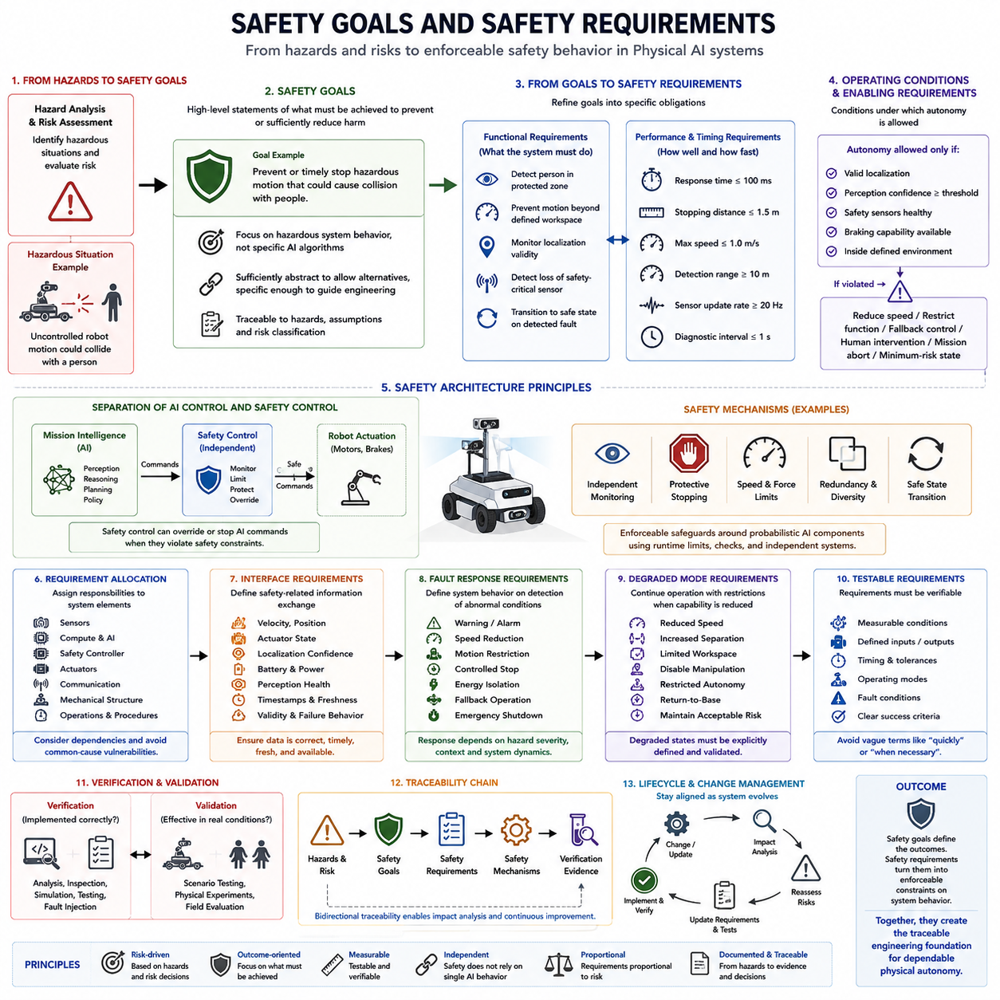{width="7.268055555555556in" height="7.268055555555556in"}

안전 목표(Safety Goal)는 위험원 분석(Hazard Analysis)과 위험 평가(Risk Assessment)의 결과를 허용할 수 없는 피해(harm)를 방지하거나 충분히 감소시키기 위해 무엇을 달성해야 하는지를 설명하는 상위 수준의 명세로 변환한다. 이는 식별된 위험 상황(hazardous situation)과 실제 구현 가능한 안전 공학(safety engineering)을 연결하는 역할을 한다. 물리 AI(Physical AI)에서 안전 목표는 특정 AI 알고리즘이나 기술적 구현 방법을 규정하기보다 방지, 제어 또는 완화해야 하는 위험한 시스템 행동에 초점을 맞추어야 한다.

안전 목표(Safety Goal)는 일반적으로 위험 평가에서 식별된 하나 이상의 중요한 위험원으로부터 도출된다. 예를 들어 제어되지 않은 로봇 움직임이 사람과의 충돌을 일으킬 수 있다면, 이에 대응하는 목표는 위험한 움직임을 방지하거나 적절한 시간 안에 종료하도록 요구할 수 있다. 안전 목표는 필요한 안전 결과를 정의하며, 이후의 안전 요구사항(Safety Requirement)은 그 결과를 달성하는 데 필요한 기능, 제약, 성능 특성 및 메커니즘을 구체적으로 정의한다.

안전 목표는 다양한 아키텍처 대안을 허용할 수 있을 정도로 충분히 추상적이면서도 공학적 의사결정을 안내할 수 있을 정도로 명확해야 한다. "로봇은 안전해야 한다"와 같은 표현은 시험 가능한 행동이나 특정 위험원과의 관계를 제공하지 못하므로 지나치게 모호하다. 보다 명확한 목표는 의도하지 않은 움직임, 과도한 힘, 금지 영역 진입, 사람과의 위험한 근접 또는 핵심 인식 기능 상실 이후에도 계속되는 자율 운용과 같이 방지해야 할 불안전 상태를 구체적으로 정의한다.

안전 목표를 정의할 때 추적성(Traceability)은 핵심적인 요소이다. 각각의 목표는 이전 단계의 위험원, 위험 상황, 가정 및 위험 분류와 연결되어야 하며, 이후 단계의 도출된 안전 요구사항, 아키텍처 요소, 검증 활동 및 유효성 확인 증거(validation evidence)와도 연결되어야 한다. 이러한 연결 체계를 통해 특정 안전 기능이 왜 존재하며 어떤 위험을 처리하는지를 설명할 수 있고, 충분한 요구사항으로 아직 다루어지지 않은 위험원도 식별할 수 있다.

안전 요구사항(Safety Requirement)은 상위 수준의 안전 목표를 시스템 구성요소에 할당할 수 있는 구체적인 의무사항으로 세분화한다. 여기에는 필요한 기능, 성능 한계, 타이밍 제약, 결함 대응, 진단, 독립성, 중복성(redundancy), 인터페이스 또는 운용 제한 등이 포함될 수 있다. 예를 들어 위험한 움직임에 관한 목표는 최대 속도, 제동 응답, 장애물 감지, 분리 거리 감시, 액추에이터 정지, 감시 장치 감독(watchdog supervision), 보호 정지(protective stop) 등에 관한 요구사항으로 구체화될 수 있다.

기능 안전 요구사항(Functional Safety Requirement)은 시스템이 제공해야 하는 안전 관련 행동을 정의한다. 예를 들어 보호 구역 내의 사람을 감지하거나, 정의된 작업공간을 벗어나는 움직임을 방지하거나, 위치 추정(localization)의 유효성을 감시하거나, 안전 필수 센서(safety-critical sensor)의 손실을 식별하거나, 결함이 감지된 이후 안전 상태(safe state)로 전환하는 기능 등이 이에 해당한다. 이러한 요구사항은 AI 모델 내부의 불명확한 의도에 의존하기보다 관찰 가능한 시스템 행동을 설명해야 한다.

성능 요구사항(Performance Requirement)은 안전 기능이 얼마나 효과적이고 신속하게 작동해야 하는지를 결정한다. 감지 거리, 응답시간, 최대 정지 거리, 허용 속도, 힘 제한, 센서 갱신 주기, 진단 간격, 통신 타임아웃 및 불확실성 마진(uncertainty margin)은 모두 안전과 관련된 매개변수가 될 수 있다. 이러한 값은 단순한 편의성에 따라 결정해서는 안 되며, 궁극적으로 위험원 분석, 시스템 동역학, 적용 환경의 제약, 시험 결과 및 관련 안전 기준에 의해 뒷받침되어야 한다.

물리 AI는 지속적으로 변화하는 환경과 상호작용하기 때문에 타이밍 요구사항(Timing Requirement)이 특히 중요하다. 올바른 안전 판단이라도 너무 늦게 이루어지면 피해가 발생할 수 있다. 따라서 요구사항은 센싱과 위험 감지에서 시작하여 계산, 통신, 제어 및 물리적 작동으로 이어지는 전체 반응 경로(reaction path)를 고려해야 한다. 허용 가능한 응답시간은 속도, 분리 거리, 제동 능력 및 예측 가능한 환경 변화와 일관성을 유지해야 한다.

안전 요구사항은 자율 지능(autonomous intelligence)이 운용될 수 있는 조건도 규정할 수 있다. 로봇의 자율 이동을 허용하기 전에 유효한 위치 추정, 충분한 인식 신뢰도, 정상적인 안전 센서, 사용 가능한 제동 능력 및 정의된 환경 내부에서의 운용이 요구될 수 있다. 이러한 선행 조건이 위반되면 요구사항에 따라 속도를 감소시키거나, 기능을 제한하거나, 폴백 제어(fallback control)를 실행하거나, 사람의 개입을 요청하거나, 임무를 중단하거나, 최소 위험 상태(minimum-risk condition)로 전환할 수 있다.

학습 기반 인식(learned perception)과 AI 모델에서는 높은 평균 정확도가 안전을 보장한다고 가정해서는 안 된다. 대신 시스템 수준의 요구사항을 통해 독립적인 장애물 감지, 불확실성 모니터링, 타당성 검사(plausibility check), 신뢰도 임계값(confidence threshold), 중복 센싱(redundant sensing), 런타임 안전 경계(runtime safety envelope), 불확실한 정보에서 생성된 행동에 대한 제한 등을 정의할 수 있다. 이러한 접근법은 확률적 구성요소(probabilistic component)의 주변에 강제 가능한 안전 속성을 배치한다.

안전 요구사항은 AI 제어(AI Control)와 안전 제어(Safety Control)의 분리도 다루어야 한다. 임무 지능(mission intelligence)은 내비게이션, 조작 또는 작업 수행을 최적화할 수 있지만, 안전 필수 한계(safety-critical limit)는 정상 행동을 생성하는 동일한 모델에만 의존해서는 안 된다. 요구사항을 통해 독립적인 모니터링, 보호된 실행 경로, 별도의 안전 제어기, 안전 명령의 우선순위 또는 AI가 생성한 명령이 설정된 제약을 위반할 경우 이를 거부하는 메커니즘을 정의할 수 있다.

요구사항 할당(Requirement Allocation)은 각각의 안전 의무를 어떤 서브시스템이 담당할 것인지를 결정한다. 책임은 센서, 컴퓨팅 하드웨어, 통신 시스템, 액추에이터, 전통적 제어기(classical controller), AI 구성요소, 독립적인 모니터, 기계 구조 또는 운용 절차 등에 할당될 수 있다. 여러 안전 기능을 동일한 고장 원인을 공유하는 구성요소에 할당하면 숨겨진 공통 원인 취약성(common-cause vulnerability)이 발생할 수 있으므로 종속 관계를 고려해야 한다.

안전 책임이 서브시스템의 경계를 넘어가는 경우 인터페이스 요구사항(Interface Requirement)이 중요해진다. 안전 모니터는 속도, 위치, 액추에이터 상태, 위치 추정 신뢰도, 배터리 상태 또는 인식 시스템 상태에 관한 신뢰할 수 있는 정보를 필요로 할 수 있다. 따라서 요구사항은 이러한 신호의 의미, 유효성, 타이밍, 최신성(freshness) 및 고장 시 행동을 정의해야 한다. 인터페이스가 오래되거나 모호하거나 손상되거나 사용할 수 없는 정보를 제공한다면 올바르게 설계된 안전 아키텍처도 효과를 잃을 수 있다.

결함 대응 요구사항(Fault-Response Requirement)은 비정상적인 조건이 감지되었을 때 시스템이 어떻게 행동해야 하는지를 정의한다. 위험원에 따라 필요한 대응에는 경고, 속도 감소, 움직임 제한, 제어된 정지(controlled stop), 에너지 격리, 폴백 운용 또는 비상 정지(emergency shutdown)가 포함될 수 있다. 즉각적인 정지가 어떤 로봇에서는 안전하지만 다른 시스템에서는 추가적인 위험을 만들 수 있으므로 적절한 대응은 물리적 동역학과 운용 상황에 따라 결정되어야 한다.

요구사항은 정상적인 안전 제약과 성능 저하 모드(degraded mode)의 행동도 구분해야 한다. 중복성이 상실되거나 센서 성능이 저하되더라도 더욱 엄격한 제한 아래에서 운용을 계속할 수 있는 경우가 있다. 속도 감소, 분리 거리 증가, 제한된 작업공간, 조작 기능 비활성화, 자율성 제한 또는 기지 복귀(return-to-base) 행동을 통해 허용 가능한 위험 수준을 유지하면서 일부 유용한 기능을 지속할 수 있다. 그러나 허용 가능한 성능 저하 상태는 명확하게 정의되고 검증되어야 한다.

모든 안전 요구사항은 최종적으로 요구사항 충족 여부를 입증할 수 있도록 작성되어야 한다. "신속하게", "신뢰성 있게", "필요한 경우"와 같은 모호한 표현은 명확한 기준이 함께 정의되지 않으면 객관적인 검증을 어렵게 만든다. 시험 가능한 요구사항(testable requirement)은 적절한 경우 측정 가능한 조건, 입력, 예상 출력, 타이밍, 허용오차, 운용 모드 및 결함 조건을 정의하여 주관적인 해석이 아니라 체계적인 검증이 가능하도록 해야 한다.

검증(Verification)은 안전 요구사항이 올바르게 구현되었는지를 판단하고, 유효성 확인(Validation)은 구현된 안전 행동이 실제 운용 조건에서 의도된 위험원을 충분히 처리하는지를 판단한다. 증거는 분석, 검사, 시뮬레이션, 결함 주입(fault injection), 소프트웨어 및 하드웨어 시험, 시나리오 기반 평가, 통제된 물리적 실험 등을 통해 확보할 수 있다. 따라서 요구사항의 특성에 따라 서로 다른 검증 증거의 조합이 필요할 수 있다.

양방향 추적성(Bidirectional Traceability)은 검증 결과를 안전 요구사항과 안전 목표를 거쳐 최초의 위험원까지 연결할 수 있도록 한다. 시험이 실패하면 어떤 요구사항과 안전 목표가 영향을 받는지 파악할 수 있다. 반대로 운용 속도, 적재물, 환경, 센서 또는 AI 행동의 변화로 위험원이 변경되면 어떤 요구사항과 검증 활동을 다시 검토해야 하는지를 추적성을 통해 확인할 수 있다.

물리 AI에서는 모델 업데이트가 기존 소프트웨어 인터페이스를 변경하지 않고도 행동을 변화시킬 수 있다는 추가적인 문제가 존재한다. 미세조정(fine-tuning), 새로운 학습 데이터, 전처리 변경, 양자화(quantization), 모델 교체 또는 적응(adaptation)은 인식과 행동 특성을 변화시킬 수 있다. 따라서 안전 요구사항은 구성 및 변경 관리(configuration and change management)에 포함되어 관련 업데이트가 영향 분석, 회귀 시험(regression testing), 영향을 받는 안전 가정에 대한 재검토를 유발하도록 해야 한다.

안전 목표와 안전 요구사항은 한 번 작성한 뒤 고정되는 것이 아니라 반복적인 과정(iterative process)을 통해 발전해야 한다. 위험원 분석을 통해 새로운 시나리오가 발견될 수 있고, 시험 과정에서 불충분한 안전 마진이 드러날 수 있으며, 실제 운용 경험을 통해 이전에는 알려지지 않았던 상호작용이 확인될 수 있다. 따라서 식별된 위험, 필요한 보호 조치, 구현 및 증거 사이의 통제된 추적성을 유지하면서 요구사항을 지속적으로 개선할 수 있어야 한다.

잘 구성된 물리 AI 안전 명세(Physical AI Safety Specification)는 위험 상황과 위험 의사결정에서 시작하여 안전 목표, 기능 및 성능 요구사항, 서브시스템 할당, 기술적 안전 메커니즘, 검증 증거로 이어지는 계층 구조를 형성한다. 이러한 계층 구조는 물리적 피해에 관한 추상적인 우려를 설계하고, 구현하고, 시험하고, 모니터링하며, 시스템 전체 수명주기에 걸쳐 유지할 수 있는 구체적인 공학적 의무로 변환한다.

궁극적으로 안전 목표(Safety Goal)는 물리 AI가 달성해야 하는 안전 결과를 정의하며, 안전 요구사항(Safety Requirement)은 이러한 결과를 시스템 행동에 적용할 수 있는 강제 가능한 제약(enforceable constraint)으로 변환한다. 두 요소를 결합함으로써 인식, 추론, 계획, 학습 정책, 제어, 하드웨어 및 운용 절차를 명시적인 위험 감소 목표(risk-reduction objective)와 연결할 수 있으며, 신뢰할 수 있는 물리적 자율성(physical autonomy)을 구현하기 위해 필요한 추적 가능한 공학적 기반을 형성한다.

## 02.04. Safety Integrity and Risk Reduction

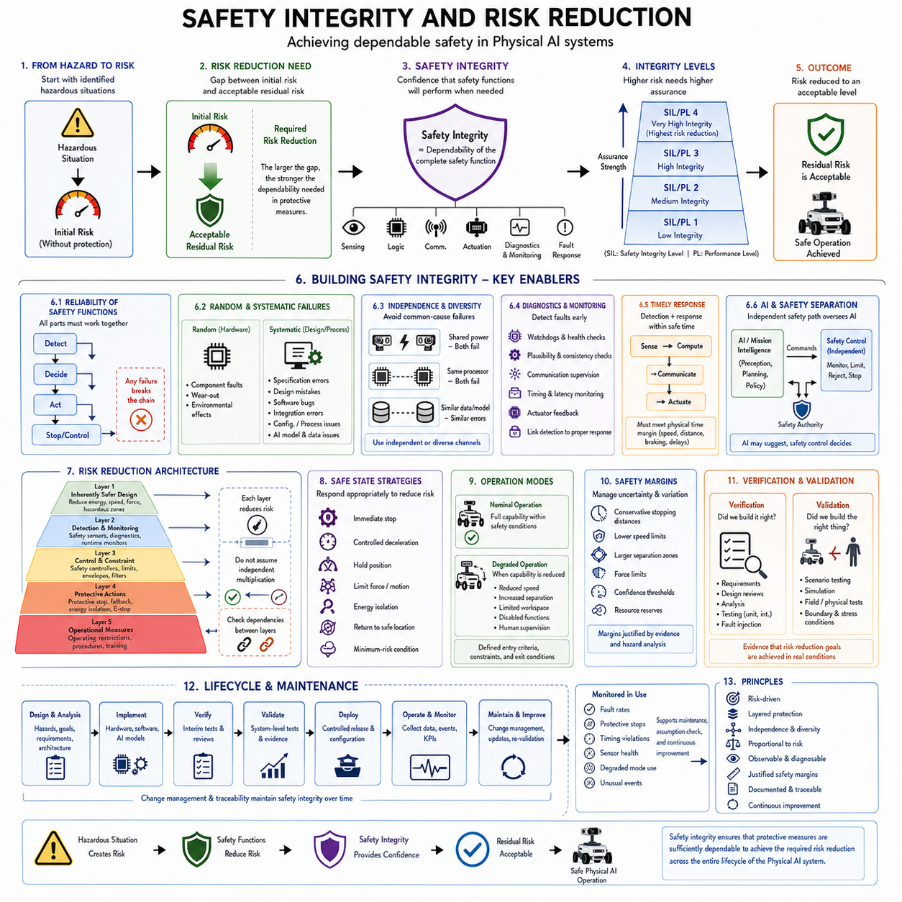{width="7.268055555555556in" height="7.268055555555556in"}

안전 무결성(Safety Integrity)은 위험을 감소시켜야 하는 순간에 안전 관련 기능(safety-related function)이 올바르게 수행될 것이라는 신뢰 수준을 의미한다. 이는 단순히 구성요소의 품질이나 AI 정확도를 측정하는 것이 아니라 센싱, 로직, 통신, 작동, 진단 및 결함 대응을 포함하는 전체 안전 기능의 신뢰성을 다룬다. 물리 AI(Physical AI)에서 안전 무결성은 필요한 위험 감소량과 이를 달성하기 위해 사용되는 메커니즘의 엄격성을 연결하는 공학적 기준을 제공한다.

위험 감소(Risk Reduction)는 위험 상황(hazardous situation)에 존재하는 초기 위험(initial risk)과 허용 가능한 것으로 판단되는 잔여 위험(residual risk) 수준의 차이에서 시작된다. 이 차이가 클수록 일반적으로 더 강력하고 신뢰할 수 있는 보호 조치가 필요하다. 따라서 안전 무결성은 단순히 안전 기능이 존재하는지를 나타내는 것이 아니라 해당 보호 조치에 어느 정도의 신뢰성이 요구되는지를 표현한다.

안전 기능(Safety Function)은 필요한 상황에서 충분한 신뢰성을 가지고 작동할 때만 위험을 감소시킬 수 있다. 예를 들어 보호 정지(protective stop)는 성공적인 위험 감지, 올바른 안전 로직, 적시 통신, 정상적으로 작동하는 브레이크 또는 액추에이터, 충분한 물리적 정지 성능에 의존한다. 각각의 구성요소가 정상 운용에서는 잘 동작하더라도 이 연쇄 과정의 어느 한 부분에서 고장이 발생하면 전체 안전 기능의 무결성이 감소할 수 있다.

기능 안전 프레임워크(Functional Safety Framework)는 일반적으로 정의된 무결성 분류(integrity classification)를 사용하여 높은 위험 수준을 더욱 강력한 보증 요구사항(assurance requirement)과 연결한다. 적용 산업과 표준에 따라 안전 무결성 수준(Safety Integrity Level)이나 성능 수준(Performance Level) 등의 개념으로 표현될 수 있다. 구체적인 분류 방법은 다르지만, 더 큰 위험 감소가 필요할수록 더욱 강력한 아키텍처, 진단, 검증 및 수명주기 관리가 요구된다는 기본 원칙은 동일하다.

안전 무결성은 임의 하드웨어 고장(random hardware failure)과 체계적 고장(systematic failure)을 모두 고려해야 한다. 임의 하드웨어 고장은 물리적 구성요소의 열화 또는 예측하기 어려운 하드웨어 결함에서 발생하는 반면, 체계적 고장은 명세, 설계, 구현, 통합, 구성 또는 개발 과정의 취약점에서 발생한다. 물리 AI에서는 학습 데이터, 모델 아키텍처, 전처리, 배포 구성 및 운용 분포에 따라 행동이 달라지는 학습 구성요소(learned component)도 추가적으로 고려해야 한다.

하드웨어 무결성(Hardware Integrity)은 신뢰성 높은 구성요소, 중복성(redundancy), 진단, 모니터링, 결함 격리(fault containment), 적절한 아키텍처 설계를 통해 향상시킬 수 있다. 안전 시스템은 독립적인 센싱 채널, 중복 처리 장치, 감시되는 통신 또는 로봇을 안전 상태로 전환할 수 있는 복수의 메커니즘을 사용할 수 있다. 그러나 중복 채널이 동일한 근본적인 고장에 취약하다면 중복성만으로 안전 무결성을 보장할 수 없다.

따라서 공통 원인 고장(Common-Cause Failure)은 중요한 고려 대상이다. 두 개의 센서가 동일한 전원을 공유하여 동시에 사용할 수 없게 될 수 있고, 두 개의 소프트웨어 모니터가 동일한 프로세서에서 실행되어 함께 실패할 수 있으며, 두 AI 모델이 높은 상관성을 가진 데이터로 학습되어 유사한 오류를 발생시킬 수도 있다. 효과적인 위험 감소를 위해서는 공유된 종속성을 분석하고 필요한 경우 보호 채널 사이에 충분한 독립성(independence)이나 다양성(diversity)을 확보해야 한다.

진단 범위(Diagnostic Coverage)는 위험한 결함이 허용할 수 없는 행동으로 이어지기 전에 감지될 가능성을 높임으로써 안전 무결성에 기여한다. 감시 장치(watchdog), 타당성 검사(plausibility check), 메모리 보호, 통신 감시, 센서 일관성 검사, 액추에이터 피드백, 프로세서 상태 모니터링 및 타이밍 감시는 비정상적인 상태를 식별할 수 있다. 그러나 결함 감지는 적절한 대응과 연결되어야 하며, 결과를 제어하지 못한 채 결함을 식별하는 것만으로는 충분한 위험 감소를 제공할 수 없다.

결함 감지 지연시간(Fault Detection Latency)은 물리 AI에서 특히 중요하다. 로봇은 결함을 감지하고 대응하는 사이에도 상당한 거리를 이동할 수 있기 때문이다. 따라서 안전 무결성은 결함이 최종적으로 감지되는지만이 아니라 사용 가능한 물리적 시간 여유 안에서 감지와 완화가 이루어지는지에도 의존한다. 로봇 속도, 분리 거리, 액추에이터 동역학, 제동 능력, 계산 지연 및 통신 지연이 결합되어 안전 메커니즘이 피해를 방지할 수 있는지를 결정한다.

임무 지능(Mission Intelligence)과 안전 메커니즘(Safety Mechanism) 사이의 독립성은 위험 감소 능력을 크게 강화할 수 있다. AI 구성요소는 인식, 예측, 추론, 계획 또는 정책 생성을 수행하는 반면, 독립적인 안전 경로(independent safety path)는 중요한 한계를 감독할 수 있다. 정상 AI가 불안전한 명령을 생성하더라도 보호 경로는 허용할 수 없는 물리적 결과가 발생하기 전에 해당 명령을 거부, 수정, 제한 또는 종료할 수 있는 충분한 권한과 가용성을 유지해야 한다.

이러한 분리는 확률적 및 학습 기반 구성요소(probabilistic and learned component)에서 특히 중요하다. 인식 모델이 가능한 모든 장면에서 정확한 분류를 보장하기는 일반적으로 어렵고, 학습 정책이 설계 단계에서 미래의 모든 행동을 열거하는 것도 불가능하다. 따라서 이러한 구성요소에 무제한적인 안전 책임을 부여하는 대신 안전 경계(safety envelope), 독립 모니터, 행동 필터(action filter), 움직임 제한, 신뢰도 조건 및 폴백 제어기(fallback controller)를 통해 권한을 제한할 수 있다.

위험 감소는 하나의 메커니즘에 집중시키기보다 여러 보호 계층(protective layer)에 분산해야 한다. 본질적으로 더 안전한 기계 설계(inherently safer mechanical design)는 사용 가능한 에너지, 속도, 힘 또는 접근 가능한 위험 영역을 감소시킬 수 있다. 안전 센서와 제어기는 위험한 조건을 감지하고, 런타임 모니터(runtime monitor)는 행동을 제한하며, 보호 또는 비상 메커니즘은 위험한 움직임을 종료할 수 있다. 기술적 조치만으로 충분하지 않은 경우 운용 제한도 추가적인 방어 수단을 제공할 수 있다.

각 보호 조치의 위험 감소 기여도는 위험 감소 효과를 항상 서로 독립적으로 곱할 수 있다고 가정하지 않고 이해해야 한다. 두 개의 안전 보호 수단(safeguard)이 동일한 센서, 프로세서, 소프트웨어 라이브러리, 통신 네트워크 또는 환경적 가정에 의존한다면 고장이 서로 상관될 수 있다. 따라서 안전 무결성 분석에서는 서로 독립적으로 보이는 보호 계층의 위험 감소 효과를 결합하기 전에 메커니즘 사이의 종속성을 분석해야 한다.

안전 상태 전환(Safe-State Transition) 역시 안전 무결성의 일부이다. 보호 대응 자체가 신뢰할 수 있어야 하기 때문이다. 시스템에 따라 위험 감소를 위해 즉각적인 정지, 제어된 감속(controlled deceleration), 위치 유지, 힘 제한, 에너지 격리, 알려진 위치로의 복귀 또는 최소 위험 상태(minimum-risk condition) 진입이 필요할 수 있다. 선택된 대응은 완전한 시스템 종료가 항상 가장 안전하다고 가정하는 대신 플랫폼의 물리적 동역학을 반영해야 한다.

고장 안전(Fail-Safe), 고장 시 운용 지속(Fail-Operational), 결함 허용(Fault-Tolerant) 전략은 결함 발생 이후에도 허용 가능한 위험 수준을 유지하기 위한 서로 다른 접근법을 제공한다. 고장 안전 시스템은 안전 상태로의 전환을 우선하며, 고장 시 운용 지속 시스템은 특정 고장이 발생하더라도 필수 기능을 유지한다. 결함 허용 설계는 결함을 감지하고 관리하면서 정의된 한계 안에서 운용을 지속한다. 물리 AI에서는 임무 중요도, 환경 조건 및 사용 가능한 중복성에 따라 이러한 접근법을 조합할 수 있다.

성능 저하 운용(Degraded Operation)은 전체 기능을 더 이상 지원할 수 없을 때 통제된 위험 감소를 제공할 수 있다. 하나의 센서나 컴퓨팅 채널이 손실되면 속도 감소, 분리 안전 여유 증가, 작업공간 제한, 조작 기능 비활성화, 자율 기능 제한 또는 사람의 감독이 실행될 수 있다. 성능 저하 모드는 정상 운용이 불명확하게 지속되는 상태가 아니라 자체적인 안전 가정, 진입 기준, 운용 제약 및 종료 조건이 명확하게 정의되어야 한다.

안전 마진(Safety Margin)은 모델링이나 시험만으로 완전히 제거할 수 없는 불확실성을 다룬다. 보수적인 정지 거리, 감소된 속도 제한, 확대된 분리 구역, 힘 제한, 신뢰도 임계값 및 자원 여유(resource reserve)는 측정 오류, 타이밍 변화, 환경 불확실성 및 모델 불일치(model mismatch)에 대한 추가적인 허용 능력을 제공할 수 있다. 적절한 안전 마진은 임의적으로 선택하는 것이 아니라 시스템 증거와 위험원 분석에 의해 정당화되어야 한다.

검증(Verification)은 개별 안전 메커니즘이 요구사항을 만족한다는 증거를 제공하고, 유효성 확인(Validation)은 이러한 메커니즘의 결합된 행동이 대표적인 운용 조건에서 의도한 위험 감소를 실제로 제공하는지를 판단한다. 시험에는 정상 시나리오, 경계 조건, 주입된 결함, 센서 성능 저하, 타이밍 교란, 통신 고장, 컴퓨팅 과부하 및 안전 아키텍처에 부담을 줄 수 있는 복합 조건이 포함되어야 한다.

안전 무결성은 수명주기 규율(Lifecycle Discipline)에도 크게 의존한다. 잘 설계된 안전 메커니즘이라도 문서화되지 않은 소프트웨어 변경, 교체된 하드웨어, 수정된 매개변수, 변경된 네트워크 구성 또는 유지보수 오류로 인해 의도된 안전 무결성을 상실할 수 있다. 따라서 구성 관리(configuration management), 추적성(traceability), 통제된 릴리스, 검증 기록 및 변경 영향 분석(change-impact analysis)은 배포와 운용 전반에서 위험 감소 능력을 유지하는 핵심 요소이다.

AI 모델 변경은 추가적인 수명주기 문제를 발생시킨다. 미세조정(fine-tuning), 새로운 데이터셋, 전처리 수정, 양자화(quantization), 모델 압축(model compression), 인식 모델 또는 정책 모델의 교체는 주변 인터페이스를 변경하지 않으면서도 고장 특성을 변화시킬 수 있다. 따라서 모델 행동이 변경되면 특히 후단 안전 메커니즘이 신뢰도, 지연시간, 출력 분포 또는 모델별 성능에 의존하는 경우 안전 관련 가정을 다시 평가해야 한다.

운용 모니터링(Operational Monitoring)은 개발 과정에서 설정한 가정이 실제 현장에서도 유효하게 유지되는지를 확인할 수 있는 증거를 제공한다. 결함 발생률, 보호 정지 이벤트, 센서 상태, 타이밍 위반, 안전 개입, 비정상적인 시나리오 및 성능 저하 모드 활성화 기록은 새롭게 나타나는 취약점을 발견하는 데 활용할 수 있다. 이러한 증거는 유지보수와 재평가를 지원해야 하지만 현장 모니터링이 배포 전에 필요한 안전 조치를 대신할 수는 없다.

안전 무결성(Safety Integrity)과 위험 감소(Risk Reduction)는 궁극적으로 위험 상황에서 필요한 보호 수준, 아키텍처, 진단, 독립성, 검증 및 잔여 위험으로 이어지는 지속적인 공학적 논증(engineering argument)을 형성한다. 위험이 높을수록 필요한 순간에 보호 기능이 효과적으로 작동할 것이라는 더욱 강력한 보증이 요구된다. 이러한 원칙은 안전을 서로 분리된 기능들의 집합으로 취급하는 것을 방지하고 전체 안전 아키텍처의 측정 가능한 속성으로 다루도록 한다.

물리 AI(Physical AI)에서는 지능적 행동이 확률적인 특성을 유지할 수 있는 반면 그 물리적 결과는 실제적이며 되돌릴 수 없기 때문에 이러한 관점이 필수적이다. 따라서 신뢰 가능한 자율성(dependable autonomy)을 구현하려면 학습 기반 지능 주변에 독립적으로 강제 가능한 여러 보호 계층을 구축하고, 정당화된 안전 마진, 결함 대응, 유효성 확인 및 수명주기 제어를 함께 적용해야 한다. 안전 무결성은 이러한 보호 체계가 의도된 물리적 운용에 필요한 충분한 위험 감소를 제공하는지를 판단하기 위한 체계적인 공학적 프레임워크를 제공한다.

## 02.05. Fault Error and Failure Models

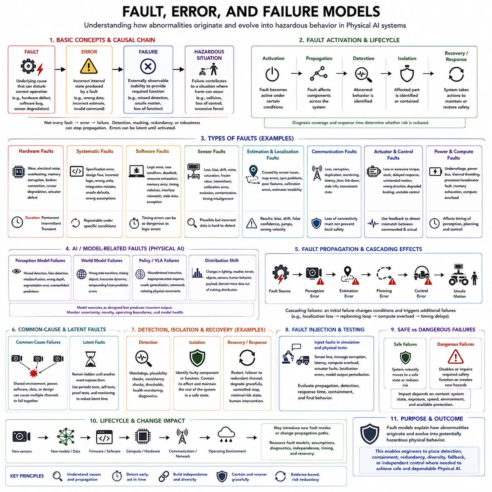{width="7.268055555555556in" height="7.268055555555556in"}

결함(Fault)은 시스템의 올바른 동작을 방해할 수 있는 근본적인 원인이며, 오류(Error)는 그러한 결함으로 인해 발생하는 잘못된 내부 상태이고, 고장(Failure)은 요구된 기능을 제공하지 못하는 외부에서 관찰 가능한 상태를 의미한다. 이러한 개념을 구분하는 것은 기능 안전(Functional Safety)의 기본이다. 안전 메커니즘은 이러한 진행 과정의 서로 다른 지점에서 작동하기 때문이다. 물리 AI(Physical AI)에서는 이러한 전통적인 개념을 하드웨어, 소프트웨어, 센싱, 통신, 학습 모델 및 물리적 행동 전반으로 확장해야 한다.

기본적인 인과관계는 결함(Fault)이 오류(Error)를 발생시키고, 오류가 잠재적으로 고장(Failure)으로 이어지는 과정으로 표현할 수 있다. 손상된 센서 연결은 결함에 해당할 수 있고, 왜곡된 거리 정보는 그 결과로 발생한 오류가 될 수 있으며, 장애물을 감지하지 못하는 것은 외부적으로 나타나는 고장이 될 수 있다. 로봇이 충분한 보호 개입 없이 사람이나 객체를 향해 계속 이동한다면 이러한 고장은 위험 상황(Hazardous Situation)으로 이어질 수 있다.

모든 결함이 즉시 오류를 발생시키는 것은 아니며, 모든 오류가 고장으로 이어지는 것도 아니다. 중복성(Redundancy), 진단(Diagnostics), 마스킹(Masking), 강건한 알고리즘(Robust Algorithm) 또는 사용되지 않는 기능에 의해 결함의 전파가 차단될 수 있다. 또한 내부 오류는 특정 운용 조건에서 활성화될 때까지 잠재 상태로 남아 있을 수 있다. 따라서 결함 모델(Fault Model)은 가능한 원인뿐만 아니라 결함이 어떻게 활성화되고, 전파되고, 감지되고, 격리되고, 허용되며, 최종적으로 시스템 경계에서 나타나는지를 설명해야 한다.

결함은 발생 원인, 지속시간 및 행동 특성에 따라 분류할 수 있다. 하드웨어 결함(Hardware Fault)은 구성요소 마모, 전기적 교란, 과열, 메모리 손상, 연결 단선, 센서 성능 저하 또는 액추에이터 결함 등으로 발생할 수 있다. 이러한 결함은 영구적(Permanent), 간헐적(Intermittent), 일시적(Transient)일 수 있다. 짧은 통신 장애에는 일시적인 성능 저하가 적절할 수 있지만 지속적인 제동 결함에는 즉각적인 임무 종료와 더욱 안전한 상태로의 전환이 필요할 수 있으므로 지속시간을 이해하는 것이 중요하다.

체계적 결함(Systematic Fault)은 무작위적인 물리적 열화가 아니라 명세, 설계, 구현, 통합, 구성 또는 운용 가정의 결함에서 발생한다. 잘못된 좌표 변환, 단위 변환 오류, 잘못된 상태 기계(State Machine) 로직, 불안전한 기본 매개변수, 불완전한 요구사항 또는 통합 오류는 특정 조건에서 동일한 고장을 반복적으로 발생시킬 수 있다. 해당 결함을 활성화하는 시나리오가 실제로 시험되지 않는다면 일반적인 시험만으로 체계적 결함을 발견하지 못할 수 있다.

소프트웨어 결함 모델(Software Fault Model)은 잘못된 로직, 경쟁 상태(Race Condition), 교착 상태(Deadlock), 자원 고갈(Resource Exhaustion), 메모리 오류, 타이밍 위반, 인터페이스 불일치, 오래된 데이터(Stale Data), 처리되지 않은 예외(Unhandled Exception) 등의 결함을 고려한다. 실시간 물리 AI에서는 수치적으로 올바른 출력이라도 너무 늦게 도착하면 고장으로 간주될 수 있다. 따라서 지연된 인식 또는 제어 정보가 물리적 안전에 직접 영향을 미칠 수 있으므로 논리적 정확성과 함께 시간적 정확성(Temporal Correctness)을 모델링해야 한다.

센서 결함 모델(Sensor Fault Model)은 완전한 신호 손실, 바이어스(Bias), 드리프트(Drift), 노이즈 증가, 포화(Saturation), 값 고정(Frozen Value), 간헐적 출력, 보정 오류, 가림(Occlusion), 오염 및 타이밍 불일치 등의 상태를 설명한다. 센서는 잘못된 값을 출력하면서도 외관상 타당해 보이는 데이터를 계속 생성할 수 있기 때문에 이러한 결함은 완전한 센서 손실보다 감지하기 어려울 수 있다. 따라서 센서 간 일관성 검사(Cross-Sensor Consistency Check)와 물리적 타당성 제약(Physical Plausibility Constraint)이 중요한 진단 메커니즘이 될 수 있다.

위치 추정(Localization)과 상태 추정(State Estimation)의 결함은 센서 성능 저하, 지도 오류, 동기화 문제, 불충분한 환경 특징, 잘못된 보정 또는 추정기 불안정성(Estimator Instability)에서 발생할 수 있다. 그 결과 위치 편향, 자세 드리프트, 잘못된 신뢰도, 불연속적인 자세 추정 또는 부정확한 속도가 나타날 수 있다. 계획기(Planner)는 일반적으로 상태 추정값이 유효하다고 가정하므로 감지되지 않은 추정 오류는 불안전한 궤적이나 제어 명령으로 빠르게 전파될 수 있다.

통신 결함 모델(Communication Fault Model)은 메시지 손실, 손상, 중복, 순서 변경, 과도한 지연, 지터(Jitter), 링크 단절, 오래된 정보 및 분산 상태의 불일치를 포함한다. 플릿(Fleet) 및 클라우드 연결형 물리 AI 시스템에서는 네트워크와 원격 서비스에 대한 의존성이 추가되지만, 안전 필수 기능(Safety-Critical Function)은 통신 성능 저하를 고려하여 설계되어야 한다. 연결이 끊어졌다고 해서 안전한 로컬 상태를 유지할 수 있는 능력까지 자동으로 상실해서는 안 된다.

액추에이터 및 제어 결함(Actuator and Control Fault)에는 토크 손실, 과도한 토크, 액추에이터 고착, 응답 지연, 의도하지 않은 움직임, 잘못된 방향, 제동 성능 저하, 불안정한 제어 및 명령된 움직임과 실제 움직임 사이의 불일치가 포함된다. 피드백(Feedback)을 이용하여 예상 행동과 실제 행동을 비교하면 이러한 상태를 감지하는 데 도움이 된다. 그러나 결함 감지가 실질적인 위험 감소로 이어지려면 진단 대응이 로봇의 동역학에 비해 충분히 빠르게 이루어져야 한다.

전원 및 컴퓨팅 결함(Power and Compute Fault)은 여러 기능에 동시에 영향을 미칠 수 있다. 배터리 저전압, 전원 중단, 열 스로틀링(Thermal Throttling), 프로세서 결함, 가속기 고장, 메모리 고갈 또는 컴퓨팅 과부하는 인식 주기를 감소시키거나 계획 및 제어를 지연시킬 수 있다. 이러한 고장은 AI 시스템이 논리적으로는 계속 동작하면서도 안전한 물리적 운용을 위해 전제된 타이밍 조건을 더 이상 충족하지 못할 수 있다는 점에서 시스템 자원 상태가 안전과 직접 관련되어 있음을 보여준다.

물리 AI는 전통적인 구성요소 고장 범주에 명확하게 포함되지 않는 모델 관련 결함 개념(Model-Related Fault Concept)을 추가한다. AI 모델이 올바르게 구현되어 설계된 대로 정확하게 실행되더라도 입력이 모호하거나, 학습 분포 밖에 있거나, 학습 데이터에 충분히 표현되지 않았다면 잘못된 예측을 생성할 수 있다. 따라서 불안전한 출력이 반드시 전통적인 소프트웨어 결함을 의미하는 것은 아니며 모델과 데이터의 한계를 명시적으로 다루어야 한다.

인식 모델 고장(Perception Model Failure)에는 미검출, 오검출, 오분류, 잘못된 깊이 추정, 세그멘테이션 오류 및 과도하게 높은 신뢰도의 예측 등이 포함될 수 있다. 월드 모델 고장(World Model Failure)에는 잘못된 상태 전이, 객체 누락, 부정확한 동역학 또는 누적되는 미래 예측 오류 등이 포함된다. 정책(Policy) 및 비전-언어-행동(Vision-Language-Action, VLA) 모델의 고장에는 명령 오해, 부적절한 행동 순서, 불안전한 일반화 또는 의미적으로는 타당해 보이지만 물리적 제약을 위반하는 명령 등이 포함될 수 있다.

분포 변화(Distribution Shift)는 학습 모델 고장을 활성화하는 중요한 조건이다. 조명, 날씨, 지형, 객체 외형, 센서 특성, 사람의 행동, 적재물 또는 운용 도메인의 변화로 관측 데이터가 학습 분포에서 벗어날 수 있다. 이 경우 모델은 전통적인 내부 결함 신호를 생성하지 않으면서도 성능이 저하될 수 있다. 불확실성, 신규성(Novelty), 운용 경계(Operational Boundary) 및 모델 상태를 모니터링하면 고장 위험이 증가하는 조건을 식별하는 데 도움이 될 수 있다.

결함 전파 모델(Fault Propagation Model)은 국부적인 비정상 상태가 다른 구성요소에 어떤 영향을 미치는지를 설명한다. 카메라의 타이밍 결함이 센서 융합을 손상시키고, 이것이 상태 추정을 왜곡하며, 다시 예측을 잘못 유도하고, 불안전한 계획을 생성하여 최종적으로 위험한 움직임으로 이어질 수 있다. 따라서 안전 분석에서는 각 서브시스템을 독립적으로만 평가하지 않고 인식, 월드 모델링, 계획, 제어 및 작동 전반의 전파 경로를 고려해야 한다.

연쇄 고장(Cascading Failure)은 초기 고장이 시스템 조건을 변화시켜 추가적인 고장을 유발할 때 발생한다. 위치 추정 상실로 반복적인 재계획이 발생하면 계산 부하가 증가하여 추가적인 타이밍 지연을 만들 수 있다. 통신 고장은 로컬 운용으로의 전환을 요구하는 동시에 계획에서 사용하던 원격 정보를 제거할 수 있다. 계산 상태와 물리 상태가 지속적으로 서로 영향을 주는 긴밀하게 결합된 물리 AI 아키텍처에서는 이러한 상호작용을 이해하는 것이 특히 중요하다.

공통 원인 고장(Common-Cause Failure)은 외관상 중복된 아키텍처의 안전성을 무력화할 수 있다. 여러 카메라가 동일한 환경 오염으로 동시에 기능을 상실할 수 있고, 중복 프로세서가 동일한 결함 전원을 공유할 수 있으며, 서로 다른 AI 모델도 학습 데이터와 표현 방식이 유사하다면 동일한 낯선 장면에서 함께 실패할 수 있다. 따라서 결함 모델링에서는 공유된 종속성을 식별하고 단순한 복제와 실제 독립성(Independence)을 구분해야 한다.

잠재 결함(Latent Fault)은 다른 사건이 발생하여 안전상의 중요성이 드러날 때까지 감지되지 않은 상태로 남아 있는 결함이다. 예를 들어 백업 제동 채널에 존재하는 결함이 주 제동 채널이 정상적으로 동작하는 동안 수개월간 발견되지 않을 수 있다. 이후 주 채널이 고장 나면 잠재 결함으로 인해 기대했던 중복성이 사라진다. 주기적인 진단, 검증 시험(Proof Testing), 기동 검사, 자체 시험(Self-Test) 및 모니터링은 안전 필수 잠재 결함이 발견되지 않은 상태로 유지되는 시간을 감소시킬 수 있다.

결함 감지·격리·복구(Fault Detection, Isolation, and Recovery)는 결함 모델을 실제 운용 안전 메커니즘으로 전환한다. 감지(Detection)는 비정상적인 행동의 존재를 확인하고, 격리(Isolation)는 영향을 받은 기능을 식별하거나 그 영향을 제한하며, 복구(Recovery)는 적절한 대응을 선택한다. 결함의 특성에 따라 구성요소 재시작, 중복 채널 전환, 저속 운용, 폴백 제어(Fallback Control), 제어된 정지, 사람의 개입 또는 최소 위험 상태(Minimum-Risk Condition)로의 전환 등이 사용될 수 있다.

유용한 결함 모델은 감지에 관한 가정과 진단의 한계도 포함해야 한다. 일부 결함은 즉시 관찰할 수 있지만, 다른 결함은 일관되지 않은 행동을 통해 간접적으로 추론해야 하거나 환경 변화와 구별하기 매우 어려울 수 있다. 따라서 모니터링 기능이 존재한다는 이유만으로 진단 범위(Diagnostic Coverage)가 보장되는 것은 아니다. 안전 분석에서는 어떤 결함을 감지할 수 있는지, 어느 시간 안에 감지할 수 있는지, 어느 정도의 신뢰도로 판단할 수 있는지, 그리고 감지가 불확실할 때 시스템이 어떻게 행동할지를 결정해야 한다.

결함 주입(Fault Injection)은 가정한 결함 행동과 안전 대응이 현실적인지를 평가하는 실용적인 방법을 제공한다. 엔지니어는 시뮬레이션 및 통제된 시험 환경에서 센서 손실, 손상된 메시지, 통신 지연, 컴퓨팅 과부하, 액추에이터 이상, 위치 추정 오류 또는 모델 출력 교란을 의도적으로 발생시킬 수 있다. 목적은 단순히 구성요소를 고장 내는 것이 아니라 결함 전파, 진단 효과, 대응 시간, 격리 능력 및 최종 시스템 행동을 관찰하는 것이다.

고장 모델(Failure Model)은 안전 고장(Safe Failure)과 위험 고장(Dangerous Failure)도 구분해야 한다. 일부 고장은 자연스럽게 시스템을 더 낮은 위험 상태로 이동시키는 반면, 다른 고장은 필요한 안전 기능을 비활성화하거나 손상시킬 수 있다. 따라서 고장의 중요성은 상황, 시스템 상태, 노출 및 사용 가능한 보호 기능에 따라 달라진다. 동일한 구성요소 고장이라도 정지 상태의 유지보수, 저속 주행, 고속 움직임 또는 사람과의 근접 상호작용에서는 서로 다른 결과를 발생시킬 수 있다.

결함, 오류 및 고장 모델은 수명주기 및 변경 관리(Lifecycle and Change Management)와 지속적으로 연결되어야 한다. 새로운 센서, 펌웨어, AI 모델, 데이터셋, 컴퓨팅 하드웨어, 통신 아키텍처 또는 운용 환경은 새로운 결함 모드를 추가하거나 기존의 결함 전파 경로를 변화시킬 수 있다. 따라서 시스템 변경이 결함 발생, 감지, 독립성, 타이밍 또는 복구에 관한 기존 가정에 영향을 미친다면 안전 분석을 다시 수행해야 한다.

물리 AI(Physical AI)에서 결함 모델링(Fault Modeling)은 궁극적으로 비정상적인 상태가 어떻게 시작되고 잠재적으로 위험한 물리적 행동으로 발전하는지를 구조적으로 설명한다. 결함에서 오류, 서브시스템 고장, 전파 경로, 안전 메커니즘 및 물리적 결과까지 추적함으로써 엔지니어는 어느 지점에 감지, 격리, 중복성, 다양성(Diversity), 폴백(Fallback) 또는 독립적인 제어가 필요한지를 결정할 수 있다. 이러한 인과관계에 대한 이해는 체계적인 안전 분석 방법과 강건한 안전 아키텍처(Robust Safety Architecture)를 구축하기 위한 기반을 형성한다.

## 02.06. FMEA FTA and STPA for Physical AI

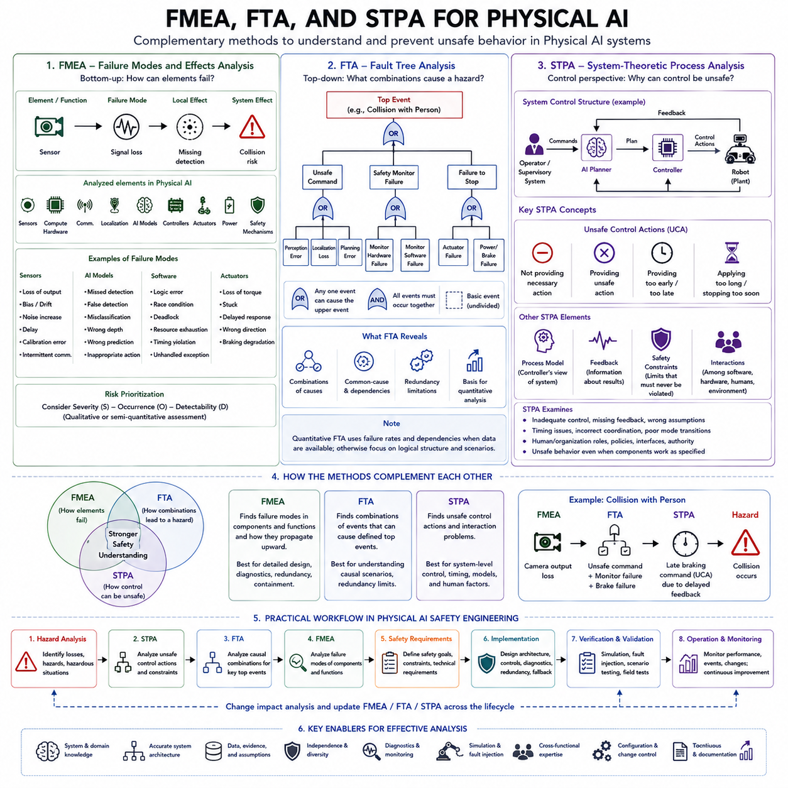{width="7.268055555555556in" height="7.268055555555556in"}

고장 형태 및 영향 분석(Failure Modes and Effects Analysis, FMEA), 결함 트리 분석(Fault Tree Analysis, FTA), 시스템 이론적 프로세스 분석(System-Theoretic Process Analysis, STPA)은 물리 AI(Physical AI) 시스템이 어떻게 불안전한 상태에 도달할 수 있는지를 이해하기 위한 상호 보완적인 방법을 제공한다. FMEA는 주로 구성요소에서 상위 시스템으로 고장을 분석하고, FTA는 바람직하지 않은 최상위 사건에서 원인을 역방향으로 추적하며, STPA는 불안전한 제어 및 상호작용 구조를 분석한다. 이들을 함께 적용하면 하나의 고장 관점만으로는 파악하기 어려운 안전 문제까지 분석 범위를 확장할 수 있다.

FMEA는 기능, 구성요소, 인터페이스 또는 프로세스에서 시작하여 각각의 요소가 어떤 방식으로 고장날 수 있는지를 분석하는 체계적인 상향식(Bottom-Up) 방법이다. 각각의 고장 형태(Failure Mode)에 대해 엔지니어는 국부적 영향, 후속 시스템 영향, 가능한 원인, 기존 제어 수단 및 사용 가능한 감지 메커니즘을 검토한다. 물리 AI에서는 센서, 컴퓨팅 하드웨어, 통신, 위치 추정(Localization), AI 모델, 제어기, 액추에이터, 전원 시스템 및 안전 메커니즘 등이 분석 대상이 될 수 있다.

센서 중심 FMEA에서는 출력 손실, 값 고정(Frozen Value), 바이어스(Bias), 드리프트(Drift), 과도한 노이즈, 측정 지연, 잘못된 보정 또는 간헐적인 통신 등을 고려할 수 있다. 이후 이러한 문제가 센서 융합(Sensor Fusion), 상태 추정(State Estimation), 인식, 계획 및 제어에 어떤 영향을 미치는지를 추적한다. 이러한 접근법을 통해 국부적 결함이 시스템 수준의 행동으로 어떻게 전파되는지, 그리고 어디에 진단, 중복성(Redundancy) 또는 격리(Containment)를 도입해야 하는지를 식별할 수 있다.

FMEA는 소프트웨어와 AI 기능에도 확장할 수 있지만, 전통적인 고장 형태라는 용어를 적용할 때에는 신중한 해석이 필요하다. 인식 모델은 장애물을 놓치거나, 잘못된 객체를 검출하거나, 객체를 오분류하거나, 잘못된 깊이를 추정할 수 있다. 월드 모델(World Model)은 잘못된 상태 전이를 예측할 수 있으며, 학습 정책(Learned Policy)은 부적절한 행동을 생성할 수 있다. 전통적인 하드웨어 결함이 존재하지 않더라도 이러한 출력이 시스템에 미치는 영향을 분석할 수 있다.

위험 중심 FMEA(Risk-Oriented FMEA)는 일반적으로 심각도(Severity), 발생도(Occurrence), 검출도(Detectability) 등의 요소를 사용하여 고장 형태의 우선순위를 결정한다. 수치적 순위화 방법은 공학적 대응의 우선순위를 정하는 데 유용하지만, 충분한 근거가 없다면 그 값을 물리적 위험의 정밀한 측정값으로 해석해서는 안 된다. 새로운 물리 AI 행동에서는 불확실성과 제한된 현장 데이터 때문에 근거가 부족한 수치적 정밀성보다 정성적 또는 반정량적 평가가 더 타당할 수 있다.

FTA는 이와 상호 보완되는 하향식(Top-Down) 관점을 제공한다. 개별 구성요소에서 시작하는 대신 사람과의 충돌, 제어되지 않은 로봇 움직임, 제동 능력 상실 또는 금지 영역 진입과 같은 바람직하지 않은 최상위 사건(Top Event)을 정의한다. 이후 해당 최상위 사건을 발생시킬 수 있는 하위 수준 사건의 조합으로 분해하여 시스템 위험원과 기여 고장 및 조건을 연결하는 논리적 구조를 생성한다.

결함 트리(Fault Tree)의 논리 관계는 일반적으로 AND와 OR 등의 조합으로 표현된다. OR 관계는 여러 기여 사건 가운데 어느 하나만 발생해도 상위 사건이 발생할 수 있음을 의미하고, AND 관계는 여러 조건이 동시에 발생해야 상위 사건이 발생함을 의미한다. 이러한 구조는 구성요소를 독립적으로 분석할 때 놓칠 수 있는 복합 고장을 발견하는 데 도움이 되며 중복성과 독립성(Independence)에 관한 분석도 지원한다.

예를 들어 위험한 로봇 움직임은 불안전한 명령, 독립 안전 모니터(Independent Safety Monitor)의 고장 또는 액추에이터 시스템의 보호 정지(Protective Stop) 수행 실패로 발생할 수 있다. 각각의 분기는 인식 오류, 위치 추정 상실, 소프트웨어 결함, 통신 지연, 컴퓨팅 고장, 제동 결함 또는 공유 전원 문제 등으로 다시 세분화할 수 있다. 이렇게 생성된 트리는 인과관계에 대한 가정을 명확하게 표현하고 중요한 종속성을 드러낸다.

FTA는 공통 원인 고장(Common-Cause Failure)과 종속 고장(Dependent Failure)을 분석하는 데 특히 유용하다. 두 개의 보호 채널이 외관상 중복되어 있더라도 동일한 프로세서, 전원, 네트워크, 센서 소스, 소프트웨어 구성요소 또는 환경적 취약성을 공유할 수 있다. 이러한 고장을 독립적인 것으로 취급하면 보호 효과를 크게 과대평가할 수 있다. 물리 AI에서는 서로 다른 모델이 동일한 분포 변화(Distribution Shift)나 학습 데이터에 충분히 표현되지 않은 시나리오에 유사하게 반응하는 상관된 AI 고장도 발생할 수 있다.

정량적 FTA(Quantitative FTA)는 신뢰할 수 있는 고장률과 종속성 데이터가 존재하는 경우 최상위 사건의 발생 확률을 추정할 수 있다. 그러나 데이터가 부족하거나 가정이 불확실한 경우 수치 계산이 잘못된 확신을 만들어서는 안 된다. AI 모델 고장, 새로운 운용 환경 및 복잡한 인간-로봇 상호작용에는 충분히 성숙한 확률 데이터가 존재하지 않는 경우가 많다. 이러한 경우 정량적인 결론을 제한하더라도 결함 트리의 논리 구조 자체는 여전히 중요한 분석 가치를 가진다.

FMEA와 FTA는 고장 중심 분석에 강력하지만 모든 불안전한 물리 AI 행동이 구성요소 고장에서 시작되는 것은 아니다. 모든 구성요소가 명세에 따라 정상적으로 작동하더라도 잘못된 상호작용, 불충분한 제약, 지연된 제어 행동, 잘못된 가정 또는 부적절한 협조로 인해 불안전한 행동이 발생할 수 있다. STPA는 이러한 보다 광범위한 시스템 수준의 안전 문제를 제어 이론적 관점(Control-Theoretic Perspective)에서 다룬다.

STPA는 안전을 계층적 제어 구조(Hierarchical Control Structure)에서 제약조건이 충분히 강제되지 않을 때 사고가 발생할 수 있는 제어 문제(Control Problem)로 바라본다. 분석 과정에서는 손실(Loss), 위험원(Hazard), 시스템 수준 안전 제약(System-Level Safety Constraint), 제어기, 제어 대상 프로세스(Controlled Process), 제어 행동(Control Action), 피드백 경로 및 프로세스 모델(Process Model)을 식별한다. 이러한 관점은 자율 시스템이 소프트웨어, 학습 지능, 하드웨어, 사람 및 환경적 상호작용을 결합한다는 점에서 물리 AI에 적합하다.

STPA의 핵심 개념 가운데 하나는 불안전 제어 행동(Unsafe Control Action, UCA)이다. 필요한 제어 행동이 제공되지 않거나, 불안전한 행동이 제공되거나, 행동이 너무 이르거나 늦게 제공되거나, 부적절한 시간 동안 행동이 지속되면 제어 행동이 불안전해질 수 있다. 이동 로봇에서는 움직임, 제동, 속도, 경로 선택, 조작 또는 모드 전환에 관한 명령이 시스템 상황에 따라 모두 불안전 제어 행동이 될 수 있다.

AI 계획기(AI Planner)가 전진 명령을 생성하는 상황을 생각할 수 있다. 이동 경로에 사람이 존재하면 해당 명령은 불안전할 수 있지만, 위험 지역에서 탈출하기 위해 움직임이 필요한 다른 상황에서는 전진 명령을 제공하지 않는 것 역시 불안전할 수 있다. 올바른 명령이라도 너무 늦게 전달되면 효과가 없으며, 정상적으로 안전한 명령이라도 지나치게 오래 유지되면 충돌을 발생시킬 수 있다. 따라서 STPA는 단순한 구성요소의 정확성보다 상황(Context)과 제어 제약(Control Constraint)을 강조한다.

제어기가 유지하는 프로세스 모델(Process Model)은 STPA의 또 다른 중요한 개념이다. 제어기는 시스템 및 환경 상태에 대한 자신의 이해를 기반으로 행동을 선택한다. 오래된 인식 정보, 위치 추정 오류, 누락된 객체, 잘못된 월드 모델 예측 또는 잘못 이해된 작업 상황으로 인해 내부 모델이 부정확하면 제어기의 의사결정 로직 자체가 설계된 대로 정확하게 작동하더라도 불안전한 행동을 명령할 수 있다.

이러한 개념은 물리 AI에 자연스럽게 적용된다. 인식(Perception)은 관측 정보를 구성하고, 상태 추정은 현재 조건을 표현하며, 월드 모델은 가능한 미래를 예측하고, 계획기는 행동을 선택하며, 제어기는 물리적 동역학에 영향을 준다. 이러한 표현의 오류는 전통적인 하드웨어 고장이 없어도 불안전 제어 행동을 발생시킬 수 있다. 따라서 STPA는 의미적, 시간적, 상호작용 기반 및 모델 기반 안전 문제를 분석하는 데 유용한 프레임워크를 제공한다.

안전한 제어는 명령된 행동이 의도한 물리적 결과를 발생시켰는지를 파악하는 것에 의존하기 때문에 피드백(Feedback)도 매우 중요하다. 피드백이 누락되거나, 지연되거나, 잘못되거나, 불충분하면 제어기가 불안전한 행동을 계속 유지하거나 변화하는 조건을 인식하지 못할 수 있다. 따라서 물리 AI 안전 분석에서는 위치, 속도, 힘, 액추에이터 상태, 인식 시스템 상태, 위치 추정 신뢰도, 실행 상태 및 환경 반응에 관한 피드백을 검토해야 한다.

STPA는 사람과 조직도 제어 구조(Control Structure)에 포함할 수 있다. 운영자, 원격 감독자, 유지보수 담당자, 플릿 관리자(Fleet Manager), 개발자 및 자동화된 관리 시스템은 명령, 구성, 업데이트 또는 운용 정책을 통해 로봇의 행동에 영향을 줄 수 있다. 따라서 불안전한 상호작용은 순수한 기술적 구성요소 고장뿐만 아니라 모호한 권한, 잘못된 모드 인식, 지연된 개입, 오해를 유발하는 인터페이스 또는 부적절한 운용 제약에서도 발생할 수 있다.

세 가지 방법은 서로 경쟁하는 대안이라기보다 상호 보완적인 방법으로 적용할 때 가장 효과적이다. FMEA는 개별 고장 형태가 상위 시스템으로 어떻게 전파되는지를 보여주고, FTA는 정의된 위험 사건으로 이어지는 원인의 조합을 설명하며, STPA는 전체 제어 구조가 필요한 안전 제약을 적절하게 강제할 수 있는지를 분석한다. 이들의 분석 결과를 서로 비교하면 하나의 분석 방법만 사용했을 때 발견하지 못할 수 있는 안전상의 공백을 식별할 수 있다.

실제 물리 AI(Physical AI) 개발 과정에서는 위험원 분석을 통해 중요한 손실과 위험 상황을 식별하고, STPA를 이용하여 불안전 제어 및 상호작용 시나리오를 분석하며, FTA를 통해 선택된 핵심 사건의 원인 조합을 탐색하고, FMEA를 통해 세부적인 구성요소와 서브시스템의 고장 형태를 분석할 수 있다. 이러한 분석 결과는 이후 안전 목표, 기술적 요구사항, 진단, 아키텍처 독립성, 폴백 행동(Fallback Behavior) 및 검증 시나리오로 변환할 수 있다.

이러한 분석은 시뮬레이션 및 물리 시험과 지속적으로 연결되어야 한다. FMEA에서 식별한 고장 형태는 결함 주입(Fault Injection) 시험 항목으로 전환할 수 있고, FTA에서 도출된 경로는 복합 결함 시험 조건을 정의할 수 있으며, STPA의 불안전 제어 행동은 시나리오 기반 유효성 확인(Scenario-Based Validation)의 시험 사례가 될 수 있다. 이를 통해 안전 분석 문서가 실제 구현과 분리되지 않고 분석적 안전 논리와 공학적 증거 사이에 직접적인 관계를 형성할 수 있다.

AI 및 소프트웨어 업데이트가 이루어지면 이러한 분석도 시스템 수명주기 전반에서 함께 발전해야 한다. 새로운 학습 데이터, 모델 교체, 센서 변경, 수정된 계획기, 다른 컴퓨팅 플랫폼, 통신 구조 변경 또는 운용 환경 확장은 새로운 고장 형태와 불안전 제어 상호작용을 발생시킬 수 있다. 따라서 변경 영향 분석(Change-Impact Analysis)을 통해 어떤 FMEA 항목, 결함 트리 분기, STPA 가정, 안전 제약 및 유효성 확인 시나리오를 수정해야 하는지 식별해야 한다.

물리 AI에서 FMEA, FTA 및 STPA는 물리적 고장, 소프트웨어 결함, 확률적 모델, 제어 상호작용 및 환경 불확실성이 함께 존재하는 시스템의 안전성을 분석하기 위한 다중 관점 프레임워크(Multi-Perspective Framework)를 제공한다. FMEA는 각 요소가 어떻게 고장나는지를 질문하고, FTA는 어떠한 원인 조합이 위험 사건을 만들어내는지를 질문하며, STPA는 전통적인 고장이 존재하지 않더라도 부적절한 제어가 어떻게 안전 제약을 위반할 수 있는지를 질문한다.

이러한 방법을 결합하는 핵심 가치는 복잡한 시스템 행동을 추적 가능한 안전 논리(Traceable Safety Reasoning)로 변환하는 데 있다. 구성요소의 고장 형태, 인과적 사건 구조, 불안전 제어 행동, 피드백 결함, AI 불확실성 및 물리적 결과를 연결함으로써 엔지니어는 예방, 감지, 중복성, 독립성, 제약, 폴백 및 유효성 확인이 필요한 위치를 식별할 수 있다. 이러한 통합 접근법은 하나의 고장 분석 기법만을 사용하는 것보다 신뢰할 수 있는 물리 AI(Dependable Physical AI)를 구축하기 위한 더욱 강력한 안전 공학적 기반을 제공한다.

## 02.07. Safety Architecture and Independence

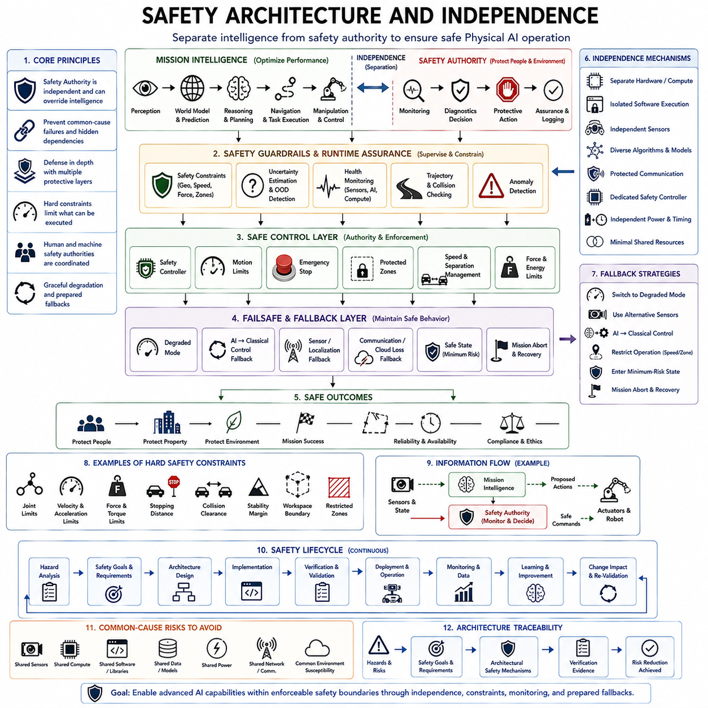{width="7.268055555555556in" height="7.268055555555556in"}

안전 아키텍처(Safety Architecture)는 지능형 시스템의 일부가 잘못 동작하더라도 위험한 행동을 예방, 감지, 제한 및 완화할 수 있도록 물리 AI(Physical AI) 시스템 전반에 안전 책임을 어떻게 분배할 것인지를 정의한다. 핵심 원칙은 독립성(Independence)이다. 임무 지능(Mission Intelligence)은 작업 성능을 최적화할 수 있지만, 정상적인 자율 기능이 불안전해질 경우에도 안전 권한(Safety Authority)은 핵심 한계를 강제할 수 있도록 충분한 분리와 제어 능력을 유지해야 한다.

따라서 아키텍처는 임무 지능(Mission Intelligence)과 독립적인 안전 경로(Independent Safety Path)를 구분할 수 있다. 임무 지능에는 인식, 예측, 추론, 계획, 내비게이션, 조작 및 작업 실행이 포함되며, 안전 경로는 모니터링, 진단, 안전 의사결정 및 보호 행동을 수행한다. 안전 경로는 지능형 스택(Intelligent Stack)을 감독하고 설정된 안전 제약(Safety Constraint)이 위반될 경우 행동을 제한하거나 무시하고 우선 제어할 수 있어야 한다.

독립성(Independence)이 반드시 모든 구성요소의 완전한 물리적 분리를 요구하는 것은 아니다. 필요한 분리 수준은 위험원, 안전 요구사항, 고장 종속성 및 필요한 위험 감소 수준에 따라 결정된다. 독립성은 별도의 하드웨어, 격리된 소프트웨어 실행, 보호된 통신, 독립적인 센싱, 다양한 알고리즘, 전용 안전 제어기(Dedicated Safety Controller), 또는 안전 분석을 통해 정당화된 이러한 메커니즘의 조합으로 구현할 수 있다.

독립성의 목적은 하나의 결함, 체계적 결함(Systematic Defect) 또는 잘못된 가정이 임무 기능과 이를 보호하는 기능을 동시에 무력화하는 것을 방지하는 것이다. 예를 들어 AI 계획기(AI Planner)와 안전 모니터가 동일하게 손상된 세계 표현(World Representation)에 의존한다면 두 시스템 모두 동일한 불안전 궤적을 허용할 수 있다. 따라서 아키텍처 분석에서는 공유 센서, 데이터, 프로세서, 소프트웨어 라이브러리, 네트워크, 전원, 타이밍 소스 및 환경적 가정을 검토해야 한다.

물리 AI에서는 학습 구성요소가 전통적인 하드웨어 결함 없이도 상관된 고장(Correlated Failure)을 나타낼 수 있기 때문에 이러한 문제가 특히 중요하다. 유사한 데이터셋으로 학습된 두 AI 모델은 동일한 낯선 장면에 잘못 반응할 수 있으며, 하나의 파운데이션 모델(Foundation Model)에서 파생된 여러 기능은 공통적인 표현상의 취약점을 공유할 수 있다. 따라서 지능 기능을 단순히 복제하는 것을 자동으로 독립적인 안전 보호로 간주해서는 안 된다.

계층화된 아키텍처(Layered Architecture)는 지능형 의사결정과 물리적 피해 사이에 여러 보호 메커니즘을 배치하여 심층 방어(Defense in Depth)를 제공한다. AI 기능 계층(AI Capability Layer)은 인식, 월드 모델링, 예측, 추론, 계획 및 정책 생성을 수행할 수 있다. 이후 안전 가드레일(Safety Guardrail)과 런타임 보증(Runtime Assurance)이 명령이 물리 시스템에 전달되기 전에 불확실성, 시스템 상태, 궤적, 충돌 위험, 이상 상태 및 사전에 정의된 제약을 평가할 수 있다.

이러한 감독 기능의 하위에는 안전 제어 계층(Safe Control Layer)이 안전 제어기, 움직임 제한, 보호 구역, 속도 및 분리 관리, 힘 제한 및 비상 메커니즘을 통해 권한과 강제력을 제공할 수 있다. 이러한 구조를 통해 지능형 기능은 복잡한 행동을 제안할 수 있지만, 안전 관련 기능은 실제로 실행할 수 있는 행동의 범위를 제한한다. 결과적으로 최적화 권한(Optimization Authority)과 최종 안전 권한(Final Safety Authority)이 분리된다.

확률적 AI 출력(Probabilistic AI Output)이 결정론적 보장을 제공할 수 없는 영역에서는 강제 가능한 안전 제약(Hard Safety Constraint)이 특히 중요하다. 관절 한계, 속도 및 가속도 한계, 토크 및 힘 한계, 정지 거리 제약, 충돌 여유 거리, 안정성 마진, 작업공간 경계 및 제한 구역 등을 통해 강제 가능한 물리적 안전 범위(Physical Safety Envelope)를 정의할 수 있다. 이 범위를 초과하는 AI 생성 행동은 실행 전에 거부, 수정, 제한 또는 종료할 수 있다.

독립 모니터링(Independent Monitoring)은 최종 명령만 관찰해서는 안 된다. 관련 신호에는 센서 품질, 모델 신뢰도, 예측 궤적, 로봇 상태, 액추에이터 명령, 환경 위험원, 실행 타이밍 및 통신 상태 등이 포함될 수 있다. 여러 단계에서 이러한 신호를 감시하면 잘못된 내부 상태가 위험한 물리적 행동으로 전환되기 전에 불안전한 전파를 감지할 수 있으며, 하나의 모델 신뢰도 값에만 의존하는 것보다 더 강력한 안전 근거를 제공한다.

임무 영역(Mission Domain)과 안전 영역(Safety Domain) 사이의 정보 흐름은 신중하게 설계해야 한다. 안전 제어기는 다른 서브시스템으로부터 위치, 속도, 힘, 위치 추정 유효성, 센서 상태, 운용 모드 또는 궤적 정보를 필요로 할 수 있다. 이러한 인터페이스는 정의된 의미, 타이밍, 최신성(Freshness), 무결성 및 고장 시 행동을 보장해야 한다. 독립적인 것으로 설계된 모니터가 자신이 감독하는 시스템의 손상되거나 오래된 정보에 의존한다면 안전 독립성이 약화될 수 있다.

명령 권한(Command Authority) 역시 명확해야 한다. 안전 제어기와 임무 제어기(Mission Controller)가 서로 충돌하는 명령을 생성하는 경우 어떤 명령이 우선하는지, 그리고 충돌을 어떻게 해결하는지를 아키텍처에서 정의해야 한다. 안전 기능은 움직임 억제, 더욱 엄격한 제한 적용, 제어된 정지 요청, 에너지 격리 또는 자율 실행 방지 등의 권한을 필요로 할 수 있다. 이러한 권한은 정상 AI 스택이 과부하 상태이거나 사용할 수 없는 경우에도 유지되어야 한다.

공유 컴퓨팅 자원이 숨겨진 종속성을 만들 수 있기 때문에 아키텍처 독립성은 타이밍 행동(Timing Behavior)까지 확장되어야 한다. AI 계획기와 동일한 과부하 프로세서에서 실행되는 안전 모니터는 계획기가 과도한 자원을 소비하는 바로 그 순간에 처리 기한을 놓칠 수 있다. 자원 파티셔닝(Resource Partitioning), 스케줄링 보장, 전용 컴퓨팅, 보호 메모리, 제한된 통신 지연 또는 독립 실행 환경을 통해 임무 작업 부하가 안전 기능을 손상시킬 가능성을 줄일 수 있다.

전원 아키텍처(Power Architecture)에서도 유사한 문제가 발생한다. 하나의 전원 결함으로 모든 계산, 센싱 및 제동 제어가 동시에 중단된다면 중복된 소프트웨어 채널이 제공하는 보호 효과는 제한적이다. 따라서 안전 분석에서는 전원 분배, 에너지 예비량, 종료 동작, 액추에이터 에너지, 통신 가용성 및 안전 상태(Safe State) 또는 최소 위험 상태(Minimum-Risk Condition)에 도달할 때까지 보호 기능을 유지할 수 있는 능력을 고려해야 한다.

안전 아키텍처는 통신 및 클라우드 종속성(Cloud Dependency)도 고려해야 한다. 플릿 조정(Fleet Coordination), 원격 추론, 지도 서비스 또는 클라우드 지능은 시스템 능력을 향상시킬 수 있지만, 연결이 끊어졌다고 해서 필수적인 로컬 안전 권한까지 자동으로 상실해서는 안 된다. 외부 서비스나 플릿 수준의 조정을 사용할 수 없더라도 로봇은 로컬 장애물 감지, 움직임 제약, 보호 정지 및 최소 위험 행동을 유지할 필요가 있다.

폴백 아키텍처(Fallback Architecture)는 정상 지능이 더 이상 운용 가정을 충족할 수 없을 때 추가적인 보호 계층을 제공한다. 시스템은 성능 저하 모드(Degraded Mode)로 진입하거나, AI 기반 제어에서 검증된 전통적 제어(Classical Control)로 전환하거나, 대체 위치 추정 또는 센싱을 사용하거나, 통신 손실 이후 운용 범위를 제한하거나, 최소 위험 상태로 전환하거나, 임무를 중단할 수 있다. 이러한 폴백 경로는 고장이 발생한 이후 즉흥적으로 결정하는 것이 아니라 사전에 정의되어야 한다.

독립성과 폴백(Fallback)은 밀접하게 연관되어 있다. 동일하게 고장 난 자원에 의존하는 폴백 메커니즘은 실질적인 보호 효과가 거의 없을 수 있기 때문이다. 대체 위치 추정 방법이 동일하게 사용할 수 없게 된 센서에 의존해서는 안 되며, 백업 제어기(Backup Controller)가 주 제어기와 모든 핵심 고장 메커니즘을 공유해서도 안 된다. 따라서 효과적인 폴백을 위해서는 종속성, 잔여 능력(Remaining Capability), 전환 조건 및 복구에 필요한 자원을 분석해야 한다.

사람의 감독(Human Oversight)도 특히 모호한 상황이나 성능 저하 자율 운용에서 아키텍처의 일부가 될 수 있다. 운영자는 행동을 감독하고, 개입하고, 명령을 무시하거나, 복구를 승인할 수 있지만 사람의 개입을 무제한적인 중복 보호로 간주해서는 안 된다. 통신 지연, 작업 부하, 불완전한 상황 인식, 인터페이스의 모호성 및 운영자 가용성은 개입 효과를 제한할 수 있으므로 사람의 권한과 기계의 안전 권한을 명시적으로 조정해야 한다.

모드 관리(Mode Management)는 자율 운용, 수동 제어, 원격 지원, 성능 저하 운용, 유지보수, 복구 또는 비상 상태에 따라 안전 책임이 달라질 수 있기 때문에 필수적이다. 모드 전환 과정에서도 명확한 권한 관계가 유지되어야 하며 AI, 안전 제어기 및 사람 사이에서 책임이 암묵적으로 이동해서는 안 된다. 상태 표시, 전환 규칙, 진입 조건, 종료 조건 및 시간 제한을 통해 이러한 변화 과정에서 제어 권한의 모호성을 방지할 수 있다.

아키텍처는 정상 운용 또는 완전한 종료만을 가정하는 대신 점진적 성능 저하(Graceful Degradation)를 지원해야 한다. 카메라 하나의 손실은 속도 감소로 대응할 수 있고, 위치 추정 성능 저하는 대체 위치 추정 소스의 사용을 요구할 수 있으며, 통신 손실은 로컬 임무로 운용 범위를 제한할 수 있다. 시스템은 남아 있는 능력과 일치하는 운용 모드를 선택하면서 해당 축소 모드에 필요한 안전 제약을 계속 유지해야 한다.

독립성의 검증(Verification)은 아키텍처 다이어그램을 확인하는 것만으로 충분하지 않다. 엔지니어는 결함, 과부하, 타이밍 교란, 통신 고장, 전원 이상 및 소프트웨어 오류가 발생하는 상황에서도 가정한 분리가 실제로 유지됨을 입증해야 한다. 결함 주입(Fault Injection), 인터페이스 시험, 자원 스트레스 시험, 시나리오 분석 및 통제된 물리 실험을 통해 정상 운용에서는 독립적으로 보이는 채널 사이의 숨겨진 결합(Hidden Coupling)을 발견할 수 있다.

아키텍처 독립성을 주장할 때에는 공통 원인 분석(Common-Cause Analysis)이 특히 중요하다. 공유 하드웨어, 공통 소프트웨어, 동일한 알고리즘, 공통 학습 데이터, 공유된 보정 절차, 환경적 취약성 또는 유지보수 프로세스는 블록 다이어그램만으로는 명확하게 보이지 않는 종속성을 만들 수 있다. 따라서 독립성은 구조적 분리뿐만 아니라 관련 고장 메커니즘의 다양성(Diversity)에 관한 증거를 통해 뒷받침되어야 한다.

아키텍처 결정은 안전 목표(Safety Goal) 및 안전 요구사항(Safety Requirement)과 추적 가능하게 연결되어야 한다. 독립 센싱, 보호된 실행 환경, 안전 제어기, 움직임 제약 또는 폴백 채널은 단순히 중복성이 바람직해 보인다는 이유가 아니라 식별된 위험원이 특정 수준의 위험 감소를 요구하기 때문에 존재해야 한다. 이러한 추적성(Traceability)을 통해 공학적 노력을 위험 수준에 비례하여 배분하고 각각의 아키텍처 메커니즘이 명확한 안전 목표에 기여하는지를 검증할 수 있다.

안전 아키텍처는 전체 수명주기(Lifecycle) 동안에도 유효성을 유지해야 한다. AI 모델, 센서, 컴퓨팅 플랫폼, 통신 시스템, 운용 환경, 소프트웨어 또는 폴백 전략의 변경은 새로운 종속성을 발생시키거나 기존 독립성 가정을 무효화할 수 있다. 따라서 구성 관리(Configuration Management)와 변경 영향 분석(Change-Impact Analysis)을 통해 수정 이후에도 안전 파티션, 인터페이스, 권한 관계 및 검증 증거가 충분한지를 판단해야 한다.

전체적인 목표는 하나의 완벽한 구성요소에 의존하는 것이 아니라 심층 방어(Defense in Depth)를 구축하는 것이다. 임무 지능은 적응적인 기능을 제공하고, 독립적인 안전 기능은 이러한 능력을 감시하고 제한하며, 안전 제어 메커니즘은 물리적 한계를 강제하고, 폴백 메커니즘은 정상 운용을 지속할 수 없을 때 허용 가능한 행동을 유지한다. 이러한 계층적 구조는 유용한 자율 운용을 가능하게 하면서 사람, 재산 및 환경을 보호하도록 지원한다.

물리 AI(Physical AI)에서 안전 아키텍처(Safety Architecture)와 독립성(Independence)은 지능의 자유도와 강제 가능한 물리적 보호 사이의 경계를 확립한다. 고도화된 AI는 허용된 운용 영역 안에서 추론하고, 예측하고, 학습하며, 최적화할 수 있지만, 독립적인 안전 권한은 불안전한 행동을 감시, 검증, 제한, 우선 제어하고 복구할 수 있는 능력을 유지해야 한다. 이러한 분리는 결함, 불확실성 및 변화하는 실제 환경 조건에서도 신뢰 가능한 자율성(Dependable Autonomy)을 구현하기 위한 아키텍처적 기반을 제공한다.

## 02.08. Redundancy Diversity and Fault Tolerance

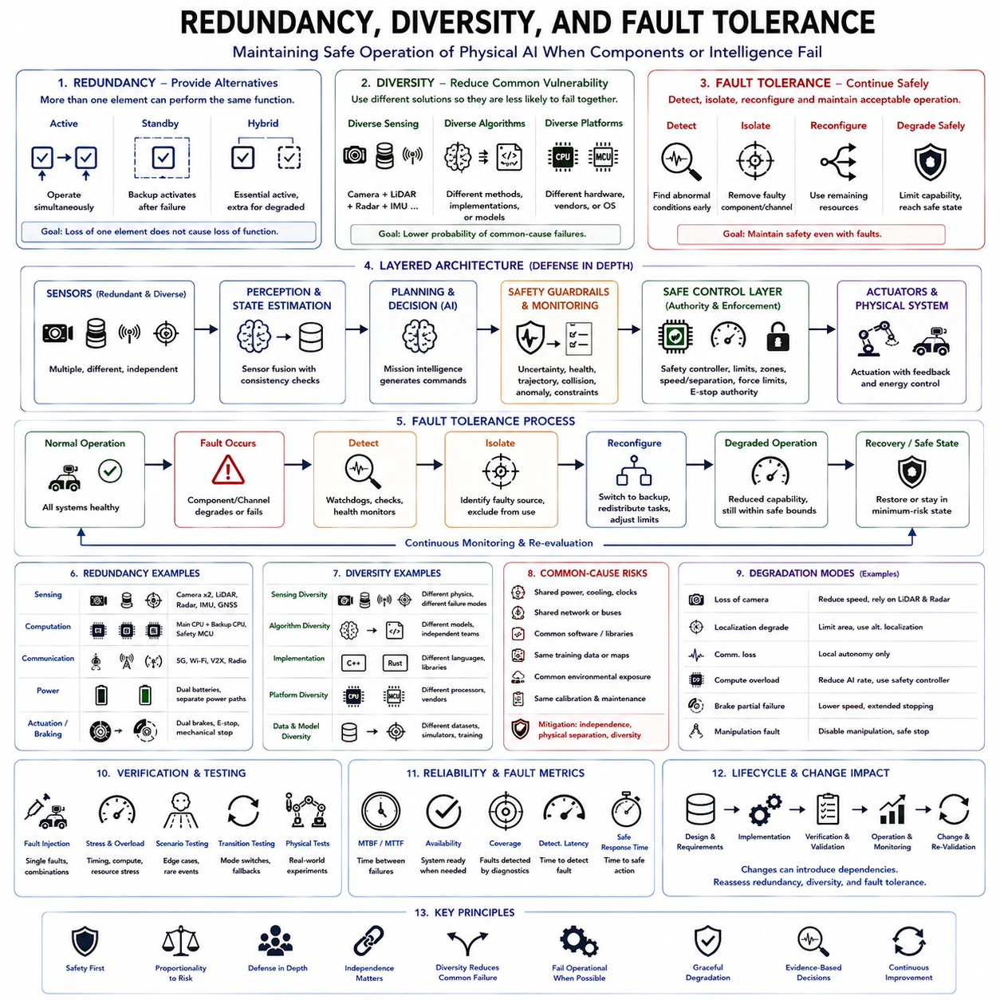{width="7.268055555555556in" height="7.268055555555556in"}

중복성(Redundancy), 다양성(Diversity), 결함 허용(Fault Tolerance)은 구성요소, 소프트웨어, 통신 또는 지능 기능에 고장이 발생했을 때에도 안전한 운용을 유지하기 위해 사용되는 상호 보완적인 아키텍처 전략이다. 중복성은 대체 가능한 자원을 제공하고, 다양성은 이러한 대안들이 동일한 원인으로 함께 고장날 가능성을 낮추며, 결함 허용은 특정 결함이 발생하더라도 시스템이 안전하게 운용을 지속할 수 있도록 한다. 물리 AI(Physical AI)에서는 계산상의 고장뿐만 아니라 그로 인해 발생하는 물리적 결과까지 이러한 전략에서 다루어야 한다.

중복성(Redundancy)은 필요한 기능을 지원할 수 있는 요소를 하나 이상 추가로 제공하는 것을 의미한다. 로봇에는 여러 센서, 프로세서, 통신 경로, 위치 추정 소스, 제동 메커니즘 또는 전원 채널이 포함될 수 있다. 목적은 단순히 하드웨어를 복제하는 것이 아니라 하나의 요소가 손실되거나 성능이 저하되더라도 안전을 유지하는 데 필요한 시스템 기능이 즉시 상실되지 않도록 하는 것이다.

중복성은 활성 중복(Active Redundancy), 대기 중복(Standby Redundancy) 또는 하이브리드 방식(Hybrid)으로 구성할 수 있다. 활성 중복 채널은 동시에 작동하면서 출력을 비교하거나 결합할 수 있으며, 대기 중복은 주 채널이 고장 난 이후 백업을 활성화한다. 하이브리드 구성은 필수 기능을 활성 상태로 유지하면서 추가 자원을 성능 저하 상황에 대비해 보존할 수 있다. 적절한 아키텍처는 결함 감지 지연시간, 전환 시간, 시스템 동역학 및 요구되는 가용성 수준에 따라 결정된다.

센서 중복성(Sensor Redundancy)은 인식과 상태 추정(State Estimation)이 불확실한 환경 측정값에 의존하기 때문에 물리 AI에서 특히 중요하다. 카메라, 라이다(LiDAR), 레이더(Radar), 초음파 센서, 관성 센서, 휠 오도메트리(Wheel Odometry), 위치 측정 시스템 등이 서로 중첩되는 정보를 제공할 수 있다. 여러 관측값은 복원력(Resilience)을 향상시킬 수 있지만, 중복 센서가 의미 있는 보호를 제공하려면 각각의 고장 형태와 환경적 종속성을 충분히 이해해야 한다.

동종 중복성(Homogeneous Redundancy)은 유사한 구성요소 또는 알고리즘을 여러 개 사용하는 방식이다. 하나의 프로세서나 센서 손실과 같은 독립적인 임의 고장(Random Failure)에 대해서는 효과적인 보호를 제공할 수 있다. 그러나 동일한 채널들은 공통 설계 결함, 동일한 환경 조건, 동일한 소프트웨어 오류 또는 공통적인 데이터 한계에 함께 취약할 수 있다. 따라서 단순한 복제를 자동으로 강력한 결함 허용으로 해석해서는 안 된다.

다양성(Diversity)은 서로 다른 고장 특성을 가진 대안을 도입하여 이러한 한계를 보완한다. 다양한 센싱(Diverse Sensing)은 여러 카메라에만 의존하기보다 카메라, 라이다, 레이더 및 고유수용성 정보(Proprioceptive Information)를 결합할 수 있다. 다양한 컴퓨팅은 서로 다른 알고리즘, 구현 방식, 하드웨어 플랫폼 또는 독립적으로 개발된 모니터링 기능을 사용할 수 있다. 목적은 하나의 원인이 모든 보호 채널을 동시에 무력화할 가능성을 감소시키는 것이다.

기능적 다양성(Functional Diversity)은 복잡한 임무 지능(Mission Intelligence)과 상대적으로 단순한 안전 메커니즘을 분리하는 데에도 적용할 수 있다. 학습 기반 인식 시스템은 풍부한 의미적 이해를 제공하고 독립적인 기하학적 모니터는 최소 장애물 거리를 검사할 수 있다. AI 계획기는 복잡한 궤적을 생성하고 결정론적 안전 제어기는 속도, 작업공간, 힘 및 충돌 제약을 검증할 수 있다. 따라서 서로 다른 방법은 완전히 동일한 문제를 해결하지 않더라도 상호 보완적인 보호를 제공할 수 있다.

AI 다양성(AI Diversity)은 외관상 서로 다른 모델도 숨겨진 종속성을 공유할 수 있으므로 특히 주의해야 한다. 서로 중첩되는 데이터셋, 유사한 아키텍처, 공통 파운데이션 모델(Foundation Model), 동일한 전처리 또는 관련된 합성 데이터로 학습된 모델은 상관된 오류(Correlated Error)를 나타낼 수 있다. 따라서 진정한 다양성은 모델 이름, 매개변수 수 또는 표면적인 아키텍처 차이가 아니라 실제 관련 고장 메커니즘을 기준으로 평가해야 한다.

중복성이나 다양성을 주장할 때에는 공통 원인 고장 분석(Common-Cause Failure Analysis)이 필수적이다. 여러 채널이 전원, 냉각 장치, 클록, 통신 네트워크, 보정 절차, 소프트웨어 라이브러리, 학습 데이터, 지도 또는 환경적 노출을 공유할 수 있다. 이 경우 하나의 교란으로 명목상 독립적인 여러 기능이 동시에 중단될 수 있다. 따라서 안전 분석에서는 이러한 공유 종속성을 식별하고 추가적인 분리 또는 대체 보호가 필요한지를 판단해야 한다.

결함 허용(Fault Tolerance)은 결함 발생 이후 시스템이 어떻게 행동하는지를 정의함으로써 단순한 중복성을 넘어선다. 결함 허용 물리 AI 시스템은 비정상적인 조건을 감지하고, 그 영향을 격리하며, 사용 가능한 자원을 재구성하여 허용 가능한 운용 상태를 유지한다. 운용을 지속한다는 것이 반드시 전체 성능을 유지한다는 의미는 아니다. 안전을 위해 기능 축소, 자율성 제한, 속도 감소 또는 최소 위험 상태(Minimum-Risk Condition)로의 전환이 필요할 수 있다.

결함 감지(Fault Detection)는 효과적인 재구성을 위한 첫 번째 요구사항이다. 감시 장치(Watchdog), 센서 일관성 검사, 액추에이터 피드백, 타이밍 감시, 통신 모니터링, 프로세서 상태 검사, 모델 불확실성 지표 및 물리적 타당성 검사(Physical Plausibility Test)를 통해 비정상적인 상태를 식별할 수 있다. 이론적으로 감지 가능한 결함이라도 개입하기 전에 위험한 움직임이 발생한다면 보호 효과가 거의 없으므로 로봇 동역학과 양립할 수 있는 시간 내에 결함을 감지해야 한다.

결함 격리(Fault Isolation)는 어떤 구성요소, 채널 또는 기능을 더 이상 신뢰해서는 안 되는지를 결정한다. 격리를 통해 손상된 정보가 센서 융합, 계획 또는 제어를 오염시키는 것을 방지할 수 있다. 예를 들어 드리프트가 발생하는 위치 추정 소스를 추정기(Estimator)에서 제거하면서 다른 위치 추정 소스는 계속 사용할 수 있다. 그러나 정상적인 자원을 잘못 격리하면 시스템 능력을 불필요하게 감소시키거나 유용한 중복성을 제거할 수 있으므로 잘못된 격리 역시 위험하다.

재구성(Reconfiguration)은 격리 이후 남아 있는 자원들이 수정된 책임을 수행하도록 한다. 시스템은 센서를 전환하고, 백업 제어기를 활성화하고, 계산 작업을 재분배하고, 위치 추정 방법을 변경하고, 움직임 한계를 낮추고, 조작 기능을 비활성화하거나 임무 자체를 수정할 수 있다. 재구성 로직(Reconfiguration Logic)이 잘못된 전환을 수행하면 관리 가능한 구성요소 결함이 시스템 수준의 고장으로 확대될 수 있으므로 재구성 로직 자체도 신뢰할 수 있어야 한다.

투표(Voting)는 중복 채널을 관리하는 한 가지 기법이다. 여러 채널이 독립적인 추정값이나 판단을 생성하고 투표 메커니즘이 합의된 결과를 선택하거나 이상 채널을 식별할 수 있다. 다수결 투표(Majority Voting)는 특정 독립 결함을 허용할 수 있지만 채널들이 체계적인 오류를 공유하는 경우에는 효과가 떨어진다. 복잡한 인식 출력에는 단순한 이진적 합의 기준을 정의하기 어려울 수 있으므로 투표에서는 불확실성도 신중하게 다루어야 한다.

분석적 중복성(Analytical Redundancy)은 동일한 하드웨어를 복제하는 대신 수학적 또는 물리적 관계를 활용하는 또 다른 접근법이다. 예상되는 차량 움직임을 휠 인코더, 관성 측정값, 명령 속도 및 실제 관측된 변위와 비교할 수 있다. 액추에이터 명령과 측정된 응답을 비교하거나 에너지, 기하학 또는 운동학적 제약(Kinematic Constraint)을 이용하여 서로 일치하지 않는 상태를 식별할 수도 있다. 이러한 관계는 동일한 센서를 추가하지 않고도 추가적인 진단 근거를 제공할 수 있다.

점진적 성능 저하(Graceful Degradation)는 결함 허용의 핵심적인 표현 방식이다. 시스템은 완전 자율 운용에서 즉시 전체 정지로 전환하는 대신 사용 가능한 자원이 감소함에 따라 기능을 단계적으로 제한할 수 있다. 인식 품질이 저하되면 속도를 낮추고, 위치 추정이 저하되면 운용 영역을 제한하며, 원격 통신이 손실되면 로봇이 로컬에서 지원할 수 있는 기능으로 제한할 수 있다. 각각의 성능 저하 모드에는 명확한 안전 가정과 운용 한계가 필요하다.

고장 안전(Fail-Safe)과 고장 시 운용 지속(Fail-Operational) 전략은 결함에 대응하는 서로 다른 방식을 나타낸다. 고장 안전 행동은 일반적으로 정지하거나 위험한 기능을 비활성화하여 위험이 통제되는 상태에 도달하는 것을 우선한다. 고장 시 운용 지속 행동은 정지가 바람직하지 않거나 오히려 위험할 수 있는 경우 특정 결함이 발생해도 필수 운용을 유지한다. 물리 AI 시스템은 핵심 기능을 유지하면서 더 이상 안전하게 지원할 수 없는 기능은 종료하는 방식으로 이러한 전략을 조합할 수 있다.

결함 허용은 중복 채널이나 운용 모드 사이의 전환 자체가 새로운 위험을 발생시킬 수 있으므로 전환 과정(Transition)도 고려해야 한다. 재구성 과정에서는 상태 불연속, 오래된 데이터, 일치하지 않는 좌표계, 제어 과도현상(Control Transient) 또는 동기화 지연이 발생할 수 있다. 따라서 안전한 전환 설계에서는 진입 조건, 동기화 요구사항, 권한 이전, 일시적 제약 및 대체 기능이 실제로 사용 가능한지에 대한 확인 절차를 정의해야 한다.

자원 중복성(Resource Redundancy)은 컴퓨팅에도 적용된다. AI 워크로드는 상당한 GPU, CPU, 메모리 및 통신 자원을 소비할 수 있으며, 이로 인해 과부하가 임무 기능과 안전 기능 모두에 영향을 미칠 가능성이 있다. 전용 안전 컴퓨팅(Dedicated Safety Compute), 자원 파티셔닝(Resource Partitioning), 보호된 메모리, 스케줄링 보장 또는 독립 프로세서를 이용하면 고성능 AI 워크로드가 불안정해지거나 계산 비용이 증가하더라도 안전 메커니즘을 유지하는 데 도움이 된다.

전원과 통신도 동일한 방식으로 다루어야 한다. 중복 프로세서가 하나의 취약한 전원을 공유한다면 보호 효과가 제한적이며, 중복 제어기가 하나의 사용할 수 없는 네트워크를 통해 연결되어 있다면 동시에 기능을 잃을 수 있다. 에너지 예비량(Energy Reserve), 분리된 전원 도메인, 로컬 안전 통신, 지연시간이 제한된 통신 채널 및 독립적인 비상 메커니즘은 안전 상태를 유지하거나 안전 상태에 도달하는 데 필요한 최소 자원을 보존할 수 있다.

소프트웨어가 모든 기계적 고장을 보상할 수 있는 것은 아니므로 물리적 중복성(Physical Redundancy)도 특히 중요하다. 독립적인 제동 메커니즘, 기계적 정지 장치(Mechanical Stop), 힘 제한 장치, 수동적 안정성(Passive Stability), 에너지 격리 및 구조적으로 안전한 설계는 지능형 제어가 손상되더라도 보호 기능을 제공할 수 있다. 계산적 안전장치와 물리적 안전장치를 결합하면 서로 다른 고장 영역에 걸친 심층 방어(Defense in Depth)를 구축할 수 있다.

중복 및 결함 허용 아키텍처의 검증(Verification)은 정상 상태에서 올바르게 동작하는지만 확인해서는 안 된다. 시험에는 단일 결함, 복합 결함, 공통 원인 조건, 지연된 결함 감지, 전환 실패, 손상된 백업 채널, 컴퓨팅 과부하, 통신 손실 및 센싱 성능 저하가 포함되어야 한다. 결함 주입(Fault Injection)과 시나리오 기반 시험(Scenario-Based Testing)을 통해 가정한 중복성이 실제적인 타이밍과 물리적 제약 아래에서도 효과적으로 유지되는지를 확인할 수 있다.

신뢰할 수 있는 구성요소 고장 데이터와 종속성에 대한 타당한 가정이 존재한다면 정량적 신뢰성 모델(Quantitative Reliability Model)을 이용하여 아키텍처 의사결정을 지원할 수 있다. 그러나 근거 없이 AI 오류, 환경 불확실성 또는 상관된 고장을 서로 독립적인 임의 사건으로 취급해서는 안 된다. 새로운 물리 AI 시스템에서는 하드웨어의 정량적 신뢰성 추정과 함께 구조적인 정성적 분석(Qualitative Analysis)이 계속 필요할 수 있다.

수명주기 변경(Lifecycle Change)은 의도하지 않게 새로운 종속성을 도입하여 중복성과 다양성을 약화시킬 수 있다. 독립적인 알고리즘을 하나의 공통 파운데이션 모델로 교체하거나, 여러 소프트웨어 기능을 하나의 프로세서에 통합하거나, 전처리 파이프라인을 공유하거나, 센서 보정을 변경하거나, 통신을 중앙집중화하면 아키텍처는 단순해질 수 있지만 새로운 공통 원인 취약성(Common-Cause Vulnerability)이 발생할 수 있다. 따라서 변경 영향 분석(Change-Impact Analysis)을 통해 독립성과 결함 허용에 관한 기존 가정을 다시 평가해야 한다.

목표는 최대한 많은 중복성을 구현하는 것이 아니라 식별된 위험원에 대해 충분하고 정당화된 복원력(Resilience)을 확보하는 것이다. 추가 채널은 하드웨어, 소프트웨어, 검증, 유지보수 및 통합의 복잡성을 증가시키며 새로운 고장 형태를 발생시킬 수도 있다. 따라서 아키텍처 결정에서는 중복성, 다양성 및 결함 허용 메커니즘을 명확한 안전 요구사항(Safety Requirement)과 연결하고 각각의 메커니즘이 필요한 위험 감소에 어떻게 기여하는지를 입증해야 한다.

물리 AI(Physical AI)에서 신뢰 가능한 자율성(Dependable Autonomy)은 개별적인 가정이나 구성요소가 실패하더라도 효과를 유지하는 메커니즘으로 지능 기능을 보호할 때 형성된다. 중복성(Redundancy)은 대체 자원을 유지하고, 다양성(Diversity)은 공통 취약성을 감소시키며, 결함 허용(Fault Tolerance)은 결함 감지, 격리, 재구성, 성능 저하 및 복구를 체계적으로 조정한다. 이들을 결합함으로써 시스템은 결함, 불확실성 및 변화하는 실제 운용 조건에서도 강제 가능한 안전 경계(Enforceable Safety Boundary)를 유지할 수 있다.

## 02.09. Safety Sensors and Independent Monitoring

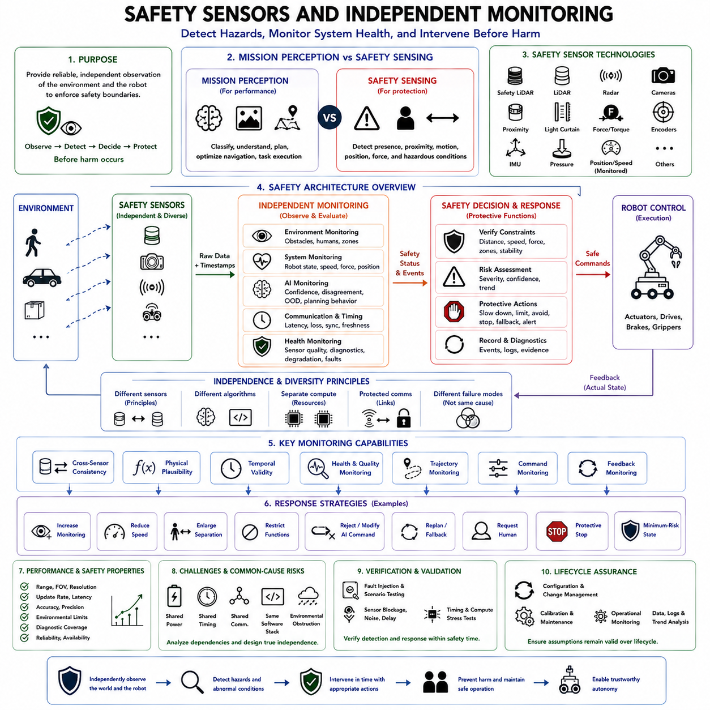{width="7.268055555555556in" height="7.268055555555556in"}

안전 센서(Safety Sensor)와 독립 모니터링(Independent Monitoring)은 물리 AI(Physical AI) 시스템이 위험한 상태를 인식하고 지능형 행동이 허용할 수 없는 물리적 결과를 발생시키기 전에 개입할 수 있도록 하는 관측 기반을 제공한다. 안전 센싱(Safety Sensing)은 단순히 자율성 향상을 위한 추가적인 인식 기능이 아니다. 이는 시스템에서 식별된 위험과 안전 요구사항으로부터 도출된 가용성, 타이밍, 진단 행동 및 독립성을 갖는 명시적인 보호 기능을 지원한다.

임무 인식(Mission Perception)과 안전 센싱(Safety Sensing)은 동일한 환경을 관측하면서도 근본적으로 서로 다른 목적을 수행할 수 있다. 임무 인식은 객체를 분류하고, 장면을 이해하고, 의미 정보를 추정하거나, 내비게이션을 최적화할 수 있는 반면, 안전 센서는 보호 경계(Protective Boundary)를 강제하는 데 필요한 정보를 제공한다. 따라서 정교한 AI 인식 모델과 함께 존재, 근접성, 움직임, 위치, 힘 또는 위험 상태를 감지하도록 특별히 설계된 보다 단순한 안전 지향 센싱을 사용할 수 있다.

일반적인 안전 센싱 기술(Safety Sensing Technology)에는 안전 레이저 스캐너(Safety Laser Scanner), 라이다(LiDAR), 레이더(Radar), 근접 센서(Proximity Sensor), 라이트 커튼(Light Curtain), 압력 감지 장치, 인코더(Encoder), 관성 센서(Inertial Sensor), 힘 및 토크 센서(Force and Torque Sensor), 감시되는 위치 또는 속도 피드백 등이 포함된다. 적절한 조합은 로봇의 형태와 적용 분야에 따라 달라진다. 이동 로봇은 장애물 및 사람과의 근접성을 중요하게 다루며, 매니퓰레이터는 작업공간, 관절, 힘, 토크 및 접촉 모니터링이 필요할 수 있다.

안전 센서는 독립적인 장치가 아니라 종단 간 안전 기능(End-to-End Safety Function)의 일부로 평가해야 한다. 사람을 감지하는 기능은 해당 감지 결과가 충분한 무결성과 적절한 시간 안에 안전 로직으로 전달되고, 그에 따른 보호 행동이 위험한 접촉이 발생하기 전에 위험을 감소시킬 수 있을 때 의미가 있다. 따라서 센서 범위, 시야각, 해상도, 갱신 주기, 지연시간, 진단 능력, 환경적 한계 및 통신 동작은 모두 안전 관련 특성이 될 수 있다.

독립 모니터링(Independent Monitoring)은 이러한 원칙을 전용 안전 센서 이상으로 확장한다. 모니터는 자신이 감독하는 정상적인 임무 행동을 직접 생성하지 않으면서 시스템의 상태와 행동을 관찰한다. 센서 품질, 위치 추정 유효성, 모델 신뢰도, 예측 궤적, 액추에이터 명령, 로봇 상태, 환경 위험원, 실행 타이밍 및 통신 상태 등을 평가하여 이상 상태가 불안전한 물리적 행동으로 전파되기 전에 이를 감지할 수 있다.

독립성(Independence)이 중요한 이유는 주 AI와 정확히 동일한 가정과 고장 메커니즘에 의존하는 모니터가 동일한 오류를 반복할 수 있기 때문이다. 인식 시스템과 안전 모니터링이 동일한 카메라, 전처리 파이프라인, 신경망 표현, 컴퓨팅 프로세스를 사용한다면 하나의 공통 고장이 두 기능을 동시에 무력화할 수 있다. 독립 센서, 다양한 알고리즘, 보호된 실행 환경, 별도의 컴퓨팅 또는 단순한 물리적 검사를 이용하면 이러한 취약성을 줄일 수 있다.

서로 다른 센싱 원리(Sensing Principle)가 환경 조건에 다르게 반응하기 때문에 다양성(Diversity)은 모니터링을 강화할 수 있다. 카메라는 풍부한 의미 정보를 제공하지만 어둠, 눈부심 또는 오염에서 성능이 저하될 수 있다. 라이다는 기하학적 거리 측정을 제공하지만 반사 특성이나 가시성과 관련된 한계가 있을 수 있으며, 레이더는 이와 다른 강건성 특성을 제공한다. 상호 보완적인 센싱의 결합이 불확실성을 제거하지는 않지만 하나의 고장 메커니즘에 대한 의존성을 줄일 수 있다.

센서 간 일관성 검사(Cross-Sensor Consistency Checking)는 중요한 진단 능력을 제공한다. 서로 다른 소스의 측정값을 비교하여 센서 성능 저하, 보정 오류, 타이밍 문제 또는 환경적 간섭을 나타낼 수 있는 불일치를 식별할 수 있다. 카메라 기반 객체 추정값을 거리 측정값과 비교할 수 있으며, 위치 추정으로 계산된 속도를 휠 인코더 및 관성 정보와 비교할 수도 있다. 이때 불일치 자체가 안전 관련 신호(Safety-Relevant Signal)가 된다.

물리적 타당성 모니터링(Physical Plausibility Monitoring)은 또 다른 형태의 독립적인 증거를 제공한다. 일반적으로 로봇의 속도는 이에 상응하는 가속도 없이 변화할 수 없으며, 명령된 움직임은 예상되는 액추에이터 응답을 발생시켜야 하고, 추정 위치는 운동학적 및 기하학적 제약과 일치해야 한다. 이러한 관계를 이용한 분석적 중복성(Analytical Redundancy)은 동일한 센서를 복제하지 않고도 불일치를 감지할 수 있으며, 개별 채널 내부에서는 수치적으로 타당하게 보이는 오류도 발견할 수 있다.

모니터링은 수치적 유효성뿐만 아니라 시간적 유효성(Temporal Validity)도 포함해야 한다. 센서 값이 생성된 순간에는 정확하더라도 과도한 지연 이후 사용된다면 안전하지 않을 수 있다. 따라서 타임스탬프, 갱신 주기, 메시지 경과시간, 동기화, 통신 지연 및 처리 마감시간을 모니터링해야 한다. 더 높은 속도로 운용되는 물리 AI 시스템에서는 오래된 정보가 장애물 위치와 가용 정지 거리에 대한 가정을 빠르게 무효화할 수 있으므로 더욱 엄격한 시간적 감시가 필요하다.

센서 상태 모니터링(Sensor Health Monitoring)은 완전한 손실과 성능 저하 운용(Degraded Operation)을 구분해야 한다. 센서는 연결 상태를 유지하면서도 노이즈 증가, 바이어스, 드리프트, 오염, 부분적인 가림, 시야각 감소, 열적 성능 저하 또는 보정 오류를 경험할 수 있다. 따라서 단순한 정상 또는 고장(Alive-or-Dead) 검사는 많은 안전 관련 센싱 기능에 충분하지 않다. 상태 지표는 후속 안전 의사결정의 유효성을 저하시킬 수 있는 품질 저하까지 포착해야 한다.

독립 모니터링은 AI 고유 속성(AI-Specific Property)도 감독할 수 있다. 신뢰도 변화, 모델 간 불일치, 비정상적인 특징 분포, 분포 외 데이터(Out-of-Distribution) 지표, 예측 불일치, 반복적인 재계획, 비정상적인 행동 패턴 또는 예상보다 빈번한 개입은 지능형 시스템이 검증된 운용 가정을 벗어나고 있음을 나타낼 수 있다. 이러한 신호는 AI 고장을 완벽하게 탐지하는 수단이 아니라 불확실성이 증가했다는 증거로 다루어야 한다.

궤적 모니터링(Trajectory Monitoring)은 행동을 생성한 모델의 내부적인 정확성만 평가하는 것이 아니라 제안된 행동의 물리적 결과를 평가하기 때문에 특히 중요하다. 안전 모니터는 예측된 로봇 움직임을 충돌 여유 거리, 정지 거리, 제한 구역, 안정성 한계, 관절 제약, 속도 한계 또는 사람과의 분리 요구사항과 비교할 수 있다. 불안전한 행동 제안은 실제 작동 이전에 거부하거나 수정할 수 있다.

명령 모니터링(Command Monitoring)은 물리 시스템과 가까운 위치에서 또 다른 보호 경계를 제공한다. 요구된 속도, 가속도, 조향, 토크, 힘, 관절 위치 또는 조작 명령을 허용된 범위 및 현재 운용 조건과 비교하여 검사할 수 있다. 상위의 인식, 월드 모델(World Model), 계획기 또는 비전-언어-행동 정책(Vision-Language-Action Policy, VLA Policy)이 부적절한 행동을 생성하더라도 후단 모니터링을 통해 명령이 강제 가능한 물리적 한계를 초과하는 것을 방지할 수 있다.

피드백 모니터링(Feedback Monitoring)은 로봇이 명령된 안전 행동을 실제로 수행했는지를 확인함으로써 안전 루프(Safety Loop)를 완성한다. 제어기가 제동을 명령하더라도 액추에이터 성능 저하, 기계적 결함 또는 노면 조건으로 인해 예상된 감속이 발생하지 않을 수 있다. 명령된 움직임과 실제 측정된 움직임을 비교하면 실행 고장(Execution Failure)을 감지하고 최초의 보호 행동이 예상된 물리적 결과를 달성하지 못했을 때 대응 수준을 높일 수 있다.

모니터링은 정의된 안전 대응(Safety Response)으로 연결되어야 한다. 감지된 상태의 심각도와 신뢰도에 따라 시스템은 모니터링 강화, 속도 감소, 분리 안전 여유 확대, 기능 제한, AI 명령 거부, 재계획, 폴백 제어(Fallback Control) 활성화, 사람의 감독 요청, 보호 정지(Protective Stop) 또는 최소 위험 상태(Minimum-Risk Condition) 진입 등을 수행할 수 있다. 적절한 대응 경로가 없다면 단순한 감지만으로는 충분한 위험 감소를 제공하지 못한다.

대응 임계값(Response Threshold)은 지나치게 민감하면 불필요한 운용 중단을 발생시키고, 반대로 충분히 민감하지 않으면 위험이 발전하도록 허용할 수 있으므로 신중하게 설계해야 한다. 거리, 신뢰도, 불일치, 지연시간, 힘, 속도 또는 상태 지표의 임계값은 위험원 분석, 시스템 동역학, 측정 불확실성 및 필요한 안전 마진(Safety Margin)과 연결되어야 한다. 적응형 지능(Adaptive Intelligence)이 통제되고 검증된 메커니즘 밖에서 안전 필수 임계값을 임의로 변경해서는 안 된다.

안전 구역(Safety Zone)은 센싱 정보를 강제 가능한 공간적 행동으로 변환하는 실용적인 방법을 제공한다. 로봇 주변의 서로 다른 영역을 정상 운용, 속도 감소, 보호 개입 또는 정지와 연결할 수 있다. 이러한 구역은 로봇 속도, 적재물, 이동 방향, 제동 능력, 사람과의 근접성 또는 운용 모드에 따라 변화할 수 있다. 동적 안전 구역(Dynamic Safety Zone)은 그 계산과 강제 과정이 필요한 안전 가정을 충족할 때에만 안전 메커니즘으로 기능한다.

독립 모니터링은 임무 지능(Mission Intelligence)이 컴퓨팅 과부하나 소프트웨어 고장을 경험하는 상황에서도 계속 동작해야 한다. 모니터링이 계산 집약적인 AI 스택과 모든 CPU, GPU, 메모리, 스케줄링 및 통신 자원을 공유한다면 가장 필요한 순간에 모니터를 사용할 수 없게 될 수 있다. 전용 안전 컴퓨팅(Dedicated Safety Compute), 보호된 스케줄링, 자원 파티셔닝(Resource Partitioning) 또는 별도의 실행 환경을 통해 비정상적인 작업 부하에서도 모니터링 가용성을 유지할 수 있다.

통신 감시(Communication Supervision)도 마찬가지로 중요하다. 안전 관련 메시지는 손실, 손상, 지연, 중복, 순서 오류 및 오래된 정보에 대해 감시되어야 한다. 분산형 또는 플릿 연결형 로봇(Distributed or Fleet-Connected Robot)은 임무 최적화를 위해 원격 정보에 의존할 수 있지만, 필수적인 로컬 모니터링은 네트워크 성능이 저하되는 상황에서도 안전한 행동을 유지할 수 있어야 한다. 클라우드나 플릿 연결이 손실되었다고 해서 로컬 보호 센싱과 제어 기능까지 자동으로 상실해서는 안 된다.

진단 범위(Diagnostic Coverage)는 모니터링이 안전 기능과 관련된 결함을 얼마나 효과적으로 감지할 수 있는지를 나타낸다. 어떠한 모니터도 가능한 모든 고장을 감지한다고 가정해서는 안 된다. 일부 결함은 직접 관찰할 수 있지만, 다른 결함은 불일치를 통해서만 추론할 수 있으며, 일부는 정상적인 환경 변화와 구별하기 어려울 수 있다. 따라서 안전 분석에서는 무엇을 모니터링하는지, 어떤 결함이 감지를 벗어날 수 있는지, 그리고 남아 있는 불확실성을 어떻게 관리하는지를 문서화해야 한다.

모니터링 아키텍처(Monitoring Architecture)는 공통 원인 고장(Common-Cause Failure)도 다루어야 한다. 독립적인 채널도 전원, 보정, 타이밍 소스, 소프트웨어 라이브러리, 통신 인프라, 환경적 노출 또는 유지보수 프로세스를 공유할 수 있다. 서로 다른 종류의 센서라도 물리적 차단이나 심각한 환경 조건으로 동시에 손상될 수 있다. 따라서 독립성에 대한 주장은 단순히 센서 개수에 의존하는 것이 아니라 공유 종속성에 대한 명시적인 분석으로 뒷받침되어야 한다.

검증(Verification)은 예상되는 운용 경계에 접근하거나 이를 넘어서는 조건에서 안전 센싱과 모니터링 기능을 시험해야 한다. 센서 차단, 오염, 보정 오류, 지연된 메시지, 데이터 손실, 컴퓨팅 과부하, 타이밍 지터(Timing Jitter), 센서 측정값 간 충돌, 예상하지 못한 장애물, 위치 추정 성능 저하 및 액추에이터 응답 이상 등을 시험에 포함할 수 있다. 결함 주입(Fault Injection)과 시나리오 시험을 통해 사용 가능한 안전 시간 안에 감지와 보호 대응이 이루어지는지를 판단할 수 있다.

운용 모니터링(Operational Monitoring)은 배포 이후에도 안전 가정이 유효하게 유지되는지를 확인할 수 있는 증거를 제공한다. 센서 상태 추세, 보호 정지 이벤트, 타이밍 위반, 채널 간 불일치, 안전 우선 제어(Safety Override), 성능 저하 모드 진입 및 비정상적인 환경 조건을 분석하면 새롭게 발생하는 취약점을 발견할 수 있다. 이러한 정보는 유지보수와 재평가를 지원하며 하드웨어 노후화 또는 운용 조건 변화에 따라 센싱 성능이 변화하고 있는지도 판단하는 데 도움이 된다.

센서, 보정, AI 모델, 전처리, 컴퓨팅 플랫폼, 통신 또는 운용 환경의 변경은 기존의 모니터링 가정을 무효화할 수 있다. 따라서 구성 및 변경 관리(Configuration and Change Management)는 위험원, 안전 요구사항, 센싱 기능, 진단 메커니즘, 대응 임계값 및 검증 증거 사이의 추적성(Traceability)을 유지해야 한다. 외관상 사소한 센서나 소프트웨어 업데이트도 안전 관련 정보 경로에 영향을 준다면 다시 유효성 확인(Validation)을 수행해야 할 수 있다.

핵심 목표는 모든 지능형 구성요소를 완벽하게 신뢰할 수 있도록 만드는 것이 아니라 불확실한 자율성(Autonomy) 주변에 독립적으로 관찰 가능하고 강제 가능한 경계(Independently Observable and Enforceable Boundary)를 구축하는 것이다. 안전 센서는 물리적 조건에 관한 신뢰 가능한 증거를 제공하고, 독립 모니터링은 인식, 상태 추정, 계획, 명령, 실행 및 시스템 상태가 검증된 한계 안에 유지되는지를 평가한다. 이들은 함께 심층 방어(Defense in Depth)를 구성하는 핵심 감지 계층(Detection Layer)을 형성한다.

물리 AI(Physical AI)에서 안전 센싱(Safety Sensing)과 독립 모니터링(Independent Monitoring)은 불확실성을 실제로 대응 가능한 보호 조치(Actionable Protection)로 변환한다. 전용 안전 센서, 다양한 관측, 일관성 검사, 상태 진단, 시간적 감시, 궤적 및 명령 모니터링, 물리적 피드백, 사전에 정의된 대응을 결합함으로써 시스템은 악화되는 안전 상태가 되돌릴 수 없는 피해로 발전하기 전에 이를 감지할 수 있다. 이러한 기능의 효과는 독립성, 적시 대응, 검증된 진단 범위 및 지속적인 수명주기 보증(Lifecycle Assurance)에 달려 있다.

## 02.10. Emergency Stop and Protective Stop

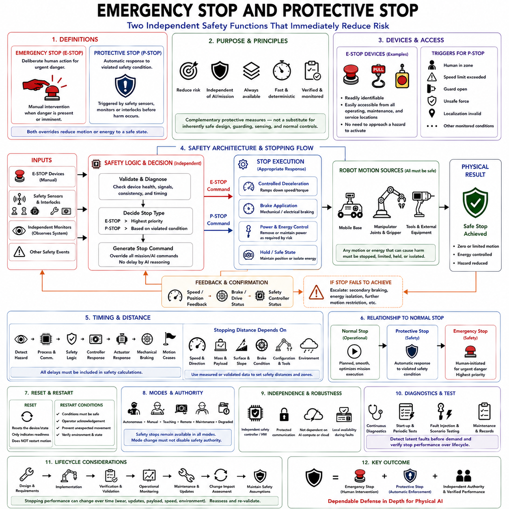{width="7.268055555555556in" height="7.268055555555556in"}

비상 정지(Emergency Stop)와 보호 정지(Protective Stop)는 서로 다른 조건에서 위험한 로봇 행동을 중단시키는 구별된 안전 기능(Safety Function)이다. 비상 정지는 위험 상황이 이미 발생했거나 임박했을 때 긴급하게 개입하기 위한 것이며, 보호 정지는 일반적으로 모니터링되는 안전 조건이 위반되었을 때 자동으로 시작된다. 두 기능 모두 움직임이나 에너지를 제어하여 위험을 감소시키지만 목적, 작동 논리, 복구 및 운용 방식에서 차이가 있다.

비상 정지(Emergency Stop)는 본질적으로 안전한 설계(Inherently Safe Design), 가드(Guarding), 센싱 또는 정상적인 위험 감소 기능을 대체하는 것이 아니라 주로 보완적인 보호 조치(Complementary Protective Measure)이다. 이는 예상하지 못한 위험이 발생했을 때 사람이 의도적으로 개입할 수 있는 수단을 제공한다. 따라서 물리 AI(Physical AI) 시스템은 운영자가 모든 위험 상태를 인식하고 제때 비상 정지를 작동시키는 것에 의존하지 않고 정상적인 안전 아키텍처를 통해 안전을 유지할 수 있어야 한다.

비상 정지 장치(Emergency-Stop Device)는 개입해야 하는 사람이 쉽게 식별하고 접근할 수 있어야 한다. 일반적인 구현에는 안전 관련 제어 기능에 연결된 전용 푸시버튼(Pushbutton), 풀 코드(Pull Cord) 또는 기타 수동 작동 장치가 사용된다. 장치의 위치는 예상 가능한 운용, 유지보수, 티칭(Teaching), 복구 및 서비스 상황을 고려해야 하며, 운영자가 비상 기능을 작동시키기 위해 이미 존재하는 위험에 접근해야 하는 상황이 발생해서는 안 된다.

비상 정지가 활성화되면 정상적인 임무 명령을 우선적으로 무시하고 고수준 AI 추론에 의존하지 않은 상태에서 사전에 정의된 정지 대응을 시작해야 한다. 인식 모델, 월드 모델(World Model), 계획기(Planner), 비전-언어-행동 정책(Vision-Language-Action Policy, VLA Policy) 또는 임무 제어기(Mission Controller)가 비상 행동을 지연시키거나 거부할 수 없어야 한다. 이러한 분리는 지능 기능이 잘못되거나, 과부하되거나, 사용할 수 없거나, 검증된 가정 밖에서 동작하는 상황에서도 안전 권한(Safety Authority)을 유지한다.

보호 정지(Protective Stop)는 이와 다른 운용 역할을 수행한다. 일반적으로 안전 센서, 모니터링되는 조건, 인터록(Interlock), 안전 제어기 또는 독립 모니터(Independent Monitor)가 운용을 계속할 경우 안전 제약(Safety Constraint)을 위반한다고 판단할 때 시작된다. 보호 구역으로의 사람 진입, 불충분한 분리 거리, 과도한 속도, 가드 개방, 불안전한 힘, 위치 추정 무효 또는 기타 모니터링 조건은 물리적 피해가 발생하기 전에 보호 정지를 작동시킬 수 있다.

보호 정지는 로봇이 변화하는 환경에서 동작하고 사람, 차량, 장비 및 불확실한 장애물과 공간을 공유할 수 있기 때문에 물리 AI에서 특히 중요하다. 안전 레이저 스캐너(Safety Laser Scanner), 라이다(LiDAR), 레이더(Radar), 라이트 커튼(Light Curtain), 위치 모니터링, 힘 센싱 또는 기타 안전 관련 관측을 통해 보호 조건을 설정할 수 있다. 이러한 조건이 위반되면 정지 행동이 임무 AI의 의미적 판단에만 의존해서는 안 된다.

정지 대응(Stopping Response)은 기계와 위험 특성에 적합해야 한다. 액추에이터 전원을 즉시 차단하는 것이 항상 가장 안전한 대응은 아니다. 제어되지 않은 전원 상실로 인해 적재물이 떨어지거나, 제동 능력이 사라지거나, 플랫폼이 불안정해지거나, 제어되지 않은 움직임이 발생할 수 있기 때문이다. 따라서 일부 시스템에서는 에너지를 제거하기 전에 제어된 감속(Controlled Deceleration)을 수행하거나, 위치를 안전하게 유지하기 위해 전원을 유지하는 제어 정지 상태(Controlled Stopped State)가 필요할 수 있다.

정지 시간(Stopping Time)은 핵심적인 설계 매개변수이다. 전체 시간에는 위험 감지, 신호 처리, 통신, 안전 로직 실행, 제어기 응답, 액추에이터 응답, 기계적 제동 및 움직임이 완전히 멈추는 데 필요한 시간이 포함된다. 따라서 안전 거리(Safety Distance)와 보호 구역(Protective Zone)은 로봇의 명목상 기계적 제동 시간만 고려하는 것이 아니라 이러한 전체 대응 체인을 반영해야 한다.

정지 거리(Stopping Distance) 역시 명령된 속도만으로 결정되지 않는다. 로봇 질량, 적재물, 가속도, 바퀴와 지면 사이의 상호작용, 경사도, 액추에이터 특성, 브레이크 상태, 매니퓰레이터 구성, 운반 물체 및 환경 조건 등이 안전 상태에 도달하는 데 필요한 거리에 영향을 줄 수 있다. 따라서 적재물이나 구성이 변화하는 물리 AI 시스템에서는 보수적인 제한 또는 검증된 동적 계산(Validated Dynamic Calculation)이 필요할 수 있다.

비상 정지와 보호 정지는 정상 정지(Normal Stop)와의 관계가 명확하게 정의되어야 한다. 정상 정지는 일반적인 임무 실행의 일부이며 승차감, 효율성 또는 작업 연속성을 최적화할 수 있다. 보호 정지는 모니터링된 조건에 대한 안전 대응이고, 비상 정지는 의도적인 긴급 개입을 통해 긴급한 위험에 대응한다. 세 가지 정지를 동일하게 취급하면 우선순위, 진단 및 재시작 행동에 관한 잘못된 가정이 발생할 수 있다.

안전 관련 정지(Safety-Related Stop)는 모션 제어 체인에 대해 충분한 권한을 가져야 한다. 내비게이션, 계획, 조작, 학습 정책, 원격 운용, 플릿 관리(Fleet Management) 또는 클라우드 서비스에서 전달되는 명령이 필요한 정지를 방해해서는 안 된다. 정상적인 자율성 스택(Autonomy Stack)이 고장 난 경우에도 정지 기능을 유지할 수 있도록 독립 안전 제어기(Independent Safety Controller), 안전 등급 드라이브(Safety-Rated Drive), 보호된 통신 또는 제동 회로 등을 사용할 수 있다.

안전 기능은 여러 움직임 발생원(Motion Source)도 고려해야 한다. 이동형 매니퓰레이터(Mobile Manipulator)는 이동 베이스, 여러 개의 로봇 팔 관절, 그리퍼, 회전 장비 및 외부 전원 도구를 포함할 수 있다. 이동 베이스만 정지시키면 위험한 매니퓰레이터 움직임이 계속될 수 있다. 따라서 안전 개념에서는 각각의 위험 상황에 대해 어떤 움직임 또는 에너지원을 정지, 제한, 유지 또는 격리해야 하는지를 식별해야 한다.

명령된 정지가 실제로 이루어졌는지를 확인하려면 피드백(Feedback)이 필요하다. 안전 제어기가 속도 0 또는 제동을 요청하더라도 액추에이터 결함, 통신 문제, 기계적 결함 또는 낮은 마찰의 노면으로 인해 예상된 대응이 이루어지지 않을 수 있다. 모니터링된 속도, 위치, 브레이크 상태, 드라이브 상태 또는 기타 물리적 피드백을 통해 시스템이 요구된 정지 상태에 도달했고 이를 계속 유지하는지를 확인할 수 있다.

예상한 대로 정지하지 못한 경우 아키텍처가 추가적인 보호 수단을 지원한다면 대응 수준을 높여야 한다. 제어 정지(Controlled Stop)가 필요한 감속을 달성하지 못하면 보조 제동 메커니즘, 에너지 격리, 추가적인 움직임 제한 또는 사전에 정의된 다른 대응이 필요할 수 있다. 이는 정지를 단순히 속도 0을 나타내는 소프트웨어 명령으로 취급하는 것이 아니라 종단 간 안전 기능(End-to-End Safety Function)으로 다루어야 하는 이유를 보여준다.

리셋 동작(Reset Behavior) 역시 중요하다. 비상 정지 장치를 리셋하는 것만으로 위험한 움직임이 자동으로 재시작되어서는 안 된다. 일반적으로 리셋은 비상 장치가 이후 운용을 승인할 수 있는 상태로 복귀했음을 의미한다. 재시작(Restart)은 적절한 조건이 충족된 이후에 이루어져야 하며, 로봇 작업공간에 사람이 남아 있을 때 위험을 발생시킬 수 있는 예상하지 못한 움직임을 방지해야 한다.

보호 정지 복구(Protective-Stop Recovery)는 보다 자동화될 수 있지만 재시작 조건은 여전히 명확하게 설계되어야 한다. 사람이 보호 구역에서 벗어나거나 정지를 유발했던 다른 조건이 사라졌을 때 시스템은 자동 운전 재개가 허용되는지 또는 별도의 확인(Acknowledgement)이 필요한지를 결정해야 한다. 이러한 결정은 적용 분야, 감지되지 않은 사람이 존재할 가능성, 운용 모드, 가시성, 위험 평가 및 적용되는 안전 요구사항에 따라 달라진다.

예상하지 못한 재시작(Unexpected Restart)은 자율 물리 AI에서 특히 중요하다. 로봇은 정지된 동안에도 임무, 계획된 궤적, 조작 목표 또는 원격 명령을 유지하고 있을 수 있다. 안전 조건이 해제되었다고 해서 이전에 중단된 행동을 그대로 다시 시작하면 환경이 이미 변화했을 가능성이 있기 때문에 위험할 수 있다. 따라서 복구 과정에서는 현재 조건을 다시 검증하고 기존 명령이 여전히 유효한지를 판단한 이후 물리적 실행을 재개해야 한다.

모드 전환(Mode Transition)은 정지 권한을 유지해야 한다. 자율, 수동, 티칭, 원격 운용, 유지보수, 성능 저하(Degraded), 복구 모드는 서로 다른 제어기와 명령 소스를 사용할 수 있지만 필요한 비상 및 보호 기능은 적절하게 계속 사용할 수 있어야 한다. 모드 변경 과정에서 정지 기능이 암묵적으로 비활성화되거나 명시적인 설계 및 검증 없이 안전 책임이 운영자에게 이전되어서는 안 된다.

통신 손실(Communication Loss)도 고려해야 한다. 플릿 연결형 로봇 또는 원격 감독형 장비가 필수적인 로컬 정지를 수행하기 위해 클라우드 연결에 의존해서는 안 된다. 보호 센서, 안전 로직, 드라이브 제어 및 비상 기능은 필요한 안전 시간 안에 대응할 수 있도록 충분히 로컬화되고 독립적이어야 한다. 원격 비상 명령은 추가적인 기능을 제공할 수 있지만 필요한 로컬 보호 기능을 대체해서는 안 된다.

컴퓨팅 과부하(Compute Overload)도 유사한 아키텍처 문제를 발생시킨다. AI 인식과 계획이 과도한 CPU 또는 GPU 자원을 소비할 경우 동일한 보호되지 않은 실행 환경을 공유하는 정지 기능은 허용할 수 없는 지연을 경험할 수 있다. 전용 안전 제어기, 자원 파티셔닝(Resource Partitioning), 보호된 스케줄링 또는 독립 하드웨어를 사용하면 임무 계산이 불안정해지는 상황에서도 비상 및 보호 대응 기능을 유지하는 데 도움이 된다.

전원 손실(Power Loss)이 자동으로 안전한 정지를 보장하는 것은 아니다. 이동 플랫폼은 관성으로 계속 이동할 수 있고, 매니퓰레이터는 중력에 의해 떨어질 수 있으며, 브레이크는 전기적 제어를 필요로 할 수 있고, 운반 중인 물체가 떨어질 수도 있다. 따라서 안전 아키텍처는 정지 및 전원 차단 과정에서 저장된 기계적, 전기적, 유압적, 공압적 또는 중력 에너지가 어떻게 행동하는지를 분석하고 위험 에너지를 어떻게 제어할지를 결정해야 한다.

비상 정지 및 보호 정지 기능에는 실제 요구가 발생하기 전에 숨겨진 결함으로 보호 기능이 상실되는 것을 방지하기 위한 진단 모니터링(Diagnostic Monitoring)이 필요하다. 배선 단선, 스위치 고장, 통신 결함, 브레이크 성능 저하, 안전 제어기 결함 또는 잘못된 구성은 정상 운용 중에는 발견되지 않을 수 있다. 기동 검사, 지속적인 진단, 주기적인 시험 및 유지보수를 통해 안전 관련 정지 경로의 잠재 결함(Latent Fault)을 발견할 수 있다.

결함 주입(Fault Injection)과 시나리오 시험(Scenario Testing)을 통해 현실적인 비정상 조건에서 정지 행동을 검증할 수 있다. 엔지니어는 센서 고장, 안전 메시지 지연, 액추에이터 성능 저하, 통신 손실, 컴퓨팅 과부하, 브레이크 결함 또는 충돌하는 AI 명령을 의도적으로 발생시키고 필요한 대응이 이루어지는지를 측정할 수 있다. 시험에서는 감지 시간, 정지 시작, 감속, 최종 위치, 정지 상태 유지 및 복구 행동을 평가해야 한다.

검증(Verification)은 현실적인 속도, 적재물, 노면 상태, 경사도, 로봇 구성, 환경 조건 및 인간과의 상호작용 조합을 포함해야 한다. 이상적인 실험실 조건에서만 입증된 정지 기능은 최악 조건(Worst-Case Condition)의 운용을 대표하지 못할 수 있다. 실제 측정된 정지 성능을 이용하여 보호 거리, 운용 한계, 안전 구역 및 상위 수준 모니터링 기능에서 사용하는 가정을 검증할 수 있다.

정지 성능은 시간이 지나면서 변화할 수 있으므로 수명주기 관리(Lifecycle Management)가 필요하다. 브레이크 마모, 타이어 상태, 적재물 변경, 소프트웨어 업데이트, 제어기 튜닝, 새로운 AI 행동, 센서 교체, 운용 속도 증가 또는 기계적 변경은 응답 시간과 정지 거리를 변화시킬 수 있다. 이러한 가정에 영향을 주는 변경이 이루어지면 관련 안전 요구사항 및 검증 증거를 다시 평가해야 한다.

운용 데이터(Operational Data)는 지속적인 안전 보증(Continued Assurance)을 지원할 수 있다. 보호 정지, 비상 정지 활성화, 정지 시간, 제동 이상, 안전 우선 제어(Safety Override), 센서 트리거 및 복구 실패 기록을 분석하면 추세 또는 새롭게 발생하는 성능 저하를 발견할 수 있다. 이러한 정보는 유지보수와 안전 개선을 지원하면서 즉각적인 보호를 담당하는 독립 안전 메커니즘과 운용 분석(Operational Analytics) 사이의 구분을 유지해야 한다.

물리 AI(Physical AI)에서 비상 정지(Emergency Stop)와 보호 정지(Protective Stop)는 자율 지능과 위험한 물리적 에너지 사이에 핵심적인 안전 경계(Safety Boundary)를 형성한다. 비상 정지는 긴급한 위험에 대해 사람이 의도적으로 개입할 수 있는 수단을 제공하고, 보호 정지는 모니터링되는 안전 조건을 자동으로 강제한다. 독립적인 안전 권한, 검증된 정지 성능, 안전한 리셋 로직, 진단 및 수명주기 보증이 함께 지원될 때 두 기능은 신뢰 가능한 심층 방어(Dependable Defense in Depth)에 기여한다.

## 02.11. Safe Speed Separation and Motion Limits

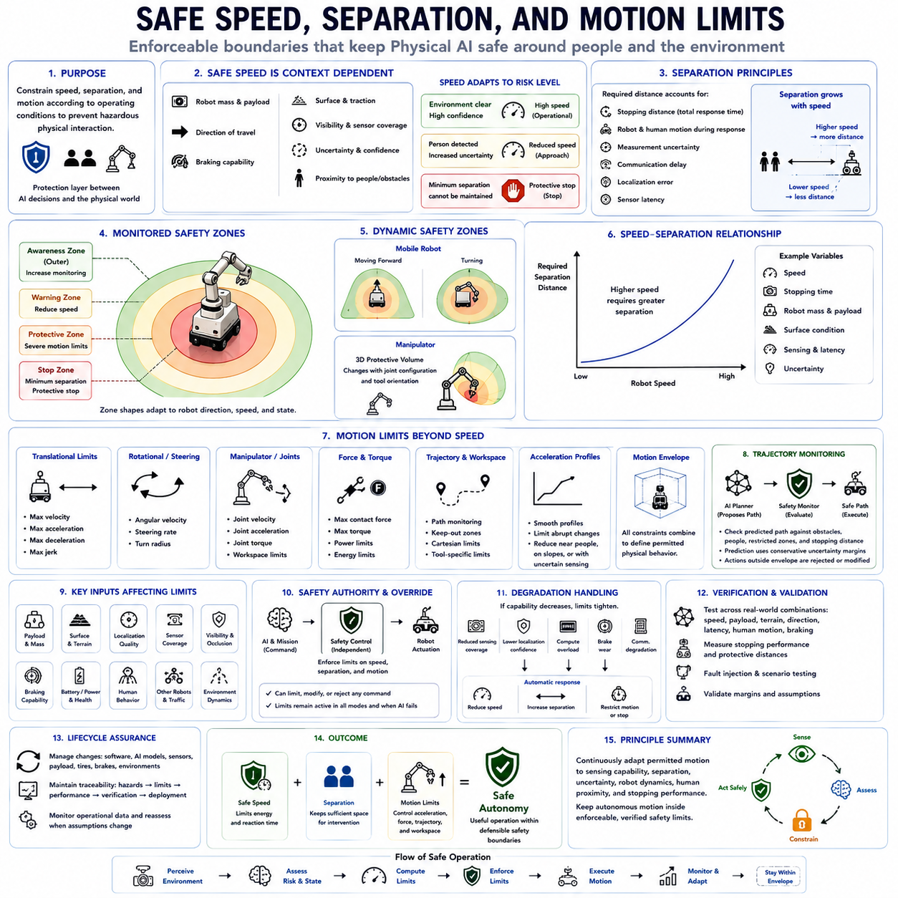{width="7.268055555555556in" height="7.268055555555556in"}

안전 속도(Safe Speed), 분리 거리(Separation), 움직임 제한(Motion Limits)은 물리 AI(Physical AI) 시스템이 지능형 의사결정을 위험한 물리적 행동으로 전환하지 못하도록 하는 강제 가능한 경계(Enforceable Boundary)를 정의한다. 인식과 계획이 항상 정확할 것이라고 가정하는 대신, 이러한 메커니즘은 현재 운용 조건에 따라 속도, 가속도, 힘, 궤적 및 근접성을 제한한다. 이를 통해 불확실한 자율 지능과 사람, 장비 및 환경과의 물리적 상호작용 사이에 보호 계층을 제공한다.

안전 속도(Safe Speed)는 모든 상황에 적용할 수 있는 하나의 고정된 속도를 의미하지 않는다. 허용 가능한 속도는 로봇 질량, 적재물, 이동 방향, 제동 능력, 노면 상태, 가시성, 센서 감지 범위, 환경 불확실성 및 사람이나 장애물과의 근접성에 따라 달라진다. 격리된 작업공간에서 안전한 것으로 간주되는 속도도 사람이 접근하거나, 위치 추정 신뢰도가 낮아지거나, 정지 성능이 저하되면 허용할 수 없는 속도가 될 수 있다.

따라서 속도 제한(Speed Limit)은 운용 상황에 따라 변화하는 동적 제약(Dynamic Constraint)으로 구성할 수 있다. 환경이 안전하게 확보되어 있을 때 로봇은 허용된 운용 속도로 이동할 수 있고, 사람이 모니터링 영역에 진입하면 속도를 줄이며, 최소 분리 거리를 더 이상 유지할 수 없으면 보호 정지(Protective Stop)를 시작할 수 있다. 이러한 단계적 대응은 물리적 위험이 증가함에 따라 더욱 보수적인 행동을 적용하면서도 유용한 생산성을 유지할 수 있도록 한다.

분리 거리(Separation)는 위험한 로봇 움직임과 사람, 장애물, 제한 영역 또는 다른 기계 사이에 충분한 거리를 유지함으로써 공간적 보호를 제공한다. 필요한 거리는 현재의 기하학적 간격만을 고려해서는 안 된다. 로봇의 응답 시간, 정지 시간, 접근 속도, 측정 불확실성, 통신 지연, 위치 추정 오류 및 대응 시간 동안 로봇과 주변 사람이 모두 계속 움직일 가능성을 함께 고려해야 한다.

따라서 속도와 분리 거리는 밀접하게 연결되어 있다. 일반적으로 로봇 속도가 높을수록 위험을 감지하고 안전하게 정지하는 데 더 많은 시간과 공간이 필요하기 때문에 더 큰 보호 거리가 요구된다. 반대로 위험 평가와 검증된 안전 기능이 이를 뒷받침한다면 감소된 속도로 운용함으로써 보다 가까운 상호작용을 허용할 수 있다. 안전한 시스템은 사용 가능한 분리 거리, 달성 가능한 정지 성능 및 허용되는 움직임 사이의 관계를 지속적으로 유지해야 한다.

실용적인 아키텍처에서는 로봇 주변에 여러 개의 모니터링 구역(Monitored Zone)을 설정할 수 있다. 외부 인지 영역(Awareness Region)에서는 모니터링을 강화하고, 경고 영역(Warning Region)에서는 속도를 감소시키며, 보호 영역(Protective Region)에서는 강력한 움직임 제한을 적용하고, 최소 허용 분리 거리가 침해되면 정지를 시작할 수 있다. 구역의 정확한 개수와 형상은 보편적으로 고정되는 것이 아니라 적용 분야, 센싱 아키텍처, 로봇 동역학 및 안전 요구사항에 따라 결정된다.

동적 안전 구역(Dynamic Safety Zone)은 이동 방향과 움직임 상태에 따라 적응할 수 있다. 전진하는 이동 로봇은 후방보다 전방에 더 큰 보호 영역이 필요할 수 있으며, 회전할 때에는 플랫폼 측면의 위험 영역이 확대될 수 있다. 매니퓰레이터는 관절 구성, 도구 방향, 적재물, 예측 궤적 및 도달 가능한 작업공간에 따라 변화하는 3차원 보호 영역이 필요할 수 있다. 따라서 안전 형상(Safety Geometry)은 정적인 거리만이 아니라 실제 물리적 움직임을 반영해야 한다.

정지 능력(Stopping Capability)은 안전 분리 거리를 결정하는 기본적인 입력이다. 전체 정지 성능에는 센서 감지, 신호 처리, 통신, 안전 로직, 제어기 응답, 액추에이터 동역학, 기계적 제동 및 최종적인 움직임 정지가 포함된다. 기계적인 제동만 고려하여 보호 거리를 계산하면 개입에 필요한 공간을 과소평가할 수 있다. 따라서 안전 관련 제한에는 최악 조건(Worst-Case) 또는 검증된 보수적 응답 시간을 사용해야 한다.

움직임 제한(Motion Limits)은 병진 속도(Translational Speed)를 넘어 보호 범위를 확장한다. 각속도, 가속도, 감속도, 저크(Jerk), 조향 속도, 관절 속도, 관절 가속도, 토크, 힘, 동력 및 작업공간 경계 모두 제약이 필요할 수 있다. 로봇이 느리게 움직이더라도 과도한 매니퓰레이터 힘, 급격한 가속, 불안정한 조향 또는 높은 저장 에너지로 인해 위험이 발생할 수 있다. 따라서 안전에서는 식별된 위험과 관련된 물리적 변수를 제한해야 한다.

힘 및 토크 제한(Force and Torque Limits)은 사람과 로봇이 가까운 거리에서 상호작용하거나 조작 작업을 수행할 때 특히 중요하다. 접촉 위험은 유효 질량, 속도, 기하학적 형상, 접촉 위치, 도구 형상 및 로봇과 접촉 대상의 기계적 특성에 따라 달라진다. 명령된 힘만 제한한다고 해서 안전한 상호작용이 보장되는 것은 아니며 운동량과 저장된 기계적 에너지가 여전히 클 수 있다. 따라서 움직임, 힘 및 에너지를 함께 고려해야 한다.

가속도와 저크 제약(Acceleration and Jerk Constraints)도 안전에 영향을 준다. 갑작스러운 움직임 변화는 이동 플랫폼을 불안정하게 만들거나, 적재물을 이동시키거나, 사람이 예상하지 못한 반응을 하게 하거나, 높은 순간적인 힘을 발생시킬 수 있다. 임무 계획기(Mission Planner)는 시간과 효율성을 최적화할 수 있지만, 후단의 안전 제어는 사람 주변 운용, 불안정한 적재물 운반, 불확실한 노면 주행 또는 센싱 성능 저하 상황에서 더욱 엄격한 가속도 프로파일을 강제할 수 있다.

작업공간 제한(Workspace Limits)은 또 다른 강제 가능한 경계를 제공한다. 이동 로봇은 금지 영역으로 진입하지 못하도록 제한할 수 있으며, 매니퓰레이터는 관절 한계, 직교좌표 경계(Cartesian Boundary), 진입 금지 구역(Keep-Out Zone) 또는 도구별 제한을 적용할 수 있다. 이러한 제한은 잘못된 상위 수준 계획기, 지도, 월드 모델(World Model) 또는 학습 정책이 쉽게 우회할 수 없도록 제어 계층과 충분히 가까운 위치에서 강제되어야 한다.

움직임 엔벨로프(Motion Envelope)는 여러 제약을 결합하여 허용되는 물리적 행동의 범위를 표현할 수 있다. 엔벨로프는 현재 상황에 허용되는 위치, 속도, 가속도, 힘, 방향, 분리 거리 및 운용 모드를 정의할 수 있다. 지능형 시스템은 이 엔벨로프 내부에서 자유롭게 최적화할 수 있지만, 범위를 벗어나는 행동은 거부, 수정 또는 더 안전한 대응으로 대체된다. 이를 통해 임무 최적화(Mission Optimization)와 최종 안전 강제(Final Safety Enforcement)를 분리할 수 있다.

궤적 모니터링(Trajectory Monitoring)을 이용하면 위험한 상태에 물리적으로 도달하기 전에 안전 기능이 미래의 움직임을 평가할 수 있다. 로봇의 현재 위치만 확인하는 대신 예측된 경로를 장애물, 사람의 움직임, 제한 구역, 정지 거리, 안정성 마진 및 운동학적 한계와 비교할 수 있다. 현재 충돌이 없는 궤적이라도 이후 제동이나 회피에 필요한 충분한 거리를 확보하지 못한다면 불안전할 수 있다.

예측(Prediction)에는 불확실성이 포함되므로 이를 보수적으로 표현해야 한다. 사람의 움직임, 객체 이동, 휠 슬립(Wheel Slip), 위치 추정 오류, 모델 예측 및 센싱 노이즈로 인해 미래 위치가 불확실해질 수 있다. 안전 마진(Safety Margin)은 보호 영역을 확대하거나, 허용 속도를 낮추거나, 신뢰도가 감소할 때 예측 구간(Prediction Horizon)을 줄이는 방식으로 이러한 불확실성을 고려할 수 있다. 학습 기반 예측은 안전 추론을 지원할 수 있지만 보장된 보호의 유일한 수단이 되어서는 안 된다.

위치 추정 품질(Localization Quality)은 공간적 제약이 로봇이 자신의 위치를 충분한 신뢰도로 알고 있을 때에만 의미가 있기 때문에 움직임 제한에 직접적인 영향을 준다. 제한 경계 근처에 있는 로봇은 위치 추정 불확실성이 증가하면 속도를 낮춰야 할 수 있다. 위치 유효성이 안전한 내비게이션에 필요한 가정 이하로 떨어지면 대체 위치 추정, 제한된 운용 모드, 제어 정지 또는 최소 위험 상태(Minimum-Risk Condition)로의 전환이 필요할 수 있다.

센서 감지 범위(Sensor Coverage)는 로봇에 허용되는 이동 속도를 지원할 수 있어야 한다. 플랫폼은 센싱과 제어가 반응하기 전에 장애물이 정지 영역 안으로 들어올 정도로 빠르게 이동해서는 안 된다. 따라서 감지 거리, 시야각, 갱신 주기, 가림(Occlusion), 환경적 성능 저하 및 처리 지연시간은 허용 속도에 영향을 준다. 고성능 자율 지능도 실제 접근 경로에 대한 안전 관련 관측이 불충분한 문제를 보상할 수는 없다.

적재물 변화(Payload Change)는 안전한 움직임에 상당한 영향을 미칠 수 있다. 질량 증가는 정지 거리를 늘리고, 안정성을 변화시키며, 견인력을 변경하고, 충돌 에너지를 증가시키며, 매니퓰레이터 동역학에 영향을 줄 수 있다. 적재물 위치 역시 무게 중심을 이동시켜 안전한 가속도나 회전 한계를 변경할 수 있다. 가변 적재물을 운용하는 시스템은 적재 상태를 식별하고 검증된 기계적 성능에 적합한 움직임 제약을 적용해야 한다.

노면 및 지형 조건(Surface and Terrain Conditions)은 추가적인 불확실성을 발생시킨다. 젖은 바닥, 느슨한 자갈, 경사면, 불규칙한 지형, 얼음 또는 마모된 타이어는 제동 및 조향 능력을 감소시킬 수 있다. 물리 AI 시스템은 지형 조건을 추정하고 행동을 적응시킬 수 있지만 신뢰도가 충분하지 않은 경우 안전 제한은 보수적으로 유지되어야 한다. 견인력 감소는 속도 감소, 더 큰 분리 거리, 제한된 기동 또는 자율 운용 종료를 요구할 수 있다.

다중 로봇(Multiple Robots) 사이의 상호작용에서는 단순한 정적 충돌 회피를 넘어서는 분리 관리가 필요하다. 로봇들은 플릿 수준 시스템(Fleet-Level System)으로부터 명령을 받으면서 복도, 교차로, 작업 셀 또는 적재 영역을 공유할 수 있다. 조정 메시지가 지연되거나 일관되지 않거나 사용할 수 없는 경우에도 로컬 안전 권한(Local Safety Authority)은 위험한 근접 상태를 방지해야 한다. 플릿 최적화는 움직임을 조정할 수 있지만 필수적인 충돌 보호가 중앙집중식 계획에만 의존해서는 안 된다.

사람의 행동(Human Behavior)은 사람이 예측할 수 없게 움직이거나, 방향을 갑자기 바꾸거나, 제한 영역에 진입하거나, 로봇의 의도를 잘못 이해할 수 있기 때문에 추가적인 주의가 필요하다. 안전 메커니즘은 사람이 계획된 궤적을 완벽하게 준수한다고 가정해서는 안 된다. 모니터링된 분리 거리, 보수적인 접근 가정, 명확하게 인지 가능한 움직임, 사람 주변에서의 속도 감소 및 보호 정지를 통해 예측이나 의사소통과 실제 사람의 움직임이 일치하지 않을 때에도 여러 계층의 보호를 제공할 수 있다.

안전 속도와 분리 기능은 임무 명령에 대해 독립적인 권한(Independent Authority)을 가져야 한다. 계획기가 효율성을 위해 고속 궤적을 요청하더라도 현재 분리 거리가 충분하지 않다면 안전 제어가 속도를 제한하거나 해당 명령을 거부할 수 있어야 한다. 마찬가지로 학습 정책이 위험한 기동이 성공할 가능성이 높다고 예측한다는 이유로 움직임 제한을 비활성화하도록 허용해서는 안 된다. 안전 제약은 정상적인 AI 최적화 외부에서도 강제 가능해야 한다.

성능 저하 운용(Degraded Operation)에서는 관련 기능이 손실되면 움직임 제한을 자동으로 강화해야 한다. 센서 감지 범위 감소, 위치 추정 불확실성 증가, 통신 성능 저하, 컴퓨팅 과부하, 브레이크 마모 또는 중복 채널 손실은 더 낮은 속도나 더 큰 분리 거리를 요구할 수 있다. 점진적 성능 저하(Graceful Degradation)를 통해 가능한 경우 유용한 운용을 유지하면서도 허용되는 움직임이 감소된 안전 능력과 일치하도록 할 수 있다.

검증(Verification)에서는 속도, 적재물, 접근 방향, 노면 상태, 센싱 지연시간, 위치 추정 오류, 사람의 움직임 및 제동 성능의 현실적인 조합에 대해 움직임 제한을 시험해야 한다. 측정을 통해 정의된 위험 상태를 방지할 수 있을 만큼 충분히 이른 시점에 안전 개입이 이루어지는지를 확인해야 한다. 시나리오 시험(Scenario Testing)과 결함 주입(Fault Injection)을 이용하면 센싱, 통신, 컴퓨팅 또는 액추에이션 성능이 저하되었을 때에도 기존 가정이 유효하게 유지되는지를 확인할 수 있다.

안전한 움직임을 결정하는 매개변수는 시간이 지나면서 변화할 수 있으므로 수명주기 보증(Lifecycle Assurance)이 필요하다. 소프트웨어 업데이트, 새로운 AI 계획기, 센서 교체, 타이어 마모, 브레이크 성능 저하, 적재물 변경, 기계적 변경 또는 운용 환경 확장은 검증된 제한을 변화시킬 수 있다. 구성 관리(Configuration Management)는 위험원 분석, 움직임 제약, 정지 성능, 안전 마진, 검증 결과 및 실제 배포된 시스템 설정 사이의 추적성(Traceability)을 유지해야 한다.

핵심 목표는 자율 지능이 허용 가능한 위험을 초과하지 않으면서 행동할 수 있는 강제 가능한 물리적 운용 엔벨로프(Enforceable Physical Operating Envelope)를 구축하는 것이다. 안전 속도(Safe Speed)는 움직임의 속도와 에너지를 제한하고, 분리 거리(Separation)는 개입에 필요한 충분한 공간을 확보하며, 보다 광범위한 움직임 제약(Motion Constraints)은 가속도, 힘, 궤적 및 작업공간을 제어한다. 이들의 결합은 추상적인 안전 요구사항을 지속적으로 강제되는 물리적 경계로 변환한다.

물리 AI(Physical AI)에서 안전한 자율성(Safe Autonomy)은 위험이 감지될 때까지 지능이 자유롭게 움직이도록 허용하는 것을 의미하지 않는다. 이는 센싱 능력, 분리 거리, 불확실성, 로봇 동역학, 사람과의 근접성 및 사용 가능한 정지 성능에 따라 허용되는 움직임을 지속적으로 조정하는 것을 의미한다. 동적 속도 제한, 보호 거리, 궤적 감시, 물리적 제약, 독립적인 강제 및 검증된 성능 저하 행동을 결합함으로써 시스템은 유용성을 유지하면서 자율 움직임을 정당화 가능한 안전 경계(Defensible Safety Boundary) 안에 유지할 수 있다.

## 02.12. Safety Control and AI Control Separation

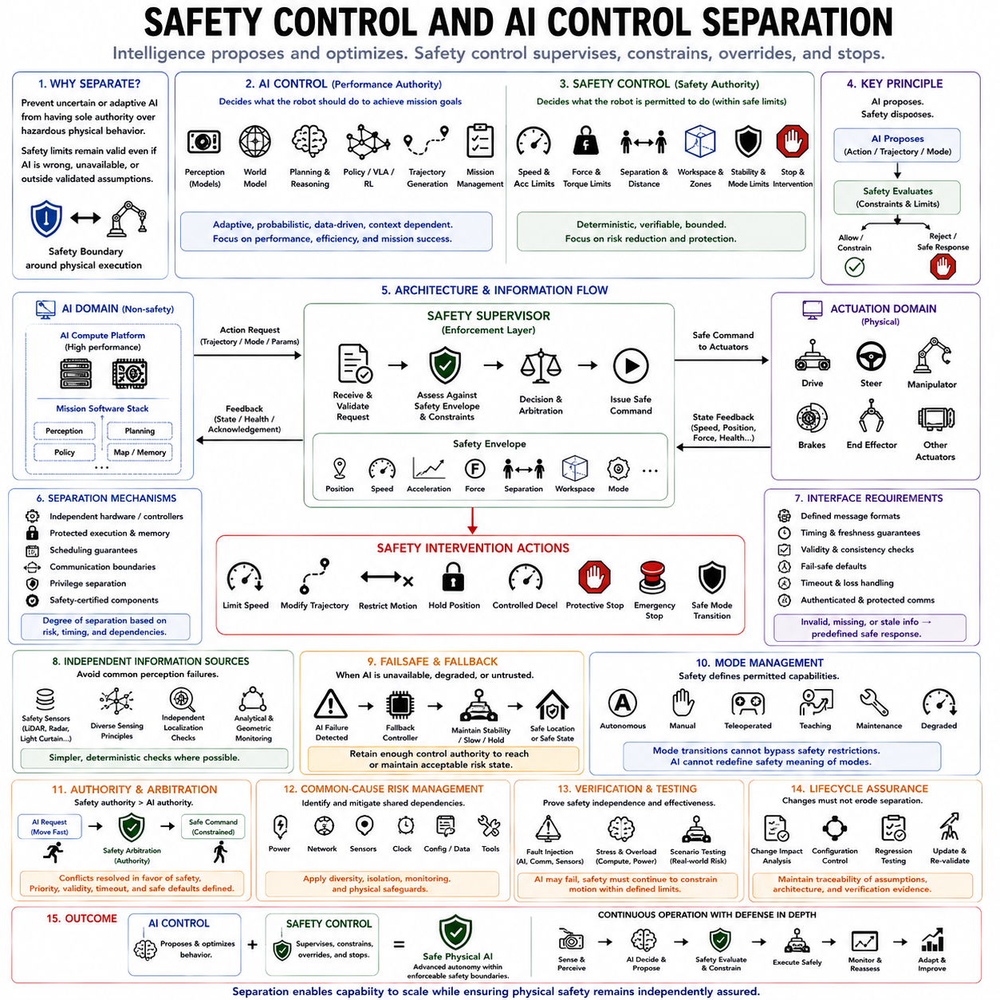{width="7.268055555555556in" height="7.268055555555556in"}

안전 제어(Safety Control)와 AI 제어(AI Control)의 분리는 불확실하거나 적응적인 지능이 위험한 물리적 행동에 대한 유일한 제어 권한을 갖지 못하도록 하는 아키텍처 원칙이다. AI 기능은 인식, 예측, 계획, 내비게이션, 조작 및 임무 성능을 최적화할 수 있지만, 안전 제어는 AI가 잘못 행동하거나 사용할 수 없게 되거나 검증된 운용 가정을 벗어난 조건을 만나더라도 반드시 유지되어야 하는 제약을 독립적으로 강제한다.

근본적인 구분은 성능 권한(Performance Authority)과 안전 권한(Safety Authority) 사이에 있다. AI 제어는 주로 로봇이 임무를 효율적으로 달성하기 위해 무엇을 해야 하는지를 결정하는 반면, 안전 제어는 허용 가능한 위험을 초과하지 않으면서 로봇이 무엇을 할 수 있는지를 결정한다. 이러한 분리를 통해 정교한 자율 행동을 지속적으로 발전시키면서도 물리적 실행 주변에 비교적 안정적이고 독립적으로 검증 가능한 보호 경계를 유지할 수 있다.

AI 제어에는 학습 기반 인식(Learned Perception), 월드 모델(World Model), 파운데이션 모델(Foundation Model), 비전-언어-행동 정책(Vision-Language-Action Policy, VLA Policy), 강화학습(Reinforcement Learning), 궤적 생성, 행동 계획 및 적응형 의사결정이 포함될 수 있다. 이러한 기능은 확률적으로 동작할 수 있으며 대규모 데이터셋, 복잡한 표현 및 변화하는 환경적 맥락에 의존할 수 있다. 이러한 능력은 유연성을 제공하지만 안전 필수 액추에이션(Safety-Critical Actuation)에 대해 제한 없는 직접 권한을 부여하기 어렵게 만드는 불확실성도 함께 도입한다.

따라서 안전 제어는 정상적인 AI 명령이 핵심적인 제한을 우회할 수 없도록 배치되어야 한다. 요청된 행동이 액추에이터에 도달하기 전에 안전 메커니즘은 속도, 가속도, 힘, 토크, 작업공간, 분리 거리, 충돌 위험, 안정성, 운용 모드 및 기타 관련 제약을 평가할 수 있다. 이러한 경계를 위반하는 명령은 제한, 거부, 대체되거나 사전에 정의된 안전 대응(Safe Response)으로 전환될 수 있다.

아키텍처적 분리(Architectural Separation)가 반드시 모든 구성요소의 완전한 물리적 격리를 요구하는 것은 아니다. 독립 프로세서, 보호된 실행 환경, 메모리 파티셔닝(Memory Partitioning), 스케줄링 보장, 통신 경계, 권한 분리(Privilege Separation) 또는 안전 인증 제어기(Safety-Certified Controller)를 통해 분리를 구현할 수 있다. 필요한 분리 수준은 위험의 심각도, 고장 종속성, 타이밍 요구사항, 시스템 아키텍처 및 안전 기능에 요구되는 무결성 수준에 따라 달라진다.

물리적 분리(Physical Separation)는 공유 컴퓨팅 자원을 통해 전파될 수 있는 고장에 대해 강력한 보호를 제공한다. 전용 안전 제어기(Dedicated Safety Controller)는 주 AI 컴퓨터가 충돌하거나, GPU 과부하를 경험하거나, 메모리를 소진하거나, 제어되지 않는 소프트웨어 상태에 진입하더라도 모니터링과 개입을 계속할 수 있다. 그러나 두 채널이 취약한 전원, 통신, 센서, 클록, 구성 또는 기타 공통 자원을 공유한다면 물리적 분리만으로는 충분하지 않다.

기능들이 하나의 컴퓨팅 플랫폼을 공유하는 경우에는 논리적 분리(Logical Separation)도 유용할 수 있다. 메모리 보호, 프로세스 격리, 실시간 스케줄링, 하이퍼바이저(Hypervisor), 실행 권한 및 보호된 통신 인터페이스를 통해 임무 소프트웨어가 안전 필수 상태를 변경하지 못하도록 할 수 있다. 이러한 접근법에서는 자원 경합(Resource Contention)이나 소프트웨어 결함이 안전 제어 기능에 요구되는 타이밍, 무결성 및 가용성을 손상시키지 않는다는 근거가 필요하다.

두 영역 사이의 권한 방향(Direction of Authority)은 명확하게 정의되어야 한다. AI 제어는 행동, 궤적, 모드 또는 운용 매개변수를 요청할 수 있으며, 안전 제어는 이러한 요청이 허용 가능한지를 독립적으로 판단한다. 안전 제어는 필요할 경우 AI 행동을 제한하거나 우선적으로 무시할 수 있는 충분한 권한을 가져야 하지만, 임무 AI에는 일반적으로 안전 메커니즘을 비활성화하거나 약화시키거나 암묵적으로 변경할 수 있는 동등한 권한을 부여해서는 안 된다.

안전 감독기(Safety Supervisor)는 자율성(Autonomy)과 액추에이션 사이의 강제 계층(Enforcement Layer)으로 동작할 수 있다. AI는 속도, 경로, 매니퓰레이터 궤적 또는 작업 행동을 제안하고, 감독기는 해당 제안을 검증된 제약과 비교하여 평가한다. 제안이 허용 가능하면 실행을 진행하고, 경계 수준에 가까우면 제한할 수 있으며, 불안전한 경우에는 명령을 거부하고 보호 대응(Protective Response)을 시작할 수 있다.

이러한 아키텍처는 지능이 행동을 최적화할 수 있도록 허용되는 안전 엔벨로프(Safety Envelope) 개념을 지원한다. 엔벨로프에는 허용되는 위치, 속도, 가속도, 힘, 분리 거리, 작업공간, 안정성 및 운용 모드 제약이 포함될 수 있다. AI 제어는 이 영역 내부에서 다양한 행동을 최적화할 수 있으며, 안전 시스템은 각각의 결정이 갖는 모든 의미적 이유를 이해할 필요가 없다. 안전 계층은 강제 가능한 물리적 결과에 집중한다.

독립성(Independence)은 정보 소스에도 적용된다. 안전 제어가 AI 제어와 동일한 인식 모델 및 센서 처리 파이프라인에 전적으로 의존한다면 하나의 공통 오류가 두 의사결정 경로를 모두 손상시킬 수 있다. 전용 안전 센서, 다양한 센싱 원리, 분석적 검사(Analytical Check), 독립적인 위치 추정 검증 또는 단순화된 기하학적 모니터링을 통해 임무 인식의 신뢰성이 저하되더라도 유용한 증거를 제공할 수 있다.

안전 시스템이 AI 제어기의 전체 지능을 재현할 필요는 없다. 많은 경우 보다 단순한 결정론적 검사(Deterministic Check)가 선호되는데, 그 행동의 범위를 제한하고 보다 직접적으로 검증할 수 있기 때문이다. 예를 들어 안전 요구사항이 로봇이 위험한 속도로 점유된 보호 영역에 진입하는 것을 방지하는 것이라면, 안전 모니터는 객체가 의자인지, 팔레트인지, 사람인지를 반드시 이해할 필요가 없을 수 있다.

시간적 독립성(Temporal Independence)도 동일하게 중요하다. AI 작업 부하가 충분한 컴퓨팅 용량을 남겨줄 때에만 실행되는 안전 기능은 보호가 가장 필요한 비정상 상황에서 실패할 수 있다. 따라서 안전 모니터링과 개입에는 예측 가능한 실행 기회가 보장되어야 한다. 전용 하드웨어, 실시간 스케줄링, 예약된 컴퓨팅 자원 또는 보호된 통신 채널을 통해 AI 과부하 상황에서도 대응 마감시간(Response Deadline)을 유지할 수 있다.

AI 제어와 안전 제어 사이의 통신에는 명확하게 정의된 인터페이스를 사용해야 한다. 안전 관련 명령, 상태 정보, 모드 요청, 상태 지표 및 확인 응답(Acknowledgement)은 지정된 형식, 유효 조건, 타이밍 요구사항 및 고장 시 행동을 가져야 한다. 유효하지 않거나, 누락되거나, 오래되거나, 일관성이 없거나, 지연된 정보가 발생하면 두 제어 영역 사이에서 정의되지 않은 상호작용이 발생하는 대신 사전에 정의된 대응이 수행되어야 한다.

아키텍처는 신뢰할 수 있는 안전 경계(Trusted Safety Boundary) 내부에 배치되는 복잡한 AI 기능의 양을 최소화해야 한다. 안전 필수 소프트웨어 범위가 증가하면 검증의 어려움이 커지고 고장을 고려해야 하는 구성요소의 수도 증가한다. 가능한 경우 복잡한 지능은 안전 커널(Safety Kernel) 외부에 유지하고, 보다 작은 규모의 메커니즘 집합이 액추에이터 및 센서 인터페이스에 가까운 위치에서 필수적인 물리적 제약을 강제하도록 할 수 있다.

이것이 AI가 안전에 기여할 수 없다는 의미는 아니다. AI는 사람의 움직임을 예측하고, 지형을 추정하고, 비정상적인 조건을 식별하고, 불확실성을 평가하고, 충돌 예측을 향상시키며, 보수적인 행동을 권고할 수 있다. 이러한 정보는 안전 성능을 향상시킬 수 있지만 AI 출력에 대해 충분한 보증(Assurance)을 확립할 수 없는 경우에는 독립적으로 강제 가능한 보호 기능과 그 역할을 구분해야 한다.

AI 불확실성(AI Uncertainty)은 안전 적응(Safety Adaptation)을 위한 입력으로 사용할 수 있다. 인식 신뢰도가 낮아지거나, 위치 추정 불확실성이 증가하거나, 시스템이 익숙하지 않은 조건을 만나는 경우 안전 제어는 허용되는 운용 엔벨로프를 더욱 엄격하게 제한할 수 있다. 속도를 낮추고, 분리 거리를 확대하고, 조작을 제한하거나, 자율 운용을 중단할 수 있다. 따라서 이러한 대응을 유발하는 증거가 확률적 지능에서 생성되더라도 안전 대응 자체는 결정론적으로 수행될 수 있다.

모드 관리(Mode Management)는 안전 제어와 AI 제어 사이의 중요한 인터페이스이다. 자율, 수동, 원격 운용, 티칭(Teaching), 유지보수, 성능 저하(Degraded) 및 복구 모드는 서로 다른 제어기에 서로 다른 기능을 허용할 수 있다. 안전 제어는 각 모드에서 어떤 행동이 허용되는지를 정의하고 모드 전환 과정에서 제한이 의도하지 않게 우회되지 않도록 해야 한다. AI가 운용 모드의 안전 의미를 독립적으로 재정의해서는 안 된다.

폴백 제어(Fallback Control)는 분리의 또 다른 측면을 보여준다. 주 AI 제어를 사용할 수 없거나 신뢰할 수 없게 되면 보다 단순한 제어기가 제어된 감속, 안정성 유지, 사전에 정의된 안전 위치로 이동 또는 현재 위치 유지와 같은 제한된 행동을 수행할 수 있다. 폴백 제어기가 전체 임무 능력을 유지할 필요는 없다. 그 목적은 허용 가능한 위험 상태에 도달하거나 이를 유지하는 데 필요한 충분한 제어 권한을 보존하는 것이다.

비상 정지(Emergency Stop)와 보호 정지(Protective Stop) 기능은 임무 AI의 재량적 권한(Discretionary Authority) 밖에 유지되어야 한다. AI는 보호 대응을 유발하는 데 기여하는 정보를 제공할 수 있지만 독립적인 안전 조건이 정지를 요구하는 경우 필요한 정지를 방해해서는 안 된다. 비상 개입, 안전 등급 센싱(Safety-Rated Sensing), 제동 및 기타 필수 보호 기능은 자율 임무 목표보다 높은 우선순위를 유지해야 한다.

공유 액추에이터(Shared Actuator)는 신중하게 정의된 중재(Arbitration)를 필요로 한다. AI 제어기와 안전 제어기가 동일한 구동, 조향, 관절 또는 제동 시스템에 영향을 줄 수 있으므로 서로 충돌하는 명령이 발생할 가능성이 있다. 중재 로직(Arbitration Logic)은 필요한 경우 안전 제한이 우선하도록 보장하고 전환 과정에서 불안정하거나 불연속적인 제어가 발생하지 않도록 해야 한다. 우선순위, 명령 유효성, 타임아웃 동작 및 안전 기본값(Safe Default)을 명시적으로 정의해야 한다.

제어 아키텍처가 외관상 분리되어 있더라도 공통 원인 고장(Common-Cause Failure)은 여전히 중요하다. AI 채널과 안전 채널은 전원 공급 장치, 네트워크 스위치, 운영체제 구성요소, 센서, 보정 데이터, 기계적 액추에이터 또는 개발 도구를 공유할 수 있다. 독립성 분석(Independence Analysis)을 통해 이러한 종속성을 식별하고 하나의 고장이 두 제어 영역을 동시에 무력화하지 않도록 추가적인 다양성, 격리, 모니터링 또는 물리적 안전장치가 필요한지를 판단해야 한다.

사이버보안(Cybersecurity) 역시 분리에 영향을 줄 수 있다. AI 또는 통신 기능에 대한 비인가 변경(Unauthorized Modification)이 안전 강제를 우회하는 간접 경로를 제공해서는 안 되기 때문이다. 접근 제어, 인증된 인터페이스, 보호된 구성, 안전한 업데이트 메커니즘 및 권한 경계를 통해 안전 관련 기능의 무결성을 유지할 수 있다. 보안(Security)과 안전(Safety)은 서로 다른 분야이지만 제어 권한이 침해되면 직접적인 물리적 안전 결과로 이어질 수 있다.

검증(Verification)은 AI의 고장이 의도된 안전 경계를 침해할 수 없음을 입증해야 한다. 잘못된 궤적, 과도한 속도 요청, 유효하지 않은 모드, 손상된 메시지, 오래된 데이터, 컴퓨팅 과부하, 계획기 충돌, 센서 불일치 또는 의도적으로 불안전한 AI 명령 등을 주입하여 시험할 수 있다. 기대되는 결과는 AI가 항상 올바르게 복구하는 것이 아니라 독립적인 안전 제어가 물리적 행동을 정의된 한계 내부로 계속 제한하는 것이다.

시험에서는 분리 메커니즘 자체에도 문제가 발생하는 조건을 검증해야 한다. 자원 고갈, 통신 고장, 공유 전원 교란, 타이밍 결함, 메모리 손상, 제어기 리셋 및 동시적인 서브시스템 고장을 통해 숨겨진 종속성을 발견할 수 있다. 검증에서는 안전 기능이 요구되는 권한과 응답 시간을 계속 유지하는지, 또는 독립성을 더 이상 보장할 수 없을 때 시스템이 사전에 정의된 안전 상태(Safe State)나 최소 위험 상태(Minimum-Risk Condition)로 전환되는지를 확인해야 한다.

수명주기 변경(Lifecycle Change)은 아키텍처적 분리를 점진적으로 약화시킬 수 있다. 프로세서 통합, 새로운 소프트웨어 라이브러리 공유, 독립 센서 교체, 통신 경로 수정, 파운데이션 모델 추가, 운영체제 변경 또는 액추에이터 인터페이스 업데이트는 최초 설계에는 존재하지 않았던 종속성을 도입할 수 있다. 따라서 변경 영향 분석(Change-Impact Analysis)은 기능적 행동뿐만 아니라 안전 독립성을 뒷받침하는 가정까지 다시 평가해야 한다.

목표는 지능을 로봇으로부터 격리하는 것이 아니라 지능과 물리적 권한(Physical Authority) 사이에 통제된 관계를 확립하는 것이다. AI는 더욱 고도화된 인식, 추론, 예측 및 계획 기능을 자유롭게 제공할 수 있어야 하며, 안전 제어는 사람, 장비 및 로봇을 보호하는 물리적 한계에 대해 독립적인 권한을 유지해야 한다. 이를 통해 모든 AI 의사결정을 안전 인증 대상으로 만들지 않으면서도 지능의 능력을 확장할 수 있다.

물리 AI(Physical AI)에서 AI 제어(AI Control)와 안전 제어(Safety Control)의 분리는 확률적 지능(Probabilistic Intelligence)과 결정론적 보호(Deterministic Protection) 사이에 정당화 가능한 경계(Defensible Boundary)를 형성한다. AI는 행동을 제안하고 최적화하며, 안전 제어는 필요할 때 이를 감독하고, 제한하고, 우선적으로 무시하며, 정지시킨다. 독립적인 실행, 보호된 인터페이스, 제한된 안전 엔벨로프, 폴백 행동, 검증된 권한 및 수명주기 보증(Lifecycle Assurance)을 통해 고도화된 자율성은 물리적 안전에 대한 단일 책임 지점(Single Point of Responsibility)이 되지 않으면서 운용될 수 있다.

## 02.13. Software and Hardware Safety Mechanisms

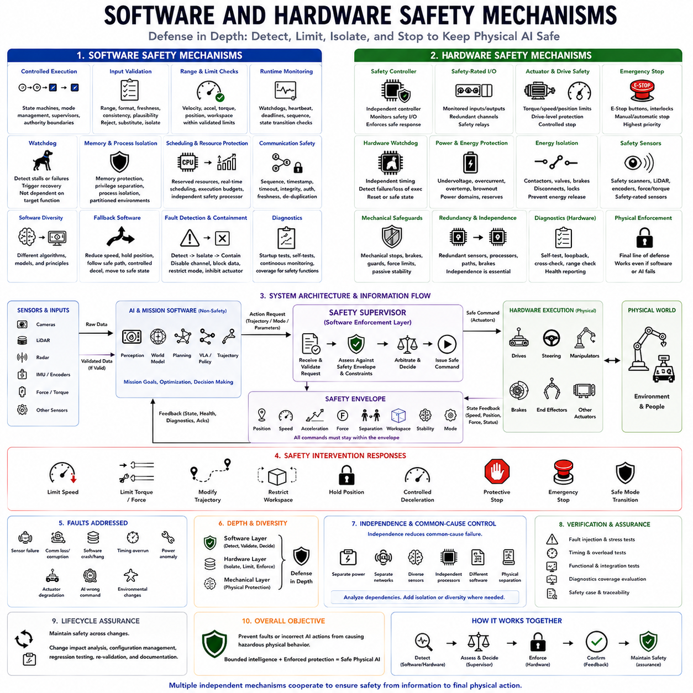{width="7.268055555555556in" height="7.268055555555556in"}

소프트웨어 안전 메커니즘(Software Safety Mechanism)과 하드웨어 안전 메커니즘(Hardware Safety Mechanism)은 물리 AI(Physical AI) 시스템 내부에서 안전 요구사항(Safety Requirements)을 실제로 강제하기 위한 기술적 수단을 제공한다. 소프트웨어 메커니즘은 정보, 실행, 타이밍 및 제어 로직을 감독하고, 하드웨어 메커니즘은 독립적인 감지, 격리, 제한 및 물리적 개입을 제공한다. 이들의 결합 목적은 개별 결함, 잘못된 AI 의사결정 또는 구성요소 고장이 위험한 물리적 행동으로 전파되는 것을 방지하는 것이다.

소프트웨어 안전 메커니즘은 안전 관련 기능(Safety-Relevant Function)의 통제된 실행에서 시작된다. 안전 로직은 제한 없는 애플리케이션 동작에 의존하기보다 정의된 상태, 인터페이스, 타이밍 제약 및 권한 경계 안에서 동작해야 한다. 상태 머신(State Machine), 모드 관리자(Mode Manager), 안전 감독기(Safety Supervisor), 명령 검증기(Command Validator) 및 런타임 모니터(Runtime Monitor)를 통해 정상 운용, 성능 저하 운용, 보호 정지, 복구 및 안전 상태 사이의 시스템 전환 방식을 제한할 수 있다.

입력 검증(Input Validation)은 잘못되거나 손상된 정보가 자율 제어 시스템 전체로 빠르게 전파될 수 있기 때문에 기본적인 소프트웨어 메커니즘이다. 센서 값, 위치 추정값, 궤적, 네트워크 메시지, 구성 매개변수 및 AI 생성 명령은 범위, 형식, 최신성(Freshness), 일관성 및 타당성에 대해 검사해야 한다. 유효하지 않은 정보는 거부, 대체, 격리하거나 사전에 정의된 성능 저하 대응(Degraded Response)을 시작하는 데 사용할 수 있다.

범위 및 타당성 검사(Range and Plausibility Check)는 복잡한 지능 주변에서 단순하지만 강력한 보호 기능을 제공한다. 요청된 속도, 가속도, 조향, 토크, 힘, 관절 위치 및 작업공간 좌표를 검증된 물리적 한계와 비교할 수 있다. AI 계획기(AI Planner)나 학습 정책(Learned Policy)이 예상하지 못한 명령을 생성하더라도 결정론적 검사(Deterministic Check)를 통해 해당 명령이 로봇의 허용된 운용 엔벨로프(Operating Envelope)를 직접 초과하지 못하도록 할 수 있다.

런타임 모니터링(Runtime Monitoring)은 시간에 따른 시스템 행동을 감독함으로써 개별 값에 대한 검사를 넘어 보호 범위를 확장한다. 감시 장치(Watchdog), 하트비트 모니터링(Heartbeat Monitoring), 마감시간 감시(Deadline Supervision), 실행시간 모니터링, 순서 검사 및 상태 전환 검증을 통해 정지된 프로세스, 누락된 업데이트, 타이밍 초과 또는 예상하지 못한 소프트웨어 상태를 식별할 수 있다. 이러한 메커니즘은 계산 집약적인 AI 워크로드가 실시간 로봇 제어와 자원을 공유할 때 특히 중요하다.

감시 장치 메커니즘(Watchdog Mechanism)은 소프트웨어 또는 프로세서가 예상대로 계속 실행되고 있는지를 감지한다. 감시 장치는 정상 실행을 나타내는 주기적인 증거를 요구하고 해당 증거가 사라질 경우 복구를 시작할 수 있다. 효과적인 감시 장치 설계는 감독 대상 기능에 전적으로 의존하지 않아야 한다. 하나의 소프트웨어 결함이 애플리케이션과 감시 메커니즘을 동시에 비활성화하면 의도했던 보호 기능까지 상실될 수 있기 때문이다.

메모리 보호(Memory Protection)와 프로세스 격리(Process Isolation)는 하나의 소프트웨어 결함이 관련 없는 안전 기능을 손상시킬 가능성을 줄인다. 보호된 주소 공간, 권한 분리(Privilege Separation), 메모리 접근 제어, 프로세스 격리 및 파티셔닝된 실행 환경(Partitioned Execution Environment)을 통해 소프트웨어 오류의 전파를 제한할 수 있다. 혼합 중요도 시스템(Mixed-Criticality System)에서는 이러한 메커니즘이 복잡한 AI 애플리케이션과 예측 가능한 실행이 필요한 소규모 안전 관련 구성요소를 분리하는 데 도움을 준다.

스케줄링 및 자원 보호(Scheduling and Resource Protection)도 중요하다. 일반적인 소프트웨어 손상이 발생하지 않더라도 안전 기능이 영향을 받을 수 있기 때문이다. AI 추론, 매핑, 계획 또는 파운데이션 모델(Foundation Model) 워크로드는 예상하지 못하게 CPU, GPU, 메모리 또는 통신 용량을 소모할 수 있다. 예약된 자원, 실시간 스케줄링, 실행 예산(Execution Budget), 우선순위 관리 및 독립 안전 프로세서를 통해 임무 계산이 과부하될 때에도 안전 대응 시간을 유지할 수 있다.

통신 안전 메커니즘(Communication Safety Mechanism)은 분산된 제어기, 센서, 액추에이터 및 안전 기능 사이에서 교환되는 정보를 보호한다. 순서 카운터(Sequence Counter), 타임스탬프, 타임아웃 감지, 무결성 검사, 필요한 경우 메시지 인증, 중복 감지 및 최신성 검증을 통해 손실, 손상, 지연, 반복 또는 오래된 메시지를 식별할 수 있다. 통신 고장이 발생하면 유효하지 않은 정보를 사용하여 제어되지 않은 운용을 계속하는 대신 사전에 정의된 행동으로 전환해야 한다.

소프트웨어 다양성(Software Diversity)은 하나의 구현 방식이나 알고리즘에 대한 의존성을 줄일 수 있다. 복잡한 학습 기반 제어기를 보다 단순한 결정론적 모니터가 감독할 수 있으며, AI 기반 위치 추정은 기하학적, 관성 또는 운동학적 제약을 통해 검사할 수 있다. 서로 다른 메커니즘이 서로 다른 고장 특성을 갖는 경우 다양성은 유용하지만, 외관상 서로 다른 소프트웨어도 라이브러리, 데이터, 모델 또는 가정을 공유할 수 있으므로 독립성을 신중하게 평가해야 한다.

폴백 소프트웨어(Fallback Software)는 정상 자율 기능을 사용할 수 없거나 신뢰할 수 없게 되었을 때 통제된 행동을 제공한다. 폴백 제어기(Fallback Controller)는 속도를 낮추고, 안정성을 유지하고, 현재 위치를 유지하고, 제한된 경로를 따라가거나, 제어된 감속을 수행하거나, 최소 위험 상태(Minimum-Risk Condition)로 전환할 수 있다. 가능한 경우 폴백 기능은 고장 난 임무 기능보다 단순해야 하며 제어되지 않은 물리적 행동을 방지할 수 있는 충분한 권한을 유지해야 한다.

하드웨어 안전 메커니즘(Hardware Safety Mechanism)은 임무 소프트웨어의 올바른 실행에만 의존하지 않는 보호 기능을 제공한다. 전용 안전 제어기(Dedicated Safety Controller), 안전 등급 입출력(Safety-Rated I/O), 독립 제동 회로, 비상 정지 장치(Emergency-Stop Device), 인터록(Interlock), 감시 릴레이(Monitored Relay), 안전 센서 및 드라이브 수준 보호 기능은 위험한 에너지를 직접 제한할 수 있다. 이러한 메커니즘은 상위 수준 AI 또는 소프트웨어가 고장 나더라도 유지되는 물리적 강제 지점(Physical Enforcement Point)을 형성한다.

안전 제어기(Safety Controller)는 주 AI 컴퓨팅 플랫폼과 독립적으로 핵심 로직을 구현할 수 있다. 비상 장치, 보호 센서, 드라이브 상태, 속도 제한, 인터록 또는 액추에이터 활성화 신호를 모니터링하고 사전에 정의된 안전 대응을 시작할 수 있다. 안전 제어기의 가치는 기능적 권한뿐만 아니라 아키텍처적 독립성(Architectural Independence)에서 나오며, 특히 주 컴퓨팅 플랫폼이 복잡한 운영체제, GPU 워크로드 및 자주 업데이트되는 AI 소프트웨어를 포함할 때 중요하다.

하드웨어 감시 장치(Hardware Watchdog)는 소프트웨어만으로 이루어진 감독으로 신뢰성 있게 식별하기 어려운 프로세서 또는 제어기 고장을 감지할 수 있다. 독립적인 타이밍 회로나 감독 장치는 프로세서 동작을 감시하고 예상된 실행이 사라지면 리셋, 격리 또는 안전 상태 전환을 시작할 수 있다. 따라서 하드웨어 모니터링은 프로세서 정지, 제어되지 않은 소프트웨어 상태 또는 특정 체계적 실행 고장에 대한 추가적인 보호 계층을 제공할 수 있다.

드라이브 수준 안전 기능(Drive-Level Safety Function)은 액추에이터와 가까운 위치에서 움직임 제한을 강제할 수 있다. 시스템 아키텍처에 따라 이러한 메커니즘은 제어 정지, 토크 제거, 속도 제한, 위치 제한, 제동 또는 예상하지 못한 움직임 방지를 지원할 수 있다. 물리적 액추에이터 가까이에 강제 기능을 배치하면 즉각적인 개입이 필요한 상황에서 상위 수준 계획 및 통신 경로에 대한 의존성을 줄일 수 있다.

디지털 제어만으로 모든 위험한 고장을 제거할 수 없기 때문에 기계적 및 전기기계적 메커니즘(Mechanical and Electromechanical Mechanism)은 여전히 필수적이다. 기계적 정지 장치, 브레이크, 유지 장치(Retaining Device), 힘 제한 구조, 수동적 안정성(Passive Stability), 카운터밸런스(Counterbalance), 에너지 흡수 요소 및 물리적 가드는 전자 제어를 사용할 수 없는 상황에서도 결과를 제한할 수 있다. 이러한 메커니즘은 소프트웨어 결정이 아닌 물리 법칙에 의존함으로써 다양성을 제공한다.

에너지 격리(Energy Isolation)는 또 다른 중요한 하드웨어 전략이다. 정상적인 명령이 중단된 이후에도 전기적, 기계적, 유압적, 공압적, 열적 또는 중력 에너지가 위험한 상태로 남아 있을 수 있다. 접촉기(Contactor), 밸브, 브레이크, 차단 장치, 방전 메커니즘, 잠금 장치 및 기타 격리 요소를 이용하여 의도하지 않은 에너지 방출을 방지할 수 있다. 필요한 메커니즘은 위험 에너지가 로봇 내부에서 어떻게 저장되고 전달되는지에 따라 결정된다.

전원 감시(Power Supervision)는 비정상적인 전압, 전류, 온도, 배터리 상태 또는 전원 불안정성이 제어 기능을 손상시키기 전에 이를 감지해야 한다. 브라운아웃 감지(Brownout Detection), 저전압 감시, 과전류 보호, 열 보호, 독립 전원 도메인 및 에너지 예비량(Energy Reserve)을 통해 통제된 성능 저하를 지원할 수 있다. 단순한 전원 상실이 항상 안전하다고 볼 수는 없는데, 매니퓰레이터가 떨어지거나 이동 플랫폼이 관성으로 계속 움직이거나 브레이크 성능이 상실될 수 있기 때문이다.

센서 하드웨어(Sensor Hardware)는 내부 결함 또는 성능 저하를 나타내는 진단 기능을 포함할 수 있다. 중복 채널, 테스트 펄스(Test Pulse), 감시 출력, 내부 자체 시험, 신호 범위 검사 및 채널 간 비교를 통해 진단 범위(Diagnostic Coverage)를 높일 수 있다. 그러나 센서 자체는 정상이어도 환경적 차단, 잘못된 설치 또는 보정 오류로 인해 정보가 불안전해질 수 있으므로 하드웨어 진단은 시스템 수준의 검사와 함께 사용해야 한다.

중복성(Redundancy)은 선택된 결함이 필요한 안전 기능을 즉시 제거하지 못하도록 여러 하드웨어 또는 소프트웨어 자원을 결합한다. 중복 프로세서, 센서, 전원 경로, 통신 채널 또는 제동 메커니즘은 복원력(Resilience)을 높일 수 있다. 그러나 복제된 구성요소가 동일한 전원, 소프트웨어 결함, 통신 네트워크, 환경적 취약성 또는 구성 오류를 공유한다면 동시에 고장 날 수 있으므로 중복성의 효과는 독립성에 달려 있다.

진단 메커니즘(Diagnostic Mechanism)은 실제 보호 기능이 요구되기 전에 잠재 결함(Latent Fault)을 발견하기 위해 필요하다. 기동 시험, 주기적 자체 시험, 지속적인 모니터링, 루프백 검사(Loopback Check), 액추에이터 피드백, 브레이크 모니터링, 센서 진단, 메모리 시험 및 통신 감시를 통해 숨겨진 성능 저하를 식별할 수 있다. 진단 범위는 안전 기능과 연계되어야 하며 구성요소가 정상 상태를 보고한다는 이유만으로 모든 결함을 탐지할 수 있다고 가정해서는 안 된다.

결함 감지(Fault Detection)는 결함 격리(Fault Containment)와 연결되어야 한다. 결함이 있는 구성요소나 유효하지 않은 채널이 식별되면 아키텍처는 해당 출력이 안전 필수 의사결정에 계속 영향을 미치지 못하도록 해야 한다. 격리는 센서를 비활성화하거나, 제어기를 중재 과정에서 제거하거나, 통신 채널을 차단하거나, 액추에이터를 억제하거나, 시스템을 제한된 모드로 전환하는 방식으로 이루어질 수 있다. 이를 통해 국부적인 결함이 시스템 수준의 위험으로 확대되는 것을 방지한다.

따라서 하드웨어와 소프트웨어 메커니즘은 서로 관련 없는 개별 보호 기능으로 동작하는 것이 아니라 협력해야 한다. 소프트웨어가 불안전한 궤적을 감지하고, 안전 제어기가 제어된 감속을 명령하며, 드라이브 전자장치가 움직임 제한을 강제하고, 기계식 브레이크가 최종적인 정지 능력을 제공할 수 있다. 이후 피드백을 통해 의도된 물리적 대응이 실제로 이루어졌는지를 확인한다. 이러한 체인은 감지에서 물리적 위험 감소까지 이어지는 종단 간 안전 기능(End-to-End Safety Function)을 형성한다.

이러한 체인 전체에서는 공통 원인 고장(Common-Cause Failure)을 고려해야 한다. 소프트웨어 모니터와 하드웨어 제어기가 외관상 독립적으로 보이더라도 하나의 전원, 통신 버스, 클록, 센서, 구성 데이터베이스 또는 액추에이터를 공유할 수 있다. 마찬가지로 중복 소프트웨어 기능도 공통 소스 코드나 학습 데이터를 기반으로 할 수 있다. 안전 분석에서는 공유 종속성을 식별하고 다양성, 격리 또는 추가적인 물리적 안전장치가 필요한 지점을 결정해야 한다.

사이버보안 메커니즘(Cybersecurity Mechanism)은 비인가 접근이 안전 관련 행동을 변경할 수 있는 경우 안전을 지원할 수 있다. 보호된 구성, 인증된 통신, 통제된 권한, 안전한 업데이트 프로세스, 무결성 검증 및 안전 매개변수에 대한 제한된 접근을 통해 악의적이거나 우발적인 변경이 보호 기능을 우회할 가능성을 줄일 수 있다. 보안 제어(Security Control)는 전용 안전 메커니즘을 대체하는 것이 아니라 이를 보완해야 한다.

검증(Verification)은 개별 메커니즘뿐만 아니라 현실적인 결함 조건에서 이들 사이의 상호작용도 시험해야 한다. 결함 주입(Fault Injection)을 통해 손상된 메시지, 프로세서 정지, 센서 고장, 메모리 결함, 타이밍 초과, 액추에이터 성능 저하, 통신 손실, 전원 교란 또는 불안전한 AI 명령을 발생시킬 수 있다. 시험에서는 단순히 결함이 감지되는지를 확인하는 것이 아니라 필요한 시간 내에 격리와 물리적 안전 대응이 실제로 수행되는지를 검증해야 한다.

소프트웨어와 하드웨어 안전 메커니즘은 서로 다른 방식과 속도로 변화하기 때문에 수명주기 보증(Lifecycle Assurance)이 필요하다. AI 모델과 임무 소프트웨어는 자주 변경될 수 있지만 안전 제어기와 물리적 보호 장치는 상대적으로 안정적으로 유지될 수 있다. 업데이트가 인터페이스, 자원 종속성, 타이밍 가정, 안전 매개변수 또는 명령 권한을 암묵적으로 변경해서는 안 된다. 구성 관리(Configuration Management)와 회귀 시험(Regression Testing)을 통해 배포된 안전 아키텍처를 뒷받침하는 증거를 유지해야 한다.

목표는 소프트웨어 지능 또는 하드웨어 보호 중 어느 하나에만 의존하는 것이 아니라 여러 고장 영역에 걸쳐 심층 방어(Defense in Depth)를 구축하는 것이다. 소프트웨어 메커니즘은 유연한 모니터링, 검증, 진단, 격리 및 폴백 행동을 제공하며, 하드웨어 메커니즘은 독립적인 권한, 에너지 제어, 액추에이터 수준의 강제 및 물리적 제한을 제공한다. 이러한 다양성은 하나의 보호 원칙에 대한 의존성을 감소시킨다.

물리 AI(Physical AI)에서 신뢰 가능한 안전(Dependable Safety)은 복잡한 자율 지능이 고장 상황에서도 행동 범위가 제한되는 메커니즘으로 둘러싸여 있을 때 형성된다. 소프트웨어 검사는 정보와 계산을 제한하고, 하드웨어 메커니즘은 에너지와 움직임을 제한하며, 진단 및 폴백 기능은 기존 가정이 실패했을 때 대응을 조정한다. 이들은 함께 AI 의사결정 생성부터 최종 물리적 액추에이션(Physical Actuation)에 이르는 전체 과정에서 안전 요구사항을 강제 가능한 보호 기능으로 변환한다.

## 02.14. Safety Lifecycle Verification and Validation

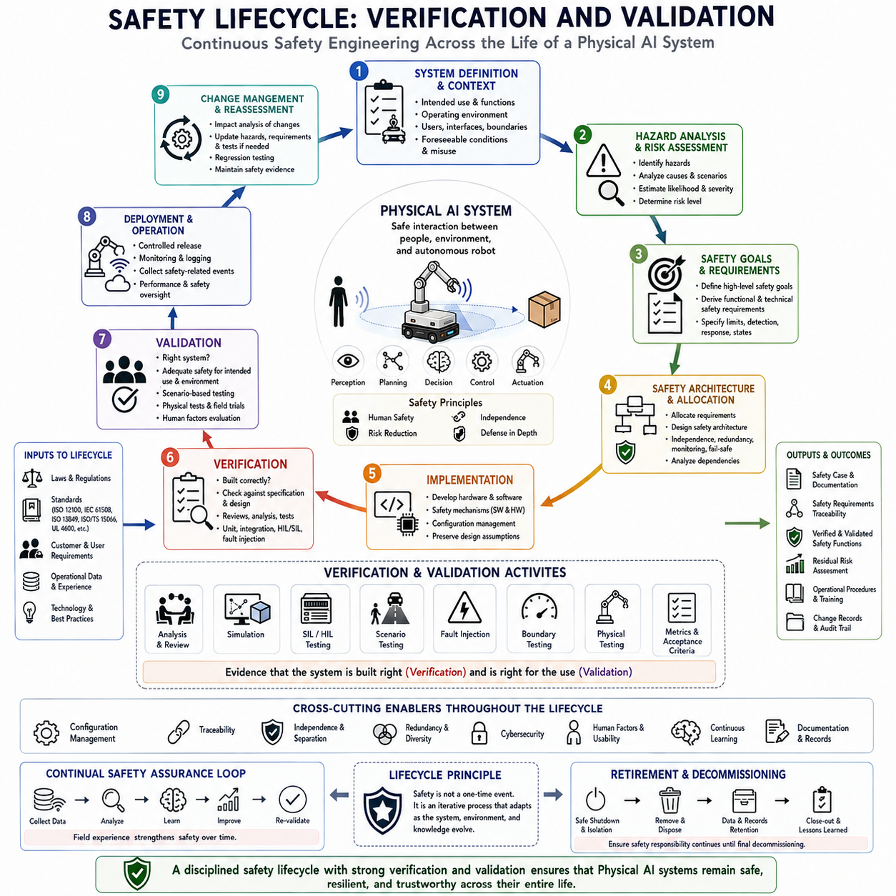{width="7.268055555555556in" height="7.268055555555556in"}

안전 수명주기(Safety Lifecycle)는 물리 AI(Physical AI) 시스템의 전체 수명 동안 안전을 확립하고, 구현하고, 입증하고, 유지하며, 재평가하기 위한 구조화된 프로세스를 제공한다. 안전은 자율 기능 개발이 완료된 이후 수행하는 최종 시험으로 취급할 수 없다. 위험원, 요구사항, 아키텍처, 구현, 검증, 유효성 확인, 배포, 운용, 변경 및 폐기는 지속적인 안전 엔지니어링(Continuous Safety Engineering)을 통해 서로 연결되어야 한다.

수명주기는 시스템, 의도된 기능, 운용 환경, 사용자, 인터페이스, 경계 및 합리적으로 예측 가능한 조건을 정의하는 것에서 시작한다. 물리 AI의 경우 이러한 정의에는 하드웨어와 기존 소프트웨어뿐만 아니라 인식, 월드 모델(World Model), 학습 정책(Learned Policy), 계획, 통신, 인간과의 상호작용 및 물리적 액추에이션(Physical Actuation)이 포함되어야 한다. 불완전한 시스템 경계(System Boundary)는 중요한 위험원을 안전 분석 밖에 남겨둘 수 있다.

위험원 분석 및 위험 평가(Hazard Analysis and Risk Assessment)는 수명주기에서 통제해야 하는 안전 문제를 확립한다. 위험 사건은 로봇 움직임, 에너지, 환경과의 상호작용, 사람과의 근접성, 구성요소 결함, 소프트웨어 고장, AI 불확실성, 잘못된 인식, 불안전한 계획, 통신 손실 및 예측 가능한 오용을 고려하여 식별한다. 그 결과로 이루어지는 위험 평가는 위험 감소가 필요한 영역을 결정하고 안전 목표(Safety Goal)를 정의하는 기반을 제공한다.

안전 목표(Safety Goal)는 허용할 수 없는 위험을 요구되는 보호 수준에 대한 상위 수준의 명세로 변환한다. 이러한 목표는 무엇을 감지하고, 방지하고, 제한하고, 모니터링하거나 제어해야 하는지를 정의하는 기능적 및 기술적 안전 요구사항(Functional and Technical Safety Requirements)으로 점진적으로 구체화된다. 요구사항에는 안전 속도, 분리 거리, 정지 행동, 결함 대응, 센서 범위, 제어 독립성, 진단 능력, 성능 저하 운용 및 안전 상태 또는 최소 위험 상태(Minimum-Risk Condition)로의 전환 등이 포함될 수 있다.

추적성(Traceability)은 각각의 안전 요구사항을 이를 정당화하는 위험원 및 위험과 연결한다. 동일한 추적성은 아키텍처, 구현, 검증 증거, 유효성 확인 시나리오 및 구성 항목(Configuration Item)까지 이어져야 한다. 이를 통해 특정 안전 메커니즘이 왜 존재하는지, 어떻게 구현되었는지, 그리고 의도된 안전 목표를 충족한다는 것을 어떤 증거가 입증하는지를 보여주는 감사 가능한 연결 체인(Auditable Chain)을 구축할 수 있다.

안전 아키텍처(Safety Architecture)는 요구사항을 기술적인 구조로 변환한다. 독립 안전 제어기(Independent Safety Controller), 모니터, 안전 센서, 중복 채널, 통신 감시, 하드웨어 인터록(Hardware Interlock), 움직임 제한, 폴백 제어(Fallback Control) 및 에너지 격리(Energy Isolation) 등을 식별된 위험에 따라 배치할 수 있다. 또한 외관상 독립적인 메커니즘이 필요한 보호 기능을 무력화할 수 있는 공통 고장을 공유하지 않도록 아키텍처 분석에서 종속성을 검토해야 한다.

구현(Implementation)은 안전 설계 과정에서 확립된 가정을 유지해야 한다. 소프트웨어 안전 기능에는 통제된 인터페이스, 제한된 행동, 필요한 경우 결정론적 대응(Deterministic Response), 보호된 실행 및 구성 관리(Configuration Management)가 요구된다. 하드웨어 안전 메커니즘에는 적절한 진단, 환경 대응 능력, 타이밍 성능 및 고장 행동이 필요하다. AI 구성요소는 그 행동이 학습 데이터, 상황, 불확실성 및 운용 분포(Operating Distribution)에 따라 달라질 수 있으므로 특별한 주의가 필요하다.

검증(Verification)은 시스템이 명시된 요구사항과 설계에 따라 구축되었는지를 확인한다. 개별 구성요소, 인터페이스, 알고리즘, 안전 메커니즘, 통신 경로, 타이밍 행동 및 통합 기능을 정의된 기준에 따라 평가한다. 검토, 분석, 시뮬레이션, 정적 검사, 단위 시험(Unit Test), 통합 시험(Integration Test), 하드웨어 시험 및 결함 주입(Fault Injection)은 모두 구현이 안전 명세(Safety Specification)를 준수한다는 증거를 제공할 수 있다.

유효성 확인(Validation)은 이와 다른 질문을 다룬다. 완성된 시스템이 의도된 사용 목적과 운용 환경에서 적절한 안전을 제공하는지를 확인하는 것이다. 기능이 기술적 명세를 만족하더라도 해당 명세가 현실적인 위험을 충분히 반영하지 못했다면 시스템은 여전히 부적절할 수 있다. 따라서 유효성 확인에서는 대표적인 시나리오, 인간과의 상호작용, 환경 변화, 운용 워크플로, 예측 가능한 교란 및 자율 행동의 실제 물리적 결과를 중요하게 평가한다.

검증(Verification)과 유효성 확인(Validation)은 서로 구분되어야 하지만 긴밀하게 연결되어야 한다. 검증은 지정된 분리 거리 임계값이 침해될 때 보호 정지(Protective Stop)가 활성화되는지를 입증할 수 있으며, 유효성 확인은 해당 임계값이 현실적인 운용에서 충분한 보호를 제공하는지를 평가한다. 검증은 요구사항에 대한 적합성(Conformance)에 초점을 맞추고, 유효성 확인은 해당 요구사항과 구현이 실제 환경에서 허용 가능한 수준의 안전한 시스템을 만들어내는지를 평가한다.

물리 AI는 안전이 상호작용과 상황에 크게 의존하기 때문에 시나리오 기반 유효성 확인(Scenario-Based Validation)이 필요하다. 시나리오에는 다양한 사람의 접근 방식, 장애물 구성, 로봇 속도, 적재물, 노면, 조명, 필요한 경우 기상 조건, 센서 가림(Occlusion), 통신 상태 및 임무 조건이 포함되어야 한다. 정상적인 궤적만 시험하면 잘못된 신뢰를 제공할 수 있는데, 중요한 위험 중 상당수가 평범한 조건들의 비정상적인 조합에서 나타나기 때문이다.

경계 조건(Boundary Condition)은 특별한 주의가 필요하다. 안전 고장은 최대 속도, 최소 분리 거리, 센서 범위 한계, 위치 추정 불확실성 임계값, 적재 한계, 급경사, 통신 마감시간 또는 운용 모드 전환과 같은 경계 부근에서 자주 나타난다. 검증에서는 이러한 경계와 경계를 약간 벗어난 조건을 의도적으로 시험하여 시스템이 예측할 수 없게 실패하는 것이 아니라 보수적으로 대응하는지를 확인해야 한다.

결함 주입(Fault Injection)은 진단 및 결함 허용 메커니즘(Fault-Tolerance Mechanism)의 효과에 대한 증거를 제공한다. 센서 손실, 손상된 측정값, 오래된 메시지, 프로세서 정지, 메모리 결함, 액추에이터 성능 저하, 브레이크 고장, 전원 교란, 통신 중단 및 유효하지 않은 AI 명령 등을 의도적으로 발생시킬 수 있다. 목적은 결함이 감지되고 격리되며 사용 가능한 시간 안에 적절한 물리적 안전 대응으로 전환되는지를 확인하는 것이다.

AI 고유 유효성 확인(AI-Specific Validation)은 기존의 구성요소 고장 이상을 검토해야 한다. 학습 시스템(Learned System)은 계산 측면에서는 정상적으로 계속 동작하면서도 잘못된 출력을 생성할 수 있다. 따라서 시험에는 익숙하지 않은 환경, 모호한 관측, 분포 변화(Distribution Shift), 상충하는 센서 증거, 낮은 신뢰도의 예측, 예상하지 못한 객체 구성 및 학습 정책이 물리적으로는 실행 가능하지만 불안전한 행동을 제안하는 상황이 포함되어야 한다.

시뮬레이션(Simulation)은 물리적으로 재현하기에 비용이 많이 들거나 위험하거나 어려운 많은 시나리오에 시스템을 노출함으로써 안전 평가 범위를 확장할 수 있다. 매개변수 변화, 무작위 환경, 합성 교란(Synthetic Disturbance) 및 희귀 사건 시나리오를 통해 행동의 취약 영역을 발견할 수 있다. 그러나 부정확한 시뮬레이터가 안전에 중요한 물리적 영향을 숨길 수 있으므로 시뮬레이션 증거에서는 모델의 한계를 고려해야 한다.

하드웨어 인 더 루프(Hardware-in-the-Loop, HIL) 및 소프트웨어 인 더 루프(Software-in-the-Loop, SIL) 시험은 시뮬레이션과 완전한 물리 시험 사이의 간극을 연결할 수 있다. 실제 제어기, 안전 로직, 통신 인터페이스 또는 컴퓨팅 하드웨어를 시뮬레이션된 구성요소 및 환경과 연결할 수 있다. 이러한 방법은 완전한 로봇과 주변 사람 또는 장비를 위험한 시험 조건에 노출하기 전에 타이밍, 인터페이스, 자원 경합, 고장 대응 및 통합 행동을 평가하는 데 도움을 준다.

시뮬레이션에서 충분한 신뢰도로 표현할 수 없는 현상에 대해서는 물리적 시험(Physical Testing)이 여전히 필요하다. 실제 제동 거리, 휠 슬립(Wheel Slip), 적재물 동역학, 매니퓰레이터 컴플라이언스(Manipulator Compliance), 센서 간섭, 진동, 열적 행동, 접촉력 및 환경적 성능 저하는 대표 하드웨어에서 직접 측정해야 할 수 있다. 물리적 유효성 확인은 적절한 시험 안전조치를 유지하면서 통제된 조건에서 점차 현실적인 운용 조건으로 확대되어야 한다.

복잡한 자율 시스템의 모든 상태를 유한한 시험 프로그램으로 검토할 수 없기 때문에 커버리지(Coverage)는 핵심적인 과제이다. 따라서 안전 보증(Safety Assurance)은 시험과 함께 분석, 아키텍처적 제약, 모니터링, 중복성, 보수적인 제한 및 운용 제한을 결합한다. 목표는 가능한 모든 AI 출력이 정확하다는 것을 입증하는 것이 아니라 신뢰할 만한 불안전 행동이 방지, 감지, 제한되거나 통제 가능한 상태로 전환된다는 것을 입증하는 것이다.

가능한 경우 시험 전에 합격 기준(Acceptance Criteria)을 정의해야 한다. 요구되는 정지 시간, 최대 속도, 최소 분리 거리, 진단 응답 시간, 위치 추정 유효성, 허용 힘, 통신 타임아웃, 결함 대응 및 안전 상태 행동에는 측정 가능한 기준이 있어야 한다. 사전에 정의된 기준이 없다면 시험 결과가 주관적으로 해석될 수 있으며, 관찰된 고장이 기존 안전 요구사항에 따라 평가되는 대신 사후에 합리화될 위험이 있다.

시험 독립성(Test Independence)은 안전 증거에 대한 신뢰도를 높일 수 있다. 기능을 개발한 엔지니어는 중요한 기술적 지식을 가지고 있지만 독립적인 검토 또는 유효성 확인을 통해 구현 팀이 간과할 수 있는 가정을 검토할 수 있다. 필요한 독립성 수준은 위험과 보증 목표에 따라 달라지지만, 개발과 최종 안전 판단을 분리하면 확증 편향(Confirmation Bias)을 줄이고 결론의 신뢰성을 향상시킬 수 있다.

검증 및 유효성 확인 과정에서 발견된 이상(Anomaly)은 단순히 제거해야 할 결함이 아니라 시스템에 대한 증거로 취급해야 한다. 시험 실패는 잘못된 요구사항, 숨겨진 종속성, 불충분한 안전 마진, 비현실적인 환경 가정 또는 이전에 식별하지 못했던 위험원을 드러낼 수 있다. 따라서 시정 조치(Corrective Action)는 근본적인 안전 논거(Safety Argument)를 검토하고 관련 분석, 요구사항 및 시험까지 변경해야 하는지를 판단해야 한다.

안전 증거(Safety Evidence)는 일관된 안전 사례(Safety Case) 또는 이에 상응하는 보증 구조로 구성되어야 한다. 위험원 분석, 요구사항, 아키텍처 결정, 검증 결과, 유효성 확인 결과, 결함 주입 증거, 가정, 한계 및 잔여 위험(Residual Risk)이 함께 정의된 운용에서 시스템이 허용 가능한 수준으로 안전하다는 주장을 뒷받침해야 한다. 증거는 추적 가능하고, 재현 가능하며, 특정 구성에 대응하고, 검토자가 이해할 수 있어야 한다.

배포(Deployment)가 안전 수명주기의 끝을 의미하지는 않는다. 실제 현장 환경에서는 개발 과정에서 충분히 표현되지 않았던 조건의 조합이 나타날 수 있다. 운용 모니터링(Operational Monitoring)을 통해 보호 정지, 비상 정지, 센서 성능 저하, 위치 추정 실패, 안전 우선 제어(Safety Override), 통신 손실, 비정상적인 AI 불확실성 또는 반복적인 폴백 활성화와 같은 안전 관련 사건을 수집할 수 있다. 이러한 관측은 지속적인 안전 평가를 위한 증거를 제공한다.

배포 이후의 변경에는 체계적인 영향 분석(Impact Analysis)이 필요하다. AI 모델 업데이트, 학습 데이터 변경, 센서 교체, 제어기 변경, 속도 증가, 새로운 적재물 지원, 운용 환경 변경 또는 플릿 조정(Fleet Coordination) 수정은 기존의 가정을 무효화할 수 있다. 변경된 구성을 운용하도록 승인하기 전에 영향을 받는 위험원, 요구사항, 인터페이스, 시험 및 안전 증거를 식별해야 한다.

AI 업데이트(AI Update)는 외부 인터페이스가 동일하게 유지되더라도 모델 행동이 변화할 수 있기 때문에 특히 중요한 수명주기 과제를 만든다. 새로운 모델이 평균 성능을 향상시키면서도 드문 상황에서는 서로 다른 고장 패턴을 발생시킬 수 있다. 따라서 회귀 시험(Regression Testing)은 종합적인 AI 성능 지표에만 의존하지 않고 안전 필수 시나리오, 경계 조건, 기존에 알려진 고장 사례, 불확실성 행동 및 독립 안전 메커니즘과의 상호작용을 포함해야 한다.

구성 관리(Configuration Management)는 안전 증거가 실제 배포된 시스템과 일치하도록 보장한다. 하드웨어 리비전, 펌웨어, 소프트웨어 버전, AI 모델 체크포인트(AI Model Checkpoint), 보정 매개변수, 안전 임계값, 지도, 센서 구성 및 운용 모드는 안전에 영향을 주는 경우 통제되어야 한다. 구성 무결성(Configuration Integrity)이 없다면 한 시스템 버전에 대해 성공적으로 수행된 검증 결과를 다른 버전의 안전성을 정당화하는 데 신뢰성 있게 사용할 수 없다.

장비가 노후화되고 운용 조건이 변화함에 따라 주기적인 재평가(Periodic Reassessment)가 필요하다. 브레이크 마모, 센서 오염, 배터리 성능 저하, 기계적 변경, 운용 환경 확대, 새로운 인간 작업 흐름 및 누적된 소프트웨어 변경은 최초의 위험 구조를 변화시킬 수 있다. 따라서 유지보수 정보와 운용 데이터는 안전 가정이 더 이상 유효하지 않을 가능성이 있을 때 위험원 분석, 검증 계획 및 유효성 확인 과정으로 다시 피드백되어야 한다.

퇴역 및 폐기(Retirement and Decommissioning) 역시 수명주기의 일부이다. 정상적인 운용이 종료된 이후에도 위험 에너지, 배터리, 저장된 기계적 하중, 학습 데이터, 구성 정보 및 연결된 인프라가 남아 있을 수 있기 때문이다. 자율 시스템이 더 이상 임무를 수행하지 않는다는 이유만으로 안전 책임이 사라지지 않도록 안전한 종료, 격리, 제거, 폐기 및 관련 기록 보존을 계획해야 한다.

따라서 안전 수명주기(Safety Lifecycle)는 출시 이전에 한 번 완료되는 선형적인 과정이 아니라 반복적인 보증 루프(Iterative Assurance Loop)이다. 위험원 분석은 요구사항을 생성하고, 요구사항은 아키텍처를 형성하며, 구현은 검증되고, 통합 시스템은 유효성이 확인되며, 운용 증거는 기존 가정을 시험하고, 변경은 재평가를 유발한다. 각각의 반복 과정은 지속적인 안전 운용을 뒷받침하는 증거를 강화하거나 수정한다.

물리 AI(Physical AI)에서 검증(Verification)과 유효성 확인(Validation)은 궁극적으로 지능 성능 이상의 것을 입증해야 한다. 불확실한 인식, 예측, 추론, 계획 및 학습 기반 제어가 신뢰할 수 있는 운용 및 고장 조건 전반에서 효과적인 물리적 보호에 의해 제한되고 있음을 보여주어야 한다. 체계적인 안전 수명주기는 위험원, 요구사항, 아키텍처, 시험, 현장 증거 및 변경 관리를 연결함으로써 안전이 완전한 자율 시스템의 설계되고 지속적으로 유지되는 속성(Engineered and Continuously Supported Property)이 되도록 한다.

## 02.15. Functional Safety Analysis Example

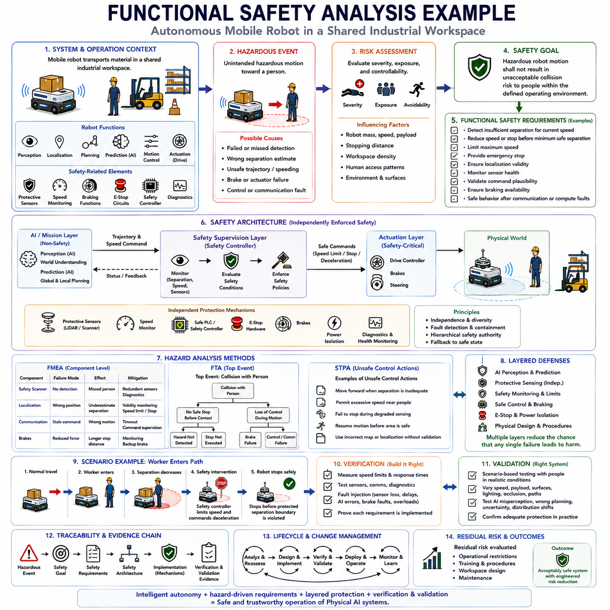{width="7.268055555555556in" height="7.268055555555556in"}

기능 안전 분석(Functional Safety Analysis)은 추상적인 안전 원칙을 구체적인 물리 AI(Physical AI) 운용 시나리오에 적용할 때 가장 실질적인 가치를 갖는다. 작업자, 지게차, 장비 및 임시 장애물이 이동 경로에 진입할 수 있는 공유 산업 작업공간에서 자재를 운반하는 자율 이동 로봇(Autonomous Mobile Robot)을 고려할 수 있다. 로봇은 인식, 위치 추정, 계획, AI 기반 예측, 움직임 제어 및 안전 메커니즘을 사용하여 주변 사람을 허용할 수 없는 위험에 노출시키지 않으면서 임무를 수행한다.

분석은 의도된 기능(Intended Function)과 시스템 경계(System Boundary)를 정의하는 것에서 시작한다. 로봇은 운송 임무를 수신하고, 자신의 위치를 결정하며, 주변 객체를 인식하고, 경로를 생성하고, 국부 움직임을 계획하여 구동 액추에이터에 명령을 전달한다. 안전 관련 요소에는 보호 센서, 속도 모니터링, 제동 기능, 비상 정지 회로, 안전 제어 및 진단 메커니즘이 포함된다. 인프라, 운영자, 플릿 조정(Fleet Coordination) 및 환경 조건도 운용 맥락의 일부를 구성한다.

대표적인 위험 사건(Hazardous Event)은 사람을 향한 의도하지 않은 위험한 움직임이다. 이러한 사건은 로봇이 사람을 감지하지 못하거나, 분리 거리를 잘못 추정하거나, 불안전한 궤적을 생성하거나, 허용 속도를 초과하거나, 제동을 실행하지 못하거나, 제어 결함 이후에도 계속 움직일 때 발생할 수 있다. 분석에서는 하나의 원인만을 가정하지 않고 인식, 계산, 통신, 제어, 액추에이터, 환경 및 사람 관련 조건의 조합이 어떻게 위험 상태를 발생시킬 수 있는지를 검토한다.

위험 평가(Risk Assessment)는 접촉으로 인해 발생할 수 있는 잠재적 심각도, 노출 가능성 또는 빈도, 그리고 위험 사건을 회피할 가능성을 고려한다. 로봇 질량, 속도, 적재물, 작업공간 밀도, 사람의 접근 가능성, 정지 거리 및 예상되는 상호작용 패턴이 평가에 영향을 준다. 무거운 로봇이 공유 통로에서 빠르게 이동하는 경우 동일한 플랫폼이 격리되고 접근이 통제된 영역에서 저속으로 운용되는 경우보다 훨씬 큰 위험을 발생시킬 수 있다.

이에 대응하는 안전 목표(Safety Goal)는 정의된 운용 환경에서 위험한 로봇 움직임으로 인해 사람이 허용할 수 없는 충돌 위험에 노출되지 않아야 한다고 규정할 수 있다. 이러한 상위 수준 목표는 특정 구현 방식을 규정하지 않는다. 대신 필요한 안전 결과를 정의하며, 이를 기반으로 센싱, 모니터링, 제어, 제동, 진단 및 운용 절차에 할당되는 보다 상세한 기능적 및 기술적 안전 요구사항(Functional and Technical Safety Requirements)을 도출할 수 있다.

하나의 기능 안전 요구사항(Functional Safety Requirement)은 현재 속도와 정지 능력에 비해 사용 가능한 분리 거리가 불충분해지는 시점을 시스템이 감지하도록 요구할 수 있다. 또 다른 요구사항은 최소 안전 분리 거리가 침해되기 전에 로봇이 속도를 낮추거나 보호 정지(Protective Stop)를 시작하도록 요구할 수 있다. 추가적인 요구사항에는 최대 속도, 비상 정지, 위치 추정 유효성, 센서 상태, 명령 타당성, 제동 가용성 및 통신이나 계산 고장 이후의 행동이 포함될 수 있다.

안전 아키텍처(Safety Architecture)는 임무 지능(Mission Intelligence)과 최종 안전 권한(Final Safety Authority)을 분리한다. AI 인식 및 계획 기능은 궤적과 목표 속도를 제안할 수 있지만, 독립적인 안전 경로(Independent Safety Path)는 그 결과로 발생하는 물리적 움직임이 검증된 한계 내에 유지되는지를 감독한다. 안전 제어기는 정의된 안전 조건이 위반되면 속도를 제한하고, 움직임 명령을 거부하고, 제어된 감속을 요청하거나, 구동 권한을 제거할 수 있다. 따라서 임무 최적화는 강제 가능한 안전 제약에 종속된다.

인식 실패(Perception Failure)는 이러한 분리가 필요한 이유를 보여준다. AI 인식 시스템이 가림(Occlusion), 특이한 복장, 불충분한 조명 또는 익숙하지 않은 자세로 인해 주변 작업자를 일시적으로 올바르게 분류하지 못한다고 가정할 수 있다. 위험한 근접 상태를 독립적인 보호 센싱(Protective Sensing)을 통해 감지할 수 있다면 안전 메커니즘은 의미적 분류(Semantic Classification)에만 의존해서는 안 된다. 보다 단순한 안전 등급 관측(Safety-Rated Observation)을 통해 정교한 인식 시스템이 잘못된 해석을 생성하더라도 보호 기능을 유지할 수 있다.

위치 추정(Localization)은 또 다른 잠재적인 고장 경로를 제공한다. 로봇이 자신의 위치 오차를 과소평가하면 허용된 통로 안에 있다고 판단하면서 실제로는 사람이나 제한 영역에 접근할 수 있다. 따라서 안전 분석에서는 위치 추정 유효성 한계와 모니터링 요구사항을 정의할 수 있다. 불확실성이 검증된 임계값을 초과하면 로봇은 속도를 낮추거나, 자율 움직임을 제한하거나, 대체 위치 추정 증거를 요구하거나, 제어 정지(Controlled Stop) 상태로 전환할 수 있다.

궤적 생성(Trajectory Generation) 역시 기술적으로 유효한 경로가 여전히 불안전할 수 있기 때문에 분석해야 한다. AI 계획기는 임무 효율성을 높이기 위해 좁은 간격, 공격적인 회전 또는 고속 기동을 선택할 수 있지만, 이러한 행동은 충분한 정지 여유를 제공하지 못할 수 있다. 안전 감독기(Safety Supervisor)는 명령이 구동 시스템에 도달하기 전에 요청된 움직임을 속도, 가속도, 조향, 안정성, 작업공간 및 분리 거리 제약과 비교하여 평가함으로써 최적화 목표가 물리적 안전 요구사항을 우선하지 못하도록 할 수 있다.

고장 형태 및 영향 분석(Failure Mode and Effects Analysis, FMEA)은 구성요소를 체계적으로 검토할 수 있다. 안전 스캐너가 유효한 측정값을 제공하지 못하거나, 위치 추정 모듈이 잘못된 위치 추정값을 생성하거나, 통신 인터페이스가 오래된 명령을 전달하거나, 브레이크 모니터링 채널이 고장 날 수 있다. 각각의 고장 형태에 대해 분석에서는 국부적인 영향, 시스템 수준의 결과, 기존 감지 메커니즘, 사용 가능한 완화 조치 및 추가 안전 조치가 필요한지를 검토한다.

결함 트리 분석(Fault Tree Analysis, FTA)은 사람과의 위험한 충돌과 같은 최상위 사건(Top Event)에서 시작함으로써 이러한 상향식 검토를 보완할 수 있다. 분석은 사람 감지 실패와 위험한 움직임 지속의 결합 또는 성공적인 위험 감지와 정지 기능 실패의 결합과 같이 해당 사건을 발생시킬 수 있는 조건을 역방향으로 추적한다. 이를 통해 개별 구성요소만 검토할 때 명확하게 드러나지 않을 수 있는 결함 조합과 종속성을 발견할 수 있다.

시스템 이론 기반 프로세스 분석(Systems-Theoretic Process Analysis, STPA)은 구성요소 고장을 넘어 분석 범위를 확장할 수 있다. 개별 구성요소가 설계된 대로 동작하더라도 잘못된 상황에서 불안전한 제어 행동(Unsafe Control Action)이 발생하면 사고가 발생할 수 있다. 예를 들어 분리 거리가 부족한 상태에서 전진 명령을 내리거나, 작업자 주변에서 과도한 속도를 허용하거나, 센싱 성능 저하 중 정지하지 않거나, 보호 영역이 실제로 안전해지기 전에 움직임을 재개하는 상황이 이에 해당한다.

결합된 분석은 안전이 하나의 센서, 알고리즘 또는 제어기에 의존해서는 안 된다는 것을 보여준다. 보호 센싱, 명령 검증, 속도 감시, 독립 안전 로직, 액추에이터 모니터링, 제동 및 비상 개입은 여러 계층의 방어(Defense Layers)를 형성한다. 이러한 메커니즘 사이의 다양성(Diversity)은 하나의 공통 오류가 모든 보호 기능을 무력화할 가능성을 낮추며, 진단 기능은 두 번째 결함으로 인해 남아 있는 안전 능력까지 상실되기 전에 성능 저하를 식별한다.

작업자가 갑자기 로봇의 이동 경로에 진입하는 구체적인 상황을 고려할 수 있다. 보호 센싱은 분리 거리가 감소하는 것을 감지하지만 로봇은 AI 계획기로부터 정상적인 전진 명령을 계속 수신한다. 안전 제어기는 현재 속도가 사용 가능한 정지 거리와 더 이상 양립할 수 없다고 판단하여 요청된 움직임을 우선적으로 무시한다. 제어된 감속(Controlled Deceleration)이 시작되고 로봇은 보호 분리 경계가 침해되기 전에 정지 상태에 도달한다.

동일한 시나리오에 결함이 추가되면 상황은 더욱 까다로워진다. 하나의 인식 채널이 작업자를 감지하지 못하지만 독립적인 보호 센서가 여전히 점유 상태를 감지한다고 가정할 수 있다. 보호 결정이 고장 난 AI 채널에만 의존하지 않기 때문에 안전 기능은 계속 유효해야 한다. 보호 센서 자체가 유효하지 않게 되면 진단 기능이 필요한 감지 범위의 손실을 식별하고 사전에 정의된 안전 전략에 따라 속도 제한, 성능 저하 운용(Degraded Operation) 또는 정지를 유발해야 한다.

제동 고장(Braking Fault)은 아키텍처에 대한 또 다른 시험을 제공한다. 제어기가 올바르게 정지를 요청하더라도 액추에이터가 예상된 감속을 생성하지 못하면 로봇은 여전히 위험할 수 있다. 따라서 피드백 모니터링(Feedback Monitoring)은 명령된 움직임과 실제 움직임을 비교해야 한다. 감속이 불충분하면 추가 제동, 토크 제거, 비상 개입 또는 사용 가능한 다른 메커니즘을 작동시킬 수 있다. 기능 안전은 위험 감지에서 물리적 위험 감소에 이르는 전체 체인을 다루어야 한다.

이 전체 체인에서 타이밍(Timing)은 매우 중요하다. 감지 시간, 센서 업데이트 주기, 통신 지연시간, 안전 로직 실행, 제어기 응답, 액추에이터 지연 및 기계적 정지 시간이 로봇이 완전히 정지하기 전까지 이동하는 전체 거리에 영향을 준다. 따라서 안전 분리 거리는 이론적인 제동 성능만이 아니라 검증된 종단 간 응답(Validated End-to-End Response)을 기반으로 해야 한다. 최악 조건의 타이밍 가정(Worst-Case Timing Assumption)은 현실적인 계산 및 환경 조건에서 검증되어야 한다.

검증(Verification)은 각각의 요구사항이 올바르게 구현되었는지를 시험할 수 있다. 엔지니어는 최대 허용 속도, 안전 제어기 응답 시간, 보호 센서 행동, 통신 타임아웃, 제동 거리, 진단 반응 및 비상 정지 성능을 측정할 수 있다. 결함 주입(Fault Injection)을 통해 센서 데이터를 의도적으로 제거하고, 메시지를 지연시키고, 임무 계산에 과부하를 발생시키고, AI 명령을 손상시키거나, 액추에이터 응답을 저하시켜 안전 메커니즘이 의도된 권한을 계속 유지하는지를 확인할 수 있다.

유효성 확인(Validation)은 이러한 검증된 메커니즘이 현실적인 운용 환경에서 적절한 보호를 제공하는지를 평가한다. 작업자는 서로 다른 방향과 속도로 접근할 수 있으며 로봇은 대표적인 적재물을 운반하면서 다양한 노면, 조명 및 장애물 조건에서 동작할 수 있다. 가림, 좁은 통로, 교차로, 후진 움직임, 회전 및 예상하지 못한 사람의 진입이 포함된 시나리오는 정의된 안전 가정이 실제 운용 환경에서도 적절하게 유지되는지를 판단하는 데 도움을 준다.

AI 고유 유효성 확인(AI-Specific Validation)에는 자율 시스템이 계산적으로는 정상 상태를 유지하면서 잘못된 의사결정을 생성하는 상황이 포함되어야 한다. 계획기가 불안전한 기동을 선택하거나, 인식 시스템이 잘못된 의미를 부여하거나, 예측 시스템이 사람의 움직임을 과소평가하거나, 학습 정책이 익숙하지 않은 장면에서 예상하지 못한 방식으로 대응할 수 있다. 안전 목표는 반드시 AI가 항상 정확하도록 보장하는 것이 아니라 잘못된 출력이 자유롭게 위험한 물리적 행동으로 전환되지 못하도록 하는 것이다.

분석을 통해 생성된 증거는 추적 가능해야 한다. 위험 사건(Hazardous Event)은 안전 목표로 연결되고, 안전 목표는 기능적 및 기술적 요구사항으로 이어지며, 요구사항은 센서, 제어기, 소프트웨어, 드라이브 및 물리적 메커니즘에 할당된다. 이후 검증과 유효성 확인을 통해 이들의 구현과 효과를 입증한다. 이러한 추적성(Traceability)을 통해 검토자는 식별된 위험이 어떻게 측정 가능하고 시험 가능한 보호 기능으로 변환되는지를 명확하게 이해할 수 있다.

안전 메커니즘을 적용한 이후에는 잔여 위험(Residual Risk)을 평가해야 한다. 어떠한 아키텍처도 생각할 수 있는 모든 위험을 완전히 제거할 수 없으며, 남아 있는 위험은 운용 제한, 유지보수, 교육, 작업공간 설계 또는 환경 조건에 대한 가정에 의존할 수 있다. 잔여 위험이 여전히 허용할 수 없는 수준이라면 추가적인 기술적 보호 또는 운용 제약이 필요하다. 안전 수용(Acceptance)은 고도화된 AI가 해결되지 않은 위험을 보상할 것이라는 기대가 아니라 증거를 기반으로 이루어져야 한다.

이 사례는 구성 관리(Configuration Management)와 수명주기 관리(Lifecycle Management)가 기능 안전의 일부인 이유도 보여준다. 최대 속도를 증가시키거나, 타이어를 변경하거나, 적재 용량을 수정하거나, 보호 센서를 교체하거나, 제동 매개변수를 업데이트하거나, 새로운 AI 계획기를 배포하면 정지 성능과 고장 행동이 달라질 수 있다. 이러한 변경은 영향 분석(Impact Analysis)을 유발해야 하며, 필요한 경우 변경된 구성이 운용 승인을 받기 전에 다시 검증 및 유효성 확인을 수행해야 한다.

운용 모니터링(Operational Monitoring)은 또 다른 피드백 경로를 제공한다. 반복적인 보호 정지, 위치 추정 성능 저하, 비정상적인 제동 사건, 센서 결함, AI 불확실성 또는 예상하지 못한 폴백 활성화(Fallback Activation)는 재평가가 필요한 가정을 드러낼 수 있다. 현장 증거(Field Evidence)는 위험원 분석과 시험 계획으로 다시 피드백되어야 하며, 이를 통해 안전 보증이 최초 배포 이전에 달성된 상태에 고정되지 않고 축적되는 운용 경험과 함께 발전하도록 해야 한다.

이 기능 안전 분석 사례(Functional Safety Analysis Example)는 위험한 물리적 상호작용에서 공학적으로 설계된 보호 기능까지 이어지는 종단 간 추론 체인(End-to-End Reasoning Chain)을 보여준다. 위험원 식별은 무엇이 잘못될 수 있는지를 정의하고, 위험 평가는 그 중요성을 결정하며, 안전 목표는 요구되는 결과를 설정하고, 아키텍처는 보호 권한을 할당하며, 안전 메커니즘은 행동을 제한하고, 검증과 유효성 확인은 전체 시스템이 의도된 위험 감소를 달성한다는 증거를 제공한다.

물리 AI(Physical AI)에서 핵심적인 교훈은 지능 성능(Intelligent Performance)과 안전 보증(Safety Assurance)이 서로 연결되어야 하지만 동일한 것으로 취급되어서는 안 된다는 것이다. AI는 인식, 예측, 계획 및 적응을 향상시킬 수 있지만, 기능 안전(Functional Safety)은 물리적 실행 주변에 독립적으로 강제 가능한 한계를 설정한다. 따라서 정당화 가능한 시스템(Defensible System)은 지능형 자율성, 위험원 기반 요구사항, 계층화된 보호, 결함 격리, 검증된 정지 능력, 현실적인 유효성 확인, 추적성 및 지속적인 수명주기 재평가를 결합해야 한다.
