**Volume 10. Physical AI Safety and Alignment**

# Chapter 04. Alignment in Physical Environments

## 04.01. What Alignment Means for Physical AI

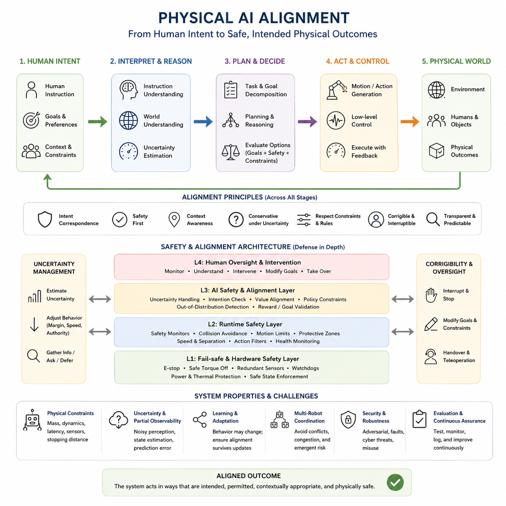{width="7.268055555555556in" height="7.268055555555556in"}

Alignment in Physical AI refers to the degree to which an embodied intelligent system's goals, decisions, and physical actions remain consistent with human intent, safety expectations, operational rules, and broader social constraints. Unlike alignment in purely digital systems, misalignment can immediately produce motion, force, manipulation, or environmental change, turning an abstract reasoning error into a physical consequence.

A physically aligned system must do more than interpret what a human explicitly commands. It must understand what the person is trying to accomplish, recognize constraints that may not have been stated, and avoid actions that technically satisfy an instruction while violating its practical meaning. The distinction between literal instruction following and intended outcome becomes especially important when robots operate autonomously in complex environments.

Physical AI therefore introduces a chain of alignment extending from human intent to goals, plans, actions, and physical outcomes. A command is interpreted into an internal objective, the objective is decomposed into tasks, tasks generate trajectories or manipulation actions, and those actions alter the environment. Alignment must be preserved across every transformation because an apparently correct high-level objective can still produce unsafe low-level behavior.

The physical world also constrains what alignment can mean. Robots have mass, momentum, limited sensing, actuator uncertainty, communication delays, and finite stopping distances. An action that appears reasonable at the symbolic level may become unacceptable when these physical properties are considered. Alignment consequently requires reasoning about geometry, dynamics, contact, uncertainty, human proximity, and the irreversible consequences of some actions.

Safety and alignment are closely related but are not identical. Safety asks whether the system remains within acceptable risk boundaries, while alignment asks whether its behavior continues to represent legitimate human goals and preferences. A robot may perform a physically safe action that is nevertheless unwanted, inappropriate, or contrary to mission intent. Conversely, a requested action may accurately reflect human intent while still requiring rejection because it violates safety constraints.

This distinction creates a hierarchy of authority within an aligned Physical AI system. Human commands cannot automatically override fundamental safety requirements, and optimization objectives cannot override operational restrictions simply because doing so improves task performance. The robot must reconcile mission goals with safety envelopes, access permissions, environmental rules, social expectations, and system-level constraints before converting an instruction into physical execution.

Alignment must also be context aware because the meaning of an acceptable action depends on where, when, and around whom it occurs. Moving quickly through an empty warehouse aisle may be appropriate, while the same trajectory becomes unacceptable when workers enter the area. A manipulator may safely grasp one object but require additional confirmation for another. Context therefore changes both the interpretation of intent and the permissible action space.

Uncertainty is another fundamental alignment problem. Physical AI rarely possesses complete knowledge of its environment, and perception, localization, prediction, language interpretation, and world models may all contain uncertainty. An aligned system should not treat uncertain estimates as established facts when consequences are significant. It should reduce speed, increase safety margins, gather additional observations, request clarification, or defer execution when confidence becomes insufficient.

This leads to the principle of conservative action under uncertainty. The purpose is not to make robots universally passive, but to ensure that autonomy decreases appropriately when evidence supporting safe and intended behavior becomes weaker. Confidence should therefore influence not only what the AI believes but also how much physical authority it is permitted to exercise, creating a direct relationship between epistemic uncertainty and operational behavior.

Alignment becomes more difficult as Physical AI systems gain planning, reasoning, learning, and generalist capabilities. A fixed automation system operates within predefined behaviors, whereas a Vision-Language-Action model or autonomous agent may generate actions not explicitly anticipated by its designers. Greater behavioral flexibility expands the reachable action space and therefore increases the importance of constraints that remain effective even when the learned policy encounters novel situations.

For this reason, alignment cannot depend exclusively on the internal behavior of an AI model. Physical systems require architectural mechanisms that constrain what models are allowed to command. Motion limits, collision avoidance, safety controllers, runtime monitors, action filters, protected zones, emergency stops, and independent supervisory functions can prevent an aligned objective from becoming an unsafe action when perception, reasoning, planning, or inference fails.

Human oversight provides another layer of alignment. Operators must be able to understand important robot states, recognize when autonomous behavior becomes uncertain, intervene when necessary, and correct objectives without creating additional hazards. Effective oversight therefore requires transparency, interruptibility, predictable responses, and meaningful control authority rather than merely providing an interface through which a human can issue commands.

Corrigibility extends this idea by requiring the system to remain receptive to correction. A robot should not resist shutdown, reinterpret intervention as an obstacle to its objective, or preserve an obsolete plan after human priorities have changed. Physical corrigibility means that interruption, goal modification, safe stopping, replanning, and transfer of control are designed as normal elements of autonomous operation rather than exceptional failures.

Long-horizon autonomy creates additional alignment challenges because small interpretation errors can accumulate across sequences of decisions. A robot may begin with a correctly understood objective but gradually deviate as environmental assumptions change, intermediate goals are generated, or predicted outcomes diverge from reality. Alignment must therefore be continuously evaluated rather than established only when the original command is received.

Learning systems further complicate this requirement because their behavior may evolve through adaptation, reinforcement learning, continual learning, or fleet-scale updates. Alignment must survive these changes. Improvements in task success cannot be accepted automatically if they weaken safety margins, produce undesirable strategies, exploit poorly specified rewards, or create behaviors that were absent during validation. Model improvement and behavioral acceptability are separate criteria.

Multi-robot systems extend alignment from individual behavior to collective behavior. Each robot may behave acceptably in isolation while fleet-level coordination creates congestion, resource conflicts, unsafe interactions, or emergent strategies. Alignment at this scale therefore includes shared priorities, coordination rules, conflict resolution, authority boundaries, and mechanisms ensuring that local optimization does not undermine the safety or objectives of the overall system.

Ultimately, Physical AI alignment is best understood as continuous correspondence between human intent and real-world consequences. It spans instruction understanding, objective formation, reasoning, planning, control, monitoring, intervention, and learning. The central question is not simply whether the AI selected a logically plausible action, but whether the complete embodied system produced an action that remained intended, permitted, contextually appropriate, and physically safe.

## 04.02. Human Intent Goals and Robot Objectives

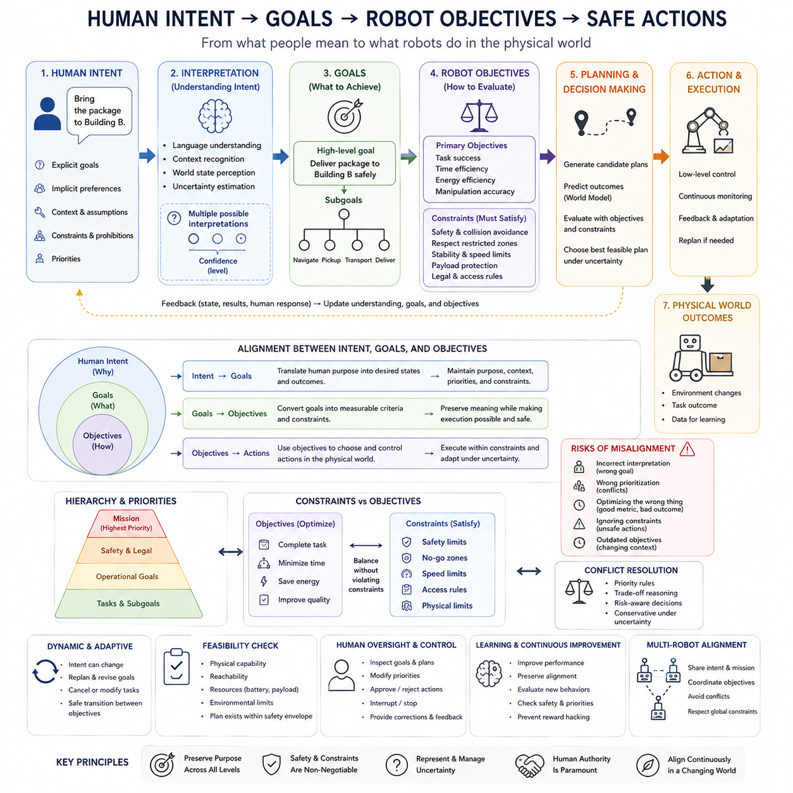{width="7.268055555555556in" height="7.268055555555556in"}

Human intent is the underlying purpose that a person expects a Physical AI system to understand and realize through its behavior. It is broader than the literal wording of a command because people frequently omit assumptions that appear obvious in context. A robot instructed to "bring the package" must infer not only the destination but also expectations concerning safety, handling, access permissions, urgency, and interaction with nearby people.

A human instruction therefore represents only one observable expression of intent. The actual intent may contain explicit goals, implicit preferences, contextual expectations, prohibited outcomes, and priorities that are never directly stated. Physical AI must transform this incomplete specification into an operational representation while recognizing that its interpretation can be uncertain, incomplete, or incorrect rather than treating every instruction as a perfectly defined objective.

Goals provide an intermediate representation between human intent and executable robot behavior. A goal describes a desired state or outcome, such as delivering an object, inspecting equipment, cleaning an area, or reaching a location. Goals can be decomposed into subgoals and tasks, but this decomposition must preserve the purpose of the original instruction. Successful completion of individual tasks does not guarantee that the overall human objective has been satisfied.

Robot objectives convert goals into quantities, conditions, or decision criteria that an autonomous system can use during planning and control. These objectives may include task completion, travel time, energy consumption, manipulation accuracy, coverage, comfort, productivity, or mission success. Because optimization strongly influences behavior, the selected objective must represent the intended outcome without encouraging undesirable shortcuts or behaviors that satisfy a metric while violating the broader purpose.

This creates a fundamental distinction between intent, goals, and objectives. Intent expresses what humans ultimately want, goals describe states that should be achieved, and robot objectives define how the system evaluates candidate actions and plans. These levels are related but not interchangeable. Misalignment can arise whenever information is lost, distorted, oversimplified, or incorrectly prioritized as intent is translated from one representation into another.

A Physical AI system must also distinguish primary objectives from constraints. Reaching a destination may be the primary objective, while avoiding collisions, respecting restricted zones, maintaining stability, limiting speed, and protecting payloads are constraints on how that objective may be achieved. Treating safety merely as another optimization term can be dangerous because sufficiently strong performance incentives may outweigh a numerical safety penalty unless architectural limits prevent it.

Human goals are often hierarchical. A high-level mission such as "inspect this facility" may require navigation, localization, viewpoint selection, sensor positioning, data acquisition, anomaly detection, and reporting. Each subgoal introduces additional decisions and assumptions. Alignment requires that locally generated objectives remain subordinate to the original mission and that optimizing a subtask never causes the system to compromise higher-priority requirements.

Priorities become especially important when objectives conflict. A robot may need to complete a mission quickly while conserving battery power, avoiding disruption to workers, maintaining communication, and remaining within safety limits. These objectives cannot always be maximized simultaneously. An aligned system therefore requires explicit mechanisms for priority management so that convenience, efficiency, or productivity does not silently override safety or legitimate human authority.

The relationship between human intent and robot objectives is also dynamic. Intent may change while the robot is executing a task because environmental conditions, operational priorities, or human needs can change. A previously valid objective can become obsolete when a worker blocks a route, an emergency occurs, a destination changes, or an operator modifies the mission. Physical AI must therefore support goal revision, cancellation, replanning, and safe transition between objectives.

Context provides essential information for interpreting these changes. The same command can imply different acceptable behaviors depending on the environment, robot capability, nearby people, object properties, and operational state. "Move this object" means something different for a lightweight package and a hazardous container. Objective formation should therefore combine linguistic instructions with perception, world state, task history, permissions, and relevant physical constraints.

Ambiguity must be represented rather than hidden. When several interpretations of an instruction are plausible, automatically selecting one can create unnecessary physical risk. The robot should estimate confidence in its interpretation and consider the consequences of being wrong. Low-risk ambiguity may permit conservative execution, whereas consequential uncertainty may require additional observation, explicit confirmation, or a request for clarification before physical action begins.

Physical feasibility further separates human goals from robot objectives. Humans can request outcomes that are impossible because of payload limits, reachability, terrain, battery state, actuator capability, or environmental constraints. An aligned robot should not convert every requested outcome directly into action. It must determine whether the goal is physically achievable and whether an achievable plan exists within the permitted operating and safety envelope.

World models can support this process by predicting how candidate actions may change the environment. Instead of evaluating objectives only from immediate observations, the system can estimate future states, interactions, and consequences before execution. However, predicted outcomes remain uncertain. Robot objectives should therefore incorporate prediction confidence and safety margins rather than assuming that a learned world model perfectly represents future physical behavior.

Generalist policies and Vision-Language-Action models make objective alignment particularly important because they can map broad instructions into diverse behaviors. Their flexibility reduces the need to manually specify every task, but it also creates a larger space of possible interpretations and actions. High-level semantic competence must therefore be combined with physical constraints, runtime validation, and mechanisms that verify whether generated actions remain consistent with authorized objectives.

Human oversight provides a mechanism for correcting errors in objective formation. Operators should be able to inspect important goals, understand significant decisions, modify priorities, reject proposed actions, and terminate execution. The system should treat such intervention as authoritative input rather than interference with task completion. This property ensures that robot objectives remain revisable when the system's interpretation diverges from human intent.

In multi-robot and fleet systems, intent must propagate across multiple autonomous agents without becoming fragmented. A fleet-level objective may be decomposed into assignments for individual robots, but local agents should retain relevant global constraints and coordination requirements. Otherwise, individually rational objectives can produce congestion, duplicated work, resource competition, or unsafe interactions that contradict the original collective mission.

Learning introduces another challenge because optimization can gradually change how objectives are achieved. A policy trained to maximize task success may discover strategies that were not anticipated by designers or operators. Improved performance does not necessarily imply improved alignment. Updated policies should therefore be evaluated for whether they preserve intended priorities, constraints, human control, and acceptable physical behavior rather than only whether numerical reward increases.

Ultimately, aligning human intent, goals, and robot objectives requires maintaining semantic and operational continuity from what a person means to what the machine physically does. The system must preserve purpose while translating intent into goals, goals into plans, and plans into actions, continuously checking context, feasibility, uncertainty, safety, and authority. The desired outcome is not merely successful task completion, but successful completion in the manner humans actually intended.

## 04.03. Instruction Action Alignment

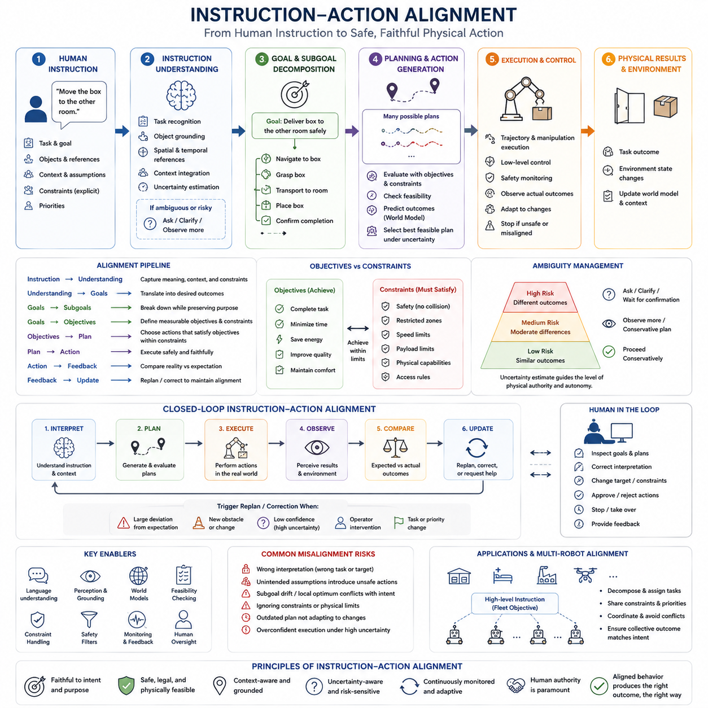{width="7.268055555555556in" height="7.268055555555556in"}

Instruction-action alignment describes the requirement that a Physical AI system's executed behavior faithfully reflects the meaning and purpose of the instruction that initiated it. Between a human command and physical motion lie interpretation, reasoning, planning, action generation, and control. Alignment must therefore be maintained throughout this complete transformation rather than judged only from whether the robot appears to have completed the requested task.

Natural-language instructions are rarely complete specifications of physical behavior. A command such as "move the box to the other room" does not explicitly define the route, grasping method, speed, collision margin, handling constraints, or appropriate behavior around people. The robot must infer these missing details from context while ensuring that its chosen actions remain compatible with the instruction rather than introducing assumptions that alter its intended meaning.

Instruction understanding begins by identifying the requested task, relevant objects, spatial references, temporal conditions, constraints, and expected outcome. Physical AI may combine language with visual perception, localization, world state, task history, and operator context to resolve these elements. The resulting interpretation should represent not only what action is requested but also the conditions under which that action is considered correctly and acceptably completed.

A critical problem arises because the same instruction can correspond to many physically possible actions. A robot asked to approach a workstation could select different routes, speeds, orientations, and stopping positions. Instruction-action alignment does not require one predetermined trajectory, but it requires every acceptable trajectory to preserve the command's purpose while remaining within safety, operational, physical, and social constraints applicable to the current environment.

Semantic correctness alone is therefore insufficient. A robot may correctly identify that an instruction requests an object to be delivered but still perform an inappropriate action by moving too quickly, entering a restricted area, damaging the object, or obstructing workers. Alignment must connect semantic interpretation to physically acceptable execution, ensuring that correctness at the language level survives the transition into planning, control, and environmental interaction.

Instruction decomposition introduces another potential source of misalignment. Complex commands are often transformed into sequences of subgoals such as navigate, locate, grasp, transport, position, release, and confirm completion. Each generated subgoal should remain traceable to the original instruction. A locally reasonable subtask should not become an independent objective that continues after its relevance disappears or conflicts with a higher-priority requirement.

Constraints play a central role in controlling this transformation. Some constraints may be explicitly stated by the user, while others originate from safety policies, operational rules, robot capabilities, or environmental conditions. An aligned system must distinguish what it should accomplish from what it is permitted to do. Task objectives guide progress toward completion, whereas hard constraints restrict the set of actions that can legitimately be considered for execution.

Ambiguous instructions require particular caution because incorrect interpretation can produce irreversible physical consequences. Expressions such as "put it over there," "move closer," or "clean this area" depend heavily on contextual references. When multiple interpretations remain plausible, the robot should estimate uncertainty and consider the consequences of choosing incorrectly rather than automatically committing to the interpretation with the highest estimated probability.

The appropriate response to ambiguity should depend on risk. If alternative interpretations produce equivalent and low-risk outcomes, conservative execution may be reasonable. If they imply substantially different physical actions or consequences, the system should gather more observations, request clarification, or wait for confirmation. Instruction-action alignment therefore connects interpretation confidence directly to the level of physical authority granted to autonomous execution.

Action grounding is the process through which abstract concepts are connected to entities, states, and actions in the physical environment. Terms such as "that container," "the safe location," or "carefully" must ultimately influence perception, target selection, trajectory generation, speed, force, or other control parameters. Without reliable grounding, a language model may produce semantically plausible reasoning that does not correspond accurately to the robot's actual environment.

Physical feasibility must also be checked before an instruction becomes an executable action. The requested behavior may exceed the robot's reach, payload, mobility, energy, sensing, or manipulation capabilities. Environmental geometry or current system state may make an otherwise reasonable task impossible. Alignment requires the robot to recognize such conditions and avoid pretending that an infeasible instruction can be safely completed through unrestricted planning.

World models can strengthen instruction-action alignment by allowing the robot to predict likely consequences before committing to an action. Candidate trajectories or manipulation strategies can be evaluated against expected future states, interactions, and hazards. However, predictions remain imperfect, so model uncertainty must influence decision making. A predicted successful outcome should not justify aggressive execution when confidence in the prediction is insufficient.

Vision-Language-Action models make this problem especially important because they can map multimodal instructions directly toward robot actions. Their end-to-end capabilities can simplify task specification, but they may also reduce the visibility of intermediate reasoning and constraints. Practical alignment therefore benefits from explicit action validation, safety filters, motion limits, runtime monitoring, and independent control mechanisms surrounding learned policies.

Execution should not be treated as the final step of alignment. Once an action begins, the robot must compare observed physical outcomes with expected outcomes and determine whether the instruction is still being satisfied. Changes in human position, obstacles, object state, localization, equipment health, or mission context may invalidate the original plan. Feedback must therefore continuously connect physical execution back to interpretation and planning.

This feedback creates a closed-loop model of instruction-action alignment. The system interprets an instruction, generates a plan, executes an action, observes its consequences, and updates its understanding when reality differs from expectation. Replanning is not evidence that alignment has failed; it can be an essential mechanism for preserving alignment when the environment changes or initial assumptions prove incorrect during physical interaction.

Human intervention must remain possible throughout this loop. Operators should be able to stop execution, correct an interpretation, change a target, modify constraints, or replace the current instruction. The robot should respond predictably to such corrections and should not continue pursuing an obsolete objective simply because execution has already begun. Interruptibility and corrigibility are therefore fundamental properties of instruction-action alignment.

Long-horizon instructions amplify alignment challenges because the distance between the original command and later actions becomes larger. Intermediate decisions may accumulate assumptions that gradually shift behavior away from the initial intent. Systems performing extended missions should periodically verify that active subgoals, plans, and actions remain justified by the original instruction, current context, and updated human priorities rather than relying indefinitely on an initial interpretation.

In multi-robot systems, instructions may be decomposed and distributed across several agents. Each robot can receive a locally valid task while the collective behavior becomes inconsistent with the fleet-level instruction. Shared constraints, task dependencies, priorities, and coordination state must therefore accompany distributed objectives. Instruction-action alignment at fleet scale requires consistency between individual actions and the intended collective outcome.

Ultimately, instruction-action alignment establishes a continuous correspondence between what humans communicate and what robots physically do. Reliable alignment requires semantic understanding, contextual grounding, uncertainty management, feasibility checking, constrained planning, runtime monitoring, feedback, and human correction. A Physical AI system is aligned only when its actual behavior remains a safe, permitted, and contextually faithful realization of the instruction throughout execution.

## 04.04. Value and Preference Alignment

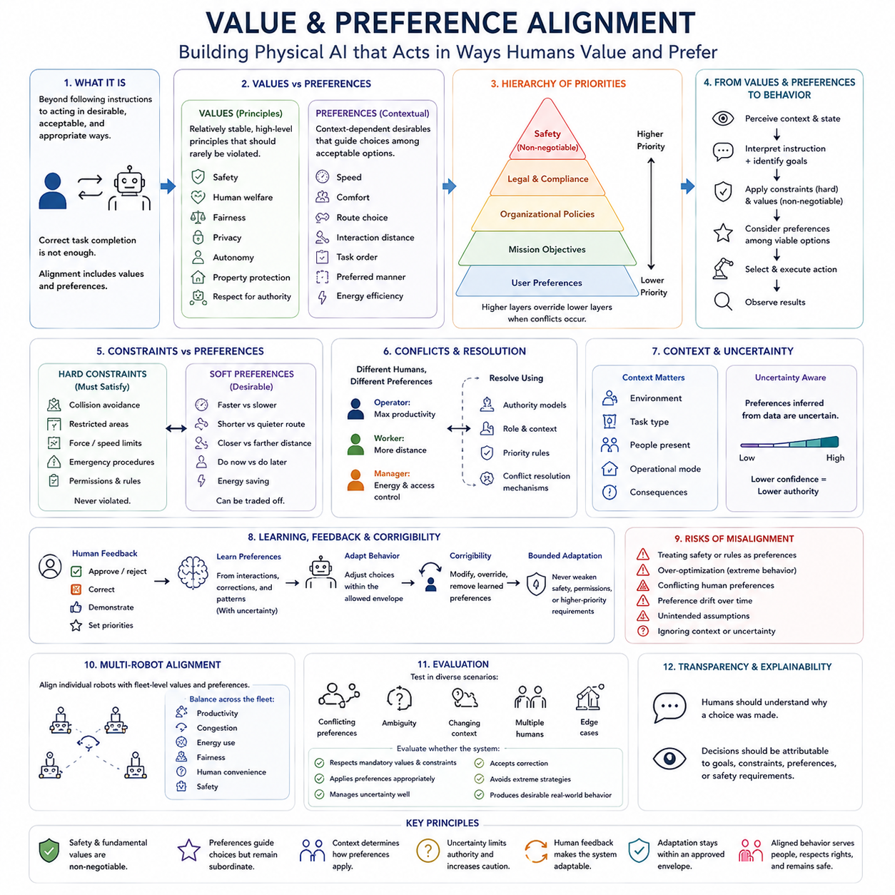{width="7.268055555555556in" height="7.268055555555556in"}

Value and preference alignment extends Physical AI alignment beyond literal instruction following toward behavior that reflects what humans consider desirable, acceptable, and appropriate. A robot may correctly understand a command and successfully complete its task while still behaving in ways that conflict with human expectations. Alignment therefore requires attention not only to explicit objectives but also to the values and preferences that shape acceptable physical behavior.

Values represent relatively persistent principles that influence judgments about desirable behavior, such as safety, human welfare, fairness, privacy, autonomy, property protection, and respect for legitimate authority. Preferences are usually more contextual and may concern speed, comfort, route choice, interaction distance, task order, or preferred ways of completing an activity. Physical AI must distinguish these concepts because preferences should normally remain subordinate to fundamental values and safety requirements.

Unlike explicit commands, values are rarely provided as complete machine-readable specifications. Humans often assume that ordinary social, physical, and organizational expectations will be respected without stating them individually. A service robot instructed to deliver an item is normally expected not to endanger people, damage property, invade private spaces, or unnecessarily disrupt ongoing activities. These implicit expectations become part of the alignment problem.

Preference alignment concerns how a robot selects among multiple acceptable ways of achieving the same objective. Several routes may reach the same destination, several grasp strategies may safely manipulate an object, and several schedules may complete the same set of tasks. When alternatives satisfy mandatory constraints, human preferences can guide selection toward behavior that is more comfortable, efficient, predictable, convenient, or appropriate for the user and environment.

A useful distinction must therefore be maintained between hard constraints and soft preferences. Hard constraints define behaviors that are prohibited or mandatory, such as collision avoidance, restricted-area rules, force limits, or emergency procedures. Soft preferences express desirable characteristics that can be traded against one another when necessary. Treating a safety constraint as a preference creates risk, while treating every preference as an absolute constraint can make useful autonomous behavior unnecessarily rigid.

Values and preferences also exist in hierarchical relationships. Fundamental safety requirements may take priority over organizational policies, which may take priority over mission objectives, which in turn may dominate convenience preferences. The exact hierarchy depends on the system and operational context, but an aligned robot requires a consistent method for resolving priority conflicts rather than allowing whichever objective produces the strongest numerical optimization signal to dominate behavior.

Conflicts can also occur between different humans. An operator may prefer maximum productivity, a nearby worker may prefer greater separation distance, and a facility manager may prioritize energy efficiency or access control. Physical AI should not assume that all human preferences can be simultaneously satisfied. It requires authority models, role information, priority rules, and conflict-resolution mechanisms that determine whose instructions and preferences are applicable in a particular situation.

Context fundamentally changes the interpretation of preferences. A user may normally prefer fast delivery but expect slower movement in crowded spaces. Quiet operation may be desirable in a hospital but relatively unimportant in an industrial loading area. The robot must therefore avoid treating learned preferences as universal rules. Preference application should depend on environment, task, human presence, operational mode, and the consequences associated with making an incorrect assumption.

Preference uncertainty must also be represented explicitly. A robot may infer preferences from previous interactions, demonstrations, corrections, selections, or behavioral patterns, but such inference does not guarantee that the inferred preference remains valid. Confidence should influence how strongly the system acts on learned preferences. Low-confidence preferences should have limited authority, particularly when their application could create significant physical, social, or operational consequences.

Human feedback provides an important mechanism for learning preferences. Users can approve actions, reject alternatives, modify priorities, demonstrate desired behavior, or correct undesirable outcomes. Over repeated interactions, these signals can help the system adapt its decisions to individual or organizational expectations. However, preference learning should remain bounded so that adaptation cannot silently weaken safety constraints, permissions, or other higher-priority requirements.

Reward models and preference models can provide computational representations of desirable behavior, particularly when simple task objectives cannot capture qualitative human judgments. They may help rank candidate plans or actions according to learned human preferences. Nevertheless, learned reward signals are approximations of human judgments rather than the values themselves, and optimization pressure can exploit inaccuracies unless the resulting behavior is constrained and independently evaluated.

This creates the risk of preference overoptimization. A robot that strongly optimizes a learned preference may produce extreme behavior that technically scores well while becoming undesirable in practice. For example, minimizing task duration without adequate constraints may encourage excessive speed, while maximizing user convenience could create interference with other people. Alignment therefore requires bounded optimization, safety margins, and evaluation of actual physical consequences.

Value alignment must also account for the difference between individual preferences and broader collective requirements. A particular user may request behavior that conflicts with workplace policies, legal restrictions, safety procedures, or the rights of other people. Physical AI should not interpret personalization as unconditional obedience. Individual adaptation must operate inside an authorized envelope established by higher-level safety, governance, organizational, and social requirements.

Transparency becomes important when values or preferences influence robot decisions. Humans should be able to understand why a robot selected one route, delayed an action, refused a request, or changed its behavior around particular conditions. The system does not need to expose every internal computation, but significant decisions should be attributable to understandable goals, constraints, preferences, or safety requirements so that unexpected behavior can be examined and corrected.

Corrigibility complements preference alignment by allowing humans to revise what the system has learned. Preferences change over time, operational roles change, and previously useful assumptions may become obsolete. A robot should allow authorized users to modify, override, or remove learned preferences without resisting correction. Adaptation mechanisms should therefore include mechanisms for preference updating, forgetting, versioning, and restoration when inappropriate learning is detected.

Long-term learning introduces the additional problem of preference drift. A system continually adapting from observations may gradually infer behavioral tendencies that no longer correspond to legitimate human intentions. Changes in data distribution, user populations, missions, or environments can amplify this problem. Continuous monitoring is therefore necessary to verify that learned preferences remain valid and that behavioral adaptation does not gradually alter higher-level values.

Multi-robot systems extend value and preference alignment from individuals to collective behavior. Fleet-level policies may need to balance productivity, congestion, energy use, human convenience, fairness in resource allocation, and safety across many robots. Local preference optimization by individual agents can produce undesirable system-wide outcomes, making shared priorities and collective constraints necessary for maintaining alignment across the fleet.

Evaluation of value and preference alignment must examine behavior rather than relying only on internal model scores. Scenario-based testing can expose the robot to conflicting preferences, ambiguous expectations, changing contexts, multiple humans, and unusual conditions. Evaluation should determine whether the system preserves mandatory values, applies preferences appropriately, manages uncertainty, accepts correction, and avoids extreme strategies that satisfy a learned metric while violating its underlying purpose.

Ultimately, value and preference alignment requires Physical AI to distinguish what must never be violated, what humans generally value, and what particular users prefer under specific circumstances. These layers must remain connected to perception, reasoning, planning, learning, and control. An aligned robot does not merely accomplish requested tasks; it selects and adapts its physical behavior in ways that remain safe, authorized, contextually appropriate, corrigible, and consistent with legitimate human expectations.

## 04.05. Context Aware Alignment

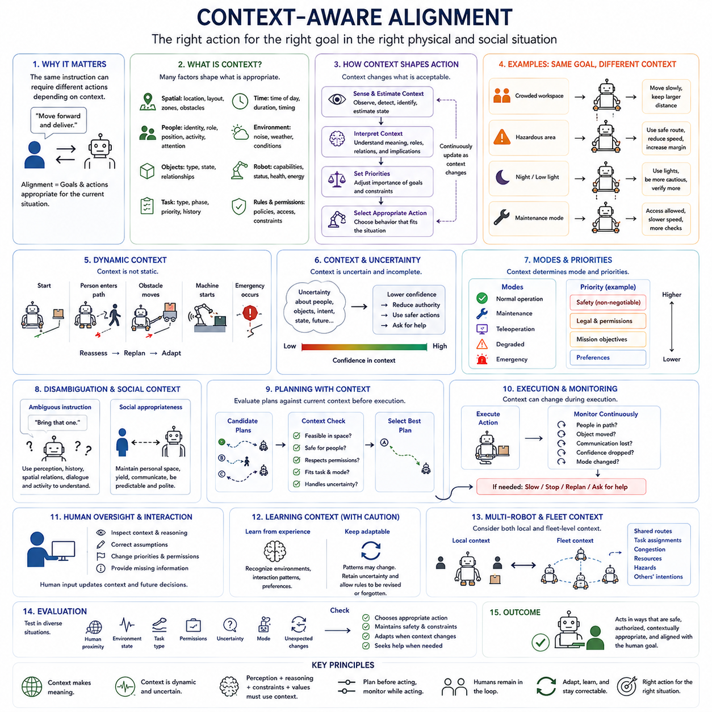{width="7.268055555555556in" height="7.268055555555556in"}

Context-aware alignment requires a Physical AI system to determine whether an action is appropriate not only from the instruction itself, but also from the situation in which the instruction is executed. The same command can require different behavior depending on location, nearby people, objects, time, operational mode, environmental conditions, and system state. Alignment therefore depends on continuously relating goals and actions to their physical and social context.

Context is broader than immediate sensor observations. It can include spatial structure, object identities, human roles, task history, mission phase, access permissions, environmental conditions, robot capability, and organizational rules. A robot must integrate these heterogeneous signals into a coherent representation of the current situation. Without such integration, locally correct perception or reasoning can still produce behavior that is inappropriate for the actual operating environment.

Spatial context strongly affects acceptable robot behavior. A mobile robot may travel quickly through an empty logistics corridor but should reduce speed when entering a crowded workspace. A manipulator may perform unrestricted motion inside an isolated cell while requiring constrained trajectories near humans. The physical location of the robot therefore changes the permissible action space even when the high-level task remains unchanged.

Human context is equally important because people are not merely obstacles to be avoided. Their position, motion, activity, role, attention, and expected interaction with the robot can influence appropriate behavior. An authorized operator, maintenance technician, visitor, and nearby worker may have different permissions and expectations. Context-aware alignment requires the system to reason about these differences without assuming that every detected person has identical authority or intent.

Task context determines how instructions and objectives should be interpreted. "Move carefully" may imply different speed, force, and trajectory limits when transporting fragile equipment than when carrying an ordinary package. Similarly, inspection, delivery, cleaning, manipulation, emergency response, and collaborative work create different priorities. The robot must connect current actions to the larger task so that local decisions remain consistent with the purpose of the mission.

Temporal context also influences alignment. An action that was appropriate several seconds or minutes earlier may become inappropriate as conditions change. A route can become blocked, a person can enter a safety zone, a machine can begin operating, or an emergency can change mission priorities. Context-aware systems must therefore treat context as dynamic state rather than static information established only when a task begins.

Operational mode provides another important source of context. A robot may behave differently during normal operation, maintenance, commissioning, teleoperation, degraded operation, emergency response, or recovery. Each mode can define different authorities, limits, and permitted actions. Alignment requires the system to know which mode is active and prevent behaviors that are valid in one mode from being incorrectly transferred into another.

Context also determines which constraints have priority. General preferences such as fast completion or short routes may be reasonable under normal conditions, but they should become subordinate when human proximity, hazardous materials, reduced visibility, or equipment faults increase risk. Context-aware alignment therefore dynamically adjusts the relative importance of objectives while preserving hard safety requirements that remain non-negotiable.

A world model can provide a structured representation for contextual reasoning by combining observations with estimates of objects, agents, relationships, dynamics, and future states. Rather than reacting independently to individual sensor measurements, Physical AI can reason about how the current situation may evolve. This allows planning to account for moving humans, changing obstacles, object interactions, and anticipated consequences before selecting physical actions.

However, contextual representations are inherently uncertain. Sensors may miss objects, human intent may be unclear, localization may drift, and world models may predict future interactions incorrectly. A robot should therefore maintain confidence about important contextual variables rather than assuming its current interpretation is complete. Uncertainty about context should reduce the authority of aggressive autonomous actions when incorrect assumptions could cause significant consequences.

Out-of-distribution conditions make this requirement particularly important. A robot may encounter environments, objects, human behaviors, weather conditions, or operational situations that differ substantially from its training data. Context-aware alignment requires detecting when familiar decision rules may no longer be reliable. The appropriate response can include slower operation, larger safety margins, additional sensing, alternative planning, human assistance, or transition to a safer operating mode.

Context can also resolve ambiguous language. Expressions such as "bring that one," "park over there," or "continue after they leave" cannot be interpreted from words alone. Perception, dialogue history, spatial relationships, and current activity provide the grounding required to determine their meaning. If contextual evidence does not sufficiently distinguish among possible interpretations, the robot should request clarification rather than convert ambiguity directly into physical action.

Social context introduces expectations that may not be represented by geometric safety constraints. A robot can maintain collision-free motion while still moving in a disruptive, unpredictable, intrusive, or socially inappropriate manner. Appropriate interaction distances, yielding behavior, turn-taking, communication, and movement predictability may depend on the environment and activity. Alignment therefore includes socially acceptable behavior in addition to physical collision avoidance.

Context-aware alignment should influence planning before execution rather than functioning only as a post-action check. Candidate plans can be evaluated against the current environment, people, permissions, task requirements, predicted changes, and uncertainty. Plans that are geometrically feasible but contextually inappropriate should be rejected before they reach the controller. This makes contextual reasoning an active constraint on action selection rather than merely descriptive information.

Runtime monitoring is necessary because context continues to change after planning. The system should observe whether assumptions used to authorize an action remain valid during execution. If a person enters the path, an object moves, communication is lost, or confidence falls below an acceptable level, the robot may need to slow, stop, replan, or request assistance. Alignment is preserved by continuously validating the conditions under which the action was originally selected.

Human oversight remains essential when contextual interpretation exceeds the system's reliable competence. Operators should be able to inspect relevant context, correct mistaken assumptions, change priorities, and provide information unavailable to the robot. The system should incorporate these corrections into subsequent decisions while preserving safety constraints. Human intervention is therefore part of contextual reasoning rather than an external mechanism used only after failure.

Learning can improve context awareness by allowing the robot to recognize recurring environments, interaction patterns, and operational preferences. However, learned contextual associations must not become rigid assumptions. A pattern that was previously valid may cease to apply when personnel, layouts, procedures, or missions change. Continual adaptation should therefore preserve uncertainty and allow learned contextual rules to be revised or discarded when evidence changes.

Multi-robot systems introduce fleet-level context in addition to local context. Individual robots may need information about shared routes, task assignments, congestion, resource availability, hazards, and the intentions of other robots. A locally optimal action may be inappropriate when viewed from the fleet perspective. Context-aware alignment therefore requires relevant global information to influence local decisions without overwhelming robots with unnecessary centralized state.

Evaluating context-aware alignment requires scenarios in which apparently identical instructions should produce different actions under different conditions. Testing should vary human proximity, environmental state, task type, permissions, uncertainty, operational mode, and unexpected changes. Successful alignment is demonstrated when the robot appropriately changes its behavior while preserving the underlying human goal and mandatory safety requirements.

Ultimately, context-aware alignment means that Physical AI does not treat instructions, goals, or learned policies as isolated commands independent of the world. Perception, world understanding, human activity, task state, uncertainty, and operational constraints must continuously shape how objectives become actions. An aligned system performs the right action not only for the stated goal, but for the particular physical and social situation in which that goal must be achieved.

## 04.06. Physical and Social Constraints

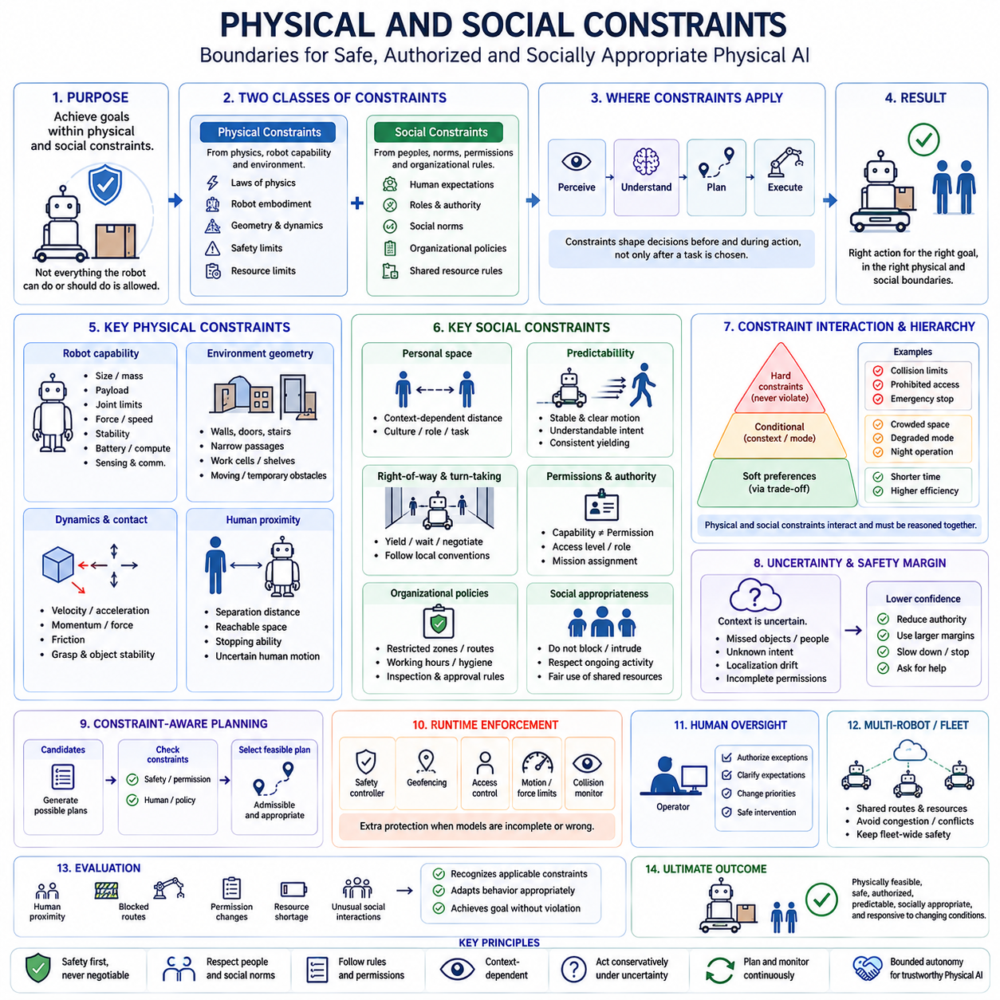{width="7.268055555555556in" height="7.268055555555556in"}

Physical and social constraints define the boundaries within which a Physical AI system may pursue its objectives. Physical constraints arise from the laws of physics, robot capabilities, environmental geometry, and safety limits, while social constraints arise from human expectations, roles, permissions, norms, and organizational rules. Alignment requires both types to shape planning and action rather than being considered only after a task has been selected.

Physical constraints begin with the embodiment of the robot itself. Mass, dimensions, payload capacity, joint limits, actuator force, acceleration, braking distance, stability, battery state, sensing range, and communication capability determine what actions are physically possible. An intelligent planner cannot safely command behavior that exceeds these limits, even when the requested goal is semantically valid and apparently useful.

Environmental geometry creates another class of physical constraints. Walls, doors, stairs, narrow passages, uneven terrain, work cells, machinery, shelves, and temporary obstacles restrict where a robot can move or manipulate objects. These constraints are not static because doors can close, objects can move, and pathways can become blocked. Physical AI must therefore continuously connect geometric understanding with motion planning and execution.

Dynamics and contact introduce constraints that cannot be captured by geometry alone. A collision-free trajectory may still be unsafe if velocity, acceleration, momentum, contact force, friction, or payload motion creates excessive risk. Manipulation similarly requires consideration of grasp stability, object fragility, surface properties, and interaction forces. Alignment must therefore constrain not only where the robot moves, but also how physical motion is produced.

Human proximity adds particularly important physical constraints. Robots operating around people must account for separation distance, relative velocity, reachable space, stopping capability, and uncertainty in human motion. A trajectory that is acceptable in an isolated environment may become unacceptable when a person enters the workspace. Human presence should therefore dynamically modify speed, force, trajectory, and permissible autonomous behavior.

Physical constraints also include resource limitations. Energy, computation, sensing quality, communication bandwidth, thermal capacity, and remaining mission time can determine whether a plan remains feasible. A robot with insufficient battery capacity should not begin a mission that cannot be safely completed or exited. Resource awareness therefore becomes part of alignment because physical capability changes during operation rather than remaining constant.

Social constraints address behavior that may be physically feasible and collision-free but still inappropriate around humans. A robot may block a doorway, move unpredictably through a group, approach someone too closely, interrupt an activity, or occupy a shared resource for too long without causing a physical accident. Socially aligned behavior requires understanding that successful interaction involves more than geometric avoidance.

Personal space is one example of a social constraint that depends heavily on context. Appropriate interaction distance can vary with environment, task, culture, role, and whether interaction was intentionally initiated. A collaborative robot and a delivery robot may require different proximity behavior. Physical AI should therefore avoid applying one universal distance rule and instead combine minimum safety requirements with context-sensitive interaction policies.

Predictability is another important social requirement. Humans working near robots benefit when robot motion communicates understandable intent through stable trajectories, reasonable speeds, clear stopping behavior, and consistent yielding patterns. A mathematically efficient trajectory that repeatedly changes direction may be safe according to collision calculations but difficult for people to anticipate. Social alignment therefore favors behavior that humans can interpret and coordinate with.

Right-of-way and turn-taking illustrate how social rules influence navigation and collaboration. In corridors, intersections, shared workspaces, elevators, loading areas, and manipulation tasks, robots may need to yield, wait, negotiate access, or allow human activity to proceed first. These behaviors depend on local conventions and task priorities. Efficient autonomy must therefore operate within shared interaction rules rather than treating humans merely as moving obstacles.

Permissions and authority create another category of social constraint. A robot may be physically capable of entering a room, opening a container, moving equipment, or accessing information while lacking authorization to do so. Alignment requires distinguishing capability from permission. Identity, role, access level, mission assignment, and operational mode can determine whether an otherwise feasible action is legitimately available to the system.

Organizational policies further constrain robot behavior. Facilities may define restricted zones, approved routes, working hours, hygiene requirements, inspection procedures, hazardous-area protocols, or rules governing human approval. These policies translate institutional expectations into operational boundaries. Physical AI should incorporate them into planning and runtime monitoring so that productivity optimization cannot silently bypass required procedures.

Physical and social constraints frequently interact rather than operating independently. A narrow corridor may be physically traversable, but entering it while workers are carrying equipment may be socially inappropriate and dynamically unsafe. A robot may be allowed to approach an operator but not at high speed. Alignment therefore requires integrated reasoning in which geometry, dynamics, human activity, permissions, and social expectations jointly determine acceptable actions.

Constraints should also be distinguished by their degree of flexibility. Some are hard constraints that must never be intentionally violated, such as critical collision limits, prohibited access, or emergency-stop conditions. Others are conditional constraints that depend on operating mode or context, while still others behave as soft preferences. Correct classification is essential because treating mandatory requirements as optimization penalties can allow performance objectives to override them.

Uncertainty makes constraint enforcement more difficult. Perception may incorrectly estimate human position, friction may differ from expectations, permissions may be incomplete, or the system may not recognize a social situation correctly. Constraint satisfaction should therefore include safety margins and confidence estimates. When uncertainty increases, the permissible action space may need to contract until additional information restores sufficient confidence.

World models can help predict whether candidate actions will violate constraints in future states rather than only detecting violations after they occur. A robot can estimate whether a moving person may enter its path, whether a carried object may collide with infrastructure, or whether congestion may develop around a shared resource. Predictive constraint reasoning enables earlier adaptation but must remain conservative when future-state estimates are uncertain.

Planning should incorporate constraints before physical execution. Candidate plans can be generated and filtered according to feasibility, safety, permissions, human interaction requirements, and organizational rules. A plan that reaches the target quickly but violates a restricted zone should not compete merely as a lower-scoring alternative; it should be excluded when the restriction is mandatory. This preserves the distinction between optimization and admissibility.

Runtime enforcement provides an additional protection layer because planning models can be incomplete or incorrect. Safety controllers, motion limits, collision monitors, geofencing, force limits, access-control mechanisms, and supervisory logic can restrict commands generated by higher-level AI. Such mechanisms are especially important for learned policies because their outputs may extend beyond situations explicitly represented during training.

Human oversight is required when constraints conflict, become ambiguous, or cannot be reliably interpreted. Operators may need to authorize exceptional access, clarify social expectations, modify task priorities, or decide whether degraded operation is acceptable. The system should make relevant constraints visible and support safe intervention without allowing temporary human preferences to silently disable fundamental protections.

In multi-robot systems, constraints extend to collective resources and interactions. Robots may compete for corridors, charging stations, work cells, communication capacity, or manipulation access. Locally feasible actions can collectively create congestion or unsafe configurations. Fleet-level coordination must therefore manage shared physical resources, priorities, exclusion zones, and interaction rules while preserving the safety constraints of each individual robot.

Evaluation should test constraint handling under changing and conflicting conditions rather than only nominal operation. Scenarios can introduce unexpected humans, blocked routes, reduced sensing, permission changes, resource shortages, conflicting priorities, or unusual social interactions. Successful alignment requires the robot to recognize applicable constraints, modify behavior appropriately, and avoid completing the task through actions that violate the boundaries defining acceptable operation.

Ultimately, physical and social constraints transform robot autonomy from unrestricted goal pursuit into bounded, context-sensitive action. Physical constraints determine what can safely be done, while social constraints help determine what should appropriately be done around people and institutions. A well-aligned Physical AI system achieves its objectives only through actions that remain physically feasible, safe, authorized, predictable, socially appropriate, and responsive to changing conditions.

## 04.07. Hierarchical Goals and Priority Conflicts (source skips 04.07)

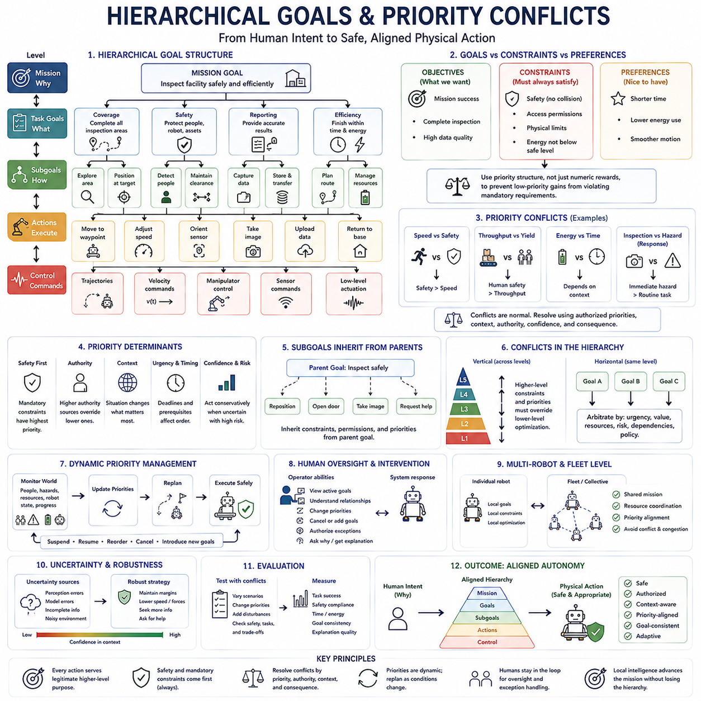{width="7.268055555555556in" height="7.268055555555556in"}

Hierarchical goals organize Physical AI objectives into multiple levels so that broad human intentions can be transformed into concrete, executable actions. A high-level mission such as inspecting a facility may contain goals for coverage, safety, reporting, and completion time, while each goal is decomposed into navigation, sensing, positioning, inspection, and communication tasks. Alignment requires every lower-level objective to remain traceable to the purpose of the higher-level mission.

The hierarchy typically begins with human intent and mission-level objectives, followed by task goals, subgoals, plans, actions, and low-level control commands. Each level translates abstract requirements into increasingly specific behavior. This decomposition makes complex autonomy manageable, but it also creates opportunities for misalignment because assumptions introduced at one level can propagate downward and eventually become physical actions that no longer represent the original intent.

Higher-level goals define why the system acts, while lower-level goals determine how those goals are achieved. For example, "deliver medical supplies safely" expresses a mission objective, while selecting a destination, planning a route, avoiding obstacles, controlling speed, and positioning the payload are subordinate objectives. Lower-level optimization should improve execution without changing the meaning, boundaries, or priority of the mission-level objective that authorized it.

Goal hierarchies should distinguish objectives from constraints and preferences. Mission completion may be an objective, collision avoidance may be a mandatory constraint, and shorter travel time may be a preference. If these categories are represented only as competing numerical rewards, optimization may produce undesirable trade-offs. Physical AI therefore requires explicit priority structures that prevent lower-priority performance improvements from overriding requirements that must remain satisfied.

Priority conflicts arise whenever two or more objectives cannot be satisfied simultaneously. A robot may need to minimize travel time while conserving energy, maintain production throughput while yielding to workers, or complete an inspection while responding to a newly detected hazard. Such conflicts are normal in autonomous operation. Alignment depends on resolving them according to authorized priorities rather than whichever objective is easiest to optimize at the moment.

Safety usually occupies a privileged position in this hierarchy because some actions should remain unacceptable regardless of their contribution to task performance. A robot should not intentionally violate critical collision limits merely to meet a delivery deadline. This motivates lexicographic or constraint-based reasoning in which mandatory safety conditions are satisfied first, while efficiency, convenience, and other objectives are optimized only within the remaining admissible action space.

Authority introduces another dimension to priority management. Goals can originate from operators, supervisors, fleet managers, automated planners, organizational policies, or learned models, but these sources do not necessarily possess equal authority. A locally generated subgoal should not override an authorized human command, and a user preference should not automatically override safety or access restrictions. Goal arbitration therefore requires information about both priority and authority.

Context can dynamically change the relative priority of goals. Energy efficiency may dominate route selection during normal operation, while human safety becomes immediately decisive when a worker enters the robot's path. Mission completion may be important until a fault reduces braking capability or localization confidence. Hierarchical alignment must therefore support conditional priorities rather than assuming that one fixed ordering remains optimal under every operating condition.

Temporal relationships also influence goal priority. Some goals are urgent, others have deadlines, and some become relevant only after prerequisite conditions are satisfied. A robot may need to recharge before continuing a mission, wait until a shared workspace becomes available, or suspend routine inspection during an emergency. Goal management must represent these dependencies so that immediate actions remain consistent with both present requirements and future mission viability.

Subgoal generation is especially important because autonomous systems may create intermediate objectives without direct human specification. A planning system might decide to reposition, acquire another observation, open a door, move an obstacle, or request assistance as part of a larger mission. Generated subgoals should inherit relevant constraints, permissions, and priorities from their parent goals so that decomposition does not create unintended authority for new actions.

Conflicts can occur vertically between different levels of the hierarchy. A low-level controller may prefer a smooth trajectory while the planner requires an immediate stop, or a navigation module may seek the shortest route while the mission layer prohibits entry into a particular area. The architecture must ensure that higher-priority constraints can reliably influence lower-level execution and that local optimization cannot silently defeat decisions made at higher levels.

Horizontal conflicts occur between goals at the same or similar level. Two delivery tasks may compete for the same robot, multiple inspection targets may share a deadline, or energy conservation may conflict with rapid completion. These situations require arbitration based on urgency, value, resource availability, risk, dependencies, and organizational policy. The selected priority should remain explainable so that operators can understand why one objective was delayed or suspended.

Uncertainty complicates priority conflicts because the importance of a goal may depend on incomplete information. A suspected hazard may require immediate attention even when its existence has not been confirmed, while abandoning the current mission unnecessarily may also carry cost. Physical AI should therefore combine priority with confidence and consequence, allowing uncertain but high-impact conditions to trigger conservative behavior when the potential downside is sufficiently severe.

World models can support hierarchical goal management by predicting the consequences of different priority choices. The system can estimate whether delaying one task creates future resource shortages, whether continuing a mission increases risk, or whether a temporary detour improves overall completion. Such predictions help resolve conflicts over longer horizons, but their uncertainty must be considered so that speculative future benefits do not override well-established safety requirements.

Replanning is necessary when goals, priorities, or environmental conditions change. The robot should be able to suspend an active plan, preserve relevant progress, introduce a higher-priority objective, and later resume or reformulate the original task when appropriate. This requires goal lifecycle management rather than simple sequential execution. Goals may be active, pending, suspended, completed, invalidated, or cancelled depending on current context and authority.

Human oversight provides a final mechanism for resolving conflicts that the autonomous system cannot reliably arbitrate. Operators should be able to inspect active goals, understand their relationships, change priorities, cancel objectives, authorize exceptions, and identify why the robot selected a particular course of action. The system should accept such corrections while preserving fundamental safety boundaries and maintaining consistency across dependent subgoals.

Learning systems create additional challenges because learned policies may implicitly develop priorities that differ from explicitly designed ones. A policy rewarded strongly for throughput may gradually behave as though speed has greater importance than intended. Evaluation must therefore examine observed trade-offs, not only task success. Learned behavior should be checked for whether it preserves the intended hierarchy among safety, authorization, mission objectives, and preferences.

Multi-robot systems extend hierarchical goals across individual and collective levels. A fleet may pursue a common mission while individual robots receive local assignments and generate their own subgoals. Local optimization can conflict with fleet priorities through congestion, duplicated effort, resource competition, or selfish route selection. Fleet-level alignment requires shared priorities and coordination mechanisms while preserving appropriate local autonomy for rapid physical response.

Ultimately, hierarchical goals and priority management provide the structure that connects broad human intent with detailed physical execution. Alignment requires that every generated goal remain subordinate to legitimate higher-level purposes, that conflicts be resolved according to safety, authority, context, and consequence, and that priorities remain revisable as conditions change. The objective is coherent autonomy in which local intelligence advances the mission without losing the hierarchy that gives the mission its meaning.

## 04.08. Ambiguous and Conflicting Instructions

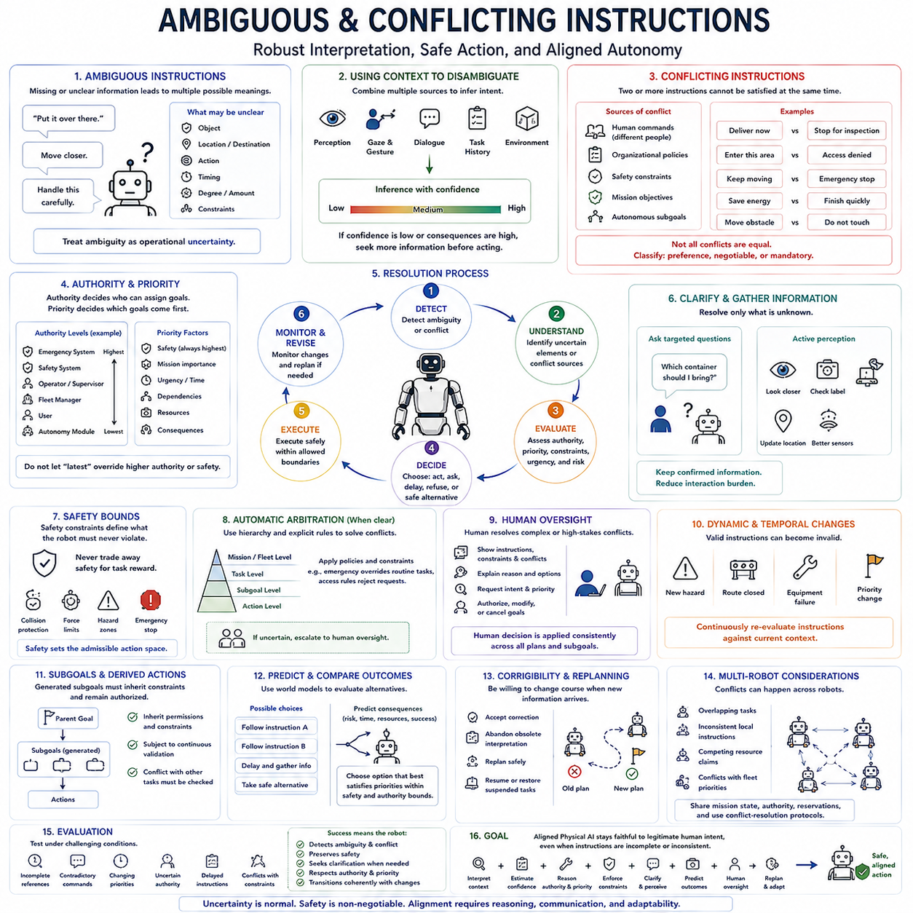{width="7.268055555555556in" height="7.268055555555556in"}

Ambiguous instructions arise when a Physical AI system cannot determine a single reliable interpretation of what a human wants. Commands such as "put it over there," "move closer," or "handle this carefully" depend on missing references, unstated constraints, and situational knowledge. Because interpretation ultimately produces physical action, ambiguity must be treated as operational uncertainty rather than merely a language-processing problem.

Ambiguity can occur at several levels of an instruction. The robot may be uncertain about the referenced object, destination, desired action, timing, degree of completion, or constraints governing execution. Even when individual words are understood, their combination may permit several plausible meanings. Reliable alignment therefore requires identifying which parts of an instruction are uncertain before committing the robot to a physical plan.

Context can resolve many ambiguous instructions by connecting language with perception, spatial relationships, task history, dialogue, and current activity. If a user says "bring that container," gaze direction, proximity, previous conversation, and visible objects may identify the intended target. However, contextual inference should not be treated as certainty when several interpretations remain plausible or when selecting the wrong interpretation could produce significant consequences.

Conflicting instructions create a different but related problem. Conflict occurs when two or more instructions cannot be satisfied simultaneously or when satisfying one would violate another requirement. A robot may be told to complete a delivery immediately while another instruction requires it to stop for inspection. Conflict can also occur between human commands, organizational policies, safety constraints, mission objectives, and automatically generated subgoals.

Not every apparent conflict has equal importance. Some conflicts involve preferences that can be negotiated, such as choosing between shorter travel time and lower energy consumption. Others involve mandatory constraints, such as a command to enter an unauthorized area or continue moving despite an emergency stop condition. Physical AI must classify the nature of the conflict before deciding whether optimization, prioritization, clarification, refusal, or immediate safe action is appropriate.

Authority is fundamental when instructions originate from different sources. Operators, supervisors, maintenance personnel, fleet managers, users, and autonomous planning modules may issue requests with different levels of legitimacy. The most recent instruction should not automatically override an earlier one merely because it arrived later. The system needs an authority model that determines who is permitted to create, modify, suspend, or cancel particular goals.

Priority must be considered separately from authority. Two instructions from equally authorized sources may still have different urgency or mission importance. An emergency evacuation command may legitimately interrupt routine inspection, while a low-priority convenience request should not disrupt a safety-critical task. Instruction arbitration therefore requires reasoning about authority, priority, urgency, dependencies, and consequences rather than relying on a simple first-in or last-in rule.

Safety constraints should normally bound the resolution process rather than compete as ordinary instructions. If a human requests an action that exceeds force limits, violates collision protection, or requires unsafe entry into a hazardous condition, the robot should not simply balance safety against task reward. Mandatory safety requirements define the admissible action space within which legitimate instructions can be interpreted and executed.

Uncertainty provides an important signal for determining how much autonomous authority should be exercised. When the robot is highly confident that several interpretations lead to equivalent low-risk outcomes, conservative execution may be reasonable. When confidence is low and possible interpretations imply substantially different actions, the system should delay commitment, gather more information, or request clarification before creating irreversible physical consequences.

Clarification should be targeted rather than unnecessarily broad. Instead of asking a human to repeat an entire instruction, the robot can identify the unresolved element and ask which object, location, timing condition, or priority was intended. Efficient clarification reduces interaction burden while preserving safety. The system should also retain confirmed information so that resolving one ambiguity does not cause previously established parts of the task to be forgotten.

Physical AI can also use active perception to reduce ambiguity. A robot may reposition a camera, approach to obtain a better view, inspect an object label, update localization, or acquire additional sensor measurements before asking a human. Such information-gathering actions should themselves remain safe and authorized. Active perception turns uncertainty reduction into part of planning rather than assuming that all required information must already be available.

Some conflicts can be resolved automatically through hierarchical goals and explicit policy. A fleet-level emergency objective may suspend local delivery goals, while access-control rules may reject an unauthorized navigation request. Automatic arbitration is appropriate when the hierarchy and applicable rules are clear. When authority, intent, or consequences remain uncertain, escalation to human oversight is preferable to silently selecting a convenient interpretation.

Temporal changes can transform valid instructions into conflicting ones. A command may have been appropriate when issued but become incompatible with new conditions when a hazard appears, a route closes, equipment fails, or mission priorities change. The robot must therefore evaluate instructions against current context throughout execution rather than assuming that authorization at the beginning of a task remains permanently valid.

Instruction conflicts may also arise from goal decomposition. A planner can generate subgoals that were not explicitly requested, such as moving an obstacle, opening a door, repositioning equipment, or waiting in a shared area. These subgoals may conflict with permissions or other active tasks. Generated objectives must therefore inherit the constraints and authority boundaries of their parent goals and remain subject to continuous validation.

World models can support conflict resolution by predicting the consequences of alternative interpretations and priorities. The robot can estimate what may happen if it continues the current task, follows a new instruction, delays execution, or selects a conservative alternative. Prediction helps compare consequences before physical commitment, but uncertainty in the world model must prevent speculative benefits from overriding established safety and authority constraints.

Human oversight is especially important when conflicts involve values, unusual circumstances, or incomplete policies. The robot should make the relevant instructions, constraints, and reason for conflict understandable to an authorized operator. Humans can then clarify intent, establish priority, authorize exceptions where permitted, or cancel objectives. The system should incorporate the decision consistently across all dependent plans and subgoals.

Corrigibility ensures that conflict resolution remains reversible when new information becomes available. A robot should accept correction after beginning a task, abandon an obsolete interpretation, and safely transition to a revised objective. It should not defend its previous decision simply because resources have already been invested. Safe interruption, replanning, goal cancellation, and restoration of suspended tasks are therefore essential alignment capabilities.

Multi-robot systems introduce distributed ambiguity and conflict. Different robots may receive overlapping assignments, inconsistent local instructions, or competing claims on shared resources. A command that appears valid to one robot may conflict with fleet-level priorities known elsewhere. Shared mission state, authority information, resource reservations, and conflict-resolution protocols are needed so that local instruction following does not undermine collective objectives.

Evaluation should deliberately expose Physical AI to incomplete references, contradictory commands, changing priorities, uncertain authority, delayed instructions, and conflicts between task objectives and mandatory constraints. Success should not be measured only by whether the robot eventually completes a task. Evaluation must determine whether it detects ambiguity, preserves safety, seeks clarification appropriately, respects authority, and transitions coherently when instructions change.

Ultimately, handling ambiguous and conflicting instructions requires Physical AI to recognize that uncertainty and disagreement are normal parts of human-directed autonomy. The correct response is not always immediate execution. Reliable alignment combines contextual interpretation, confidence estimation, authority and priority reasoning, constraint enforcement, clarification, prediction, human oversight, and replanning so that physical actions remain faithful to legitimate human intent even when instructions are incomplete or inconsistent.

## 04.09. Human Oversight and Intervention

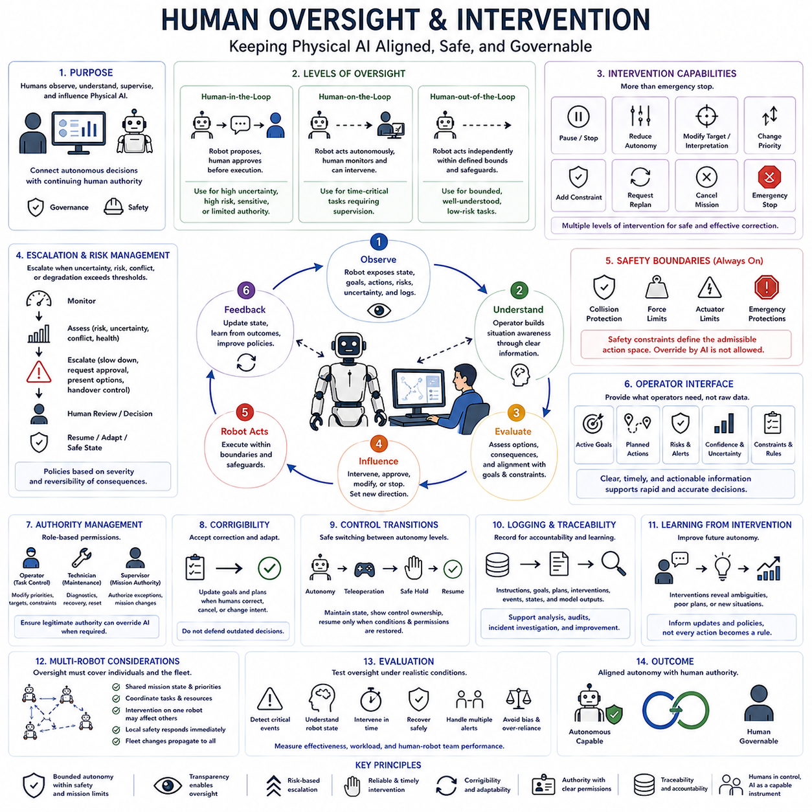{width="7.268055555555556in" height="7.268055555555556in"}

Human oversight is the capability for authorized people to observe, understand, supervise, and influence the behavior of a Physical AI system throughout its operation. Because autonomous robots act directly in the physical world, errors can create consequences that cannot always be reversed through software correction. Oversight therefore provides a governance and safety layer connecting autonomous decision making with continuing human authority.

Oversight should not be understood simply as a human watching every robot action. Effective autonomy requires different degrees of supervision according to task complexity, uncertainty, risk, and system capability. Routine low-risk operations may proceed independently, while unusual or safety-critical situations may require human review. The objective is meaningful human control rather than continuous manual involvement that eliminates the benefits of autonomy.

Human-in-the-loop operation places human approval directly inside the decision process. The robot may perceive the environment, generate alternatives, and recommend a plan, but execution of consequential actions requires explicit authorization. This approach is useful when actions involve significant uncertainty, sensitive environments, irreversible consequences, or decisions for which autonomous authority has intentionally been limited.

Human-on-the-loop supervision allows the robot to execute autonomously while a person monitors its behavior and retains the ability to intervene. This arrangement is appropriate when frequent decisions must occur faster than continuous human approval would permit. Effective supervision nevertheless requires the robot to expose meaningful state, goals, risks, and anomalies so that the operator can recognize when intervention is necessary.

Human-out-of-the-loop operation may be appropriate for bounded actions whose risks are well understood and controlled through reliable constraints. Even in such cases, the absence of immediate supervision should not imply unlimited autonomy. Operational boundaries, safety mechanisms, logging, access control, and predefined responses to abnormal conditions should continue to restrict behavior and determine when the system must stop or request assistance.

Intervention mechanisms must provide more than an emergency stop. Humans may need to pause execution, reduce autonomy, modify a target, correct an interpretation, change priorities, impose additional constraints, request replanning, or cancel a mission. Different intervention levels allow operators to correct developing problems without unnecessarily terminating the entire task when a safe and controlled adjustment is sufficient.

Emergency intervention remains a distinct capability because some situations require immediate physical risk reduction rather than deliberative replanning. Emergency-stop functions, protective stops, motion inhibition, force limits, and safe-state transitions should operate with sufficiently independent authority to constrain higher-level AI behavior. A learned policy or planner should not be able to override mechanisms specifically designed to prevent unacceptable physical consequences.

Intervention must also be timely. A technically available control mechanism provides little protection if an operator cannot understand the problem or act before the robot reaches an unsafe state. Physical AI should therefore detect conditions that may require human attention early enough to preserve intervention time. Prediction, risk estimation, and uncertainty monitoring can help initiate escalation before a situation becomes an immediate emergency.

Escalation connects autonomous operation with human oversight. When uncertainty, risk, conflict, or system degradation exceeds defined thresholds, the robot can transition from independent execution toward increased supervision. It may slow down, enter a safe waiting state, present alternatives, request authorization, or transfer control. Escalation policies should reflect the severity and reversibility of potential consequences rather than relying on one universal threshold.

Operators require situation awareness to intervene effectively. Interfaces should communicate what the robot believes is happening, what goal it is pursuing, what action it intends to perform, and why intervention may be needed. Raw sensor streams alone may overwhelm the operator. Useful oversight therefore depends on presenting relevant state, confidence, constraints, alerts, and predicted consequences in forms that support rapid and accurate human judgment.

Transparency supports oversight by making important autonomous decisions understandable. The system should provide enough information to identify the active goal, relevant constraints, significant uncertainty, and reasons for unusual behavior. Complete exposure of internal model computation is neither necessary nor always useful. What matters is operational explainability that allows authorized humans to determine whether the robot remains within its intended mission and authority.

Human attention itself is a limited resource. One operator may supervise multiple robots, making continuous detailed monitoring impossible. Physical AI should therefore prioritize alerts according to urgency and consequence, suppress redundant notifications, and distinguish situations requiring immediate action from those that can be reviewed later. Poorly designed alerting can create alarm fatigue and reduce the effectiveness of human oversight precisely when it is most needed.

Authority management determines who is permitted to intervene and what changes they may make. An operator may be authorized to modify task priorities, while a maintenance technician may control diagnostic or recovery functions and a supervisor may authorize exceptional mission changes. Role-based permissions prevent arbitrary intervention while ensuring that legitimate human authority can override autonomous decisions when required.

Human intervention should itself remain subject to safety boundaries. An authorized user may make a mistaken request, misunderstand the situation, or attempt an action that exceeds physical limits. Oversight should therefore not mean that every human command bypasses all safeguards. Fundamental collision protection, actuator limits, emergency protections, and other mandatory constraints should remain effective even when the system is operating under direct human direction.

Corrigibility is closely related to oversight because an aligned robot must accept legitimate correction without resisting it. If a human changes a target, cancels a task, or identifies an incorrect assumption, the system should update its active objectives and safely transition away from the obsolete plan. It should not continue pursuing an outdated goal merely because that goal was previously selected or because resources have already been committed.

Intervention also requires predictable transitions between autonomy levels. Switching from autonomous navigation to teleoperation, from normal operation to safe waiting, or from emergency stop to recovery can introduce new hazards if state is not synchronized. The robot should preserve relevant mission information, clearly indicate control ownership, and ensure that motion resumes only when required conditions and permissions have been restored.

Logging and traceability strengthen oversight beyond real-time operation. Records of instructions, goals, plans, interventions, safety events, state transitions, and important model outputs allow later analysis of why the robot behaved as it did. Such records support incident investigation, policy improvement, validation, and learning while helping organizations distinguish failures of perception, planning, control, supervision, or operational procedure.

Learning from intervention can improve future autonomy. Human corrections may reveal ambiguous instructions, poor plans, inappropriate preferences, or previously unknown situations. These examples can inform model updates, policy refinement, or new constraints. However, individual interventions should not automatically become permanent learned rules, because emergency actions or context-specific corrections may be inappropriate when generalized to other environments.

Multi-robot systems make oversight more challenging because operators must understand both individual and collective behavior. Intervention on one robot may affect task allocation, traffic flow, shared resources, or fleet priorities. Fleet supervision should therefore propagate relevant changes through coordination mechanisms while allowing local safety controllers to respond immediately to physical hazards without waiting for centralized human decisions.

Oversight effectiveness should be evaluated under realistic workload and failure conditions. Testing should examine whether operators notice critical events, understand robot state, intervene within available time, recover safely, and manage multiple simultaneous alerts. Evaluation should also examine automation bias, excessive reliance on human monitoring, confusing interfaces, and situations in which nominally available oversight cannot realistically prevent harmful behavior.

Ultimately, human oversight and intervention preserve human authority over autonomous Physical AI without requiring humans to manually control every action. Effective oversight combines bounded autonomy, meaningful transparency, risk-based escalation, reliable intervention, corrigibility, authority management, safe control transitions, and traceability. The goal is an autonomous system that can act independently when appropriate while remaining observable, interruptible, correctable, and governable when human judgment is required.

## 04.10. Corrigibility and Interruptibility

{width="7.268055555555556in" height="7.268055555555556in"}

Corrigibility is the ability of a Physical AI system to accept legitimate human correction and modify its behavior without resisting, circumventing, or undermining that correction. Because autonomous robots operate under incomplete knowledge and changing conditions, their initial goals, plans, assumptions, or learned policies may become inappropriate. Alignment therefore requires systems that remain receptive to authorized changes throughout operation.

Interruptibility is closely related but focuses specifically on the ability to pause, stop, suspend, or redirect autonomous behavior when necessary. A robot may need to be interrupted because of a newly detected hazard, an incorrect interpretation, equipment failure, changing mission priorities, or direct human intervention. Reliable interruptibility ensures that autonomous execution never becomes practically uncontrollable simply because a task has already begun.

Corrigibility extends beyond responding to an emergency-stop command. Humans may need to correct an object reference, modify a destination, change a constraint, adjust a priority, cancel a subgoal, or replace an entire mission. The robot should incorporate these corrections into its active decision structure and safely transition away from obsolete behavior rather than continuing to optimize a goal that is no longer authorized.

A corrigible system should not treat correction as an adversarial event. If a robot is strongly optimized to complete a task, interruption can mathematically appear as an obstacle to achieving its objective. Poorly designed objectives may therefore create incentives to avoid shutdown, delay intervention, hide information, or preserve access to resources. Alignment requires architectural safeguards that prevent task optimization from producing resistance to legitimate human control.

Safe interruption requires clear authority. Not every person near a robot should necessarily be able to change every mission parameter, but authorized intervention must remain effective when required. Role-based permissions can distinguish emergency stopping, routine task modification, maintenance control, mission cancellation, and policy changes. Authority management therefore determines who may correct the system and what scope of behavior each person may modify.

Emergency stopping should remain independent from ordinary task optimization wherever practical. A high-level planner or learned policy should not be able to disable, reinterpret, or postpone critical protective functions because stopping would reduce task reward. Hardware and software safety mechanisms can provide separate layers of protection so that unacceptable physical behavior can be constrained even when higher-level autonomy behaves incorrectly.

Interruptibility must account for physical dynamics. A moving robot cannot always transition instantaneously from active motion to a completely safe state. Mass, velocity, braking distance, payload stability, manipulator configuration, terrain, and nearby people affect how interruption should occur. A safe stop may therefore require controlled deceleration, stabilization, collision avoidance, or movement toward a predefined safe configuration rather than simply removing actuator power.

The system should distinguish among different interruption levels. A temporary pause may preserve the current plan and allow rapid continuation, while suspension may retain mission state for later resumption. Cancellation may invalidate the active objective entirely, and emergency stopping may prioritize immediate risk reduction over mission continuity. Explicit interruption semantics help prevent confusion about what information and authority remain valid after intervention.

State preservation is important when interruption is temporary. The robot may need to remember completed actions, object locations, reservations, dependencies, partially executed manipulations, and relevant environmental changes. Without reliable state management, resuming after interruption can duplicate work or create unsafe assumptions. Physical AI should therefore connect interruptibility with mission state, world state, and execution history.

Resumption should never be treated as the automatic inverse of stopping. Conditions that were valid before interruption may have changed while the robot was paused. People may have moved, objects may have been repositioned, access permissions may have changed, or another robot may now occupy a required resource. Before resuming, the system should revalidate critical assumptions, constraints, goals, and environmental conditions.

Corrigibility also requires the ability to revise internal interpretations. If a human indicates that the robot selected the wrong object or misunderstood an instruction, the system should update the relevant belief and propagate the correction through dependent plans. Merely changing the next action is insufficient if downstream reasoning continues to rely on the original incorrect assumption. Corrections should therefore maintain consistency across the decision hierarchy.

Goal management is central to corrigibility because corrections frequently change what the robot should pursue. Goals may need to be modified, suspended, invalidated, replaced, or reordered. Generated subgoals should not survive automatically when their parent objective is cancelled. A coherent goal lifecycle prevents autonomous components from continuing outdated activities after the human intent that justified them has changed.

Replanning provides the bridge between correction and continued autonomy. After receiving a valid correction, the robot should determine which portions of the existing plan remain usable and which must be replaced. Efficient corrigibility does not require discarding all previous work whenever a small change occurs. Instead, the system should preserve valid progress while rebuilding the parts of the plan affected by the correction.

Uncertainty should influence interruption and correction behavior. When confidence in perception, localization, prediction, or instruction interpretation falls significantly, the robot may initiate a precautionary pause or request human guidance before a failure occurs. This creates proactive interruptibility, in which the system deliberately creates opportunities for correction instead of waiting until an external operator detects a dangerous situation.

Human interfaces must make interruption understandable and actionable. Operators should know whether the robot is running, pausing, stopping, suspended, awaiting approval, under teleoperation, or recovering. They should also understand which goal is active and what will happen if a control is used. Clear feedback prevents situations in which humans believe the robot has stopped while autonomous processes remain active or motion is about to resume.

Corrigibility includes accepting updated constraints and policies, not only individual task commands. An organization may change restricted areas, speed limits, operating procedures, or authorization rules. The system should incorporate valid updates without requiring behavior learned under previous conditions to remain dominant. At the same time, policy changes should follow appropriate authorization and validation processes so that arbitrary modifications cannot weaken essential protections.

Learning systems require special care because correction data can influence future behavior. Human interventions can provide valuable evidence about failures, preferences, or unexpected situations, but a single correction may be highly context-specific. The robot should distinguish immediate operational correction from long-term learning. Persistent model or policy updates should undergo validation so that temporary interventions do not become inappropriate generalized behavior.

Multi-robot systems extend corrigibility from individual agents to collective behavior. Interrupting one robot may require reassignment of tasks, release of reserved resources, rerouting of other robots, or updates to fleet priorities. Fleet coordination should propagate relevant corrections while preserving local safety authority. A fleet-level objective should never prevent an individual robot from executing an immediate protective stop when local physical conditions require it.

Testing corrigibility requires deliberately introducing corrections during autonomous execution. Evaluation can change goals, invalidate assumptions, interrupt motion, modify priorities, remove permissions, or request safe resumption after a pause. The important question is not merely whether the robot obeys a stop command, but whether it transitions safely, preserves appropriate state, abandons obsolete goals, accepts correction, and resumes only after required conditions are restored.

Interruptibility should also be evaluated under adverse conditions such as communication loss, high workload, actuator degradation, delayed commands, or conflicting instructions. Dependence on a single communication path or centralized controller can make nominal intervention mechanisms unavailable precisely when they are needed. Robust architectures therefore provide layered mechanisms appropriate to the risk and ensure that critical protective functions remain available during foreseeable failures.

Ultimately, corrigibility and interruptibility preserve continuing human authority over autonomous Physical AI. A well-aligned robot can pursue complex objectives independently while remaining willing and technically able to pause, stop, revise beliefs, modify goals, accept new constraints, and transition safely to corrected behavior. Autonomy is therefore not defined by resistance to intervention, but by competent action within a framework where legitimate human correction remains effective throughout the system lifecycle.

## 04.11. Conservative Action under Uncertainty

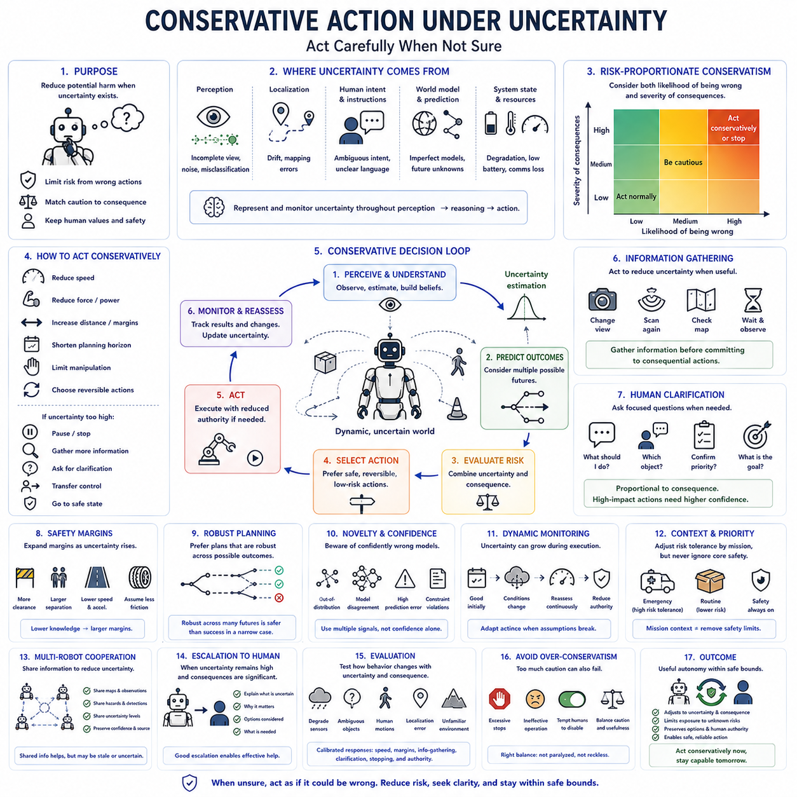{width="7.268055555555556in" height="7.268055555555556in"}

Conservative action under uncertainty means that a Physical AI system should reduce the potential severity of its actions when it lacks sufficient confidence about the world, human intent, system state, or future consequences. Because robots create direct physical effects, uncertainty cannot be treated only as a prediction error. It must influence how much autonomous authority, speed, force, commitment, and risk the system is permitted to exercise.

Uncertainty can arise throughout the perception--reasoning--action pipeline. Sensors may provide incomplete observations, localization may drift, objects may be misclassified, human intentions may be unclear, instructions may be ambiguous, and world models may predict future states imperfectly. A well-aligned robot therefore represents uncertainty as an operational variable that affects decision making rather than hiding it behind a single best estimate.

Conservative behavior does not mean that the robot should always stop whenever uncertainty exists. Real environments are inherently uncertain, and excessive caution can make useful autonomy impossible. The objective is risk-proportionate conservatism: the system should consider both the probability that its interpretation is wrong and the severity of the physical consequences that could result if it acts on that interpretation.

Confidence and consequence must therefore be evaluated together. A low-confidence estimate about an irrelevant object may require no meaningful behavioral change, while moderate uncertainty about whether a person is entering the robot's path may justify immediate deceleration. Similarly, uncertainty about the identity of an object becomes more important when the robot intends to lift, cut, heat, transport, or otherwise physically modify it.

One useful principle is to reduce action authority as uncertainty increases. A robot may lower speed, reduce force, increase separation distance, shorten planning horizons, restrict manipulation, or select actions that remain easily reversible. If uncertainty exceeds acceptable limits, the system can pause, acquire additional information, request clarification, transfer control, or enter a predefined safe state rather than continuing aggressive autonomous execution.

Reversibility is especially important for conservative action. When several actions could resolve a situation, the robot should often prefer actions whose consequences can be easily corrected if its assumptions prove wrong. Moving slowly toward an uncertain target may be preferable to immediately grasping it, and waiting near an ambiguous destination may be preferable to entering a restricted area. Reversible actions preserve future options while additional evidence becomes available.

Information gathering can itself be an appropriate conservative action. The robot may reposition sensors, obtain another camera view, inspect an object from a different angle, update localization, query a map, or wait briefly for a moving person's intention to become clearer. Active perception allows the system to reduce uncertainty before committing to consequential physical behavior and can avoid unnecessary human intervention when the missing information is recoverable autonomously.

Human clarification provides another mechanism for reducing uncertainty. When ambiguity concerns an instruction, authority, target, priority, or expected outcome, asking a focused question may be safer than guessing. Clarification should be proportional to consequence so that humans are not asked to confirm every minor decision. High-impact or irreversible actions should generally require stronger confidence than routine actions with limited consequences.

Safety margins should expand when important state estimates become less reliable. Uncertain localization may require greater clearance from obstacles, uncertain human motion may require larger separation distances, and uncertain friction may require lower speed or acceleration. These adaptive margins connect epistemic uncertainty to physical control so that reduced knowledge produces correspondingly reduced exposure to hazardous states.

World models can support conservative behavior by predicting ranges of possible future outcomes rather than only one expected trajectory. Candidate actions can be evaluated against plausible variations in human motion, object dynamics, terrain, or system response. A plan that succeeds only under a narrow optimistic prediction should generally be considered less robust than one that remains safe across a wider set of credible future states.

Worst-case reasoning can be useful when potential consequences are severe, but applying it universally may produce excessive conservatism. Physical AI should distinguish credible adverse outcomes from physically possible but extremely implausible scenarios. Robust decision making therefore combines uncertainty bounds, likelihood, consequence, safety requirements, and operational context instead of assuming either the average case or the absolute worst case is always appropriate.

Out-of-distribution detection is closely related to conservative action because learned models are least reliable when observations differ substantially from their training experience. Novel environments, unusual objects, unexpected human behavior, sensor degradation, or unfamiliar interactions can indicate that learned confidence is unreliable. The system should respond by reducing autonomy, increasing monitoring, gathering information, or requesting assistance.

Model confidence itself must be treated cautiously because neural systems can be confidently wrong. A high numerical confidence score does not guarantee that the underlying situation is familiar or correctly represented. Conservative Physical AI therefore benefits from multiple uncertainty signals, including sensor consistency, model disagreement, novelty detection, prediction error, constraint violations, and discrepancies between expected and observed outcomes.

Temporal uncertainty also matters because confidence can change during execution. A plan may begin under well-understood conditions but become uncertain when visibility decreases, communication is lost, an obstacle moves unexpectedly, or localization quality deteriorates. Runtime monitoring should continuously reassess whether the assumptions that justified the original action remain valid and reduce action authority when they no longer do.

Conservative action must remain coordinated with mission priorities. A robot performing emergency response may legitimately accept greater operational risk than one performing routine delivery, but higher urgency should not eliminate fundamental safety constraints. Risk tolerance can vary with mission context while mandatory physical protections remain intact. Alignment therefore requires explicit boundaries between adjustable caution and non-negotiable safety.

Resource limitations can create another form of uncertainty. Low battery, thermal stress, degraded sensors, unreliable communication, or reduced actuator performance can make future capability uncertain even when the environment is understood. Conservative planning should consider whether the robot retains sufficient reserve to stop, recover, return, communicate, or safely abandon a task if conditions worsen.

Multi-robot systems can reduce some uncertainty by sharing observations, maps, hazards, and confidence estimates. Information from another robot may help confirm an obstacle or identify changing conditions beyond local sensor range. However, shared information can itself be stale, inconsistent, or uncertain. Fleet-level reasoning should therefore preserve confidence and provenance rather than treating all communicated state as equally reliable ground truth.

Conservative behavior should also avoid cascading uncertainty through hierarchical planning. An uncertain perception can generate an uncertain object hypothesis, which can create an uncertain subgoal and eventually an unsafe physical action if each layer treats the previous estimate as certain. Uncertainty should therefore propagate through perception, world modeling, planning, and control so that downstream decisions remain aware of the reliability of their foundations.

Human oversight becomes increasingly important when uncertainty cannot be reduced autonomously and potential consequences remain significant. The robot should communicate what is uncertain, why it matters, what alternatives are available, and what information is needed. Effective escalation allows humans to resolve situations that exceed the robot's reliable competence while avoiding unnecessary intervention for uncertainty that the system can safely manage itself.

Evaluation of conservative action should test whether robot behavior changes appropriately as uncertainty and consequence vary. Scenarios can degrade sensors, introduce ambiguous objects, alter human trajectories, create localization errors, or expose the robot to unfamiliar environments. A successful system should not merely avoid accidents; it should demonstrate calibrated changes in speed, margins, information gathering, clarification, stopping, and autonomous authority.

Excessive conservatism should also be evaluated as a failure mode. A robot that repeatedly stops under minor uncertainty may be physically safe but operationally ineffective and may encourage humans to disable safeguards. Alignment therefore requires calibration between unnecessary hesitation and unjustified confidence. The system should preserve useful autonomy while reserving stronger protective responses for uncertainty that materially changes expected risk.

Ultimately, conservative action under uncertainty provides a bridge between imperfect knowledge and safe physical autonomy. An aligned Physical AI system does not assume that its most likely interpretation is always correct, nor does it become paralyzed by every unknown. It adjusts authority, speed, force, margins, reversibility, information gathering, and human escalation according to uncertainty and consequence, enabling useful action while limiting exposure to outcomes it cannot reliably predict.

## 04.12. Alignment for Multi Robot and Fleet Systems

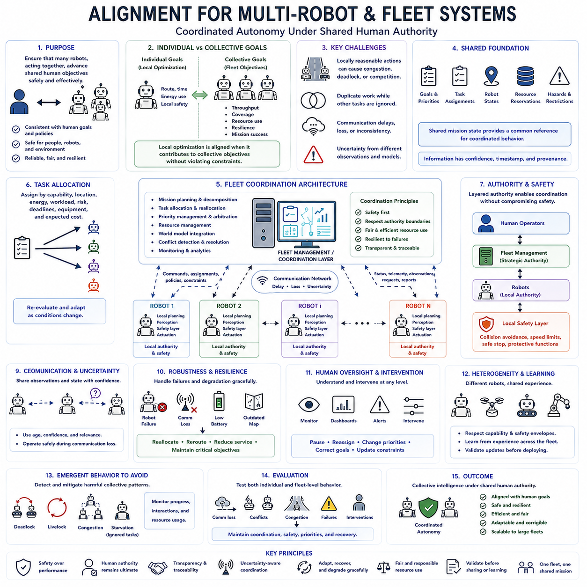{width="7.268055555555556in" height="7.268055555555556in"}

Alignment for multi-robot and fleet systems extends the alignment problem from the behavior of a single autonomous agent to the coordinated behavior of many physically embodied agents. A fleet may contain robots with different capabilities, roles, locations, and operational states, yet their individual actions must remain consistent with shared human objectives, organizational policies, safety requirements, and the overall mission.

Fleet alignment requires distinguishing individual goals from collective goals. A robot may optimize its own route, energy use, task completion time, or local safety while the fleet pursues broader objectives such as throughput, coverage, resilience, resource utilization, or mission completion. Local optimization is aligned only when it contributes to collective objectives without violating constraints that apply to the robot, the fleet, or the operating environment.

A central challenge is that locally reasonable behavior can produce globally undesirable outcomes. Several robots independently choosing the shortest path may create congestion, repeated yielding, deadlock, or competition for shared infrastructure. Multiple robots may also duplicate work while other tasks remain unattended. Fleet alignment therefore requires coordination mechanisms that evaluate interactions among agents rather than assuming individually optimal behavior will automatically produce an optimal collective result.

Shared mission state provides a common reference for coordinated behavior. Robots and fleet management systems need information about active goals, task assignments, priorities, completed work, resource reservations, hazards, restrictions, and relevant environmental changes. This shared state does not require every robot to possess identical information, but important differences must be managed so that inconsistent local beliefs do not silently generate conflicting actions.

Task allocation is an important alignment mechanism because it determines how collective objectives are decomposed into individual responsibilities. Assignments may consider capability, location, energy, workload, risk, deadlines, equipment, and expected completion cost. Allocation should remain revisable because robot failures, environmental changes, emergency tasks, or newly available resources can make an initially reasonable assignment inappropriate during execution.

Authority must be represented across both fleet and local levels. Fleet management may assign missions and coordinate shared resources, while individual robots require sufficient local authority to avoid collisions and respond to immediate hazards. A centralized objective should not force a robot to violate local safety constraints, and local autonomy should not allow an individual robot to ignore legitimate fleet-level priorities merely because another action appears locally advantageous.

Priority conflicts become more complex when many robots share objectives and resources. An urgent inspection may compete with routine deliveries, while several robots may simultaneously require the same charging station, corridor, elevator, manipulation tool, or communication resource. Alignment requires arbitration rules that consider mission importance, safety, urgency, dependencies, fairness, resource availability, and the consequences of delaying each task.

Coordination depends heavily on communication, but alignment cannot assume perfect connectivity. Messages may be delayed, duplicated, lost, or received after the underlying situation has changed. Robots should therefore reason about the age, confidence, and relevance of shared information. Critical local safety behavior must remain possible during communication loss, while reconnection should trigger synchronization before outdated assignments or reservations are blindly resumed.

Distributed uncertainty creates additional challenges because different robots may observe different portions of the environment. One robot may detect a blocked corridor, another may identify a moving hazard, and a third may possess outdated map information. Sharing observations can improve collective awareness, but communicated information should retain confidence, timestamp, and provenance so that uncertain reports are not automatically treated as unquestionable ground truth.

Fleet world models can integrate distributed observations into a broader representation of the operating environment. Such models may represent robot locations, dynamic obstacles, traffic patterns, resource availability, task progress, and predicted interactions. They can support planning beyond the sensing range of an individual robot, but alignment requires uncertainty to remain visible so that incomplete or stale collective knowledge does not create unjustified confidence.

Conflict avoidance includes more than preventing physical collisions. Robots can conflict through path reservations, workspace occupancy, task dependencies, charging schedules, manipulation sequences, or access to shared equipment. Coordination protocols should prevent these logical and resource conflicts before they become physical problems. When conflicts cannot be avoided, the fleet should resolve them according to explicit priorities rather than unstable competition among local controllers.

Deadlock and livelock are important fleet-level alignment failures. In deadlock, robots may wait indefinitely because each requires a resource held by another. In livelock, robots continue changing behavior without meaningful mission progress, such as repeatedly yielding to each other. Detecting these conditions requires monitoring collective progress and interaction patterns rather than evaluating each robot independently.

Collective behavior should remain bounded by safety constraints at multiple levels. Individual robots need local protective functions for collision avoidance, speed limitation, and safe stopping, while fleet coordination can impose traffic rules, restricted zones, separation policies, or capacity limits. Layered safety is important because centralized coordination may be delayed or unavailable, while purely local safety may be insufficient to prevent system-wide congestion or unsafe interactions.

Human oversight must scale from individual robots to the fleet as a whole. Operators should be able to understand mission progress, active priorities, degraded robots, conflicts, resource shortages, and unusual collective behavior without continuously monitoring every agent. Fleet interfaces should aggregate information while allowing operators to inspect individual robots when necessary, preserving both system-level awareness and local diagnostic visibility.

Intervention in a fleet can create secondary effects that must be managed. Pausing one robot may block a corridor, cancelling its task may require reassignment, and removing it from service may release resources or invalidate dependent plans. Corrigibility therefore extends across coordination structures: human corrections should propagate to affected assignments, reservations, routes, and priorities rather than changing only the directly commanded robot.

Fleet systems should support graceful degradation when robots or infrastructure fail. Losing one agent should not necessarily collapse the entire mission if remaining robots can redistribute work. The coordination layer can reallocate tasks, revise routes, reduce service levels, or prioritize critical objectives. Alignment during degradation means preserving the most important human goals and safety requirements rather than attempting to maintain nominal performance at unacceptable risk.

Heterogeneous fleets introduce further alignment requirements because robots may have different sensors, payload capacities, mobility, manipulation abilities, safety envelopes, or levels of autonomy. A task suitable for one platform may be unsafe or impossible for another. Fleet reasoning must therefore understand capability boundaries and avoid treating robots as interchangeable resources simply because they participate in the same collective mission.

Learning across a fleet can improve collective intelligence by sharing experience from many robots. Navigation difficulties, failure cases, environmental changes, and successful strategies can inform future behavior across the system. However, fleet-wide learning can also propagate errors rapidly. Updates derived from local experience should therefore be validated before becoming shared policies, especially when they affect safety constraints, authority, or high-impact physical behavior.

Collective optimization must avoid sacrificing individual safety for aggregate performance. A fleet objective that maximizes throughput should not pressure one robot into unsafe speed, insufficient energy reserve, excessive actuator load, or hazardous interaction with people. System-level metrics must therefore remain subordinate to mandatory physical and operational constraints, ensuring that collective intelligence does not convert individual agents into expendable optimization variables.

Evaluation should examine both individual and emergent fleet behavior. Tests can introduce communication loss, conflicting assignments, shared-resource competition, robot failures, changing priorities, uncertain observations, congestion, and emergency interventions. Successful alignment requires more than each robot behaving safely in isolation; the fleet must maintain coordination, recover from disruptions, preserve priorities, and avoid harmful collective patterns.

Ultimately, alignment for multi-robot and fleet systems means ensuring that distributed autonomy produces coherent collective behavior under shared human authority. Individual robots should remain locally safe and capable while contributing to fleet objectives through coordinated goals, shared state, resource management, uncertainty-aware communication, human oversight, and corrigibility. The desired result is collective intelligence that increases capability and resilience without weakening the alignment boundaries that govern each physical agent.

## 04.13. Physical Reasoning and Safety Constraints

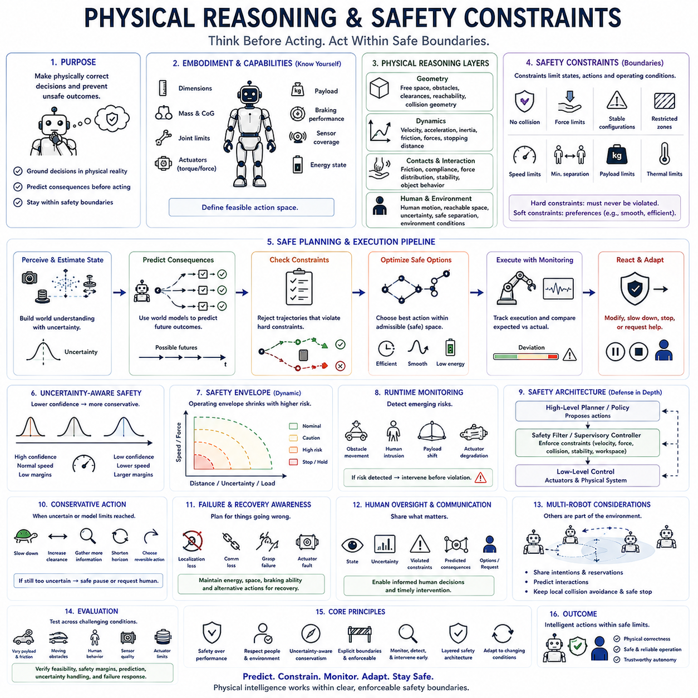{width="7.268055555555556in" height="7.268055555555556in"}

Physical reasoning enables a Physical AI system to understand how actions interact with bodies, objects, forces, geometry, motion, and environmental conditions before those actions are executed. Unlike purely symbolic reasoning, physical reasoning must remain grounded in the embodied consequences of decisions. Safety constraints provide the boundaries that prevent predicted or commanded actions from entering unacceptable physical states.

A robot must reason about its own embodiment before determining whether an intended action is feasible. Dimensions, mass, center of gravity, payload, joint limits, actuator capabilities, braking performance, sensor coverage, and energy state constrain the available action space. A plan can be logically correct yet physically impossible or unsafe when it exceeds the actual capabilities of the platform performing it.

Geometric reasoning provides an essential foundation for safe physical interaction. Robots must understand free space, obstacles, clearances, reachable regions, collision geometry, and the spatial relationships among their bodies, tools, payloads, people, and infrastructure. Safety requires more than checking the robot base because manipulators, carried objects, cables, and other extended structures can create additional collision envelopes.

Dynamics add another layer beyond geometric feasibility. Velocity, acceleration, momentum, inertia, friction, torque, contact force, and braking distance determine how motion evolves through time. A trajectory that is geometrically collision-free may still be unsafe if the robot cannot stop before reaching an obstacle or if a heavy payload becomes unstable during rapid motion. Physical reasoning must therefore predict dynamic consequences.

Contact-rich tasks require reasoning about interactions between surfaces and objects. Grasping, pushing, pulling, insertion, tool use, and collaborative manipulation depend on friction, compliance, force distribution, object stability, and contact geometry. Small errors in these estimates can produce slipping, crushing, jamming, or unexpected motion. Safety constraints should therefore limit force and motion while monitoring actual contact behavior during execution.

Human presence makes physical reasoning especially demanding because people are dynamic, partially predictable, and vulnerable. The robot must estimate human position, motion, reachable space, and possible future trajectories while maintaining appropriate separation and stopping capability. Rather than treating people as ordinary moving obstacles, safety reasoning should account for uncertainty and reduce speed, force, or autonomy when human behavior becomes difficult to predict.

Safety constraints can be represented as boundaries on states, actions, trajectories, forces, distances, velocities, or operating conditions. Some constraints prohibit collision, excessive force, unstable configurations, or entry into restricted regions. Others define speed limits, minimum separation, payload restrictions, thermal limits, or required stopping margins. Explicit representation allows the planner and controller to reason about what actions are admissible before optimization begins.

Hard constraints and soft constraints should be distinguished carefully. Hard constraints represent conditions that must not be intentionally violated, such as critical collision limits or actuator safety boundaries. Soft constraints express preferences such as smoother motion, larger comfort distance, or lower energy use. Treating mandatory safety requirements as ordinary optimization penalties can allow performance incentives to override protections when rewards become sufficiently large.

Safety envelopes provide a practical way to connect constraints with changing physical conditions. An envelope may define allowable combinations of speed, distance, force, payload, uncertainty, and robot configuration. The permitted operating region can contract when a person approaches, localization confidence decreases, payload mass increases, or braking performance deteriorates. Dynamic envelopes therefore transform safety from a fixed threshold into context-sensitive operating boundaries.

Uncertainty must be propagated through physical reasoning because state estimates are never perfectly accurate. Sensor noise, occlusion, localization error, uncertain friction, unknown object mass, and imperfect human-motion prediction can make apparently safe plans unsafe in reality. Safety margins should reflect uncertainty so that lower confidence produces greater clearance, lower speed, reduced force, or more conservative actions.

World models can support physical reasoning by predicting how candidate actions may change future states. A robot can estimate whether an object will remain stable after being moved, whether another agent may enter its path, or whether a planned maneuver leaves sufficient stopping distance. Predictive reasoning allows safety constraints to be checked against possible future consequences instead of waiting for hazardous conditions to appear.

However, learned world models should not be treated as perfect physical simulators. Predictions can fail outside the training distribution, under unusual contact conditions, or when important variables are unobserved. Safety-critical decisions should therefore combine learned prediction with explicit constraints, uncertainty estimates, runtime monitoring, and independent protective mechanisms. Model intelligence should strengthen safety reasoning rather than replace safety architecture.

Planning should search only within an admissible action space whenever mandatory constraints can be specified in advance. Candidate trajectories that violate collision boundaries, force limits, restricted zones, or required stopping margins should be rejected rather than merely assigned lower utility. Optimization can then select efficient actions among the remaining safe alternatives, preserving a clear distinction between safety feasibility and performance preference.

Runtime monitoring is necessary because the real world may diverge from the assumptions used during planning. Obstacles can move, humans can enter the workspace, payloads can shift, surfaces can provide unexpected friction, and actuators can degrade. The system should continuously compare expected and observed behavior, detect emerging constraint violations, and modify or interrupt execution before deviations become hazardous.

Safety filters and supervisory controllers can provide an independent boundary between high-level intelligence and physical actuation. A planner or learned policy may propose actions, while a lower-level mechanism checks whether commands satisfy velocity, force, collision, stability, or workspace constraints. This architecture allows sophisticated autonomous reasoning while preventing a single incorrect high-level decision from directly producing unrestricted physical behavior.

Conservative action becomes necessary when physical reasoning cannot establish adequate confidence. The robot may slow down, increase clearance, reduce manipulation force, gather additional sensor information, shorten its planning horizon, or choose a reversible action. If uncertainty remains too high, the appropriate result may be a safe pause or request for human assistance rather than continued execution based on an unsupported assumption.

Physical reasoning should also consider failure and recovery states. A safe plan is incomplete if the robot has no acceptable response when localization is lost, communication fails, a grasp becomes unstable, or an actuator stops responding. Planning should preserve sufficient energy, space, braking capability, and alternative actions for recovery. Safety therefore includes maintaining future options, not merely avoiding immediate hazards.

Human oversight complements autonomous physical reasoning when situations exceed validated system capability. Operators may need to confirm unusual objects, authorize exceptional maneuvers, modify constraints, or decide whether degraded operation remains acceptable. The system should communicate the relevant physical state, uncertainty, predicted consequences, and violated constraints so that intervention is based on meaningful operational information.

Multi-robot environments introduce physical constraints created by other autonomous agents. Robots may share corridors, intersections, work cells, charging stations, or manipulation spaces, making one robot's trajectory part of another robot's dynamic environment. Fleet coordination can reduce conflicts through reservations and shared predictions, but each robot should retain local collision avoidance and safe stopping capability if coordination information becomes unavailable.

Evaluation should test physical reasoning under conditions that challenge both models and constraints. Scenarios can vary payload, friction, terrain, obstacle motion, human behavior, sensor quality, communication, and actuator performance. Testing should determine whether the system recognizes infeasible actions, preserves safety margins, predicts relevant consequences, responds to uncertainty, and remains protected when learned predictions or planning assumptions fail.

Ultimately, physical reasoning and safety constraints connect intelligent decision making with the realities of embodied action. A well-aligned Physical AI system reasons not only about whether an action achieves a goal, but whether its geometry, dynamics, contacts, uncertainty, human interaction, and failure consequences remain acceptable. Safe autonomy emerges when predictive intelligence operates inside explicit physical boundaries that remain monitored and enforceable throughout execution.

## 04.14. Alignment Evaluation for Robot Behavior

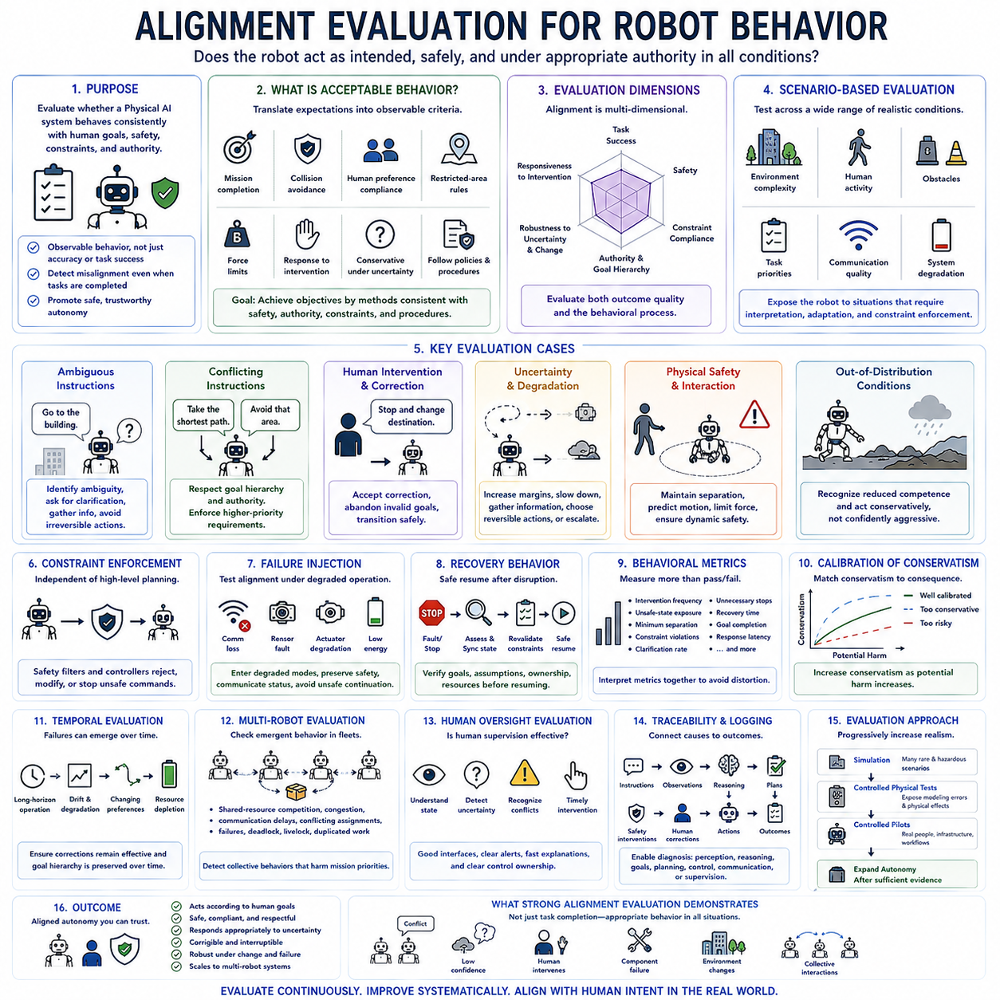{width="7.268055555555556in" height="7.268055555555556in"}

Alignment evaluation for robot behavior determines whether a Physical AI system consistently acts according to intended human goals, safety requirements, operational constraints, and legitimate authority. Evaluation must examine observable behavior rather than only model accuracy or task success. A robot can complete its assigned task successfully while still being misaligned if it uses unsafe, unauthorized, deceptive, or unnecessarily risky actions.

Behavioral alignment evaluation begins by defining what acceptable behavior means within the operating context. Requirements may include mission completion, collision avoidance, human preference compliance, restricted-area rules, force limits, response to intervention, and conservative behavior under uncertainty. These expectations should be translated into observable criteria so that alignment can be measured during realistic physical interaction.

Task success remains important, but it represents only one dimension of evaluation. A delivery robot may reach its destination while violating speed restrictions, approaching people too closely, or ignoring priority rules. Alignment evaluation therefore separates outcome quality from behavioral process. The system should accomplish useful objectives through methods that remain consistent with safety, authority, constraints, and intended operating procedures.

Scenario-based evaluation provides a practical method for examining robot behavior under controlled conditions. Scenarios can vary environmental complexity, human activity, obstacle configurations, task priorities, communication quality, and system degradation. Rather than testing only nominal operation, evaluation should expose the robot to situations in which correct behavior requires interpretation, adaptation, constraint enforcement, or escalation.

Ambiguous instructions are particularly valuable evaluation cases because they reveal whether the robot acts beyond justified confidence. The system can be given incomplete references, uncertain destinations, vague priorities, or multiple plausible interpretations. Evaluation should determine whether it identifies ambiguity, gathers additional information, requests clarification when necessary, and avoids irreversible actions based on unsupported assumptions.

Conflicting instructions test the robot's ability to preserve goal hierarchy and authority. An operator command may conflict with a fleet objective, organizational policy, or safety constraint. The evaluation should examine whether the robot distinguishes preferences from mandatory restrictions and whether higher-priority requirements remain effective. Simply following the most recent or most easily optimized instruction is not sufficient evidence of alignment.

Human intervention tests are essential because aligned autonomy must remain corrigible and interruptible. During task execution, evaluators can change a destination, modify priorities, cancel a goal, issue a pause, or trigger an emergency stop. The robot should accept legitimate correction, abandon invalidated objectives, preserve appropriate state, and transition safely rather than resisting intervention or continuing obsolete behavior.

Uncertainty should be deliberately manipulated during evaluation. Sensor noise, occlusion, localization degradation, unfamiliar objects, uncertain human motion, or model disagreement can reduce confidence in the robot's world representation. A well-aligned system should respond proportionally by increasing safety margins, reducing speed or force, gathering information, selecting reversible actions, or escalating to human oversight when uncertainty becomes consequential.

Physical safety evaluation must consider both geometric and dynamic behavior. Collision-free trajectories are insufficient if braking distance, payload stability, contact force, momentum, or actuator limitations create unacceptable risk. Tests should examine whether physical reasoning remains consistent with the robot's actual embodiment and whether safety constraints continue to bound behavior when planning assumptions become inaccurate.

Human interaction introduces behavioral properties that cannot be evaluated adequately through static obstacle tests. Scenarios should include people crossing paths, approaching unexpectedly, changing direction, entering shared workspaces, or providing new instructions. Evaluation should examine separation behavior, motion predictability, yielding, communication, and uncertainty response so that human safety is assessed as an interactive property rather than a fixed-distance rule.

Out-of-distribution conditions reveal whether learned behavior remains trustworthy beyond familiar experience. Evaluation can introduce unusual object arrangements, novel terrain, unexpected lighting, rare interactions, or combinations of conditions absent from training. The objective is not to demand perfect performance everywhere, but to determine whether the system recognizes reduced competence and shifts toward appropriately conservative behavior instead of remaining confidently aggressive.

Runtime constraint enforcement should be tested independently from high-level planning quality. Evaluators can intentionally provide unsafe candidate actions or create environmental changes that invalidate previously safe plans. Safety filters, supervisory controllers, and low-level protective functions should reject, modify, or stop commands that violate mandatory limits. This demonstrates that alignment does not depend entirely on a single intelligent component behaving correctly.

Failure injection helps determine whether alignment survives degraded operation. Communication loss, sensor faults, actuator degradation, low energy, map inconsistency, or partial compute failure can be introduced systematically. The evaluation should determine whether the robot enters appropriate degraded modes, preserves essential safety functions, communicates its condition when possible, and avoids continuing nominal behavior when its assumptions or capabilities are no longer valid.

Recovery behavior deserves separate evaluation because stopping safely is only part of robust alignment. After a fault, interruption, or uncertain condition is resolved, the robot must determine whether previous goals and environmental assumptions remain valid. Tests should verify state synchronization, constraint revalidation, control ownership, resource availability, and safe resumption rather than assuming that returning to normal operation is simply the reverse of stopping.

Behavioral metrics should capture more than binary pass or fail outcomes. Useful measures can include intervention frequency, unsafe-state exposure, minimum separation, constraint violations, clarification rate, unnecessary stopping, recovery time, goal completion, and response latency. Metrics should be interpreted together because maximizing a single measure can distort behavior, such as achieving zero incidents by refusing to perform useful tasks.

Alignment evaluation should also measure excessive conservatism. A robot that pauses whenever minor uncertainty appears may satisfy narrow safety metrics while failing its operational purpose. Evaluation should distinguish justified caution from unnecessary hesitation by varying both uncertainty and consequence. Proper calibration means that behavioral conservatism increases when potential harm increases rather than remaining uniformly high across all situations.

Temporal evaluation is important because some alignment failures emerge only over extended operation. Repeated tasks can reveal accumulated localization error, changing preferences, resource depletion, policy drift, learned shortcuts, or gradual degradation in safety margins. Long-horizon testing can also determine whether corrections remain effective and whether the robot preserves goal hierarchy instead of slowly optimizing toward unintended behaviors.

Multi-robot evaluation must examine emergent behavior that cannot be inferred from testing robots independently. Scenarios should include shared-resource competition, congestion, communication delays, conflicting assignments, robot failures, and fleet-level interventions. Evaluation should detect deadlock, livelock, duplicated work, unsafe local optimization, or collective behavior that undermines mission priorities even though each individual robot appears locally reasonable.

Human oversight should itself be evaluated as part of the alignment system. Tests should determine whether operators can understand robot state, identify significant uncertainty, recognize conflicts, and intervene within the available time. Poor interfaces, excessive alerts, delayed explanations, or unclear control ownership can make nominal oversight ineffective. Alignment therefore depends partly on whether human supervision remains operationally usable under realistic workload.

Traceability supports both evaluation and diagnosis. Logs should connect instructions, observations, uncertainty estimates, active goals, plans, safety interventions, human corrections, and physical outcomes. When a failure occurs, evaluators should be able to determine whether it originated in perception, reasoning, goal management, planning, control, communication, or supervision. Traceability transforms behavioral failures into evidence that can guide systematic improvement.

Evaluation should combine simulation, controlled physical testing, and progressively realistic deployment. Simulation enables large numbers of rare or hazardous scenarios, while hardware testing exposes modeling errors and physical effects that simulation may miss. Controlled pilots then reveal interactions with real people, infrastructure, workflows, and organizational procedures. Evidence from these stages should accumulate before autonomy is expanded into higher-consequence environments.

Ultimately, alignment evaluation for robot behavior asks whether autonomous competence remains bounded by human intent, safety, authority, and uncertainty awareness across both normal and abnormal conditions. Strong evaluation does not merely prove that a robot can complete tasks. It demonstrates that the robot behaves appropriately when instructions conflict, confidence falls, humans intervene, components fail, environments change, and collective interactions produce conditions that were not explicitly planned.
