**Volume 10. Physical AI Safety and Alignment**

# Chapter 05. Human Robot Safety Interfaces

## 05.01. Human Robot Safety Interface Principles

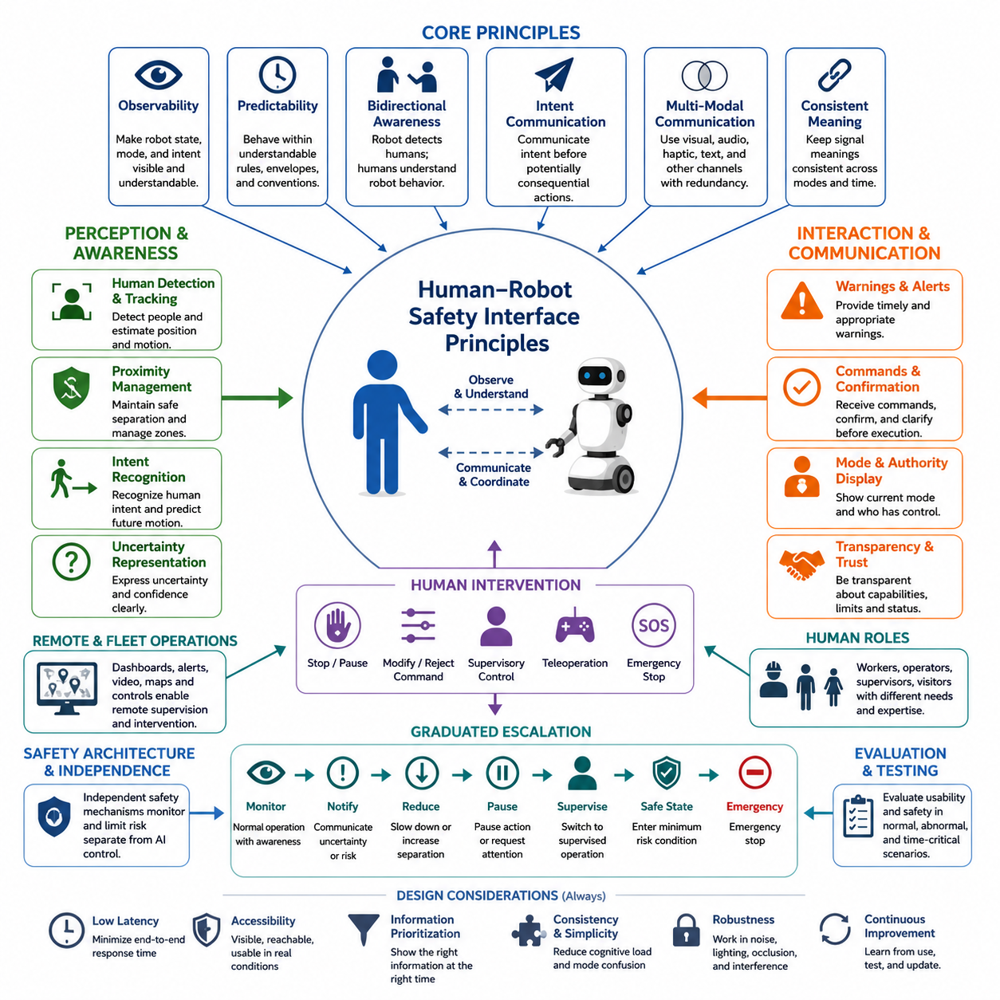{width="7.268055555555556in" height="7.268055555555556in"}

Human--robot safety interfaces form the boundary through which people perceive, understand, influence, and interrupt the behavior of a Physical AI system. Unlike conventional user interfaces, these interfaces participate directly in physical risk management because misunderstanding, delayed communication, or inaccessible controls can contribute to injury or equipment damage. Their design must therefore connect human interaction, robot autonomy, and independent safety mechanisms into a coherent operational relationship.

A fundamental principle is that safety-relevant information must be observable to the people who may be affected by robot behavior. Humans should be able to recognize whether a robot is operating normally, waiting, yielding, executing a task, entering a restricted area, experiencing uncertainty, or transitioning toward a protective state. Indicators should communicate operational meaning rather than merely expose internal technical states that require specialist interpretation.

The interface must also make robot behavior sufficiently predictable for safe human coordination. Predictability does not require that every motion be identical, particularly when AI adapts its behavior to changing environments. Instead, the robot should behave within understandable motion conventions, safety envelopes, and interaction rules. Sudden acceleration, unexplained trajectory changes, unexpected manipulation, or inconsistent yielding behavior can create hazards even when individual actions remain technically feasible.

Human awareness and robot awareness must operate as complementary parts of the interface. The robot requires mechanisms for detecting people, estimating their positions and motion, and maintaining appropriate separation, while humans require understandable signals describing the robot\'s current and intended behavior. This creates a bidirectional safety relationship in which the robot observes human activity while simultaneously making its own state and intentions observable to nearby people.

Safety interfaces should communicate intention before potentially consequential physical actions occur. A mobile robot may indicate its intended direction, a manipulator may signal that motion is about to begin, and an autonomous system may request confirmation before executing an unusual operation. Early communication gives people time to interpret the situation and react safely, transforming the interface from a passive status display into an active component of anticipatory risk reduction.

Multiple communication modalities are important because no single channel remains reliable under every operating condition. Visual indicators may become difficult to see because of orientation, lighting, occlusion, or distance, while auditory warnings may be masked by industrial noise. Haptic feedback, displays, projected information, physical indicators, or natural-language messages can provide complementary channels. Redundancy should improve comprehension without producing excessive alarms or contradictory signals.

The meaning of safety signals should remain consistent across operating modes whenever possible. If colors, sounds, icons, motion patterns, or interface messages change meaning unpredictably between autonomous operation, teleoperation, maintenance, and degraded modes, users may develop incorrect expectations. Consistent semantics reduce cognitive load and allow operators and nearby workers to build reliable mental models of how the robot communicates hazards, requests, transitions, and intervention opportunities.

Human intervention must remain accessible when autonomous behavior becomes unsafe, confusing, or inappropriate. Depending on the system, intervention may include stopping motion, rejecting an action, modifying a command, assuming supervisory control, initiating teleoperation, or activating an emergency function. These mechanisms should be clearly distinguishable according to their purpose because routine command cancellation, protective stopping, and emergency stopping represent different operational and safety functions.

Safety-critical intervention paths should not depend entirely on the same AI components whose behavior may require intervention. If a learned perception model, reasoning model, VLA policy, or autonomous planner fails, the human must still have a dependable means of bringing the system toward a safe condition. This motivates architectural separation between intelligent interaction functions and independently assured safety mechanisms, consistent with defense-in-depth principles used throughout Physical AI safety engineering.

Interfaces should explicitly represent uncertainty when uncertainty can affect human decisions. An AI system may be unable to identify an object confidently, interpret an instruction reliably, estimate human intent, or determine whether a planned path is safe. Concealing this uncertainty can create false confidence. Appropriate interfaces can instead communicate reduced confidence, request clarification, slow or suspend execution, or escalate the situation to a human supervisor before physical consequences develop.

Safety interaction must account for different human roles and levels of expertise. A trained operator may understand detailed diagnostic information, while a warehouse worker, passenger, patient, visitor, or pedestrian may encounter the robot without specialized knowledge. The external safety behavior of the system should therefore remain understandable without assuming extensive training, while specialized interfaces can provide deeper information and control capabilities to authorized operators, technicians, and safety personnel.

The interface should minimize opportunities for mode confusion. Physical AI systems may transition among autonomous operation, supervised autonomy, shared control, teleoperation, degraded operation, maintenance, recovery, and emergency states. If humans incorrectly believe that the robot is stopped when autonomy remains active, or assume that the robot is controlling itself when manual control has been transferred, hazardous actions can follow. Mode, authority, and control ownership should therefore remain clearly visible.

Command interfaces must distinguish between receiving an instruction and determining that the instruction can safely be executed. Natural-language commands, gestures, graphical controls, and remote commands may express human intent, but they should not automatically bypass physical constraints or safety policies. A robust interface supports confirmation, clarification, constraint checking, and rejection when necessary, allowing the robot to remain responsive to human authority without treating every received command as immediately executable.

Human--robot safety interfaces should support graceful escalation rather than relying only on normal operation and emergency stopping. When risk increases, the system may first communicate uncertainty, reduce speed, increase separation, request human attention, pause an action, transition to supervised operation, or enter a minimum-risk condition. Such graduated responses can preserve useful operation while preventing uncertain situations from progressing directly into severe hazards or unnecessary emergency events.

Trust should be treated as a calibrated operational property rather than a goal of making the robot appear universally reliable. Interfaces that hide uncertainty or exaggerate capability may encourage overreliance, while excessive warnings can produce distrust and alarm fatigue. Safety-oriented transparency should help users understand what the robot is doing, what it intends to do, what limitations currently apply, and when human intervention is required, supporting appropriately calibrated reliance on automation.

Interface latency is itself a safety consideration. Human detection, warning generation, visualization, command transmission, acknowledgment, override processing, and physical response all consume time. A theoretically correct warning may provide little protection if it arrives after a person has entered a hazardous region. Safety interface design must therefore consider end-to-end response time together with robot velocity, stopping distance, communication delay, human reaction time, and the dynamics of the surrounding environment.

Remote and fleet operations extend the safety interface beyond direct physical proximity. Supervisors may observe multiple robots through dashboards, alerts, maps, video feeds, or mission-control systems while robots continue operating locally. Remote interfaces must communicate which robot requires attention, why intervention is needed, what information may be delayed or incomplete, and what authority the remote operator currently possesses. Loss of communication should trigger predefined local safety behavior rather than uncontrolled dependence on remote supervision.

Safety interfaces must also resist information overload. Physical AI systems can expose enormous quantities of sensor data, confidence scores, trajectories, diagnostics, predictions, and event logs, but presenting all available information does not necessarily improve safety. Interfaces should prioritize information according to urgency, consequence, and required human action. Critical hazards must remain prominent, while lower-priority diagnostics can be available through deeper interface layers without competing for immediate attention.

The physical placement and accessibility of interface elements are as important as their logical design. Emergency controls, status indicators, acknowledgment devices, and manual intervention mechanisms must remain reachable and identifiable under realistic operating conditions. Designers should consider viewing direction, protective equipment, environmental noise, lighting, mobility limitations, gloves, stress, and the possibility that the person needing to intervene may not be positioned at the primary operator station.

Human--robot safety interfaces should ultimately be evaluated as part of the complete safety architecture rather than as isolated usability features. Testing should examine whether people correctly perceive robot states, understand warnings, predict motion, recognize uncertainty, identify control authority, and intervene effectively under realistic scenarios. Evaluation must include abnormal conditions, communication failures, ambiguous interactions, unexpected human behavior, degraded autonomy, and time-critical events rather than focusing only on nominal operation.

For Physical AI, the strongest safety interface establishes a continuous and understandable relationship among human intent, robot perception, autonomous decision making, physical action, and independent protection. Human detection, proximity management, intent recognition, robot intent communication, warnings, command confirmation, shared control, teleoperation, emergency intervention, trust, and predictability therefore form interconnected capabilities rather than separate interface features. This relationship provides the foundation for the more specialized human--robot safety mechanisms developed throughout the remainder of the chapter.

## 05.02. Human Detection and Tracking

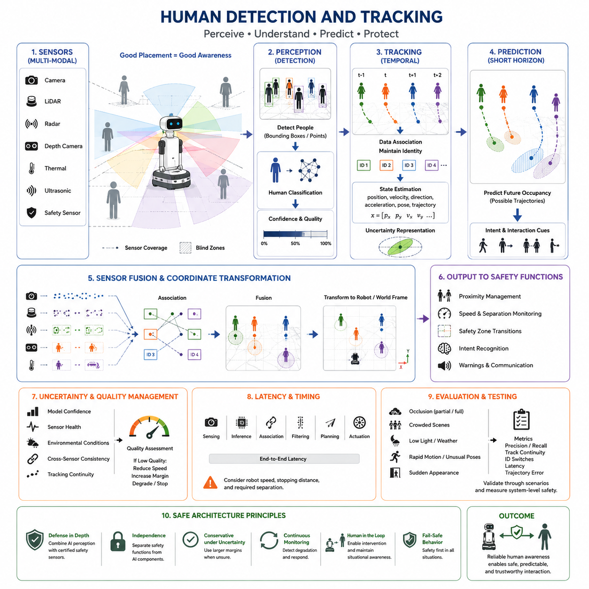{width="7.268055555555556in" height="7.268055555555556in"}

Human detection and tracking provide the perceptual foundation for safe interaction between Physical AI systems and people. A robot cannot reliably manage separation, yield right of way, communicate intent, or initiate protective behavior unless it can determine where humans are and how they are moving. Detection identifies people within the observable environment, while tracking maintains their identities, positions, motion states, and trajectories over time.

Unlike ordinary object detection, safety-oriented human detection must operate under dynamic and imperfect physical conditions. People may appear at different distances, orientations, poses, and speeds while being partially hidden by machines, shelves, vehicles, furniture, or other humans. Clothing, illumination, weather, reflections, background clutter, and sensor noise further change appearance, requiring detection systems to maintain useful performance beyond carefully controlled environments.

Physical AI systems commonly combine several sensing modalities because each provides different information about human presence. Cameras offer rich visual features for recognizing people and estimating pose, while LiDAR provides geometric position and distance measurements that can remain useful when visual appearance changes. Radar, depth cameras, thermal sensors, ultrasonic devices, and dedicated safety sensors can provide additional evidence depending on the operating environment and required safety integrity.

Sensor placement is a critical part of human detection design. A highly capable perception model cannot detect a person who remains outside the observable field of view or is persistently occluded by the robot structure. Mobile robots, manipulators, autonomous vehicles, and humanoids therefore require sensing coverage appropriate to their possible motion. Blind regions near the chassis, behind payloads, around manipulators, or beside docking structures must be identified during safety analysis.

Detection answers whether a human is currently observable, but safe interaction usually requires temporal understanding. Tracking associates detections across successive observations so that the system can estimate whether a person is stationary, approaching, departing, crossing the robot\'s path, or moving alongside it. Temporal continuity also reduces unstable behavior caused by individual missed detections and allows the safety system to reason about developing interactions rather than isolated sensor frames.

A tracking system typically maintains an estimated human state containing position, velocity, direction, and uncertainty. Depending on the application, it may also estimate acceleration, body orientation, pose, or predicted trajectory. These states are continuously updated as new sensor observations arrive. The resulting representation provides downstream safety functions with a more useful description of human motion than a sequence of disconnected detection bounding boxes or point measurements.

Data association is one of the central challenges in multi-human tracking. When several people move close together, cross paths, temporarily disappear behind obstacles, or enter and leave sensor coverage, the system must determine which new observation corresponds to which previously tracked person. Incorrect association can cause identity switches, discontinuous trajectories, or inaccurate motion estimates, potentially degrading proximity management and short-term prediction.

Occlusion requires particularly conservative treatment in safety applications. A person who disappears behind a shelf, vehicle, machine, or another person should not necessarily be assumed to have left the environment. Tracking systems can maintain a temporary latent track and propagate its estimated state for a limited period while increasing uncertainty. Safety logic can then account for the possibility that the person remains nearby until sufficient evidence supports removal of the track.

Human tracking should represent uncertainty rather than producing only deterministic coordinates. Sensor noise, partial observations, ambiguous associations, poor visibility, and prediction errors create uncertainty in both position and motion estimates. As uncertainty increases, the region in which a human may plausibly exist becomes larger. Safety mechanisms can use this information to enlarge protective margins, reduce robot speed, request additional observations, or choose more conservative trajectories.

Detection confidence must also be interpreted carefully. A high neural-network confidence score does not automatically mean that a safety-critical estimate is reliable, especially under distribution shift or unfamiliar environmental conditions. Physical AI systems should distinguish model confidence from broader operational certainty by considering sensor health, environmental conditions, cross-sensor consistency, tracking history, and whether the current situation resembles conditions represented during development and validation.

Multi-sensor fusion can improve robustness by combining complementary observations into a common representation of human presence and motion. Camera detections may be associated with LiDAR clusters, depth measurements, radar returns, or other sensor evidence. Fusion can occur at raw-data, feature, detection, or track level. The appropriate architecture depends on computational resources, synchronization requirements, sensor geometry, latency, and the independence required by the safety architecture.

Accurate coordinate transformation is essential when observations originate from multiple sensors or moving platforms. Human measurements must often be transformed from individual sensor coordinates into robot, vehicle, map, or world coordinate frames. Calibration errors, timing offsets, localization errors, and mechanical movement between sensors can distort estimated positions. Consequently, tracking accuracy depends not only on detection algorithms but also on calibration, synchronization, localization, and system integration.

Latency directly affects the safety value of human tracking. Every stage---including sensing, preprocessing, inference, association, filtering, communication, planning, and actuation---delays the system\'s knowledge of the physical world. At higher relative velocities, even a modest delay can produce a significant difference between the estimated and actual human position. Safety design must therefore evaluate end-to-end perception latency together with robot speed, stopping capability, and required separation.

Tracking frequency and temporal stability must be balanced. High update rates allow faster reaction to changing human motion, but noisy estimates can cause unstable velocity or trajectory calculations. Filtering and temporal models can improve stability, although excessive smoothing introduces additional delay. The tracking architecture should therefore provide sufficiently responsive estimates while avoiding rapid fluctuations that could cause unnecessary braking, repeated warnings, or oscillatory robot behavior.

Human pose and body configuration can provide safety information beyond the location of a person\'s center point. Arms, hands, legs, head orientation, and body posture may indicate that part of the body is entering a hazardous region even when the person\'s overall position appears acceptable. Pose estimation can also support intent recognition and collaborative interaction, although its uncertainty and failure modes must be considered before using it for safety-critical decisions.

Short-horizon trajectory prediction extends tracking from estimating current motion toward anticipating possible future occupancy. A person approaching an aisle intersection, stepping toward a mobile robot, or reaching into a manipulator workspace may create a foreseeable conflict before entering the immediate protective zone. Prediction enables earlier speed reduction or replanning, but human motion is inherently uncertain, so predicted trajectories should be represented as possibilities rather than guaranteed future paths.

Human detection must remain closely connected to proximity management and safety-zone logic. Tracked positions and predicted motion can be used to determine whether a person is outside the interaction region, approaching a caution zone, entering a reduced-speed region, or crossing a protective boundary. These transitions can trigger progressively stronger responses, connecting perception directly to the graduated safety behavior established by the human--robot safety interface architecture.

Learned perception should not automatically replace independently assured protective sensing when the required risk reduction demands stronger guarantees. AI-based human detection can provide semantic understanding, prediction, and flexible environmental perception, while certified or independently engineered safety sensors may enforce critical protective functions. Separating these roles allows advanced intelligence to improve interaction without making every safety function dependent on the correctness of a complex learned model.

Runtime monitoring should continuously evaluate whether the human detection and tracking subsystem remains trustworthy enough for the current operation. Useful indicators include sensor availability, frame rate, inference latency, detection consistency, track continuity, calibration status, unexpected observation patterns, and disagreement among sensing modalities. If perception quality falls below an acceptable threshold, the robot can reduce speed, increase margins, transition to degraded operation, or move toward a safe state.

Evaluation must include difficult scenarios rather than only average detection accuracy. Testing should examine partial and full occlusion, crowded scenes, unusual poses, rapid motion, low illumination, reflective surfaces, adverse weather where applicable, sensor contamination, communication delay, and people entering suddenly from previously hidden regions. False negatives are particularly important because an undetected human can prevent downstream safety mechanisms from recognizing that protective action is required.

System-level evaluation should also measure how perception errors affect actual robot behavior. Detection precision and recall, tracking continuity, localization error, identity switches, latency, and trajectory error are useful technical metrics, but safety ultimately depends on whether the complete system preserves appropriate separation and responds correctly. Scenario-based testing should therefore connect perception performance to warnings, speed reduction, replanning, protective stopping, and emergency intervention.

Human detection and tracking should ultimately be understood as a continuously updated safety representation of nearby people rather than a standalone computer-vision function. Detection establishes human presence, tracking preserves temporal continuity, sensor fusion improves robustness, uncertainty represents incomplete knowledge, and prediction anticipates potential conflicts. Together these capabilities provide the human-awareness layer required for proximity management, speed and separation monitoring, intent recognition, and subsequent human--robot safety interfaces.

## 05.03. Safety Zones and Proximity Management

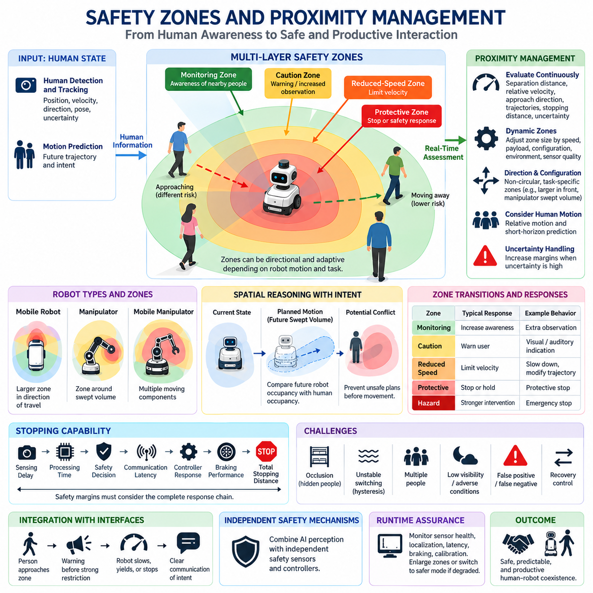{width="7.268055555555556in" height="7.268055555555556in"}

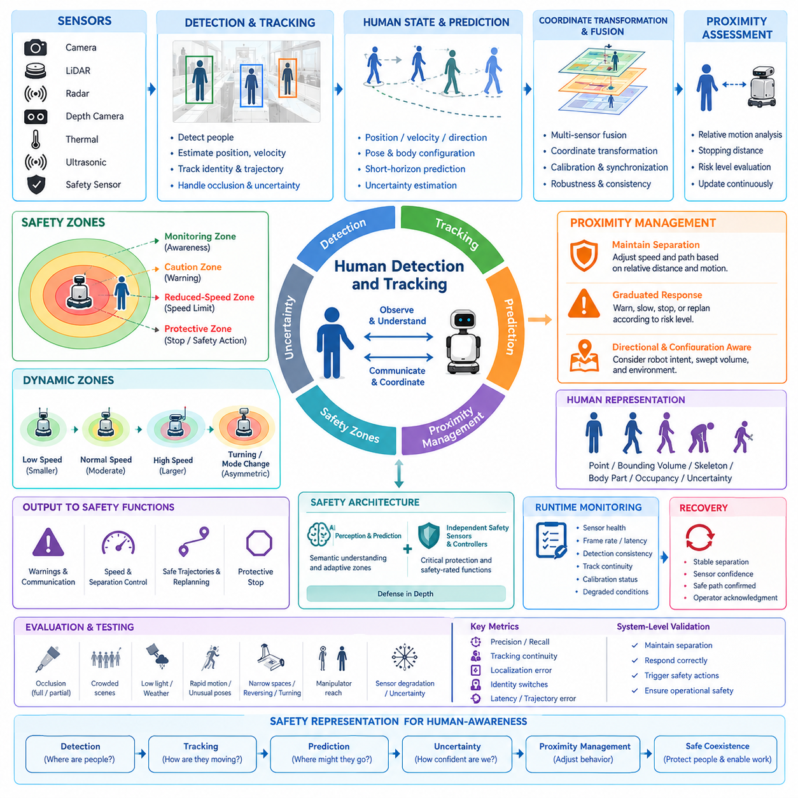{width="7.268055555555556in" height="7.268055555555556in"}

Safety zones and proximity management convert human location information into spatial rules that govern how a Physical AI system may move near people. Rather than treating safety as a simple distinction between free motion and emergency stopping, the environment can be divided into regions associated with progressively different robot behaviors. These regions provide a structured connection between human detection, distance estimation, motion control, warnings, protective functions, and intervention.

A safety zone represents a spatial region in which specific conditions, constraints, or responses apply. Depending on the application, zones may surround the entire robot, individual manipulators, moving tools, payloads, docking mechanisms, or hazardous workspaces. Their dimensions should reflect the robot\'s geometry, possible motion, velocity, stopping capability, sensing performance, environmental conditions, and the severity of potential contact rather than being chosen as arbitrary fixed distances.

A useful architecture commonly contains multiple layers instead of one protective boundary. A monitoring region can establish awareness of nearby people, a caution region can initiate warnings or increased observation, a reduced-speed region can constrain velocity, and a protective region can trigger stopping or another safety response. This graduated structure allows the robot to respond proportionally as risk changes while preserving productive operation whenever sufficient separation remains available.

Proximity management continuously evaluates the spatial relationship between humans and the robot rather than waiting for a boundary crossing. Relevant variables include current separation distance, relative velocity, direction of approach, robot trajectory, human trajectory, stopping distance, and uncertainty. Two people at the same distance may therefore represent very different risks if one is stationary and moving away while the other is rapidly approaching the robot\'s planned path.

Safety zones do not need to be circular or geometrically uniform. A mobile robot moving forward may require a larger protected region in its direction of travel than behind it, while a manipulator may require zones shaped around the swept volume of its links and end effector. Direction-dependent and configuration-dependent regions can represent physical risk more accurately than fixed symmetric boundaries, provided their behavior remains understandable and sufficiently validated.

Dynamic safety zones extend this concept by changing their dimensions according to operational conditions. When robot speed increases, stopping distance and required reaction time may increase, causing forward safety margins to expand. When speed decreases, the system may permit closer interaction where appropriate. Payload mass, manipulator configuration, floor conditions, localization quality, sensor performance, visibility, and uncertainty can also influence the size of a dynamically managed safety region.

Human motion must be considered because separation is a relative property. A person walking toward a robot can reduce available reaction time even if the robot itself is moving slowly. Tracking information can therefore be used to estimate relative motion and time to potential interaction. Short-horizon prediction may further identify whether human and robot trajectories are converging, enabling preventive speed reduction or replanning before the person reaches an immediate protective boundary.

Stopping capability establishes an important physical constraint on proximity management. A robot cannot safely operate at a speed from which it cannot stop before reaching an unacceptable interaction condition. Total stopping behavior includes sensing delay, perception processing, safety decision time, communication latency, controller response, actuator dynamics, braking performance, and mechanical stopping distance. Safety margins must account for this complete response chain rather than considering braking distance alone.

Uncertainty should enlarge rather than silently weaken safety margins. Human position estimates may contain sensor error, tracking uncertainty, calibration error, or temporary occlusion, while robot localization and motion estimates may also be imperfect. If the system is less certain about the relative configuration of robot and human, proximity logic can conservatively expand protected regions, reduce allowable velocity, or transition to a more restrictive operating mode until reliable observations return.

Occlusion creates a particularly important challenge for spatial safety management. A person who disappears behind a shelf, machine, vehicle, payload, or structural obstacle may still be close to the robot\'s future path. The system should avoid immediately treating previously occupied space as empty. Persistent tracks, occupancy memory, conservative hidden-space assumptions, or additional sensing can help maintain protection until sufficient evidence indicates that the occluded person no longer presents an immediate risk.

Safety-zone transitions should be designed to avoid unstable switching. If a person repeatedly moves near a boundary, small measurement fluctuations can otherwise cause rapid alternation between normal operation, reduced speed, and stopping. Hysteresis, temporal filtering, minimum dwell times, and appropriately separated thresholds can stabilize behavior. These mechanisms must be designed carefully so that improved stability does not introduce excessive delay in responding to genuinely increasing risk.

The response associated with each region should be explicit and deterministic enough for safety reasoning. Entering an outer zone may increase monitoring or activate a visual indication, while entering an intermediate zone may reduce speed and modify the planned trajectory. A closer protective zone may initiate a protective stop, and an immediate hazardous condition may require stronger intervention. The exact mapping depends on the robot, environment, task, and applicable safety architecture.

Zone management should also consider robot intent and future swept volume rather than only current physical geometry. A stationary manipulator preparing to rotate or a mobile robot preparing to turn may soon occupy space that is currently clear. Planning systems can project intended motion into the environment and compare future robot occupancy with tracked or predicted human occupancy. This allows proximity management to constrain unsafe plans before physical movement creates an immediate conflict.

For mobile robots, safety zones often move with the platform and change with velocity and steering direction. Corners, reversing maneuvers, rotations in place, narrow passages, intersections, and docking operations can create different spatial hazards. The proximity system should therefore reason about the complete footprint and predicted swept path of the robot rather than representing the platform as a single point located at its geometric center.

For manipulators and mobile manipulators, proximity management becomes more complex because multiple robot components can move simultaneously. The base, arm links, end effector, carried object, and attached tool may each create different hazardous regions. A safety representation may therefore need to evaluate the minimum distance between a human body or body part and several moving robot geometries while considering joint velocities and possible future configurations.

Human body representation also affects proximity calculations. Treating a person as a single point can underestimate risk when an arm, hand, leg, or head extends toward the robot. Depending on sensing capability and application requirements, humans may be represented using bounding volumes, skeletal models, body-part regions, occupancy distributions, or uncertainty envelopes. More detailed representations can support closer collaboration but require reliable perception and careful validation.

Safety zones should interact coherently with human-facing warnings and robot intent communication. A person approaching a restricted region may receive visual or auditory information before robot motion is significantly constrained. At closer distances, stronger warnings and more restrictive robot responses may occur. This coordinated behavior helps people understand why the robot is slowing, yielding, stopping, or replanning instead of experiencing apparently unexplained changes in autonomous behavior.

Proximity management should remain connected to independent safety mechanisms when required by the risk level. AI perception and prediction can provide flexible semantic awareness and enable adaptive zones, but safety-critical protective functions may require independent sensing, safety-rated controllers, or separately assured monitoring. Advanced Physical AI can therefore operate within an intelligent dynamic envelope while a more conservative protection layer enforces fundamental limits when necessary.

Runtime assurance should monitor whether the assumptions supporting safety zones remain valid. Sensor failures, degraded localization, excessive latency, braking degradation, unexpected payload changes, calibration errors, or poor environmental visibility can invalidate previously acceptable separation distances. When such degradation is detected, the system can enlarge zones, reduce maximum speed, restrict autonomous functions, request human assistance, or transition toward a minimum-risk condition.

Evaluation must test both the geometry of the zones and the behavior produced when humans interact with them. Scenarios should include slow and rapid approaches, crossing trajectories, sudden appearances, multiple people, occlusion, narrow spaces, reversing motion, turning, manipulator reach, sensor degradation, and uncertain localization. Testing should verify not only whether boundaries are detected but whether warnings, speed reduction, replanning, stopping, and recovery occur with sufficient timing and consistency.

False positives and false negatives create different operational consequences. Excessively conservative zone activation may produce frequent unnecessary stops, reducing productivity and encouraging people to ignore warnings or bypass safety procedures. Insufficiently conservative activation can expose people to unacceptable risk. Effective proximity management therefore requires carefully validated thresholds and uncertainty margins that balance operational availability with the required level of risk reduction.

Recovery after a safety-zone event must also be controlled. A robot should not immediately resume unrestricted motion merely because a person briefly moves outside a boundary. The system may require stable separation, renewed sensor confidence, confirmation that the intended path is clear, or operator acknowledgment depending on the event. Controlled recovery prevents repeated stop-start behavior and reduces the possibility of motion resuming while the underlying hazardous interaction remains unresolved.

Safety zones and proximity management ultimately transform perception into a continuously changing spatial safety envelope around robot behavior. Human tracking establishes where people may be, prediction estimates where they may move, robot planning defines future occupied space, and uncertainty expands the region that must be treated cautiously. Together these elements provide the spatial foundation for speed and separation monitoring, intent-aware interaction, protective stopping, and predictable human--robot coexistence.

## 05.04. Speed and Separation Monitoring

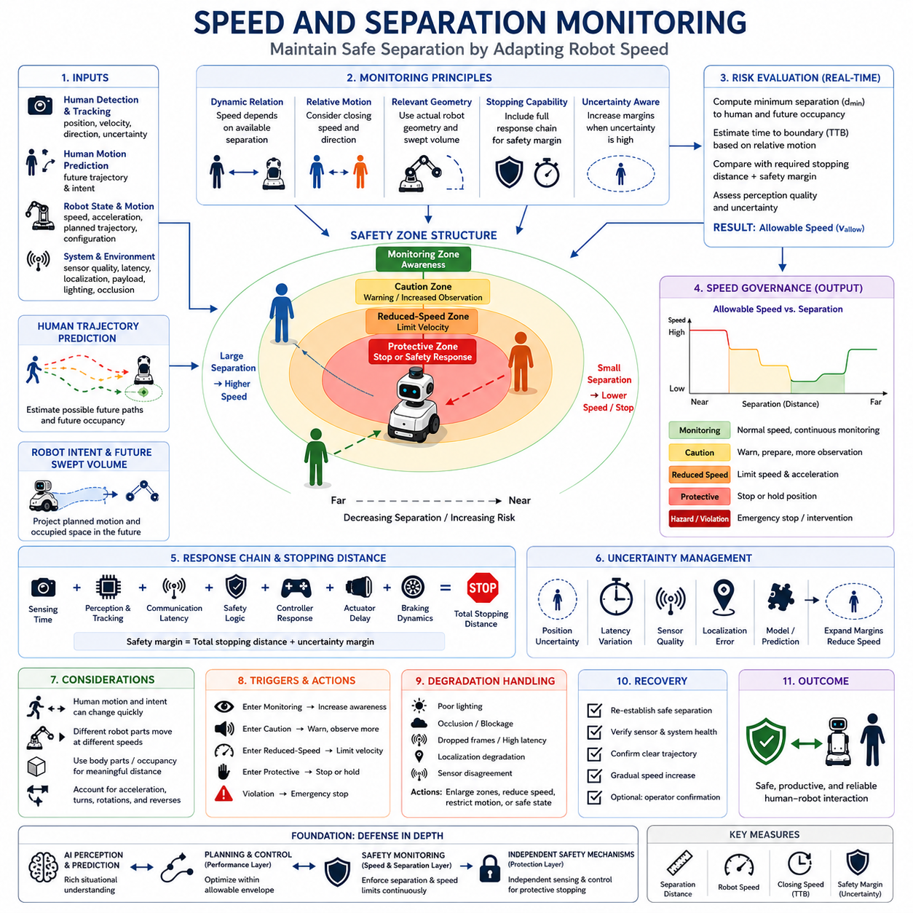{width="7.268055555555556in" height="7.268055555555556in"}

Speed and separation monitoring connects human proximity directly to robot motion constraints. Its purpose is to maintain sufficient distance between people and hazardous robot motion while allowing useful operation whenever conditions remain safe. Instead of relying only on fixed barriers or complete stopping, the system continuously evaluates separation, relative motion, robot speed, stopping capability, perception quality, and uncertainty to determine an appropriate level of motion.

The central concept is that acceptable robot speed depends on the available separation between a person and the relevant moving part of the robot. When separation is large, normal operation may be permitted. As a person approaches, the allowable speed can progressively decrease until protective stopping becomes necessary. This creates a dynamic relationship between distance and velocity rather than treating every human presence as requiring the same response.

Separation should be measured relative to the actual hazardous geometry, not merely between abstract reference points. For a mobile robot, relevant geometry may include the chassis, payload, protruding equipment, or predicted swept footprint. For a manipulator, it may include individual links, the end effector, tools, and carried objects. The shortest meaningful distance between a human body region and moving robot geometry often provides the basis for safety decisions.

Human motion is equally important because separation can change rapidly. A stationary person several meters away may present little immediate risk, while a person moving quickly toward the robot can consume the available safety margin within a short time. Tracking therefore provides position, velocity, direction, and uncertainty, allowing the monitoring function to estimate closing speed and determine whether the human and robot are converging, separating, or moving approximately together.

Robot velocity affects both the probability and potential severity of physical interaction. Higher speed generally increases stopping distance and reduces the time available for perception, decision making, and intervention. The monitoring system should therefore evaluate translational velocity, rotational velocity, manipulator joint motion, and relevant component velocities rather than relying only on a single platform speed. Different robot parts can create different local approach speeds toward a nearby person.

Stopping distance is not simply the mechanical braking distance measured after a stop command has reached the actuators. A complete safety analysis includes sensing time, perception processing, human tracking, communication, safety logic, controller response, actuator delay, braking dynamics, and the distance traveled during these stages. The required separation must account for this entire response chain so that protective action begins early enough to prevent unacceptable contact.

Relative approach speed provides a more informative risk measure than robot speed alone. If a robot and a person move toward each other, the available separation can decrease faster than either individual velocity suggests. Conversely, when both move in the same direction, the closing rate may be much lower. Monitoring should therefore consider the combined kinematics of human and robot motion when estimating the time remaining before a protected spatial condition could be violated.

A practical system can define progressively restrictive operating states based on separation. At long range, the robot may operate normally while maintaining awareness. At an intermediate distance, it may increase observation or issue a warning. As separation decreases further, velocity and acceleration can be constrained. If the calculated protective separation can no longer be maintained, the system can initiate a protective stop or another predefined minimum-risk response.

Dynamic speed limits allow the robot to preserve productivity while maintaining protection. Instead of stopping whenever a person enters a broad workspace, the controller can reduce allowable speed according to measured distance and current conditions. If the person moves away and stable separation is restored, speed may gradually increase again. Such adaptation is especially useful in shared industrial spaces, warehouses, hospitals, service environments, and collaborative manipulation tasks.

Acceleration and direction changes must also be considered because current velocity alone does not describe future motion. A robot traveling slowly may be preparing to accelerate or turn toward a person, while a manipulator may be about to move a link into previously clear space. Monitoring can therefore incorporate commanded motion, planned trajectories, acceleration limits, and predicted swept volumes to determine whether future robot behavior remains compatible with available separation.

Human trajectory prediction can provide additional reaction time. If tracking indicates that a person is likely to cross the robot\'s planned route, speed reduction or replanning can begin before the minimum separation is reached. Prediction should remain conservative because human movement can change suddenly. Rather than assuming a single future trajectory, the system can consider a region of plausible future occupancy and increase safety margins when predicted behavior becomes uncertain.

Uncertainty is a fundamental component of speed and separation monitoring. Human position, velocity, robot localization, calibration, timing, and stopping performance all contain errors or variations. The system should not interpret estimated separation as an exact physical quantity when these uncertainties are significant. Conservative margins can compensate for imperfect knowledge, and allowable speed can be reduced when uncertainty grows beyond the conditions assumed during validation.

Perception degradation should therefore influence motion limits directly. Poor illumination, sensor contamination, occlusion, dropped frames, localization degradation, excessive inference latency, or disagreement among sensors can reduce confidence in the measured human--robot relationship. Continuing at the same speed despite degraded perception effectively consumes safety margin. A robust system can compensate by increasing separation requirements, reducing speed, restricting motion, or entering a protective state.

Latency is particularly important because speed and separation estimates always describe the world at some earlier instant. By the time sensing, inference, filtering, communication, and control have completed, both the human and robot may have moved. Monitoring should use bounded end-to-end latency assumptions and, where appropriate, propagate estimated states forward to the decision time. Unexpected latency growth should be detected because it can invalidate previously acceptable operating limits.

Sampling frequency and temporal stability also influence performance. Slow updates may fail to capture rapidly changing interactions, while noisy high-frequency estimates can cause repeated speed changes or unnecessary stops. Filtering, hysteresis, and temporal consistency checks can stabilize control decisions, but they must not suppress genuine hazards. The monitoring architecture should therefore balance responsiveness with robustness while maintaining conservative behavior during ambiguous transitions.

For mobile robots, speed and separation monitoring should account for the complete footprint and maneuvering behavior of the platform. Forward travel, reversing, turning, rotating in place, and docking generate different approach geometries. A person standing beside a robot may become endangered when the platform begins rotating even if its center position changes very little. Local velocity around the robot boundary can therefore be more relevant than center-of-mass velocity.

For manipulators, the relationship between joint motion and Cartesian motion is critical. Different links can move toward a person at different speeds, and the end effector may travel rapidly even when individual joint velocities appear moderate. Monitoring should evaluate relevant robot geometries throughout the planned motion and identify the closest human--robot relationship. Mobile manipulators require this reasoning for both the moving base and articulated arm simultaneously.

Human body representation can further refine separation calculations. Measuring distance only to the center of a detected person may overlook an extended arm, hand, leg, or head entering the robot workspace. Bounding volumes, skeletal representations, body-part tracking, or occupancy envelopes can provide more meaningful separation estimates. The required representation should match the application, sensing capability, interaction distance, and reliability demonstrated during validation.

Speed and separation monitoring should remain distinct from purely performance-oriented collision avoidance. A planning algorithm may attempt to avoid people efficiently, but safety monitoring must independently determine whether physical constraints remain acceptable. If an AI planner proposes a trajectory that violates required separation or speed limits, a safety layer should be capable of constraining, rejecting, or stopping that motion regardless of the planner\'s predicted task benefit.

This separation of responsibilities supports defense in depth. AI perception, trajectory prediction, and adaptive planning can provide rich situational understanding, while independent safety sensing and control mechanisms can enforce fundamental protective constraints where required. The intelligent layer may optimize motion within an allowable envelope, but failure of the learned planner or world model should not automatically remove the mechanisms responsible for limiting hazardous speed or initiating protective stopping.

Runtime assurance should continuously verify the assumptions used to calculate allowable motion. Relevant variables include sensor availability, tracking quality, localization accuracy, communication delay, controller timing, braking capability, payload configuration, and environmental conditions. If any of these variables move outside validated bounds, previously calculated separation requirements may no longer be sufficient, requiring reduced speed, enlarged margins, degraded operation, or a safe-state transition.

Evaluation should include realistic combinations of human and robot movement rather than static distance tests alone. Important scenarios include direct approaches, crossing paths, overtaking, sudden human entry, reversing robots, rapid turns, manipulator reach, multiple people, occlusion, degraded sensors, and changing payloads. Tests should verify that the system reduces speed and stops with sufficient margin under both nominal conditions and credible combinations of delay and uncertainty.

Operational performance should also be evaluated because excessively conservative monitoring can produce frequent unnecessary slowdowns and stops. Such behavior reduces productivity and may encourage users to bypass safety mechanisms. Conversely, aggressive thresholds may preserve throughput while reducing protection. Effective design therefore seeks validated operating envelopes in which robot availability and useful speed are maximized without compromising the required level of risk reduction.

Recovery from a speed reduction or protective stop must be controlled as carefully as the initial response. Increased speed should occur only after adequate separation has been re-established and relevant perception and system-health conditions are stable. Depending on the application, recovery may also require trajectory reevaluation or human acknowledgment. This prevents the robot from repeatedly accelerating and stopping near a boundary or resuming motion into an unresolved interaction.

Speed and separation monitoring ultimately creates a real-time coupling between human motion and allowable robot motion. Human detection establishes presence, tracking estimates relative movement, safety zones provide spatial structure, stopping models determine required margins, and uncertainty modifies those margins conservatively. Together these mechanisms enable Physical AI systems to slow, yield, replan, stop, and recover predictably while sharing physical environments with people.

## 05.05. Intent Recognition and Human Awareness

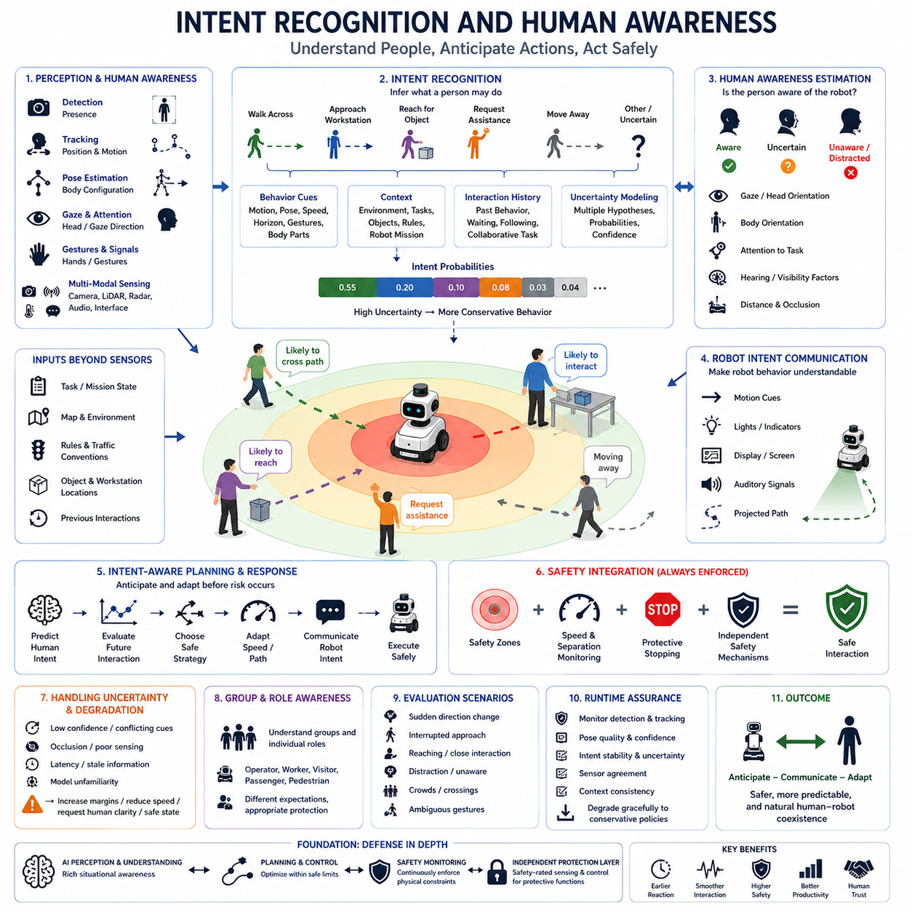{width="7.268055555555556in" height="7.268055555555556in"}

Intent recognition and human awareness extend human--robot safety beyond detecting where a person is toward understanding what that person may be trying to do. A Physical AI system operating near people must interpret motion, posture, gestures, attention, task context, and interaction history while recognizing that human behavior remains uncertain. This capability allows the robot to anticipate potential interactions and adapt before a hazardous spatial relationship develops.

Human awareness begins with a continuously updated representation of people in the robot's environment. Detection establishes presence, tracking estimates position and motion, and pose estimation provides information about body configuration. Intent recognition builds on these observations by inferring possible goals or near-term actions, such as crossing a robot path, approaching a workstation, reaching toward an object, requesting assistance, or moving away from the interaction area.

Intent should not be treated as a directly observable physical quantity. Sensors measure images, depth, motion, position, orientation, sound, and other signals, while intention must be inferred from patterns in those observations. The same movement can represent different intentions depending on context. A person walking toward a robot may intend to cross its path, interact with it, retrieve an object nearby, or simply pass through the area, making probabilistic interpretation essential.

Body motion provides important cues for short-term intent recognition. Walking direction, velocity, acceleration, torso orientation, head orientation, arm movement, hand position, and changes in posture can indicate likely future behavior. A worker turning toward a robot lane may suggest an upcoming crossing, while a hand extending toward a shared workspace may indicate imminent interaction. These cues become more informative when interpreted over time rather than from a single observation.

Human gaze and attention can provide additional evidence about awareness and intended action, although they should be interpreted cautiously. Head direction or estimated gaze may indicate whether a person has noticed the robot, is monitoring its movement, or is focused elsewhere. However, apparent visual attention does not guarantee comprehension or future behavior. Safety decisions should therefore avoid assuming that a person will yield merely because the person appears to have seen the robot.

Gestures can provide more explicit interaction signals when the operating environment defines their meaning. A raised hand, pointing motion, stop gesture, directional indication, or task-specific signal may communicate a request or command. Reliable use requires clear gesture definitions, sufficient sensing coverage, and mechanisms for handling ambiguous recognition. Safety-critical behavior should not depend on a gesture interpretation when confidence is inadequate or multiple interpretations remain plausible.

Context significantly improves intent recognition. Human behavior that is ambiguous in isolation may become understandable when combined with workspace geometry, task state, traffic rules, object locations, robot missions, and previous interactions. A person approaching a loading station during a transfer operation may have a different likely intention from a person following the same trajectory in an unrestricted corridor. Context therefore connects human perception with the robot's world model and task understanding.

Interaction history provides another temporal source of information. Repeated observations can reveal whether a person has been waiting, following the robot, repeatedly approaching a workstation, or participating in a collaborative task. Maintaining relevant short-term history allows the system to distinguish transient motion from purposeful interaction. This history should support prediction without creating unjustified assumptions that past behavior guarantees the same future action.

Intent recognition is inherently uncertain because humans can change their decisions quickly. A person predicted to continue walking may suddenly stop, turn, accelerate, or reach into the robot workspace. The system should therefore represent several plausible intentions or future trajectories rather than committing prematurely to a single interpretation. When uncertainty is high, conservative behavior such as reduced speed, increased separation, or additional observation can preserve safety.

Human awareness should distinguish between recognizing a person and estimating whether that person is aware of the robot. A nearby worker may be looking at a screen, facing away, wearing hearing protection, or concentrating on another task. The robot should not assume mutual awareness simply because the person has been detected. Interaction strategies can account for this asymmetry by communicating robot intent more clearly or increasing safety margins when human awareness is uncertain.

Robot intent communication complements human intent recognition. Safe interaction is bidirectional: the robot attempts to understand what people may do while making its own planned behavior understandable to them. Motion cues, lights, displays, sounds, projected paths, or other signals can indicate that the robot intends to move, turn, yield, stop, or enter a workspace. Predictable robot behavior helps humans form accurate expectations and reduces ambiguity on both sides of the interaction.

Intent-aware planning can use human predictions before immediate proximity constraints are violated. If a person appears likely to cross the robot's route, the planner may slow down, yield, select another path, or delay entry into a shared region. If a worker appears likely to reach into a collaborative workspace, manipulator motion can be adjusted before the hand enters a protective zone. This anticipatory behavior can produce smoother and safer interaction than purely reactive stopping.

Intent recognition should nevertheless remain subordinate to physical safety constraints. A prediction that a person intends to move away does not justify violating required separation or speed limits. Human behavior can differ from the predicted intention, and perception can fail. Safety zones, speed and separation monitoring, protective stopping, and independent safety mechanisms should therefore continue to enforce fundamental constraints regardless of the intent model's preferred interpretation.

Multi-modal perception can strengthen human awareness by combining visual, geometric, motion, and interaction information. Cameras may provide pose and gesture cues, while LiDAR or depth sensors provide spatial relationships and radar can contribute motion information. Speech or explicit interface commands may add semantic context. Fusion can improve robustness, but conflicting signals should increase uncertainty rather than being forced into an unjustifiably confident interpretation.

Group behavior introduces additional complexity. Multiple people may influence one another, move together, separate unexpectedly, or obscure individual body motion. A robot operating in crowds or shared workspaces may need to reason about both individual intentions and collective movement patterns. The system should avoid assuming that every member of a group will follow the same trajectory, particularly near intersections, doors, workstations, and other regions where paths diverge.

Role and task awareness can further refine interpretation. An authorized operator, maintenance technician, collaborative worker, visitor, passenger, or pedestrian may interact with the same robot differently. When role information is legitimately available, it can help interpret expected interaction patterns and permitted commands. However, safety should not depend on unreliable identity assumptions, and unfamiliar people must still receive appropriate protection without requiring specialized knowledge of the robot.

Intent models can fail under distribution shift when human behavior differs from training or validation data. Cultural differences in gestures, unusual clothing, mobility aids, atypical body motion, unfamiliar work procedures, crowded conditions, or new environmental layouts may reduce prediction quality. Runtime monitoring should identify low confidence, inconsistent predictions, or unfamiliar observations and cause the system to fall back toward more conservative proximity and motion policies.

Latency also affects the usefulness of intent recognition. An accurate interpretation that arrives after the relevant human action has begun may provide little preventive value. Perception, pose estimation, temporal modeling, prediction, planning, and control must therefore operate within an end-to-end timing budget appropriate to the interaction speed. Faster environments require earlier prediction horizons while also demanding careful management of the additional uncertainty created by longer-term prediction.

False intent predictions have asymmetric consequences. Predicting an interaction that does not occur may cause unnecessary slowing or yielding, while failing to predict an actual crossing or reach can reduce available reaction time. Evaluation should therefore consider not only classification accuracy but also the operational consequences of errors. Safety-oriented thresholds may intentionally favor conservative responses when the cost of missing a hazardous intention is significantly greater than the cost of unnecessary caution.

Evaluation should include ambiguous and changing human behavior rather than only scripted gestures or predictable trajectories. Useful scenarios include sudden direction changes, interrupted approaches, partial occlusion, distracted people, conflicting body cues, groups crossing paths, unexpected reaching, hesitation, and people who ignore robot signals. Testing should measure whether uncertainty is represented appropriately and whether the complete robot response remains safe when intent predictions are incorrect.

Human awareness must also be integrated with runtime assurance. The system can monitor detection continuity, pose quality, prediction confidence, sensor agreement, interaction context, and the stability of inferred intentions. If these indicators deteriorate, the robot can reduce reliance on intent prediction and shift toward direct spatial protection. This graceful degradation prevents advanced behavioral inference from becoming a single point of failure in the safety architecture.

The objective of intent recognition is not to read human thoughts but to provide useful, uncertainty-aware predictions that improve physical interaction. Human detection explains who is present, tracking describes how they are moving, pose and context provide behavioral cues, and intent inference estimates what they may do next. These predictions can support earlier yielding, speed adaptation, replanning, communication, and protective action while remaining constrained by independently enforced safety limits.

Intent recognition and human awareness therefore create an anticipatory layer between human perception and robot action. By combining observed motion, body configuration, attention cues, gestures, environmental context, interaction history, and uncertainty, Physical AI systems can reason about plausible human behavior before immediate hazards emerge. Integrated with proximity management and speed and separation monitoring, this capability supports safer, more predictable, and more natural human--robot coexistence.

## 05.06. Robot Intent Communication

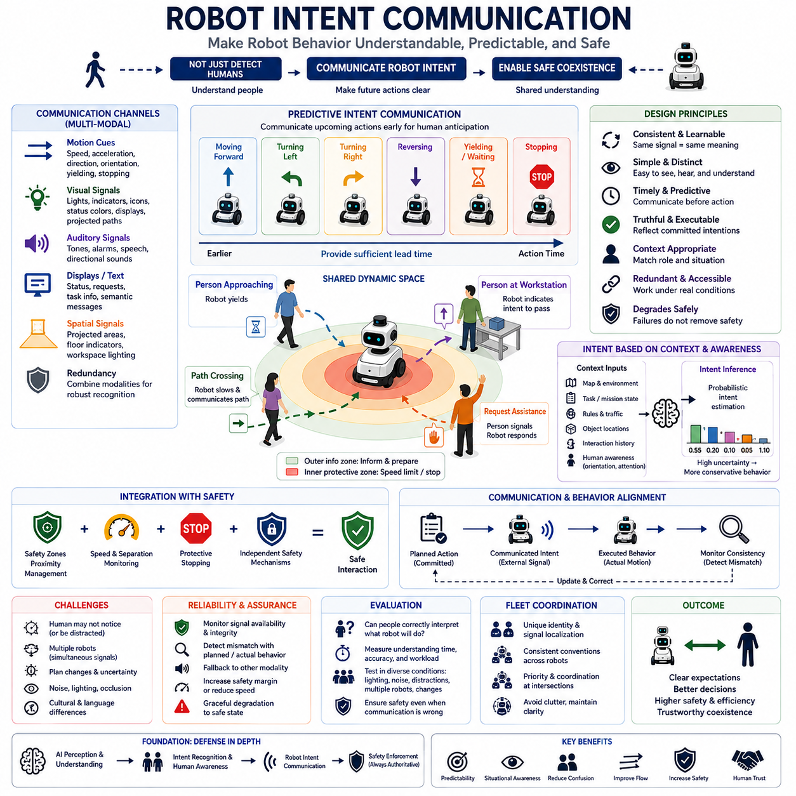{width="7.268055555555556in" height="7.268055555555556in"}

Robot intent communication makes planned robot behavior understandable to nearby people before and during physical action. A Physical AI system should not only detect and interpret humans but also provide observable cues about what it intends to do next. Communicating motion, direction, yielding, stopping, task transitions, and uncertainty reduces ambiguity and helps people form appropriate expectations when sharing dynamic spaces with autonomous machines.

Intent communication is fundamentally predictive rather than merely descriptive. A signal that explains robot motion only after movement begins provides limited preventive value. Effective interfaces indicate an upcoming action early enough for a person to perceive, interpret, and respond. The required lead time depends on robot speed, interaction distance, environmental complexity, human attention, and the consequences of misunderstanding the intended behavior.

Robot motion itself is one of the most important communication channels. Gradual deceleration can indicate yielding, a deliberate orientation change can reveal an intended direction, and a smooth approach can communicate controlled engagement. Motion should therefore be designed not only for mechanical efficiency but also for legibility. Sudden acceleration, unnecessary oscillation, abrupt path changes, and repeated hesitation can make technically safe behavior difficult for humans to predict.

Visual indicators can supplement motion when movement alone does not provide sufficient information. Lights, illuminated bands, directional indicators, icons, and displays can communicate states such as moving, yielding, waiting, turning, stopping, or requesting clearance. These signals should remain simple and distinguishable under realistic viewing conditions. Excessive colors, rapidly changing patterns, or complicated symbolic meanings can increase cognitive load rather than improve situational understanding.

Directional communication is especially important for mobile robots because a person\'s decision often depends on where the robot will move next. Indicators can communicate an intended turn, planned departure, reversing motion, or route through an intersection. Projected paths or floor indicators may provide additional spatial information in suitable environments. Such interfaces should represent robot plans conservatively because an autonomous planner may revise its trajectory when environmental conditions change.

Auditory communication can attract attention when visual signals are outside a person\'s field of view or when immediate awareness is important. Tones, alarms, spoken messages, and directional sounds can indicate approach, reversing, warnings, or requests. Auditory interfaces must consider ambient noise, hearing protection, multiple robots, language differences, and alarm fatigue. Frequent or ambiguous sounds can lose effectiveness if people learn that they rarely correspond to meaningful events.

Displays and text-based interfaces can communicate richer semantic information where users have sufficient time and proximity to read them. A robot may indicate that it is waiting, rerouting, requesting assistance, entering a restricted operation, or unable to continue autonomously. Text should support rather than replace immediately understandable motion and safety cues because people may be distracted, unfamiliar with the language, or unable to view the display from their current position.

Multi-modal communication combines motion, visual, auditory, and interface signals so that important intent is not dependent on a single channel. A robot preparing to yield might decelerate, display a waiting indication, and provide a subtle visual signal simultaneously. Consistent redundancy can improve recognition, particularly under degraded conditions. However, different modalities must communicate compatible meanings; conflicting cues can make the robot less predictable than using one clear signal.

Consistency is essential for learned human expectations. The same signal should represent the same general robot behavior across repeated interactions whenever practical. If one light pattern sometimes means yielding and elsewhere means immediate movement, people cannot develop reliable interpretations. Interface conventions should therefore be stable across operating modes, robot states, and similar platforms, while unavoidable differences should be made sufficiently distinct to prevent hazardous misunderstanding.

Robot communication should reflect actual executable intent rather than an internal plan that may never occur. Autonomous systems frequently generate candidate trajectories before selecting or revising a final action. Communicating unstable planning hypotheses can confuse nearby people. Intent signals should therefore correspond to plans that have reached an appropriate commitment level while still being presented early enough to support human anticipation and safe interaction.

Plan changes require explicit consideration. If a robot indicates that it will proceed straight but subsequently decides to turn because of a newly detected obstacle, the communication interface should update promptly and coherently. The robot may also need to reduce speed during the transition because nearby people could still be acting on the previous signal. Communication design should account for the persistence of human expectations after a displayed intention has changed.

Human attention cannot be assumed. A person may be facing away, using a phone, wearing protective equipment, concentrating on work, or interacting with another person. Human-awareness estimates can help determine whether ordinary communication is likely to have been perceived. When awareness is uncertain, the robot can increase separation, reduce speed, repeat or strengthen appropriate signals, or avoid relying on human cooperation until sufficient evidence of mutual awareness exists.

Communication should also be appropriate to the interaction role. An operator may require detailed system status, while a pedestrian primarily needs immediate movement intent. A collaborative worker may need information about task transitions or manipulator actions, whereas a visitor may understand only universally recognizable cues. The interface should expose the information necessary for safe decisions without requiring every person to understand the robot\'s internal architecture or autonomy state.

For manipulators, intent communication can make future arm motion more predictable. Motion preparation, directional indicators, workspace illumination, projected regions, or task-state displays may indicate that an arm is about to reach, transfer an object, rotate, or enter a shared workspace. Communication becomes particularly valuable when the future swept volume is not obvious from the manipulator\'s current configuration or when multiple joints can produce unexpected movement.

Mobile manipulators require coordinated communication because the base and arm can express different intentions simultaneously. The platform may be stationary while the arm begins moving, or the base may reposition while the manipulator holds a payload. Signals should help people understand which part of the robot is about to move and what space may become occupied. Uncoordinated indications from different subsystems can create misleading expectations about the overall robot behavior.

Intent communication should integrate with safety zones and proximity management. An outer interaction region can trigger informational cues before stronger restrictions become necessary. As a person approaches, communication may become more salient while robot speed decreases. If a protective boundary is reached, physical safety mechanisms should take priority over communication. This progression creates a coherent relationship between what the robot communicates and what the robot physically does.

Speed and separation monitoring can also determine whether communication alone is sufficient. A robot should never rely on a warning to compensate for inadequate stopping distance or excessive approach speed. Signals can improve human understanding, but they do not guarantee that a person will notice, understand, or obey them. Required separation, velocity limits, protective stopping, and other physical constraints must therefore remain enforceable independently of successful communication.

Uncertainty should be reflected in robot behavior rather than hidden behind overly confident signals. If perception, intent recognition, localization, or planning is uncertain, the robot should avoid communicating a precise action that it cannot reliably execute. It may instead slow down, wait, request clarification, or indicate a limited operational state. Conservative behavior is often a more trustworthy expression of uncertainty than attempting to communicate complex internal probability estimates to nearby people.

Failure of a communication channel should produce predictable degradation. A damaged light, blocked display, failed speaker, network delay, or software fault should not eliminate the protection required for safe operation. Runtime monitoring can verify communication availability and consistency with commanded robot behavior. If an important interface becomes unavailable, the system may compensate through another modality, increase safety margins, reduce speed, restrict operation, or transition to a safer state.

Multiple robots introduce additional communication challenges. Simultaneous lights, sounds, and movements can make it difficult for a person to determine which signal belongs to which robot. Fleet environments should therefore consider signal localization, consistency, priority, and coordination. Communication should help people distinguish individual robot intentions without creating excessive visual or auditory clutter, particularly at intersections, shared workstations, charging areas, and narrow traffic corridors.

Evaluation should measure human interpretation rather than only whether an indicator technically activates. Participants should be able to determine what the robot is likely to do, how quickly they understand the signal, and whether different environmental conditions change interpretation. Testing should include unfamiliar users, divided attention, noise, poor visibility, multiple robots, changing plans, ambiguous trajectories, and communication failures to identify conditions in which intended meanings are misunderstood.

Safety evaluation should also examine conflicts between communicated and actual behavior. Critical scenarios include delayed indicators, incorrect directional signals, sudden plan changes, stale displays, missing warnings, and robot motion that contradicts the communicated intention. The system should remain physically safe even when communication is imperfect. This principle prevents the human interface from becoming a substitute for independently enforced constraints within the safety architecture.

Runtime assurance can continuously compare communicated intent with planned and executed robot behavior. If the robot indicates yielding while its commanded trajectory continues to approach a person, the inconsistency should be detected as a system fault rather than treated as an ordinary interface problem. Monitoring this relationship helps ensure that communication remains a truthful external representation of the robot\'s operational state and near-term actions.

Robot intent communication ultimately creates a shared interaction language between autonomous systems and people. Human awareness helps the robot estimate what people may perceive and do, while communication allows people to anticipate robot behavior. Motion cues, visual indicators, sound, displays, and spatial signals make future actions more legible, but physical safety mechanisms remain authoritative. Integrated with intent recognition, proximity management, and speed and separation monitoring, communication enables safer, clearer, and more predictable human--robot coexistence.

## 05.07. Visual Auditory and Haptic Warnings

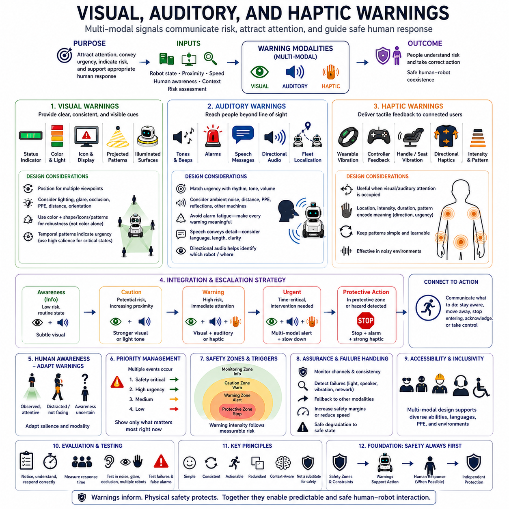{width="7.268055555555556in" height="7.268055555555556in"}

Visual, auditory, and haptic warnings provide complementary channels for communicating safety-relevant information between Physical AI systems and people. Their purpose is not merely to announce that an event has occurred, but to attract attention, convey urgency, indicate the source or nature of risk, and support an appropriate human response. Effective warning design connects robot state, environmental risk, human awareness, and required action through signals that remain understandable under realistic operating conditions.

Visual warnings communicate safety information through lights, colors, icons, displays, projected patterns, illuminated surfaces, or other observable indicators. They are particularly useful when continuous status information is required without adding environmental noise. A visual warning can indicate caution, restricted motion, protective stopping, degraded autonomy, or an approaching robot, but its meaning must remain simple, consistent, and distinguishable from ordinary operational information.

Visibility depends on more than the brightness of an indicator. Human orientation, viewing distance, lighting, glare, occlusion, robot geometry, protective equipment, and competing visual information can determine whether a signal is actually noticed. Indicators should therefore be positioned according to likely human viewpoints and interaction regions. For mobile robots, visibility from multiple directions may be necessary because people can approach from the front, side, or rear while the platform changes orientation.

Color can provide rapid visual differentiation, but color alone should not carry critical meaning. Lighting conditions, color-vision differences, display characteristics, and local conventions can alter interpretation. Combining color with shape, position, iconography, text, or temporal patterns provides redundancy. The objective is to make important warning states distinguishable even when one visual property is difficult to perceive, while avoiding excessive combinations that increase cognitive workload.

Flashing or animated visual signals can attract attention more effectively than static indicators, but excessive use can reduce their value. If many states employ rapid flashing, users may struggle to distinguish urgency or may become desensitized. Temporal patterns should therefore correspond to meaningful differences in severity or required response. Highly salient patterns are most useful when reserved for conditions requiring immediate attention rather than routine robot activity.

Auditory warnings are valuable when a person is not looking toward the robot or when rapid attention capture is required. Tones, beeps, alarms, spoken messages, and directional audio can indicate approach, reversing, abnormal conditions, requests, or urgent hazards. Sound can reach people beyond direct visual line of sight, but its effectiveness depends on ambient noise, distance, hearing protection, acoustic reflections, competing machinery, and simultaneous warnings from other systems.

Auditory warning design should make urgency recognizable without creating unnecessary alarm. Frequency, rhythm, repetition, duration, and loudness can distinguish informational signals from increasingly serious warnings. However, simply making every warning louder does not produce a better safety interface. Excessive sound can contribute to stress, communication interference, and alarm fatigue, eventually causing people to ignore signals that occur too frequently or lack meaningful consequences.

Spoken warnings can communicate more semantic detail than simple tones. A robot may announce that it is reversing, requesting clearance, unable to proceed, or entering a restricted operation. Speech can be useful in supervised environments, but language, accent, hearing conditions, message length, and processing time must be considered. Safety-critical meaning should not depend exclusively on understanding a complex spoken sentence, particularly in multilingual or noisy environments.

Directional auditory cues can help people identify which robot or region requires attention. This becomes increasingly important in fleet environments where several autonomous machines may operate simultaneously. A warning that attracts attention without revealing its source can create confusion or cause a person to react toward the wrong machine. Spatialized or localized signaling should therefore support rapid association between the warning and the relevant physical hazard whenever practical.

Haptic warnings communicate through touch and are especially useful when visual and auditory attention is occupied. Vibration in a wearable device, controller, seat, handle, joystick, or operator interface can indicate proximity, directional risk, control limits, or the need for intervention. Haptic communication can remain effective in noisy environments and can provide private operator-specific information without increasing visual or acoustic clutter in the surrounding workspace.

The location and pattern of haptic feedback influence its interpretation. Different vibration positions, intensities, durations, or pulse patterns can represent direction, urgency, or event type. For example, directional vibration may indicate the side from which a hazard is approaching. However, haptic vocabularies should remain limited and learnable because complex vibration patterns can be difficult to distinguish, particularly during physical work, vehicle motion, or other sources of mechanical vibration.

Multi-modal warnings combine visual, auditory, and haptic channels to increase the probability that important information is perceived. A significant proximity event may activate a visual indicator while producing an audible signal and haptic feedback to an operator. Redundancy is valuable when one modality is degraded, but the signals should communicate consistent meaning. Contradictory urgency levels or unrelated messages across modalities can increase confusion rather than improve safety.

The appropriate combination of modalities depends on risk and context. Routine awareness may require only a low-salience visual indication, while increasing proximity could justify a more noticeable visual or auditory warning. An urgent intervention request may require several modalities simultaneously. This graduated warning strategy aligns communication intensity with risk, helping users distinguish informational states from cautionary conditions and genuinely time-critical hazards.

Warnings should be connected to specific expected human responses whenever possible. A signal is more useful when people can understand whether they should remain aware, move away, stop entering a region, acknowledge a request, or take control. Warning design should therefore consider not only detection probability but also actionability. Signals that attract attention without helping a person determine what to do can create hesitation during situations where response time matters.

Human awareness should influence warning selection. If the robot estimates that a nearby person is already watching its movement and maintaining safe separation, an intrusive alarm may be unnecessary. If the person appears distracted, faces away, or is unlikely to perceive a visual cue, an auditory or stronger multi-modal warning may be appropriate. Such adaptation can improve communication efficiency, although physical safety must never depend on the assumption that a warning was perceived.

Warning priority becomes critical when multiple conditions occur simultaneously. A robot may experience low battery, localization degradation, a blocked route, human proximity, and a safety fault at the same time. Presenting every alert with equal prominence can overwhelm the user. A warning-management architecture should prioritize information according to urgency, severity, required response time, and relevance to the current human role so that safety-critical conditions remain dominant.

Alarm fatigue is a major human-factors concern. Frequent false alarms, overly conservative thresholds, repeated low-value notifications, or warnings that do not require action can cause people to become desensitized. Once users learn that a warning rarely corresponds to meaningful risk, their response time may increase. Warning systems should therefore minimize unnecessary activation while preserving conservative protection through independent physical safety mechanisms rather than relying on constant human attention.

Warnings must remain distinct from normal robot intent communication while still being consistent with it. A directional light indicating an intended turn should not be easily confused with a hazard indicator requiring immediate avoidance. Intent signals describe what the robot plans to do, whereas warnings emphasize conditions requiring increased human attention or response. Clear semantic separation between these functions helps prevent routine communication from diluting the urgency of safety alerts.

Safety zones and proximity management can provide structured triggers for warning escalation. Entry into an outer monitoring region may produce a subtle informational cue, while movement into a caution region can activate stronger visual or auditory signals. Closer approach may trigger multi-modal warnings together with speed reduction, and entry into a protective region can initiate stopping. This links warning intensity to measurable changes in physical risk rather than arbitrary interface states.

Speed and separation monitoring further determines whether warning time is sufficient. A warning that occurs too late may be correctly perceived but still provide insufficient time for human reaction. End-to-end timing should include sensing, risk estimation, warning generation, signal delivery, human perception, decision time, and physical response. Faster robots or rapidly approaching humans therefore require earlier warning thresholds or stronger autonomous protective actions rather than dependence on faster human reactions.

Warning systems must degrade safely when communication hardware fails. Broken lights, blocked displays, failed speakers, disconnected wearables, damaged vibration motors, or network latency can reduce warning availability. Runtime monitoring should detect important channel failures and determine whether alternative modalities remain adequate. Depending on risk, the robot may increase safety margins, reduce speed, restrict operation, request maintenance, or enter a safer operating state.

Accessibility should be considered from the beginning rather than added after deployment. People may have reduced vision, hearing differences, limited mobility, language barriers, or temporary restrictions caused by protective equipment and environmental conditions. Multi-modal signaling provides an important foundation for inclusive safety because information can be conveyed through more than one sensory pathway. Critical warnings should avoid unnecessary dependence on a single human capability.

Fleet environments require coordinated warning behavior. If many robots independently produce similar alarms, the resulting visual and acoustic clutter can make individual warnings difficult to interpret. Signals should help people determine which robot is involved, where the relevant hazard exists, and whether immediate action is required. Fleet-level coordination can reduce redundant warnings while preserving local robot authority to issue urgent alerts when immediate physical risk is detected.

Evaluation should test whether people notice, understand, and respond appropriately to warnings rather than merely verifying that hardware activates. Scenarios should include bright and dark environments, high background noise, hearing protection, visual occlusion, divided attention, multiple robots, unfamiliar users, and simultaneous alerts. Response time, interpretation accuracy, missed warnings, false reactions, and subjective workload provide useful evidence about whether the interface supports safe behavior.

Failure-oriented testing should include delayed warnings, incorrect modality selection, contradictory signals, unavailable channels, excessive alarms, and warnings that do not match actual robot behavior. The Physical AI system should remain safe even when communication is misunderstood or completely missed. Independent safety zones, motion constraints, protective stopping, and emergency mechanisms must remain authoritative because warnings can support human action but cannot guarantee it.

Visual, auditory, and haptic warnings ultimately form a layered attention and communication system around robot behavior. Visual channels provide persistent and spatial information, auditory channels attract attention beyond direct sight, and haptic channels deliver immediate tactile cues to connected users. Integrated with human awareness, robot intent communication, proximity management, and independent protection, these modalities help Physical AI systems communicate escalating risk clearly while preserving predictable and safe human--robot interaction.

## 05.08. Natural Language Safety Interaction

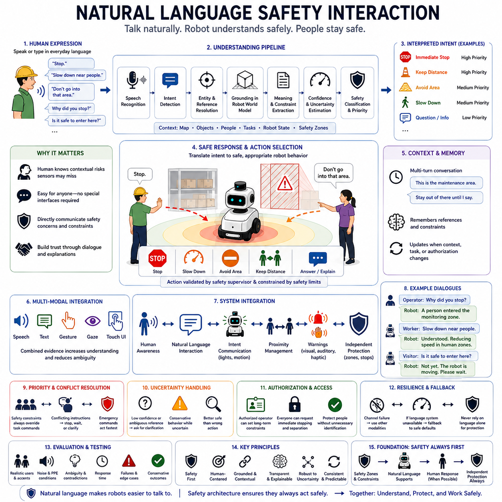{width="7.268055555555556in" height="7.268055555555556in"}

Natural language safety interaction enables people to communicate safety-relevant intentions, concerns, commands, and questions to a Physical AI system through ordinary spoken or written language. Instead of requiring every user to understand specialized control interfaces, the robot can interpret expressions such as requests to stop, slow down, wait, keep distance, avoid an area, or explain its behavior. This creates an intuitive communication layer between human judgment and robot safety behavior.

Natural language is valuable because people often recognize contextual risks that may not yet be represented by the robot's sensors or planning system. A worker may know that a floor is slippery, an aisle must remain clear, a machine is under maintenance, or another person will soon enter the workspace. Language provides a direct mechanism for introducing this contextual knowledge into the robot's situational understanding without requiring complex programming or interface navigation.

Safety-related language should be distinguished from ordinary task instructions. A command such as "bring this box to station three" primarily specifies a task, while "stop," "do not enter this area," or "stay away from me" expresses an immediate or persistent safety constraint. The interaction architecture should recognize this distinction so that safety-relevant language receives appropriate priority and cannot be silently overridden by lower-priority productivity objectives or previously issued task commands.

Speech recognition forms the first stage of spoken safety interaction, but transcription alone is insufficient. The system must determine whether an utterance is directed toward the robot, identify relevant entities and actions, infer the intended constraint, and connect it to the current physical context. Background conversations, machinery noise, multiple speakers, incomplete sentences, accents, and overlapping speech can introduce uncertainty that must be represented rather than hidden.

Language understanding should translate human expressions into grounded operational meaning. "Stay away from that door" requires identifying the referenced door and determining an appropriate spatial constraint, while "slow down near people" implies a behavioral rule connected to human detection and proximity. Natural language therefore needs grounding in the robot's world model, semantic map, perceived objects, tracked humans, task state, and available actions before it can safely influence physical behavior.

Reference resolution becomes especially important in dynamic environments. Words such as "here," "there," "that machine," "behind me," or "the person on the left" depend on spatial and conversational context. The robot should avoid executing consequential actions when the referenced entity or region remains ambiguous. It can instead request clarification, indicate what it believes the user means, or temporarily adopt a conservative behavior until sufficient grounding is available.

Safety commands should follow a clear priority structure. Immediate stop requests, emergency instructions, protective constraints, and warnings of imminent danger may require faster handling than ordinary conversational requests. The system should minimize unnecessary reasoning steps between recognizing a high-confidence urgent safety command and initiating the corresponding protective response. Complex language interpretation should never become an avoidable source of delay when rapid physical intervention is required.

At the same time, not every safety-related statement should automatically produce the most restrictive possible response. "Be careful near the loading area" is less explicit than "do not enter the loading area." The system should distinguish commands, warnings, preferences, observations, questions, and uncertain statements. Appropriate behavior may range from acknowledging information and increasing monitoring to modifying a plan, reducing speed, creating a temporary exclusion zone, or stopping completely.

Confirmation can reduce misunderstanding when a command has significant consequences but is not immediately urgent. The robot may restate an interpreted constraint such as avoiding a specified corridor or maintaining greater distance from a worker. This provides an opportunity for correction before execution. However, confirmation should not delay obvious emergency commands. Interaction design must therefore balance verification with the response time required by the physical situation.

Clarification is particularly important when language contains ambiguity, contradiction, or missing information. If a person says "don't go over there" without a reliably identifiable region, the robot should not invent a boundary. It can ask which area is intended or present its current interpretation. During clarification, conservative motion may be appropriate when continued operation could create risk. This transforms uncertainty into an explicit interaction rather than an unsupported autonomous assumption.

Natural language can also allow people to query robot safety state. Questions such as whether the robot has detected a nearby person, why it stopped, which path it intends to use, or whether an area is safe to enter can improve situational understanding. Responses should be concise and grounded in available information. The robot should distinguish between what it knows, what it estimates, and what remains uncertain rather than presenting inferred safety conditions as guaranteed facts.

Explanations can improve trust when they describe observable causes of robot behavior. A robot may state that it slowed because a person entered a monitored region, stopped because required separation could not be maintained, or rerouted because a restricted zone was established. Such explanations connect natural language interaction with safety zones, proximity management, speed and separation monitoring, and intent communication, making autonomous behavior more understandable without exposing unnecessary internal complexity.

Natural language should complement rather than replace dedicated warning channels. A spoken message can explain why a robot is stopping, but immediate visual, auditory, or haptic warnings may communicate urgency more reliably. Similarly, a person should not be required to formulate a grammatically complete sentence to prevent hazardous motion. Dedicated emergency controls, protective stops, safety-rated sensing, and physical constraints remain necessary where required by the application and risk level.

Multi-modal interaction can improve grounding by combining language with gesture, gaze, pointing, touch interfaces, or spatial context. A worker saying "don't enter there" while pointing toward a doorway provides stronger evidence than speech alone. The system can combine linguistic and perceptual information to identify the intended region. If modalities disagree, uncertainty should increase and clarification should be preferred over confidently selecting one interpretation without sufficient evidence.

Speaker awareness can matter when several people interact with the same robot. The system may need to determine who issued a command, whether that person is addressing the robot, and how simultaneous requests should be handled. However, immediate safety protection should not depend unnecessarily on identifying a specific person. A credible warning of imminent danger may deserve protective action even when speaker identity or authorization cannot be established with certainty.

Authorization becomes more important for persistent or operationally significant commands. An authorized operator may be permitted to change operating modes or establish long-duration restrictions, while a nearby person may only need the ability to request immediate stopping or separation. Safety interaction should therefore distinguish between actions that should be universally accessible for protection and actions requiring appropriate authority, preventing convenience interfaces from becoming uncontrolled configuration channels.

Conflicting instructions require explicit resolution. One person may tell the robot to proceed while another requests that it stop, or a task command may conflict with an existing safety restriction. Safety constraints should dominate ordinary task objectives, and unresolved human disagreement should not cause aggressive motion. The robot may stop, wait, request clarification, or escalate to an authorized operator rather than attempting to infer which conflicting instruction should be ignored.

Conversational memory can support multi-turn safety interaction. A person might first identify "the maintenance area" and later say "stay out of there until I tell you." The system needs enough interaction context to connect the later reference to the previously established region and constraint. Such memory should remain bounded and state-aware so that outdated instructions do not persist indefinitely after the environment, task, user intent, or authorization conditions have changed.

Language models can provide flexible interpretation of diverse expressions, but their outputs should not directly bypass safety control. A semantic model may propose that an utterance means reducing speed or avoiding a region, while a deterministic policy or safety supervisor validates whether that interpretation maps to an allowed action. This separation allows flexible natural language understanding while preserving explicit control over which physical behaviors and safety constraints can actually be executed.

Uncertainty monitoring is essential because language interpretation can fail in ways that appear linguistically plausible. Low speech confidence, ambiguous references, unfamiliar terminology, conflicting context, or multiple plausible intents should reduce confidence in execution. The system can respond by asking for clarification, selecting a conservative predefined action, or transferring control to another interface rather than converting uncertain language directly into potentially hazardous physical movement.

Natural language interfaces must also resist unsafe attempts to override fundamental protection. A request such as "ignore the person and keep moving" should not disable required separation constraints merely because the sentence is clear. Similarly, conversational persuasion, repeated commands, or higher-level task objectives should not bypass protective stopping or independent safety mechanisms. Language interaction operates within the safety envelope rather than redefining fundamental physical limits without controlled authorization.

Latency affects spoken safety interaction because perception, transcription, semantic interpretation, grounding, policy validation, and control execution all consume time. Urgent command pathways should therefore be designed with bounded processing requirements and simple fallback behavior. If advanced language understanding is delayed or unavailable, recognizable emergency phrases or dedicated controls can map through a shorter protective pathway rather than waiting for full conversational reasoning.

Evaluation should include realistic language rather than only carefully scripted commands. Tests should cover accents, background noise, incomplete speech, synonyms, indirect warnings, ambiguous references, contradictory requests, multiple speakers, rapidly changing context, and unusual phrasing. The objective is not merely to measure language accuracy but to determine whether interpretation errors, uncertainty, and communication failures result in appropriately conservative robot behavior.

Failure testing should examine missed commands, incorrect transcriptions, hallucinated references, stale conversational context, delayed responses, unauthorized instructions, and conflicts between language and physical safety systems. The robot should remain within validated safety limits even when the natural language interface fails completely. This establishes natural language as a powerful interaction mechanism without allowing it to become a single point of failure for human--robot protection.

Natural language safety interaction ultimately creates a semantic bridge between human understanding and machine safety mechanisms. People can express hazards, constraints, questions, and intentions using familiar language, while the robot grounds those expressions in its world model and converts validated meaning into controlled behavior. Integrated with human awareness, warnings, proximity management, and independent protection, this capability enables Physical AI systems to interact more naturally without weakening the physical foundations of safety.

## 05.09. Human Command Confirmation and Override

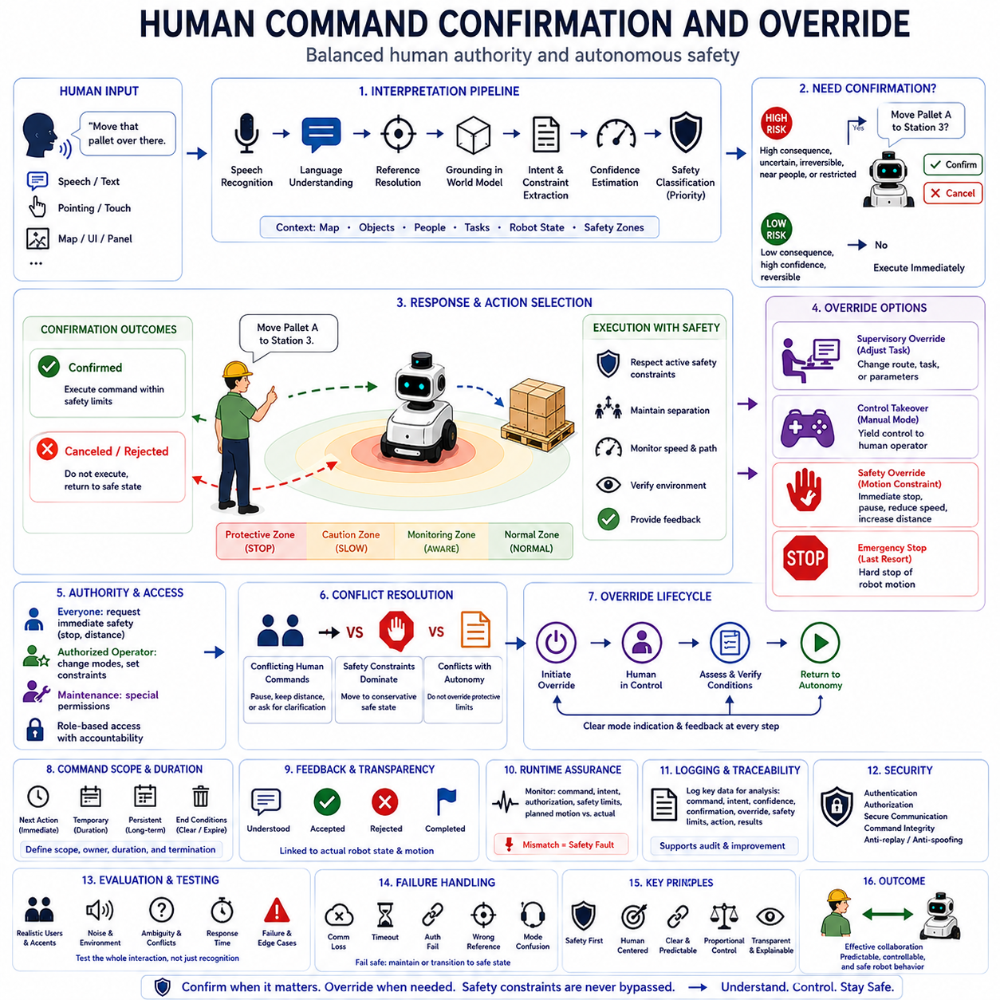{width="7.268055555555556in" height="7.268055555555556in"}

Human command confirmation and override provide a controlled interface between human authority and autonomous robot behavior. A Physical AI system must determine when a human instruction can be executed immediately, when its interpretation should be confirmed, and when autonomous behavior must yield to authorized intervention. The objective is to preserve meaningful human control without allowing ambiguous, accidental, unauthorized, or unsafe commands to bypass fundamental safety constraints.

Confirmation is particularly important when a command has significant physical consequences but does not require an immediate emergency response. Before changing a route, entering a restricted area, manipulating a heavy object, or modifying an operating mode, the robot may restate the interpreted instruction and request acknowledgment. This closed-loop interaction allows the user to detect misunderstandings before autonomous interpretation becomes physical action.

Confirmation should communicate the robot's interpreted meaning rather than merely repeat the original words. If a person says, "move that pallet over there," the system should identify the intended pallet, destination, motion, and relevant constraints before requesting approval. A useful confirmation might represent the selected object and destination explicitly. This verifies semantic grounding and reduces the possibility that linguistic agreement hides an incorrect physical interpretation.

Not every command requires confirmation. Requiring approval for every routine instruction can increase workload, delay operations, and encourage users to respond automatically without evaluating the robot's interpretation. Confirmation policy should therefore consider command criticality, ambiguity, reversibility, uncertainty, proximity to people, potential consequence, and authorization level. Low-risk actions can proceed directly when interpretation confidence and operating conditions remain within validated limits.

Urgent protective commands require a different pathway. A clear request to stop, halt, freeze, or move away from immediate danger should not wait for a lengthy confirmation dialogue when delay could increase risk. The system can initiate a conservative protective response first and clarify details afterward. This establishes an asymmetric principle: confirmation can precede consequential non-urgent action, while credible emergency intervention should favor rapid risk reduction.

Command confidence should influence confirmation behavior. Speech recognition quality, reference resolution, environmental context, speaker identification, and semantic interpretation all contribute uncertainty. When several plausible meanings remain, the robot should avoid choosing the most convenient interpretation. It can ask a focused clarification question, present alternatives, or temporarily hold position. Confirmation therefore acts as a mechanism for converting uncertain machine inference into explicit shared understanding.

Human override allows authorized intervention when autonomous behavior is inappropriate, unexpected, or unsafe. Override may request stopping, pausing, yielding control, changing a route, canceling a task, or entering a controlled manual mode. The interface should provide a predictable transition from autonomous operation to the requested state so that operators understand both what authority they are assuming and what autonomous functions remain active.

Override mechanisms should be layered according to urgency and consequence. A normal operational override may modify a task or trajectory through the supervisory interface, while a safety-related override may immediately constrain motion. Emergency stopping remains a distinct protective mechanism where required. Treating every intervention as the same type of override can obscure important differences between task supervision, autonomy disengagement, protective stopping, and emergency action.

Authority must be defined explicitly. Nearby people may need universal ability to request immediate stopping or increased separation, while changes to safety configuration, operating mode, or persistent constraints may require an authorized operator. Maintenance personnel may have different permissions from production supervisors or ordinary users. Role-based authority helps preserve accessibility for immediate protection without allowing unrestricted modification of safety-relevant system behavior.

Authorization should not create a barrier to obvious protective intervention. If a person is exposed to imminent danger, the robot should not continue hazardous motion simply because speaker identity cannot be authenticated quickly enough. Protective requests can be handled conservatively while more consequential configuration changes remain restricted. This separates the right to seek immediate safety from the authority to modify how the system operates over longer periods.

Conflicting human commands require deterministic resolution. One person may request continued motion while another requests stopping, or an operator command may conflict with an existing safety restriction. Safety-related constraints should dominate productivity objectives, and unresolved conflicts should normally move the robot toward a conservative state. The system can pause, preserve separation, request clarification, or escalate authority rather than arbitrarily selecting the instruction that best supports task completion.

Human commands can also conflict with autonomous safety decisions. An operator may request that the robot continue even though speed and separation monitoring requires deceleration or stopping. Human authority should not automatically override independently enforced protective limits. The command interface can modify goals within the allowed safety envelope, but it should not convert supervisory authority into unrestricted permission to violate validated physical constraints.

The system should communicate when an override cannot be accepted. Simply ignoring a human command can make autonomous behavior appear unpredictable or unresponsive. The robot can indicate that a request conflicts with an active protective zone, insufficient separation, an equipment fault, or an authorization restriction. Clear refusal explanations help users distinguish a malfunction from deliberate safety enforcement and support appropriate corrective action.

Override transitions require careful control because transferring authority can create temporary ambiguity about who is responsible for motion. When switching from autonomous to manual or supervised operation, the robot should establish a known motion state and clearly indicate the active control mode. Commands already queued by the autonomous planner may need to be canceled or inhibited so that unexpected motion does not occur immediately after the human assumes control.

Returning control to autonomy requires similar discipline. The robot should not resume an outdated trajectory simply because an override has ended. It should reassess human positions, safety zones, environmental changes, task state, localization quality, and previous restrictions before autonomous motion resumes. Depending on the application, explicit human acknowledgment may be required. Re-entry should therefore be treated as a validated state transition rather than a simple continuation of interrupted behavior.

Command persistence must also be defined. Some instructions apply only to the next action, while others establish temporary or long-duration constraints. "Stop" may require immediate cessation, whereas "do not use this corridor until maintenance is finished" creates a persistent spatial restriction. The system should represent command scope, duration, ownership, and termination conditions so that constraints neither disappear prematurely nor remain active after they are no longer valid.

Feedback closes the command loop. After accepting an instruction, the robot should communicate whether it has understood, accepted, rejected, or completed the requested action. For safety-relevant commands, feedback should correspond to actual system state rather than merely successful message reception. A statement that the robot has stopped should be associated with verified motion state, preventing interface acknowledgment from being mistaken for completed physical execution.

Multi-modal confirmation can reduce ambiguity in complex environments. Spoken commands may be combined with pointing, touchscreens, maps, highlighted objects, physical controls, or visual indicators. The robot can show the selected destination or exclusion region while verbally requesting confirmation. Combining language with spatial representation helps users verify what the robot believes the command means before that interpretation affects motion.

Physical override controls remain important even when advanced natural language interaction is available. Buttons, switches, enabling devices, remote controls, or dedicated stop interfaces can provide simpler and more deterministic pathways for specific interventions. Natural language offers flexibility and contextual richness, but safety-critical control should not depend exclusively on speech recognition, semantic reasoning, network availability, or a general-purpose language model.

Runtime assurance should monitor the relationship among received commands, interpreted intent, authorization, safety constraints, commanded motion, and actual robot behavior. If an accepted stop command does not produce the expected motion response, the inconsistency should be treated as a safety-relevant fault. Likewise, an override should not silently fail while the interface continues to indicate that human control has been established.

Command logs can support traceability and post-event analysis. Relevant records may include the received instruction, interpreted meaning, confidence, confirmation, authorization state, override transition, safety constraints, and resulting robot action. Such records help determine whether an event resulted from human instruction, interpretation error, autonomous planning, control failure, or incorrect authority handling. Logging should remain appropriate to privacy, security, and operational requirements.

Cybersecurity is closely connected to command and override design because interfaces that can influence physical motion create potential attack surfaces. Authentication, authorization, secure communication, command integrity, and protection against replay or spoofing may be necessary depending on deployment. Remote override should not become an uncontrolled path into the motion system, while security mechanisms must still support sufficiently rapid legitimate intervention during safety-critical situations.

Evaluation should include ambiguous commands, accidental speech, repeated instructions, conflicting users, unauthorized requests, delayed confirmation, emergency stopping, manual takeover, autonomy re-entry, and commands that conflict with physical safety constraints. Tests should measure not only whether commands are recognized but whether the complete interaction produces predictable and appropriately conservative physical behavior under realistic timing and environmental conditions.

Failure-oriented testing should examine lost acknowledgments, stale commands, incorrect reference resolution, failed authentication, communication interruption, delayed override execution, mode confusion, and disagreement between displayed and actual control state. The robot should maintain or transition toward a safe condition when the command interface becomes unreliable. Human override must improve controllability without becoming another single point of failure.

Human command confirmation and override ultimately establish a structured boundary between autonomous intelligence and human authority. Confirmation ensures that consequential actions are based on shared understanding, while override provides a means to intervene when autonomy should no longer remain in control. Integrated with authorization, runtime assurance, natural language interaction, proximity management, and independent protection, these mechanisms preserve human control while keeping fundamental physical safety constraints authoritative.

## 05.10. Shared Control and Supervisory Control

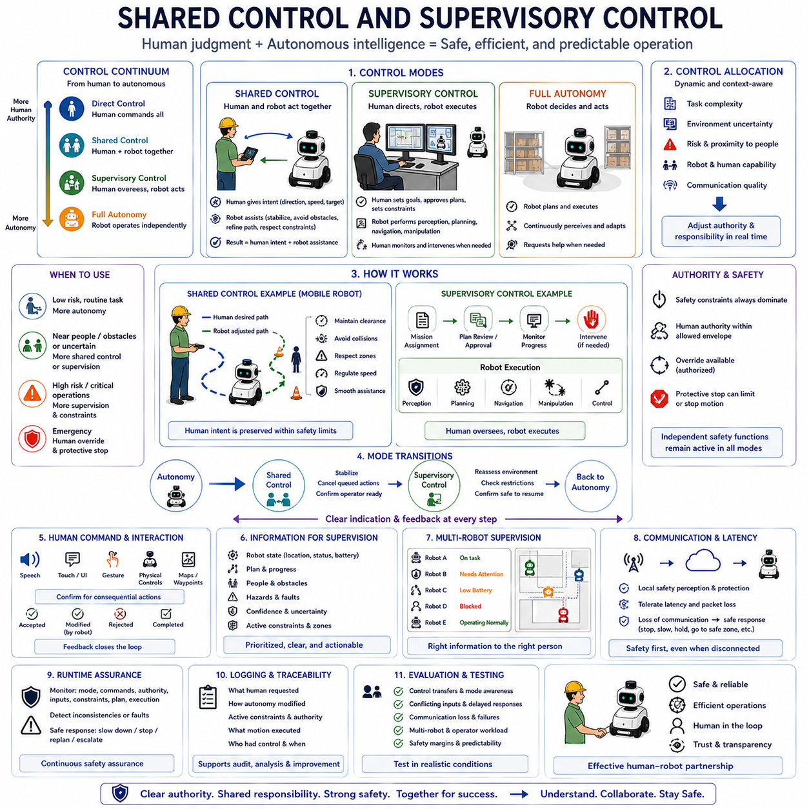{width="7.268055555555556in" height="7.268055555555556in"}

Shared control and supervisory control define how human authority and autonomous intelligence cooperate during robot operation. Instead of treating control as a binary choice between full autonomy and direct teleoperation, Physical AI systems can distribute decision-making across humans and machines according to task complexity, environmental uncertainty, risk, and capability. The objective is to combine human judgment with autonomous perception, planning, and control while preserving predictable authority boundaries.

Shared control operates when human and autonomous commands influence robot behavior simultaneously or within tightly coupled control loops. A person may specify direction, velocity, target, or task intent while the robot assists with stabilization, obstacle avoidance, collision prevention, trajectory refinement, or manipulation constraints. The resulting motion reflects both human intention and autonomous assistance rather than being generated exclusively by either participant.

Supervisory control places the human at a higher decision level. Instead of continuously commanding every motion, the supervisor assigns goals, approves plans, establishes constraints, monitors progress, and intervenes when necessary. The autonomous system performs lower-level perception, planning, navigation, manipulation, and control. This structure allows one person to oversee complex robots or multiple autonomous systems without maintaining continuous low-level control.

The appropriate control allocation depends on the task and operating context. Routine navigation through a well-mapped environment may require little human involvement, while manipulation near people or operation in an uncertain environment may benefit from stronger supervision. Control authority can therefore vary dynamically rather than remaining fixed for an entire mission. Such adaptation should follow explicit rules so users can understand when autonomy will assist, constrain, or yield.

Human input can represent different levels of abstraction. At a low level, an operator may command velocity or manipulator motion directly. At an intermediate level, the person may select a waypoint, object, grasp target, or preferred path. At a high level, the operator may specify an objective such as inspecting an area or delivering material. Increasing abstraction transfers more execution responsibility to autonomous intelligence while retaining human authority over mission intent.

Autonomous assistance should support human intention without unexpectedly transforming it. If an operator commands forward motion, obstacle avoidance may adjust the path while preserving the intended direction whenever possible. Excessive correction can create a feeling that the robot is resisting the operator, while insufficient assistance may allow unsafe behavior. Shared control therefore requires an interpretable relationship between human input, autonomous modification, and resulting robot motion.

Control arbitration determines how competing human and autonomous commands are combined. Arbitration may use fixed priority, weighted blending, constraint-based optimization, state-dependent authority, or discrete mode switching. Safety-critical constraints should remain dominant regardless of the arbitration method. A human command can influence motion within the allowed operating envelope, but shared control should not average a safe autonomous response with an unsafe human command into a hazardous compromise.

Authority should become more conservative as risk increases. Under normal conditions, the system may allow broad human guidance or autonomous freedom. Near people, obstacles, restricted zones, or unstable conditions, motion constraints can become stronger. If required safety margins cannot be maintained, protective mechanisms can limit or stop motion regardless of the currently selected control mode. This preserves a consistent safety boundary across manual, shared, supervised, and autonomous operation.

Mode awareness is essential because users must understand who currently controls which aspects of robot behavior. Interfaces should clearly indicate whether the robot is under direct control, shared control, supervisory autonomy, temporary autonomous assistance, or protective intervention. Hidden or ambiguous mode transitions can produce mode confusion, where the operator assumes responsibility lies with autonomy while the system expects human control, or vice versa.

Transitions between control modes should therefore be explicit and predictable. Moving from autonomy to shared control may require stabilization, cancellation of queued actions, and confirmation of operator readiness. Returning to autonomy should require reassessment of the environment, task state, human positions, and active restrictions. Control transfer should be treated as a state transition with defined entry and exit conditions rather than an instantaneous change of command source.

Human override remains available when autonomous behavior becomes inappropriate or unexpected. A supervisor may pause a mission, modify a goal, reject a planned action, request manual control, or impose a new constraint. However, override authority should remain within independently enforced physical safety limits. Human intervention changes what the robot is trying to accomplish or how autonomy is allocated, but it should not automatically disable required protective mechanisms.

Supervisory interfaces should provide sufficient information for meaningful intervention without overwhelming the operator. Relevant information can include robot location, task progress, planned trajectory, nearby humans, detected hazards, confidence, active constraints, faults, and requests for assistance. Information should be prioritized according to operational significance so that safety-critical conditions remain visible even when several robots or tasks are being supervised simultaneously.

Confidence and uncertainty can guide when autonomy requests human assistance. A robot may operate independently while perception, localization, planning, and task execution remain within validated confidence bounds. When uncertainty grows, it can slow down, seek confirmation, present alternative plans, or request supervisory intervention. This allows human attention to be concentrated on difficult situations rather than continuously monitoring behavior that autonomy can handle reliably.

Human workload must be considered when designing supervisory control. A theoretically autonomous fleet can still become operationally dependent on humans if robots frequently request approval or assistance. Excessive notifications, repeated confirmations, or simultaneous intervention requests can overload supervisors and increase response time. The system should therefore manage attention as a limited resource and escalate only information that genuinely benefits from human judgment.

Multi-robot supervision extends this challenge because one operator may oversee several robots with different tasks, locations, and risk states. The interface should help prioritize which robot requires attention and why. Routine autonomous activity can remain summarized, while anomalies, safety events, blocked tasks, or uncertain decisions receive greater prominence. Fleet-level coordination should reduce unnecessary intervention while preserving the ability to assume control of an individual robot when needed.

Shared control for mobile robots can combine human directional intent with autonomous navigation constraints. An operator may steer toward a destination while the robot maintains obstacle clearance, respects restricted regions, regulates speed, and avoids unsafe proximity to people. The assistance should remain smooth and predictable so that the operator can anticipate how input will be modified. Abrupt autonomous corrections can themselves create confusion and unstable human control behavior.

For manipulators, shared control can assist with alignment, collision avoidance, force limits, grasp constraints, or motion within permitted workspaces. A person may guide an end effector while autonomy maintains orientation or prevents entry into hazardous regions. This division allows human spatial judgment and dexterity to be combined with machine precision. The control interface should make active constraints perceptible so the operator understands why certain motions are resisted.

Remote supervisory control introduces communication latency, bandwidth limitations, and possible network interruption. Direct teleoperation can become difficult when feedback is delayed, whereas higher-level supervisory commands may remain practical because the robot executes local motion autonomously. Safety-critical perception and protection should therefore remain local whenever possible, allowing the robot to preserve safe behavior even when remote communication becomes degraded or unavailable.

Loss of communication should lead to a predefined control response. Depending on the application, the robot may complete a safe local action, hold position, reduce speed, retreat to a known region, or transition to a minimum-risk condition. It should not continue indefinitely under assumptions that require unavailable human supervision. Communication health is therefore part of the runtime state used to determine which autonomy and control modes remain permissible.

Shared control should integrate naturally with human command confirmation. Consequential supervisory commands may require confirmation when references, targets, or constraints are ambiguous. Immediate protective commands can follow a faster path. The robot should also provide feedback showing whether a command was accepted, modified by autonomous constraints, rejected, or completed. This closes the control loop and helps the human maintain an accurate mental model of system behavior.

Natural language can provide a high-level supervisory channel. An operator may request that the robot inspect another region, wait for a worker, avoid a corridor, or explain why progress stopped. Such instructions should be grounded in the world model and validated before affecting physical behavior. Language can simplify supervisory interaction, but deterministic safety policies and physical protection remain authoritative over conversational interpretation.

Runtime assurance should monitor the complete human--autonomy control relationship. Relevant variables include active control mode, command source, authorization, communication health, human input, autonomous modifications, safety constraints, planned motion, and actual execution. Unexpected disagreement between these elements can indicate mode confusion, software faults, stale commands, or failed control transfer and should trigger an appropriate conservative response.

Logging and traceability are particularly valuable because shared decisions can otherwise make responsibility difficult to reconstruct. Records can identify what the human requested, how autonomy modified the request, which constraints were active, who possessed control authority, and what motion was ultimately executed. Such information supports debugging, validation, incident analysis, operator training, and improvement of future human--robot collaboration.

Evaluation should include more than nominal task performance. Testing should examine control transfers, conflicting inputs, uncertain autonomy, operator distraction, delayed responses, communication loss, multiple simultaneous robots, protective interventions, and recovery to autonomy. Measures can include task success, intervention frequency, response time, mode awareness, workload, safety margin, and the predictability of autonomous assistance from the human perspective.

Failure-oriented testing should deliberately create stale commands, incorrect mode indications, delayed control transfer, network interruption, conflicting human and autonomous objectives, and unavailable supervisory interfaces. The robot should remain within validated safety constraints even when coordination between human and autonomy deteriorates. Safe degradation is essential because shared control adds flexibility only when failure of the cooperation mechanism does not remove fundamental protection.

Shared control and supervisory control ultimately establish a scalable partnership between human judgment and autonomous Physical AI. Humans provide goals, contextual understanding, exception handling, and authority, while autonomy provides continuous perception, planning, stabilization, and execution. Through explicit control allocation, predictable transitions, runtime assurance, and independent safety constraints, the system can shift responsibility without losing clarity, enabling effective human oversight from individual robots to coordinated fleets.

## 05.11. Teleoperation and Remote Safety

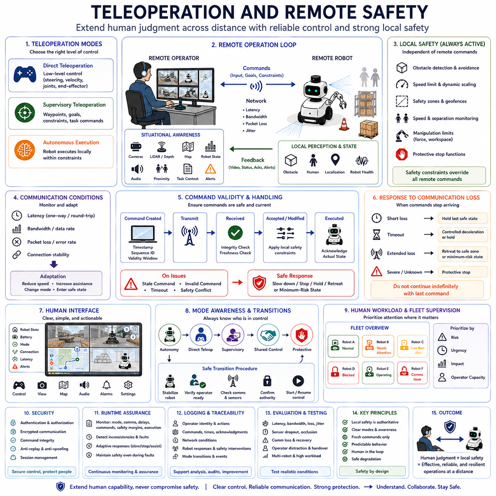{width="7.268055555555556in" height="7.268055555555556in"}

Teleoperation and remote safety address the conditions under which a human operator controls or assists a Physical AI system from a location separated from the robot. Remote operation extends human judgment into environments that may be distant, hazardous, inaccessible, or operationally complex, but it also introduces communication latency, limited situational awareness, network failure, and control uncertainty that must be managed as explicit parts of the safety architecture.

Teleoperation can range from direct low-level motion control to high-level remote supervision. An operator may continuously command steering, velocity, manipulator joints, or end-effector motion, while more autonomous systems may receive waypoints, task goals, or constraints and execute them locally. The appropriate level depends on communication quality, task precision, environmental complexity, robot capability, and the consequences of delayed or incorrect human intervention.

Remote control does not remove the need for local autonomy and protection. A teleoperated robot should retain independent mechanisms for obstacle detection, speed limitation, collision avoidance, protective stopping, and enforcement of restricted regions where appropriate. These local functions provide a safety boundary around human commands so that a remote operator cannot unintentionally direct the robot beyond validated physical constraints simply because direct control authority has been granted.

Situational awareness is a central challenge because the operator experiences the environment through sensors rather than direct physical presence. Cameras, depth sensors, LiDAR, maps, robot state, proximity information, audio, and task context can contribute to the remote representation. The interface should provide enough information to understand hazards and motion consequences without overwhelming the operator with raw sensor streams that compete for limited attention.

Camera placement strongly influences remote driving and manipulation performance. Forward views may support navigation but fail to reveal side clearance, rear obstacles, manipulator configuration, or nearby people. Multiple viewpoints or dynamically selected views can reduce blind regions, while spatial representations can provide additional context. The operator should be made aware when important areas are unobserved rather than being encouraged to assume that absence from the display means absence of risk.

Latency directly affects controllability. A delay between operator input and robot response can cause overshoot, oscillation, repeated commands, or inappropriate corrections because the operator acts on an outdated representation of robot state. Delay in the opposite direction is equally important because sensor feedback may show conditions that existed before the robot executed the most recent command. Teleoperation design must therefore consider the complete command-and-feedback loop rather than network delay alone.

Variable latency can be more difficult to manage than a constant known delay. When communication timing changes unpredictably, the operator cannot develop a stable expectation of how quickly the robot will respond. Interfaces can indicate communication quality and delay, while the control system can reduce permitted speed or increase autonomous assistance as latency grows. Severe degradation may require transition from direct teleoperation to supervisory commands or a predefined safe state.

Bandwidth limitations can reduce the quality or update rate of remote perception. Video compression, reduced resolution, lower frame rates, delayed maps, or missing sensor channels can hide information important for safe operation. The system should adapt information transmission according to operational importance rather than treating all data equally. Safety-relevant state, control acknowledgments, and critical warnings may require stronger delivery priority than nonessential visualization or diagnostic information.

Packet loss and communication interruption should be expected rather than treated as impossible exceptions. The robot must define how long a remote command remains valid and what happens when new commands stop arriving. Continuing indefinitely with the last velocity command can create severe risk. Depending on the application, loss of communication may trigger controlled deceleration, holding position, completion of a locally safe maneuver, retreat, or transition to a minimum-risk condition.

Command freshness is therefore an important safety property. Remote commands can carry timestamps, sequence information, validity periods, or other mechanisms that help detect stale instructions. A command generated for an earlier physical situation should not be executed after communication is restored if the robot or environment has changed substantially. Local control should reject commands that are no longer compatible with the current state or validated execution window.

Acknowledgment closes the remote command loop. The operator should be able to distinguish between a command that was transmitted, received, accepted, modified by local safety constraints, and physically executed. Without this distinction, a remote interface may create false confidence that an intended action has already occurred. Safety-relevant feedback should therefore correspond to verified robot state rather than merely successful network delivery.

Local collision protection is especially important during direct teleoperation. Human operators can misjudge distance, overlook obstacles, experience display latency, or issue abrupt commands. The robot can constrain velocity, maintain minimum clearance, enforce geofences, limit manipulator force, or reject motion toward detected hazards. Such assistance should remain predictable so that the operator understands when and why requested motion has been modified.

Speed should reflect both physical risk and communication conditions. High-speed remote operation requires sufficient perception range, update frequency, control responsiveness, and stopping capability. When network delay increases or sensor quality decreases, the allowable speed may need to decrease even if the physical environment itself has not changed. This connects remote communication health directly to the robot\'s dynamic safety envelope.

Remote manipulation introduces additional challenges because small control errors can produce contact forces or collisions. Operators may have limited depth perception and incomplete understanding of joint configuration or surrounding geometry. Shared-control functions can assist with alignment, collision avoidance, force limits, workspace constraints, and grasp stabilization. Haptic feedback may provide additional information where appropriate, although communication delay must be considered when closing force-feedback loops.

Human detection and tracking should remain active locally during teleoperation. A remote operator may not notice a person entering from outside the current camera view or may react too slowly because of network latency. Local perception can detect proximity and automatically constrain motion regardless of the remote command. Remote authority therefore operates inside the same fundamental human-protection envelope used during autonomous operation.

Safety zones and speed and separation monitoring can remain authoritative across remote control modes. As a person approaches the robot, permitted motion can progressively decrease even when the operator continues requesting higher speed. Entry into a protective region can trigger stopping independently of remote intent. Maintaining consistent protection across autonomous, shared, and teleoperated operation prevents mode changes from creating gaps in physical safety.

Remote emergency intervention requires carefully designed pathways. An operator should have an unambiguous method to request rapid stopping or transition to a safe state, but communication itself may be unavailable during the event. Remote emergency commands therefore cannot be the only protective mechanism. Local emergency and protective functions must remain capable of acting without dependence on a distant operator or continuously available network connection.

Control mode awareness is critical because the operator must know whether commands are actively controlling the robot. The system should clearly indicate direct teleoperation, shared control, supervisory operation, autonomous execution, communication-loss behavior, or protective intervention. If local safety logic temporarily rejects or modifies commands, the interface should make this visible. Otherwise, the operator may continue issuing corrections based on an incorrect understanding of control authority.

Transitions into teleoperation should establish a known and stable robot state. Autonomous trajectories or queued actions may need to be suspended before remote control becomes active. Operator readiness, communication quality, sensor availability, and control authority can be verified before motion begins. This prevents a situation in which autonomous and remote commands unexpectedly overlap during the transfer of control.

Transitions back to autonomy require similar validation. The robot should not resume a previously planned trajectory without reconsidering environmental changes that occurred during remote operation. Human locations, obstacles, localization quality, task state, active restrictions, and robot configuration should be reassessed. Resumption of autonomy is therefore a new validated decision rather than simple continuation of a suspended autonomous command sequence.

Remote operator workload can become a safety constraint, particularly when one person supervises multiple robots. Frequent intervention requests, multiple video feeds, alarms, communication problems, and simultaneous task failures can exceed human attention capacity. Fleet-level systems should prioritize requests according to risk and urgency, allowing routine robots to remain autonomous while directing operator attention toward situations that genuinely require human judgment.

Handover between remote operators must also preserve control clarity. Shift changes, escalation to specialists, or transfer between local and remote personnel can create uncertainty about who currently possesses authority. The system should explicitly manage ownership, confirm successful handover, and prevent overlapping commands from multiple operators. A known safe state may be appropriate while authority is unresolved.

Cybersecurity is inseparable from remote safety because teleoperation exposes physical control through communication networks. Authentication, authorization, encrypted communication, command integrity, session management, and protection against spoofing or replay may be required. Security controls should prevent unauthorized motion while remaining compatible with timely legitimate intervention. A compromised remote interface must not provide unrestricted access to safety-critical robot functions.

Runtime assurance should continuously monitor communication quality, command freshness, active operator, control mode, local safety constraints, planned motion, and actual execution. Unexpected disagreement between these states can indicate delayed commands, control transfer failure, network faults, or software errors. The system can respond by reducing speed, rejecting commands, increasing autonomous protection, holding position, or entering a minimum-risk condition.

Logging supports reconstruction of remote-control events. Relevant records may include operator identity, control mode, command timing, network condition, robot response, local safety intervention, sensor availability, and mode transitions. These records help distinguish operator error from communication failure, autonomous modification, perception failure, or control-system faults and support validation, training, cybersecurity analysis, and continuous improvement.

Evaluation should reproduce realistic remote-operation degradation rather than testing only ideal network conditions. Scenarios should include fixed and variable latency, bandwidth reduction, packet loss, sensor dropout, camera occlusion, delayed commands, communication interruption, operator distraction, control handover, and unexpected human entry. Testing should examine whether the combined human-machine system remains predictable and safe as communication quality deteriorates.

Failure-oriented testing should deliberately disconnect communication, deliver stale commands, delay feedback, provide incomplete perception, create conflicting control sources, and trigger local protective interventions during teleoperation. The robot should maintain validated safety limits even when the operator cannot observe or control it effectively. Recovery should also be tested to ensure that reconnection does not automatically reactivate obsolete commands or unsafe motion.

Teleoperation and remote safety ultimately require control authority to be separated from fundamental protection. A remote human can provide judgment, contextual reasoning, dexterity, and exception handling, while the robot maintains local perception, motion constraints, protective responses, and safe degradation. By combining remote supervision with local safety authority, Physical AI systems can extend human capability across distance without making network connectivity or remote perception a single point of failure.

## 05.12. Emergency Intervention Interfaces

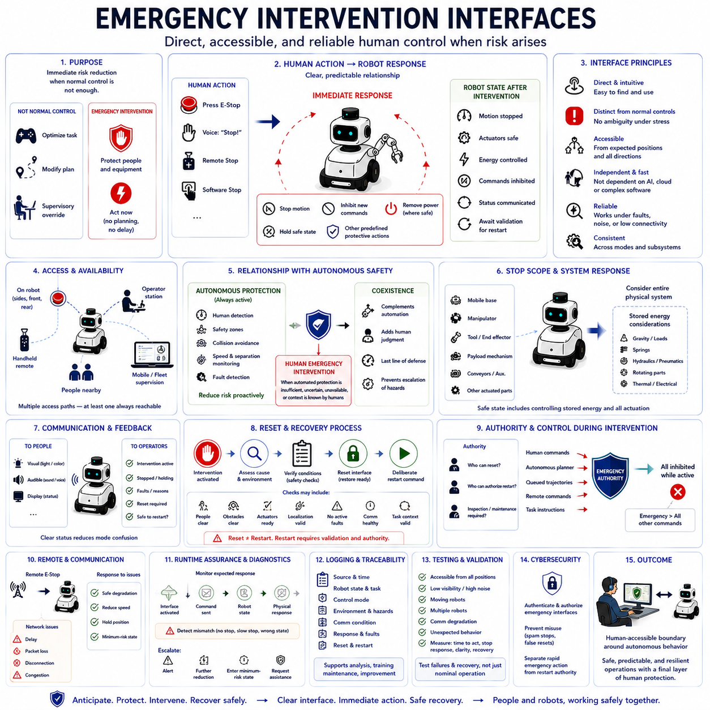{width="7.268055555555556in" height="7.268055555555556in"}

Emergency intervention interfaces provide humans with direct and predictable mechanisms for interrupting, constraining, or terminating robot behavior when normal autonomous or supervisory processes are no longer sufficient to maintain safety. In Physical AI systems, these interfaces form a distinct protection layer that must remain understandable and accessible even during unexpected behavior, perception failure, control faults, communication loss, or rapidly developing hazardous situations.

Emergency intervention differs from routine human command and supervisory override because its primary objective is immediate risk reduction rather than task optimization or normal control transfer. A supervisor may ordinarily pause a mission or modify a trajectory, while an emergency intervention may need to inhibit hazardous motion without waiting for planning, language interpretation, or higher-level reasoning. This distinction should remain explicit throughout the system architecture.

An emergency interface should provide a clear relationship between human action and robot response. When a person activates an emergency mechanism, the resulting state should be deterministic enough that the person can anticipate what the robot will do. Depending on the hazard and machine design, this may involve stopping motion, removing actuator power where appropriate, inhibiting new commands, maintaining a safe holding state, or initiating another predefined protective response.

Physical emergency-stop devices remain an important intervention mechanism because they provide a direct and recognizable means of requesting immediate action. Their placement should reflect realistic human access during operation rather than only convenient equipment packaging. People should be able to identify and reach the relevant control rapidly from expected work positions without entering additional hazardous areas merely to activate the intervention.

Emergency controls should be visually and functionally distinguishable from ordinary operational controls. A user under stress should not need to navigate complex menus, interpret ambiguous icons, or determine which software mode is currently active before requesting protection. Interface design should minimize the number of cognitive and physical steps between recognizing an emergency and initiating the intended protective response.

Accessibility must consider the changing physical relationship between humans and mobile robots. Unlike fixed industrial machinery, an autonomous mobile robot may move through large spaces and approach people from different directions. Emergency intervention may therefore require controls distributed across the robot, accessible operator stations, remote devices, or other mechanisms appropriate to the environment. No single interface location should be assumed sufficient without considering realistic operating scenarios.

Emergency intervention should remain independent of high-level autonomous reasoning wherever practical. A safety-critical stop request should not depend on a language model correctly interpreting a sentence, a mission planner accepting a new goal, or a cloud service remaining available. Advanced interfaces can supplement emergency mechanisms, but the shortest reliable protective pathway should remain available when higher-level intelligence becomes unavailable or behaves unexpectedly.

Local intervention is particularly important when remote operation or fleet supervision is used. A remote operator may request an emergency response, but network latency or communication failure can prevent that command from arriving in time. People physically near the robot may therefore require locally accessible protective mechanisms, while the robot itself retains autonomous protective functions capable of acting without remote connectivity.

Remote emergency intervention can provide an additional layer of protection when operators supervise robots from a distance. The interface should clearly distinguish whether an emergency request has been transmitted, received, accepted, and physically realized. A successful button press on a remote screen must not be interpreted as proof that the robot has stopped until verified robot state confirms the expected response.

Communication health influences the reliability of remote emergency interfaces. Network delay, packet loss, disconnection, or congestion can make remote intervention uncertain precisely when rapid action is needed. Consequently, remote emergency control should complement rather than replace local safety functions. Loss of the communication channel should itself trigger predefined safe degradation when continued operation requires active remote supervision.

Emergency intervention must coexist with autonomous protective behaviors such as human detection, safety zones, collision avoidance, and speed and separation monitoring. These mechanisms can act before a person decides to intervene and may prevent a developing hazard from becoming an emergency. Human emergency interfaces provide an additional pathway when automated protection is insufficient, uncertain, unavailable, or when a person possesses contextual information that the robot does not.

The system should define which actions remain active after emergency intervention. Stopping one motion while allowing another subsystem to continue unexpectedly can create secondary hazards. Mobile bases, manipulators, tools, payload mechanisms, conveyors, or other actuated components may require coordinated treatment. The emergency response should therefore consider the complete physical system rather than assuming that stopping the primary drive mechanism alone always establishes safety.

Stored energy requires special consideration because cessation of commanded motion does not necessarily eliminate physical risk. Gravity, suspended loads, springs, hydraulic or pneumatic pressure, rotating components, thermal energy, and electrically energized mechanisms can remain hazardous after control commands are removed. Emergency interface behavior should be coordinated with the machine's physical safety design so that intervention does not unintentionally release or destabilize stored energy.

A protective stop and an emergency stop should not be treated as interchangeable concepts. Protective stopping may be automatically triggered during expected operation when a safety condition is violated, while emergency intervention is intended for abnormal or hazardous situations requiring human action. The exact implementation depends on the machine and application, but maintaining conceptual separation helps prevent routine protective events from weakening the significance of emergency mechanisms.

Reset behavior is as important as activation behavior. Releasing or resetting an emergency interface should not automatically cause robot motion to restart. Reset should indicate that the intervention mechanism has been restored to a ready condition, not that permission for motion has necessarily been granted. The system should require appropriate validation or a separate deliberate restart action before returning to active operation.

Before restart, the robot should reassess the conditions that led to intervention. Human positions, obstacles, safety zones, actuator state, localization quality, payload condition, active faults, communication status, and task context may have changed during the emergency. Resuming an old trajectory without this reassessment could recreate the original hazard or introduce a new one. Recovery should therefore be treated as a new safety-relevant state transition.

Control authority after emergency intervention must be explicit. The system should define who can reset the intervention, who can authorize restart, and whether additional inspection or maintenance is required. In some environments, the person who activated the emergency control may not be the person authorized to resume operation. Clear authority prevents pressure for rapid production recovery from bypassing necessary safety checks.

The robot should communicate its emergency state through understandable visual, auditory, or other appropriate signals. Nearby people and remote operators should be able to determine that an emergency intervention is active and that normal autonomous execution has been inhibited. Status communication should also distinguish an active emergency state from a normal pause, protective stop, communication loss, or maintenance condition to reduce mode confusion.

Natural language can support emergency interaction but should not become the sole pathway for critical intervention. Short phrases such as "stop" may provide useful supplementary control, especially when physical controls are not immediately reachable. However, speech recognition can be affected by noise, accents, multiple speakers, microphone failure, or semantic uncertainty. Dedicated protective mechanisms should remain authoritative where immediate and reliable intervention is required.

Shared control and teleoperation interfaces should respect emergency authority. Human steering commands, autonomous planner outputs, queued trajectories, remote commands, and task instructions should be inhibited when they conflict with an active emergency state. Emergency intervention should sit above normal control arbitration so that lower-priority command sources cannot accidentally restore hazardous motion while the protective condition remains active.

Software interfaces can provide emergency functions, but dependence on complex software paths introduces additional failure possibilities. Frozen displays, application crashes, unavailable touchscreens, operating-system faults, or network failures can prevent a software control from functioning. Where risk requires highly dependable intervention, system design should avoid relying exclusively on a general-purpose user interface and should provide sufficiently independent protective pathways.

Runtime assurance should monitor whether emergency intervention produces the expected physical response. The system can compare interface activation, commanded actuator state, measured velocity, brake state, power state, and other relevant feedback. If the robot continues moving after an intervention that should stop motion, the discrepancy represents a critical fault requiring escalation rather than being treated merely as an interface error.

Diagnostics should distinguish between activation of the emergency interface and successful completion of the intended safety response. A button circuit may indicate activation while a mechanical or control fault prevents complete stopping. Monitoring actual physical state provides stronger assurance than relying only on the command signal. This distinction becomes especially important for large robots, high-inertia platforms, manipulators, or systems carrying substantial payloads.

Emergency events should be logged for traceability and system improvement. Relevant information can include intervention source, activation time, robot state, active task, nearby hazards, control mode, communication condition, safety-system response, stopping behavior, faults, reset, and restart authorization. Such records support incident analysis, validation, maintenance, operator training, and identification of recurring conditions that should be prevented earlier by automated safety mechanisms.

Cybersecurity also applies to emergency interfaces, particularly remote or network-connected controls. Unauthorized users should not be able to repeatedly trigger disruptive interventions or falsely clear emergency states. At the same time, security procedures should not introduce excessive delay into legitimate protective action. Architecture should distinguish rapid emergency activation from more carefully authenticated reset, configuration, and restart authority.

Evaluation should test intervention from realistic human positions and under realistic operating conditions. Scenarios should include moving robots, obstructed access, low visibility, high noise, operator distraction, multiple robots, remote operation, communication degradation, and unexpected autonomous behavior. Measures can include detection-to-action time, interface accessibility, stopping response, state clarity, restart discipline, and whether users correctly understand the resulting robot condition.

Failure-oriented testing should examine inaccessible controls, failed switches, broken communication, delayed software response, misleading status indications, incomplete actuator stopping, stale commands, unexpected restart attempts, and simultaneous faults. The objective is not merely to demonstrate that an emergency button works during nominal operation, but to verify that the overall intervention architecture remains effective when other system components are already degraded.

Emergency intervention interfaces ultimately provide a human-accessible boundary around autonomous physical behavior. They allow people to rapidly constrain a robot when automated intelligence, normal supervision, or contextual understanding is insufficient, while local protective mechanisms preserve safety when human intervention is delayed or unavailable. Integrated with deterministic stopping, clear state communication, controlled recovery, runtime assurance, and independent protection, they form a critical final layer of human--robot safety.

## 05.13. Trust Transparency and Predictability

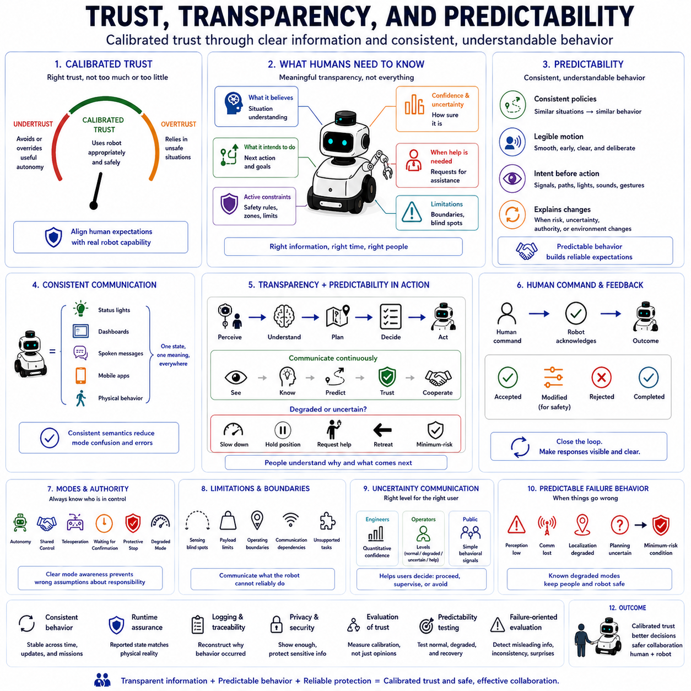{width="7.268055555555556in" height="7.268055555555556in"}

Trust in human--robot interaction should be treated as a calibrated operational relationship rather than a general belief that an intelligent robot is reliable. A trustworthy Physical AI system helps people understand what it can do, where its limitations exist, and how it will behave under changing conditions. Effective safety depends on keeping human expectations aligned with actual system capability so that neither excessive trust nor unnecessary distrust distorts decisions.

Trust calibration is especially important because advanced robots can appear more capable than they actually are. Fluent language, smooth navigation, human-like explanations, or successful demonstrations may encourage users to generalize competence from one domain to another. The interface should therefore communicate capability boundaries and uncertainty so that impressive behavior in familiar situations does not create unjustified confidence in unfamiliar or safety-critical conditions.

Undertrust can also create operational problems. If users do not understand why a robot slows, stops, reroutes, or requests assistance, they may interpret correct protective behavior as poor performance. They may repeatedly override autonomy, avoid useful functionality, or introduce inefficient manual procedures. Transparency should therefore reveal enough of the system's reasoning and safety state to distinguish deliberate protective behavior from malfunction or inadequate capability.

Transparency does not require exposing every internal computation. Modern Physical AI systems may contain perception models, world models, planners, foundation models, safety monitors, and control systems whose complete internal state would overwhelm most users. Useful transparency instead presents information that supports action: what the robot believes is happening, what it intends to do, what constraints are active, how confident it is, and when human intervention may be required.

Predictability concerns whether humans can form reliable expectations about robot behavior before it occurs. A predictable robot does not necessarily perform the same action in every situation; rather, similar situations should produce behavior consistent with understandable policies and constraints. When behavior changes because risk, uncertainty, authority, or environmental conditions change, the reason for that change should remain sufficiently interpretable to nearby people and operators.

Motion itself is an important communication channel. Smooth acceleration, early deceleration, stable trajectories, clear stopping behavior, and deliberate yielding can make robot intent easier to anticipate. Sudden turns, unexplained pauses, oscillating trajectories, or late obstacle avoidance can reduce confidence even if collisions are avoided. Physical behavior should therefore be designed not only for dynamic feasibility but also for legibility to humans sharing the environment.

Robot intent communication can improve predictability before movement occurs. Visual indicators, projected paths, displays, auditory cues, gestures, or other signals can communicate whether the robot intends to proceed, stop, yield, reverse, manipulate an object, or wait. These signals should correspond closely to actual control state. An interface that indicates "safe to proceed" while the planner remains uncertain can create more danger than providing no signal at all.

Consistency across interfaces is equally important. A status light, remote dashboard, spoken explanation, mobile application, and physical robot behavior should not provide conflicting interpretations of the same state. If the robot is stopped because a protective zone is occupied, local and remote interfaces should communicate compatible information. Consistent semantics reduce mode confusion and help users develop a stable mental model of the system.

Explanations should be concise, relevant, and connected to observable behavior. When a robot stops, statements such as "person detected in protective zone," "path blocked," or "localization confidence too low" are more useful than generic messages indicating that an error occurred. Explanations should identify the condition affecting behavior without implying greater certainty than the system actually possesses.

Uncertainty should be communicated in forms appropriate to the user and task. Engineers may benefit from quantitative confidence values, while operators may need categories such as normal, degraded, uncertain, or intervention required. Nearby members of the public may need only simple behavioral signals. The objective is not to expose uncertainty for its own sake but to help each user determine whether the robot can safely continue, requires supervision, or should be avoided.

Transparency should include limitations as well as current state. Users should understand relevant sensing blind spots, operating boundaries, payload constraints, environmental restrictions, communication dependencies, and unsupported tasks. Limitations that are hidden until failure can create hazardous expectations. A system that clearly communicates what it cannot reliably do may produce greater justified trust than one that appears universally capable but fails unpredictably.

Predictable failure behavior is particularly important. When perception confidence falls, communication is lost, localization degrades, or planning becomes uncertain, the robot should transition through known degraded modes rather than continue with unexplained behavior. Slowing, holding position, requesting assistance, retreating, or entering a minimum-risk condition can provide understandable responses to uncertainty and help humans anticipate what happens when normal autonomy is unavailable.

Mode awareness supports both transparency and predictability. Users should know whether the robot is autonomous, under shared control, teleoperated, waiting for confirmation, performing a protective stop, or operating in a degraded mode. Hidden mode changes can cause incorrect assumptions about responsibility and future behavior. Clear mode indication becomes especially important when authority transfers between autonomous systems and human operators.

Human commands should produce visible or otherwise understandable acknowledgments. The user should know whether a command was received, interpreted, accepted, modified by safety constraints, rejected, or completed. Without such feedback, people may repeat commands or assume actions have occurred when they have not. Closing the interaction loop makes the robot's response more predictable and supports appropriate trust in both autonomy and human control interfaces.

Trust should not depend on persuasive language. A robot may provide natural-language explanations, but confidence should arise from consistent behavior, verified capability, transparent state, and reliable protection rather than conversational fluency. Physical AI systems should avoid presenting uncertain inference as established fact or using authoritative language that encourages users to accept decisions without appropriate verification.

Explanations should also distinguish autonomous decisions from safety-enforced constraints. A planner may choose a longer route because it predicts congestion, while a safety system may prohibit a shorter route because a protective region is active. These are different forms of system behavior. Showing whether an action results from optimization, uncertainty management, human instruction, or mandatory safety enforcement helps users understand which aspects can be changed and which remain authoritative.

Trust changes over time through repeated interaction. Successful operation can increase confidence, while unexplained failures can reduce it rapidly. Systems should therefore maintain behavioral consistency across missions and software updates. Significant changes to navigation style, warning behavior, control authority, or intervention thresholds should be communicated and validated because previously learned human expectations may no longer match the updated robot.

Multi-robot environments require additional consistency because humans may interact with robots having different capabilities or configurations. Shared conventions for yielding, warning signals, status indicators, safety zones, and intervention interfaces can reduce the need to learn each robot individually. Where robots behave differently, those differences should be clearly communicated rather than hidden behind superficially identical interfaces.

Fleet supervision requires transparency at multiple levels. Operators need a concise overview of normal fleet operation while retaining the ability to inspect individual robots when anomalies occur. Interfaces can prioritize robots with degraded perception, blocked tasks, communication problems, safety interventions, or requests for assistance. Transparency should direct human attention toward meaningful exceptions rather than forcing continuous observation of every autonomous action.

Runtime assurance contributes to trust by checking whether the robot's communicated state matches its physical behavior. If an interface indicates that the robot has stopped, measured motion should confirm that state. If a robot claims that an obstacle has cleared, perception and safety monitoring should support the transition back to motion. Detecting disagreement between reported and actual state prevents transparency mechanisms from becoming merely cosmetic.

Logging and traceability support deeper transparency after events. Records can capture perception state, planned actions, safety constraints, human commands, control modes, warnings, interventions, and resulting motion. These records help engineers and operators reconstruct why behavior occurred and determine whether the cause was environmental uncertainty, autonomous planning, human input, communication failure, or a system fault.

Privacy and security should constrain transparency appropriately. Providing useful explanations does not mean exposing sensitive sensor data, personal information, proprietary models, credentials, or security-critical implementation details. Different stakeholders may require different levels of access. Transparency should reveal enough information for safe understanding and accountability while respecting privacy, cybersecurity, and operational confidentiality.

Evaluation of trust should measure calibration rather than asking only whether users report liking or trusting the robot. Users should appropriately rely on the system when it is capable and recognize when supervision or intervention is required. Experiments can compare perceived capability with actual capability, examine response to uncertainty, and determine whether explanations improve correct prediction of robot behavior rather than merely increasing subjective confidence.

Predictability testing should expose users to normal operation, degraded conditions, safety interventions, ambiguous situations, and recovery. Researchers can measure whether users correctly anticipate stopping, yielding, rerouting, requesting assistance, or entering a minimum-risk condition. Unexpected behavior should be analyzed not only as a control problem but also as an interaction problem when technically correct actions are difficult for humans to interpret.

Failure-oriented evaluation should examine misleading indicators, delayed status updates, inconsistent explanations, incorrect confidence estimates, hidden mode changes, contradictory interfaces, and behavior that violates previously established expectations. The objective is to ensure that transparency remains dependable precisely when the system is uncertain or degraded, because misleading confidence during abnormal conditions can be more dangerous than openly communicating limited capability.

Trust, transparency, and predictability ultimately form a feedback relationship between human understanding and robot behavior. Transparency reveals relevant state, intent, uncertainty, and limitations; predictable behavior allows humans to build accurate expectations; and repeated agreement between communicated and observed behavior produces calibrated trust. Integrated with safety monitoring, clear authority, controlled degradation, and verifiable physical responses, these principles allow humans to cooperate with Physical AI without assuming either blind confidence or constant suspicion.

## 05.14. Human Robot Interface Safety Evaluation

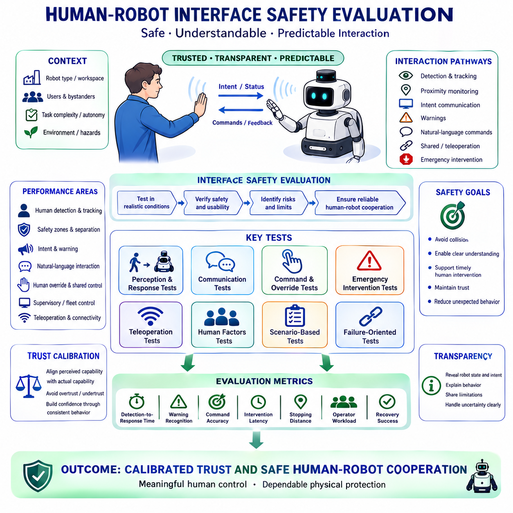{width="7.268055555555556in" height="7.268055555555556in"}

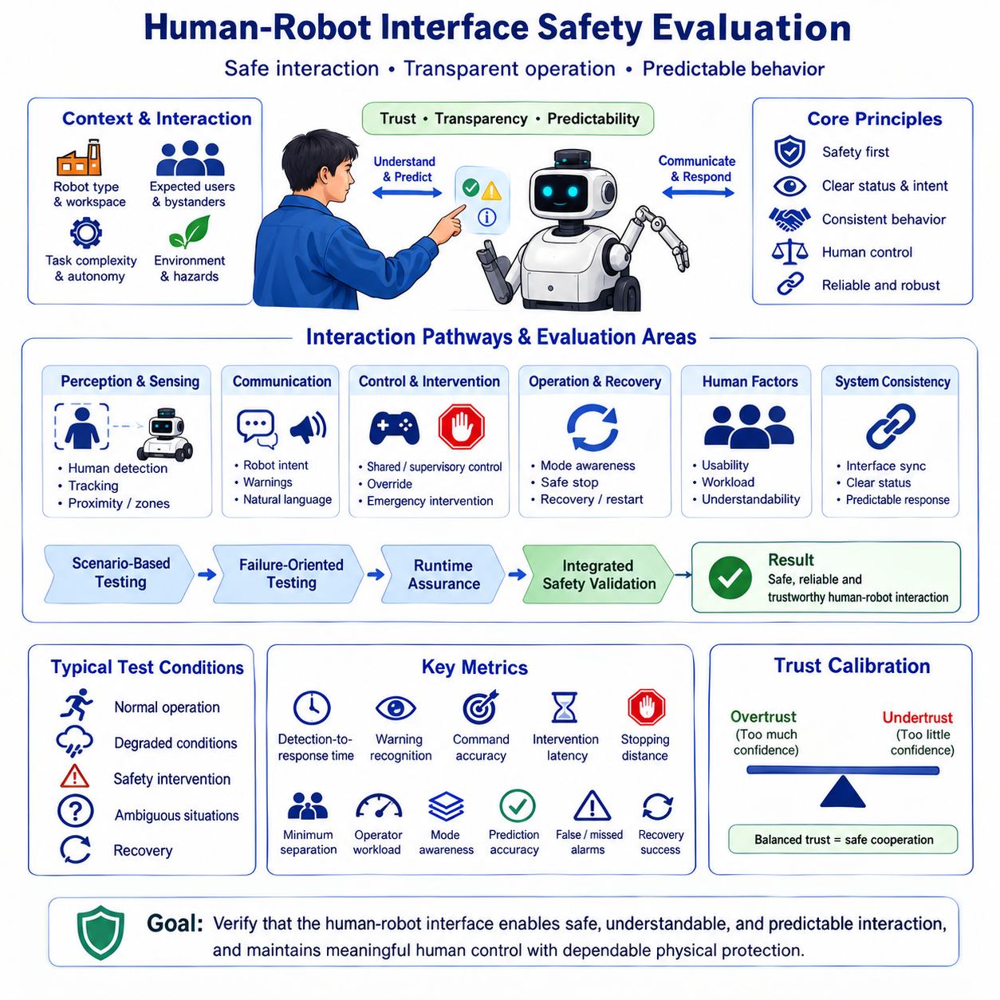{width="7.268055555555556in" height="7.268055555555556in"}

Human--robot interface safety evaluation determines whether the mechanisms connecting people and Physical AI systems support safe, understandable, and predictable interaction across normal, degraded, and emergency conditions. Evaluation must examine more than interface usability alone. It should verify whether perception, communication, commands, warnings, control transitions, human intervention, and robot responses collectively preserve safety throughout the complete interaction lifecycle.

The evaluation begins by defining the interaction context in which the interface will operate. Relevant factors include robot type, workspace, expected users, nearby non-operators, task complexity, autonomy level, environmental conditions, operating speed, payload, and potential hazards. An interface that is adequate for a supervised laboratory robot may be insufficient for a mobile platform operating near workers in a dynamic industrial environment.

Evaluation should identify every safety-relevant interaction pathway between humans and the robot. These pathways include human detection and tracking, proximity monitoring, robot intent communication, warnings, natural-language commands, command confirmation, shared control, teleoperation, supervisory control, override, and emergency intervention. Each pathway should be examined independently and as part of the integrated system because failures can emerge from interactions between otherwise functional components.

Human detection performance should be evaluated under realistic operating conditions rather than only controlled scenes. Testing should include different body orientations, clothing, partial occlusion, lighting conditions, crowd density, movement patterns, sensor blind spots, and environmental clutter. The objective is not merely to measure detection accuracy but to determine whether missed, delayed, or uncertain detections produce sufficiently conservative robot behavior.

Tracking evaluation should examine whether the system maintains reliable human state estimates as people move around the robot. Identity switches, temporary occlusion, sensor transitions, sudden motion, and multiple nearby people can degrade tracking quality. Safety logic should account for these uncertainties so that losing a track does not automatically imply that the person has disappeared from the physical environment or that previously established separation constraints can be removed.

Safety zones and proximity management should be tested across the robot's complete operating envelope. Evaluation should verify whether zone boundaries correspond to actual sensing and stopping capability, whether transitions between zones produce the intended responses, and whether dynamic zones adapt correctly to speed and environmental conditions. Tests should include people approaching from unexpected directions and entering monitored regions rapidly.

Speed and separation monitoring requires evaluation of the entire perception-to-stop chain. Human position estimation, robot velocity, relative motion, system latency, braking performance, stopping distance, and uncertainty margins all influence whether separation remains sufficient. Testing should therefore verify physical outcomes rather than considering the correctness of software calculations alone. Worst-case combinations of speed, delay, and detection uncertainty deserve particular attention.

Robot intent communication should be evaluated according to whether people correctly understand future robot behavior. Visual indicators, projected paths, auditory signals, displays, gestures, and motion cues should be tested with representative users. The important measure is not simply whether a signal is visible or audible, but whether users interpret it correctly and can predict whether the robot will proceed, stop, yield, reverse, or perform another relevant action.

Warnings should be evaluated for detectability, urgency, meaning, and timing. Visual warnings may fail under poor visibility or when users are looking elsewhere, while auditory warnings may be masked by industrial noise. Haptic warnings require appropriate physical contact with the interface. Multi-modal warnings can improve robustness, but their meanings should remain consistent. Excessive alarms should also be examined because frequent low-value warnings can produce alarm fatigue.

Natural-language safety interaction requires evaluation beyond ordinary speech-recognition accuracy. Tests should include noise, accents, incomplete statements, ambiguous references, indirect warnings, multiple speakers, contradictory commands, and unfamiliar expressions. Evaluation should determine whether uncertain language results in clarification or conservative behavior rather than unsupported physical action. Urgent safety phrases should also be assessed for recognition and response latency.

Command confirmation should be tested to determine whether it reduces dangerous misunderstanding without creating unnecessary interaction burden. Consequential but non-urgent commands may benefit from explicit confirmation, while immediate protective commands should not be delayed by lengthy dialogue. Evaluation should examine whether the robot confirms interpreted physical meaning, such as target objects or destinations, instead of merely repeating the user's original words.

Human override evaluation should verify that authorized intervention produces predictable changes in robot behavior. Tests should cover pausing, task cancellation, route modification, manual takeover, and other supported transitions. The evaluation should also confirm that human override cannot silently bypass independently enforced safety constraints. When an override is rejected or modified, the interface should clearly communicate why the requested action cannot be performed as issued.

Shared control should be evaluated by examining how human and autonomous commands interact. Autonomous assistance should improve safety without making the robot feel unpredictable or resistant to legitimate operator intent. Tests can introduce obstacles, proximity constraints, conflicting inputs, and abrupt human commands. The resulting motion should remain stable, understandable, and within validated safety boundaries even when human and autonomous objectives differ.

Supervisory control evaluation should include human workload and attention management. An interface may function correctly for one robot but become unsafe when an operator supervises several systems simultaneously. Testing should examine notification frequency, intervention requests, alarm prioritization, information density, and response time. The objective is to determine whether supervisors can identify which robot requires attention and understand the reason before conditions become critical.

Teleoperation safety evaluation should reproduce realistic communication degradation. Fixed latency, variable latency, packet loss, bandwidth reduction, delayed video, sensor dropout, and complete disconnection can significantly alter controllability. The robot should reduce dependence on remote commands as communication quality deteriorates and retain local protective functions. Reconnection testing should verify that stale commands are not automatically executed after the physical situation has changed.

Situational awareness during teleoperation should be evaluated using representative camera placement, sensor views, maps, and state information. Operators should be tested on their ability to identify people, obstacles, clearance, robot orientation, manipulator configuration, and blind regions. Evaluation should specifically examine whether interface limitations encourage false assumptions, such as interpreting an unseen area as an area known to be clear.

Emergency intervention interfaces require dedicated evaluation because they represent a final human-accessible protection layer. Physical and remote controls should be tested for accessibility, recognizability, activation time, resulting robot response, and state indication. Evaluation should include stressful and abnormal conditions rather than only planned demonstrations. The system should provide a predictable protective response even when other components are already degraded.

Emergency stopping tests should examine actual physical behavior after intervention. Measured velocity, stopping distance, brake state, actuator behavior, payload stability, and stored energy may all be relevant. Activation of an emergency command is not equivalent to successful risk reduction if the robot continues moving unexpectedly or another subsystem remains hazardous. Verification should therefore extend from interface activation through completion of the intended physical response.

Recovery and restart behavior should be evaluated as carefully as stopping. Resetting an intervention should not automatically restart motion. Tests should verify reassessment of human positions, obstacles, localization, active faults, safety zones, communication state, and task context before operation resumes. The system should also prevent previously queued or stale actions from unexpectedly becoming active during recovery.

Trust, transparency, and predictability should be evaluated through human understanding rather than subjective preference alone. Users can be asked to predict robot behavior under normal, uncertain, degraded, and protective conditions. Evaluation should determine whether displayed state, explanations, warnings, and physical behavior create an accurate mental model. Both overtrust and undertrust indicate failures of trust calibration when they do not correspond to actual system capability.

Mode awareness should be tested across autonomous, shared-control, teleoperated, supervisory, protective-stop, and degraded states. Users should consistently identify who or what currently controls robot motion and which safety mechanisms remain active. Hidden or ambiguous transitions should be treated as safety concerns because mode confusion can cause operators either to intervene unnecessarily or to fail to intervene when human control is expected.

Interface consistency should be examined across physical indicators, displays, remote dashboards, spoken messages, mobile interfaces, and actual robot behavior. The same system condition should not be represented differently across channels. Testing should deliberately create transitions and faults to verify that all relevant interfaces remain synchronized. Contradictory status information can undermine both situational awareness and confidence in safety mechanisms.

Human factors evaluation should include representative users rather than relying exclusively on developers or expert operators. Experience, training, physical ability, language familiarity, attention, stress, fatigue, and protective equipment can affect interaction. Evaluation should determine whether important controls, warnings, explanations, and robot behaviors remain understandable under realistic working conditions rather than only to people already familiar with the system design.

Scenario-based evaluation should combine multiple interface functions within realistic tasks. A person may enter a safety zone while the robot is teleoperated, communication latency may increase, an operator may issue an override, and a warning may occur simultaneously. Integrated scenarios reveal interaction failures that isolated component tests cannot identify. Safety evaluation should therefore progressively move from component verification toward complete human--robot operational scenarios.

Failure-oriented testing should intentionally create missed detections, ambiguous commands, incorrect tracking, delayed warnings, stale control inputs, communication loss, mode confusion, failed confirmations, unavailable displays, and conflicting commands. The objective is to verify that individual interface failures do not immediately become hazardous physical behavior. The system should degrade conservatively and preserve independent protection when communication or interaction mechanisms become unreliable.

Evaluation metrics should connect interface performance to physical safety outcomes. Relevant measures can include detection-to-response time, warning recognition, command interpretation accuracy, intervention latency, stopping distance, minimum separation, operator workload, mode awareness, prediction accuracy, false alarms, missed alarms, and successful recovery. No single metric is sufficient because safe interaction emerges from the combined performance of humans, interfaces, autonomy, and physical control.

Traceability should connect evaluation results to hazards, safety requirements, interface functions, test scenarios, and observed outcomes. When a failure is discovered, engineers should be able to determine which requirement was violated and which design element requires improvement. Logs of robot state, human commands, perception outputs, control modes, warnings, interventions, and physical responses can provide evidence for both validation and post-test analysis.

Human--robot interface safety evaluation ultimately verifies whether humans and autonomous Physical AI can remain coordinated when conditions are imperfect. A safe interface must help people perceive robot state, understand intent, issue and confirm commands, intervene when necessary, and anticipate what happens during failure and recovery. By combining human factors, physical testing, uncertainty, failure injection, runtime evidence, and integrated scenarios, evaluation demonstrates whether the complete interaction system preserves meaningful human control and dependable physical protection.
