**Volume 10. Physical AI Safety and Alignment**

# Chapter 06. Fail Safe and Fallback Design

## 06.01. Fail Safe Fail Operational and Fault Tolerant Design

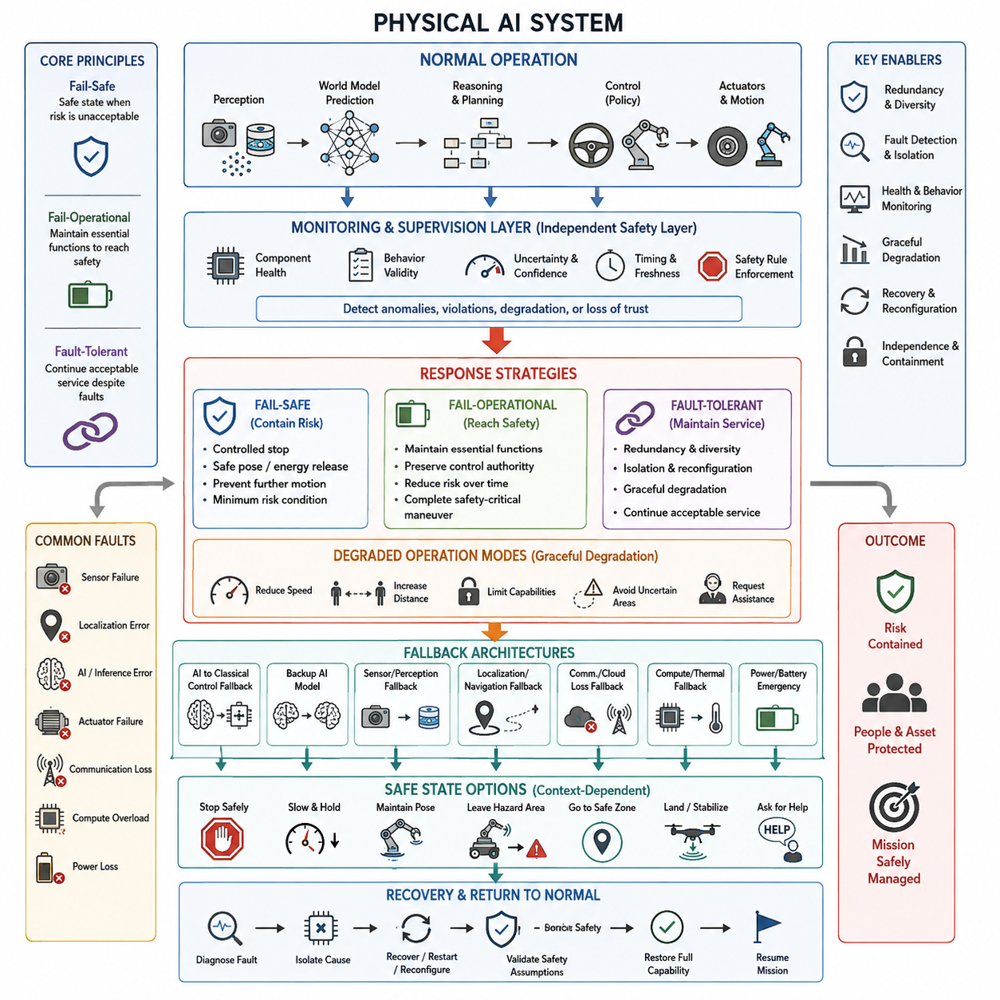{width="7.268055555555556in" height="7.268055555555556in"}

Physical AI systems operate in environments where computational failures can immediately become physical hazards. A perception error, processor fault, communication loss, actuator malfunction, or corrupted AI inference may affect motion before a human can intervene. Fail-safe, fail-operational, and fault-tolerant design therefore provide complementary strategies for controlling how a robot behaves when parts of the system no longer operate as intended.

Fail-safe design assumes that certain failures should cause the system to transition toward a predefined condition in which unacceptable risk is minimized. For a mobile robot, this may involve controlled deceleration and stopping, while a manipulator may halt motion, maintain a safe pose, release energy where appropriate, or prevent further actuator commands. The objective is not continued productivity but predictable containment of hazardous behavior.

A fail-safe response must consider that stopping is not universally safe. An autonomous vehicle stopping in an active traffic lane, a mobile manipulator freezing while carrying an unstable load, or an aerial robot immediately disabling propulsion may create greater hazards than temporary continued operation. Physical AI therefore requires context-dependent safe states that account for motion, stored energy, payload, surrounding humans, terrain, traffic, and environmental conditions.

Fail-operational design addresses situations in which some functionality must remain available after a failure. Instead of immediately terminating operation, the system preserves enough sensing, computation, communication, or control capability to complete a safety-critical maneuver. An autonomous robot may lose its primary localization method yet continue using an independent source long enough to reduce speed, leave a hazardous area, reach a designated location, or achieve a minimum risk condition.

The amount of fail-operational capability required depends on the consequences of losing functionality and the time needed to reach safety. A warehouse AMR may often stop safely within a short distance, whereas a road vehicle, aerial robot, heavy mobile platform, or robot interacting closely with people may require continued steering, braking, stabilization, perception, or state estimation. Safety analysis must therefore identify which functions must survive particular faults and for how long.

Fault tolerance is the broader ability of a system to continue providing an acceptable service despite faults. It combines mechanisms such as redundancy, fault detection, isolation, reconfiguration, graceful degradation, and recovery. Rather than treating every component failure as a complete system failure, fault-tolerant architecture determines which capabilities remain trustworthy and restructures operation around the surviving resources while preserving defined safety constraints.

Redundancy is an important mechanism, but simply duplicating components does not guarantee fault tolerance. Two identical sensors, processors, or AI models may fail simultaneously because they share power, software defects, environmental exposure, training data, or assumptions. Effective designs examine common-cause and correlated failures and may introduce diversity through different sensing modalities, algorithms, compute channels, power paths, communication links, or independently developed safety mechanisms.

Physical AI introduces additional challenges because learned components do not fail only through conventional hardware or software faults. An AI model may remain computationally healthy while producing unsafe predictions because of distribution shift, unfamiliar objects, ambiguous scenes, sensor degradation, or excessive confidence. Fault-tolerant design must therefore monitor both component health and behavioral validity, including uncertainty, consistency, operational boundaries, and violations of physical safety constraints.

A useful architecture separates high-performance autonomy from independently enforceable safety functions. The primary AI system may perform perception, prediction, reasoning, planning, and adaptive control, while a simpler safety layer observes critical states and constrains dangerous actions. If the AI becomes unavailable or untrustworthy, authority can migrate toward deterministic fallback control, restricted motion, reduced speed, emergency stabilization, or another independently validated control path.

The transition between normal and fallback operation is itself safety-critical. Abruptly switching controllers can introduce discontinuities in velocity, steering, torque, trajectory, or actuator commands. A robust design defines explicit transition conditions, synchronization rules, state transfer, command arbitration, and hysteresis so that temporary anomalies do not cause unstable switching. The fallback controller must also receive enough reliable state information to assume control safely.

Graceful degradation provides an intermediate strategy between unrestricted operation and complete shutdown. When sensing quality, computational capacity, localization accuracy, communication reliability, or actuator capability deteriorates, the robot progressively restricts its operating envelope. It may reduce velocity, increase obstacle clearance, prohibit complex manipulation, shorten planning horizons, avoid uncertain regions, disable autonomous functions, or request human assistance while retaining essential safety functions.

Fault containment prevents a local problem from propagating across the architecture. Compute partitions, communication boundaries, independent watchdogs, protected power domains, command validation, and safety-rated control paths can isolate failures before they corrupt unrelated functions. This principle is especially important when foundation models, VLA policies, world models, fleet services, and conventional robot controllers coexist within the same Physical AI system.

Temporal behavior must also be included in the fault model. A function can produce logically correct results but still become unsafe when computation exceeds its deadline, sensor information becomes stale, communication latency grows, or synchronization is lost. Watchdogs and freshness checks therefore monitor not only whether information exists but whether it remains valid for the current physical state and whether the system still has sufficient time to react safely.

Recovery should be distinguished from immediate fault containment. After entering a safe or degraded condition, the system may diagnose the fault, restart components, switch resources, recalibrate sensors, rebuild localization, or replan its mission. Automatic recovery should occur only when the system can establish that required safety assumptions have been restored. Otherwise, the robot should remain restricted, request supervision, or terminate the mission rather than repeatedly re-entering unsafe operation.

Fail-safe, fail-operational, and fault-tolerant strategies ultimately form a coordinated hierarchy rather than competing design choices. Fail-safe behavior defines how risk is contained when continued operation cannot be justified, fail-operational behavior preserves essential functions long enough to reach safety, and fault tolerance enables acceptable service despite selected failures. Their combination creates a structured path from normal autonomy through degradation, fallback, minimum-risk behavior, and controlled recovery.

For Physical AI, the central design question is therefore not simply whether the robot can survive a component failure, but whether it can preserve control over physical risk while its internal assumptions are being invalidated. A robust system detects loss of trust, limits authority, maintains essential capabilities, and moves toward increasingly conservative behavior. This layered philosophy provides the foundation for the fault detection, safe-state, degraded-mode, fallback, and recovery mechanisms developed throughout the remainder of the chapter.

## 06.02. Fault Detection Isolation and Recovery

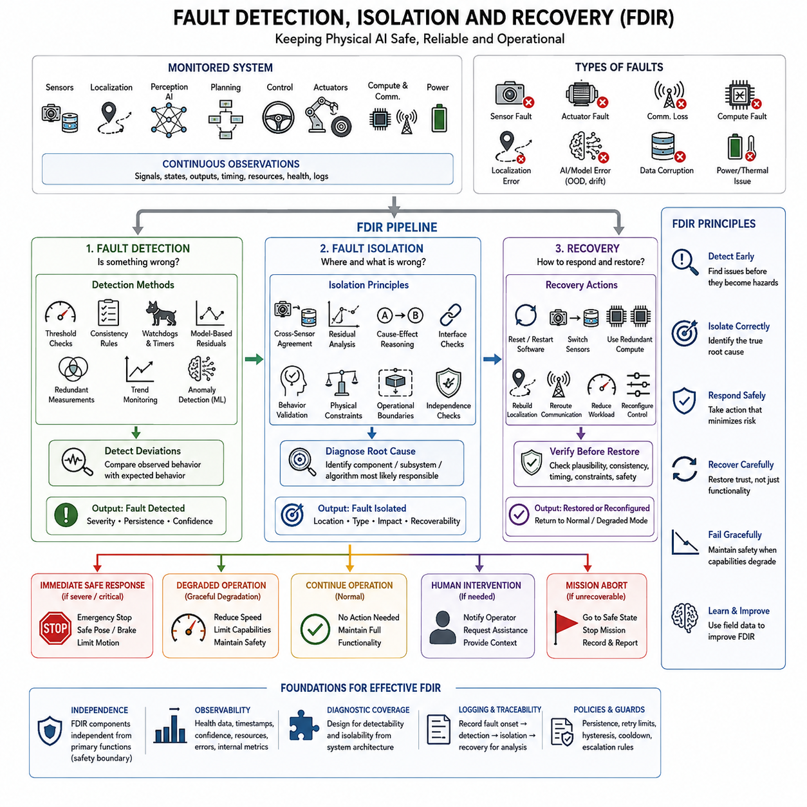{width="7.268055555555556in" height="7.268055555555556in"}

Fault Detection, Isolation, and Recovery (FDIR) provides the mechanisms that allow a Physical AI system to recognize abnormal conditions, determine where they originate, and respond before they develop into hazardous physical behavior. Unlike conventional monitoring that mainly reports component status, FDIR connects diagnosis directly to safety decisions, degraded operation, fallback control, and restoration of trustworthy autonomy.

Fault detection determines whether observed system behavior remains consistent with expected operating conditions. Detection mechanisms may examine sensor signals, actuator responses, localization estimates, communication status, computational timing, power conditions, and AI outputs. The objective is to identify meaningful deviations early enough that the robot still has sufficient control authority and physical margin to execute a safe response.

Detection can rely on explicit thresholds, consistency rules, watchdogs, analytical models, redundant measurements, or learned anomaly detectors. Simple limits remain valuable because they are predictable and independently verifiable, while model-based approaches can recognize complex relationships among system variables. Physical AI architectures often combine several methods so that no single diagnostic assumption becomes the only defense against unsafe behavior.

Temporal information is particularly important because many faults emerge gradually rather than appearing as immediate failures. Sensor drift, increasing inference latency, battery degradation, thermal throttling, localization divergence, or deteriorating communication quality may initially remain within nominal limits. Trend monitoring and persistence checks help distinguish developing faults from harmless transient disturbances and provide additional time for controlled degradation.

Fault isolation follows detection by identifying the component, subsystem, interface, or functional chain most likely responsible for the abnormal behavior. Isolation prevents the system from unnecessarily disabling healthy capabilities and supports selection of an appropriate fallback strategy. For example, determining whether navigation inconsistency originates from a camera, LiDAR, localization algorithm, map mismatch, or timing problem can lead to very different recovery actions.

Isolation frequently depends on relationships between multiple observations. If wheel odometry, inertial sensing, and visual localization disagree, cross-checking their residuals may indicate which estimate has become unreliable. Similarly, commanded actuator motion can be compared with measured motion, power consumption, and encoder feedback. Diagnostic reasoning therefore converts distributed evidence into hypotheses about the location and nature of a fault.

Physical AI requires fault isolation beyond conventional hardware diagnosis because failures can occur at semantic and behavioral levels. A perception network may continue producing outputs while systematically missing an unfamiliar obstacle class, or a world model may generate physically inconsistent predictions despite normal computation. Isolation must therefore distinguish hardware faults, data corruption, model uncertainty, distribution shift, planning errors, and violations of operational assumptions.

Confidence alone is insufficient for detecting or isolating AI failures because learned models can be confidently wrong. More robust diagnosis combines uncertainty estimates with sensor agreement, temporal consistency, physical constraints, trajectory feasibility, operational design boundaries, and independent safety observations. When evidence conflicts, the system should reduce trust in the affected function rather than assuming that a numerically confident AI output is correct.

Fault identification may additionally characterize severity, persistence, and recoverability. A brief packet loss may require no more than temporary buffering, whereas persistent communication loss may trigger autonomous fallback. A slightly degraded sensor may permit reduced-speed operation, while complete loss of safety-critical perception may require stopping. Diagnostic results therefore need to represent operational consequences rather than merely assigning binary healthy or failed labels.

Recovery begins once the fault has been sufficiently characterized and the system has entered an acceptable operating condition. Recovery actions may include resetting software, restarting an AI inference process, switching sensors, selecting a redundant compute channel, recalibrating state estimation, rebuilding localization, rerouting communication, reducing workload, or reconfiguring control. The selected action must preserve safety throughout the transition rather than focusing only on restoring functionality.

Not every detected fault should trigger immediate automatic recovery. Repeated restart cycles, unstable controller switching, or rapid transitions between primary and backup components can create new hazards. Recovery logic therefore benefits from persistence criteria, retry limits, hysteresis, cooldown intervals, and explicit escalation policies. If recovery repeatedly fails, the system should progressively move toward a more conservative degraded mode or mission termination.

Recovery must also distinguish between restoring a component and restoring confidence in the system. A restarted perception process may execute normally but still receive corrupted sensor data, while recovered localization may remain inconsistent with the physical environment. Before returning authority to a recovered function, the system should verify output plausibility, timing, cross-sensor consistency, safety constraints, and other assumptions required for trustworthy operation.

Reconfiguration provides continuity when direct repair is impossible. A failed camera may be excluded while remaining sensors support restricted perception, a lost localization source may be replaced by another estimator, or a failed AI planner may transfer authority to a simpler classical controller. Such reconfiguration enables graceful degradation by matching the robot\'s permitted behavior to the capabilities that remain demonstrably available.

FDIR architecture should preserve independence between the function being diagnosed and the mechanisms responsible for critical safety decisions. If the same AI model both generates behavior and determines whether that behavior is safe, a common failure may compromise both roles. Independent watchdogs, safety processors, redundant sensing paths, protected communication channels, and deterministic constraint checks can provide stronger diagnostic and containment boundaries.

The effectiveness of FDIR depends heavily on observability and diagnostic coverage designed into the system from the beginning. Components should expose meaningful health information, timestamps, confidence indicators, error states, resource utilization, and relevant internal measurements. Logging should preserve the sequence from fault onset through detection, isolation, fallback, and recovery so that field incidents can be reconstructed and diagnostic mechanisms can be improved.

In a complete Physical AI safety architecture, FDIR forms the decision bridge between runtime monitoring and fallback behavior. Detection establishes that trust has been reduced, isolation determines which capability should no longer be relied upon, and recovery attempts to restore or reconfigure that capability under controlled conditions. When recovery cannot be justified, the same diagnostic information guides degraded operation, minimum-risk behavior, human intervention, or mission abort.

## 06.03. Safe State Definition

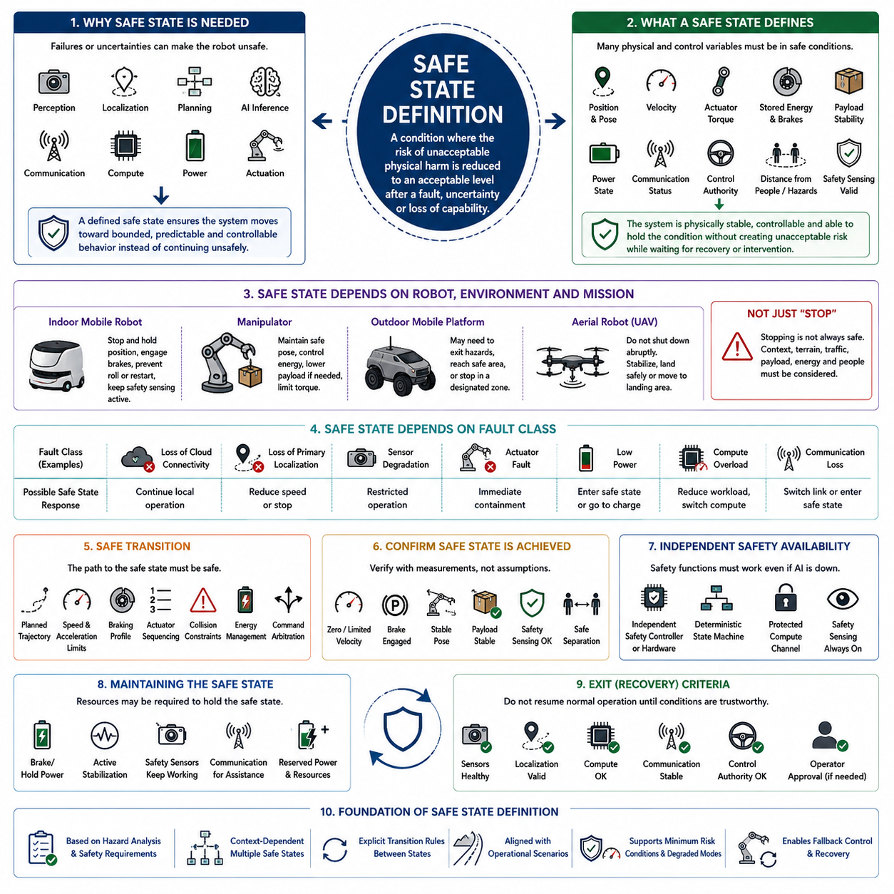{width="7.268055555555556in" height="7.268055555555556in"}

A safe state is a system condition in which the risk of unacceptable physical harm has been reduced to an acceptable level after a fault, uncertainty, loss of capability, or violation of operational assumptions. For Physical AI, a safe state cannot be defined merely as "powered off" or "stopped." It must describe a physically stable and controllable condition appropriate to the robot, environment, mission, payload, and surrounding people.

The concept originates from the need to ensure that failures lead toward bounded and predictable behavior rather than uncontrolled continuation. When perception, localization, planning, AI inference, communication, compute, power, or actuation becomes unreliable, the system needs a defined destination for its safety response. The safe state therefore provides the target condition toward which fail-safe mechanisms and fallback strategies attempt to move the system.

A complete safe-state definition specifies more than robot velocity. It may include position, pose, actuator torque, stored mechanical energy, brake condition, payload stability, power state, communication status, control authority, and distance from people or hazards. These variables collectively determine whether the physical system can remain in its current condition without creating an unacceptable risk while awaiting recovery or intervention.

Stopping is a common safe-state strategy for indoor mobile robots because removing motion can eliminate a major source of kinetic risk. However, even a stopped robot must remain stable, prevent unintended restart, maintain braking where required, and preserve essential safety sensing. A stationary condition that permits uncontrolled rolling, payload movement, actuator collapse, or unexpected reactivation cannot be considered a properly established safe state.

For manipulators, safe-state definition requires consideration of configuration and stored energy. Immediately removing actuator power may allow a heavy arm or suspended object to fall, while rigidly maintaining position may generate excessive force or thermal stress. Depending on the system, a safer response may involve controlled deceleration, maintaining a stable pose, lowering a payload, engaging brakes, limiting torque, or moving away from a human interaction zone.

Mobile platforms operating outdoors may require a different safe state because stopping at the current location can expose the robot or other traffic to additional hazards. A robot may need to leave an intersection, avoid a slope, move away from machinery, or reach a designated stopping area before terminating autonomous motion. Safe-state selection must therefore consider not only the robot\'s internal condition but also the safety characteristics of its surrounding environment.

Aerial robots illustrate why zero motion cannot universally represent safety. Immediate propulsion shutdown can cause an uncontrolled descent, making continued stabilization temporarily safer than termination. The safe-state objective may instead be controlled hovering, emergency landing, reduced-flight operation, or navigation toward an acceptable landing location. The required behavior depends on altitude, remaining energy, vehicle health, terrain, and nearby people.

Safe states should be defined for identifiable fault classes rather than relying on a single universal response. Loss of cloud connectivity may allow continued local operation, whereas loss of primary localization may require reduced speed or stopping. A degraded sensor may permit restricted autonomy, while failure of a safety-critical actuator may require immediate containment. Mapping faults to appropriate states enables proportional responses instead of unnecessary emergency shutdowns.

The definition must also distinguish a safe state from a minimum risk condition. A safe state describes a condition that satisfies specified safety requirements, while a minimum risk condition may represent the safest achievable condition when normal safety objectives cannot be completely satisfied. In complex environments, the system may first enter degraded operation and then execute a controlled maneuver toward the best achievable minimum-risk condition.

Transitioning into a safe state is as important as the state itself. A theoretically safe destination provides little protection if the robot must perform an unstable or hazardous maneuver to reach it. Safe-state design therefore includes transition trajectories, allowable acceleration and deceleration, braking profiles, actuator sequencing, collision constraints, energy management, and command arbitration. The entire transition must remain inside an acceptable safety envelope.

The system must also determine when a safe state has actually been achieved. Confirmation may require measured zero or limited velocity, verified brake engagement, stable actuator position, acceptable payload condition, valid safety sensing, sufficient separation from humans, or confirmation that hazardous energy has been controlled. Safety should depend on observed physical conditions rather than simply assuming that issuing a stop or shutdown command produced the intended result.

Safe-state logic should remain available even when high-level AI functions are unavailable. An independent safety controller, deterministic state machine, protected compute channel, or dedicated safety hardware can maintain essential transition and holding functions. This separation prevents failure of a foundation model, VLA policy, world model, planner, or primary compute platform from simultaneously eliminating the mechanism responsible for establishing physical safety.

Maintaining the safe state may require continued resources. Brakes can require power, stabilization may require active control, safety sensors may need to remain operational, and communication may be necessary for human intervention. Power architecture and resource allocation should therefore reserve sufficient capacity for safety functions. A system that can enter a safe state but cannot sustain it for the required duration has an incomplete safety strategy.

Exit conditions must be defined as carefully as entry conditions. Recovery should not occur merely because a fault indicator disappears or a component restarts. The system should verify that required sensors, localization, computation, communication, control, and safety assumptions have returned to acceptable conditions. Where uncertainty remains, human authorization, additional diagnostics, or a restricted restart may be required before full autonomous operation resumes.

Safe-state definitions should ultimately be traceable to hazard analysis, operational scenarios, and system safety requirements. Different robot classes and environments may require several context-dependent safe states connected through explicit transition rules. By defining what physical safety actually means before failures occur, Physical AI systems can convert uncertain or degraded situations into predictable behavior and provide a reliable foundation for minimum-risk conditions, degraded modes, fallback control, and recovery.

## 06.04. Minimum Risk Condition

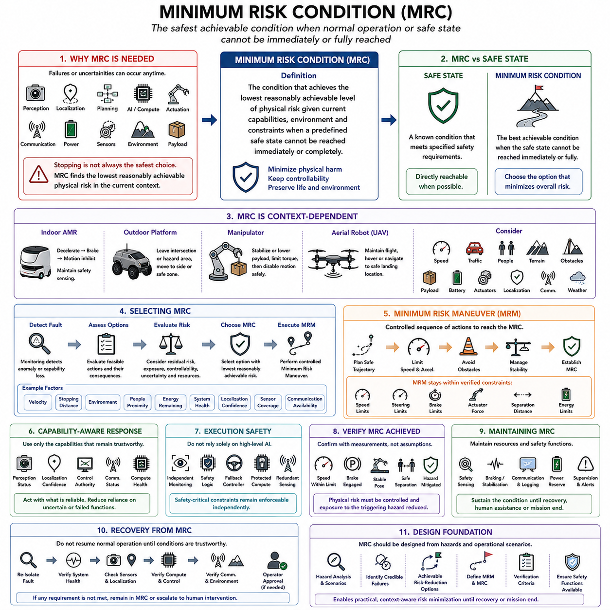{width="7.268055555555556in" height="7.268055555555556in"}

A Minimum Risk Condition (MRC) is the condition a Physical AI system seeks when normal operation can no longer be safely maintained and the preferred safe state cannot be reached immediately or completely. Rather than assuming that every failure can be resolved by stopping, the MRC represents the lowest reasonably achievable level of physical risk under the actual circumstances, available capabilities, and environmental constraints.

The concept is particularly important for autonomous physical systems because the safest achievable outcome may depend on where and how a failure occurs. A mobile robot inside an open warehouse aisle may safely stop in place, while the same robot crossing a vehicle route may need to continue moving temporarily. The MRC therefore connects fault response with situational reasoning about hazards, exposure, controllability, and remaining system capability.

An MRC should be distinguished from a predefined safe state. A safe state normally describes a condition known to satisfy specified safety requirements, whereas an MRC addresses situations where such a condition may not be directly reachable. The system may have to choose among imperfect alternatives and execute the action expected to minimize overall risk rather than simply applying a fixed shutdown response regardless of context.

Determining the MRC requires understanding both current hazards and the consequences of alternative actions. Relevant factors can include robot velocity, stopping distance, terrain, traffic, nearby people, payload stability, remaining battery energy, actuator condition, localization confidence, sensor coverage, communication availability, and environmental obstacles. These variables define which actions remain physically feasible and how much residual risk each option creates.

The MRC is therefore inherently context-dependent. For an indoor AMR, it may involve controlled deceleration followed by brake engagement and motion inhibition. For an outdoor autonomous platform, it may require leaving an intersection or moving to the side of a route. For a manipulator, the appropriate condition may involve stabilizing or lowering a payload before disabling motion rather than immediately removing actuator power.

For an aerial robot, minimum-risk behavior may require continued flight even after a significant fault. Immediate propulsion shutdown could create uncontrolled descent, while maintaining stabilization and navigating toward an emergency landing location may reduce risk. Remaining energy, propulsion capability, altitude, terrain, weather, and human presence influence whether hovering, controlled descent, diversion, or immediate landing provides the lowest achievable risk.

Reaching an MRC usually involves a Minimum Risk Maneuver (MRM), which is the controlled sequence of actions used to move the system toward the selected condition. The distinction is important: the MRC describes the desired final condition, while the MRM describes how the robot gets there. A safe architecture must reason about both because an inappropriate transition maneuver can introduce hazards even when the intended final state is comparatively safe.

Minimum-risk maneuvers should remain within verified physical and operational constraints. Speed, acceleration, steering, braking, actuator force, separation distance, collision margins, and energy consumption may need tighter limits than during normal autonomy. Complex objectives can be abandoned so that computation and control authority focus on essential stabilization, obstacle avoidance, controlled motion, and establishment of the minimum-risk condition.

The selection process should consider the capabilities that remain trustworthy after a fault. If primary perception is degraded but independent safety sensing remains available, restricted movement may still be justified. If localization confidence is lost, movement through a complex environment may become unacceptable. If communication disappears but local control remains healthy, the robot may autonomously complete an MRM without depending on cloud or fleet infrastructure.

Uncertainty should push MRC selection toward conservative behavior. Physical AI may not know precisely whether a sensor has failed, whether an obstacle prediction is correct, or whether localization error is increasing. Rather than requiring perfect diagnosis before acting, the system can reduce speed, enlarge safety margins, restrict maneuver choices, and favor conditions whose safety depends on fewer uncertain assumptions.

MRC execution should not depend entirely on the high-level AI function whose reliability may already be compromised. Independent monitoring, deterministic safety logic, fallback controllers, protected compute resources, and redundant sensing can provide the essential capabilities needed to execute a minimum-risk maneuver. High-level AI may assist with context interpretation, but safety-critical constraints should remain enforceable independently whenever practical.

The system must verify that the MRC has actually been achieved. Issuing a braking, landing, parking, or stabilization command does not prove that physical risk has been controlled. Confirmation may require measured motion limits, verified brake status, stable pose, acceptable payload condition, safe separation, successful landing detection, controlled energy state, or evidence that the robot is no longer exposed to the hazard that triggered the maneuver.

Once established, the MRC may need to be maintained for an extended period. Safety sensing, braking, stabilization, communication, logging, warning interfaces, and supervisory functions may remain active while the system waits for recovery or human assistance. Resource management must therefore reserve sufficient power and computational capability to sustain the condition instead of consuming all remaining resources during the transition.

An MRC does not automatically imply mission termination. After the triggering fault has been isolated and required capabilities have been restored, the system may evaluate whether controlled recovery is justified. Restart should require verification of sensor health, localization, computation, communication, control authority, environmental conditions, and relevant safety assumptions. Otherwise, the system should remain in the MRC or escalate to human intervention.

Minimum Risk Condition design should be derived from hazard analysis and operational scenarios rather than added as a generic emergency function after system development. Designers should identify credible failure situations, determine achievable risk-reduction options, define corresponding minimum-risk maneuvers, establish verification criteria, and ensure that the necessary safety functions remain available under the faults that make those maneuvers necessary.

Within the broader Physical AI fallback architecture, the MRC provides a practical bridge between safe-state definitions and real-world uncertainty. It recognizes that perfect safety may not always be immediately achievable, yet uncontrolled behavior is unacceptable. By selecting and executing the safest feasible response with the trustworthy capabilities that remain, the system can minimize residual physical risk until recovery, human assistance, or controlled mission termination becomes possible.

## 06.05. Degraded Mode Operation

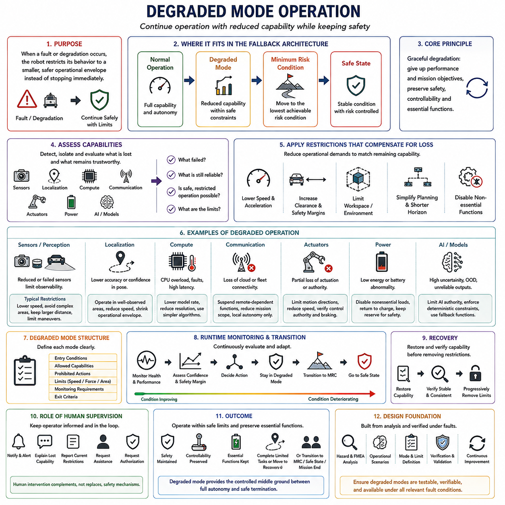{width="7.268055555555556in" height="7.268055555555556in"}

Degraded mode operation allows a Physical AI system to continue functioning with deliberately reduced capability when one or more components, resources, or assumptions can no longer support normal autonomous operation. Instead of treating every fault as a reason for immediate shutdown, the system restricts its behavior to a smaller operational envelope whose safety can still be justified using the capabilities that remain trustworthy.

The central principle of degraded operation is graceful degradation rather than abrupt loss of functionality. A robot may lose performance, autonomy, speed, sensing coverage, planning sophistication, or mission capability while preserving essential safety functions. This creates an intermediate operating region between full autonomous operation and a safe state or Minimum Risk Condition, allowing risk to be managed proportionally to the severity of degradation.

Entering degraded mode requires an assessment of what has failed and what remains reliable. Fault Detection, Isolation, and Recovery mechanisms can identify affected sensors, compute resources, communication channels, actuators, localization functions, or AI models. The system then determines whether the remaining capabilities provide sufficient observability, controllability, and safety assurance to support continued operation under explicitly restricted conditions.

Restrictions should directly compensate for the lost capability. Reduced perception range may require lower speed and greater obstacle clearance, while degraded localization may require operation only within well-observed areas. Limited compute capacity may force simpler planning, shorter prediction horizons, or lower model update rates. The objective is to reduce operational demands until they become compatible with the system\'s remaining trustworthy capability.

Degraded operation is especially useful for sensor and perception faults. If one camera fails in a multi-camera system, complete autonomy may not need to terminate if LiDAR, radar, or other cameras still provide sufficient coverage. However, blind regions and reduced detection performance must be reflected in behavior. The robot may restrict direction changes, increase separation distances, avoid complex environments, or operate at a lower maximum velocity.

Localization degradation requires similar adaptation. A robot that loses high-accuracy localization may continue using wheel odometry, inertial sensing, visual localization, map constraints, or another independent estimator, but accumulated uncertainty limits how long and where this remains acceptable. The operating envelope can progressively shrink as uncertainty increases, eventually triggering stopping or transition toward a Minimum Risk Condition if localization becomes insufficient.

Compute degradation can arise from processor faults, overload, memory pressure, thermal throttling, or excessive AI inference latency. Instead of allowing missed deadlines to propagate unpredictably into control, the system may reduce computational demand. Optional models can be disabled, perception resolution lowered, planning frequency reduced, or a simpler fallback algorithm activated while safety-critical monitoring and control retain prioritized computational resources.

Communication loss also illustrates the importance of capability-aware degradation. A robot designed with sufficient local autonomy may continue operating when cloud or fleet communication disappears, but functions requiring remote coordination should be suspended. Mission scope may be reduced, shared-map updates frozen, cooperative maneuvers prohibited, and remote-dependent decisions deferred until communication returns or the robot reaches an appropriate fallback condition.

Actuator degradation requires careful consideration because remaining control authority directly determines physical maneuverability. Loss of an actuator may permit restricted motion in some robot architectures but make continued operation unacceptable in others. The system must evaluate braking, steering, stabilization, payload support, force limits, and achievable trajectories before authorizing degraded movement, rather than assuming that partial actuation automatically provides sufficient control.

Power degradation can similarly produce staged responses. As available energy decreases or battery abnormalities emerge, nonessential computation, sensing, payload functions, or mission activities may be disabled to preserve resources for locomotion, braking, communication, safety monitoring, and recovery. The robot may shorten its mission, reduce speed, return to a charging location, or transition toward a safe state before energy falls below the level required for controlled operation.

AI degradation introduces challenges that may not correspond to explicit component failures. Increasing uncertainty, out-of-distribution observations, inconsistent world-model predictions, or unreliable VLA outputs can indicate that learned autonomy is operating beyond its trustworthy domain. The system can respond by limiting AI authority, enforcing stronger deterministic constraints, simplifying tasks, requesting confirmation, or transferring control to classical or independently validated fallback functions.

Degraded mode should therefore be represented as an explicit operating state rather than an informal collection of emergency behaviors. Entry conditions, permitted capabilities, prohibited actions, speed and force limits, environmental restrictions, monitoring requirements, and exit criteria should be defined for each relevant mode. Multiple degradation levels may be appropriate so that restrictions increase progressively as capability or confidence declines.

Runtime monitoring remains essential throughout degraded operation because the condition may improve or deteriorate. The system must continuously evaluate sensor health, localization confidence, compute timing, communication, power, actuator capability, environmental complexity, and AI behavior. If the remaining safety margin decreases below an acceptable threshold, the robot should transition to a more restrictive mode, execute a Minimum Risk Maneuver, or establish a safe state.

Recovery from degraded operation should occur only after the capability that caused the restriction has been restored and verified. A restarted sensor, recovered network connection, cooled processor, or recalibrated localization system should demonstrate stable and consistent behavior before restrictions are removed. Progressive restoration can be safer than immediately returning from a severely degraded condition to unrestricted autonomous operation.

Human supervision can become increasingly important as autonomy degrades. The robot may notify an operator, explain which capability has been lost, report current restrictions, request remote assistance, or require authorization for particular actions. Human intervention should complement rather than replace fundamental safety mechanisms, because communication latency, operator availability, or incomplete situational awareness may prevent immediate assistance.

Degraded mode operation ultimately provides the controlled middle ground of a Physical AI fallback architecture. Normal autonomy can progressively surrender performance and mission objectives while preserving safety, controllability, and essential functions. When continued restricted operation remains justified, the robot can complete limited tasks or move toward recovery; when it does not, the same architecture guides transition toward a safe state, Minimum Risk Condition, human intervention, or controlled mission termination.

## 06.06. AI to Classical Control Fallback

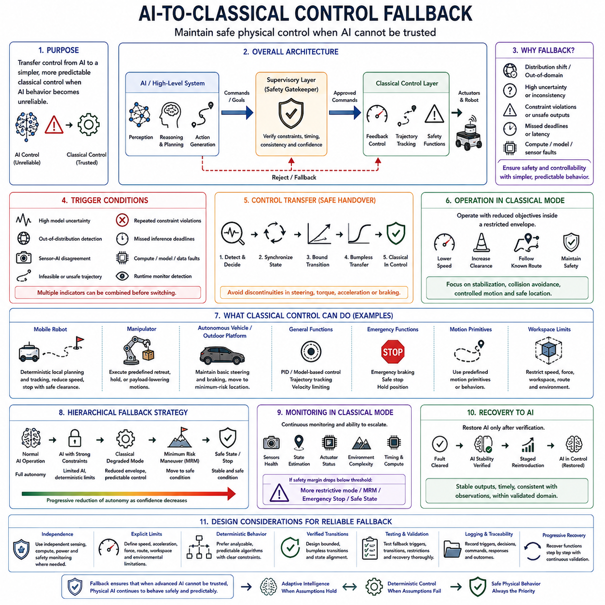{width="7.268055555555556in" height="7.268055555555556in"}

AI-to-classical control fallback provides a structured mechanism for transferring control from a learned or high-level autonomous system to a simpler, more predictable control architecture when AI behavior can no longer be trusted. In Physical AI, the objective is not to eliminate AI when uncertainty appears, but to preserve safe physical control by reducing dependence on functions whose behavior cannot be sufficiently verified at runtime.

Modern autonomous robots may use foundation models, Vision-Language-Action models, learned planners, neural perception, or world models to interpret complex environments and generate flexible behavior. These capabilities provide adaptability beyond traditional control systems, but their outputs may become unreliable under distribution shift, ambiguous observations, corrupted inputs, excessive inference latency, or situations outside the conditions represented during development and validation.

Classical control provides a complementary safety property because many of its behaviors can be expressed through explicit models, constraints, state machines, feedback laws, and deterministic algorithms. PID control, model-based control, trajectory tracking, geometric planning, velocity limiting, emergency braking, and predefined motion primitives can often be analyzed more directly than learned policies. They therefore provide useful fallback functions when advanced autonomy loses trustworthiness.

The fallback architecture should separate high-level intelligence from safety-critical motion authority. AI may propose goals, trajectories, actions, or task sequences, while a lower-level control layer verifies whether those commands remain within physical and operational constraints. If AI outputs violate limits, become inconsistent, arrive too late, or lose sufficient confidence, the supervisory architecture can reject them and transfer authority to an independently executable classical control path.

Fallback does not necessarily mean replacing every AI function simultaneously. A system may retain reliable perception while replacing learned planning, or preserve AI-based object recognition while switching motion generation to deterministic navigation. Conversely, classical localization and control may remain active while an unreliable semantic reasoning model is removed from the decision loop. Functional decomposition enables the system to isolate only the capability whose trust has been lost.

Trigger conditions must be defined explicitly because unnecessary switching can reduce availability while delayed switching can create hazards. Relevant indicators include excessive model uncertainty, out-of-distribution detection, disagreement between sensors and AI predictions, infeasible trajectories, repeated safety-constraint violations, missed inference deadlines, compute faults, corrupted model outputs, or failures detected by independent runtime monitors. Multiple indicators may be combined before control authority is changed.

The classical fallback controller must be capable of operating with information that remains trustworthy after the triggering failure. If the fallback depends on the same failed perception pipeline, corrupted state estimate, compute resource, or communication channel as the AI controller, nominal architectural redundancy may provide little actual protection. Independence in sensing, state estimation, computation, power, and safety monitoring should therefore be considered according to the hazards being controlled.

Control transfer itself must be treated as a safety-critical maneuver. AI and classical controllers may represent trajectories, velocities, actuator commands, or internal states differently, and abrupt switching can generate discontinuities in steering, torque, acceleration, or braking. State synchronization, command arbitration, bounded transitions, bumpless transfer, and actuator-rate limits help ensure that fallback activation does not introduce a new physical instability.

Once classical fallback assumes authority, the robot normally operates with a reduced objective set. Instead of maximizing mission performance, it may prioritize stabilization, collision avoidance, controlled deceleration, lane or path keeping, payload protection, or movement toward a designated safe location. Complex task reasoning can be suspended so that available computation and sensing focus on maintaining controllability and reducing physical risk.

Classical fallback should operate inside a deliberately restricted operational envelope. Speed, acceleration, steering angle, actuator force, workspace, route complexity, obstacle clearance, and allowable environmental conditions may be tightened because the fallback controller generally has less semantic and adaptive capability than the primary AI system. These restrictions transform reduced intelligence into predictable behavior rather than attempting to reproduce full AI performance.

For a mobile robot, fallback may switch from an AI planner to a deterministic local planner and trajectory tracker that follows a known route, reduces speed, and stops when obstacles violate conservative clearance limits. A manipulator may abandon AI-generated manipulation and execute predefined retreat, hold, or payload-lowering motions. An autonomous vehicle or outdoor platform may maintain basic steering and braking while moving toward a minimum-risk location.

AI-to-classical fallback can also be hierarchical. The first response may preserve limited AI capability under stronger deterministic constraints, followed by classical degraded operation if confidence continues to fall. Further deterioration can activate a Minimum Risk Maneuver, and inability to maintain the required control authority can lead to a safe state. This creates progressive reduction of autonomy rather than a single binary transition between intelligent operation and shutdown.

Runtime monitoring must continue after the transfer because classical control is not inherently immune to failure. Sensors can degrade, state estimates can diverge, actuators can lose authority, and deterministic software can still contain faults. The system must verify that the fallback controller is achieving expected physical responses and retain the ability to escalate toward a more restrictive degraded mode, Minimum Risk Condition, emergency stop, or other safe response.

Returning authority to AI requires more than detecting that the original fault indicator has disappeared. The affected AI function should demonstrate stable outputs, acceptable timing, consistency with independent observations, compliance with safety constraints, and operation within its validated domain. A staged recovery may initially allow AI recommendations without control authority before progressively restoring its ability to influence planning and physical action.

Logging and traceability are important because every fallback event provides evidence about the boundary between trusted and untrusted autonomy. The system should record triggering conditions, AI outputs, monitor decisions, control-transfer timing, fallback commands, physical responses, recovery attempts, and final outcomes. These records support safety validation, failure analysis, model improvement, and refinement of the operational conditions under which AI control is permitted.

AI-to-classical control fallback ultimately establishes a layered relationship between adaptive intelligence and deterministic safety. AI provides semantic understanding, prediction, reasoning, and flexible behavior when its operating assumptions remain valid, while classical control preserves essential physical controllability when those assumptions fail. By designing the transition, restrictions, independence, monitoring, and recovery together, Physical AI can fail toward simpler and more predictable behavior instead of losing control when advanced intelligence becomes unreliable.

## 06.07. Primary and Backup AI Models

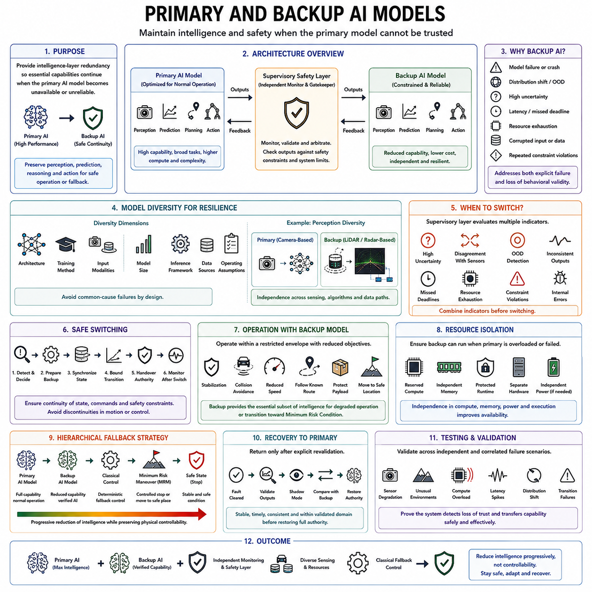{width="7.268055555555556in" height="7.268055555555556in"}

Primary and backup AI models provide redundancy at the intelligence layer of a Physical AI system, allowing selected autonomous capabilities to continue when the preferred model becomes unavailable, unreliable, or unsuitable for the current operating condition. The primary model normally delivers the highest performance, while the backup model provides a deliberately constrained alternative designed to preserve essential perception, prediction, reasoning, or action capabilities.

This architecture recognizes that AI failure is not limited to complete model shutdown. A primary model may continue executing while producing unreliable outputs because of distribution shift, unfamiliar environments, corrupted observations, excessive inference latency, memory pressure, numerical instability, or uncertainty beyond validated limits. Backup AI therefore addresses both explicit computational failure and loss of confidence in the behavioral validity of the primary model.

The primary AI model is generally optimized for normal operation and broad capability. It may use a large foundation model, Vision-Language-Action model, high-capacity perception network, learned planner, or sophisticated world model capable of handling diverse tasks and environments. Its computational cost and complexity are justified by improved understanding and adaptability, provided that runtime evidence indicates operation remains within acceptable assumptions and constraints.

A backup AI model should not simply be an identical copy of the primary model. Identical models can share the same architecture, training data, optimization artifacts, software defects, and failure modes, creating common-cause or correlated failures. Greater resilience can be achieved through diversity in model architecture, training methodology, input modalities, model size, inference framework, data sources, or the assumptions under which the backup function operates.

The backup model is often smaller and intentionally less capable than the primary model. Reduced complexity can provide lower inference latency, smaller memory requirements, improved computational predictability, and operation on independent or resource-constrained hardware. Rather than reproducing every function of the primary model, the backup should preserve the subset of intelligence required for degraded operation, controlled fallback, or transition toward a Minimum Risk Condition.

Model diversity must be designed according to the failure being mitigated. If both primary and backup perception models depend entirely on the same camera stream, sensor corruption may defeat both regardless of architectural differences. A more resilient arrangement may combine camera-based primary perception with LiDAR, radar, geometric processing, or another independent sensing path for backup. Independence should therefore extend beyond neural network architecture to the complete information chain.

Runtime monitoring determines when authority should move between models. Relevant indicators may include uncertainty, confidence calibration, disagreement with independent sensors, temporal inconsistency, physically implausible predictions, out-of-distribution observations, missed inference deadlines, resource exhaustion, repeated constraint violations, or internal model errors. A supervisory mechanism evaluates these signals rather than allowing either model to determine its own trustworthiness without independent checks.

Primary and backup models can also operate simultaneously to provide cross-validation. Their outputs may be compared for object detection, state estimation, trajectory prediction, semantic interpretation, or action selection. Persistent disagreement can indicate that at least one model is operating outside its reliable region. However, agreement alone does not prove correctness because models trained on similar data or assumptions may produce the same incorrect conclusion.

Switching to the backup model must preserve state continuity. Stateful AI components may maintain temporal context, latent memory, tracked objects, maps, task history, or internal world representations that cannot be transferred trivially. The architecture should define which state is shared, reconstructed, independently maintained, or discarded during transition. Poor state synchronization can cause the backup model to begin operation with incomplete or inconsistent situational understanding.

Control authority should normally pass through a supervisory safety layer rather than directly from one model to another. The supervisor can validate model outputs against deterministic safety constraints, robot dynamics, workspace limits, collision margins, and operational rules. Even when the backup model is active, its commands should remain subject to independent enforcement because backup status does not automatically imply that its outputs are safe.

Backup AI can support several levels of degradation. A smaller perception model may maintain basic obstacle detection while advanced semantic understanding is disabled, or a simplified world model may predict only short-horizon motion. A lightweight planner may support known routes but reject complex exploration. This capability-based approach allows the system to preserve useful autonomy without requiring the backup model to reproduce the complete intelligence of normal operation.

Resource isolation is important because a primary model failure caused by compute overload, memory exhaustion, thermal limits, or accelerator faults may also prevent the backup from running on the same hardware. Critical backup functions may therefore require reserved CPU or accelerator capacity, separate memory allocation, protected execution environments, or independent compute hardware. The required degree of separation should be determined by hazard and availability analysis.

The architecture may contain more than one fallback layer. Normal operation can begin with the primary AI model, transition to a backup AI model when confidence or availability decreases, then move to deterministic classical control if AI trust continues to deteriorate. Further loss of capability may trigger a Minimum Risk Maneuver and ultimately a safe state. Such a hierarchy provides progressive reduction of intelligence while preserving physical controllability.

Recovery to the primary model should require explicit revalidation rather than automatic restoration after a restart. The primary model should demonstrate stable inference timing, plausible outputs, agreement with independent observations, acceptable uncertainty, and operation within its validated domain. A staged transition can initially run the recovered model in shadow mode, compare its outputs with the active backup, and restore authority only after sufficient evidence of trustworthy behavior.

Testing primary and backup AI requires failure scenarios that examine both independent and correlated faults. Validation should include sensor degradation, unusual environments, model corruption, compute overload, latency spikes, distribution shift, communication loss, inconsistent predictions, and transition failures. The objective is not merely to prove that the backup model executes, but to demonstrate that the complete architecture detects loss of trust and transfers capability safely.

Primary and backup AI models ultimately create an intermediate resilience layer between full AI autonomy and deterministic fallback control. The primary model provides maximum intelligence when conditions support trustworthy operation, while the backup preserves a smaller verified capability when that trust declines. Combined with independent monitoring, diverse sensing, protected resources, classical fallback, and safe-state mechanisms, this architecture allows Physical AI to reduce intelligence progressively without immediately losing safe physical control.

## 06.08. Sensor Failure and Perception Fallback

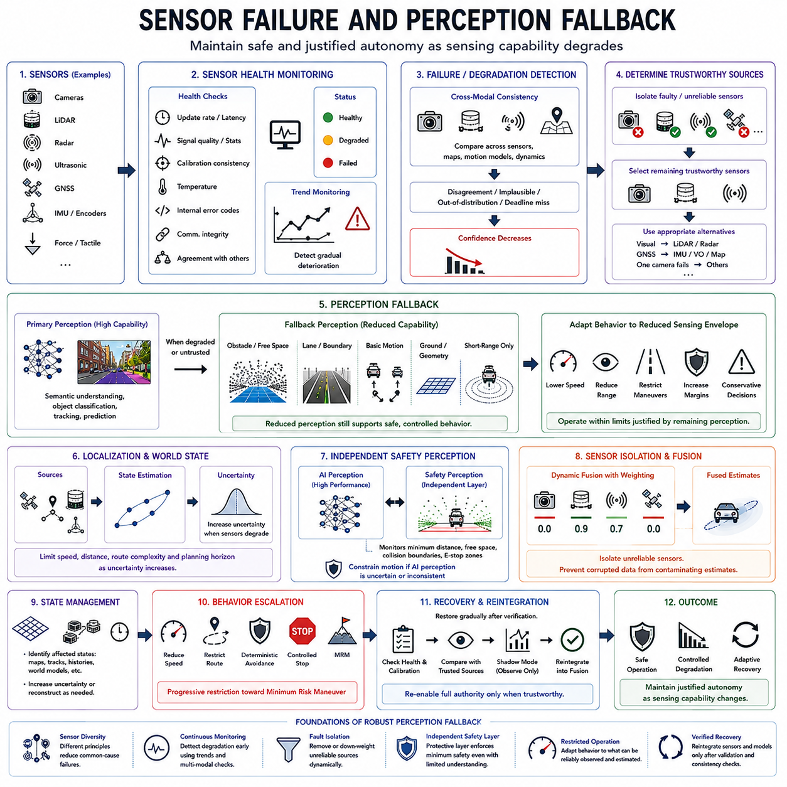{width="7.268055555555556in" height="7.268055555555556in"}

Sensor failure is a critical concern in Physical AI because autonomous behavior depends on continuous and trustworthy observation of the physical environment. Cameras, LiDAR, radar, ultrasonic sensors, GNSS, IMUs, encoders, force sensors, and tactile devices can fail completely or degrade gradually. Perception fallback ensures that loss of one sensing capability does not immediately produce uncontrolled or unjustified autonomous behavior.

Sensor faults include more than complete signal loss. A device may continue transmitting data while suffering from drift, calibration errors, contamination, saturation, occlusion, synchronization problems, packet corruption, reduced field of view, or environmental interference. Such failures are especially dangerous because downstream AI models may process apparently valid measurements without recognizing that the physical information represented by those measurements has become unreliable.

Runtime sensor-health monitoring should therefore evaluate both device availability and measurement quality. Diagnostics may examine timestamps, update rates, signal statistics, calibration consistency, temperature, internal error codes, communication integrity, and agreement with other sensors. Temporal monitoring is also important because gradual deterioration can be detected through trends before the sensor crosses a hard failure threshold or begins significantly affecting autonomous behavior.

Cross-modal consistency provides another important mechanism for detecting perception degradation. Camera detections can be compared with LiDAR geometry, radar motion estimates, map constraints, inertial measurements, or expected object dynamics. Persistent disagreement does not automatically identify which sensor is faulty, but it provides evidence that the perception system should reduce confidence, isolate suspicious information sources, and restrict autonomy until reliability is restored.

Perception fallback begins by determining which sensing capabilities remain trustworthy after a fault. If one camera fails in a multi-camera configuration, neighboring cameras may preserve partial visual coverage. If visual perception becomes unreliable because of darkness or glare, LiDAR or radar may continue supporting obstacle detection. If GNSS becomes unavailable, inertial sensing, wheel odometry, visual odometry, or map-based localization may temporarily preserve state estimation.

Effective fallback requires sensor diversity rather than simple duplication. Two identical cameras mounted together may experience the same glare, contamination, vibration, or environmental obstruction. Similarly, redundant GNSS receivers may share the same satellite visibility problem. Combining sensing principles with different physical failure characteristics can reduce common-cause failures and provide more meaningful redundancy for safety-critical perception.

The fallback perception function does not necessarily need to reproduce the full capability of the primary perception system. A backup path may detect only obstacles, free space, lane boundaries, ground geometry, or basic motion while advanced semantic recognition is disabled. This reduced perception can still support controlled deceleration, restricted navigation, collision avoidance, or movement toward a Minimum Risk Condition when complex autonomous behavior can no longer be justified.

Behavior must be adapted to the reduced sensing envelope. If long-range perception is lost, maximum speed should decrease so that stopping distance remains within reliable observation range. If side or rear coverage becomes unavailable, turning and reversing may be prohibited. Reduced depth accuracy may require larger obstacle margins, while uncertain object classification may cause the system to treat ambiguous objects conservatively rather than relying on semantic interpretation.

Sensor failure can also affect localization and world-model consistency even when obstacle perception remains available. Loss of GNSS, visual landmarks, LiDAR features, or inertial accuracy may increase uncertainty in robot pose and predicted environmental state. The system should track this uncertainty explicitly and limit travel distance, route complexity, planning horizon, or allowable speed as state-estimation confidence deteriorates.

AI perception models introduce another layer of failure because the sensors themselves may remain healthy while learned interpretation becomes unreliable. Distribution shift, unusual weather, unfamiliar objects, image artifacts, adversarial environmental patterns, or conditions outside the validated domain can degrade perception without producing hardware alarms. Monitoring should therefore distinguish sensor health from perception-model validity and provide fallback paths for both categories of failure.

Independent safety perception can provide a protective layer beneath high-performance AI perception. A sophisticated neural perception stack may perform semantic scene understanding, while a simpler geometric or deterministic function monitors minimum obstacle distance, free space, collision boundaries, or emergency stopping zones. If AI perception becomes uncertain or inconsistent, the independent safety path can constrain motion even when it cannot provide complete environmental understanding.

Sensor isolation should prevent corrupted measurements from contaminating fused estimates. Once a sensor is identified as unreliable, its contribution to localization, tracking, mapping, world modeling, or planning may need to be reduced or removed. Fusion algorithms should support dynamic weighting and exclusion so that a faulty measurement source does not continue influencing the system merely because it remains electrically connected and produces syntactically valid data.

Transitioning to fallback perception requires careful management of internal state. Object tracks, occupancy maps, localization estimates, temporal histories, and world-model representations may have been constructed using the failed sensor. The system must determine which state remains valid, which uncertainty should be increased, and which information must be reconstructed. Continuing to trust stale derived information can defeat the purpose of isolating the original sensor fault.

If remaining sensors cannot support sufficient perception, the system should progressively restrict physical behavior rather than attempting to maintain normal autonomy. The sequence may move from reduced-speed operation to route restrictions, limited maneuvering, deterministic collision avoidance, controlled stopping, or a Minimum Risk Maneuver. The appropriate escalation depends on the environment, robot dynamics, remaining sensing coverage, and consequences of continued movement.

Recovery requires more than detecting that a failed sensor has started producing data again. Calibration, timing, signal quality, cross-sensor consistency, environmental visibility, and downstream perception outputs should be verified before the sensor regains full authority. A recovered sensor may initially operate in observation or shadow mode while its measurements are compared with trusted sources before being reintegrated into fused perception and autonomous decision making.

Sensor failure and perception fallback ultimately transform sensing redundancy into behavioral resilience. The objective is not simply to keep perception software running, but to maintain a justified relationship between what the robot can reliably observe and what it is permitted to do. By combining health monitoring, sensor diversity, fault isolation, independent safety perception, restricted operation, and verified recovery, Physical AI can degrade safely as environmental awareness is progressively reduced.

## 06.09. Localization and Navigation Fallback

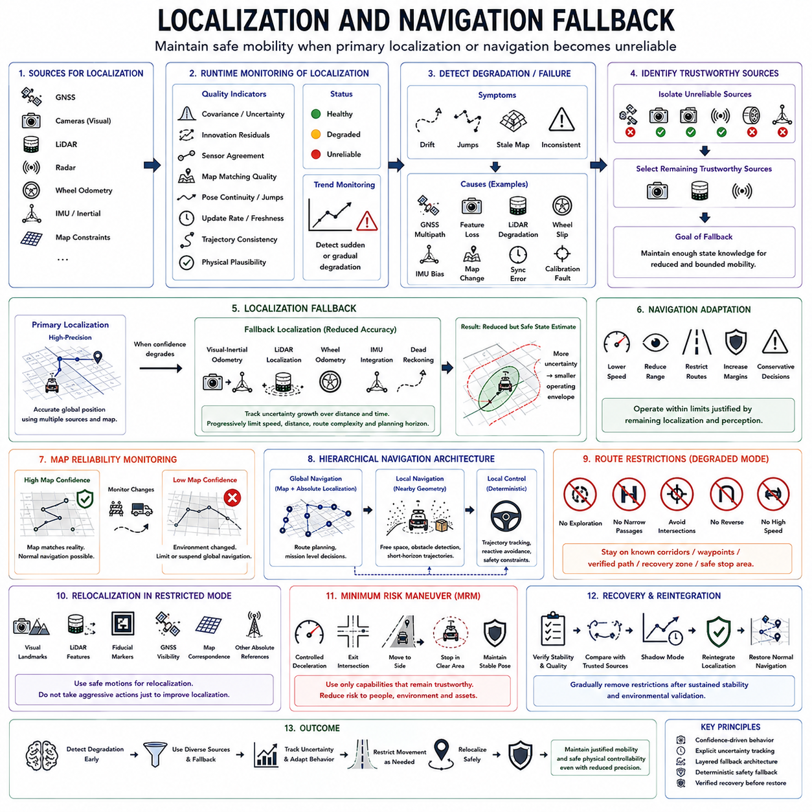{width="7.268055555555556in" height="7.268055555555556in"}

Localization and navigation fallback defines how a Physical AI system preserves safe mobility when its primary ability to estimate position, orientation, motion, or navigable space becomes unreliable. Because autonomous movement depends on knowing both where the robot is and how it can move through the environment, localization degradation can rapidly invalidate planning assumptions. Fallback therefore links state-estimation confidence directly to permitted navigation behavior.

Localization failure is not limited to complete loss of position. A system may continue producing poses while accumulating drift, jumping between hypotheses, using stale map information, or becoming inconsistent with physical observations. GNSS multipath, visual feature loss, LiDAR degradation, wheel slip, IMU bias, map changes, synchronization errors, and calibration faults can all reduce localization integrity without immediately causing an explicit failure signal.

Runtime monitoring should evaluate localization quality as well as availability. Relevant evidence includes covariance, innovation residuals, map-matching quality, sensor agreement, pose continuity, update rate, timestamp freshness, trajectory consistency, and physically plausible motion. Sudden jumps or gradually increasing uncertainty should trigger investigation before the navigation system continues to build plans around a state estimate that no longer represents the robot reliably.

Localization fallback begins by identifying which independent sources remain trustworthy. Loss of GNSS may permit continued operation using visual-inertial odometry, LiDAR localization, wheel odometry, IMU integration, or map constraints. Failure of visual localization may be compensated by LiDAR or radar-based methods. The objective is not necessarily to preserve the original accuracy, but to maintain enough state knowledge for a reduced and explicitly bounded form of mobility.

Fallback localization should account for uncertainty accumulation. Dead reckoning can maintain short-term motion estimates after an absolute reference disappears, but error normally grows with distance and time. Rather than treating the fallback estimate as indefinitely valid, the system should track uncertainty and progressively restrict speed, travel distance, route complexity, turning behavior, and planning horizon as confidence decreases.

Navigation behavior must be adapted to the quality of localization that remains. High-precision autonomous navigation may require centimeter-level positioning, while degraded operation may only support corridor following, lane keeping, landmark-to-landmark movement, or travel along a previously verified route. When precise global position is unavailable, the robot may temporarily rely on local obstacle avoidance and relative motion instead of attempting complex global replanning.

Map reliability is another important part of navigation fallback. A robot may be accurately localized against a map that no longer represents the physical environment because objects, walls, traffic patterns, construction zones, or traversable areas have changed. Runtime systems should therefore distinguish localization confidence from map confidence. Strong pose estimates do not justify navigation when the underlying environmental representation has become invalid.

A robust architecture can maintain multiple navigation representations at different levels of dependency. Global route planning may rely on maps and absolute localization, while local navigation can use nearby geometry, free-space estimates, obstacle detection, and short-horizon trajectories. If global localization fails but local perception remains trustworthy, the robot may suspend mission-level navigation while preserving enough local control to stop safely or move toward a nearby low-risk location.

Navigation fallback should also separate AI-dependent planning from deterministic mobility functions. A learned planner or world model may normally select sophisticated routes and predict interactions, while a classical local planner, trajectory tracker, or reactive obstacle-avoidance layer preserves basic controllability. When AI planning becomes unreliable, the system can reduce semantic reasoning and continue only with movements that satisfy explicit geometric, dynamic, and safety constraints.

Route restrictions provide a practical mechanism for degraded navigation. The robot may prohibit exploration, narrow passages, intersections, reversing, high-speed segments, unstructured terrain, or areas requiring precise localization. Instead, it can remain on known corridors, follow predefined waypoints, return along a recently verified path, move toward a localization recovery zone, or approach a designated stopping area where uncertainty creates less physical risk.

Relocalization can be attempted while the robot remains in a restricted operating mode. The system may search for known visual landmarks, LiDAR features, fiducial markers, GNSS visibility, map correspondences, or other absolute references. Motion used for relocalization must itself remain safe; aggressive exploratory movement should not be justified merely to improve localization when the robot already has insufficient confidence about its physical state.

Navigation fallback must consider dynamic obstacles and changing environments independently of localization. Even if approximate position remains available, reduced perception or prediction capability may make continued movement unsafe around people, vehicles, or machinery. Localization confidence, perception coverage, obstacle dynamics, stopping capability, and route geometry should therefore be evaluated together when deciding whether restricted navigation remains acceptable.

If uncertainty exceeds the limits required for controlled mobility, the system should transition toward a Minimum Risk Maneuver rather than continuing navigation indefinitely. Depending on context, this may involve controlled deceleration, moving out of an intersection, reaching the side of a route, stopping in a clear area, or maintaining a stable pose. The selected maneuver should require only capabilities that remain demonstrably trustworthy after the localization failure.

Recovery requires more than obtaining a new position estimate. The recovered localization system should demonstrate temporal stability, consistency across sensors, acceptable uncertainty, agreement with map features, and plausible continuity with the robot\'s physical motion. Navigation plans created using uncertain or stale state information may also need to be discarded and regenerated before normal autonomous movement is restored.

A staged recovery can reduce the risk of immediately returning to unrestricted navigation. The recovered estimator may first operate in parallel with the active fallback source, allowing the system to compare trajectories and confidence over time. Once localization has remained stable and environmental assumptions have been revalidated, route restrictions can be progressively removed and planning authority can return to the primary navigation architecture.

Localization and navigation fallback ultimately preserve the relationship between positional knowledge and authorized motion. As confidence in the robot\'s state decreases, the complexity and freedom of movement should decrease with it. By combining diverse localization sources, explicit uncertainty tracking, local navigation, deterministic fallback, route restrictions, relocalization, Minimum Risk Maneuvers, and verified recovery, Physical AI can lose navigational precision without immediately losing safe physical controllability.

## 06.10. Communication and Cloud Loss Fallback

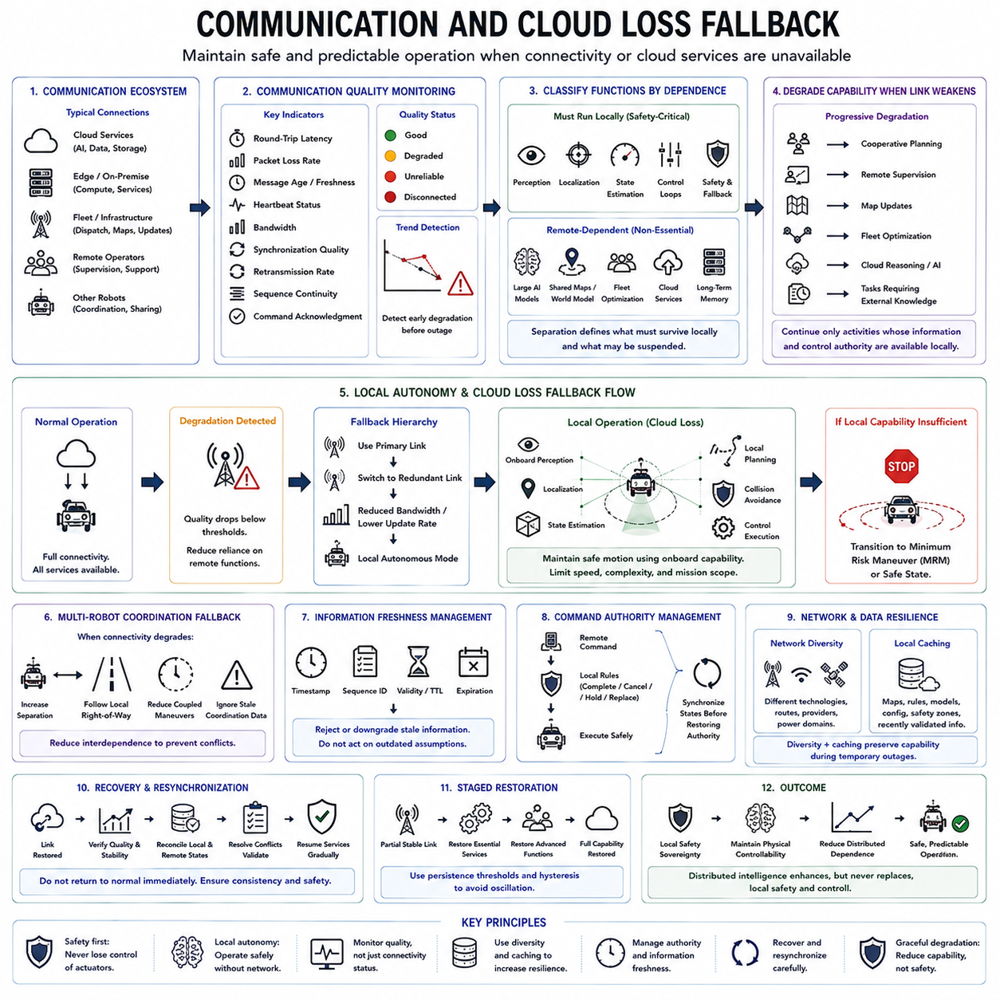{width="7.268055555555556in" height="7.268055555555556in"}

Communication and cloud loss fallback defines how a Physical AI system maintains safe and predictable operation when connectivity to remote services, fleet infrastructure, edge servers, on-premise computing, or cloud intelligence becomes unavailable or unreliable. Because physical safety cannot depend on continuous network availability, essential sensing, stabilization, collision avoidance, control, and fallback functions should remain executable locally whenever their loss could create unacceptable physical risk.

Communication failure is broader than complete disconnection. Networks may experience increased latency, jitter, packet loss, reduced bandwidth, intermittent connectivity, duplicated messages, out-of-order delivery, or stale information while technically remaining connected. These degraded conditions can be more difficult to manage than an obvious outage because remote commands, shared maps, predictions, or coordination data may arrive late enough to become inconsistent with the current physical environment.

Runtime monitoring should therefore evaluate communication quality rather than relying only on a connected or disconnected state. Relevant indicators include round-trip latency, packet-loss rate, message age, heartbeat status, bandwidth, synchronization quality, retransmission frequency, sequence continuity, and command acknowledgment. The system should detect trends toward degradation early enough to reduce dependence on remote functions before communication becomes unusable.

A distributed Physical AI architecture should explicitly classify functions according to their dependence on communication. Safety-critical control loops generally require local execution, while remote systems may provide mission planning, fleet optimization, shared world models, semantic reasoning, large-model inference, long-term memory, software services, or global coordination. This separation establishes which capabilities must survive locally and which capabilities may be temporarily suspended during connectivity loss.

Local autonomy forms the primary defense against communication failure. The robot should preserve enough onboard perception, localization, state estimation, planning, and control to remain physically safe without immediate remote assistance. The required level of local autonomy depends on the platform and environment, but communication loss should never leave actuators uncontrolled or force the robot to wait indefinitely for a remote decision while continuing hazardous motion.

Cloud-dependent AI functions require particularly careful fallback design. A robot may normally use remote foundation models, large Vision-Language-Action models, computationally intensive world models, or cloud-based reasoning services that cannot be replicated fully onboard. When connectivity is lost, the architecture can switch to smaller local models, cached policies, deterministic planners, predefined behaviors, or classical control while reducing the complexity of tasks that the robot is permitted to perform.

Loss of communication should therefore trigger capability degradation rather than automatically reproducing normal operation with incomplete information. Cooperative planning, remote supervision, shared-map updates, fleet-wide optimization, cloud reasoning, and tasks requiring current external knowledge may be suspended. The robot can continue only those activities whose required information and control authority remain locally available and sufficiently trustworthy.

Fleet and multi-robot systems introduce additional challenges because communication supports coordination among physically independent agents. When connectivity deteriorates, robots may lose shared intentions, reservations, trajectories, task assignments, or information about other agents. Fallback behavior should reduce interdependence by avoiding tightly coupled maneuvers, increasing separation, preserving local right-of-way rules, and preventing conflicting actions based on stale coordination data.

Information freshness is critical during partial network failure. A message can be syntactically valid and authenticated yet no longer describe the current world. Remote trajectories, obstacle states, map updates, task commands, or shared predictions should therefore include timestamps, sequence information, validity intervals, or expiration conditions. Once information becomes stale, the system should reject or downgrade it instead of continuing to act on outdated assumptions.

Command authority must also be protected during disconnection and reconnection. If a remote command is interrupted halfway through execution, the robot needs explicit rules defining whether to complete, cancel, hold, or replace the action. After connectivity returns, delayed commands should not suddenly regain authority without validation. Local and remote control states must be synchronized before higher-level command authority is restored.

Communication fallback can be hierarchical. The system may first switch from a primary network to a redundant communication channel, then continue with reduced bandwidth and lower update rates, followed by local autonomous operation if remote services remain unavailable. If local capability is insufficient for the environment or mission, the robot can progressively restrict motion and transition toward a Minimum Risk Maneuver or safe state.

Network redundancy is useful only when redundant channels do not share the same dominant failure mechanism. Multiple wireless links connected through the same access point, power source, gateway, or network provider may fail together. More resilient designs consider diversity across communication technologies, routing paths, infrastructure, power domains, and local processing so that loss of one dependency does not simultaneously remove every fallback path.

Local caching can preserve selected capabilities during temporary outages. Maps, mission constraints, safety zones, robot configuration, authorized task rules, compact models, and recently validated environmental information may be retained onboard. Cached information should have explicit validity conditions because old data can become hazardous when environments change. The system must know not only what information is available locally, but also how long it remains trustworthy.

Recovery from communication loss should be treated as a synchronization process rather than an immediate return to normal operation. The system may need to reconcile local state changes, completed actions, map modifications, task progress, robot positions, shared reservations, and remote commands generated during the outage. Conflicting information should be resolved before cloud or fleet systems resume authoritative control over physical behavior.

Reconnection should also include verification of communication quality. A briefly restored link may remain unstable, and rapid switching between connected and disconnected modes can produce oscillating control decisions. Persistence thresholds, hysteresis, minimum stability intervals, and staged restoration can ensure that remote functions regain authority only after the network has demonstrated sufficiently reliable performance.

Communication and cloud loss fallback ultimately establishes local safety sovereignty for Physical AI. Remote infrastructure can significantly enhance intelligence, coordination, memory, and computational capability, but it should not become a single point of failure for physical control. By combining local autonomy, communication monitoring, network diversity, cached information, degraded operation, explicit authority management, and controlled resynchronization, the system can safely reduce distributed intelligence while preserving essential physical controllability.

## 06.11. Compute Overload and Thermal Fallback

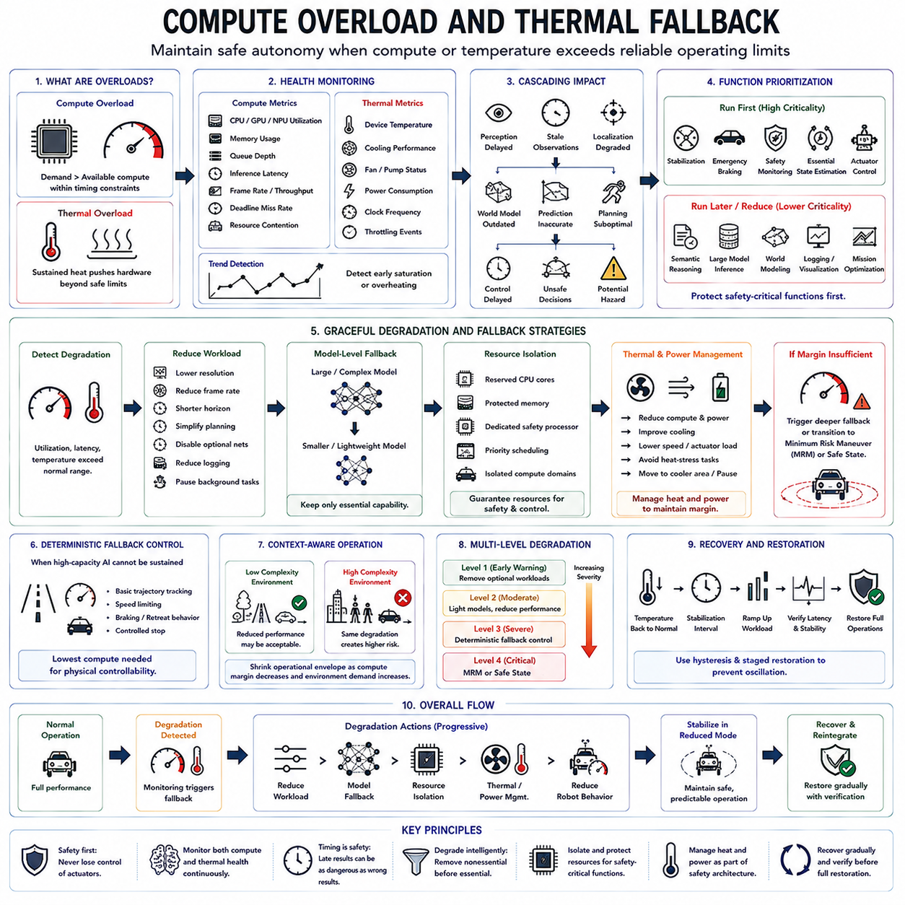{width="7.268055555555556in" height="7.268055555555556in"}

Compute overload occurs when a Physical AI system demands more processing capacity than its CPU, GPU, accelerator, memory, or communication architecture can reliably provide within required timing constraints. Thermal overload occurs when sustained computation or environmental heat pushes hardware beyond acceptable operating limits. Both conditions can degrade autonomy gradually before producing an obvious hardware failure, making controlled fallback essential.

In Physical AI, computational correctness includes timing as well as numerical accuracy. A perception model that produces an accurate result after its deadline may already be unsafe because the physical environment has changed. Delayed localization, world-model updates, trajectory prediction, planning, or control commands can create stale decisions. Runtime supervision must therefore treat excessive latency and missed deadlines as functional degradation rather than only performance problems.

Compute-health monitoring should observe processor utilization, accelerator load, memory consumption, queue depth, inference latency, scheduling delay, frame-processing rate, deadline misses, and resource contention. Thermal monitoring should additionally track device temperature, cooling performance, fan status, power consumption, clock frequency, and throttling events. Trends are important because gradual saturation can provide enough warning to activate fallback before critical services become unstable.

Resource saturation can propagate through the autonomy stack. A delayed perception pipeline can produce stale environmental observations, which then affect localization, world modeling, prediction, planning, and finally control. Memory pressure may cause unpredictable allocation delays or model eviction, while excessive accelerator contention can prevent safety-related inference from executing on time. Fallback design should therefore consider end-to-end computational dependency rather than monitoring individual processors in isolation.

Thermal degradation introduces a similar cascading effect. As temperature rises, hardware may reduce clock frequency or power limits to protect itself, decreasing available compute precisely when complex environmental conditions may require greater processing. If the autonomy architecture assumes fixed inference rates, thermal throttling can silently invalidate timing assumptions. Temperature should therefore be treated as an operational state variable that directly influences permitted AI workload and robot behavior.

A robust system should classify computational functions by criticality. Stabilization, emergency braking, safety monitoring, actuator control, essential state estimation, and minimum obstacle detection generally require stronger resource guarantees than semantic reasoning, large-model inference, detailed world modeling, logging, visualization, or mission optimization. Explicit prioritization allows nonessential workloads to be sacrificed before computational pressure affects functions required for physical safety.

Graceful compute degradation can begin by reducing workload rather than immediately terminating autonomy. The system may lower camera resolution, reduce perception frame rate, shorten prediction horizons, decrease world-model update frequency, simplify planning, disable optional neural networks, reduce logging, or suspend background optimization. These measures release resources while retaining a smaller set of functions necessary for controlled operation.

Model-level fallback provides another response to computational overload. A large foundation model, VLA model, perception network, or learned planner may be replaced by a smaller backup model with lower memory and inference requirements. The backup does not need to reproduce full intelligence. It may support only essential object detection, local navigation, short-horizon prediction, or restricted task execution while the robot operates inside a reduced operational envelope.

Compute isolation is particularly important for safety-critical functions. If mission AI, perception, planning, and safety supervision compete for the same accelerator without guaranteed scheduling, overload in one component can starve another. Reserved CPU cores, protected memory, independent safety processors, dedicated execution queues, priority scheduling, or separate compute domains can preserve essential control even when the primary AI compute environment becomes saturated.

Thermal fallback should combine computational and physical responses. Software can reduce model complexity, inference frequency, accelerator utilization, and nonessential workloads, while the robot may also lower speed, reduce actuator demand, avoid thermally stressful tasks, move toward a cooler environment, or pause operation. Cooling fans, pumps, airflow paths, heat sinks, and thermal interfaces become part of the safety-relevant architecture when continued computation depends on effective heat removal.

Power and thermal management are closely coupled. High accelerator utilization increases electrical consumption and heat generation, while reduced cooling efficiency can force additional throttling. The fallback controller should therefore consider available electrical power, battery condition, processor temperature, cooling capability, and required mission duration together. Preserving maximum AI performance until thermal shutdown is generally less desirable than reducing workload early and maintaining predictable control.

The system should define multiple degradation thresholds instead of relying on a single critical-temperature or utilization limit. An early warning level can remove optional workloads, a higher level can activate lightweight models and reduce robot performance, and a severe level can transfer control to deterministic fallback functions. If sufficient computational or thermal margin cannot be maintained, the system should execute a Minimum Risk Maneuver or transition to a safe state.

Deterministic classical control can provide the final computational fallback when high-capacity AI processing is no longer sustainable. Basic trajectory tracking, speed limiting, braking, predefined retreat behavior, or controlled stopping can often execute with significantly lower computational demand than complex learned autonomy. This enables the system to surrender semantic capability and mission performance while preserving the minimum computation necessary for physical controllability.

Fallback decisions should account for environmental complexity because identical compute degradation can create different risks in different situations. Reduced perception frequency may remain acceptable in a static, low-speed area but become unacceptable near people, vehicles, intersections, or rapidly changing obstacles. The permissible operational envelope should therefore shrink as both computational margin decreases and environmental demand increases.

Recovery from overload or thermal degradation should be gradual. A processor returning below a temperature threshold does not guarantee that full workloads can immediately resume without causing another overload cycle. Hysteresis, stabilization intervals, workload ramping, resource verification, and staged model reactivation can prevent oscillation between normal and degraded modes. Restored functions should demonstrate acceptable latency before receiving full operational authority.

Compute overload and thermal fallback ultimately protect the timing foundation on which Physical AI depends. Intelligence is useful only when perception, prediction, planning, and control execute within the time available for safe physical action. By combining health monitoring, workload prioritization, lightweight models, resource isolation, thermal management, deterministic fallback, progressive degradation, and verified recovery, the system can reduce computational intelligence before resource exhaustion becomes loss of physical control.

## 06.12. Power and Battery Emergency Strategies

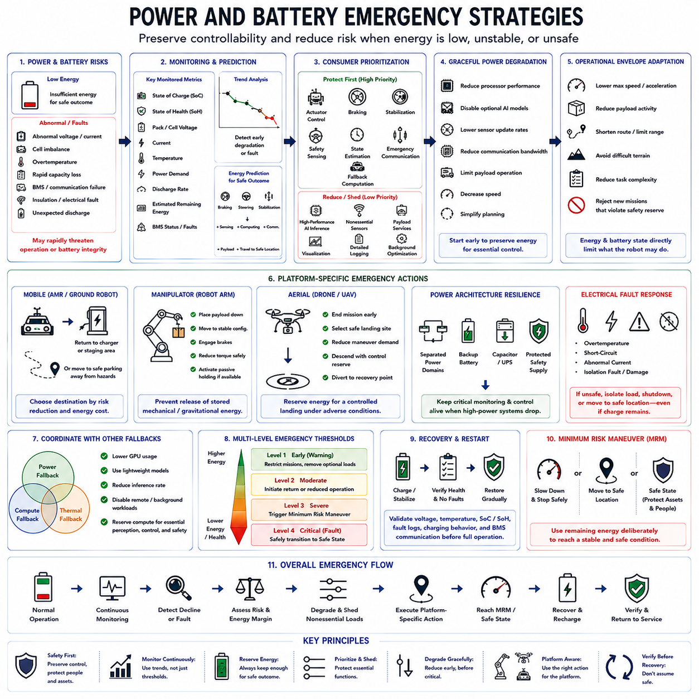{width="7.268055555555556in" height="7.268055555555556in"}

Power and battery emergency strategies define how a Physical AI system preserves controllability and reduces physical risk when electrical energy becomes insufficient, unstable, or unsafe. Power faults may affect sensing, computation, communication, actuation, braking, or payload systems simultaneously, so energy management must be treated as part of the safety architecture rather than only as a mission-duration or efficiency problem.

Battery emergencies include more than a low state of charge. Abnormal voltage, excessive current, cell imbalance, overheating, rapid capacity loss, internal resistance growth, communication failure with the Battery Management System, insulation faults, and unexpected discharge rates can indicate conditions requiring immediate response. The system must distinguish predictable energy depletion from faults that may rapidly threaten continued operation or battery integrity.

Runtime monitoring should continuously evaluate state of charge, state of health, pack and cell voltage, current, temperature, power demand, discharge rate, estimated remaining energy, and Battery Management System status. Trends are as important as absolute thresholds because an unexpectedly rapid voltage drop or temperature rise may indicate an emerging fault even when individual measurements remain inside nominal limits.

Energy prediction should consider the power required to reach a safe outcome rather than simply estimate remaining operating time. A robot may need sufficient reserve energy for braking, steering, stabilization, communication, sensing, computation, payload retention, or travel to a charging or minimum-risk location. The usable safety reserve must therefore reflect platform dynamics, environmental conditions, mission state, and the energy required for controlled fallback.

Power consumers should be classified according to safety criticality. Essential functions such as actuator control, braking, stabilization, safety sensing, state estimation, emergency communication, and fallback computation should receive priority over high-performance AI inference, nonessential sensors, payload services, visualization, detailed logging, or background optimization. Load shedding can then preserve the functions required to maintain physical controllability.

Graceful power degradation should begin before energy reaches a critical threshold. The system may reduce processor performance, disable optional AI models, lower sensor update rates, reduce communication bandwidth, limit payload operation, decrease speed, or simplify planning. By reducing consumption early, the robot preserves energy for essential control and avoids reaching a condition where power disappears before a safe transition can be completed.

Battery state should directly influence the permitted operational envelope. As available energy or battery confidence decreases, maximum speed, acceleration, payload activity, route length, terrain difficulty, and task complexity may need to decrease. New missions should be rejected when their estimated energy requirement would violate the safety reserve, even if the battery contains enough energy to begin the task under nominal assumptions.

Mobility platforms should maintain enough reserve to reach an appropriate fallback location when possible. An AMR may return to a charger, staging area, or safe parking zone, while an outdoor robot may move away from traffic or hazardous machinery before stopping. The selected destination should be based on achievable risk reduction and energy cost rather than automatically choosing the nearest charging station regardless of environmental conditions.

Manipulators require different power-loss strategies because electrical failure can release stored gravitational or mechanical energy. A robot arm holding a payload may need to place the object down, move to a mechanically stable configuration, engage brakes, reduce torque safely, or activate passive holding mechanisms before power becomes insufficient. Immediate power removal can be more hazardous than temporarily preserving controlled actuation.

Aerial robots make energy reserve management particularly critical because loss of propulsion directly affects the ability to remain airborne. Low-energy fallback may require terminating the mission early, selecting an emergency landing location, reducing maneuver demand, descending while sufficient control authority remains, or diverting to an alternative recovery point. Energy must be reserved not merely for flight time but for a controlled landing under credible adverse conditions.

Power architecture can provide additional resilience through separated power domains, protected safety supplies, backup batteries, capacitors, uninterruptible power modules, or mechanically fail-safe components. Critical monitoring and control should not necessarily lose power at the same instant as high-demand AI compute or payload systems. Limited independent energy can provide the seconds or minutes required to establish a controlled safe condition.

Electrical faults may require a response different from ordinary low-energy operation. Overtemperature, short-circuit indications, abnormal current, damaged cells, or isolation faults may make continued battery use unsafe even when substantial charge remains. In such cases, the objective changes from maximizing remaining operating time to reducing electrical and physical hazard, potentially requiring rapid load isolation, controlled shutdown, or movement to an appropriate safe location.

Power fallback should coordinate with compute and thermal fallback because these resources are strongly coupled. High GPU utilization increases electrical demand and heat generation, while cooling systems themselves consume power. Under an energy emergency, the system may replace large AI models with lightweight alternatives, reduce inference frequency, disable remote or background workloads, and reserve computation for essential perception, control, and safety supervision.

Multiple emergency thresholds provide more predictable behavior than a single low-battery alarm. An early stage can restrict mission acceptance and remove optional loads, a moderate stage can initiate return or reduced operation, and a severe stage can trigger a Minimum Risk Maneuver. A critical battery or electrical fault may require immediate transition toward a safe state while sufficient power remains to complete the necessary physical actions.

Recovery and restart should require verification that the energy system has returned to a trustworthy condition. Charging alone does not resolve overheating, cell imbalance, abnormal degradation, damaged wiring, or Battery Management System faults. Voltage stability, temperature, state estimates, fault records, charging behavior, and communication with power-management components should be validated before unrestricted autonomous operation resumes.

Power and battery emergency strategies ultimately ensure that energy depletion becomes a managed reduction of capability rather than an uncontrolled loss of control. By combining continuous monitoring, safety reserves, load prioritization, progressive degradation, platform-specific emergency actions, protected power domains, Minimum Risk Maneuvers, and verified recovery, Physical AI can use its remaining energy deliberately to preserve safety until a stable condition is reached.

## 06.13. Human Takeover and Remote Assistance

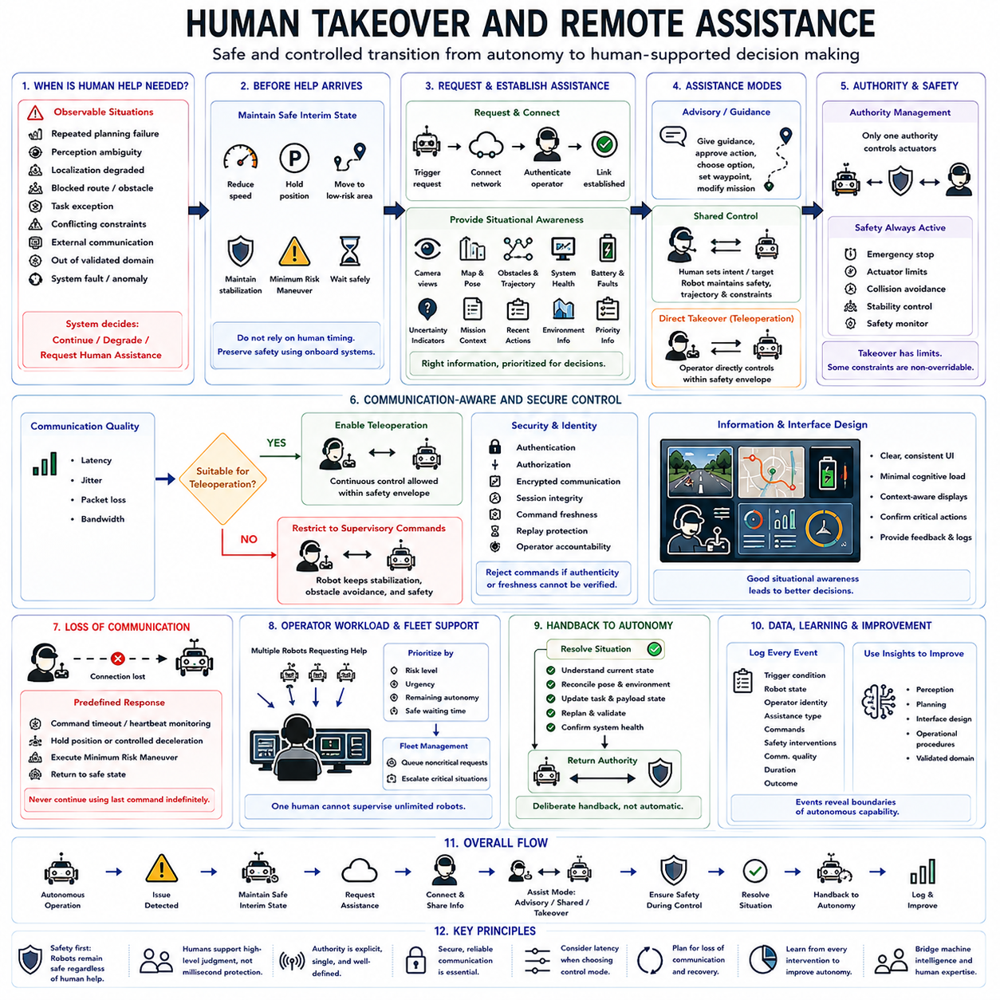{width="7.268055555555556in" height="7.268055555555556in"}

Human takeover and remote assistance provide a controlled transition from autonomous operation to human-supported decision making when a Physical AI system encounters conditions it cannot safely resolve alone. The objective is not to treat the human as an unlimited fallback mechanism, but to define when human involvement is appropriate, what authority can be transferred, and how the robot remains safe while assistance is requested, established, and completed.

Human intervention can take several forms depending on the remaining autonomy and the severity of the situation. An operator may provide semantic guidance, approve a proposed action, select among alternatives, modify a mission, specify a waypoint, or directly control robot motion. Remote assistance and direct teleoperation should be distinguished because advisory interaction preserves substantial robot autonomy, whereas takeover transfers greater responsibility and physical control authority to the human.

A takeover request should be triggered by observable conditions rather than vague model uncertainty alone. Relevant situations include repeated planning failure, unresolved perception ambiguity, localization degradation, blocked routes, unusual objects, task exceptions, conflicting safety constraints, communication with external infrastructure, or conditions outside the validated operational domain. Runtime supervision should determine whether the robot can continue autonomously, operate in a degraded mode, or requires human assistance.

Before human control becomes available, the robot must remain capable of maintaining a safe interim condition. Network establishment, operator authentication, situation assessment, and human response all require time. The robot may therefore reduce speed, hold position, move to a low-risk area, maintain stabilization, or execute a Minimum Risk Maneuver while waiting. Human assistance should never be assumed to arrive quickly enough to replace immediate onboard safety functions.

The human operator requires sufficient situational awareness to make reliable decisions. Remote interfaces may provide camera views, maps, robot pose, detected obstacles, planned trajectories, system health, battery condition, active faults, uncertainty indicators, mission context, and recent autonomous actions. Information should be prioritized according to decision relevance because excessive telemetry can increase cognitive load without improving the operator\'s understanding of the physical situation.

Communication latency significantly affects the type of authority that can safely be transferred. High-level commands such as selecting a destination or approving a route can tolerate more delay than direct steering or manipulator control. When latency, jitter, packet loss, or bandwidth becomes unsuitable for continuous teleoperation, the architecture should restrict the operator to supervisory commands while local controllers preserve stabilization, obstacle avoidance, collision constraints, and actuator safety.

Shared control can provide an intermediate mode between full autonomy and direct teleoperation. The human may specify intent, direction, target, or task preference while the robot retains responsibility for low-level trajectory generation and safety constraints. This arrangement allows human reasoning to resolve semantic or contextual uncertainty without requiring the operator to reproduce every fast control decision that the onboard system can execute more reliably.

Direct takeover requires explicit control-authority arbitration. Autonomous and human-generated commands must not compete simultaneously for the same actuators. The system should define who currently holds authority, which functions remain automatically enforced, and what conditions permit or revoke takeover. Safety monitors, emergency stopping, actuator limits, collision constraints, and stability control may remain active even when a human operator has primary motion authority.

The transition itself should be designed as a safety-critical process. Before transferring authority, the system may verify operator identity, communication quality, robot state, control-interface readiness, and acknowledgement from both sides. Command discontinuities should be prevented through state synchronization, bounded control transitions, speed restrictions, and initialization of the remote control interface to the robot\'s current physical state rather than an assumed default condition.

Human takeover should be constrained by the same physical safety envelope that protects autonomous operation. Remote operators should not automatically gain unrestricted access to speed, force, workspace, payload, or prohibited areas merely because autonomous reasoning has failed. Depending on the application, some safety constraints may be non-overridable, while exceptional overrides may require explicit authorization, additional confirmation, logging, or higher-level supervisory approval.

Remote assistance also introduces cybersecurity and identity risks because control commands cross communication boundaries. Authentication, authorization, encrypted communication, session integrity, command freshness, replay protection, and operator accountability become safety-relevant properties. A system unable to verify the legitimacy or freshness of a remote command should reject it rather than allowing uncertain network authority to influence physical actuators.

Loss of communication during human control requires a predefined response. The robot should not continue indefinitely using the last steering, velocity, or manipulation command after the operator disappears. Command timeouts, heartbeat monitoring, local safety supervision, controlled deceleration, hold behavior, or Minimum Risk Maneuvers can return the platform to a bounded condition. The appropriate response depends on robot dynamics and the consequences of stopping in the current environment.

Operator workload must also be considered when remote assistance is deployed across fleets. A single human cannot reliably supervise an unlimited number of robots, particularly when several systems request intervention simultaneously. Requests should therefore be prioritized by risk, urgency, remaining autonomous capability, and available safe waiting time. Fleet systems may queue noncritical assistance while escalating situations that require immediate human judgment or control.

After the exceptional situation has been resolved, authority should return to autonomy through a deliberate handback process. The autonomous system must understand the robot\'s current pose, environment, task state, payload condition, and any changes introduced by the human. Plans or world-model states generated before takeover may no longer be valid. Replanning and state reconciliation should therefore occur before unrestricted autonomous operation resumes.

Every takeover and remote-assistance event should be recorded as evidence about the boundaries of autonomous capability. Logs can capture trigger conditions, model uncertainty, robot state, operator identity, assistance type, commands, safety interventions, communication quality, duration, and final outcome. Repeated intervention patterns can reveal weaknesses in perception, planning, interface design, operational procedures, or the validated domain and can guide future system improvement.

Human takeover and remote assistance ultimately create a structured bridge between machine autonomy and human judgment. The safest architecture does not depend on humans for millisecond-level protection and does not grant remote operators unconstrained physical authority. Instead, it combines onboard safety, explicit authority transfer, appropriate human situational awareness, shared control, communication-aware restrictions, secure access, safe disconnection behavior, and verified handback to preserve controllability when autonomous intelligence reaches its limits.

## 06.14. Recovery Replanning and Mission Abort

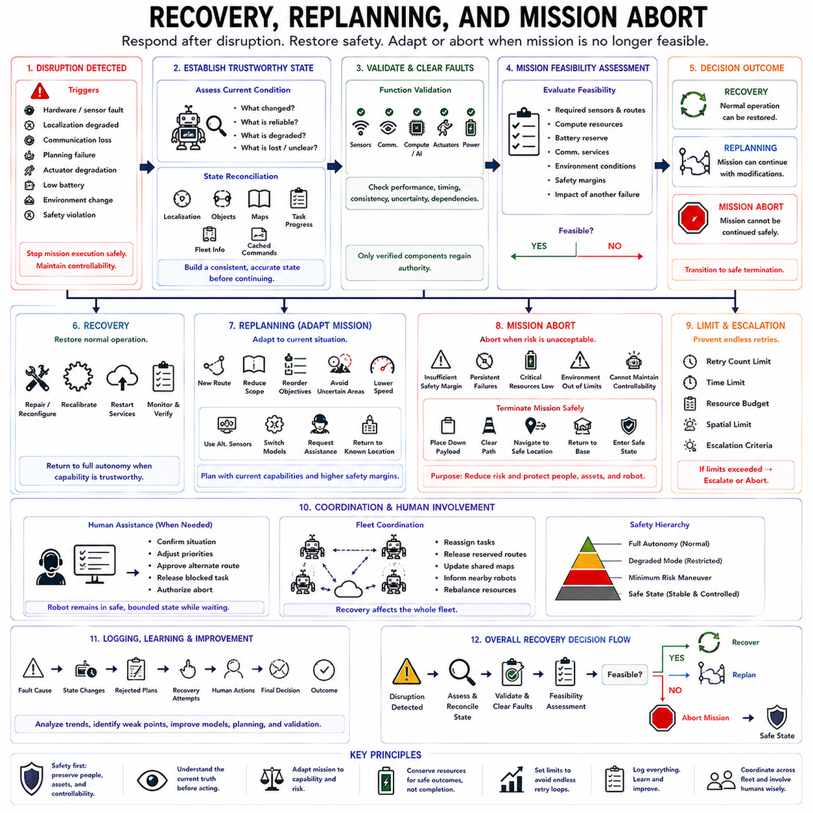{width="7.268055555555556in" height="7.268055555555556in"}

Recovery, replanning, and mission abort define how a Physical AI system responds after faults, uncertainty, environmental changes, or degraded capabilities disrupt normal autonomous operation. The objective is not simply to restart failed functions, but to determine whether safe operation can be restored, whether the mission must be reformulated, or whether continued execution creates unacceptable risk and should therefore be terminated.

Recovery begins with establishing a trustworthy understanding of the robot's current condition. A fault may have changed position, velocity, payload state, actuator availability, sensor coverage, battery reserve, communication status, or environmental assumptions. Before autonomous behavior resumes, the system should reconstruct its operational state and identify which capabilities remain available, degraded, isolated, or uncertain.

Fault clearance alone does not prove that recovery is complete. A sensor may begin transmitting again while remaining miscalibrated, a communication link may reconnect but remain unstable, or an AI model may restart while continuing to produce unreliable outputs. Recovery therefore requires validation of function, timing, consistency, uncertainty, and dependencies before affected components regain operational authority.

State reconciliation is particularly important because different subsystems may contain information generated before, during, and after the failure. Localization estimates, object tracks, occupancy maps, world-model states, task progress, shared fleet information, and cached commands may no longer agree. The system should identify stale or inconsistent information and rebuild the state required for safe decision making rather than blindly continuing from previous internal memory.

Once a trustworthy state has been established, the system determines whether the original mission remains feasible. The previous plan may depend on sensors, routes, compute resources, battery reserves, communication services, or environmental conditions that are no longer available. Mission feasibility should therefore be reassessed using current capability, remaining resources, operational constraints, safety margins, and the expected consequences of another failure.

Replanning provides a mechanism for adapting the mission to the changed situation. The robot may select a different route, reduce task scope, reorder objectives, avoid uncertain areas, lower speed, use alternative sensors, switch models, request remote assistance, or return to a known location. A valid recovery plan should rely only on capabilities that have been demonstrated to remain trustworthy after the disruptive event.

Replanning should also account for uncertainty introduced by the failure. Even when operation can continue, confidence in maps, localization, object states, predictions, or system health may be lower than before. Conservative margins, shorter planning horizons, reduced speed, restricted workspaces, simpler maneuvers, and additional monitoring can compensate for incomplete knowledge while allowing limited mission progress.

Not every mission objective should have equal priority during recovery. Safety-critical objectives, protection of people, stabilization of the platform, payload security, preservation of essential infrastructure, and maintaining controllability should take precedence over productivity or schedule completion. Mission management should be able to discard low-priority goals when continuing them would consume resources needed to maintain a safe fallback capability.

Repeated recovery attempts require explicit limits. A system that continuously retries a failed planner, localization process, network connection, manipulation action, or charging approach may remain in a hazardous environment while consuming battery and computational resources. Retry counts, time limits, resource budgets, spatial limits, and escalation criteria should prevent recovery logic from becoming an uncontrolled loop.

Mission abort becomes appropriate when the remaining capabilities cannot support the mission within acceptable risk. Abort conditions may include persistent safety-monitor violations, insufficient localization confidence, inadequate perception coverage, actuator degradation, critical battery reserve, unstable communication required for the task, repeated planning failure, environmental conditions outside validated limits, or inability to maintain required safety margins.

Mission abort should be distinguished from emergency stop. An emergency stop may immediately suppress motion because of an imminent hazard, while mission abort is a higher-level decision to discontinue the objective and transition toward a safer operational condition. After aborting, the robot may still need to navigate to a safe location, place down a payload, leave a traffic path, return to base, or execute another controlled termination sequence.

The abort destination or final condition should be selected according to risk rather than convenience alone. Returning to the original starting point may require more energy or traverse more hazardous terrain than reaching a nearby safe zone. The system should evaluate remaining battery, mobility, environmental hazards, human presence, payload condition, communication availability, and the reliability of navigation before choosing the termination strategy.

Recovery and abort logic should coordinate with Minimum Risk Maneuvers and safe-state definitions. If replanning remains possible, the robot may continue in a restricted degraded mode. If mission completion is no longer justified but controlled mobility remains available, it can execute an abort trajectory. If capability deteriorates further, a Minimum Risk Maneuver can reduce exposure before the system enters an appropriate safe state.

Human involvement may be useful when autonomous recovery cannot resolve semantic or operational ambiguity. A remote operator can confirm environmental conditions, modify mission priorities, approve an alternate route, release a blocked task, or authorize mission termination. However, human assistance should not be required for immediate physical safety, and the robot must remain in a bounded condition while waiting for intervention.

Fleet systems require additional recovery coordination because one robot's abort can affect shared tasks, traffic reservations, resource allocation, and other agents. When a robot withdraws from a mission, its tasks may need reassignment, reserved routes released, shared maps updated, and neighboring robots informed. Recovery therefore extends beyond the individual platform when mission state is distributed across a collective robotic system.

Every recovery, replanning, and abort event should be logged with the original fault, state changes, rejected plans, recovery attempts, safety constraints, human interventions, final decisions, and outcomes. These records reveal whether the system correctly recognized the limits of its remaining capability and provide evidence for improving fault handling, mission planning, validation scenarios, and future autonomy.

Recovery, replanning, and mission abort ultimately provide a disciplined decision hierarchy for Physical AI after normal operation has been disrupted. The system first seeks to establish trustworthy state, then evaluates whether capability can be restored, whether the mission can be safely reformulated, or whether the objective must be abandoned. By prioritizing safety over mission completion, Physical AI can recover when justified and terminate gracefully when continued autonomy is no longer defensible.

## 06.15. Fallback State Machine [w/Code]

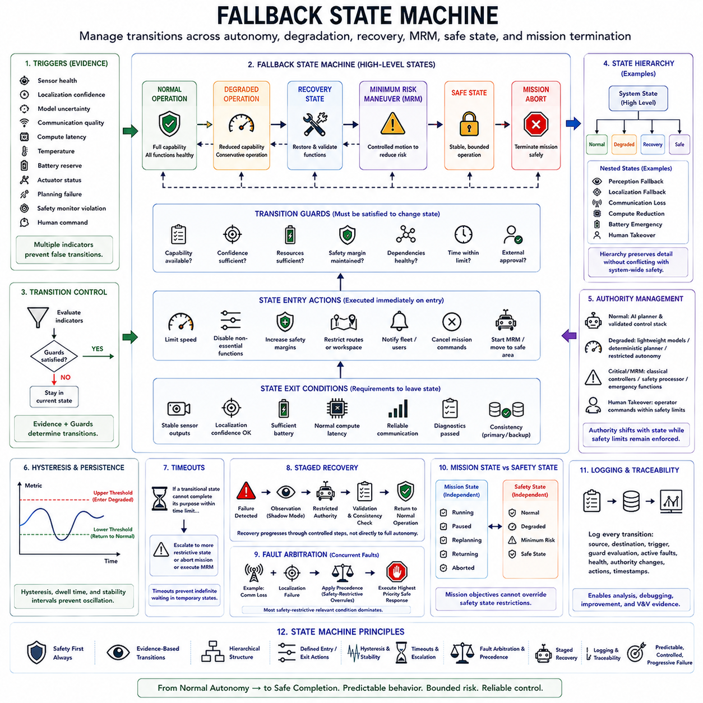{width="7.268055555555556in" height="7.268055555555556in"}

A fallback state machine provides a formal control structure for managing transitions between normal autonomy, degraded operation, recovery, Minimum Risk Maneuvers, safe states, and mission termination. Instead of allowing individual subsystems to react independently to failures, the state machine coordinates system-wide behavior so that faults produce predictable changes in authority, capability, motion, and safety constraints.

Each state represents a defined operational condition rather than merely a diagnostic label. Normal operation assumes that required sensing, localization, computation, communication, power, planning, and control functions satisfy their acceptance criteria. Degraded states represent reduced but still usable capability, while recovery and safe states define increasingly restrictive behavior as uncertainty or fault severity increases.

Transitions between states should be triggered by explicit evidence. Sensor-health indicators, localization confidence, model uncertainty, communication quality, compute latency, temperature, battery reserve, actuator status, planning failures, safety-monitor violations, and human commands can contribute to transition decisions. Combining multiple indicators prevents a single noisy measurement from unnecessarily forcing the entire robot into a restrictive fallback mode.

Transition guards define the conditions that must be satisfied before a state change is permitted. A localization failure may trigger degraded navigation only if alternative localization remains trustworthy, while loss of both primary and backup localization may require a Minimum Risk Maneuver. Guards therefore connect diagnostic evidence with capability requirements, ensuring that the destination state can actually be supported by the functions that remain available.

The state machine should distinguish warning, degraded, critical, and terminal conditions. An early warning may activate additional monitoring or remove optional workloads without changing the mission. Continued degradation can restrict speed, routes, models, or task complexity. Critical conditions may initiate controlled termination, while unrecoverable faults can place the system in a stable safe state until maintenance or authorized intervention occurs.

Hierarchical state machines are useful because Physical AI contains multiple layers of autonomy. A high-level system state may indicate Normal, Degraded, Recovery, or Safe Operation, while nested states describe perception fallback, localization fallback, communication loss, compute reduction, battery emergency, or human takeover. This structure preserves subsystem detail without allowing local fallback logic to conflict with the global safety objective.

Fallback states should explicitly define control authority. In normal operation, an AI planner may command trajectories through validated control layers. During degradation, authority may shift toward lightweight models, deterministic planners, or restricted local autonomy. In critical states, classical controllers, emergency functions, or safety processors may dominate. Human takeover introduces another authority state that must be coordinated with onboard safety enforcement.

State entry actions define what happens immediately after a transition. Entering degraded operation may reduce speed, disable optional models, increase safety margins, restrict routes, or notify fleet infrastructure. Entering a Minimum Risk Maneuver state may cancel mission commands and initiate controlled deceleration or movement toward a safe area. Entry actions make the response deterministic instead of relying on loosely coordinated subsystem reactions.

State exit conditions are equally important. A fault disappearing momentarily should not automatically restore full autonomy. Recovery may require stable sensor outputs, acceptable localization confidence, sufficient battery reserve, normal compute latency, reliable communication, successful diagnostics, or agreement between primary and backup systems over a defined interval. These conditions prevent premature restoration of capabilities that have not yet demonstrated trustworthy operation.

Hysteresis and persistence mechanisms help prevent rapid oscillation between states. For example, a temperature crossing a threshold repeatedly or an intermittent network link could otherwise cause constant switching between normal and degraded operation. Separate entry and exit thresholds, minimum dwell times, confidence windows, and stability intervals allow the state machine to respond decisively while avoiding unstable mode transitions.

Timeouts provide protection when transitional states cannot complete their intended purpose. A robot attempting relocalization, network reconnection, model restart, charging, or remote assistance should not remain indefinitely in a temporary state. When a timeout expires, the state machine can escalate to a more restrictive state, initiate mission abort, or execute a Minimum Risk Maneuver according to the remaining capabilities and environmental risk.

Recovery should normally progress through controlled intermediate states rather than jumping directly from failure to full autonomy. A recovered sensor or AI model can first operate in observation or shadow mode, then participate with restricted authority, and finally return to normal operation after validation. This staged progression enables the system to verify consistency before restored components again influence safety-relevant physical actions.

Concurrent faults require arbitration because several fallback conditions may be active simultaneously. Communication loss might permit local autonomy, while a simultaneous localization failure could make continued navigation unacceptable. The state machine should apply precedence rules so that the most safety-restrictive relevant condition dominates. Lower-level recovery actions must never override a higher-level requirement for controlled stopping or safe-state entry.

Mission state and safety state should remain logically separated but coordinated. A mission may be Running, Paused, Replanning, Returning, or Aborted while the safety controller independently determines Normal, Degraded, Minimum Risk, or Safe State operation. This separation prevents mission objectives from redefining safety requirements and ensures that productivity cannot override the operational restrictions imposed by fault conditions.

Every transition should generate traceable evidence describing the source state, destination state, trigger, guard evaluation, active faults, system health, authority changes, and actions executed. Transition histories allow engineers to reconstruct why the robot behaved as it did and identify repeated oscillations, unnecessary fallback activations, failed recoveries, or unsafe assumptions. They also provide valuable evidence for verification and validation.

The fallback state machine ultimately converts diverse failures into a bounded and understandable progression of system behavior. Normal autonomy can contract into degraded operation, recovery, Minimum Risk Maneuvers, mission abort, or a safe state according to explicit evidence and verified capability. Through guarded transitions, authority management, hierarchy, hysteresis, timeouts, fault arbitration, staged recovery, and logging, Physical AI can fail progressively rather than unpredictably.
