**Volume 10. Physical AI Safety and Alignment**

# Chapter 07. Monitoring and Runtime Assurance

## 07.01. Runtime Assurance Fundamentals

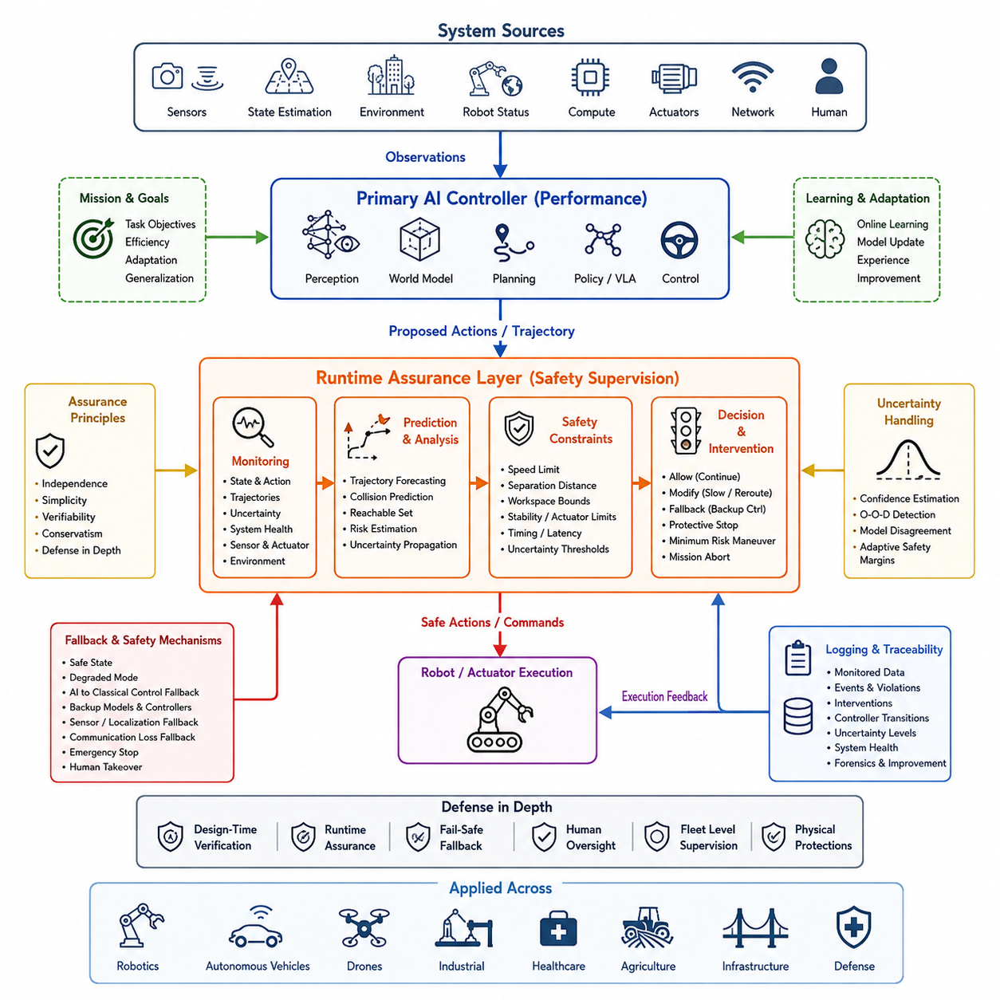{width="7.268055555555556in" height="7.268055555555556in"}

Runtime assurance provides a safety layer that supervises an autonomous Physical AI system while it is operating. Instead of assuming that perception, planning, learned policies, or world models will always behave correctly, runtime assurance continuously evaluates whether the current system state and proposed behavior remain compatible with defined safety requirements and operational constraints.

The central motivation for runtime assurance is that many Physical AI components cannot be completely verified before deployment. Learned models may encounter unfamiliar environments, distribution shifts, sensor degradation, ambiguous human behavior, or combinations of conditions absent from training. Runtime assurance therefore complements design-time verification by detecting unsafe conditions during actual operation.

A runtime assurance architecture generally separates performance-oriented intelligence from safety-oriented supervision. The primary controller may use neural networks, reinforcement learning, VLA policies, world models, or sophisticated optimization to achieve mission objectives. A more constrained assurance mechanism independently determines whether proposed actions remain inside an acceptable region of behavior.

This separation is especially important because high-performance AI and safety mechanisms have different objectives. The primary AI seeks efficient, adaptive, and capable behavior, whereas the assurance layer prioritizes constraint satisfaction and risk reduction. Independence prevents a failure inside the primary decision process from automatically disabling the mechanism responsible for detecting that failure.

Runtime assurance operates by observing relevant states, actions, trajectories, environmental conditions, and system health indicators. These observations can include robot velocity, distance to humans, localization confidence, predicted collision probability, actuator status, compute latency, battery state, model uncertainty, and sensor consistency. Their combination provides evidence about whether operation remains trustworthy.

Safety constraints transform this evidence into enforceable operational boundaries. Constraints may define maximum velocity, minimum separation distance, permitted workspace regions, stability conditions, actuator limits, timing deadlines, or acceptable uncertainty. The assurance mechanism evaluates current and predicted behavior against these boundaries before hazardous conditions become irreversible.

Monitoring must consider both the present state and the consequences of future actions. A robot may currently satisfy every safety constraint while following a trajectory that will violate one several seconds later. Runtime assurance therefore benefits from predictive evaluation using trajectory forecasting, reachable-state analysis, collision prediction, or conservative estimates of future system evolution.

When a potential violation is detected, the assurance system can intervene at different levels of severity. Minor risk may result in speed reduction or trajectory modification, while greater risk can trigger a backup controller, degraded operating mode, protective stop, minimum-risk maneuver, or mission abort. Intervention should occur early enough that the robot retains sufficient physical authority to reach a safe condition.

Runtime assurance should also account for uncertainty rather than treating every estimated state as exact. Perception confidence, localization covariance, model disagreement, out-of-distribution indicators, and prediction uncertainty can reveal that the system\'s understanding of the environment is becoming unreliable. Increasing uncertainty can progressively tighten safety margins or restrict the set of permitted actions.

An important design principle is that the assurance mechanism itself should be simpler and more auditable than the intelligence it supervises. It does not necessarily need to understand every internal representation of a foundation model or learned policy. Instead, it can monitor externally meaningful properties such as state bounds, action validity, trajectory safety, timing behavior, and physical constraints.

Runtime assurance also connects directly with fail-safe and fallback design. Monitoring identifies when normal operation is no longer sufficiently trustworthy, while fallback mechanisms define what the system should do after that determination. Effective safety therefore requires coordinated detection, decision, transition, and recovery logic rather than an isolated alarm that merely reports abnormal behavior.

The assurance boundary extends beyond AI inference because failures can originate throughout the physical computing stack. Sensor loss, stale messages, excessive latency, thermal throttling, actuator faults, communication interruption, or resource exhaustion may invalidate otherwise correct AI decisions. Runtime supervision must therefore combine AI health monitoring with conventional system and hardware diagnostics.

For adaptive robots, runtime assurance provides a practical boundary between learning capability and operational permission. A system may generate novel strategies or adapt its behavior, but adaptation does not automatically authorize every resulting action. The assurance layer preserves invariant safety requirements even when the internal policy, environmental context, or learned representation changes during deployment.

Logging and traceability are also fundamental because assurance decisions become evidence for later investigation and improvement. Records of monitored variables, detected violations, intervention triggers, controller transitions, uncertainty levels, and resulting robot behavior help reconstruct incidents. These traces support debugging, validation, safety-case development, and refinement of operational limits.

At fleet scale, runtime assurance can combine local protection with higher-level supervision. Individual robots must retain immediate safety mechanisms that do not depend on network connectivity, while fleet systems can detect shared hazards, correlated degradation, abnormal behavior patterns, or unsafe interactions among multiple agents. Local autonomy and collective monitoring therefore provide complementary layers of protection.

Ultimately, runtime assurance should be understood as continuous operational evidence that a Physical AI system remains within an acceptable safety envelope. It does not eliminate uncertainty or guarantee that complex AI will never fail. Instead, it limits the physical consequences of uncertain intelligence by continuously monitoring behavior, enforcing constraints, and transferring control toward safer modes whenever confidence in normal autonomous operation becomes insufficient.

## 07.02. Independent Safety Monitor Architecture

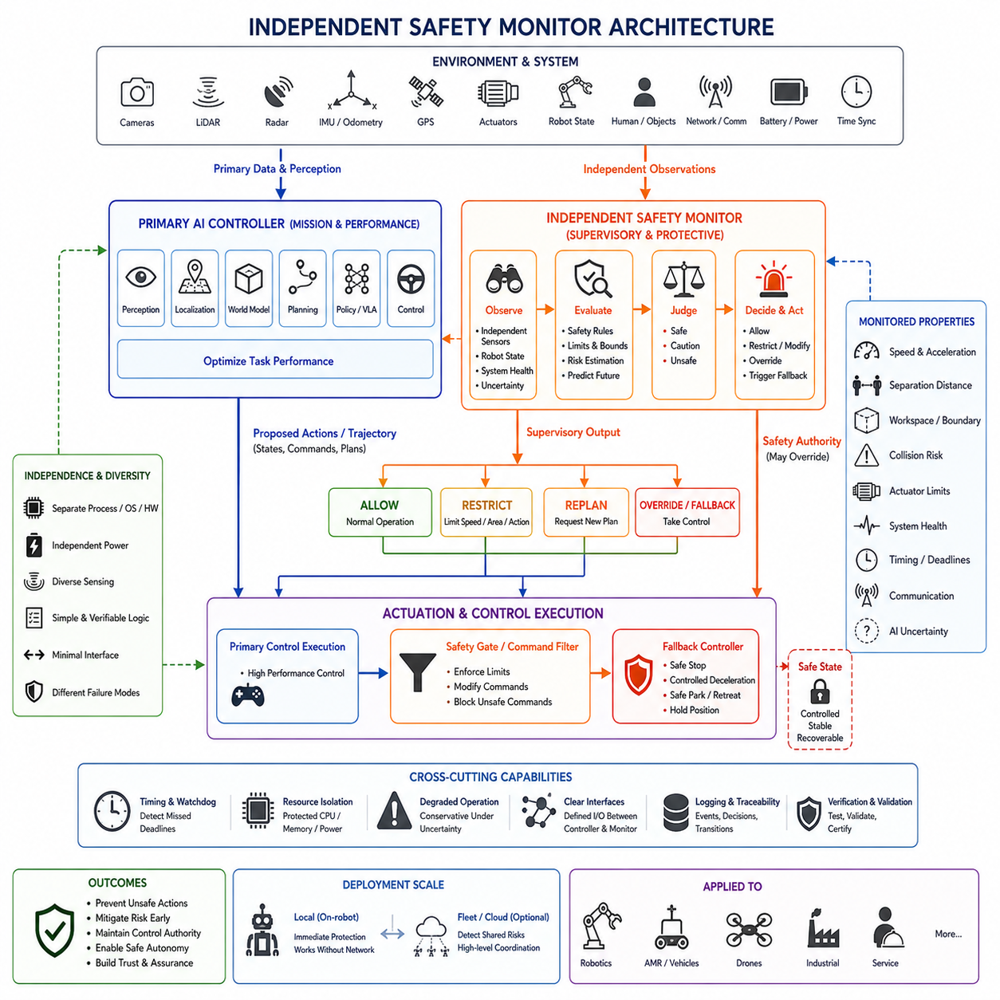{width="7.268055555555556in" height="7.268055555555556in"}

An independent safety monitor is a dedicated supervisory mechanism that evaluates whether a Physical AI system remains within predefined safety conditions while the primary autonomy stack performs perception, reasoning, planning, and control. Its defining characteristic is independence: the monitor should not rely entirely on the same models, assumptions, data paths, or failure-prone components that it is intended to supervise.

The architecture separates mission-oriented intelligence from safety-oriented authority. A primary AI controller may optimize navigation efficiency, manipulation performance, task completion, or adaptive behavior, while the independent monitor evaluates whether the resulting states, actions, and trajectories remain acceptable. This separation allows advanced autonomy to operate freely inside an explicitly defined safety envelope without granting it unrestricted control.

Independence can be established at several architectural levels. The monitor may execute as a separate software process, on an isolated operating-system partition, within a safety-certified controller, or on physically independent computing hardware. Greater separation reduces the probability that a common software crash, resource exhaustion event, corrupted memory region, or AI inference failure simultaneously disables both primary control and safety supervision.

The monitor requires trustworthy observations of the physical system and its environment. Inputs may include velocity, position, acceleration, actuator state, human proximity, localization confidence, obstacle distance, battery condition, communication status, timing information, and AI uncertainty. Safety-critical signals may be obtained directly from sensors or independent interfaces rather than solely through representations generated by the primary AI pipeline.

Monitoring logic converts these observations into explicit safety judgments. Instead of reproducing the full intelligence of the primary controller, the monitor evaluates a smaller set of safety-relevant properties such as speed limits, separation distances, workspace boundaries, stability margins, collision risk, actuator limits, communication freshness, or execution deadlines. This narrower responsibility makes its behavior easier to understand, verify, test, and certify.

A key architectural principle is diversity between the primary system and its monitor. If both components use identical neural networks, sensor-processing pipelines, algorithms, or training datasets, the same systematic error can affect them simultaneously. Diverse sensing, simpler algorithms, independent state estimation, analytical checks, geometric constraints, or deterministic rules can reduce common-cause failures and strengthen confidence in supervisory decisions.

The independent monitor must evaluate proposed behavior early enough to prevent unsafe physical consequences. Monitoring only the robot\'s current state may detect danger too late because momentum, actuator dynamics, braking distance, and environmental motion constrain future recovery. The architecture can therefore inspect planned trajectories and predict whether future states will cross safety boundaries before execution reaches an unrecoverable condition.

Safety decisions can be organized around explicit operating states. When monitored conditions are normal, the primary controller retains authority. As risk increases, the monitor may impose speed restrictions, constrain trajectories, reject particular actions, or request replanning. When safety limits are violated or confidence becomes insufficient, authority can be transferred to a backup controller or another mechanism capable of reaching a defined safe state.

Control authority is therefore one of the most important interfaces in the architecture. A monitor that can detect danger but cannot influence execution provides limited protection. The supervisory path must be capable of overriding, filtering, inhibiting, or replacing commands from the primary controller when necessary. Safety intervention should remain available even when the primary AI becomes unresponsive, unstable, computationally overloaded, or logically inconsistent.

The backup path should generally be simpler and more conservative than normal autonomous control. It may perform controlled deceleration, hold position, retreat to a known safe region, maintain stability, execute a minimum-risk maneuver, or initiate a protective stop. The objective is not to preserve maximum mission performance but to prevent unacceptable physical outcomes while maintaining enough control authority for safe recovery.

Timing independence is equally important because Physical AI safety depends on decisions arriving before physical deadlines. The monitor can supervise control-cycle execution time, sensor freshness, communication latency, inference delay, and watchdog signals. If the primary autonomy stack misses critical deadlines, the absence of a valid command must itself be interpreted as a potentially unsafe condition rather than allowing outdated control information to continue indefinitely.

Resource isolation further protects the monitor from failures in computationally demanding AI workloads. Large perception networks, world models, VLA systems, or planning algorithms may consume excessive CPU, GPU, memory, power, or thermal capacity. A safety monitor should retain sufficient protected resources to continue evaluating essential conditions and initiating fallback actions even when the performance-oriented computing environment becomes degraded.

The architecture should also address uncertainty and degraded observability. Loss of a camera, inconsistent LiDAR measurements, declining localization confidence, or disagreement among perception models may prevent the monitor from proving that operation remains safe. In such cases, absence of confirmed danger should not automatically be interpreted as evidence of safety. Operational permissions can instead become progressively more conservative as trustworthy information decreases.

Communication between the primary controller and safety monitor should use clearly defined, minimal interfaces. The monitor may receive current state estimates, candidate actions, trajectories, confidence measures, health indicators, and timing information while returning permission, restriction, override, or fallback commands. Keeping this interface explicit reduces unnecessary coupling and makes safety responsibilities easier to analyze and validate independently.

Every monitoring and intervention event should be traceable. Logs can record observed conditions, violated constraints, uncertainty levels, rejected commands, controller transitions, fallback activation, and recovery results. Such records allow engineers to determine whether the monitor responded correctly, identify recurring failure patterns, refine thresholds, and provide operational evidence for verification, validation, incident analysis, and safety assurance.

At fleet scale, the same principle can be extended without eliminating local independence. Each robot should retain a local safety monitor capable of immediate intervention without relying on remote infrastructure, while fleet-level supervision identifies interactions and hazards that cannot be observed by one robot alone. This creates layered assurance in which local monitors protect individual platforms and higher-level monitoring addresses collective behavior.

An independent safety monitor architecture ultimately creates a controlled boundary around complex and potentially unpredictable Physical AI. The primary AI can pursue increasingly capable perception, reasoning, learning, and action, while a separate supervisory mechanism determines whether those capabilities may continue controlling the physical system. Independence, simplicity, diversity, protected authority, and conservative intervention together transform runtime monitoring into an active safety architecture.

## 07.03. Runtime Constraint Enforcement

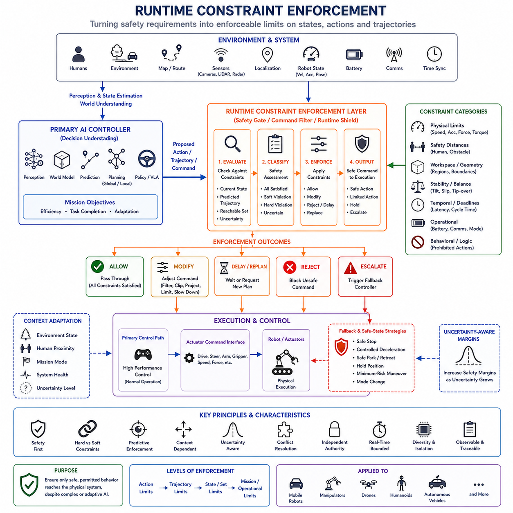{width="7.268055555555556in" height="7.268055555555556in"}

Runtime constraint enforcement is the mechanism that converts safety requirements into continuously enforceable limits on the behavior of a Physical AI system. While runtime monitoring determines what the robot is doing and whether risk is increasing, constraint enforcement actively determines which states, actions, commands, and trajectories are permitted to reach the physical system during operation.

The need for runtime enforcement arises because autonomous behavior cannot always be completely constrained during training or design. Learned policies, VLA systems, world-model planners, and adaptive controllers may generate actions that are reasonable according to their learned objectives yet violate physical or operational safety requirements. Runtime constraints therefore establish an authoritative boundary that remains valid regardless of how an action was generated.

Constraints can represent physical, geometric, temporal, operational, or behavioral requirements. Examples include maximum velocity and acceleration, minimum human separation, actuator force limits, permitted workspace regions, stability conditions, collision-clearance margins, battery thresholds, communication deadlines, and prohibited actions. Together, these constraints define a dynamically enforceable safety envelope around autonomous behavior.

A useful distinction exists between state constraints and action constraints. State constraints specify conditions that the system should never enter, such as excessive tilt, unsafe proximity, or operation outside an authorized region. Action constraints determine which commands may be executed from the current state. Runtime enforcement connects these concepts by preventing actions whose predicted consequences could drive the system toward prohibited states.

Constraint enforcement should therefore consider future evolution rather than examining commands independently. A velocity command may appear valid at the present instant but become unsafe when braking distance, robot momentum, actuator delay, human motion, or environmental geometry are considered. Predictive enforcement evaluates candidate trajectories or reachable states and rejects behavior that cannot preserve sufficient future safety margins.

The enforcement mechanism is typically positioned between high-level autonomous decision making and physical execution. A primary controller proposes an action, trajectory, or control command, while a safety gate, command filter, runtime shield, or supervisory controller evaluates it before actuation. Commands satisfying all required constraints pass through, whereas unsafe commands can be modified, delayed, rejected, or replaced by safer alternatives.

Hard constraints represent requirements that must not be intentionally violated during normal operation. Collision avoidance boundaries, mechanical limits, emergency exclusion zones, or stability requirements may belong to this category. Soft constraints represent preferences or margins that can be relaxed under controlled conditions. Separating them prevents performance optimization from trading away requirements that are essential to physical safety.

Runtime constraints may also change according to operating context. A mobile robot can safely travel faster in an empty corridor than near workers, while a manipulator may use different force limits depending on whether it is operating inside an isolated cell or collaborating with a person. Context-dependent enforcement therefore adjusts permissible behavior using environment state, mission mode, human proximity, and system health.

Uncertainty should directly influence constraint boundaries. When perception confidence decreases, localization uncertainty grows, or an out-of-distribution condition is detected, a fixed safety boundary may no longer provide adequate protection. The enforcement layer can enlarge separation margins, reduce speed, restrict available trajectories, or prohibit complex maneuvers as uncertainty increases, producing progressively more conservative operation.

Constraint conflicts require explicit resolution because several safety and operational requirements may become active simultaneously. A robot may need to avoid a person while remaining inside a permitted region and preserving vehicle stability. The enforcement architecture should prioritize non-negotiable safety requirements and search for behavior satisfying all feasible constraints rather than allowing mission objectives to override higher-priority protection.

When a proposed action violates constraints but a safe alternative exists, modification is often preferable to immediate shutdown. A command filter can reduce velocity, limit acceleration, clip actuator output, alter steering, or project an unsafe action into a permitted action set. This preserves useful autonomy while ensuring that the physical command delivered to the robot remains inside the allowable safety envelope.

Some situations cannot be resolved through command modification. The feasible safe action set may become empty because of sensor failure, localization loss, rapidly approaching obstacles, mechanical faults, or contradictory environmental conditions. In such cases, enforcement must escalate from filtering to fallback behavior, transferring authority to a backup controller, minimum-risk maneuver, protective stop, or other predefined safe-state strategy.

Timing is fundamental because a mathematically correct constraint decision is ineffective if it arrives after the command has already produced physical motion. Enforcement must operate within bounded latency relative to the dynamics of the robot. Watchdogs, real-time scheduling, deterministic safety processes, and independent compute resources can help ensure that safety checks complete before the physical system passes a point from which safe recovery is impossible.

Runtime enforcement should remain sufficiently independent from the primary AI controller. If the same learned model both proposes an action and determines whether that action is safe, systematic errors may defeat both functions simultaneously. Independent constraints, simpler algorithms, direct safety sensors, deterministic checks, and separate execution paths can provide diversity and reduce common-cause failures within the control architecture.

For adaptive or learning-enabled systems, constraint enforcement establishes a stable boundary around changing intelligence. Online learning may update policies, world models, or decision strategies, but those updates do not automatically modify fundamental safety permissions. New behavior can therefore be explored or deployed within a controlled region while invariant safety requirements remain externally enforced by the runtime assurance architecture.

Every enforcement decision should be observable and traceable. The system can record evaluated constraints, measured values, predicted violations, rejected or modified commands, activated margins, controller transitions, and resulting physical behavior. These records provide evidence for debugging, incident reconstruction, threshold refinement, verification, validation, and demonstration that safety requirements were actively enforced during operation.

At fleet level, constraint enforcement expands from individual robot limits to shared operational constraints. Robots may need to maintain mutual separation, respect traffic priorities, avoid conflicting reservations, limit congestion, or respond to shared hazards. Fleet supervision can coordinate these constraints, but each robot should retain local enforcement capable of protecting itself when communication or centralized coordination becomes unavailable.

Runtime constraint enforcement ultimately forms the executable boundary between autonomous intelligence and physical authority. The AI system may generate sophisticated plans, predictions, and adaptive actions, but only behavior satisfying the active safety constraints should reach actuators. By combining predictive evaluation, contextual limits, uncertainty-aware margins, command filtering, independent authority, and fallback escalation, runtime assurance turns abstract safety requirements into continuously enforced physical protection.

## 07.04. Safety Envelope and Operational Boundaries

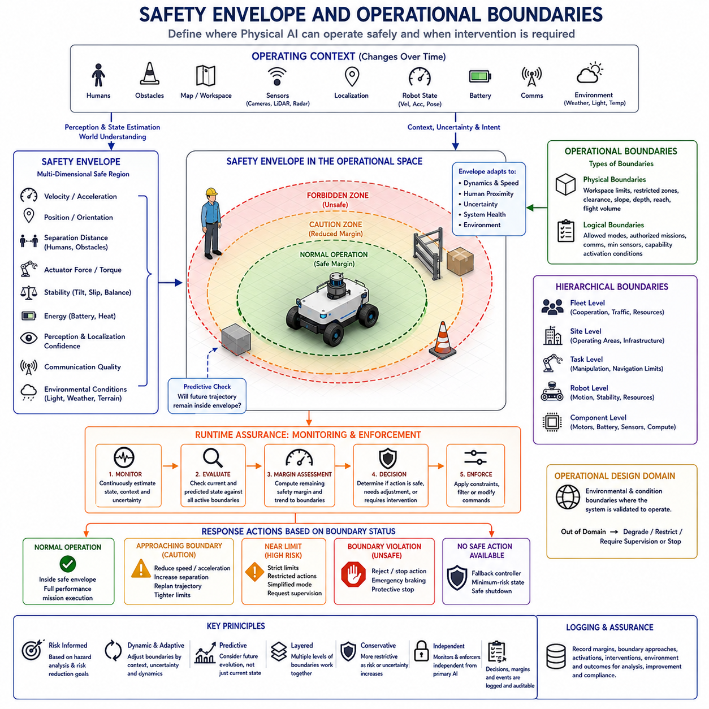{width="7.268055555555556in" height="7.268055555555556in"}

A safety envelope defines the set of physical states and behaviors within which a Physical AI system can operate while maintaining specified safety conditions. Operational boundaries translate this abstract safe region into concrete limits on motion, location, interaction, resources, and environmental conditions. Together, they establish where autonomy is permitted and where safety intervention becomes necessary.

Unlike a single fixed threshold, a safety envelope is typically multidimensional. It may simultaneously constrain velocity, acceleration, position, orientation, separation distance, actuator force, stability, battery state, localization confidence, communication quality, and environmental conditions. A robot is considered inside the envelope only when the combination of relevant variables remains within an acceptable region.

The envelope provides an important connection between hazard analysis and runtime assurance. Design-time safety analysis identifies hazardous states, unsafe interactions, and required risk reductions, while the runtime architecture converts these findings into observable boundaries. Monitoring and enforcement mechanisms can then determine whether actual or predicted robot behavior is approaching conditions identified as unacceptable during system development.

Operational boundaries can be physical or logical. Physical boundaries include restricted zones, workspace limits, minimum obstacle clearance, maximum slope, water-depth limits, manipulator reach restrictions, or permitted flight volumes. Logical boundaries may specify allowable operating modes, authorized missions, communication requirements, minimum sensor availability, or conditions under which particular autonomous capabilities may be activated.

Safety envelopes should account for robot dynamics rather than describing only static geometry. A boundary that is safe for a stationary robot may be insufficient for a platform traveling at high speed because stopping distance and maneuverability change with velocity, payload, surface friction, actuator condition, and control latency. Dynamic envelopes therefore incorporate the system\'s ability to avoid or recover from hazardous states.

Human proximity creates another important form of dynamic boundary. As a robot approaches workers, pedestrians, passengers, or collaborators, the permissible velocity, acceleration, force, or trajectory may need to become progressively more restrictive. The safety envelope can consequently contract around the robot as human exposure increases and expand again when sufficient separation and environmental confidence are restored.

Uncertainty should also modify the shape and size of the safety envelope. Increasing localization covariance, reduced perception confidence, sensor disagreement, or out-of-distribution observations mean that the estimated state may differ from the physical state. Runtime assurance can compensate by enlarging obstacle margins, reducing speed limits, restricting maneuver choices, or excluding regions that cannot be observed with sufficient confidence.

The operational design domain defines another boundary around autonomy. Environmental conditions such as lighting, temperature, weather, terrain, visibility, electromagnetic interference, traffic characteristics, or infrastructure availability may determine where a system has been validated to operate. When conditions move outside this validated domain, continued full-performance autonomy should not automatically be assumed safe.

Safety envelopes can therefore be organized hierarchically. Component-level envelopes protect motors, batteries, sensors, and compute hardware; robot-level envelopes constrain motion and stability; task-level boundaries restrict manipulation or navigation behavior; and site-level boundaries define permitted operating regions. Fleet-level boundaries can additionally regulate interactions among multiple robots sharing space, infrastructure, or operational resources.

A runtime monitor continuously estimates the system\'s position relative to these boundaries. Instead of waiting until a constraint has already been violated, it can calculate remaining safety margin and identify trends toward the edge of the envelope. Approaching a boundary may trigger warnings, reduced performance, trajectory replanning, increased separation, or tighter control limits before direct intervention becomes unavoidable.

Prediction extends this concept from current-state assurance to future-state assurance. Planned trajectories, reachable sets, human-motion forecasts, world-model predictions, or conservative dynamic models can estimate whether the robot is likely to leave the safe region. An action may therefore be rejected even when the present state is safe if its predicted evolution cannot remain inside the required envelope.

Different boundaries can have different levels of strictness. A hard boundary represents a condition that autonomous operation must not intentionally cross, such as a collision region, mechanical limit, or prohibited workspace. A softer operational boundary may indicate a preferred margin where performance should be reduced. This layered structure supports gradual intervention instead of treating every boundary approach as an emergency.

Envelope management must also consider conflicts among constraints. Avoiding an obstacle may require steering toward a workspace boundary, while maintaining stability may limit the acceleration available for collision avoidance. Runtime assurance should evaluate the combined feasible region created by all active constraints and determine whether a safe trajectory still exists rather than considering each boundary independently.

If the feasible safe region becomes very small, the system should become increasingly conservative. Reduced speed, restricted actions, simplified planning, degraded operating modes, or requests for human supervision may preserve safety while maintaining limited functionality. If no safe action remains, the runtime assurance architecture should transition toward a minimum-risk condition, protective stop, or predefined fallback state.

Operational boundaries should be explicitly represented and version controlled because they form part of the system\'s safety configuration. Changes to maximum speed, permitted regions, sensor requirements, uncertainty thresholds, or environmental limits can materially alter risk. Such changes should therefore be traceable to engineering justification, verification evidence, system configuration, and appropriate authorization.

Logging the robot\'s relationship to its safety envelope provides valuable operational evidence. Records can include current safety margins, boundary approaches, constraint activations, predicted violations, intervention events, environmental conditions, and recovery behavior. Analysis of these records can reveal whether boundaries are excessively permissive, unnecessarily restrictive, or systematically challenged by real-world operating conditions.

For fleets, safety envelopes must account for moving boundaries created by other agents. Reserved paths, intersection priorities, shared workspaces, temporary exclusion zones, congestion, and communication failures can continuously alter the feasible region for each robot. Fleet coordination can provide global information, while each platform retains local boundaries capable of protecting it independently when centralized information becomes unavailable.

Safety envelopes and operational boundaries ultimately provide a geometric, physical, and logical representation of permissible autonomy. They convert broad safety goals into regions that can be monitored, predicted, and enforced at runtime. By adapting boundaries to dynamics, uncertainty, human proximity, system health, and environmental context, Physical AI can pursue useful behavior while maintaining explicit limits on where autonomous authority is allowed.

## 07.05. Runtime Perception Health Monitoring

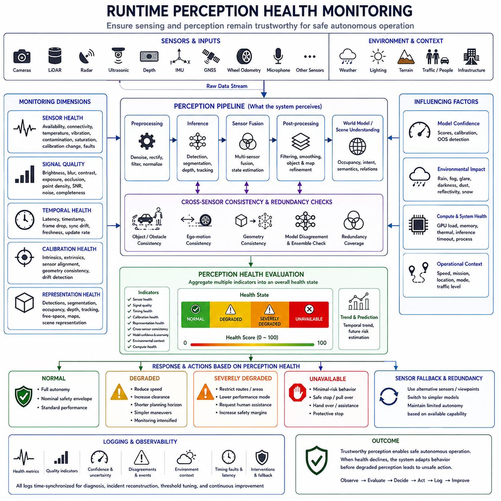{width="7.268055555555556in" height="7.268055555555556in"}

Runtime perception health monitoring evaluates whether the sensing and perception pipeline of a Physical AI system remains sufficiently reliable for safe autonomous operation. It does not ask only what objects, people, surfaces, or obstacles have been detected. It also asks whether the information used to create those detections is trustworthy enough for planning, control, and runtime safety decisions.

Perception health differs from ordinary perception performance because it focuses on operational validity rather than recognition accuracy alone. A camera may continue producing images while its lens is obscured, a LiDAR may return points despite contamination, and a neural detector may generate confident outputs under unfamiliar conditions. Health monitoring therefore evaluates the quality and credibility of the complete perception process.

Monitoring begins with the physical condition and availability of sensors. Cameras, LiDAR, radar, ultrasonic sensors, depth sensors, IMUs, GNSS receivers, encoders, and other devices can experience disconnection, overheating, vibration, contamination, saturation, timing faults, or calibration changes. Detecting these conditions early prevents apparently valid but degraded measurements from silently entering the autonomy pipeline.

Signal-level quality provides another important source of evidence. Image brightness, blur, contrast, exposure, occlusion, dropped frames, LiDAR point density, radar return quality, IMU noise, GNSS satellite availability, and depth completeness can indicate whether sensor information remains usable. These metrics allow degradation to be detected before it produces an obvious failure in downstream perception outputs.

Temporal health monitoring determines whether perception data arrives with the required timing characteristics. Autonomous systems depend not only on accurate observations but also on observations representing the current physical world. Excessive latency, timestamp errors, frame loss, synchronization drift, or stale messages can cause planning to operate on outdated conditions, creating hazards even when individual measurements are technically correct.

Calibration health is especially important in multimodal Physical AI systems. Changes in camera intrinsics, sensor extrinsics, LiDAR-camera alignment, IMU orientation, or coordinate transformations can systematically distort the reconstructed environment. Runtime consistency checks can identify growing disagreement between sensor geometry and expected relationships, indicating that recalibration, degradation, or restricted operation may be required.

Perception health monitoring should extend beyond raw sensors to intermediate representations. Object detections, semantic segmentation, occupancy maps, depth estimates, traversability maps, human tracking, free-space estimates, and scene representations may become unstable even when the sensors themselves appear healthy. Monitoring these representations helps identify failures introduced by preprocessing, inference, fusion, or post-processing stages.

Cross-sensor consistency provides powerful evidence because different sensing modalities observe the same physical environment through different mechanisms. A pedestrian detected by a camera may be compared with LiDAR geometry or radar returns, while estimated ego-motion can be checked against wheel odometry and IMU measurements. Persistent disagreement can reveal sensor faults, calibration errors, perception failures, or unusual environmental conditions.

Redundancy alone, however, does not guarantee trustworthy perception. Multiple sensors can fail together because of rain, fog, dust, glare, darkness, vibration, electromagnetic interference, or shared compute failures. Runtime monitoring should therefore distinguish independent disagreement from correlated degradation and evaluate whether the remaining sensing diversity is sufficient to support the safety requirements of the current operating mode.

Model confidence can contribute to perception health but should not be treated as definitive evidence. Neural perception systems may produce high confidence for incorrect predictions, particularly under distribution shift or unfamiliar scenes. Confidence scores should therefore be combined with calibration information, sensor quality, temporal consistency, model disagreement, environmental context, and out-of-distribution indicators.

Temporal consistency can reveal perception instability that is difficult to detect from a single frame. Objects should normally evolve according to physically plausible motion, occupancy should not change arbitrarily, and tracked entities should maintain reasonable continuity. Sudden label changes, impossible jumps, flickering detections, inconsistent depth, or rapidly changing confidence can indicate that the perception pipeline is becoming unreliable.

Environmental conditions should be included because perception capability depends strongly on operating context. Heavy rain may reduce camera and LiDAR quality, low illumination can degrade vision, reflective surfaces can disturb ranging, and dust or snow can generate misleading returns. Health monitoring can compare current conditions with validated perception capabilities and determine whether safety margins or operating modes should change.

A useful perception health architecture aggregates multiple indicators into a health state rather than relying on a single pass-or-fail signal. The system may classify perception as normal, degraded, severely degraded, or unavailable. Each state can correspond to specific operational permissions, allowing autonomy to continue with controlled restrictions when sufficient perception remains instead of immediately treating every degradation as total failure.

When perception health deteriorates, runtime assurance should modify the safety envelope accordingly. Reduced confidence may require lower velocity, greater obstacle clearance, increased human separation, shorter planning horizons, restricted routes, or simpler maneuvers. The important principle is that the robot\'s allowed behavior should become more conservative as its ability to observe the physical environment becomes less trustworthy.

Sensor fallback can preserve limited autonomy when suitable redundancy exists. If one camera fails, another viewpoint may provide partial coverage; GNSS degradation may be compensated by LiDAR or visual localization; and a failed perception model may be replaced by a simpler backup detector. The fallback capability must nevertheless be evaluated against the actual safety requirements rather than assumed equivalent to normal perception.

If perception becomes insufficient to establish safe operation, the system should not continue merely because no hazard has been detected. Failure to observe a person or obstacle is fundamentally different from proving that none exists. Runtime assurance should therefore transition toward degraded operation, human assistance, minimum-risk behavior, or protective stopping when environmental observability falls below the required threshold.

Perception health monitoring must also consider computational dependencies. GPU overload, memory pressure, thermal throttling, inference timeout, corrupted model state, middleware congestion, or process failure can degrade perception without producing a physical sensor fault. Monitoring execution rate, processing latency, resource availability, queue depth, and inference completion provides visibility into this computational dimension of perception reliability.

Logging supports diagnosis and continuous improvement of perception assurance. Sensor-health indicators, quality metrics, confidence values, disagreement events, environmental conditions, timing faults, fallback transitions, and safety interventions can be recorded together. These traces help engineers reconstruct incidents, identify recurring degradation patterns, refine thresholds, improve models, and establish operational evidence for safety validation.

Runtime perception health monitoring ultimately determines whether the Physical AI system can trust its own observation of the world sufficiently to exercise autonomous authority. By combining sensor diagnostics, signal quality, timing, calibration, cross-modal consistency, model behavior, uncertainty, environmental context, and compute health, the system can adapt its behavior before degraded perception becomes unsafe physical action.

## 07.06. Runtime AI Model Health Monitoring

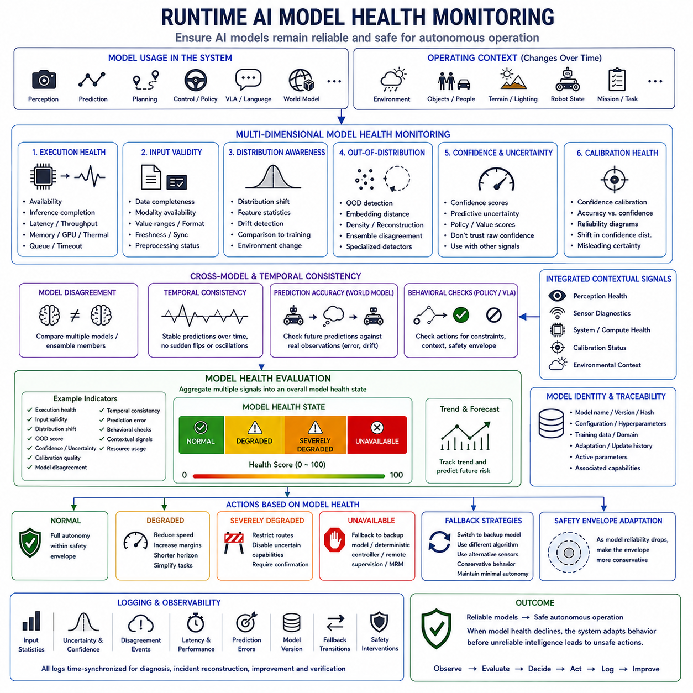{width="7.268055555555556in" height="7.268055555555556in"}

Runtime AI model health monitoring determines whether the learned models inside a Physical AI system remain sufficiently reliable for continued autonomous operation. Unlike conventional software, AI models can continue producing syntactically valid outputs while their predictions become unreliable. Runtime assurance must therefore evaluate not only whether inference executes, but whether model behavior remains trustworthy in the current operating context.

Model health is broader than conventional process health. A neural network may be loaded correctly, consume inputs, and return outputs within its timing deadline while still making systematically incorrect predictions. Distribution shift, unfamiliar objects, environmental changes, corrupted inputs, calibration errors, or unexpected interactions can degrade decision quality without producing an explicit software exception or hardware fault.

The first monitoring dimension is inference execution health. Runtime supervision can observe model availability, inference completion, execution latency, throughput, memory consumption, GPU utilization, thermal conditions, queue depth, and timeout events. These indicators reveal whether the computational environment can continue supporting the model at the frequency and responsiveness required by perception, prediction, planning, or control.

Input validity provides another essential health signal because model reliability depends on receiving data similar to what the model can meaningfully process. Missing modalities, malformed tensors, stale observations, abnormal value ranges, sensor degradation, synchronization errors, or preprocessing failures can invalidate inference. Model monitoring should therefore verify that incoming data satisfies expected structural, temporal, and statistical conditions.

Distribution shift monitoring evaluates whether runtime inputs remain sufficiently close to the conditions represented during training and validation. Changes in weather, terrain, lighting, object appearance, human behavior, robot configuration, payload, or site characteristics can move observations outside familiar regions. Detecting such shifts provides evidence that nominal validation results may no longer represent current model performance.

Out-of-distribution detection provides a related but more explicit warning that the model may be encountering conditions outside its supported knowledge. Embedding distance, feature statistics, density estimates, reconstruction signals, ensemble disagreement, or specialized detectors can contribute to this judgment. No individual indicator is universally reliable, so multiple forms of evidence should be combined when safety depends on the result.

Confidence monitoring examines whether model outputs contain useful evidence about prediction reliability. Classification probabilities, detection confidence, predictive distributions, uncertainty estimates, or policy scores can reveal weakening certainty. However, neural models may be confidently wrong, so raw confidence should not be interpreted as safety evidence without calibration, consistency checks, environmental context, and independent observations.

Calibration monitoring evaluates whether confidence remains statistically meaningful. A well-calibrated model should exhibit a reasonable relationship between predicted confidence and observed correctness. Runtime conditions may gradually invalidate calibration established during validation. Tracking confidence distributions, prediction outcomes where observable, and disagreement patterns can indicate when model certainty is becoming systematically misleading.

Model disagreement is especially valuable when multiple models or ensemble members provide partially independent estimates. If several models that normally agree begin producing substantially different classifications, trajectories, occupancy predictions, or action recommendations, the disagreement may indicate ambiguity or unfamiliar conditions. Increased disagreement can therefore serve as a practical signal for reducing autonomous authority.

Temporal consistency provides another dimension of model health. Predictions concerning objects, motion, occupancy, intent, or future states should generally evolve according to plausible physical continuity. Sudden oscillations, unstable classifications, rapidly switching plans, impossible state transitions, or large output changes caused by small input variations can indicate model instability even when individual predictions appear reasonable.

For world models, runtime health monitoring should evaluate prediction quality over time rather than treating generated future states as inherently trustworthy. Short-horizon predictions can be compared with subsequent observations to measure prediction error, drift, occupancy consistency, motion accuracy, and state-transition plausibility. Growing prediction error may indicate that the internal model is losing alignment with the actual physical environment.

Policy and VLA health monitoring focuses on the actions proposed by learned decision models. Generated commands can be examined for constraint violations, unusual action distributions, excessive oscillation, inconsistency with task context, or divergence from verified behavior patterns. A language-conditioned command that is semantically plausible must still be checked against the robot\'s physical state, operational permissions, and safety envelope.

Health monitoring should distinguish model uncertainty from environmental uncertainty and system faults. Poor predictions may originate from an unfamiliar scene, damaged sensor, incorrect calibration, compute overload, corrupted model state, or genuinely ambiguous environment. Combining model-level indicators with perception health, sensor diagnostics, system health, and contextual information helps prevent incorrect diagnosis and supports more appropriate fallback decisions.

A useful architecture aggregates these signals into an explicit model health state. Rather than declaring the model simply healthy or failed, the runtime system can classify it as normal, degraded, severely degraded, or unavailable. Each health state can correspond to predefined limits on autonomous authority, allowing the system to preserve useful capability while progressively reducing dependence on models whose reliability is becoming uncertain.

When model health degrades, the safety envelope should become more conservative. The system may reduce speed, increase separation margins, restrict routes, shorten planning horizons, simplify tasks, disable uncertain capabilities, or require confirmation from another model or deterministic mechanism. This establishes a direct relationship between confidence in learned intelligence and the amount of physical authority granted to that intelligence.

Fallback strategies may include switching to a validated backup model, deterministic controller, simpler perception algorithm, conservative planner, remote supervision, or minimum-risk behavior. A backup should not merely reproduce the same architecture and failure modes as the primary model. Diversity in algorithms, training data, sensing dependencies, and computational paths can reduce the probability of common-cause failure.

Runtime model monitoring is particularly important for systems that adapt after deployment. Online learning, parameter-efficient fine-tuning, policy updates, memory augmentation, or site-specific adaptation can alter behavior after initial validation. Model identity, version, configuration, adaptation history, and active parameters should therefore remain traceable so that runtime behavior can be associated with the exact intelligence configuration controlling the robot.

Logging transforms model health monitoring into evidence for continuous assurance. Input statistics, uncertainty measures, confidence distributions, disagreement events, inference latency, prediction errors, detected shifts, model versions, fallback transitions, and safety interventions can be recorded together. These traces support incident reconstruction, threshold refinement, model improvement, regression analysis, and future verification activities.

Runtime AI model health monitoring ultimately answers whether learned intelligence remains trustworthy enough to retain its current level of autonomous authority. By combining execution health, input validity, distribution awareness, uncertainty, calibration, disagreement, temporal consistency, predictive accuracy, behavioral checks, and traceability, Physical AI can reduce or transfer control before deteriorating model reliability becomes unsafe physical behavior.

## 07.07. Uncertainty and OOD Monitoring

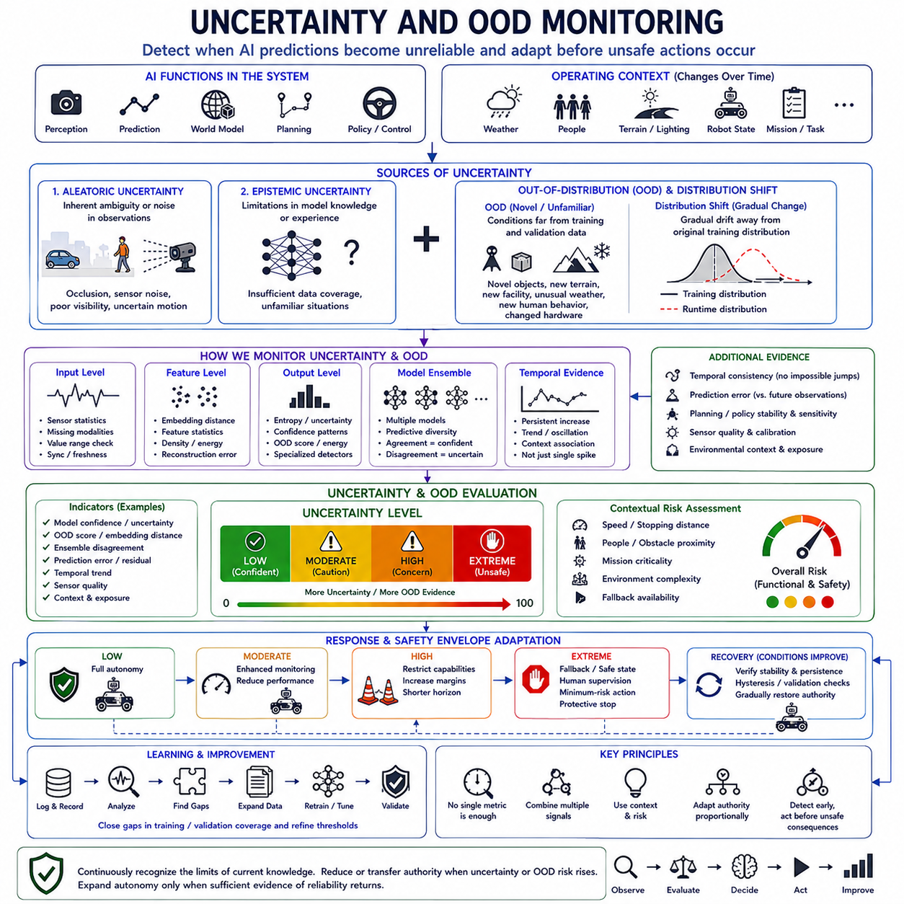{width="7.268055555555556in" height="7.268055555555556in"}

Uncertainty monitoring determines how confidently a Physical AI system can rely on its perception, prediction, world modeling, planning, and decision outputs during operation. Because autonomous systems act in open and changing environments, uncertainty cannot be eliminated completely. Runtime assurance must therefore estimate when uncertainty is increasing and determine whether the remaining confidence is sufficient for continued autonomous authority.

Uncertainty can originate from several fundamentally different sources. Aleatoric uncertainty reflects ambiguity or noise inherent in observations, such as occlusion, sensor noise, uncertain human motion, or poor visibility. Epistemic uncertainty reflects limitations in the model\'s knowledge, often caused by insufficient training coverage or unfamiliar situations. Distinguishing these sources helps determine whether additional sensing, conservative behavior, or model fallback is appropriate.

Out-of-distribution monitoring focuses on situations that differ significantly from the data or conditions under which an AI model was trained and validated. A robot may encounter unfamiliar objects, unusual terrain, new facility layouts, unexpected weather, novel human behavior, or modified hardware configurations. The model may still produce apparently reasonable outputs, making explicit OOD monitoring important for detecting hidden loss of reliability.

Distribution shift does not always mean that an observation is completely novel. Gradual changes in lighting, sensor characteristics, traffic patterns, payload, surface conditions, or operating procedures can move runtime data away from the original training distribution. Monitoring statistical changes over time helps detect this drift before accumulated differences significantly undermine the assumptions used during model validation.

OOD detection can operate at input, feature, and output levels. Input statistics can reveal unusual sensor distributions, while latent embeddings may show that current observations lie far from known training representations. Output entropy, confidence patterns, reconstruction error, density estimates, energy scores, or specialized OOD detectors can provide additional evidence that the system is operating outside familiar conditions.

No single uncertainty or OOD metric should normally be treated as definitive safety evidence. Neural networks may remain highly confident on unfamiliar inputs, while conservative detectors may generate false alarms for harmless variations. Runtime assurance should therefore combine multiple indicators, including model confidence, embedding distance, ensemble disagreement, sensor quality, temporal consistency, environmental context, and prediction error.

Model ensembles provide a practical method for estimating epistemic uncertainty. Several independently trained models, differently initialized networks, or alternative prediction mechanisms can process the same observations. Strong agreement can increase confidence, whereas substantial disagreement suggests ambiguity or insufficient knowledge. The value of this approach depends on meaningful diversity rather than merely duplicating identical failure modes.

Temporal evidence is important because isolated uncertainty spikes may not justify major intervention. Runtime monitoring can examine whether uncertainty is persistent, increasing, oscillating, or associated with particular environmental changes. A sustained rise in disagreement, prediction error, or OOD score can provide stronger evidence of degraded reliability than a single abnormal observation caused by temporary noise.

World models provide another opportunity for uncertainty monitoring by comparing predicted future states with subsequent observations. If predicted occupancy, object motion, scene evolution, or robot state repeatedly diverges from reality, the model may be operating outside its reliable predictive region. Prediction residuals can therefore serve as runtime evidence that the internal representation of the world is becoming inaccurate.

Uncertainty monitoring should also examine planning and policy outputs. A planner may produce several alternatives with nearly equal value, or a learned policy may rapidly switch between actions when small changes occur in its input. Such behavior can indicate decision uncertainty even when perception appears confident. Monitoring action stability and sensitivity helps identify uncertainty propagating from internal representations into physical control.

Context is essential when interpreting uncertainty. The same numerical confidence level may have different safety implications at low speed in an empty area and at high speed near people. Runtime assurance should therefore combine uncertainty with exposure, stopping distance, mission criticality, environmental complexity, and available fallback options rather than using one universal threshold for every operating condition.

Uncertainty should directly influence the safety envelope. As confidence decreases or OOD evidence increases, permissible velocity can be reduced, obstacle margins enlarged, human separation increased, routes restricted, and planning horizons shortened. This creates an uncertainty-aware operating boundary in which physical authority decreases progressively as the system becomes less certain about its understanding of the environment.

A graded response is generally more useful than a binary normal-or-failed decision. Low uncertainty may permit full autonomy, moderate uncertainty may trigger additional monitoring or reduced performance, and high uncertainty may require restricted capabilities or confirmation from independent systems. Extreme uncertainty can cause transition to a backup controller, human supervision, minimum-risk maneuver, or protective stop.

Recovery is equally important because uncertainty can decrease when conditions improve. A robot leaving a dusty area, reacquiring localization, restoring sensor visibility, or returning to a familiar environment may regain sufficient confidence for broader autonomy. Recovery should nevertheless use defined hysteresis, persistence requirements, or validation checks so that authority does not repeatedly switch between modes because of noisy threshold crossings.

OOD events should be recorded as valuable operational evidence rather than treated only as temporary runtime anomalies. Inputs associated with high uncertainty, unfamiliar embeddings, disagreement, prediction failures, interventions, and environmental context can reveal gaps in training and validation coverage. These records can support dataset expansion, scenario generation, retraining, threshold refinement, and future safety verification.

Monitoring itself must be validated because uncertainty estimates can also fail. Calibration may deteriorate under distribution shift, OOD detectors may be insensitive to certain novelty types, and ensemble members may share common biases. Runtime assurance should therefore avoid assuming that an uncertainty estimator is infallible and should combine model-based signals with independent sensor, system, environmental, and behavioral evidence.

At fleet scale, uncertainty monitoring can reveal patterns that are difficult to identify from a single robot. Multiple robots reporting increased OOD scores or similar prediction errors in the same location may indicate a site-level environmental change or previously unseen condition. Shared evidence can improve collective awareness, while each robot should retain local authority to react immediately to its own uncertainty.

Uncertainty and OOD monitoring ultimately provide a mechanism for recognizing the limits of what a Physical AI system currently knows. Instead of treating every AI output as equally trustworthy, runtime assurance continuously evaluates confidence, novelty, disagreement, prediction accuracy, and contextual risk. Autonomous authority can then contract before uncertain intelligence produces unsafe physical consequences and expand again only when sufficient evidence of reliability returns.

## 07.08. State Action and Trajectory Monitoring

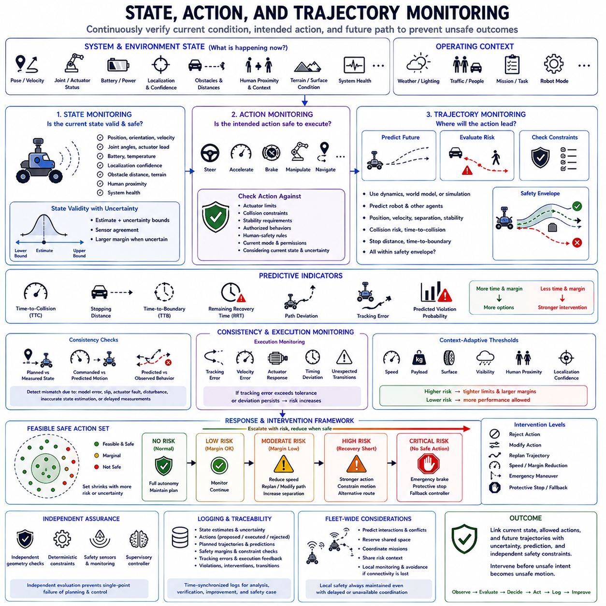{width="7.268055555555556in" height="7.268055555555556in"}

State, action, and trajectory monitoring provides runtime assurance by continuously checking what a Physical AI system is, what it intends to do, and where its behavior is likely to lead. These three monitoring perspectives connect the current physical condition of the robot with immediate control decisions and future motion, allowing unsafe behavior to be detected before it develops into an irreversible physical consequence.

State monitoring evaluates whether the robot and its environment remain within permitted operating conditions. Relevant states may include position, orientation, velocity, acceleration, joint configuration, actuator load, battery condition, localization confidence, human proximity, obstacle distance, terrain condition, and system health. The monitored state therefore combines physical configuration, environmental context, and operational readiness.

State validity must include uncertainty because runtime state estimates are rarely exact. Localization covariance, perception confidence, sensor disagreement, delayed measurements, or incomplete observations can make the estimated state differ from reality. Runtime assurance should therefore evaluate both the nominal state and its uncertainty bounds, using larger safety margins whenever the physical condition of the system cannot be determined with sufficient confidence.

Action monitoring evaluates commands before or while they are executed. Actions can include steering, acceleration, braking, manipulator motion, force commands, navigation decisions, task transitions, or learned policy outputs. A proposed action should be checked against actuator limits, collision constraints, stability requirements, authorized behaviors, human-safety rules, and the current operational mode before it receives physical authority.

An action cannot be judged safely without considering the state from which it is executed. The same acceleration command may be acceptable in an open area but unsafe near a person, on a slippery surface, or when localization confidence is poor. State-action monitoring therefore evaluates whether a particular action is permissible under the current combination of physical conditions, environmental context, uncertainty, and system health.

Trajectory monitoring extends assurance beyond individual actions by evaluating sequences of future states and controls. A trajectory may satisfy immediate constraints while gradually approaching an obstacle, unstable configuration, restricted region, or situation from which braking is impossible. Monitoring the complete planned path allows the system to identify risks that are invisible when commands are examined only one control cycle at a time.

Prediction is central to trajectory monitoring. Robot dynamics, reachable-state analysis, motion forecasting, world models, or conservative simulation can estimate how the system will evolve under candidate actions. Predicted position, velocity, separation, stability, and collision risk can then be compared with safety constraints. Behavior can be rejected before execution if future states are expected to leave the permitted safety envelope.

Trajectory monitoring should include other moving agents because the future environment is not static. Humans, vehicles, robots, manipulators, and moving equipment can change the safety of an otherwise valid path. Predicted trajectories should therefore consider possible motion of relevant agents and incorporate uncertainty margins when their future behavior cannot be estimated reliably.

Time-to-collision, stopping distance, time-to-boundary, and remaining recovery time are useful predictive indicators. They describe not only whether a hazard exists but how much time remains before intervention becomes ineffective. Runtime assurance can use these quantities to escalate responses progressively, allowing replanning or speed reduction when sufficient margin exists and stronger intervention when recovery time becomes critically short.

Consistency between state, action, and trajectory information should also be monitored. A planned trajectory may assume a velocity that differs from the measured robot state, or actuator commands may fail to produce the expected motion. Persistent differences between commanded, predicted, and observed behavior can indicate control faults, model mismatch, wheel slip, actuator degradation, external disturbance, or inaccurate state estimation.

Execution monitoring closes the loop by comparing planned behavior with actual physical behavior. The system can measure tracking error, path deviation, velocity error, actuator response, timing deviation, and unexpected state transitions. If the robot cannot follow the trajectory within validated tolerances, continuing to issue the original commands may become unsafe even if the trajectory itself was initially considered valid.

Monitoring thresholds should depend on context rather than remaining universally fixed. Higher velocity, heavier payload, poor surface conditions, reduced visibility, human proximity, or degraded localization may require tighter action limits and larger trajectory margins. Context-sensitive thresholds allow the runtime assurance system to preserve useful performance when conditions are favorable while becoming more conservative as operational risk increases.

Uncertainty should propagate from state estimation into action and trajectory evaluation. If the robot\'s location, obstacle position, human motion, or dynamic parameters are uncertain, future trajectories should not be represented as exact lines. Reachable regions, confidence bounds, probabilistic occupancy, or conservative margins can represent possible evolution and determine whether all sufficiently plausible outcomes remain acceptably safe.

When monitoring detects a developing violation, intervention can occur at several levels. The system may reject an action, reduce speed, modify acceleration, constrain steering, replan the trajectory, increase separation, or select another route. Early intervention preserves more feasible alternatives, whereas delayed detection may leave only emergency braking, minimum-risk maneuver, protective stopping, or transfer to a backup controller.

A critical concept is the feasible safe action set: the collection of actions that can be executed from the current state without causing unacceptable future risk. Runtime assurance can continuously estimate this set and restrict the primary controller to actions inside it. As hazards or uncertainty increase, the safe set contracts; when conditions improve, it may expand and restore greater autonomous freedom.

If the feasible safe action set becomes empty, normal autonomous operation should no longer continue. This condition indicates that no available command can confidently preserve the required safety constraints under the current assumptions. The runtime architecture should then transition toward a predefined fallback strategy, minimum-risk condition, protective stop, or another state designed to minimize physical consequences.

Monitoring should remain sufficiently independent from the planning and control functions being supervised. A planner should not be the sole judge of whether its own trajectory is safe. Independent geometric checks, deterministic constraints, simplified dynamic models, safety sensors, or supervisory controllers can evaluate state-action-trajectory consistency and reduce the risk that a single modeling or reasoning error defeats both autonomy and assurance.

Logging provides evidence of how autonomous behavior evolved before and during safety interventions. State estimates, uncertainty bounds, proposed actions, planned trajectories, predicted violations, safety margins, rejected commands, tracking errors, and fallback transitions can be recorded together. These synchronized traces support incident reconstruction, verification, threshold refinement, model improvement, and safety-case development.

At fleet scale, state-action-trajectory monitoring must include interactions among multiple robots. Individual trajectories may be safe in isolation but incompatible when robots share intersections, corridors, workspaces, or resources. Fleet coordination can predict conflicts and reserve shared space, while each robot retains local monitoring and collision avoidance capable of protecting it if centralized coordination becomes delayed or unavailable.

State, action, and trajectory monitoring ultimately forms a continuous chain from observation to physical consequence. State monitoring establishes where the system is, action monitoring determines what it may do, and trajectory monitoring evaluates where those actions may lead. By linking these levels with uncertainty, prediction, execution feedback, and independent safety constraints, runtime assurance can intervene before unsafe intent becomes unsafe motion.

## 07.09. World Model Prediction Consistency Monitoring

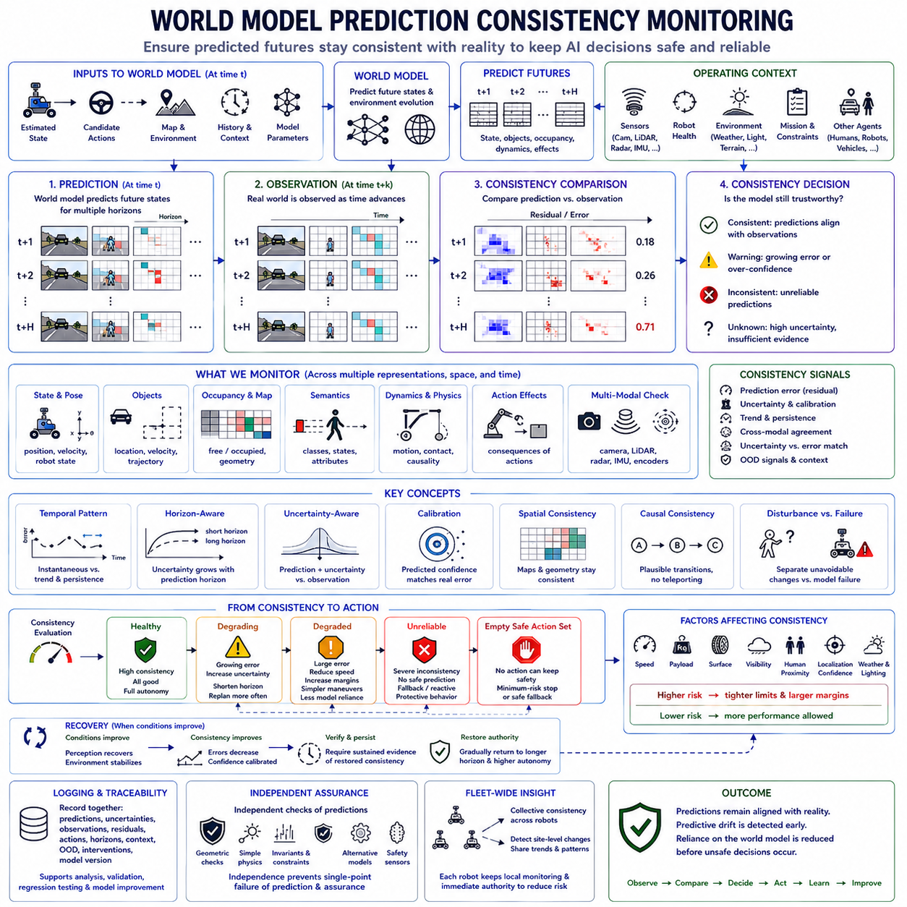{width="7.268055555555556in" height="7.268055555555556in"}

World model prediction consistency monitoring evaluates whether the future states predicted by a Physical AI system remain aligned with the physical world as it actually unfolds. A world model may predict object motion, occupancy, robot state, environmental change, and action consequences. Runtime assurance compares these predictions with subsequent observations to determine whether the internal predictive representation remains trustworthy.

The fundamental mechanism is a prediction-observation feedback loop. At time t, the world model receives the current estimated state and candidate actions and predicts future states at t+1, t+2, or longer horizons. When those future moments arrive, sensor observations and state estimates provide evidence of what actually occurred. Differences between prediction and observation become consistency signals for runtime monitoring.

Prediction consistency should be evaluated across multiple representations rather than through a single global error. Robot pose, velocity, object location, occupancy, depth, semantic state, traversability, contact, human motion, and environmental dynamics may each exhibit different failure characteristics. Representation-specific monitoring helps determine which part of the predicted world is becoming unreliable instead of treating every mismatch as complete model failure.

State-transition consistency examines whether predicted changes obey plausible physical and operational dynamics. Objects should not teleport between locations, robot motion should remain compatible with commanded actions and dynamics, and persistent structures should not disappear without explanation. Violations of these relationships can indicate model error, inaccurate state estimation, corrupted observations, unexpected disturbances, or conditions outside the model\'s learned experience.

Action-conditioned consistency is especially important because a useful world model must represent how the environment changes in response to robot behavior. The monitor can compare predicted consequences of steering, acceleration, manipulation, contact, or navigation actions with observed outcomes. If identical classes of actions repeatedly produce consequences different from those predicted, the model may no longer represent the current system or environment accurately.

Prediction error should be monitored as a temporal pattern rather than only as an instantaneous value. A single mismatch may result from measurement noise or an unusual transient event, while steadily increasing residuals can indicate systematic model drift. Moving statistics, cumulative errors, trend detection, and persistence tests help distinguish temporary prediction noise from sustained degradation of the world model.

Prediction horizons require separate treatment because uncertainty normally increases further into the future. A model may remain accurate for several hundred milliseconds while becoming unreliable over several seconds. Runtime monitoring should therefore characterize consistency as a function of prediction horizon and determine how far into the future the model currently provides sufficiently reliable information for planning and safety decisions.

Uncertainty must accompany prediction error because not every mismatch has the same meaning. A prediction that explicitly represents a wide uncertainty range may remain statistically consistent with the observation even when its nominal estimate is inaccurate. Conversely, a highly confident prediction that repeatedly contradicts reality provides stronger evidence of model failure. Consistency monitoring should therefore evaluate both error magnitude and predicted uncertainty.

Calibration determines whether the uncertainty predicted by the world model corresponds reasonably to observed errors. If actual outcomes repeatedly fall outside predicted confidence regions, the model may be overconfident. If uncertainty remains excessively large even under familiar conditions, the model may become operationally uninformative. Runtime calibration monitoring helps determine whether predictive confidence remains meaningful enough to support autonomous decisions.

Spatial consistency is important for world models that predict occupancy, geometry, or scene evolution. Predicted free space should correspond with subsequent sensor observations, obstacles should appear near expected locations, and persistent map structures should remain geometrically coherent. Growing spatial disagreement can reveal localization drift, perception degradation, environmental change, or failures in the world model\'s internal spatial representation.

Temporal consistency evaluates whether predicted sequences evolve smoothly and causally through time. Object motion, human trajectories, traffic flow, manipulation states, and robot dynamics should follow plausible transitions rather than unstable jumps or oscillations. Comparing successive predictions with both previous predictions and later observations can reveal instability that may not be visible when individual predicted frames are inspected independently.

Multi-modal consistency can strengthen monitoring by comparing predictions against independent sensing channels. A predicted obstacle trajectory may be checked against camera, LiDAR, radar, or occupancy observations, while predicted robot motion can be compared with encoders and IMU measurements. Agreement across diverse modalities increases confidence, whereas systematic disagreement can help distinguish model failure from failure of a single sensing source.

Unexpected environmental changes should not automatically be interpreted as world model faults. A person may suddenly change direction, an object may fall, a door may open, or another robot may behave unpredictably. Runtime monitoring should distinguish unavoidable environmental unpredictability from systematic predictive weakness by examining recurrence, context, uncertainty estimates, sensor evidence, and whether errors persist after the model receives updated observations.

Consistency degradation should influence planning authority. If short-horizon predictions remain reliable but long-horizon predictions deteriorate, the system can shorten its planning horizon and replan more frequently. Greater degradation may require lower speed, increased separation margins, simpler maneuvers, reduced dependence on model-based planning, or transition toward deterministic or reactive safety mechanisms that require fewer predictive assumptions.

Severe inconsistency can indicate that the model is operating outside its validated or learned domain. Persistent prediction residuals, abnormal latent states, high ensemble disagreement, and repeated confidence violations can be combined with out-of-distribution indicators. This relationship connects world model consistency monitoring with broader uncertainty and OOD monitoring, allowing predictive failure to become evidence for reducing autonomous authority.

Recovery should be evaluated explicitly because predictive consistency can improve after temporary degradation. Once perception recovers, environmental conditions stabilize, or the robot returns to familiar operating conditions, prediction errors may decrease. Runtime assurance should require sustained evidence of restored consistency before returning to longer planning horizons or higher autonomy, preventing unstable switching between degraded and normal operation.

Monitoring should remain sufficiently independent from the world model being evaluated. A model should not be the sole mechanism responsible for judging the correctness of its own predictions. Independent sensor observations, geometric checks, simplified dynamics, physical invariants, alternative models, or deterministic constraints provide external reference points and reduce the risk that one modeling error corrupts both prediction and assurance.

Logging prediction consistency creates valuable evidence for model improvement and safety validation. Predicted states, uncertainty ranges, actual observations, residual errors, prediction horizons, actions, environmental conditions, OOD indicators, interventions, and model versions can be recorded together. These traces reveal where prediction fails and support dataset expansion, retraining, calibration improvement, scenario testing, and regression analysis.

At fleet scale, prediction consistency can be evaluated collectively. If several robots experience similar prediction errors in the same area or operating condition, the cause may be a site-level change rather than an isolated model failure. Shared residual patterns can improve collective awareness and identify emerging conditions, while each robot retains local monitoring and immediate authority to reduce risk independently.

World model prediction consistency monitoring ultimately closes the loop between imagined futures and physical reality. A world model is valuable only while its predictions remain sufficiently aligned with what subsequently occurs. By continuously comparing prediction with observation across states, actions, horizons, uncertainty, space, and time, runtime assurance can detect predictive drift and reduce reliance on the model before inaccurate imagined futures produce unsafe physical decisions.

## 07.10. System Resource and Timing Monitoring

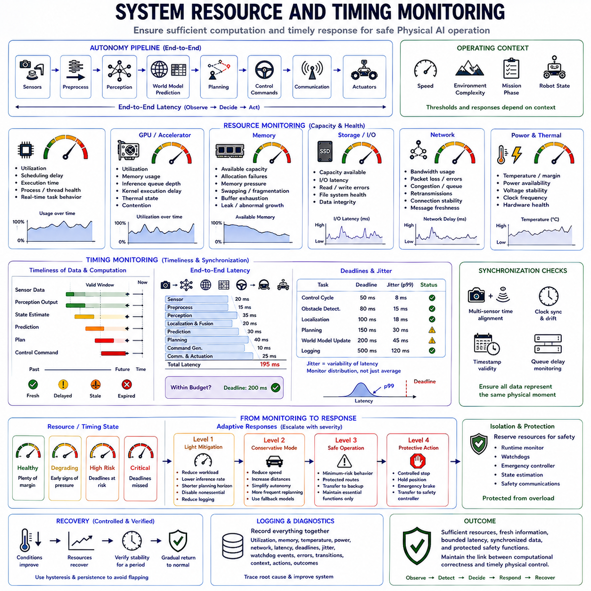{width="7.268055555555556in" height="7.268055555555556in"}

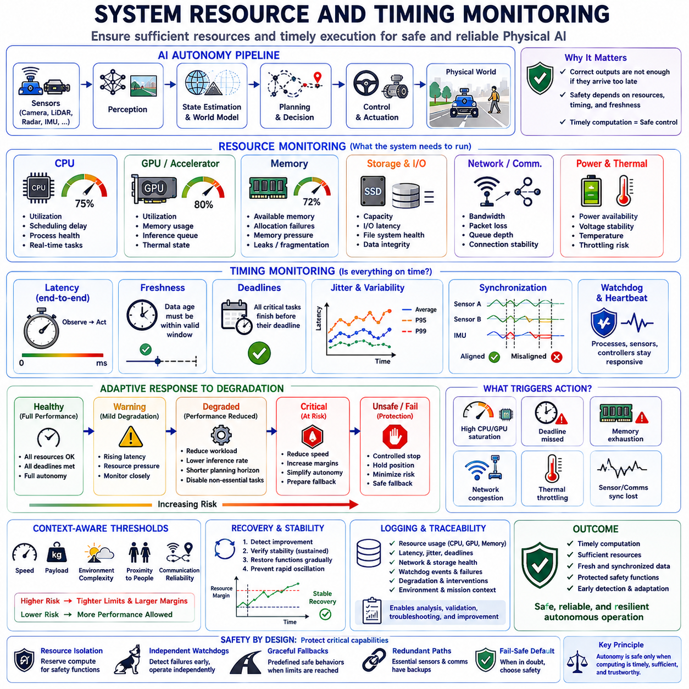{width="7.268055555555556in" height="7.268055555555556in"}

System resource and timing monitoring ensures that a Physical AI system retains the computational capacity and temporal responsiveness required for safe autonomous operation. Perception, world modeling, planning, control, and runtime assurance all depend on computations completing with sufficient resources and within defined deadlines. Correct algorithms can still become unsafe when their outputs arrive too late or when critical resources become unavailable.

Physical AI workloads frequently combine cameras, LiDAR, radar, localization, neural inference, world models, VLA systems, motion planning, and control on shared computing platforms. These components compete for CPU, GPU, memory, storage, network bandwidth, and power. Runtime monitoring must therefore observe the complete resource environment rather than assuming that successful software execution guarantees sufficient computational health.

CPU monitoring evaluates utilization, scheduling delay, execution time, process availability, thread starvation, and real-time task behavior. High average utilization alone does not necessarily indicate failure, but sustained saturation can delay safety-critical tasks. Monitoring should therefore focus on whether essential processes receive predictable execution opportunities and whether their worst-case timing remains compatible with physical control requirements.

GPU monitoring is increasingly important because perception networks, foundation models, world models, and learned policies can consume substantial accelerator capacity. GPU utilization, memory allocation, inference queue depth, kernel execution delay, thermal state, and contention among models can reveal developing overload. Safety-critical inference should not silently miss deadlines because a lower-priority AI workload monopolizes accelerator resources.

Memory health includes more than total memory consumption. Runtime assurance should observe available capacity, allocation failures, memory pressure, swapping, fragmentation, buffer exhaustion, and abnormal growth that may indicate a leak. A system operating near its memory limit can experience sudden latency increases or process termination, transforming a gradual resource problem into an immediate loss of autonomous capability.

Storage and data-path health can also influence runtime safety. Logging, map access, model loading, local databases, and temporary sensor buffers may depend on persistent storage. Low capacity, excessive I/O latency, file-system faults, or corrupted data can interfere with system operation. Monitoring should distinguish noncritical logging degradation from storage failures that directly affect localization, models, configuration, or recovery functions.

Network resources become safety relevant when perception modules, controllers, sensors, or fleet services communicate across Ethernet, CAN, wireless networks, or other middleware. Bandwidth saturation, packet loss, congestion, retransmission, queue growth, and connection instability can delay or remove information required for decisions. Runtime assurance should monitor both communication availability and whether messages arrive within their useful temporal window.

Timing monitoring evaluates whether information and computations remain synchronized with the physical world. Sensor observations, perception outputs, state estimates, predictions, plans, and control commands each have a period during which they remain valid. A technically correct result can become dangerous when used after the environment has changed, making freshness and latency fundamental safety properties rather than merely performance metrics.

End-to-end latency should be considered across the complete autonomy pipeline. Sensor acquisition, preprocessing, inference, fusion, localization, prediction, planning, command generation, communication, and actuator response all contribute to the delay between observing the world and physically reacting to it. Monitoring only individual module execution times can miss accumulated latency that makes the complete control loop unsafe.

Deadline monitoring determines whether critical computations complete before defined temporal limits. Control cycles, obstacle detection, emergency response, localization updates, and safety checks may have different deadlines according to robot dynamics. A missed deadline should be treated explicitly because continuing with stale outputs can be more dangerous than recognizing that valid information is temporarily unavailable.

Jitter is another important timing property because predictable latency can often be accommodated while highly variable latency is difficult to manage safely. Occasional long inference times, scheduler interference, garbage collection, memory paging, network bursts, or thermal throttling can produce timing spikes. Monitoring latency distributions and worst-case behavior therefore provides more useful assurance than relying only on average execution time.

Sensor and computation synchronization must also be supervised. Multi-camera systems, LiDAR-camera fusion, IMU integration, and distributed perception require observations from compatible time references. Clock drift, timestamp errors, synchronization loss, or delayed queues can combine measurements representing different physical moments. The resulting fused state may appear plausible while describing a world configuration that never actually existed.

Watchdogs provide a simple but important layer of timing assurance. Processes, controllers, sensors, and communication channels can periodically demonstrate that they remain responsive. Missing heartbeat signals or execution acknowledgments can trigger escalation before prolonged silence creates uncontrolled behavior. Independent watchdogs are particularly valuable when they remain operational despite failure or overload of the primary computing environment.

Resource monitoring should account for temperature, power, and hardware throttling because computational capability depends on physical operating conditions. High temperature can reduce CPU or GPU frequency, while unstable power can reset devices or degrade accelerators and sensors. Monitoring thermal margin, power availability, clock frequency, and hardware health helps predict performance degradation before timing failures become visible at the software level.

Resource isolation protects safety-critical functions from performance-oriented AI workloads. Runtime monitors, emergency controllers, watchdogs, communication safety paths, and essential state estimation should retain reserved CPU time, memory, communication bandwidth, or independent computing resources. Without isolation, the same overload that disables primary autonomy may also prevent the safety architecture from recognizing and responding to the failure.

Monitoring should combine resource state with mission and physical context. A temporary increase in latency may be tolerable while a robot is stationary but unacceptable when traveling quickly near people. Resource thresholds should therefore reflect velocity, stopping distance, environmental complexity, current autonomy mode, and available fallback options. Computational health becomes meaningful when interpreted in relation to physical risk.

Degradation should produce graded operational responses rather than waiting for complete resource exhaustion. Rising latency or resource pressure may first trigger workload reduction, lower inference frequency, shorter planning horizons, disabled nonessential models, or reduced logging. Further degradation can reduce robot speed, simplify autonomy, increase safety margins, or transfer functions to predefined backup mechanisms.

When critical timing guarantees can no longer be maintained, the system should transition toward a safe operating condition. A stale trajectory, delayed perception result, or missing control update should not be reused indefinitely merely to preserve mission continuity. Depending on the platform, the appropriate response may include controlled deceleration, hold position, minimum-risk maneuver, protective stop, or transfer to an independent safety controller.

Recovery from resource degradation should be controlled rather than immediate. After temperature decreases, memory becomes available, network congestion clears, or compute load returns to normal, the system should verify that timing and resource margins remain stable for a defined period. Hysteresis and persistence criteria prevent rapid switching between normal and degraded modes when computational conditions fluctuate near thresholds.

Logging provides essential evidence for diagnosing resource and timing failures. CPU and GPU utilization, memory pressure, temperatures, queue depths, network delay, execution times, missed deadlines, watchdog events, process failures, degradation transitions, and physical operating context can be recorded together. Correlating these signals helps identify whether unsafe behavior originated from algorithms, resource contention, timing failure, or hardware degradation.

System resource and timing monitoring ultimately ensures that autonomous intelligence is not granted physical authority merely because its software remains logically functional. Safe Physical AI requires sufficient computation, fresh information, bounded latency, synchronized data, and protected safety resources. By detecting degradation early and adapting autonomy before deadlines are lost, runtime assurance preserves the connection between computational correctness and timely physical control.

## 07.11. Drift and Performance Degradation Detection

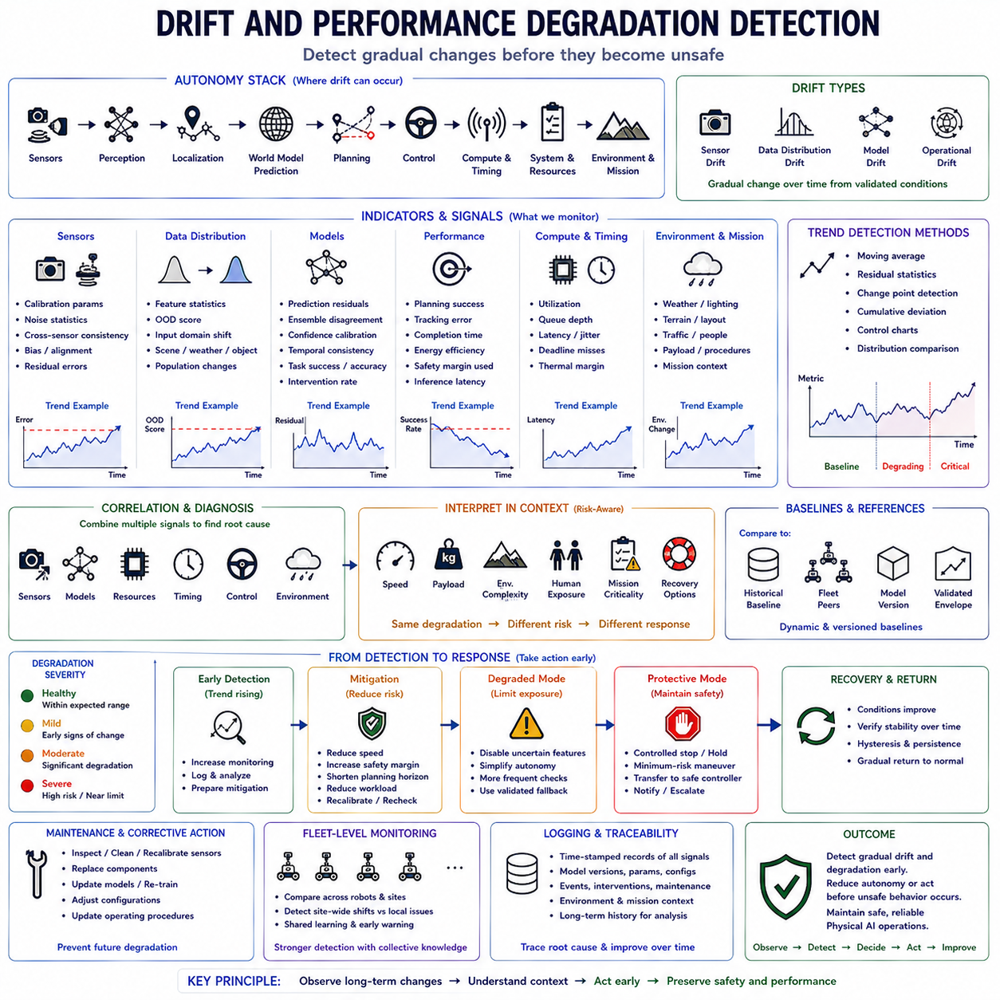{width="7.268055555555556in" height="7.268055555555556in"}

Drift and performance degradation detection determines whether a Physical AI system is gradually moving away from the conditions and performance levels established during validation. Unlike abrupt faults, degradation may emerge slowly through changing environments, aging hardware, evolving data distributions, model adaptation, or accumulated calibration error. Runtime assurance must identify these trends before they become unsafe behavior.

Drift can occur at several layers of the autonomy stack. Sensor drift changes measurement characteristics, data drift changes the statistical properties of observations, model drift changes predictive behavior, and operational drift changes the environment or mission context. Performance degradation may therefore originate from perception, localization, world modeling, planning, control, compute resources, or interactions among multiple subsystems.

Sensor drift often develops gradually and can remain hidden behind apparently valid measurements. Camera exposure characteristics, LiDAR alignment, IMU bias, wheel encoder scale, GNSS accuracy, temperature sensitivity, or sensor mounting geometry may change over time. Runtime monitoring can track reference relationships, calibration parameters, noise statistics, cross-sensor consistency, and residual errors to identify slow deterioration.

Data distribution drift occurs when runtime observations increasingly differ from the data used for training and validation. Changes in lighting, weather, terrain, facility layout, object populations, human behavior, traffic patterns, payload, or operating procedures can alter the input distribution. Statistical monitoring can reveal whether these changes are temporary variations or persistent shifts that challenge validated assumptions.

Model performance can degrade even when the model parameters themselves have not changed. A perception network, world model, policy, or VLA system may encounter combinations of conditions that were poorly represented during training. Confidence calibration, prediction residuals, ensemble disagreement, temporal consistency, task success, and intervention frequency can provide indirect evidence that effective model reliability is declining.

Adaptive models introduce another form of drift because their parameters or internal memory may change after deployment. Online learning, parameter-efficient fine-tuning, memory augmentation, and site-specific adaptation can improve performance while also moving behavior away from the originally verified configuration. Runtime assurance should therefore track model identity, adaptation history, parameter versions, and behavioral changes associated with updates.

Performance degradation should be measured against explicit operational baselines. Relevant indicators may include perception accuracy proxies, localization residuals, world-model prediction error, planning success, trajectory tracking error, task completion time, intervention frequency, energy efficiency, inference latency, and safety-margin consumption. Baselines provide a reference for determining whether current behavior remains within validated expectations.

Single measurements are rarely sufficient for detecting gradual degradation. Runtime monitoring should analyze trends across appropriate temporal windows using moving averages, residual statistics, change-point detection, cumulative deviation, control charts, or other trend indicators. The objective is to distinguish normal variability from persistent movement toward poorer performance without reacting excessively to temporary noise.

Different degradation mechanisms evolve at different time scales. Thermal throttling may develop within minutes, localization drift within seconds or hours, sensor aging across months, and environmental distribution shift across seasons or deployments. Monitoring windows and thresholds should therefore match the expected dynamics of each failure mechanism rather than applying one universal temporal criterion.

Cross-layer correlation helps identify the origin of degradation. Increasing localization error combined with growing LiDAR-camera inconsistency may suggest calibration drift, while rising world-model prediction error with healthy sensors may indicate model-domain mismatch. Correlating perception, model, resource, timing, control, and environmental indicators provides stronger diagnostic evidence than monitoring each subsystem independently.

Performance degradation must also be interpreted relative to operational risk. A modest increase in tracking error may be acceptable at low speed in an open environment but unacceptable near people or narrow infrastructure. Runtime assurance should combine degradation severity with speed, payload, environmental complexity, human exposure, mission criticality, and available recovery options when determining the appropriate response.

Early detection allows gradual mitigation before emergency intervention becomes necessary. The system may reduce speed, increase safety margins, shorten planning horizons, increase monitoring frequency, disable uncertain capabilities, request recalibration, or shift toward simpler validated functions. This preserves useful autonomy while reducing dependence on components whose performance is trending toward unacceptable levels.

Degradation can also trigger maintenance-oriented responses rather than immediate mission termination. Persistent sensor bias, increasing actuator effort, abnormal thermal behavior, storage errors, or communication instability may indicate emerging hardware problems. Runtime monitoring can generate diagnostic evidence that supports inspection, calibration, component replacement, or scheduled maintenance before complete failure occurs.

Threshold design should include hysteresis and persistence requirements because measurements often fluctuate around boundaries. Entering a degraded mode may require sustained evidence that performance has crossed a limit, while returning to normal operation may require stronger evidence of recovery. This prevents repeated transitions between states and reduces instability caused by noise or short-lived disturbances.

Drift detection should distinguish reversible degradation from structural change. Temporary fog, network congestion, or thermal overload may disappear when conditions improve, whereas sensor misalignment, hardware aging, persistent environmental change, or model mismatch may require engineering intervention. The recovery strategy should therefore depend on whether the underlying cause can reasonably disappear during continued operation.

Fleet-level monitoring can make drift easier to detect by comparing behavior across robots operating under similar conditions. If one robot develops increasing localization residuals while others remain stable, the cause may be local hardware degradation. If many robots show similar prediction errors at the same location or time, the evidence may indicate site-level distribution shift or environmental change.

Shared fleet statistics can also establish dynamic reference populations for performance comparison. Robots with similar hardware, software, tasks, and operating conditions can provide peer baselines for latency, energy use, tracking accuracy, perception consistency, or intervention rates. Significant deviation from comparable peers can reveal degradation even when absolute thresholds have not yet been exceeded.

Logging and traceability are essential because drift is fundamentally a historical phenomenon. Sensor statistics, model versions, prediction residuals, task outcomes, timing metrics, environmental conditions, maintenance events, calibration changes, interventions, and safety margins should be recorded with consistent timestamps. Longitudinal traces allow engineers to reconstruct how degradation developed and identify its likely causes.

Detected drift should feed back into validation and lifecycle management. Repeated OOD events, recurring prediction errors, changing operational distributions, and newly observed failure patterns can identify gaps in datasets and test scenarios. These findings can guide retraining, recalibration, simulation campaigns, regression testing, maintenance policy, and updates to the validated operational envelope.

Drift monitoring itself must remain trustworthy. Baselines can become obsolete, thresholds can be poorly calibrated, and monitoring algorithms can confuse legitimate operational evolution with degradation. Reference models and limits should therefore be versioned, reviewed, and validated against representative scenarios so that the monitoring system evolves together with the Physical AI platform.

Drift and performance degradation detection ultimately provides an early-warning layer between normal operation and explicit failure. By observing long-term changes across sensors, data, models, computation, control, and environment, runtime assurance can recognize when previously validated performance is being lost. Autonomous authority can then be reduced, maintenance initiated, or validation updated before gradual deterioration becomes unsafe physical behavior.

## 07.12. Anomaly and Novelty Detection

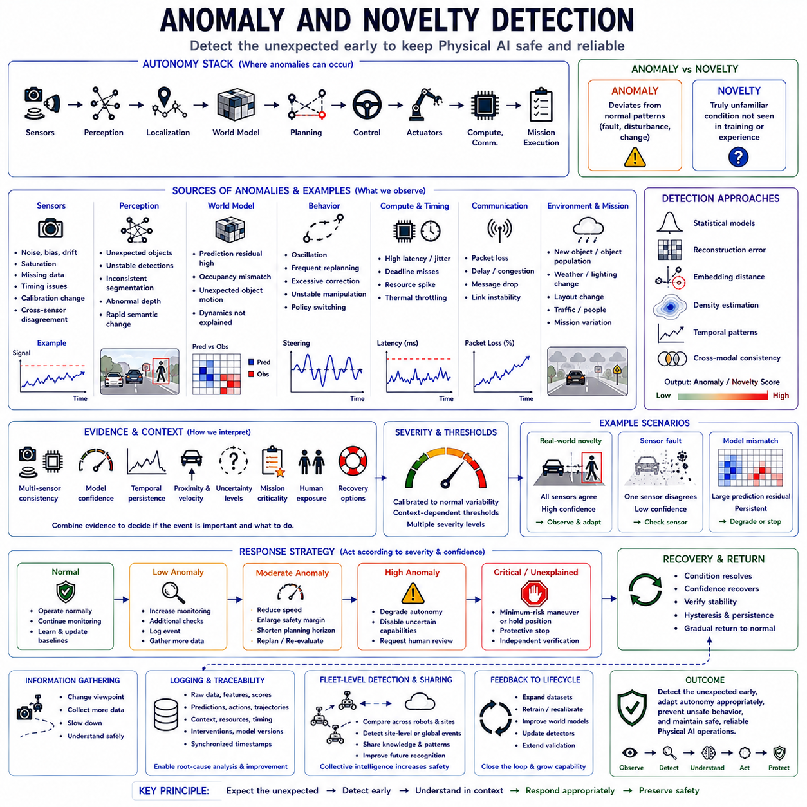{width="7.268055555555556in" height="7.268055555555556in"}

Anomaly and novelty detection provides runtime assurance by identifying observations, behaviors, system states, or interactions that differ meaningfully from what a Physical AI system normally expects. Unlike monitoring that checks only predefined limits, anomaly detection searches for unusual patterns that may indicate faults, environmental changes, emerging hazards, or previously unseen situations requiring additional caution.

An anomaly is generally an observation or behavior that deviates from an established reference pattern, while novelty refers to a condition that is genuinely unfamiliar to the system. The distinction is important because unusual behavior may result from a known fault or temporary disturbance, whereas novelty may indicate that the robot has entered a situation poorly represented by its training, validation, or operational experience.

Detection can operate across multiple layers of the autonomy system. Sensor measurements, perception outputs, localization states, world-model representations, planned trajectories, control commands, actuator responses, computational resources, communication behavior, and mission execution can all contain anomalous patterns. Cross-layer monitoring provides broader coverage than relying on a single AI model or subsystem.

Sensor-level anomaly detection searches for unusual noise, bias, saturation, missing measurements, timing irregularities, calibration changes, or disagreement among redundant sensors. A camera may produce abnormal exposure patterns, an IMU may develop bias, or LiDAR returns may suddenly become sparse. These changes may remain within hardware limits while still reducing the reliability of downstream perception and state estimation.

Perception anomalies can appear as unexpected object configurations, unstable detections, inconsistent segmentation, abnormal depth estimates, or rapid semantic changes. Novel objects and unusual scenes may also produce latent representations far from familiar examples. Monitoring both output behavior and internal feature representations can reveal when perception is processing conditions that differ substantially from validated experience.

World models provide a powerful basis for anomaly detection because they encode expectations about how states should evolve. When subsequent observations differ strongly from predicted occupancy, object motion, robot state, interaction outcomes, or environmental dynamics, prediction residuals become anomaly signals. Persistent or structured residuals can indicate conditions that the internal model does not adequately explain.

Behavioral anomaly detection evaluates whether actions and trajectories remain consistent with normal operational patterns. Unexpected steering oscillation, repeated replanning, unusual acceleration, excessive corrective motion, unstable manipulation, or frequent policy switching may indicate problems even when individual commands remain within allowed limits. Behavioral monitoring therefore complements deterministic safety constraints by detecting abnormal patterns before explicit violations occur.

Novelty detection often uses learned representations of familiar operating conditions. Embedding distance, density estimation, reconstruction error, energy scores, clustering, nearest-neighbor relationships, or dedicated novelty models can estimate how different a new observation is from previously known data. These methods are useful when it is impossible to enumerate every abnormal condition before deployment.

Temporal context is essential because many anomalies cannot be identified from a single observation. A sensor value may be individually plausible but abnormal when considered as part of a sequence. Runtime monitoring can examine persistence, rate of change, periodicity, transition patterns, and temporal consistency to distinguish isolated noise from meaningful changes in system or environmental behavior.

Context also determines whether an anomaly is operationally important. An unusual object far from the robot may require only observation, while the same novelty directly inside the planned path may demand immediate intervention. Anomaly severity should therefore be interpreted using proximity, velocity, stopping distance, uncertainty, mission criticality, human exposure, and available recovery options.

Anomaly detection should not automatically classify every unusual event as a fault. A newly placed object, changed facility layout, unexpected human behavior, temporary weather condition, or legitimate mission variation may be unusual without indicating system malfunction. Runtime assurance should combine environmental evidence, model confidence, sensor health, temporal persistence, and operational context before selecting a response.

Cross-modal consistency provides useful evidence for separating real-world novelty from sensor or model faults. If camera, LiDAR, radar, and other sensors independently observe the same unusual object, the event is more likely to represent genuine environmental novelty. If only one sensing channel reports the anomaly while others remain consistent, sensor degradation or processing failure becomes a stronger hypothesis.

Anomaly scores should be calibrated against representative normal variability. A detector that is too sensitive may generate excessive false alarms and unnecessarily restrict autonomy, while an insensitive detector may miss emerging hazards. Thresholds can depend on operational context and may include multiple severity levels so that uncertainty increases gradually rather than forcing every abnormal event into a binary normal-or-failed classification.

Runtime responses should scale with anomaly severity and confidence. Low-level anomalies may increase monitoring or trigger additional sensor checks. Moderate anomalies may reduce speed, enlarge safety margins, shorten planning horizons, or request replanning. Severe or unexplained anomalies near critical safety boundaries may require degraded autonomy, independent verification, minimum-risk maneuver, or protective stopping.

Novel conditions can be treated as opportunities for information gathering when sufficient safety margin exists. The robot may slow down, change viewpoint, collect additional sensor observations, or select a conservative trajectory that improves understanding without increasing exposure. This active observation strategy allows the system to resolve ambiguity before committing to actions that depend strongly on uncertain interpretations.

Recovery requires evidence that the anomaly has disappeared or has become sufficiently understood. A transient abnormal measurement may clear quickly, while a persistent novel environment may require continued degraded operation. Hysteresis and persistence criteria can prevent rapid switching between normal and restricted modes, and re-entry into full autonomy should occur only after relevant confidence and consistency measures recover.

Anomaly events should be logged with the context needed for later analysis. Sensor data, latent features, anomaly scores, world-model predictions, actions, trajectories, environmental conditions, system resources, interventions, and model versions can be synchronized around each event. These records support root-cause analysis, detector tuning, scenario reconstruction, dataset expansion, retraining, and safety validation.

At fleet scale, anomaly detection becomes more powerful because observations can be compared across multiple robots. An event that appears novel to one robot may already have been encountered by another, while simultaneous anomalies across many robots may reveal a site-level environmental or infrastructure change. Shared evidence can transform isolated novelty into collective operational knowledge.

Fleet-level novelty management should still preserve local safety authority. Communication delay, centralized processing failure, or incomplete shared knowledge must not prevent an individual robot from reacting to an immediate anomaly. Local detectors should therefore support rapid protective decisions, while fleet or on-premise intelligence can aggregate events, identify patterns, distribute knowledge, and improve future recognition.

Detected anomalies and novelties should feed back into the system lifecycle. Recurrent unusual scenes, previously unseen objects, abnormal interactions, and new operational conditions can reveal gaps in datasets, simulation scenarios, validation coverage, and safety assumptions. Engineering teams can use these events to extend training data, refine world models, update detectors, and expand validated operating knowledge.

Anomaly and novelty detection ultimately gives Physical AI a mechanism for recognizing that reality is behaving differently from expectation. By combining sensor evidence, learned representations, prediction residuals, behavioral patterns, temporal consistency, context, and fleet knowledge, runtime assurance can detect the unexpected early. Autonomous authority can then adapt before an unfamiliar or abnormal condition develops into unsafe physical behavior.

## 07.13. Runtime Shielding and Safety Filters

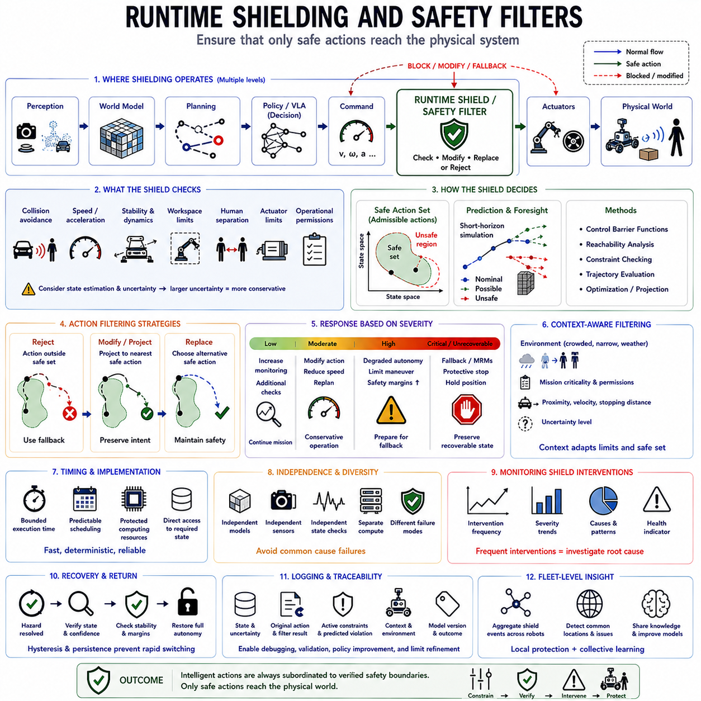{width="7.268055555555556in" height="7.268055555555556in"}

Runtime shielding and safety filters provide a protective control layer between autonomous intelligence and physical actuation. Their purpose is not to replace perception, planning, world models, or learned policies, but to ensure that proposed actions remain inside verified safety constraints. Even when an AI component produces an unsafe command, the shield can block, modify, or replace it before physical execution occurs.

A runtime shield acts as an independent decision boundary around the primary autonomy system. The primary controller may optimize task performance, efficiency, or learned objectives, while the shield evaluates whether its proposed action is admissible. This separation allows advanced AI to operate with flexibility while preserving a simpler and more interpretable mechanism responsible for enforcing critical safety properties.

Safety filters can be positioned at several points in the autonomy pipeline. They may validate high-level task commands, planned trajectories, velocity requests, actuator commands, or learned policy outputs. Filtering closer to physical actuation provides strong final protection, while earlier filtering can prevent unsafe plans from propagating through the system. Layered filtering can therefore provide defense across multiple abstraction levels.

The fundamental input to a safety filter is the current estimated state together with a proposed action. The filter evaluates whether executing that action could violate constraints involving collision avoidance, speed, acceleration, stability, workspace limits, human separation, actuator capability, or operational permissions. State uncertainty should also be considered so that uncertain conditions produce more conservative admissibility decisions.

A simple shield may reject any action that directly violates a predefined constraint. More advanced shields evaluate future consequences before allowing execution. Robot dynamics, reachable sets, short-horizon simulation, control barrier functions, predictive models, or verified transition rules can determine whether an apparently safe immediate action could lead the system toward an unsafe state from which recovery becomes impossible.

The concept of a safe action set is central to runtime shielding. For each relevant system state, the assurance mechanism can determine which actions preserve required safety properties. The primary controller retains freedom to choose among these admissible actions. When uncertainty or hazard increases, the safe action set contracts, progressively reducing autonomous authority without necessarily stopping the entire mission.

Action projection provides an alternative to simple rejection. If a proposed command lies outside the safe set, the filter can project it onto the nearest acceptable action according to defined criteria. Excessive velocity may be reduced, steering may be limited, or manipulator motion may be constrained. This preserves as much of the original intent as possible while preventing execution of the unsafe component.

Trajectory safety filters evaluate sequences of future states rather than isolated commands. A planned path may currently be collision-free while entering a region with insufficient stopping distance or limited recovery options. The filter can inspect predicted trajectories against obstacles, humans, restricted areas, stability boundaries, dynamic constraints, and uncertainty margins before granting authority for execution.

Control barrier functions provide one mathematical approach for maintaining safety constraints during continuous control. A barrier function represents the boundary between safe and unsafe states, and the controller modifies commands when necessary to prevent crossing that boundary. Such methods can preserve relatively smooth behavior while formally constraining the system to remain within a defined safe region under specified assumptions.

Runtime shielding can also use reachability analysis to reason about future safety. Instead of predicting only one nominal trajectory, reachable-state methods estimate sets of states the robot could enter under uncertainty, disturbances, or control variation. If any sufficiently plausible evolution intersects an unsafe region, the shield can restrict actions earlier, creating protection against uncertainty that a single deterministic trajectory may overlook.

Learned policies and VLA systems particularly benefit from independent safety filtering because their outputs may be difficult to verify internally. A language-conditioned or learned action can be semantically reasonable yet physically inappropriate. Before execution, the safety layer can check kinematic feasibility, collision risk, force limits, workspace permissions, task authorization, human proximity, and other deterministic constraints.

Safety filters should incorporate operational context because allowable actions depend on the environment and mission. A velocity permitted in an empty warehouse may be inappropriate near people, fragile equipment, or narrow passages. Context-aware filtering can adapt speed limits, separation margins, force limits, permitted zones, and maneuver constraints while maintaining explicit rules governing how these limits may change.

Uncertainty should make shielding more conservative rather than less effective. Poor localization, uncertain obstacle position, degraded perception, unknown surface conditions, or unreliable human-motion predictions should reduce the set of actions considered safe. Safety margins can expand dynamically, and the system can restrict velocity or maneuver complexity until sufficient confidence in the current state and environment is restored.

Shielding must operate within strict timing requirements. A safety decision that arrives after an unsafe command has already reached the actuator provides little protection. Filters therefore need bounded execution time, predictable scheduling, protected computational resources, and direct access to required state information. Critical filters may use simplified models specifically because deterministic and timely evaluation is more valuable than sophisticated but delayed reasoning.

Independence is another important architectural property. The shield should avoid sharing every assumption, model, sensor dependency, and failure mode with the controller it supervises. Deterministic geometry, safety-rated sensors, simplified dynamics, independent state checks, or separate computing resources can provide diversity. This reduces the possibility that one common error simultaneously corrupts both autonomous decision making and its protective filter.

When a proposed action cannot be safely modified, the shield should invoke a defined fallback response. Depending on the remaining safety margin, this may involve rejecting the command, holding the previous safe state, controlled deceleration, replanning, minimum-risk maneuver, or protective stopping. The response should prioritize maintaining a recoverable condition rather than preserving task completion at the expense of safety.

Repeated shield intervention is itself an important health signal. Occasional filtering may be expected during difficult situations, but frequent command rejection or modification can indicate model degradation, planner instability, environmental novelty, poor calibration, or inappropriate mission assumptions. Runtime assurance should therefore monitor intervention frequency, severity, causes, and patterns rather than treating each correction as an isolated event.

Recovery from shielding should be controlled. Once the triggering hazard disappears, the system should verify that state estimates, perception confidence, environmental conditions, and safety margins have stabilized before restoring unrestricted autonomy. Hysteresis and persistence requirements prevent rapid switching between filtered and unrestricted modes when the system operates near a safety boundary.

Shield events should be logged with enough information to reconstruct why intervention occurred. Relevant records include the estimated state, uncertainty, original action, modified or rejected action, active constraints, predicted violation, safety margins, model version, environmental context, and resulting physical behavior. These traces support debugging, safety validation, policy improvement, and refinement of operational limits.

At fleet scale, shield interventions can reveal shared weaknesses across robots. Repeated filtering at the same location may indicate environmental complexity, map problems, or inappropriate site-level policies. Similar interventions across multiple robots can reveal common model or planner limitations. Aggregating these events supports collective learning while each robot retains independent local shielding for immediate protection.

Runtime shielding and safety filters ultimately establish a controlled interface between intelligent intent and physical authority. The autonomy system may propose sophisticated actions, but only actions that satisfy the active safety conditions are permitted to reach the physical system. By combining constraint enforcement, prediction, uncertainty margins, intervention, fallback, and independent supervision, shielding ensures that intelligence remains subordinate to verified safety boundaries.

## 07.14. Simplex and Safety Controller Architectures

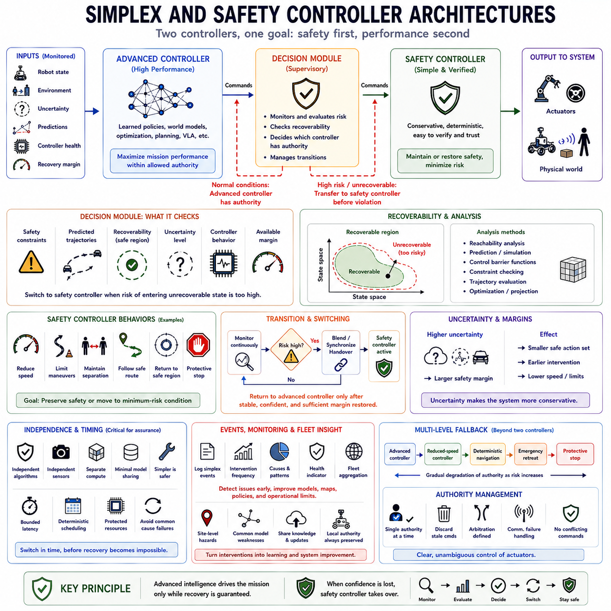{width="7.268055555555556in" height="7.268055555555556in"}

Simplex and safety controller architectures provide runtime assurance by separating high-performance autonomous control from a simpler, highly trusted safety controller. The advanced controller may use learned policies, world models, optimization, or complex planning to achieve mission objectives, while the safety controller preserves essential safety properties when the advanced controller can no longer be trusted to maintain them.

The classical Simplex architecture contains an advanced controller, a safety controller, and a decision module that supervises which controller has physical authority. Under normal conditions, the advanced controller operates the system because it can provide greater capability and performance. When monitored conditions indicate unacceptable future risk, the decision module transfers control to the safety controller before safety constraints are violated.

The advanced controller is allowed to be complex because system safety does not depend exclusively on proving every aspect of its internal behavior. It may include neural networks, reinforcement learning, VLA models, nonlinear optimization, or adaptive planning mechanisms that are difficult to verify completely. The architecture instead limits their authority through independent monitoring and a trusted recovery mechanism.

The safety controller is intentionally simpler and more conservative than the advanced controller. Its objective is not maximum mission performance but preservation of a verified safe state or transition toward a minimum-risk condition. It may enforce reduced velocity, restricted maneuvering, collision avoidance, controlled deceleration, stable posture, safe separation, return-to-safe-region behavior, or protective stopping.

A decision module acts as the supervisory mechanism between the two controllers. It continuously evaluates system state, environmental conditions, uncertainty, predicted trajectories, controller behavior, and available recovery margin. Its critical responsibility is to determine when the advanced controller must lose authority, ensuring that switching occurs early enough for the safety controller to prevent entry into an unrecoverable state.

Recoverability is therefore central to Simplex design. The system should not wait until a safety constraint has already been violated before switching controllers. Instead, the monitor determines whether the current state remains inside a recoverable region from which the safety controller can still maintain or restore safety. Approaching the boundary of this region becomes a trigger for preventive intervention.

Reachability analysis can provide a formal basis for defining recoverable regions. Given robot dynamics, actuator limits, disturbances, and environmental constraints, the system estimates states that can evolve toward hazards and states from which the safety controller can guarantee an acceptable response. These reachable sets help the decision module determine whether continued advanced control remains sufficiently safe.

Prediction-based switching offers another implementation strategy. The runtime monitor can simulate or estimate the future trajectory produced by the advanced controller and compare it with safety boundaries. If predicted motion approaches obstacles, stability limits, restricted regions, or insufficient stopping margins, control can be transferred before the dangerous state occurs. Prediction horizon must be long enough to preserve intervention time.

Uncertainty must be incorporated into switching decisions because state estimation and environmental predictions are never exact. Localization uncertainty, perception ambiguity, uncertain human motion, actuator variation, and model mismatch should reduce the region in which advanced control is permitted. Conservative margins allow the safety controller to receive authority earlier when the system has less reliable knowledge about its physical situation.

Controller switching must itself be safe. Abruptly replacing one controller with another can introduce discontinuities in steering, velocity, acceleration, force, or actuator commands. Transition logic may therefore require command blending, bounded rate changes, state synchronization, or predefined handover conditions. The transfer mechanism should prevent the assurance architecture from creating the instability it is intended to avoid.

Once the safety controller assumes authority, the system may enter a degraded operational mode rather than immediately stopping. If sufficient safety margin remains, the robot can reduce speed, follow a conservative route, maintain separation, complete a controlled retreat, or move toward a designated safe location. This preserves useful operation while ensuring that safety takes precedence over performance or mission completion.

Protective stopping becomes necessary when continued motion cannot be justified safely. The safety controller should then drive the system toward a defined minimum-risk condition using controlled braking, stable actuator states, safe manipulator posture, or other platform-specific responses. The appropriate safe state depends on robot dynamics, environment, payload, human proximity, and hazards associated with stopping in place.

Returning authority to the advanced controller requires stronger evidence than the disappearance of a single warning signal. The system should confirm that state estimation, perception confidence, computational health, environmental conditions, and recovery margins have stabilized. Hysteresis and persistence criteria prevent repeated switching between controllers when operating near the decision boundary and improve overall behavioral stability.

A Simplex architecture depends strongly on independence and diversity. The safety controller and decision module should avoid sharing all models, assumptions, software components, sensors, and computing resources with the advanced controller. Simplified dynamics, deterministic algorithms, independent sensors, separate processors, or protected execution partitions reduce common-cause failures that could otherwise disable both autonomy and safety simultaneously.

Timing guarantees are equally important because controller switching must occur before recovery becomes impossible. The monitor, decision logic, communication path, and safety controller require bounded execution latency and protected computational resources. A theoretically correct safety controller provides little protection if overloaded processors, delayed messages, or scheduling failures prevent it from receiving physical authority at the required moment.

Runtime shielding and Simplex control can complement each other. A safety filter may continuously modify small unsafe deviations while the advanced controller remains active, whereas the Simplex decision module handles larger failures by transferring authority entirely to the safety controller. This layered approach allows minor violations to be corrected locally while preserving a stronger fallback mechanism for severe or persistent degradation.

Multiple fallback controllers can extend the classical two-controller Simplex architecture. Different controllers may support reduced-speed autonomy, deterministic navigation, emergency retreat, controlled stopping, or hardware-level protection. The supervisory logic can select the least restrictive controller capable of maintaining safety, creating a graded architecture rather than a single transition directly from full autonomy to complete shutdown.

Controller authority should be explicit and unambiguous at every moment. The architecture must define which controller owns each actuator command, how stale commands are discarded, how command arbitration occurs, and how communication failure is handled. Conflicting simultaneous commands from advanced and safety controllers can undermine assurance, making deterministic authority management an essential part of the design.

Simplex events should be recorded for verification and lifecycle improvement. Relevant information includes system state, uncertainty, advanced-controller commands, predicted violations, switching criteria, controller selected, transition timing, safety margins, resulting trajectory, and recovery conditions. These traces allow engineers to determine whether intervention occurred early enough and whether the safety controller behaved as validated.

Repeated transfers to the safety controller are themselves evidence of degraded autonomous performance. Frequent switching may reveal planner instability, model drift, perception problems, environmental novelty, insufficient operational margins, or inappropriate mission assumptions. Monitoring intervention frequency and causes transforms the Simplex architecture from a passive emergency mechanism into an important source of system-health information.

At fleet scale, switching events can be aggregated to identify shared hazards and systematic weaknesses. Multiple robots entering safety control at the same location may indicate environmental complexity or map errors, while similar transitions across platforms may reveal common software limitations. Fleet intelligence can distribute these findings, but every robot should retain local authority to execute safety transitions independently.

Simplex and safety controller architectures ultimately establish a hierarchy of trust between capability and safety. Advanced intelligence is permitted to control the physical system only while runtime evidence indicates that sufficient recovery margin remains. When that confidence is lost, authority transfers to a simpler trusted controller whose primary purpose is preserving safety, ensuring that mission performance remains subordinate to recoverable physical operation.

## 07.15. Logging Traceability and Post Event Analysis

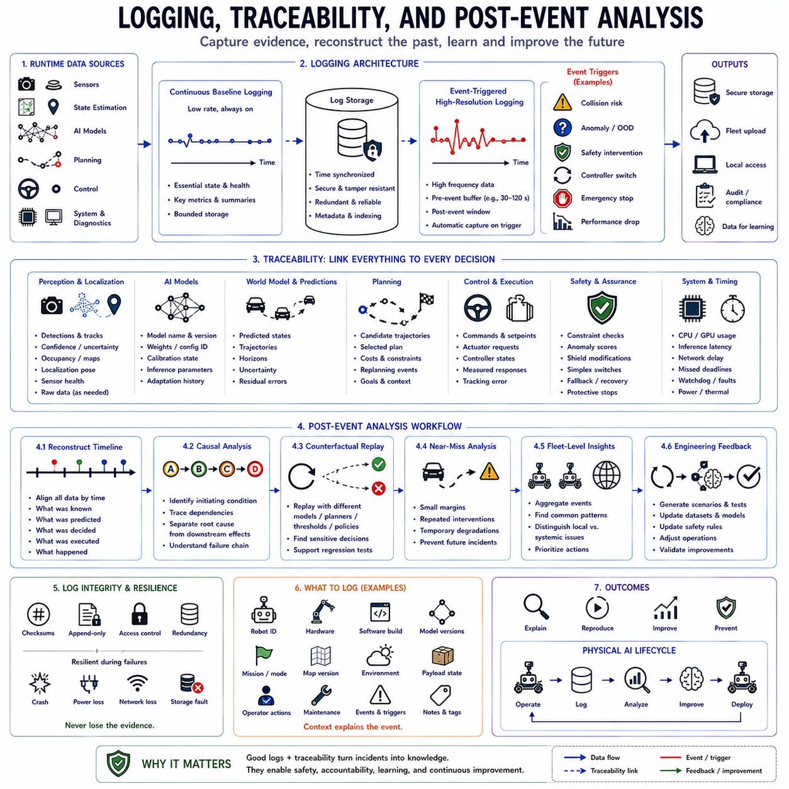{width="7.268055555555556in" height="7.268055555555556in"}

Logging, traceability, and post-event analysis provide the historical evidence required to understand how a Physical AI system behaved before, during, and after significant runtime events. Runtime assurance is incomplete if it can detect hazards but cannot reconstruct their causes. Structured records connect sensor observations, internal decisions, safety interventions, physical actions, and outcomes into an auditable operational history.

Logging should capture the information necessary to reconstruct the system state without attempting to record every signal at maximum resolution indefinitely. Physical AI platforms generate large volumes of camera, LiDAR, state, model, planning, control, and diagnostic data. A practical architecture therefore distinguishes continuous baseline logging from high-resolution event logging that is activated around safety-relevant conditions.

Traceability links each important decision to the information and software configuration that produced it. A trajectory or actuator command should be associated with relevant sensor observations, state estimates, world-model predictions, planner outputs, safety constraints, and controller authority. This relationship allows engineers to move backward from physical behavior to the chain of computational decisions responsible for that behavior.

Time synchronization is fundamental because evidence from different subsystems is useful only when events can be aligned accurately. Cameras, LiDAR, IMUs, controllers, GPUs, distributed computers, and fleet services may operate with different clocks and update rates. Consistent timestamps and monitored clock synchronization allow investigators to determine which observations were actually available when a particular decision was made.

Runtime logs should preserve the state of perception and localization that influenced autonomous decisions. Relevant records may include detected objects, confidence values, occupancy estimates, localization pose, uncertainty, map alignment, sensor-health indicators, and fusion outputs. Raw sensor data can be retained selectively when necessary to verify whether a later failure originated in sensing, interpretation, or downstream reasoning.

AI model traceability requires explicit identification of the models involved in each decision. Model name, version, weights or configuration identifier, calibration state, inference parameters, adaptation history, and deployment package can be recorded. Without this information, identical input data may be difficult to reproduce because later software or model updates can produce substantially different outputs.

World-model logging should capture predictions together with the observations that later confirm or contradict them. Predicted states, trajectories, occupancy, object motion, uncertainty ranges, prediction horizons, and subsequent residual errors provide evidence about whether the internal representation of the future was reliable. This history supports prediction-consistency analysis and identification of model drift or unfamiliar operating conditions.

Planning and control traces should preserve both intended and executed behavior. Candidate trajectories, selected plans, optimization costs, constraints, velocity commands, actuator requests, controller states, and measured responses can reveal where an unsafe sequence originated. Differences between planned commands and actual motion may distinguish planning errors from actuator faults, communication delays, or low-level control problems.

Safety interventions require particularly detailed logging because they represent moments when runtime assurance changed or restricted autonomous authority. Constraint violations, anomaly scores, OOD indicators, shield modifications, Simplex switching events, fallback activation, protective stops, and recovery decisions should be recorded together with the conditions and thresholds that triggered them.

Resource and timing evidence is also essential for reconstruction. CPU and GPU utilization, memory pressure, inference latency, queue depth, network delay, missed deadlines, thermal conditions, watchdog events, and process failures may explain behavior that appears algorithmically incorrect. A correct perception or planning result can still become unsafe when delivered after its useful temporal window has expired.

Event-triggered logging can preserve high-value evidence without requiring permanent storage of every high-bandwidth stream. A rolling buffer can continuously retain recent history and freeze selected intervals when a collision risk, emergency stop, anomaly, safety-controller transition, or major performance degradation occurs. Capturing time before and after the trigger provides context for both causal analysis and recovery assessment.

Event records should contain enough metadata to establish the operating context. Robot identity, hardware configuration, software build, model versions, mission identifier, autonomy mode, map version, environmental conditions, payload state, operator interventions, and maintenance status may all affect interpretation. Context prevents investigators from comparing events that appear similar but occurred under fundamentally different operating assumptions.

Integrity of logs is important because safety evidence must remain trustworthy after the event. Records should be protected against accidental modification, corruption, incomplete writes, timestamp ambiguity, and uncontrolled deletion. Checksums, append-oriented storage, access controls, redundant event summaries, or authenticated records can improve confidence that post-event analysis is based on the data actually generated during operation.

Logging must also remain resilient during failures. A system crash, power interruption, network disconnection, or storage fault should not automatically destroy the evidence needed to understand the incident. Critical event summaries can be written to protected local storage, while less critical high-volume data may be transferred later. Safety logging should therefore degrade gracefully when normal infrastructure becomes unavailable.

Post-event analysis begins by reconstructing a synchronized timeline. Investigators can align sensor observations, state estimates, AI outputs, plans, commands, safety-monitor decisions, controller transitions, and physical responses. This timeline establishes what the system knew, what it predicted, what it decided, what was actually executed, and how the environment responded at each significant moment.

Causal analysis should distinguish the initiating condition from downstream consequences. A localization error may create an incorrect world-model state, which then produces a poor trajectory and eventually triggers a safety shield. Treating the shield intervention as the root cause would miss the actual failure chain. Traceability allows analysts to follow dependencies backward until the earliest credible initiating factor is identified.

Counterfactual replay can strengthen post-event understanding. Recorded inputs may be replayed through alternative model versions, planners, thresholds, or safety policies to examine whether different configurations would have changed the outcome. Such replay does not prove what would have happened physically, but it can identify sensitive decision points and support controlled regression testing of proposed corrections.

Near misses should be analyzed alongside actual failures because they contain valuable safety information without requiring harmful outcomes. Small stopping margins, repeated shield interventions, unstable replanning, temporary loss of localization, or safety-controller activation may reveal weaknesses that have not yet produced an incident. Systematic near-miss analysis supports proactive improvement rather than waiting for confirmed accidents.

Fleet-scale traceability allows patterns to be identified across robots, sites, missions, and software versions. Similar anomalies occurring on multiple platforms may reveal common model weaknesses, while events isolated to one robot may indicate local hardware or calibration problems. Aggregated evidence can distinguish individual faults from systematic issues and prioritize engineering actions according to recurrence and severity.

Post-event findings should feed directly into the Physical AI lifecycle. Confirmed failure patterns can generate new simulation scenarios, regression tests, dataset examples, safety constraints, maintenance rules, model updates, or operational restrictions. Each corrective action should remain linked to the evidence that motivated it, creating traceability from runtime event through engineering change and subsequent validation.

Logging policies must balance diagnostic value with storage, bandwidth, privacy, security, and operational constraints. High-bandwidth raw data may require selective retention, compression, event prioritization, or controlled access. The objective is not maximum data accumulation but preservation of sufficient, reliable evidence to explain safety-relevant decisions while respecting deployment constraints and data-governance requirements.

Logging, traceability, and post-event analysis ultimately create the memory of runtime assurance. They transform transient sensor observations, AI decisions, interventions, and physical outcomes into evidence that can be inspected, reproduced, compared, and improved. By connecting runtime behavior with its causes and subsequent corrective actions, Physical AI systems can learn systematically from anomalies, near misses, degradations, and failures throughout their operational lifecycle.

## 07.16. Fleet Level Runtime Assurance

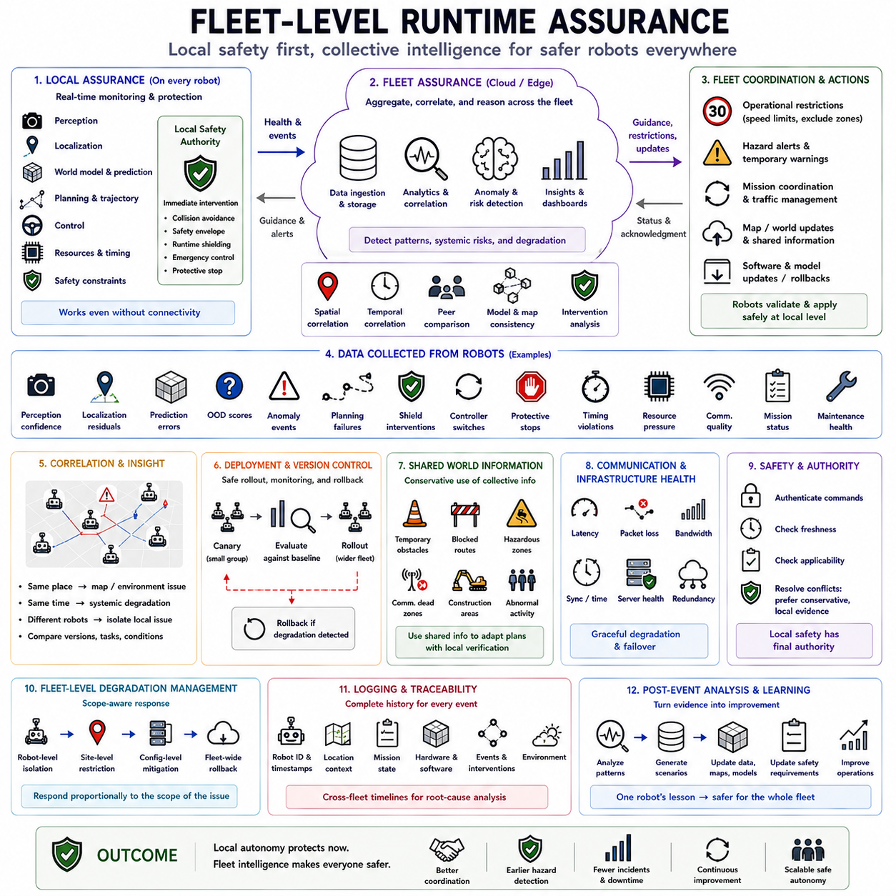{width="7.268055555555556in" height="7.268055555555556in"}

Fleet-level runtime assurance extends safety monitoring from an individual Physical AI robot to a coordinated population of robots operating across shared environments, missions, infrastructure, and computational services. Each robot retains responsibility for immediate local safety, while fleet-level assurance aggregates operational evidence to identify hazards, degradation, anomalies, and systemic risks that may remain invisible from the perspective of a single platform.

The fundamental architecture separates local assurance from fleet assurance. Local runtime monitors supervise perception, localization, world-model predictions, trajectories, control, resources, and safety constraints with sufficiently low latency for immediate intervention. Fleet-level mechanisms operate above this layer, combining information from multiple robots without making local protective actions dependent on continuous communication with a centralized system.

Local safety authority must remain available when network connectivity is degraded or completely lost. Collision avoidance, safety-envelope enforcement, runtime shielding, emergency control, and protective stopping should therefore execute on the robot whenever possible. Fleet services may improve awareness and coordination, but communication delay, server failure, congestion, or infrastructure outages must not eliminate the robot\'s ability to enter a safe state independently.

Fleet assurance begins by collecting standardized health and safety indicators from participating robots. These can include perception confidence, localization residuals, world-model prediction errors, OOD scores, anomaly events, planning failures, shield interventions, controller switches, timing violations, resource pressure, communication quality, mission status, and maintenance indicators. Common semantics allow meaningful comparison across platforms and deployments.

Aggregation transforms isolated events into fleet-level patterns. A single localization anomaly may indicate a robot-specific issue, while similar anomalies reported by several robots in the same region may indicate a map error, environmental change, GNSS disturbance, or infrastructure problem. Fleet runtime assurance therefore evaluates both individual deviations and correlated behavior across robots, locations, missions, and time.

Spatial correlation is particularly valuable in shared operating environments. Repeated emergency braking, perception uncertainty, localization degradation, or trajectory replanning at the same location can identify hazardous zones that were not represented in the original map or safety analysis. Fleet intelligence can mark these regions, increase local caution, or distribute temporary operational restrictions to robots approaching the affected area.

Temporal correlation can reveal emerging conditions that develop across the fleet. Increasing inference latency after a software update, growing prediction errors during particular environmental conditions, or simultaneous communication instability may indicate a systematic issue. Comparing event timing with software deployments, configuration changes, weather, site operations, and infrastructure events helps distinguish coincidental failures from common-cause degradation.

Fleet-level anomaly detection can use peer behavior as a dynamic reference. Robots with comparable hardware, software, payload, tasks, and environments provide baselines for localization quality, energy consumption, tracking error, intervention frequency, and computational performance. A robot that deviates significantly from its peers may require inspection even when its measurements have not crossed absolute safety thresholds.

Shared world information can improve runtime assurance when handled conservatively. Robots may report temporary obstacles, blocked routes, slippery surfaces, construction areas, abnormal human activity, communication dead zones, or other operational hazards. Other robots can use this collective evidence to adjust planning and safety margins, but locally observed information should retain priority when shared information is stale, uncertain, or contradictory.

Fleet-level world-model consistency can reveal whether predictive failures are local or systematic. If one robot repeatedly mispredicts object motion while peers remain accurate, the problem may involve its sensors or model state. If many robots produce similar residual errors under the same conditions, the evidence may indicate a broader model-domain mismatch requiring fleet-wide mitigation, validation, or model improvement.

Runtime interventions themselves provide valuable collective evidence. Safety-filter corrections, Simplex controller transitions, fallback activations, minimum-risk maneuvers, and protective stops can be aggregated across the fleet. High intervention frequency associated with a particular location, task, model version, or operational condition can reveal hidden weaknesses even when no collision or explicit safety violation has occurred.

Fleet assurance must manage software and model versions explicitly. Different robots may operate with different perception models, world models, policies, calibration files, maps, or safety configurations during staged deployment. Runtime events should therefore remain linked to exact versions so that degradation can be associated with a specific update rather than incorrectly attributed to the entire fleet or environment.

Canary deployment provides an important mechanism for controlling fleet-wide risk. New models or software can first be deployed to a limited subset of robots operating under controlled conditions. Runtime assurance compares their performance, intervention frequency, anomalies, timing behavior, and safety margins against established fleet baselines. Wider deployment can proceed only when evidence supports acceptable behavior.

Fleet-level assurance should support rollback when a deployed update produces unacceptable behavior. If anomaly rates, prediction residuals, resource consumption, safety interventions, or mission failures increase significantly after deployment, the system can suspend further rollout and return affected robots to a previously validated configuration. Versioned software and reproducible configurations make such recovery practical.

Communication health becomes part of the assurance problem because collective intelligence depends on information exchange. The system should monitor latency, packet loss, bandwidth, synchronization, message freshness, connectivity, and server availability. Fleet-level decisions should account for communication uncertainty and avoid treating delayed or missing information as equivalent to confirmed knowledge about another robot or the environment.

Centralized fleet services can themselves become common points of failure. Runtime assurance should therefore monitor fleet servers, shared maps, databases, orchestration services, message brokers, and on-premise computational resources. Redundancy, health checks, failover mechanisms, protected resources, and graceful degradation can prevent a single infrastructure failure from simultaneously compromising many robots.

Safety-related fleet commands require clear authority and validation. A central system may distribute speed restrictions, exclusion zones, mission suspensions, model rollbacks, or hazard alerts, but robots should verify message authenticity, freshness, applicability, and consistency with local safety rules. Fleet coordination must not create a path through which erroneous centralized information directly overrides essential local protection.

Conflict resolution becomes important when local and fleet-level information disagree. A shared map may classify a corridor as clear while local perception detects an obstacle, or fleet services may recommend a route that local assurance considers unsafe. Safety architecture should generally favor the more conservative credible interpretation, ensuring that centralized optimization does not override immediate physical evidence available to the robot.

Fleet-level degradation management can coordinate responses according to the scope of the problem. A robot-specific fault may isolate one platform, while a site-level localization problem may restrict operations within a geographic region. A defective software release may require fleet-wide rollback. Determining whether degradation is local, regional, configuration-specific, or systemic allows mitigation to remain proportionate to the evidence.

Logging and traceability provide the historical foundation for fleet assurance. Events should retain robot identity, timestamps, location context, mission state, hardware configuration, model versions, safety interventions, environmental conditions, and relevant health indicators. Cross-fleet timelines allow investigators to reconstruct how an issue propagated and whether multiple events originated from a common condition or independent failures.

Fleet-level post-event analysis converts distributed runtime evidence into engineering knowledge. Correlated anomalies, near misses, controller transitions, communication failures, and performance degradation can generate new test scenarios, dataset examples, map corrections, maintenance actions, operational restrictions, and safety requirements. Lessons learned from one robot can therefore improve protection for many other robots before they encounter the same condition.

Fleet-level runtime assurance ultimately creates a distributed safety intelligence in which local autonomy and collective knowledge reinforce each other. Individual robots retain immediate authority to protect themselves and nearby people, while fleet mechanisms identify patterns that no single robot can observe. By combining local independence, shared evidence, correlation, version control, coordinated mitigation, and lifecycle feedback, the fleet becomes progressively safer through accumulated operational experience.

## 07.17. Runtime Safety Monitor [w/Code]

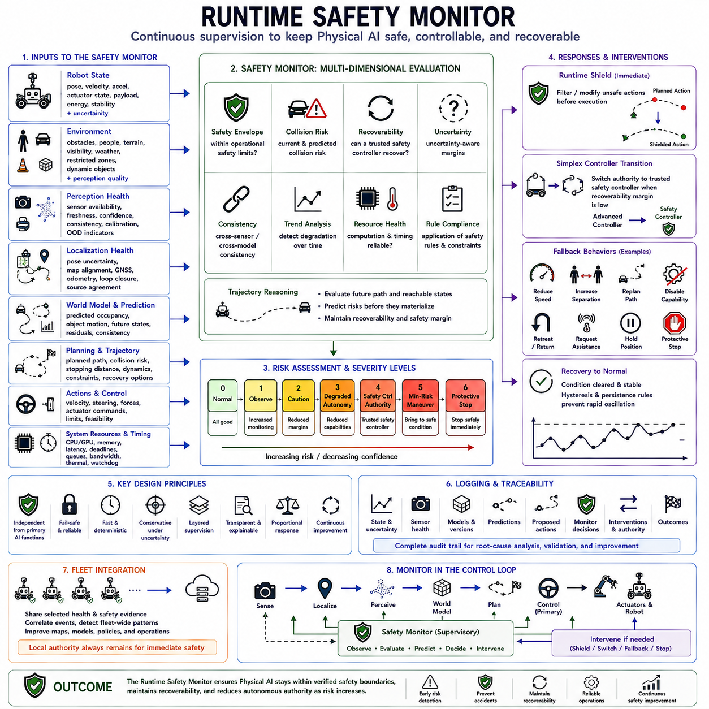{width="7.268055555555556in" height="7.268055555555556in"}

A runtime safety monitor continuously evaluates whether a Physical AI system remains within conditions that permit safe autonomous operation. It observes the robot, environment, autonomy stack, and computational platform while decisions are being executed. Rather than controlling the mission directly, the monitor provides independent evidence about whether current and predicted behavior remains compatible with defined safety requirements.

The monitor operates as a supervisory layer surrounding the primary autonomy functions. Perception, localization, world modeling, planning, learned policies, and control may pursue mission performance, while the safety monitor evaluates their outputs against explicit operational constraints. This architectural separation prevents safety from depending entirely on the same algorithms that generate autonomous behavior.

Runtime monitoring begins with the estimated physical state of the robot. Position, orientation, velocity, acceleration, actuator state, payload condition, energy level, and stability indicators provide evidence about whether the platform remains dynamically controllable. State uncertainty must accompany these estimates because apparently safe values may become unacceptable when their confidence intervals approach critical boundaries.

Environmental monitoring determines whether surrounding conditions remain compatible with safe operation. Obstacles, people, vehicles, terrain, restricted zones, visibility, surface conditions, weather, infrastructure, and dynamic objects may alter the available safety margin. The monitor should evaluate not only detected hazards but also whether perception quality is sufficient to justify continued autonomous movement.

Perception health is therefore a major input to runtime safety monitoring. Sensor availability, data freshness, confidence, cross-sensor consistency, calibration status, detection stability, and OOD indicators can reveal when environmental understanding is becoming unreliable. A robot should not interpret the absence of detected hazards as evidence of safety when the sensing system itself is degraded or uncertain.

Localization health determines whether the robot knows its own state accurately enough to execute planned actions. Pose uncertainty, map alignment, odometry consistency, GNSS quality, loop-closure behavior, and disagreement among localization sources can be monitored continuously. When localization confidence deteriorates, safety margins may need to expand even if the planned trajectory itself has not changed.

World-model predictions provide another monitoring channel by estimating how the environment and robot state are expected to evolve. The safety monitor can compare predicted occupancy, object motion, interaction outcomes, and future robot states with subsequent observations. Increasing prediction residuals or inconsistent futures can indicate model mismatch and reduce confidence in planning based on those predictions.

Planning supervision evaluates whether proposed trajectories remain inside the operational safety envelope. Collision risk, stopping distance, dynamic feasibility, stability, restricted areas, human separation, uncertainty margins, and recovery options can be checked before execution. A trajectory may satisfy immediate geometric constraints while still leading toward a state from which safe recovery would become difficult or impossible.

Action and control monitoring extends supervision to commands approaching physical execution. Velocity, steering, force, torque, acceleration, manipulator motion, and actuator requests can be checked against platform limits and contextual safety constraints. Runtime filters may reject or modify commands that violate these conditions, preventing unsafe outputs from reaching the physical system even when upstream planning fails.

The safety monitor should reason about trajectories rather than isolated states whenever possible. A robot may currently occupy a safe state while moving toward a hazard with insufficient braking distance. Short-horizon prediction, reachable sets, control barrier functions, or verified transition rules can estimate whether continued execution preserves recoverability and whether intervention must begin before an explicit boundary is crossed.

Recoverability provides an important criterion for determining when autonomous authority should be reduced. The monitor evaluates whether a trusted safety controller can still return the system to a safe condition from the current state. If the remaining recovery margin becomes too small, intervention should occur before the system reaches a state in which braking, avoidance, stabilization, or retreat can no longer guarantee acceptable safety.

Uncertainty should directly influence the monitor\'s decisions. High confidence can permit operation closer to validated limits, while uncertain perception, localization, prediction, or environmental state should produce more conservative behavior. Safety envelopes can expand, allowable speed can decrease, and permitted maneuver complexity can be reduced as uncertainty grows, preserving margin against errors that cannot be resolved immediately.

System resources and timing must also be monitored because autonomous safety depends on computations arriving when they are needed. CPU and GPU load, memory pressure, inference latency, scheduling deadlines, queue depth, communication delay, thermal throttling, watchdog status, and process health can reveal whether critical autonomy functions are becoming temporally unreliable even when their algorithms remain logically correct.

The runtime safety monitor should integrate evidence rather than treating every signal independently. Moderate localization uncertainty, increased perception latency, and rising prediction error may together represent a serious condition even when none individually exceeds its threshold. Cross-layer reasoning allows combinations of weak indicators to reveal degradation that isolated threshold checks could miss.

Monitoring logic can use multiple severity levels rather than a single binary safe-or-unsafe decision. Normal operation may transition to increased observation, cautious operation, degraded autonomy, safety-controller authority, minimum-risk maneuver, and protective stopping as evidence becomes more severe. Graded responses preserve useful functionality while ensuring that autonomous authority decreases as confidence in safe operation declines.

Runtime shielding provides an immediate enforcement mechanism for conditions identified by the safety monitor. When a proposed action lies outside the safe action set, a shield may modify velocity, steering, force, trajectory, or other commands before execution. Small deviations can therefore be corrected without transferring complete control away from the advanced autonomy system.

More severe conditions may require a Simplex-style controller transition. The safety monitor can serve as an input to the decision module that determines when the advanced controller must relinquish authority to a trusted safety controller. Such switching should occur while sufficient recovery margin remains, rather than waiting until the primary controller has already violated a critical safety constraint.

Fallback behavior should correspond to the nature and severity of the detected condition. The system may reduce speed, increase separation, replan, disable uncertain capabilities, retreat, request human assistance, hold position, or execute a protective stop. The selected response should prioritize maintaining a stable and recoverable physical condition rather than maximizing mission completion.

Recovery to normal autonomy requires evidence that the triggering condition has genuinely cleared. Sensor health, localization confidence, prediction consistency, resource availability, environmental conditions, and safety margins should remain stable for an appropriate period before authority is restored. Hysteresis and persistence rules prevent rapid oscillation between normal and degraded operating states.

Independence is essential for a safety monitor intended to supervise complex AI. It should avoid relying exclusively on the same models, software paths, assumptions, and computational resources used by the functions it monitors. Deterministic checks, simplified models, independent sensors, protected execution partitions, or separate processors can reduce common-cause failures and strengthen assurance.

The monitor itself must satisfy timing and reliability requirements. Safety evaluation must complete before the physical system passes the point at which intervention remains effective. Bounded execution latency, prioritized scheduling, watchdog supervision, protected memory, and fail-safe behavior are therefore part of the monitor architecture, not merely implementation details.

Every significant monitoring event should be logged with sufficient context for later reconstruction. State estimates, uncertainty, sensor health, model versions, predictions, proposed actions, active constraints, monitor decisions, interventions, controller authority, and physical outcomes provide a traceable record. These records support root-cause analysis, validation, threshold refinement, and lifecycle improvement.

At fleet scale, runtime safety monitors remain locally authoritative while sharing selected health and safety evidence with fleet or on-premise systems. Correlated anomalies, repeated interventions, common prediction errors, and location-specific hazards can reveal patterns invisible to one robot. Collective analysis can improve future operation without making immediate local safety dependent on centralized connectivity.

The runtime safety monitor ultimately functions as the continuously active guardian of autonomous physical behavior. It connects sensing, state estimation, prediction, planning, control, computational health, uncertainty, and recovery into one supervisory safety process. By detecting shrinking safety margins early and progressively restricting authority, it helps ensure that Physical AI remains controllable, recoverable, and bounded by verified safety conditions throughout operation.
