**Volume 10. Physical AI Safety and Alignment**

# Chapter 08. Regulation and Certification

## 08.01. Why Physical AI Certification is Difficult

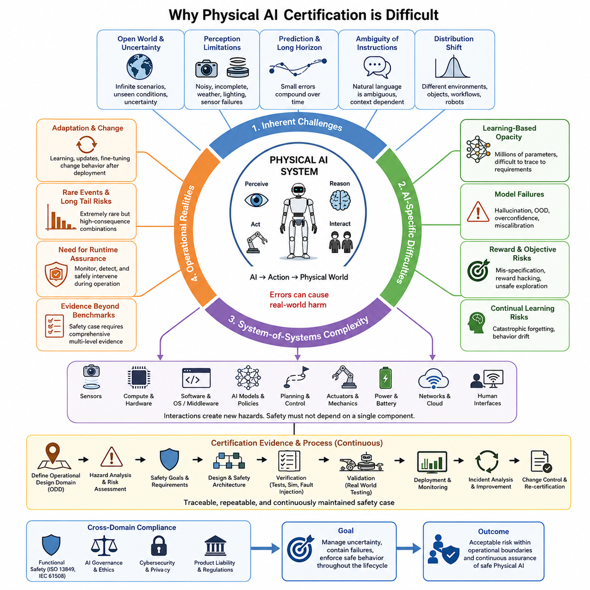{width="7.268055555555556in" height="7.268055555555556in"}

물리 AI 인증(Physical AI Certification)이 어려운 이유는 시스템이 단순히 정보를 처리하는 데 그치지 않고, 인식(Perception), 예측(Prediction), 추론(Reasoning)의 결과를 실제 물리 세계(Physical World)를 변화시키는 행동(Action)으로 변환하기 때문이다. 따라서 소프트웨어 오류(Software Error)는 움직임, 힘, 충돌 또는 사람과 기반 시설(Infrastructure)과의 위험한 상호작용으로 이어질 수 있다. 인증은 AI가 얼마나 높은 성능을 보이는지만 평가하는 것이 아니라, 지능 시스템이 잘못된 판단을 내리는 상황에서도 전체 체화 시스템(Embodied System)이 허용 가능한 수준의 안전성을 유지하는지를 평가해야 한다.

전통적인 인증 방법(Traditional Certification Methods)은 시스템 동작을 사전에 명확하게 정의하고, 요구사항(Requirements)에서 구현(Implementation)과 검증(Verification)까지 추적할 수 있을 때 가장 효과적으로 적용된다. 그러나 물리 AI(Physical AI)는 이러한 전제를 약화시킨다. 학습 모델(Learned Model)의 동작은 명시적인 규칙보다 데이터(Data)로부터 형성되기 때문이다. 신경망 기반 인식(Neural Perception), 월드 모델(World Model), 파운데이션 모델(Foundation Model), 학습 정책(Learned Policy)은 수백만 또는 수십억 개의 매개변수(Parameter)를 포함할 수 있으며, 개별 매개변수의 영향을 기존 안전 요구사항이나 결정론적 시험 사례(Deterministic Test Case)에 직접 연결하기 어렵다.

로보틱스(Robotics)의 개방형 세계(Open World) 특성은 또 다른 근본적인 문제를 만든다. 물리 AI 시스템은 개발 과정에서 한 번도 경험하지 못했던 조명, 날씨, 지형, 물체, 인간 행동, 센서 성능 저하(Sensor Degradation), 통신 상태 및 여러 사건의 복합적인 조합을 실제 환경에서 만날 수 있다. 시험을 통해 선택된 조건에서의 성능을 입증할 수는 있지만 실제 운용 환경(Operational Environment)을 완전하게 열거하여 시험하는 것은 불가능하다. 따라서 인증은 시험된 시나리오(Scenario)를 넘어 불확실성(Uncertainty), 시험 범위(Coverage), 잔여 위험(Residual Risk)을 함께 고려해야 한다.

인식(Perception)은 물리적 의사결정이 불완전하고 잡음이 포함된 관측(Observation)에 의존하기 때문에 인증을 특히 어렵게 만든다. 카메라(Camera)는 눈부심이나 어둠의 영향을 받을 수 있고, 라이다(LiDAR)는 날씨나 반사 표면의 영향을 받을 수 있으며, 위치 추정(Localization)은 환경 변화의 영향을 받을 수 있다. 또한 다중 모달 융합(Multimodal Fusion)은 시간 동기화(Timing)나 보정(Calibration) 오류의 영향을 받을 수 있다. 개별 센서가 기술 요구사항을 만족하더라도 상관된 고장(Correlated Failure)은 하위 AI 구성요소가 그럴듯한 것으로 받아들이는 잘못된 세계 표현(World Representation)을 생성할 수 있으며, 이러한 오류는 탐지하기 어려울 수 있다.

학습된 행동(Learned Behavior)은 분포 변화(Distribution Shift)라는 문제도 발생시킨다. 하나의 공장, 창고, 도로망 또는 로봇 구성에서 검증된 모델이 다른 환경에 배치되면 서로 다른 행동을 나타낼 수 있다. 물체 종류, 인간의 작업 방식, 바닥 상태, 교통 패턴, 센서 장착 상태 또는 로봇의 페이로드(Payload)가 변화하면 입력 데이터의 통계적 분포가 달라질 수 있다. 따라서 인증에서는 운용 설계 영역(Operational Design Domain)을 명확하게 정의하고, 어떠한 변화가 기존의 안전성 증거(Safety Evidence)를 무효화하는지를 규정해야 한다.

물리 AI는 장기간의 시간 범위(Long Horizon)에서 동작하는 예측형 월드 모델(Predictive World Model)과 범용 정책(Generalist Policy)을 점점 더 많이 포함한다. 상태 추정(State Estimation)이나 미래 예측(Future Prediction)의 작은 오류가 여러 차례의 추론과 행동 주기(Reasoning and Action Cycle)에 걸쳐 누적되면 최종 궤적(Trajectory)이 의도된 행동과 크게 달라질 수 있다. 따라서 모델이 단기간의 시험에서는 신뢰할 수 있는 것처럼 보이더라도 장시간 자율 운용(Autonomous Operation)에서는 위험해질 수 있다. 인증에서는 순간적인 정확도뿐만 아니라 시간에 따른 오류 전파(Temporal Error Propagation)도 평가해야 한다.

파운데이션 모델(Foundation Model)과 비전-언어-행동 시스템(Vision-Language-Action System, VLA)은 자연어 명령(Natural-Language Instruction)이 모호하거나 불완전하며 상황에 따라 다른 의미를 가질 수 있기 때문에 추가적인 불확실성을 발생시킨다. 어떤 명령이 언어적으로는 합리적이더라도 현재의 물리적 환경에서는 위험할 수 있다. 따라서 인증 문제는 단순한 언어 이해(Language Understanding)나 작업 성공(Action Success)에 한정되지 않는다. 의미론적 추론(Semantic Reasoning)이 물리적 한계(Physical Limits), 안전 정책(Safety Policy), 인간의 권한(Human Authority), 운용 경계(Operational Boundaries)에 의해 지속적으로 제한된다는 것을 입증해야 한다.

적응(Adaptation)은 인증된 제품(Certified Product)과 지속적으로 변화하는 시스템 사이의 경계를 특히 어렵게 만든다. 기존 인증은 평가된 시스템 구성이 승인 이후에도 실질적으로 동일하게 유지된다는 것을 전제로 한다. 그러나 지속 학습(Continual Learning), 미세 조정(Fine-Tuning), 정책 업데이트(Policy Update), 플릿 학습(Fleet Learning), 매개변수 적응(Parameter Adaptation)은 배치 이후에도 시스템의 행동을 변화시킬 수 있다. 따라서 인증 체계(Certification Framework)는 어떤 변경이 허용되는지, 변경의 영향을 어떻게 평가할 것인지, 그리고 누적된 변경이 언제 재검증(Reverification) 또는 재인증(Recertification)을 요구하는지를 결정해야 한다.

물리 AI는 또한 시스템 오브 시스템(System-of-Systems)의 문제이다. 안전성은 센서(Sensor), 컴퓨팅 하드웨어(Compute Hardware), 운영체제(Operating System), 미들웨어(Middleware), 네트워크(Network), AI 모델(AI Model), 플래너(Planner), 제어기(Controller), 액추에이터(Actuator), 전력 시스템(Power System), 클라우드 서비스(Cloud Service), 인간 인터페이스(Human Interface)가 함께 정상적으로 동작하는 것에 의존한다. 각각의 구성요소가 개별 요구사항을 충족하더라도 구성요소 간의 상호작용으로 새로운 위험이 발생할 수 있다. 따라서 인증에는 고장이 적절히 격리되고 안전성이 하나의 불확실한 AI 구성요소에 의존하지 않는다는 것을 보여주는 아키텍처 수준의 증거(Architectural Evidence)가 필요하다.

희귀 사건(Rare Event)과 롱테일 조건(Long-Tail Condition)은 통계적 검증(Statistical Validation)을 어렵게 만든다. 로봇이 수천 시간 동안 안전하게 운용되더라도 특이한 장애물 형상, 센서 손상, 인간 행동, 계획 불확실성(Planning Uncertainty)이 동시에 발생할 때 나타나는 고장 모드(Failure Mode)가 여전히 존재할 수 있다. 따라서 단순히 성공적인 운용 시간을 누적하는 것만으로는 발생 확률이 매우 낮은 위험에 대한 충분한 증거를 제공하기 어렵다. 시나리오 기반 시험(Scenario-Based Testing), 시뮬레이션(Simulation), 고장 주입(Fault Injection), 적대적 시험(Adversarial Testing), 그리고 목표 지향적 엣지 케이스 생성(Targeted Edge-Case Generation)이 필수적인 보완 수단이 된다.

런타임 보증(Runtime Assurance)은 모든 위험한 AI 행동을 배치 이전에 완전히 제거할 수 없기 때문에 중요하다. 독립적인 모니터링(Independent Monitoring)은 로봇이 운용되는 동안 인식 상태(Perception Health), 불확실성(Uncertainty), 운용 경계(Operational Boundaries), 궤적(Trajectory), 타이밍(Timing), 시스템 자원(System Resources), 안전 제약(Safety Constraints)을 지속적으로 확인할 수 있다. 신뢰도가 저하되거나 제약 조건이 위반되면 시스템은 행동을 제한하거나, 성능 저하 운용(Degraded Operation)으로 전환하거나, 안전 제어기(Safety Controller)를 활성화하거나, 인간 개입(Human Intervention)을 요청하거나, 최소 위험 상태(Minimum-Risk Condition)로 전환할 수 있다.

따라서 인증 증거(Certification Evidence)는 하나의 벤치마크 점수(Benchmark Score)를 넘어 확장되어야 한다. 개발자는 추적 가능한 안전 요구사항(Traceable Safety Requirements), 위험 분석(Hazard Analysis), 모델 및 데이터셋 문서(Model and Dataset Documentation), 시나리오 커버리지(Scenario Coverage), 시뮬레이션 결과(Simulation Results), 물리적 시험(Physical Testing), 고장 주입 증거(Fault-Injection Evidence), 런타임 로그(Runtime Logs), 구성 기록(Configuration Records), 변경 이력(Change History)을 확보해야 한다. 이러한 자료는 단순히 높은 평균 AI 성능을 보여주는 것이 아니라 명확하게 정의된 운용 조건에서 잔여 위험이 허용 가능한 이유를 설명하는 일관된 안전 논증(Safety Argument)을 구성해야 한다.

또 다른 복잡성은 물리 AI가 여러 규제 영역(Regulatory Domain)에 걸쳐 있다는 점이다. 산업용 매니퓰레이터(Industrial Manipulator), 협동 로봇(Collaborative Robot), 자율이동로봇(Autonomous Mobile Robot, AMR), 자율주행차(Autonomous Vehicle), 무인 항공 시스템(Aerial System), 기계류(Machinery), 인간 상호작용 로봇(Human-Facing Robot)은 서로 다른 안전 프레임워크(Safety Framework)의 적용을 받을 수 있다. AI 거버넌스(AI Governance), 사이버보안(Cybersecurity), 소프트웨어 생명주기 관리(Software Lifecycle Control), 개인정보 보호(Privacy), 제조물 책임(Product Liability) 요구사항 또한 기존 기계 및 기능 안전(Functional Safety) 의무와 중첩될 수 있다. 따라서 인증에서는 AI 규제 준수만을 독립적으로 다루는 것이 아니라 여러 보증 관점(Assurance Perspective)을 통합해야 한다.

핵심적인 문제는 결국 적응형 지능(Adaptive Intelligence)과 정적 승인(Static Approval) 사이의 불일치에 있다. 물리 AI는 일반화(Generalization), 학습(Learning), 추론(Reasoning), 적응(Adaptation)을 통해 가치를 얻는 반면, 기존 인증은 제한된 행동(Bounded Behavior), 통제된 변경(Controlled Change), 반복 가능성(Repeatability), 추적 가능성(Traceability)을 통해 신뢰를 확보한다. 미래의 보증 접근법(Assurance Approach)은 명시적인 운용 범위(Operational Envelope), 안전 아키텍처(Safety Architecture), 통제된 모델 업데이트(Controlled Model Update), 런타임 모니터링(Runtime Monitoring), 시나리오 기반 증거(Scenario-Based Evidence), 지속적으로 유지되는 안전 사례(Safety Case)를 통해 이러한 두 목표를 연결해야 한다.

따라서 물리 AI 인증(Physical AI Certification)은 AI 모델을 한 번 시험하고 승인하는 절차가 아니라 지속적인 보증 프로세스(Ongoing Assurance Process)로 이해해야 한다. 신뢰는 설계(Design), 학습(Training), 통합(Integration), 검증(Validation), 배치(Deployment), 모니터링(Monitoring), 사고 분석(Incident Analysis), 통제된 진화(Controlled Evolution)의 전체 과정에서 구축되어야 한다. 목표는 지능형 물리 시스템(Intelligent Physical System)이 절대로 실패하지 않는다는 것을 증명하는 것이 아니라, 위험 요소가 체계적으로 식별되고 불확실성이 관리되며 고장이 제한되고 안전한 행동이 전체 운용 생명주기(Operational Lifecycle)에 걸쳐 지속적으로 강제될 수 있음을 입증하는 것이다.

## 08.02. Robotics Safety Standards Landscape

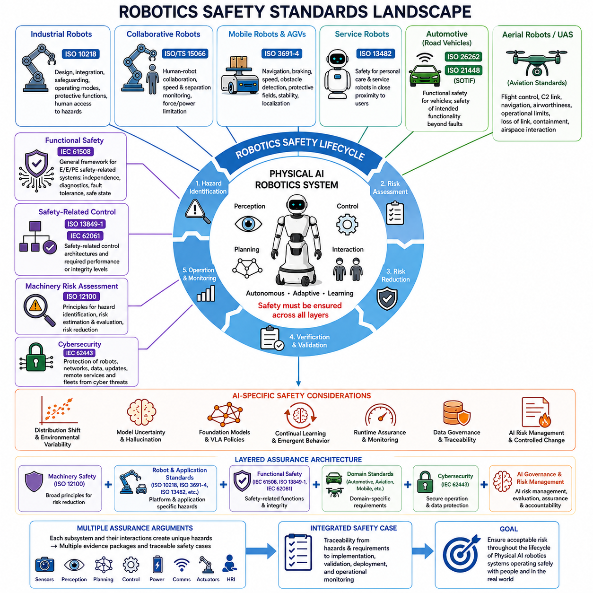{width="7.268055555555556in" height="7.268055555555556in"}

로보틱스 안전 표준(Robotics Safety Standards)은 하나의 보편적인 인증 프레임워크(Universal Certification Framework)가 아니라 여러 계층으로 구성된 체계를 형성한다. 서로 다른 표준들은 산업용 로봇(Industrial Robot), 협동 시스템(Collaborative System), 이동 로봇(Mobile Robot), 자율주행차(Autonomous Vehicle), 서비스 로봇(Service Robot), 기계류(Machinery), 전기 장비(Electrical Equipment), 기능 안전(Functional Safety), 소프트웨어(Software)를 각각 다룬다. 따라서 물리 AI(Physical AI) 시스템은 형태(Morphology), 의도된 용도(Intended Use), 운용 환경(Environment), 자율성 수준(Autonomy Level), 인간과의 상호작용 방식에 따라 여러 표준의 적용을 동시에 받을 수 있다.

이러한 표준 체계의 기반은 기존의 기계 및 로봇 안전(Conventional Machinery and Robot Safety)이다. 이러한 프레임워크는 일반적으로 위험요인 식별(Hazard Identification), 위험 평가(Risk Assessment), 위험 저감(Risk Reduction), 보호 조치(Protective Measures), 검증(Verification)에서 시작한다. 핵심 원칙은 안전성을 개발 이후에 추가하는 것이 아니라 전체 생명주기(Lifecycle)에 걸쳐 체계적으로 설계해야 한다는 것이다. 인식(Perception), 계획(Planning), 제어(Control)가 결정론적 소프트웨어(Deterministic Software)가 아닌 학습 모델(Learned Model)에 의해 수행되더라도 물리 AI는 이러한 요구사항을 그대로 계승한다.

산업용 로봇 안전(Industrial Robot Safety)은 일반적으로 산업용 로봇과 로봇 시스템을 다루는 ISO 10218과 연관된다. 이 표준의 안전 철학(Safety Philosophy)은 로봇 설계, 통합(Integration), 안전 방호(Safeguarding), 운전 모드(Operating Mode), 보호 기능(Protective Function), 위험 영역에 대한 인간의 접근 등을 고려한다. 물리 AI에서도 이러한 원칙은 중요하다. 지능형 행동(Intelligent Behavior)이 압착(Crushing), 충격(Impact), 끼임(Trapping), 예상하지 못한 움직임(Unexpected Motion), 과도한 힘(Excessive Force)과 같은 기계적 위험(Mechanical Hazard)을 제거하는 것은 아니기 때문이다.

협동 로보틱스(Collaborative Robotics)는 인간과 로봇이 의도적으로 작업 공간의 일부를 공유할 수 있기 때문에 또 다른 안전 계층을 추가한다. 안전성은 감시 정지(Monitored Stopping), 속도 및 이격 관리(Speed and Separation Management), 힘 또는 동력 제한(Force or Power Limitation)과 같은 메커니즘에 의존할 수 있다. AI 기반 협동 시스템에서는 인간 감지(Human Detection), 의도 추정(Intent Estimation), 궤적 예측(Trajectory Prediction), 적응형 움직임(Adaptive Motion)이 이러한 메커니즘에 영향을 줄 수 있으므로 기존 안전 기능과 확률적 인식(Probabilistic Perception) 사이에 새로운 의존 관계가 발생한다.

자율이동로봇(Autonomous Mobile Robot)과 산업용 이동 플랫폼(Industrial Mobile Platform)은 고정형 매니퓰레이터(Stationary Manipulator)와 다른 위험을 발생시킨다. ISO 3691-4와 같은 표준은 관련 산업 응용 분야에서 자동 유도 차량(Automated Guided Vehicle, AGV)과 자율이동로봇(Autonomous Mobile Robot, AMR)을 포함한 무인 산업 차량(Driverless Industrial Truck) 및 관련 시스템을 다룬다. 이동 안전(Navigation Safety)은 제동(Braking), 속도(Speed), 장애물 감지(Obstacle Detection), 보호 영역(Protective Field), 안정성(Stability), 위치 추정(Localization), 주행 경로 상태(Route Conditions), 작업자 및 다른 장비와의 상호작용을 고려해야 한다.

서비스 로봇(Service Robot)은 기존 산업용 안전 방호가 존재하지 않을 수 있는 비정형 환경(Unstructured Environment)으로 로보틱스의 적용 범위를 확장한다. ISO 13482는 개인지원로봇(Personal Care Robot)의 안전 요구사항을 다루며, 일반 사용자 가까이에서 기계가 작동할 때 로봇 안전이 어떻게 달라지는지를 보여준다. 물리 AI는 로봇이 복잡한 환경을 해석하고, 행동을 적응시키며, 물체를 조작하고, 자연스럽게 의사소통하며, 고정된 프로그래밍 동작 순서에 포함되지 않았던 작업까지 수행할 수 있기 때문에 이러한 과제를 더욱 확장한다.

기능 안전 표준(Functional Safety Standards)은 또 하나의 중요한 계층을 제공한다. IEC 61508은 안전 관련 전기·전자·프로그램 가능 전자 시스템(Safety-Related Electrical, Electronic and Programmable Electronic Systems)에 대한 일반적인 원칙을 제시하며, 여러 산업별 표준이 이와 관련된 개념을 특정 산업에 맞게 적용한다. 기능 안전은 고장(Fault)이 발생하더라도 안전 기능(Safety Function)이 요구되는 위험 저감 수준을 달성하는지를 중점적으로 다룬다. 이를 위해 독립성(Independence), 진단(Diagnostics), 고장 허용(Fault Tolerance), 정의된 안전 상태(Safe State), 체계적인 개발 프로세스(Systematic Development Process)가 중요해진다.

기계류 위험 평가(Machinery Risk Assessment)는 다양한 로봇 제품을 포괄하는 보다 넓은 프레임워크를 제공한다. ISO 12100은 위험요인(Hazard)을 식별하고 위험(Risk)을 추정·평가하며 위험 저감 조치(Risk Reduction Measures)를 적용하기 위한 원칙을 제시한다. 이러한 관점은 물리 AI에서 특히 중요하다. 위험은 AI 모델에서만 발생하는 것이 아니며, 기계 구조(Mechanical Structure), 액추에이터(Actuator), 저장 에너지(Stored Energy), 배터리(Battery), 열적 조건(Thermal Conditions), 페이로드(Payload), 도구(Tool), 인간 상호작용(Human Interaction), 소프트웨어(Software), 환경 조건(Environmental Conditions)을 함께 고려해야 하기 때문이다.

안전 관련 제어 시스템(Safety-Related Control System)은 기계류 내부에서 보호 기능을 구현하기 위한 메커니즘을 제공한다. ISO 13849-1과 IEC 62061과 같은 표준은 안전 관련 제어 아키텍처(Safety-Related Control Architecture)와 요구되는 성능 또는 무결성(Integrity)을 다룬다. 물리 AI 아키텍처에서는 일반적인 자율 기능(Autonomy Function)과 안전 기능(Safety Function)을 명확하게 구분해야 한다. 고성능 신경망 제어기(Neural Controller)가 일반적인 상황에서 안전한 행동을 생성한다는 이유만으로 자동적으로 안전 메커니즘(Safety Mechanism)으로 간주되어서는 안 된다.

자율주행차(Autonomous Vehicle)는 안전 표준 체계의 또 다른 영역을 형성한다. ISO 26262는 도로 차량(Road Vehicle)의 기능 안전(Functional Safety)을 다루며, 일반적으로 의도된 기능의 안전성(Safety of the Intended Functionality, SOTIF)과 연관되는 ISO 21448은 기존의 구성요소 고장이 존재하지 않더라도 발생할 수 있는 위험을 다룬다. 이러한 구분은 물리 AI에서 매우 중요하다. 인식 또는 계획 시스템이 구현된 방식 그대로 정상적으로 작동하더라도 불충분한 능력(Insufficient Capability), 환경적 모호성(Environmental Ambiguity), 불완전한 가정(Incomplete Assumption) 때문에 위험한 행동을 생성할 수 있기 때문이다.

공중 로봇(Aerial Robot)과 무인 항공기(Unmanned Aircraft)는 또 다른 규제 및 표준 환경에서 운용된다. 이들의 보증(Assurance)은 비행 제어(Flight Control), 명령 및 통신 링크(Command and Communication Link), 항법(Navigation), 감항성(Airworthiness), 운용 제한(Operational Limitation), 연결 상실(Loss of Connectivity), 비행 영역 제한(Containment), 주변 공역과의 상호작용 등을 포함한다. AI가 자율 비행이나 임무 결정에 관여할 경우 인증은 학습된 능력(Learned Capability)을 예측 가능한 행동(Predictable Behavior), 중복성(Redundancy), 운용 제약(Operational Constraints), 고장 관리(Failure Management)와 같은 기존 항공 안전 개념과 연결해야 한다.

사이버보안(Cybersecurity)은 연결된 로봇이 네트워크(Network), 소프트웨어 업데이트(Software Update), 원격 서비스(Remote Service), 플릿 관리(Fleet Management), 클라우드 인프라(Cloud Infrastructure)에 의존하면서 로봇 안전과 점점 더 밀접하게 연결되고 있다. 공격자가 명령, 센서 정보, 위치 추정, 모델 또는 안전 구성을 변경할 경우 사이버보안 침해(Cybersecurity Compromise)는 실제 물리적 안전 사고로 이어질 수 있다. 따라서 고도로 연결된 물리 AI 시스템에서는 안전(Safety)과 사이버보안(Cybersecurity)을 완전히 독립적인 엔지니어링 분야로 취급하기 어렵다.

AI 기반 로보틱스(AI-Based Robotics)는 기존 로봇 안전 표준이 처음 설계될 당시 직접적으로 고려하지 않았던 새로운 요구사항을 발생시킨다. 분포 변화(Distribution Shift), 모델 불확실성(Model Uncertainty), 환각(Hallucination), 학습 표현(Learned Representation), 파운데이션 모델(Foundation Model), 비전-언어-행동 정책(Vision-Language-Action Policy, VLA), 지속 학습(Continual Learning), 창발 행동(Emergent Behavior)은 결정론적 검증(Deterministic Verification)의 기존 가정에 도전한다. 기존 로봇 안전 원칙은 여전히 필요하지만 AI 위험 관리(AI Risk Management), 모델 평가(Model Evaluation), 데이터 거버넌스(Data Governance), 런타임 보증(Runtime Assurance), 통제된 변경 프로세스(Controlled Change Process)를 통해 보완되어야 한다.

따라서 안전 표준 체계(Standards Landscape)는 계층화된 보증 아키텍처(Layered Assurance Architecture)로 이해하는 것이 적절하다. 기계 안전(Machinery Safety)은 광범위한 위험 저감 원칙을 제공하고, 로봇별 표준(Robot-Specific Standards)은 플랫폼과 응용 분야의 위험을 다루며, 기능 안전(Functional Safety)은 안전 관련 제어 기능을 관리한다. 또한 도메인 표준(Domain Standards)은 차량, 이동 로봇, 공중 시스템 등을 다루고, 사이버보안(Cybersecurity)은 연결된 운용을 보호하며, 새롭게 등장하는 AI 거버넌스 프레임워크(AI Governance Framework)는 데이터 기반 및 적응형 지능(Adaptive Intelligence)과 관련된 위험을 다룬다.

따라서 하나의 물리 AI 제품은 모든 것을 입증하는 하나의 인증서(Certificate)보다 여러 개의 보증 논증(Assurance Argument)을 필요로 할 수 있다. 예를 들어 이동형 매니퓰레이터(Mobile Manipulator)는 이동 내비게이션(Mobile Navigation), 조작(Manipulation), 인간 상호작용(Human Interaction), 배터리, 네트워크, 인식, 계획, 그리고 잠재적으로 파운데이션 모델 기반 추론(Foundation-Model Reasoning)을 결합한다. 각 서브시스템(Subsystem)은 서로 다른 위험을 발생시키며, 이들의 상호작용은 추가적인 시스템 수준 위험(System-Level Risk)을 만든다. 따라서 어떤 표준이 적용되는지를 결정하는 것 자체가 안전 엔지니어링(Safety Engineering)의 중요한 부분이다.

새롭게 등장하는 목표는 기존 로보틱스 안전 표준을 완전히 새로운 물리 AI 표준(Physical AI Standard)으로 대체하는 것이 아니다. 대신 인증은 성숙한 엔지니어링 원칙(Mature Engineering Principles)을 학습 기반 자율성(Learning-Enabled Autonomy)에 적합한 보증 방법과 연결해야 한다. 위험 분석(Hazard Analysis), 보호 기능(Protective Function), 안전 상태(Safe State), 중복성(Redundancy), 검증(Verification), 생명주기 관리(Lifecycle Management)는 계속해서 기반을 형성하며, 시나리오 시험(Scenario Testing), 불확실성 모니터링(Uncertainty Monitoring), AI 평가(AI Evaluation), 운용 증거(Operational Evidence), 런타임 안전 메커니즘(Runtime Safety Mechanism)이 이러한 보증 프레임워크를 확장한다.

따라서 로보틱스 안전 표준 체계(Robotics Safety Standards Landscape)는 결정론적 기계 안전(Deterministic Machine Safety)과 적응형 지능 시스템 보증(Adaptive Intelligent-System Assurance)을 연결하는 진화하는 가교로 볼 수 있다. 물리 AI는 기존 로보틱스에서 계승된 물리적 안전 의무를 충족하는 동시에 인식, 추론, 학습, 자율적 의사결정(Autonomous Decision Making)이 만드는 새로운 위험을 해결해야 한다. 효과적인 인증(Effective Certification)은 이러한 계층들을 하나의 일관된 안전 사례(Safety Case)로 통합하고, 위험요인과 요구사항에서 구현, 검증, 배치(Deployment), 운용 모니터링(Operational Monitoring)에 이르기까지 전체 과정을 추적 가능하게 만드는 것에 달려 있다.

## 08.03. Industrial and Collaborative Robot Standards

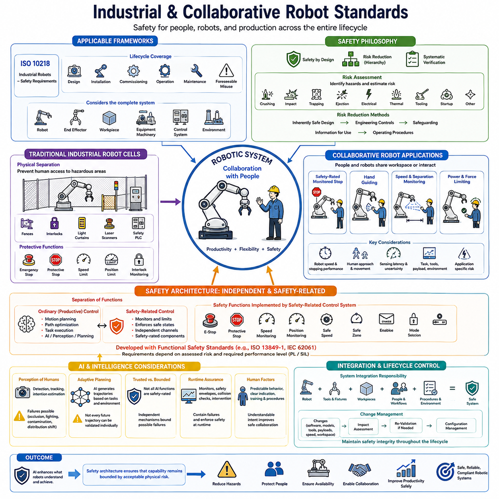{width="7.268055555555556in" height="7.268055555555556in"}

산업용 및 협동 로봇 표준(Industrial and Collaborative Robot Standards)은 제조 및 기타 구조화된 작업 환경에서 운용되는 로봇 시스템의 안전 기반을 확립한다. 이러한 표준의 목적은 단순히 로봇의 오작동을 방지하는 것이 아니라 움직임(Motion), 힘(Force), 도구(Tooling), 페이로드(Payload), 저장 에너지(Stored Energy), 인간의 접근(Human Access), 시스템 통합(System Integration)으로 인해 발생하는 위험을 통제하는 것이다. 물리 AI(Physical AI)에서도 지능형 인식(Intelligent Perception)과 학습 기반 제어(Learned Control)가 로봇 행동을 크게 변화시키더라도 이러한 표준은 여전히 기본적인 안전 기반으로 작용한다.

ISO 10218은 로봇 자체와 로봇 응용 시스템(Robotic Application)으로의 통합을 모두 다룸으로써 산업용 로봇 안전(Industrial Robot Safety)의 핵심적인 프레임워크를 제공한다. 이 표준은 설계(Design), 설치(Installation), 시운전(Commissioning), 운용(Operation), 유지보수(Maintenance), 합리적으로 예측 가능한 오사용(Foreseeable Misuse)에 걸쳐 위험을 고려한다. 이러한 생명주기 관점(Lifecycle Perspective)은 산업용 로봇의 안전성을 엔드 이펙터(End Effector), 작업물(Workpiece), 주변 기계류, 제어 시스템 및 운용 환경과 독립적으로 판단할 수 없기 때문에 중요하다.

산업용 로봇 안전의 주요 원칙 중 하나는 일반적인 로봇 제어(Ordinary Robot Control)와 안전 관련 기능(Safety-Related Functions)을 분리하는 것이다. 모션 플래닝(Motion Planning)은 생산성, 정확성 또는 작업 완료를 최적화할 수 있지만, 독립적인 안전 메커니즘(Independent Safety Mechanism)은 위반되어서는 안 되는 제한 조건을 강제한다. 보호 정지(Protective Stop), 비상 정지(Emergency Stop), 속도 제한(Speed Restriction), 위치 제한(Position Limit), 인터록(Interlock), 활성화 장치(Enabling Device), 감시형 안전 기능(Monitored Safety Function)은 주 제어기가 예상하지 못한 행동을 하더라도 위험한 행동을 방지하는 보호 장벽을 제공한다.

위험 평가(Risk Assessment)는 특정 로봇 응용 시스템에 어떠한 보호 조치(Protective Measures)가 필요한지를 결정한다. 시스템 통합자(System Integrator)는 압착(Crushing), 전단(Shearing), 충격(Impact), 끼임(Trapping), 예상하지 못한 기동(Unexpected Startup), 물체 비산(Ejected Objects), 전기적 위험(Electrical Hazards), 열적 위험(Thermal Hazards), 도구 관련 위험(Tool-Related Hazards), 지원 장비의 고장 등을 고려해야 한다. 그 결과로 구성되는 안전 아키텍처(Safety Architecture)는 본질적으로 안전한 설계(Inherently Safe Design), 공학적 제어(Engineering Controls), 안전 방호(Safeguarding), 사용 정보(Information for Use), 적절한 운용 절차를 통해 위험을 감소시켜야 한다.

전통적인 산업용 로봇 셀(Industrial Robot Cell)은 일반적으로 로봇과 사람 사이의 물리적 분리(Physical Separation)에 의존한다. 펜스(Fence), 가드(Guard), 게이트(Gate), 인터록(Interlock), 라이트 커튼(Light Curtain), 레이저 스캐너(Laser Scanner) 및 기타 보호 장치는 사람이 위험 영역에 진입하는 것을 방지하거나 통제한다. 접근이 감지되면 안전 관련 제어 기능이 로봇의 움직임을 정지시키거나 제한할 수 있다. 이러한 방식은 자동화 생산 영역과 인간 작업 공간 사이에 비교적 명확한 경계를 형성한다.

협동 로보틱스(Collaborative Robotics)는 인간과 로봇이 의도적으로 작업 공간을 공유하거나 생산 과정에서 더욱 밀접하게 상호작용하도록 허용함으로써 이러한 관계를 변화시킨다. 협동(Collaboration)이 모든 조건에서 로봇 자체가 본질적으로 안전하다는 것을 의미하지는 않는다. 안전성은 로봇, 엔드 이펙터, 작업물, 속도, 힘, 환경, 작업 형상(Task Geometry), 인간 노출(Human Exposure), 그리고 시스템 통합자가 구현한 보호 조치를 포함하는 전체 협동 응용 시스템(Collaborative Application)에 의해 결정된다.

협동 응용 시스템은 안전 등급 감시 정지(Safety-Rated Monitored Stop), 핸드 가이딩(Hand Guiding), 속도 및 이격 모니터링(Speed and Separation Monitoring), 동력 및 힘 제한(Power and Force Limiting)과 같은 메커니즘을 활용할 수 있다. 각각의 방법은 서로 다른 방식으로 위험을 통제한다. 일부 방식은 위험한 로봇 움직임과 인간 노출이 동시에 발생하는 것을 방지하며, 다른 방식은 동적으로 이격 거리를 유지하거나 기계적 에너지를 제한하여 예측 가능한 접촉이 해당 응용 분야에서 허용 가능한 범위 내에 있도록 한다.

속도 및 이격 모니터링(Speed and Separation Monitoring)은 인간과 로봇의 상대적인 위치와 움직임에 대한 정보를 필요로 한다. 보호 이격 거리(Protective Separation)는 로봇의 정지 성능(Stopping Performance), 인간의 접근, 센싱 지연(Sensing Latency), 제어기 응답(Controller Response), 측정 불확실성(Measurement Uncertainty), 시스템 동역학(System Dynamics)을 고려해야 한다. 이격 거리가 감소하면 이에 따라 로봇 속도를 낮춰야 할 수 있으며, 충분한 안전 거리를 더 이상 유지할 수 없다면 최종적으로 보호 정지(Protective Stop)를 수행할 수 있다.

동력 및 힘 제한(Power and Force Limiting)은 물리적 접촉으로 발생하는 결과를 줄이는 데 중점을 둔다. 로봇 질량(Robot Mass), 속도(Velocity), 형상(Geometry), 접촉 면적(Contact Area), 관절 토크(Joint Torque), 엔드 이펙터 형상, 페이로드 및 발생 가능한 끼임 조건(Trapping Conditions)은 부상 위험에 영향을 준다. 따라서 협동 로봇(Collaborative Robot)으로 판매되는 로봇이라고 해서 모든 응용 시스템이 자동으로 협동 응용 시스템이 되는 것은 아니다. 날카로운 도구, 무거운 작업물, 고속 움직임 또는 위험한 고정 장치(Fixture)는 위험 프로파일(Risk Profile)을 근본적으로 변화시킬 수 있다.

이러한 기능을 지원하는 안전 관련 제어 아키텍처(Safety-Related Control Architecture)는 일반적으로 ISO 13849-1 또는 IEC 62061로 대표되는 기계류 기능 안전(Machinery Functional Safety) 원칙을 활용하여 개발된다. 요구되는 안전 성능(Safety Performance)은 평가된 위험과 구현되는 안전 기능에 따라 달라진다. 아키텍처 견고성(Architectural Robustness), 진단 범위(Diagnostic Coverage), 구성요소 신뢰성(Component Reliability), 체계적 무결성(Systematic Integrity), 고장 탐지(Fault Detection), 공통 원인 고장(Common-Cause Failure)에 대한 내성이 보호 기능의 신뢰성을 형성한다.

물리 AI(Physical AI)는 인식(Perception)과 계획(Planning)이 협동 행동의 생성 방식에 영향을 줄 수 있기 때문에 추가적인 복잡성을 발생시킨다. 비전 시스템(Vision System)은 사람을 식별할 수 있고, AI는 인간의 의도(Human Intention)를 추정할 수 있으며, 학습 기반 플래너(Learned Planner)는 적응형 궤적(Adaptive Trajectory)을 생성할 수 있다. 그러나 높은 인식 정확도(Perception Accuracy)가 AI 기능을 자동적으로 안전 등급 기능(Safety-Rated Function)으로 만드는 것은 아니다. 안전 아키텍처는 어떤 지능형 기능을 신뢰할 것인지, 그리고 어떠한 독립적인 메커니즘이 그 기능의 잠재적 고장을 제한할 것인지를 명확하게 결정해야 한다.

이러한 구분은 AI 기반 인간 추적 및 예측(AI-Based Human Tracking and Prediction)에서 특히 중요하다. 모델은 대부분의 조건에서 사람을 정확하게 감지할 수 있지만 가림(Occlusion), 특이한 의복, 조명 변화, 센서 오염(Sensor Contamination), 분포 변화(Distribution Shift) 등의 조건에서는 실패할 수 있다. 안전한 이격 거리가 이러한 인식 기능에 직접 의존한다면 센싱 및 처리 체인(Sensing and Processing Chain)이 필요한 안전 특성을 충족한다는 증거가 필요하거나, 인식 실패를 제한할 수 있는 독립적인 보호 메커니즘(Independent Protective Mechanism)이 필요하다.

적응형 궤적 생성(Adaptive Trajectory Generation)도 유사한 과제를 발생시킨다. 기존 산업 자동화(Industrial Automation)는 알려진 제한 조건 안에서 검증된 움직임 순서(Validated Motion Sequence)를 반복적으로 실행하는 경우가 많지만, 물리 AI는 변화하는 작업과 환경에 따라 동적으로 궤적을 생성할 수 있다. 인증 과정에서 미래에 생성될 모든 궤적을 개별적으로 검증하는 것은 현실적으로 불가능하다. 대신 제한된 작업 공간(Bounded Workspace), 속도 제한(Speed Limit), 충돌 제약(Collision Constraint), 안전 영역(Safety Envelope), 독립 모니터(Independent Monitor), 런타임 개입 메커니즘(Runtime Intervention Mechanism)을 통해 안전을 강제할 수 있다.

인간-로봇 상호작용(Human-Robot Interaction)에서도 예측 가능한 시스템 행동(Predictable System Behavior)이 필요하다. 작업자는 로봇이 정상적으로 작동하고 있는지, 대기하고 있는지, 양보하고 있는지, 정지하고 있는지 또는 개입을 요청하고 있는지를 이해할 수 있어야 한다. 표시 장치(Indicator), 인터페이스(Interface), 운용 절차(Operating Procedure), 교육(Training), 이해 가능한 움직임 행동(Understandable Motion Behavior)은 안전한 협동에 기여한다. AI가 생성한 행동이 기술적으로 충돌이 없더라도 인간을 놀라게 하거나 부적절한 반응을 유발하거나 로봇의 의도를 이해하기 어렵게 만든다면 위험을 발생시킬 수 있다.

따라서 산업용 로봇 안전(Industrial Robot Safety)은 시스템 통합(System Integration)에 크게 의존한다. 로봇 제조사(Robot Manufacturer)는 기능과 안전 관련 기능을 제공하지만 최종 응용 시스템에는 도구, 고정 장치, 재료, 작업 흐름(Workflow), 작업자, 환경적 제약(Environmental Constraints)이 추가된다. 따라서 안전에 대한 책임은 로봇 하드웨어 자체를 넘어 확장된다. 통합된 로봇 시스템이 실제 운용에 적합하다고 판단되기 전에 응용 분야별 위험 평가(Application-Specific Risk Assessment)와 검증(Validation)이 필요하다.

배치(Deployment) 이후의 변경도 통제되어야 한다. 도구, 페이로드, 로봇 프로그램, AI 모델, 센서 구성(Sensor Configuration), 작업 공간, 운용 속도 또는 협동 작업을 변경하면 기존 위험 평가에서 사용했던 가정이 더 이상 유효하지 않을 수 있다. 물리 AI에서는 소프트웨어와 모델이 기존 자동화보다 더욱 빈번하게 변화할 수 있기 때문에 이러한 문제가 더욱 중요해진다. 따라서 구성 관리(Configuration Management)와 변경 영향 평가(Impact Assessment)는 안전성을 지속적으로 유지하기 위한 핵심 요소가 된다.

새롭게 등장하는 과제는 점점 더 적응적인 지능(Adaptive Intelligence)을 구현하면서도 산업용 및 협동 로보틱스의 강력한 안전 원칙을 유지하는 것이다. 물리 AI는 인식, 유연성(Flexibility), 작업 이해(Task Understanding), 인간과의 협업을 향상시킬 수 있지만 이러한 기능은 명확하게 설계된 안전 경계(Safety Boundaries) 안에서 작동해야 한다. 결과적으로 지능형 자율성(Intelligent Autonomy)과 독립적인 보호 기능(Independent Protective Functions)을 결합함으로써 AI 성능이 생산성을 향상시키면서도 물리적 피해를 방지하는 유일한 보호 장벽이 되지 않도록 해야 한다.

따라서 산업용 및 협동 로봇 표준(Industrial and Collaborative Robot Standards)은 물리 AI 자율성(Physical AI Autonomy)의 기반을 구성하는 결정론적 안전 기반(Deterministic Safety Foundation)으로 이해할 수 있다. 위험 평가(Risk Assessment)는 위험요인을 정의하고, 보호 기능(Protective Functions)은 강제 가능한 제약을 설정하며, 검증(Validation)은 이러한 기능이 올바르게 작동한다는 것을 입증하고, 생명주기 통제(Lifecycle Controls)는 배치 이후에도 그 무결성을 유지한다. AI는 로봇이 이해하고 수행할 수 있는 범위를 확장하며, 안전 아키텍처(Safety Architecture)는 이렇게 확장된 능력이 허용 가능한 물리적 위험(Acceptable Physical Risk)의 범위 안에서 유지되도록 보장한다.

## 08.04. Mobile Robot and AMR Safety Frameworks

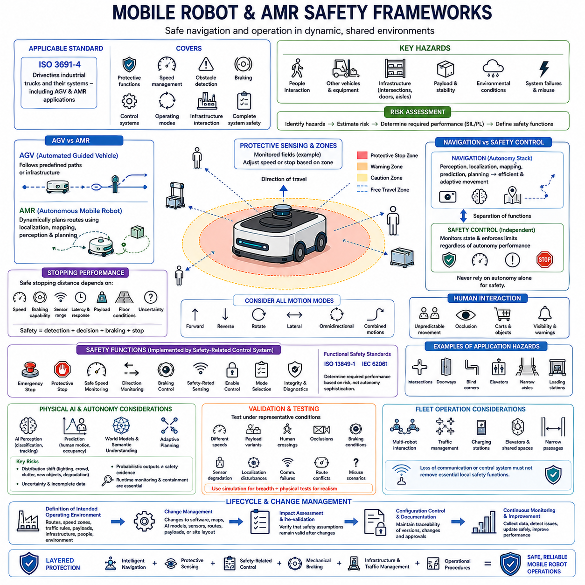{width="7.268055555555556in" height="7.268055555555556in"}

이동 로봇(Mobile Robot) 및 자율이동로봇(Autonomous Mobile Robot, AMR) 안전 프레임워크(Safety Framework)는 사람, 차량, 장비, 기반 시설(Infrastructure), 변화하는 장애물과 환경을 공유하면서 이동하는 기계를 대상으로 한다. 고정형 산업용 로봇과 달리 이동 로봇은 주변 위험요인과의 물리적 관계가 지속적으로 변화한다. 따라서 안전성은 로봇 기능뿐만 아니라 내비게이션(Navigation), 정지 거리(Stopping Distance), 경로 형상(Route Geometry), 위치 추정(Localization), 환경 조건, 페이로드 안정성(Payload Stability), 인간의 움직임까지 함께 고려해야 한다.

ISO 3691-4는 관련된 자동 유도 차량(Automated Guided Vehicle, AGV)과 자율이동로봇(AMR) 응용 시스템을 포함하여 무인 산업 차량(Driverless Industrial Truck) 및 그 시스템을 위한 중요한 안전 프레임워크를 제공한다. 이 표준은 산업 환경에서 자동화된 이동과 관련된 위험을 다루며 보호 기능(Protective Function), 제동(Braking), 속도 관리(Speed Management), 장애물 감지(Obstacle Detection), 제어 시스템, 운전 모드(Operating Mode), 주변 기반 시설과의 상호작용에 대한 요구사항을 제시한다. 단순한 내비게이션 성능이 아니라 실제 배치된 전체 시스템의 안전성이 핵심적인 관심 대상이다.

자동 유도 차량(AGV)과 보다 자율적인 이동 로봇 사이에는 근본적인 차이가 존재한다. 전통적인 AGV는 일반적으로 사전에 정의된 경로나 기반 시설을 따라 이동하지만 AMR은 위치 추정, 매핑(Mapping), 인식(Perception), 계획(Planning)을 이용하여 동적으로 경로를 결정할 수 있다. 높은 자율성은 운용 유연성(Operational Flexibility)을 증가시키지만 위험 평가(Risk Assessment), 검증(Validation), 런타임 운용(Runtime Operation) 과정에서 고려해야 하는 잠재적인 궤적(Trajectory)과 환경 상호작용의 수도 증가시킨다.

정지 성능(Stopping Performance)은 이동 로봇 안전의 핵심 요소이다. 로봇은 허용할 수 없는 접촉을 피할 수 있을 만큼 충분히 빠르게 위험을 감지해야 하기 때문이다. 필요한 보호 거리(Protective Distance)는 로봇 속도, 제동 능력(Braking Capability), 센서 감지 거리, 센싱 및 처리 지연(Sensing and Processing Latency), 제어기 응답, 페이로드, 바닥 조건, 불확실성(Uncertainty)에 따라 결정된다. 안전 시스템은 장애물 감지와 제동을 서로 독립적인 기능으로 보는 것이 아니라 감지에서 정지까지의 전체 체인(Detection-to-Stop Chain)을 고려해야 한다.

안전 레이저 스캐너(Safety Laser Scanner)와 기타 보호 센싱 기술(Protective Sensing Technology)은 이동 로봇 주변에 감시 영역(Monitored Field)을 설정하는 데 자주 사용된다. 서로 다른 영역 구성(Field Configuration)은 서로 다른 운용 속도나 이동 방향에 대응할 수 있다. 로봇이 사람이나 장애물에 접근하면 경고 영역(Warning Zone) 또는 보호 영역(Protective Zone)이 속도 감소를 유발하고 최종적으로 보호 정지(Protective Stop)를 수행할 수 있다. 동적 영역 선택(Dynamic Field Selection)은 로봇의 움직임, 조향 방향(Steering Direction), 실제로 달성 가능한 정지 성능과 일관성을 유지해야 한다.

AMR은 이동 방향과 곡률(Curvature)이 지속적으로 변화할 수 있기 때문에 추가적인 복잡성을 발생시킨다. 보호 센싱은 전진 이동, 후진 이동, 회전, 횡방향 이동(Lateral Motion), 병진 및 회전 운동(Translational and Rotational Movement)의 조합을 고려해야 한다. 전방으로 한정된 기존 주행 경로뿐만 아니라 다양한 방향으로 충돌 가능성이 존재하기 때문에 전방향(Omnidirectional) 또는 높은 기동성을 가진 이동 베이스(Mobile Base)는 특히 세심한 분석이 필요하다.

위치 추정(Localization)과 매핑(Mapping)은 그 자체가 안전 등급 기능(Safety-Rated Function)이 아니더라도 안전성에 영향을 미친다. 위치 추정 오류는 로봇을 지도상의 잘못된 영역에 위치시키고 부적절한 경로 선택을 발생시키거나 속도 제한 영역(Speed Zone)과 제한 구역(Restricted Area)에 관한 기존 가정을 무효화할 수 있다. 따라서 지도상의 경계를 위반하는 것이 직접적으로 위험한 움직임으로 이어질 수 있는 경우 안전 아키텍처(Safety Architecture)는 일반적인 위치 추정 기능에만 의존해서는 안 된다.

내비게이션 계획(Navigation Planning)과 안전 제어(Safety Control) 역시 개념적으로 분리되어야 한다. 자율성 스택(Autonomy Stack)은 사람과 장애물 주변에서 효율적인 궤적을 선택할 수 있지만 독립적인 안전 메커니즘(Independent Safety Mechanism)은 움직임의 제한을 강제해야 한다. 일반적으로 충돌을 회피하는 플래너(Planner)가 자동적으로 보호 안전 기능을 대체할 수 있는 것은 아니다. 인식, 위치 추정 또는 계획이 잘못되더라도 안전 계층(Safety Layer)은 위험한 움직임을 제한하거나 정지시킬 수 있어야 한다.

인간 상호작용(Human Interaction)은 사람이 정적인 장애물처럼 행동하지 않기 때문에 특히 중요하다. 작업자는 갑자기 로봇 경로에 진입하거나 가려진 영역(Occlusion)에서 나타나거나 방향을 변경하거나 카트를 밀거나 큰 물체를 운반하거나 접근하는 로봇을 인식하지 못할 수 있다. 따라서 안전한 AMR 운용은 보호 센싱과 적절한 속도, 가시성(Visibility), 경고 신호(Warning Signal), 작업 공간 설계(Workspace Design), 운용 절차(Operating Procedure), 예측 가능한 로봇 행동(Predictable Robot Behavior)을 함께 결합해야 한다.

교차로(Intersection), 출입구(Doorway), 사각지대 코너(Blind Corner), 엘리베이터(Elevator), 좁은 통로(Narrow Aisle), 적재 스테이션(Loading Station), 혼합 교통 영역(Mixed-Traffic Area)은 응용 분야별 위험을 발생시킨다. 위험 수준은 로봇 자체만큼이나 기반 시설에 의해 영향을 받을 수 있다. 교통 관리(Traffic Management), 통행 우선권 규칙(Right-of-Way Rules), 신호 체계(Signaling), 제한 구역, 통제된 횡단 구역(Controlled Crossing), 인터페이스 메커니즘을 통해 이러한 위험을 감소시킬 수 있다. 따라서 차량 수준의 보호 기능과 함께 현장 수준 안전(Site-Level Safety)을 평가해야 한다.

페이로드(Payload)는 이동 로봇의 안전 특성을 크게 변화시킬 수 있다. 질량이 증가하면 정지 거리와 충돌 에너지(Collision Energy)가 증가하며, 높거나 비대칭적인 하중(Asymmetric Load)은 안정성에 영향을 줄 수 있다. 페이로드가 센서를 가리거나 로봇의 기본 외곽 영역(Robot Footprint)을 넘어 확장될 수도 있다. 이동형 매니퓰레이터(Mobile Manipulator)는 로봇 팔이나 도구가 베이스 영역 밖으로 움직일 수 있기 때문에 추가적인 위험을 발생시키며, 플랫폼이 정지하거나 이동하는 동안 필요한 실질적인 보호 영역(Protective Area)을 변화시킨다.

기능 안전(Functional Safety) 원칙은 비상 정지(Emergency Stop), 보호 정지, 안전 속도 모니터링(Safe Speed Monitoring), 방향 모니터링(Direction Monitoring), 제동 제어(Braking Control), 안전 등급 센싱(Safety-Rated Sensing)과 같은 안전 관련 기능을 구현하는 데 사용된다. ISO 13849-1 및 IEC 62061과 같은 표준은 안전 관련 제어 시스템(Safety-Related Control System)에 적용할 수 있는 접근 방법을 제공한다. 요구되는 무결성(Integrity)은 자율 내비게이션 시스템의 기술적 복잡성이나 명목상 신뢰성(Nominal Reliability)이 아니라 위험 평가를 기반으로 결정되어야 한다.

물리 AI(Physical AI)는 학습 기반 인식(Learned Perception), 월드 모델(World Model), 예측(Prediction), 적응형 계획(Adaptive Planning)이 로봇 행동에 영향을 줄 수 있기 때문에 기존 내비게이션을 넘어 AMR 안전의 범위를 확장한다. AI는 보행자의 움직임을 추정하고, 장애물을 분류하며, 의미론적 영역(Semantic Region)을 해석하거나 미래 점유 상태(Future Occupancy)를 예측할 수 있다. 이러한 기능은 내비게이션을 향상시킬 수 있지만 확률적인 AI 출력(Probabilistic AI Output)은 적절한 검증, 모니터링 및 아키텍처적 제한(Architectural Containment) 없이 자동적으로 안전성 증거(Safety Evidence)로 간주되어서는 안 된다.

분포 변화(Distribution Shift)는 배치 환경이 지속적으로 변화하기 때문에 이동 로봇에서 특히 중요하다. 조명 변화, 임시 구조물, 반사 물질, 군중, 바닥 오염, 이동된 가구, 공사, 새로운 차량 유형 또는 센서 성능 저하(Sensor Degradation)는 개발 과정에서 경험한 데이터 분포를 벗어나는 조건을 발생시킬 수 있다. 런타임 모니터링(Runtime Monitoring)은 센싱 성능 저하, 비정상적인 위치 추정, 과도한 불확실성 및 자율 시스템의 기존 가정을 위협하는 기타 조건을 탐지해야 한다.

플릿 운용(Fleet Operation)은 단일 AMR에는 존재하지 않는 새로운 위험을 발생시킨다. 여러 로봇이 교차로, 충전 스테이션(Charging Station), 엘리베이터, 좁은 통로, 작업 구역을 공유할 수 있다. 플릿 관리(Fleet Management)는 교통을 조정하고 효율성을 향상시킬 수 있지만 통신 손실이나 잘못된 중앙 집중형 정보(Centralized Information)가 필수적인 로컬 안전 기능(Local Safety Function)을 제거해서는 안 된다. 상위 수준의 협조 기능이 사용할 수 없는 상태가 되더라도 각 로봇은 적절한 자체 보호 기능을 유지해야 한다.

검증(Validation)은 장애물이 없는 환경에서 성공적인 내비게이션만을 보여주는 것이 아니라 실제 운용 조건을 대표하는 상황을 재현해야 한다. 시험에는 다양한 속도, 페이로드, 장애물 접근, 인간의 횡단, 가림, 제동 조건, 센서 성능 저하, 위치 추정 교란(Localization Disturbance), 통신 고장, 경로 충돌(Route Conflict), 합리적으로 예측 가능한 오사용(Foreseeable Misuse)이 포함되어야 한다. 시뮬레이션(Simulation)은 시나리오 커버리지(Scenario Coverage)를 확장할 수 있으며, 물리적 시험(Physical Testing)은 센서, 브레이크, 제어기, 기계 시스템의 실제 동작을 검증한다.

배치 안전(Deployment Safety)은 의도된 운용 환경(Intended Operating Environment)을 명확하게 정의하고 전체 생명주기 동안 이를 유지하는 것에 달려 있다. 경로, 바닥 표면, 선반, 출입문, 교통 규칙, 페이로드, 센서, 소프트웨어, 지도 또는 AI 모델이 변경되면 기존 위험 평가의 결과가 달라질 수 있다. 따라서 현장 변경(Site Modification)과 소프트웨어 업데이트(Software Update)는 이전에 검증된 안전 가정(Safety Assumption)이 조용히 무효화되지 않도록 구성 관리(Configuration Control)와 변경 영향 평가(Impact Assessment)를 거쳐야 한다.

결국 이동 로봇 및 AMR 안전(Mobile Robot and AMR Safety)은 계층화된 보호(Layered Protection)를 필요로 한다. 지능형 내비게이션(Intelligent Navigation)은 효율적이고 사회적으로 적절한 이동을 추구하고, 보호 센싱(Protective Sensing)은 즉각적인 위험을 감지하며, 안전 관련 제어는 움직임의 제한을 강제한다. 기계적 제동(Mechanical Braking)은 물리적 위험을 감소시키고, 기반 시설은 공유 교통을 관리하며, 운용 절차는 인간 행동과 관련된 위험을 다룬다. 물리 AI는 자율성을 확장할 수 있지만 그 의사결정은 실제 운용 전반에서 독립적으로 강제할 수 있는 안전 경계(Independently Enforceable Safety Boundaries) 내부에 유지되어야 한다.

## 08.05. Autonomous Vehicle Safety Frameworks

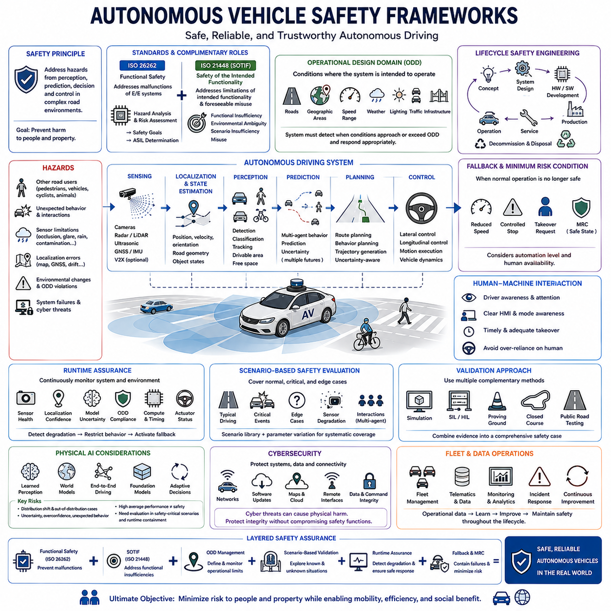{width="7.268055555555556in" height="7.268055555555556in"}

자율주행차 안전 프레임워크(Autonomous Vehicle Safety Frameworks)는 복잡한 도로 환경에서 인식(Perception), 예측(Prediction), 의사결정(Decision), 차량 제어(Control)를 수행하며, 고장이 직접적인 물리적 피해로 이어질 수 있는 시스템을 다룬다. 기존 운전자 보조 기능(Driver-Assistance Function)과 달리 고도 자동화 차량(Highly Automated Vehicle)은 주행 작업의 상당 부분을 담당할 수 있다. 따라서 안전 보증(Safety Assurance)은 센싱(Sensing), 위치 추정(Localization), 예측, 계획(Planning), 제어, 차량 동역학(Vehicle Dynamics), 인간 상호작용(Human Interaction), 운용 경계(Operational Boundaries), 폴백 행동(Fallback Behavior)을 하나의 통합 시스템으로 다루어야 한다.

ISO 26262는 도로 차량의 안전 관련 전기·전자 시스템(Safety-Related Electrical and Electronic Systems)을 위한 핵심 기능 안전 프레임워크(Functional Safety Framework)를 제공한다. 이 표준은 오작동 행동(Malfunctioning Behavior)으로 인해 발생하는 위험을 다루며 개념 개발, 시스템 설계, 하드웨어, 소프트웨어, 생산, 운용, 서비스, 폐기(Decommissioning)에 걸쳐 안전 엔지니어링을 구성한다. 위험 분석 및 위험 평가(Hazard Analysis and Risk Assessment)를 통해 안전 목표(Safety Goal)를 수립하고 안전 관련 기능에 적절한 자동차 안전 무결성 수준(Automotive Safety Integrity Level, ASIL)을 결정한다.

기능 안전(Functional Safety)은 필수적이지만 모든 자율주행 위험을 다루지는 못한다. 자율주행 시스템(Automated Driving System)에 기존 의미의 하드웨어 또는 소프트웨어 고장이 없더라도 어려운 상황에서 의도된 기능(Intended Functionality)의 능력이 충분하지 않아 위험하게 행동할 수 있다. 카메라가 특이한 물체를 인식하지 못하거나, 예측 시스템이 다른 도로 사용자의 행동을 잘못 이해하거나, 모든 구성요소가 설계된 대로 작동하는 상황에서도 계획 과정의 가정이 무효화될 수 있다.

의도된 기능의 안전성(Safety of the Intended Functionality, SOTIF)과 관련된 ISO 21448은 이러한 중요한 위험 범주를 다룬다. SOTIF는 전통적인 고장이 존재하지 않는 상황에서 기능적 불충분성(Functional Insufficiency)과 합리적으로 예측 가능한 오사용(Reasonably Foreseeable Misuse)으로 인해 발생하는 위험을 고려한다. 자율주행차에서는 인식의 한계, 환경적 모호성(Environmental Ambiguity), 불완전한 시나리오 이해, 부적절한 예측 등 시스템이 기술적으로 정상 작동하면서도 위험한 의사결정을 생성할 수 있는 조건이 이에 포함된다.

운용 설계 영역(Operational Design Domain, ODD)은 자율주행 기능이 운용되도록 의도된 조건을 정의한다. 여기에는 도로 유형, 지리적 영역, 속도 범위, 날씨, 조명, 교통 조건, 기반 시설 특성(Infrastructure Characteristics), 기타 환경적 제약이 포함될 수 있다. 안전 논증(Safety Argument)은 이러한 영역 내부에서 허용 가능한 행동을 입증하는 동시에 조건이 ODD 경계에 접근하거나 이를 벗어날 때 이를 감지하고 적절하게 대응할 수 있음을 보여주어야 한다.

인식 안전(Perception Safety)은 자율주행차가 주변 환경을 이해하기 위해 카메라, 레이더(Radar), 라이다(LiDAR), 초음파 센서(Ultrasonic Sensor), 위치 측정 시스템(Positioning System), 지도(Map), 다중 모달 융합(Multimodal Fusion)에 의존하기 때문에 특히 어렵다. 각각의 센서는 서로 다른 한계를 가지며 가림(Occlusion), 눈부심(Glare), 강수, 오염, 반사, 보정 오류(Calibration Error), 특이한 물체 등으로 인해 문제가 발생할 수 있다. 센서 다양성(Sensor Diversity)과 일관성 검사(Consistency Checking)는 단일 환경 정보원에 대한 의존성을 줄일 수 있다.

위치 추정(Localization)과 상태 추정(State Estimation)은 또 다른 중요한 기반을 제공한다. 차량은 안전한 계획을 위해 자신의 위치, 방향, 속도, 도로 형상(Road Geometry), 관련 물체와의 관계를 충분한 정확도로 이해해야 한다. GNSS 성능 저하, 지도 오류, 센서 드리프트(Sensor Drift), 공사로 인한 환경 변화, 잘못된 차선 연결(Lane Association)은 위험한 후속 의사결정을 발생시킬 수 있다. 따라서 안전 시스템은 위치 추정 품질을 모니터링하고 신뢰도(Confidence)가 저하될 때 적절하게 대응해야 한다.

예측(Prediction)은 다른 도로 사용자가 결정론적인 장애물이 아니라 스스로 행동하는 자율적 행위자(Autonomous Agent)이기 때문에 불확실성을 발생시킨다. 보행자, 자전거 이용자, 운전자, 긴급 차량, 동물은 예상하지 못하거나 모호한 방식으로 행동할 수 있다. 예측 시스템은 하나의 확정된 궤적 대신 여러 개의 가능한 미래를 생성할 수 있다. 따라서 안전한 계획은 가장 가능성이 높은 예측이 항상 발생한다고 가정하는 대신 불확실성, 다중 가설(Multiple Hypotheses), 상호작용 효과(Interaction Effects), 보수적인 안전 여유(Conservative Margin)를 고려해야 한다.

계획(Planning)과 제어(Control)는 불확실한 환경 이해를 물리적으로 실행 가능하고 안전한 차량 움직임으로 변환해야 한다. 시스템은 주행 목표를 수행하면서 충돌 제약(Collision Constraints), 도로 경계, 교통 법규, 차량 동역학, 승차감 제한(Comfort Limits), 비상 요구사항을 준수해야 한다. 독립적인 모니터링(Independent Monitoring) 또는 안전 제약(Safety Constraints)을 활용하면 최적화된 궤적이 기본적인 안전 조건을 위반할 경우 해당 궤적이 실제로 실행되는 것을 방지할 수 있다.

자율주행 시스템이 정상적인 운용을 더 이상 안전하게 지속할 수 없을 때 폴백 행동(Fallback Behavior)이 필수적이다. 센서 고장, 위치 추정 성능 저하, 컴퓨팅 고장(Compute Fault), 환경 조건 변화 또는 운용 설계 영역 이탈은 감속, 통제된 정지(Controlled Stopping), 제어권 전환(Transfer of Control), 최소 위험 상태(Minimum Risk Condition)로의 전환을 요구할 수 있다. 폴백 전략은 차량의 자동화 수준(Automation Level)과 인간 운전자가 실제로 개입할 수 있는지를 함께 고려해야 한다.

인간-기계 상호작용(Human-Machine Interaction)은 운전 책임이 자동화 시스템과 인간 사이에서 전환될 수 있는 시스템에서 특히 중요하다. 단순히 인수 요청(Takeover Request)을 발생시켰다고 해서 안전한 것은 아니다. 시스템은 운전자의 인지 상태(Driver Awareness), 반응 시간(Response Time), 인터페이스 명확성, 자동화 모드 혼동(Automation Mode Confusion), 운전자가 상황을 이해하고 다시 제어권을 확보할 충분한 시간이 존재하는지를 고려해야 한다. 고도 자동화 시스템에서는 즉각적인 인간 개입에 의존하는 것이 더욱 어려워진다.

도로 환경에는 매우 많은 상황이 존재하기 때문에 시나리오 기반 안전 평가(Scenario-Based Safety Evaluation)가 필요하다. 따라서 검증은 일반적인 주행 시나리오뿐만 아니라 위험 사건(Critical Event), 엣지 케이스(Edge Case), 비정상적인 물체 행동, 센서 성능 저하, 환경 변화, 여러 도로 사용자 사이의 상호작용을 결합하여 수행해야 한다. 시나리오 라이브러리(Scenario Library)와 매개변수 변화(Parameter Variation)를 활용하면 실제 도로 시험만으로 재현하기 어려운 조합을 체계적으로 탐색할 수 있다.

시뮬레이션(Simulation)은 검증 범위(Validation Coverage)를 확장하기 위한 중요한 수단을 제공한다. 날씨, 교통, 센서 조건, 차량 행동, 희귀 사건(Rare Event)을 통제하면서 많은 시나리오를 실행할 수 있다. 그러나 시뮬레이션 모델과 현실 사이에는 차이가 존재할 수 있기 때문에 시뮬레이션만으로 완전한 안전성을 입증할 수는 없다. 소프트웨어 인 더 루프(Software-in-the-Loop), 하드웨어 인 더 루프(Hardware-in-the-Loop), 시험장 테스트(Proving-Ground Testing), 폐쇄 코스 실험(Closed-Course Experiment), 공공도로 운행 증거(Public-Road Evidence)가 상호 보완적인 보증 수단을 제공한다.

심각한 사고는 희귀 사건이기 때문에 통계적 도로 시험(Statistical Road Testing)에도 한계가 존재한다. 매우 낮은 고장률을 주행 거리만으로 입증하려면 현실적으로 불가능할 정도로 많은 주행이 필요할 수 있다. 따라서 안전 논증은 단순히 누적 주행거리(Kilometers)에만 의존해서는 안 된다. 구조화된 시나리오 시험, 분석적 증거(Analytical Evidence), 시뮬레이션, 고장 주입(Fault Injection), 아키텍처 분석(Architecture Analysis), 구성요소 검증(Component Verification), 운용 데이터를 결합하여 보다 광범위한 안전 사례(Safety Case)를 구성해야 한다.

물리 AI(Physical AI)는 학습 기반 인식(Learned Perception), 월드 모델(World Model), 엔드투엔드 주행 정책(End-to-End Driving Policy), 파운데이션 모델(Foundation Model), 적응형 의사결정 시스템(Adaptive Decision System)을 통해 추가적인 과제를 발생시킨다. 이러한 모델은 분포 변화(Distribution Shift), 불확실성, 과신(Overconfidence), 익숙하지 않은 상황에서의 예상하지 못한 행동을 나타낼 수 있다. 높은 평균 벤치마크 성능만으로는 안전성을 보증하기에 충분하지 않다. 모델 행동을 안전 중요 시나리오(Safety-Critical Scenario)에서 평가하고 허용할 수 없는 출력을 탐지하거나 제한할 수 있는 런타임 메커니즘(Runtime Mechanism)을 통해 제약해야 한다.

런타임 보증(Runtime Assurance)은 개발 단계의 검증과 실제 운용을 연결한다. 차량은 센서 상태(Sensor Health), 위치 추정 신뢰도(Localization Confidence), 모델 불확실성(Model Uncertainty), 궤적 실행 가능성(Trajectory Feasibility), 운용 설계 영역 준수 여부, 타이밍(Timing), 컴퓨팅 자원(Compute Resources), 액추에이터 상태(Actuator Status)를 지속적으로 모니터링할 수 있다. 자율 시스템이 사용하는 가정이 더 이상 유효하지 않으면 런타임 메커니즘은 행동을 제한하거나 폴백 기능을 활성화하고 차량을 보다 안전한 운용 상태로 전환할 수 있다.

자율주행차는 연결성(Connectivity), 소프트웨어 업데이트, 차량 네트워크, 지도, 클라우드 서비스, 원격 인터페이스가 안전 중요 행동에 영향을 미칠 수 있기 때문에 사이버보안(Cybersecurity)을 안전과 분리할 수 없다. 인식 데이터, 제어 명령, 소프트웨어 또는 시스템 구성이 침해되면 사이버 공격(Cyberattack)이 실제 물리적 피해로 전환될 수 있다. 따라서 보안 엔지니어링(Security Engineering)은 시스템 무결성(System Integrity)을 보호하는 동시에 사이버보안 메커니즘 자체가 필수적인 안전 기능을 방해하지 않도록 해야 한다.

소프트웨어 및 AI 업데이트(Software and AI Update)는 자율주행 시스템이 초기 배치 이후에도 발전할 수 있기 때문에 생명주기 보증(Lifecycle Assurance) 문제를 발생시킨다. 인식 모델, 계획 알고리즘, 지도, 센서 보정, 운용 영역을 변경하면 이전의 검증 증거가 더 이상 유효하지 않을 수 있다. 시스템이 변화하더라도 신뢰성을 유지하기 위해 구성 관리(Configuration Management), 변경 영향 분석(Change Impact Analysis), 회귀 시험(Regression Testing), 통제된 배포(Controlled Deployment), 플릿 모니터링(Fleet Monitoring), 재검증(Revalidation)이 필요하다.

따라서 자율주행차 안전(Autonomous Vehicle Safety)은 하나의 표준이나 시험 방법에 의존하는 것이 아니라 상호 보완적인 보증 계층(Complementary Assurance Layers)을 필요로 한다. 기능 안전은 오작동 행동을 다루고, 의도된 기능의 안전성(SOTIF)은 의도된 기능의 한계를 다루며, 운용 설계 영역(ODD)은 자율성의 적용 범위를 제한하고, 시나리오 기반 검증은 복잡한 조건을 탐색한다. 런타임 보증은 성능 저하를 탐지하고 폴백 메커니즘은 고장을 제한하며, 이러한 요소들이 결합되어 현실 세계에서 운용되는 자율 물리 AI(Autonomous Physical AI)를 위한 생명주기 안전 사례(Lifecycle Safety Case)를 형성한다.

## 08.06. Aerial Robot and UAV Safety Frameworks

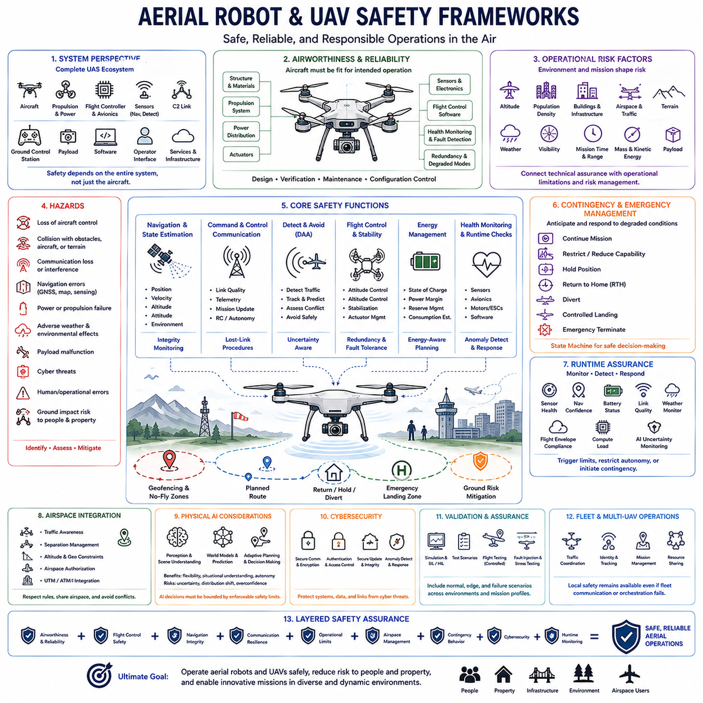{width="7.268055555555556in" height="7.268055555555556in"}

공중 로봇(Aerial Robot) 및 무인항공기(Unmanned Aerial Vehicle, UAV) 안전 프레임워크(Safety Framework)는 고장이 항공기 자체뿐만 아니라 사람, 재산, 기반 시설(Infrastructure), 다른 공역 사용자(Airspace User)에게까지 영향을 줄 수 있는 3차원 공역(Three-Dimensional Airspace)에서 운용되는 자율 시스템을 다룬다. 지상 로봇과 달리 공중 플랫폼(Aerial Platform)은 불확실성이 증가할 때 항상 그 자리에서 안전하게 정지할 수 있는 것은 아니다. 따라서 안전은 비행 안정성(Flight Stability), 항법(Navigation), 공역 제약(Airspace Constraints), 통신, 에너지, 환경 조건, 페이로드(Payload), 비상 행동(Emergency Behavior)을 통합하여 고려해야 한다.

안전 문제는 항공기 자체가 아니라 전체 무인항공기 시스템(Unmanned Aircraft System, UAS)에서 시작된다. 기체(Vehicle), 추진 시스템(Propulsion System), 비행 제어기(Flight Controller), 항법 센서(Navigation Sensor), 지휘통제 링크(Command-and-Control Link), 지상 통제소(Ground Control Station), 페이로드, 통신 기반 시설, 소프트웨어, 운영자 인터페이스(Operator Interface), 지원 서비스가 상호작용하여 운용 위험(Operational Risk)을 결정한다. 따라서 인증(Certification)과 보증(Assurance)은 전체 시스템 아키텍처(System Architecture)와 임무 생명주기(Mission Lifecycle)에 걸친 고장과 의존 관계를 평가해야 한다.

감항성(Airworthiness)은 공중 시스템을 위한 기본적인 안전 개념을 제공한다. 항공기는 정의된 환경 및 하중 조건에서 의도된 운용을 수행할 수 있도록 구조적·기능적으로 적합한 상태를 유지해야 한다. 추진 시스템, 전력 분배(Power Distribution), 비행 제어 전자장치, 액추에이터(Actuator), 센서, 구조 구성요소, 소프트웨어 모두가 위험한 고장 상태(Hazardous Failure Condition)에 영향을 줄 수 있다. 따라서 보증을 위해서는 체계적인 설계, 검증(Verification), 유지보수, 구성 관리(Configuration Control), 핵심 기능이 충분한 신뢰성을 유지한다는 증거가 필요하다.

운용 위험은 UAV가 어디에서 어떻게 비행하는지에 따라 크게 달라진다. 고도(Altitude), 인구 밀도(Population Density), 건물과의 근접성, 통제 공역(Controlled Airspace), 주변 항공기, 지형, 임무 시간, 기체 질량, 운동 에너지(Kinetic Energy), 페이로드 특성은 고장 발생 시 결과를 크게 변화시킬 수 있다. 따라서 안전 프레임워크는 하나의 기체 구성이 모든 임무에서 동일한 위험을 가진다고 가정하지 않고 기술적 보증(Technical Assurance)을 운용 제한(Operational Limitations)과 연결해야 한다.

항법(Navigation)과 상태 추정(State Estimation)은 공중 로봇이 위치, 고도, 자세(Orientation), 속도 및 주변 형상에 대한 정확한 정보를 필요로 하기 때문에 매우 중요하다. GNSS 성능 저하, 다중경로(Multipath), 재밍(Jamming), 스푸핑(Spoofing), 관성 드리프트(Inertial Drift), 지도 오류, 자기장 간섭(Magnetic Interference), 시각 위치 추정(Visual Localization) 실패는 상태 추정을 손상시킬 수 있다. 안전 아키텍처(Safety Architecture)는 항법 무결성(Navigation Integrity)을 모니터링하고 정상적인 자율 비행에 필요한 신뢰도가 부족해질 경우 성능 저하 모드(Degraded Mode)를 제공해야 한다.

지휘통제 통신(Command-and-Control Communication)은 또 하나의 주요 안전 의존 요소이다. UAV는 감독(Supervision), 임무 업데이트, 텔레메트리(Telemetry), 직접 제어를 위해 무선 링크에 의존할 수 있다. 간섭, 차폐, 통신 혼잡(Congestion), 하드웨어 고장, 네트워크 장애로 이러한 링크가 중단될 수 있다. 따라서 통신 두절 행동(Lost-Link Behavior)을 비행 전에 정의해야 하며, 제자리 대기(Hold), 지정 위치로 복귀(Return), 고도 변경, 사전에 정의된 비상 경로(Contingency Route) 비행, 통제된 착륙(Controlled Landing) 등의 대응이 포함될 수 있다.

비행 제어 안전(Flight-Control Safety)은 제어 상실이 즉각적인 하강이나 충돌로 이어질 수 있다는 점에서 지상 이동체와 근본적으로 다르다. 안정화(Stabilization), 자세 제어(Attitude Control), 고도 제어(Altitude Control), 추진 관리(Propulsion Management), 액추에이터 협조(Actuator Coordination)는 안전 중요 기능(Safety-Critical Capability)이다. 중복성(Redundancy), 고장 탐지(Fault Detection), 상태 모니터링(Health Monitoring), 성능 저하 제어(Degraded Control), 적절한 비상 모드(Emergency Mode)는 단일 구성요소의 고장이 항공기 전체의 치명적 손실로 이어지는 위험을 감소시킬 수 있다.

에너지 관리(Energy Management)는 비행 안전과 밀접하게 연결된다. 배터리 상태(Battery State), 전압, 온도, 방전 능력(Discharge Capability), 추진 요구량, 바람, 페이로드 질량, 임무 거리, 예비 에너지 요구량(Reserve Requirement)은 항공기가 임무를 안전하게 완료하거나 종료할 수 있는지를 결정한다. 자율 계획(Autonomous Planning)은 단순한 임무 완료만 최적화하지 않고 비상 상황을 위한 충분한 에너지 여유(Energy Margin)를 유지해야 한다. 예상하지 못한 에너지 고갈은 예측 가능하고 단계적으로 더욱 안전한 대응을 유발해야 한다.

날씨 및 환경 조건(Environmental Conditions)은 공중 로봇에 상당한 불확실성을 발생시킨다. 바람, 돌풍(Gust), 비, 결빙(Icing), 온도, 가시성(Visibility), 먼지, 전자기 간섭(Electromagnetic Interference), 대기 조건은 센싱, 통신, 추진 및 비행 안정성을 동시에 저하시킬 수 있다. 운용 영역(Operational Envelope)은 허용 가능한 환경 조건을 정의해야 하며, 온보드 모니터링(Onboard Monitoring)은 실제 조건이 임무 변경, 복귀 또는 착륙이 필요한 한계에 접근하는지를 감지해야 한다.

공역 통합(Airspace Integration)은 다른 항공기와 관련 운용 제한에 대한 인식을 필요로 한다. 응용 분야에 따라 UAV는 항공 교통을 감지하고, 안전한 분리(Separation)를 유지하며, 고도 및 지리적 제한을 준수하고, 예상하지 못한 조우(Encounter)에 대응하는 메커니즘을 필요로 할 수 있다. 지오펜싱(Geofencing)은 비행 영역 제한(Containment)을 지원할 수 있지만 위치 추정 오류, 지도 부정확성, 구성 오류, 소프트웨어 고장으로 지리적 제한이 손상될 수 있으므로 완전한 안전 장벽으로 간주해서는 안 된다.

탐지 및 회피(Detect-and-Avoid) 기능은 자율성과 운용 거리가 증가할수록 더욱 중요해진다. 시스템은 협조 또는 비협조 항공 교통(Cooperative or Non-Cooperative Traffic)을 탐지하고, 상대 운동을 추정하며, 잠재적 충돌을 예측하고, 항공기의 안정성과 규제 제약을 유지하면서 회피 행동을 선택해야 할 수 있다. 감지 불확실성과 제한된 센싱 거리를 고려하면 충돌 회피(Collision Avoidance)는 하나의 결정론적 예측에 의존하기보다 여러 가능한 미래(Multiple Possible Futures)를 고려해야 한다.

비가시권 운용(Beyond Visual Line of Sight, BVLOS)은 운영자가 항공기와 주변 환경을 직접 관찰할 수 없기 때문에 추가적인 보증 과제를 발생시킨다. 안전은 통신 신뢰성(Communication Reliability), 감시(Surveillance), 원격 상황 인식(Remote Situational Awareness), 항법 무결성, 기상 정보, 탐지 및 회피 기능, 자동 비상 관리(Automated Contingency Management)에 더욱 의존하게 된다. 따라서 운용 거리 증가는 비교적 국지적인 고장을 더욱 강력한 아키텍처 보증이 필요한 시스템 수준 안전 문제로 변화시킬 수 있다.

비상 및 우발 상황 관리(Emergency and Contingency Management)는 시스템의 완전한 고장뿐만 아니라 다양한 부분적 이상 상태를 다루어야 한다. 추진 성능 저하, 센서 불일치, 항법 불확실성, 통신 두절, 예상하지 못한 날씨, 공역 충돌, 페이로드 오작동, 임무 계획 오류는 각각 서로 다른 대응을 요구할 수 있다. 시스템은 성능 저하 상태를 분류하고 위험 수준에 따라 계속(Continue), 제한(Restrict), 대기(Hold), 복귀(Return), 우회(Divert), 통제 착륙(Controlled Land), 비상 종료(Emergency Terminate)와 같은 사전에 정의된 상태로 전환해야 한다.

지상 위험(Ground Risk)은 항공기 고장이 공중의 에너지를 지상의 사람과 재산에 전달할 수 있기 때문에 UAV 안전의 핵심 요소이다. 경로 계획(Route Planning)은 인구 밀집 지역이나 중요 기반 시설을 회피하여 노출 위험을 감소시킬 수 있으며, 기체 설계를 통해 충돌 결과를 완화할 수도 있다. 응용 분야에 따라 비행 영역 제한, 통제된 하강(Controlled Descent), 비상 착륙 구역(Emergency Landing Area), 기타 위험 완화 조치(Mitigation Measures)를 통해 불가피한 고장의 결과를 감소시킬 수 있다.

물리 AI(Physical AI)는 학습 기반 인식(Learned Perception), 월드 모델(World Model), 파운데이션 모델(Foundation Model), 적응형 플래너(Adaptive Planner)가 공중 자율성(Aerial Autonomy)에 참여하면서 새로운 복잡성을 발생시킨다. AI는 지형을 해석하고, 착륙 구역을 인식하며, 움직이는 물체를 예측하고, 의미론적 임무 명령(Semantic Mission Command)을 이해하거나 경로를 동적으로 변경할 수 있다. 이러한 기능은 유연성을 높이지만 확률적 출력(Probabilistic Output)과 분포 변화(Distribution Shift)는 독립적으로 강제 가능한 비행, 공역, 에너지 및 안전 제한 내부에서 통제되어야 한다.

런타임 보증(Runtime Assurance)은 공중 환경이 이륙 이후 빠르게 변화할 수 있기 때문에 특히 중요하다. 시스템은 센서 상태(Sensor Health), 항법 신뢰도(Navigation Confidence), 통신 품질, 배터리 상태, 추진 시스템 상태, 기상 지표(Weather Indicator), 비행 영역 준수 여부(Flight-Envelope Compliance), 컴퓨팅 자원, AI 불확실성을 지속적으로 모니터링할 수 있다. 안전 가정(Safety Assumption)이 약화되면 런타임 메커니즘은 자율성을 제한하고 상황이 회복 불가능해지기 전에 적절한 비상 대응을 명령할 수 있다.

사이버보안(Cybersecurity) 역시 직접적인 물리적 안전 영향을 가진다. 위조된 항법 신호(Spoofed Navigation Signal), 침해된 지휘 링크, 악성 소프트웨어 업데이트, 변경된 지오펜스(Geofence), 손상된 임무 데이터, 무단 제어(Unauthorized Control)는 위험한 비행 행동을 발생시킬 수 있다. 따라서 인증(Authentication), 무결성 보호(Integrity Protection), 안전한 업데이트(Secure Update), 접근 제어(Access Control), 이상 탐지(Anomaly Detection), 복원력 있는 통신(Resilient Communication)은 필요한 비상 운용을 방해하지 않으면서 기존 비행 안전 엔지니어링을 보완해야 한다.

검증(Validation)은 정상적인 비행의 성공만을 입증하는 것 이상을 요구한다. 시험에는 통신 두절, GNSS 성능 저하, 센서 고장, 추진 이상(Propulsion Anomaly), 배터리 불확실성, 바람 교란(Wind Disturbance), 장애물 조우, 공역 충돌, 페이로드 변경, 운영자 오류, 비상 착륙 시나리오가 포함되어야 한다. 시뮬레이션(Simulation), 소프트웨어 인 더 루프(Software-in-the-Loop), 하드웨어 인 더 루프(Hardware-in-the-Loop)는 시나리오 커버리지(Scenario Coverage)를 확장하며, 통제된 비행 시험(Controlled Flight Test)은 실제 공기역학, 센싱, 통신 및 고장 대응 행동에 대한 증거를 제공한다.

플릿 및 다중 UAV 운용(Fleet and Multi-UAV Operations)은 여러 항공기가 공역, 통신 자원, 착륙 구역, 충전 기반 시설, 임무 목표를 공유할 수 있기 때문에 또 다른 안전 계층을 추가한다. 중앙 협조(Central Coordination)는 효율성을 향상시킬 수 있지만 플릿 통신이나 오케스트레이션(Orchestration)이 실패하더라도 개별 항공기의 로컬 안전(Local Safety)은 유지되어야 한다. 공중 운용 규모가 확대될수록 충돌 해결(Conflict Resolution), 식별 관리(Identity Management), 교통 협조(Traffic Coordination), 임무 우선순위, 분산 비상 행동(Distributed Contingency Behavior)이 중요해진다.

따라서 공중 로봇 및 UAV 안전(Aerial Robot and UAV Safety)은 기체 감항성(Airworthiness), 비행 제어, 항법 무결성, 통신 복원력(Communication Resilience), 운용 제한, 공역 관리(Airspace Management), 비상 행동, 사이버보안, 런타임 모니터링(Runtime Monitoring)에 걸친 계층화된 보증(Layered Assurance)에 의존한다. 물리 AI는 자율성과 임무 능력을 확장할 수 있지만 지능형 의사결정(Intelligent Decision)은 강제 가능한 안전 제약(Enforceable Safety Constraints) 안에 유지되어야 하며, 이를 통해 불확실성이나 모델 고장이 통제되지 않은 물리적 비행 행동으로 직접 전환되는 것을 방지해야 한다.

## 08.07. Functional Safety Standards

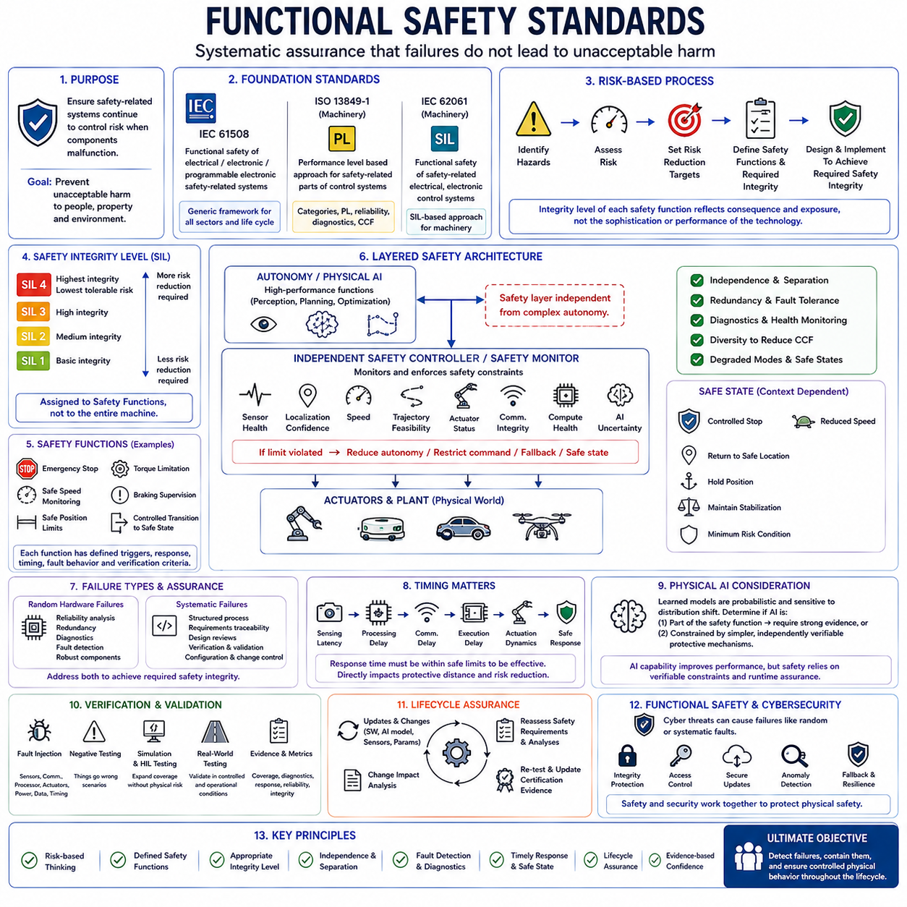{width="7.268055555555556in" height="7.268055555555556in"}

기능 안전 표준(Functional Safety Standards)은 하드웨어, 소프트웨어, 센서, 제어기 또는 액추에이터(Actuator)에 오작동이 발생하더라도 안전 관련 시스템(Safety-Related System)이 지속적으로 위험을 통제하도록 보장하기 위한 체계적인 프레임워크를 제공한다. 핵심 목표는 장비가 절대로 고장 나지 않는다고 보장하는 것이 아니라, 식별된 고장이 허용할 수 없는 위험으로 직접 이어지지 않도록 하는 것이다. 이러한 원칙은 실제 세계에 물리적 피해를 발생시킬 수 있는 시스템 위에서 지능형 자율성(Intelligent Autonomy)이 작동하는 물리 AI(Physical AI)에 필수적이다.

IEC 61508은 전기·전자·프로그램 가능 전자 안전 관련 시스템(Electrical, Electronic and Programmable Electronic Safety-Related Systems)을 위한 기본적인 기능 안전 프레임워크(Functional Safety Framework)를 제공한다. 이 표준은 위험 분석(Hazard Analysis), 안전 요구사항(Safety Requirements), 시스템 아키텍처(System Architecture), 하드웨어 및 소프트웨어 개발, 검증(Verification), 유효성 확인(Validation), 운용, 유지보수, 변경을 포함하는 생명주기 중심 원칙(Lifecycle-Oriented Principles)을 제시한다. 다양한 산업별 기능 안전 접근법은 이러한 일반적인 프레임워크의 개념을 계승하여 특정 산업과 응용 분야에 맞게 적용한다.

기능 안전(Functional Safety)은 선호하는 기술 아키텍처에서 시작하는 것이 아니라 위험요인(Hazard)과 위험(Risk)에서 시작한다. 엔지니어는 위험 사건(Hazardous Event)을 식별하고 심각도와 발생 가능성을 평가하며 필요한 위험 저감(Risk Reduction) 수준을 결정한 후, 이를 달성할 수 있는 안전 기능(Safety Function)을 도출한다. 따라서 각 안전 기능에 요구되는 무결성(Integrity)은 자동화 기술의 복잡성, 비용 또는 명목상 성능이 아니라 고장으로 인한 결과와 위험 노출 수준을 반영해야 한다.

안전 무결성 수준(Safety Integrity Level, SIL)은 IEC 61508에서 안전 관련 기능에 필요한 위험 저감 수준을 구조적으로 표현하기 위한 수단을 제공한다. 높은 무결성 요구사항은 아키텍처, 신뢰성(Reliability), 진단(Diagnostics), 체계적인 개발, 검증, 생명주기 통제(Lifecycle Control)에 대해 더욱 강력한 증거를 요구한다. 무결성 수준은 지능형 기계 전체에 단순하게 부여되는 것이 아니라 특정 안전 기능에 할당되며, 이를 통해 어떤 기능이 특정 위험 사건을 방지하거나 완화하는지를 명확하게 식별할 수 있다.

기계류 응용 분야(Machinery Application)에서는 일반적으로 ISO 13849-1과 IEC 62061을 활용하여 안전 관련 제어 시스템(Safety-Related Control System)을 설계한다. ISO 13849-1은 성능 수준(Performance Level), 카테고리(Category), 구성요소 신뢰성(Component Reliability), 진단 범위(Diagnostic Coverage), 공통 원인 고장(Common-Cause Failure) 등의 개념을 사용한다. IEC 62061은 안전 무결성 개념을 활용하여 기계류 안전 관련 제어 시스템에 기능 안전 원칙을 적용한다. 두 접근법 모두 위험 평가와 보호 제어 기능(Protective Control Function)의 설계 및 검증을 연결한다.

안전 기능(Safety Function)은 안전한 상태를 유지하거나 달성하기 위해 명확하게 정의된 대응 기능이다. 대표적인 예로 비상 정지(Emergency Stop), 보호 정지(Protective Stop), 안전 속도 모니터링(Safe Speed Monitoring), 안전 위치 제한(Safe Position Limit), 예상하지 못한 기동 방지(Prevention of Unexpected Startup), 토크 제한(Torque Limitation), 제동 감시(Braking Supervision), 안전 상태(Safe State)로의 통제된 전환 등이 있다. 기능 안전 엔지니어링에서는 각 기능에 대해 명확한 작동 조건, 예상 대응, 시간 요구사항, 고장 시 행동 및 검증 기준을 정의해야 한다.

안전 상태(Safe State)의 개념은 기본적이지만 물리 시스템에 따라 다르게 해석되어야 한다. 일부 고정형 기계에서는 전원을 차단하는 것이 안전할 수 있지만, 공중 로봇(Aerial Robot), 교통 흐름 속의 차량 또는 매달린 하중을 운반하는 로봇에서는 오히려 위험할 수 있다. 따라서 물리 AI는 통제된 정지(Controlled Stopping), 저속 운전(Reduced-Speed Operation), 위치 유지(Holding Position), 안전한 위치로의 복귀(Returning to a Safe Location), 안정화 유지(Maintaining Stabilization), 최소 위험 상태(Minimum-Risk Condition) 진입과 같은 상황 의존적인 안전 상태(Context-Sensitive Safety State)를 필요로 한다.

하드웨어의 무작위 고장(Hardware Random Failure)은 신뢰성 분석(Reliability Analysis), 아키텍처 중복성(Architectural Redundancy), 진단, 고장 탐지(Fault Detection), 적절한 구성요소 선택을 통해 다룬다. 요구되는 안전 무결성이 고장 허용(Fault Tolerance)을 필요로 하는 경우 단일 센서, 프로세서, 통신 채널, 액추에이터 또는 전원 구성요소의 고장이 허용할 수 없는 위험을 발생시켜서는 안 된다. 진단 메커니즘(Diagnostic Mechanism)은 고장이 위험한 상태로 발전하기 전에 이를 탐지하고 성능 저하 운전(Degraded Operation) 또는 정의된 안전 대응(Safety Response)을 시작할 수 있다.

체계적 고장(Systematic Failure)은 무작위적인 하드웨어 성능 저하가 아니라 사양(Specification), 설계, 구현, 통합 또는 유지보수 오류에서 발생하기 때문에 다른 형태의 보증이 필요하다. 구조화된 개발 프로세스, 요구사항 추적성(Requirements Traceability), 설계 검토(Design Review), 코딩 관행(Coding Practices), 검증, 유효성 확인, 구성 관리(Configuration Management), 변경 통제(Change Control)는 이러한 고장을 감소시킨다. 소프트웨어 중심의 물리 AI 시스템에서는 물리적 구성요소를 교체하지 않아도 기능이 변경될 수 있기 때문에 체계적 보증(Systematic Assurance)이 특히 중요하다.

독립성(Independence)과 분리(Separation)는 기능 안전에서 강력한 아키텍처 원칙이다. 고성능 자율 제어기(Autonomy Controller)는 인식, 계획, 최적화를 수행하고, 독립적인 안전 제어기(Independent Safety Controller)는 강제 가능한 제약(Enforceable Constraints)을 모니터링할 수 있다. 주 시스템이 안전하지 않은 명령을 생성하면 안전 계층(Safety Layer)이 움직임을 제한하거나 보호 대응(Protective Response)을 시작할 수 있다. 이러한 아키텍처는 모든 복잡한 자율성 구성요소를 동일한 수준의 안전 중요 요소(Safety-Critical Component)로 취급해야 할 필요성을 줄인다.

공통 원인 고장(Common-Cause Failure)은 여러 안전 채널이 동일한 전원 공급 장치, 소프트웨어 결함, 센서 기술, 환경 조건, 통신 네트워크 또는 개발 가정에 의존할 경우 외형적인 중복성(Redundancy)을 무력화할 수 있다. 동일한 AI 모델이나 프로세서를 단순히 복제한다고 해서 반드시 의미 있는 독립성이 확보되는 것은 아니다. 따라서 기능 안전 분석(Functional Safety Analysis)은 중복 채널이 동시에 실패할 가능성이 있는지, 그리고 다양성(Diversity)이나 물리적 분리(Physical Separation)가 필요한지를 검토해야 한다.

타이밍(Timing) 역시 하나의 안전 속성(Safety Property)이다. 보호 기능이 결국 위험을 탐지하더라도 탐지, 연산, 통신 또는 액추에이터 동작이 지나치게 늦으면 효과적인 안전 기능이 될 수 없다. 응답 시간 분석(Response-Time Analysis)은 센싱 지연(Sensing Latency), 처리 지연(Processing Delay), 네트워크 전송, 제어기 실행, 액추에이터 동역학(Actuator Dynamics), 기계적 정지 동작(Mechanical Stopping Behavior)을 포함해야 한다. 이동 로봇과 자율주행차에서는 이러한 지연이 보호 거리(Protective Distance)와 실제 달성 가능한 위험 저감 수준에 직접적인 영향을 미친다.

물리 AI는 학습 모델(Learned Model)을 기존의 결정론적 안전 가정(Deterministic Safety Assumption)으로 분석하기 어렵다는 중요한 과제를 발생시킨다. 신경망 기반 인식(Neural Perception), 월드 모델(World Model), 파운데이션 모델(Foundation Model), 학습 정책(Learned Policy)은 확률적으로 행동할 수 있으며 분포 변화(Distribution Shift) 상황에서 실패할 수 있다. 따라서 기능 안전 아키텍처는 AI 구성요소 자체가 안전 기능의 일부인지, 또는 보다 단순하고 독립적으로 검증 가능한 보호 메커니즘(Independently Verifiable Protective Mechanism)에 의해 AI 출력을 제한할 것인지를 신중하게 결정해야 한다.

런타임 보증(Runtime Assurance)은 복잡한 자율성과 기능 안전을 연결하는 실용적인 가교를 제공한다. 독립적인 모니터(Independent Monitor)는 센서 상태(Sensor Health), 위치 추정 신뢰도(Localization Confidence), 속도, 위치, 궤적 실행 가능성(Trajectory Feasibility), 액추에이터 상태, 통신 무결성(Communication Integrity), 컴퓨팅 상태(Compute Health), AI 불확실성(AI Uncertainty)을 관찰할 수 있다. 사전에 정의된 한계가 위반되면 모니터는 자율성을 축소하고 명령을 제한하며 폴백 제어기(Fallback Controller)를 호출하거나 시스템을 적절한 안전 상태 또는 최소 위험 상태로 전환할 수 있다.

고장 주입(Fault Injection)과 부정 시험(Negative Testing)은 기능 안전이 정상적인 운용뿐만 아니라 문제가 발생했을 때의 행동까지 입증해야 하기 때문에 필수적이다. 엔지니어는 센서 고장, 통신 두절, 프로세서 고장, 액추에이터 성능 저하, 타이밍 위반(Timing Violation), 손상된 데이터(Corrupted Data), 전원 교란(Power Disturbance)을 의도적으로 발생시키고 진단 메커니즘이 올바르게 대응하는지를 확인할 수 있다. 시뮬레이션(Simulation)과 하드웨어 인 더 루프 시험(Hardware-in-the-Loop Testing)은 사람이나 장비를 불필요한 물리적 위험에 노출하지 않고 다양한 위험 조건을 평가할 수 있도록 한다.

기능 안전은 전체 운용 생명주기(Operational Lifecycle)에 걸쳐 유지되어야 한다. 소프트웨어 업데이트, AI 모델 변경, 센서 교체, 매개변수 수정(Parameter Modification), 새로운 페이로드, 운용 환경 변경, 하드웨어 개정(Hardware Revision)은 이전의 안전 가정을 무효화할 수 있다. 따라서 구성 관리와 변경 영향 분석(Change Impact Analysis)을 통해 수정된 시스템을 배포하기 전에 안전 요구사항, 분석, 시험 또는 인증 증거(Certification Evidence)를 업데이트해야 하는지를 결정해야 한다.

기능 안전은 악의적인 행동이 무작위 또는 체계적 고장과 유사한 상태를 발생시킬 수 있기 때문에 사이버보안(Cybersecurity)과도 상호작용한다. 조작된 센서 데이터, 승인되지 않은 명령(Unauthorized Command), 침해된 소프트웨어, 변경된 안전 매개변수(Safety Parameter)는 보호 기능을 무력화할 수 있다. 따라서 안전 및 보안 아키텍처는 무결성 보호(Integrity Protection), 접근 제어(Access Control), 안전한 업데이트(Secure Update), 진단, 폴백 행동(Fallback Behavior)을 조정하여 사이버 복원력(Cyber Resilience)이 물리적 안전과 충돌하지 않고 이를 지원하도록 해야 한다.

물리 AI에서 기능 안전은 궁극적으로 지능형 자율성 아래에 존재하는 독립적으로 강제 가능한 보호 기반(Independently Enforceable Protective Foundation)으로 이해해야 한다. AI는 인식, 예측, 추론(Reasoning), 적응(Adaptation), 작업 성능을 향상시킬 수 있으며, 안전 관련 기능은 지능이 불확실해지거나 실패하는 상황에서도 유효한 경계(Boundary)를 설정한다. 목표는 지능이 절대로 실패하지 않는다고 인증하는 것이 아니라, 전체 시스템 생명주기(System Lifecycle)에 걸쳐 실패를 탐지하고 제한하며 통제된 물리적 행동(Controlled Physical Behavior)으로 전환할 수 있도록 보장하는 것이다.

## 08.08. Machinery and Product Safety Regulation

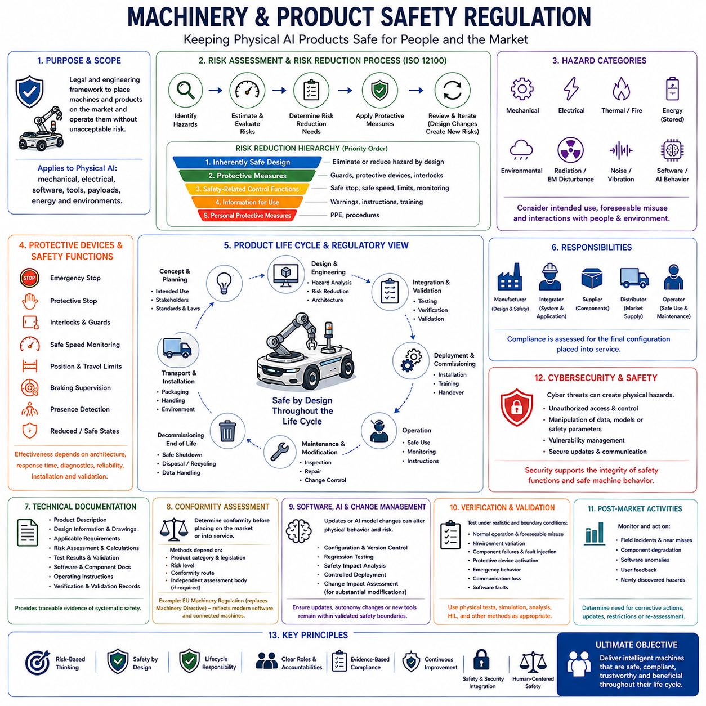{width="7.268055555555556in" height="7.268055555555556in"}

기계류 및 제품 안전 규제(Machinery and Product Safety Regulation)는 물리적 시스템(Physical System)을 시장에 출시하고 허용할 수 없는 위험(Unacceptable Risk)을 발생시키지 않으면서 운용하기 위한 법적·공학적 기반을 제공한다. 물리 AI(Physical AI)에서도 지능형 로봇은 기계 구조(Mechanical Structure), 액추에이터(Actuator), 전기 시스템(Electrical System), 저장 에너지(Stored Energy), 소프트웨어, 도구(Tool), 페이로드(Payload)를 포함하는 물리적 제품이므로 이러한 프레임워크가 중요하다. 따라서 AI 능력(AI Capability)이 기존의 기계류 안전 의무(Machinery Safety Obligations)를 대체하는 것은 아니다.

규제 관점(Regulatory Perspective)은 AI 모델 자체가 아니라 완전한 제품(Complete Product)과 의도된 사용(Intended Use)에서 시작한다. 제조업체(Manufacturer)는 기계가 어떻게 운송되고, 설치되고, 시운전(Commissioning)되고, 운용되고, 청소되고, 유지보수되고, 변경되며, 최종적으로 폐기(Decommissioning)되는지를 이해해야 한다. 합리적으로 예측 가능한 오사용(Reasonably Foreseeable Misuse)도 고려해야 한다. 따라서 안전 요구사항(Safety Requirements)은 전체 제품 생명주기(Product Lifecycle)에 걸쳐 적용되며 하드웨어, 소프트웨어, 인간 및 운용 환경 사이의 상호작용을 포함한다.

위험 평가(Risk Assessment)는 제품 설계와 규제 준수(Regulatory Compliance)를 연결하는 핵심 엔지니어링 프로세스이다. ISO 12100은 기계류 위험 평가(Machinery Risk Assessment)와 위험 저감(Risk Reduction)을 위해 널리 사용되는 원칙을 제공한다. 엔지니어는 위험요인(Hazard)을 식별하고 관련 위험을 추정·평가하며 추가적인 위험 저감이 필요한지를 결정한 후 보호 조치(Protective Measures)를 적용한다. 설계 변경이 기존 위험을 제거하면서 새로운 상호작용이나 고장 모드(Failure Mode)를 발생시킬 수 있기 때문에 이 과정은 반복적으로 수행된다.

위험 저감(Risk Reduction)은 일반적으로 외부 보호 장치나 사용자의 행동에 의존하기 전에 본질적으로 안전한 설계 조치(Inherently Safe Design Measures)를 우선하는 계층 구조를 따른다. 합리적으로 가능한 경우 먼저 기계 및 시스템 설계를 통해 위험요인을 제거하거나 감소시켜야 한다. 남아 있는 위험은 가드(Guard), 보호 장치(Protective Device), 안전 관련 제어 기능(Safety-Related Control Function), 경고, 지침, 교육 및 의도된 응용 분야에 적합한 개인 보호 조치(Personal Protective Measures)를 통해 다룰 수 있다.

기계적 위험(Mechanical Hazard)은 고도로 지능화된 기계에서도 여전히 기본적인 안전 문제이다. 압착(Crushing), 전단(Shearing), 절단(Cutting), 얽힘(Entanglement), 충격(Impact), 끼임(Trapping), 불안정성(Instability), 낙하 물체(Falling Object), 예상하지 못한 움직임(Unexpected Motion), 저장된 기계적 에너지(Stored Mechanical Energy)는 AI 성능과 관계없이 부상을 발생시킬 수 있다. 뛰어난 인식 능력을 가진 물리 AI 시스템이라도 구조, 도구, 페이로드, 제동 능력(Braking Capability), 기계적 인터페이스가 사람을 허용할 수 없는 힘이나 위험한 움직임에 노출한다면 안전하지 않을 수 있다.

전기적·열적·에너지 및 환경적 위험(Electrical, Thermal, Energy and Environmental Hazards) 역시 제품 안전 사례(Product Safety Case)에 포함되어야 한다. 배터리는 전기, 열, 화재 위험을 발생시킬 수 있으며 모터와 전력 전자장치(Power Electronics)는 열이나 예상하지 못한 움직임을 발생시킬 수 있다. 유압 또는 공압 시스템(Hydraulic or Pneumatic System)은 위험한 압력을 유지할 수 있다. 실외 로봇은 물, 먼지, 극한 온도, 부식, 진동, 전자기 교란(Electromagnetic Disturbance) 및 안전한 운용에 영향을 주는 기타 환경 조건에도 노출될 수 있다.

보호 장치(Protective Device)와 안전 관련 제어 시스템(Safety-Related Control System)은 설계를 통해 위험을 완전히 제거할 수 없는 경우 공학적으로 설계된 안전 장벽(Engineered Barrier)을 제공한다. 비상 정지(Emergency Stop), 보호 정지(Protective Stop), 인터록(Interlock), 가드, 안전 속도 모니터링(Safe Speed Monitoring), 위치 제한(Position Limit), 제동 감시(Braking Supervision), 존재 감지(Presence Detection)는 위험한 조건에 대한 노출을 감소시킬 수 있다. 이러한 기능의 효과는 단순히 안전 구성요소가 존재하는지가 아니라 올바른 아키텍처, 응답 시간(Response Time), 진단 능력(Diagnostic Capability), 신뢰성, 설치 및 검증(Validation)에 의해 결정된다.

제품 안전 규제(Product Safety Regulation)는 제조업체, 시스템 통합자(System Integrator), 공급업체(Supplier), 유통업체(Distributor), 운영자(Operator), 기타 경제 주체(Economic Actor) 사이의 책임도 명확하게 정의할 것을 요구한다. 로봇 제조업체가 안전한 기본 플랫폼을 제공하더라도 시스템 통합자가 도구, 센서, 소프트웨어, 페이로드 또는 작업 프로세스를 추가하면서 새로운 위험을 발생시킬 수 있다. 따라서 규제 준수는 개별 구성요소의 인증 상태만으로 가정해서는 안 되며 실제 운용에 투입되는 최종 구성(Final Configuration)을 기준으로 평가해야 한다.

기술 문서(Technical Documentation)는 안전성이 단순히 가정된 것이 아니라 체계적으로 엔지니어링되었다는 증거를 제공한다. 일반적인 증거에는 제품 설명, 설계 정보, 도면, 적용 요구사항, 위험 평가, 안전 계산(Safety Calculation), 시험 결과, 소프트웨어 정보, 구성요소 문서, 운용 지침, 검증 및 유효성 확인(Verification and Validation) 기록 등이 포함된다. 추적성(Traceability)을 통해 검토자는 식별된 위험요인과 구현된 위험 통제(Risk Control), 그리고 이를 뒷받침하는 증거 사이의 관계를 확인할 수 있다.

적합성 평가(Conformity Assessment)는 제품을 시장에 출시하거나 실제 운용에 투입하기 전에 해당 제품이 적용 가능한 규제 요구사항을 충족하는지를 판단한다. 필요한 절차는 제품 범주(Product Category), 적용 법규(Applicable Legislation), 위험 수준, 관련 규제 프레임워크에서 정의한 적합성 평가 경로(Conformity Route)에 따라 달라진다. 일부 제품은 상당 부분 제조업체 자체 평가(Manufacturer Assessment)에 의존할 수 있지만 다른 경우에는 독립적인 적합성 평가 기관(Independent Conformity Assessment Organization)의 참여가 필요할 수 있다.

유럽의 기계류 규제(European Machinery Regulation)는 제품 안전에서 소프트웨어와 지능형 기능(Intelligent Function)을 보다 강하게 다루는 방향으로 전환되는 사례를 보여준다. 유럽연합 기계류 규정(EU Machinery Regulation)은 기존의 기계류 지침(Machinery Directive) 체계를 대체하며 연결되고 소프트웨어 중심으로 동작하는 현대 기계류의 특성을 반영한다. 따라서 물리 AI 개발자는 소프트웨어, 안전 관련 업데이트(Safety-Related Update), 자율 행동(Autonomous Behavior), 제품의 중대한 변경(Substantial Modification)이 전체 제품 생명주기 동안 적합성(Conformity)에 영향을 줄 수 있는지를 고려해야 한다.

중대한 변경(Substantial Modification)은 기존 기계가 최초 배치 이후 변경될 때 특히 중요해질 수 있다. 새로운 센서, 액추에이터, 도구, 페이로드, 자율성 소프트웨어(Autonomy Software), AI 모델 또는 운용 목적을 추가하면 기존 위험 프로파일(Risk Profile)이 변경될 수 있다. 변경으로 인해 안전 가정(Safety Assumption)이 크게 달라진다면 이전의 적합성 증거(Conformity Evidence)가 더 이상 충분하지 않을 수 있다. 따라서 기존 승인이 계속 유효하다고 판단하기 전에 변경 영향 평가(Change Impact Assessment)가 필요하다.

소프트웨어 업데이트(Software Update)는 외형적인 기계를 변경하지 않고도 물리적 행동을 변화시킬 수 있기 때문에 유사한 문제를 발생시킨다. 업데이트된 플래너(Planner)는 다른 궤적을 생성할 수 있고, 인식 모델은 물체를 다르게 인식할 수 있으며, 새로운 자율 기능은 운용 영역(Operating Envelope)을 확장할 수 있다. 출시된 제품과 검증된 안전 증거 사이의 연결을 유지하려면 구성 관리(Configuration Management), 회귀 시험(Regression Testing), 안전 영향 분석(Safety Impact Analysis), 버전 관리(Version Control), 통제된 배포(Controlled Deployment)가 필요하다.

물리 AI는 학습된 행동(Learned Behavior)이 기존 자동화보다 덜 결정론적이기 때문에 기계류 규제를 더욱 복잡하게 만든다. 신경망 기반 인식(Neural Perception), 월드 모델(World Model), 파운데이션 모델(Foundation Model), 적응형 정책(Adaptive Policy)은 익숙하지 않은 조건에서 서로 다른 출력을 생성할 수 있다. 따라서 제품 안전은 평균적인 모델 정확도(Model Accuracy)에만 의존할 수 없다. 제조업체는 AI 고장이 어떻게 물리적 위험으로 전환될 수 있는지를 고려하고 허용할 수 없는 움직임, 힘 또는 상호작용을 방지할 수 있는 아키텍처적 제약(Architectural Constraints)을 구현해야 한다.

인간 상호작용(Human Interaction)은 규제 안전 문제를 더욱 확장한다. 로봇은 서로 다른 수준의 교육과 상황 인식(Situational Awareness)을 가진 작업자, 고객, 환자, 보행자 또는 일반 대중 가까이에서 운용될 수 있다. 합리적으로 설계를 통해 통제해야 하는 위험을 단순한 지침만으로 보완해서는 안 된다. 인터페이스(Interface), 경고, 운전 모드(Operating Mode), 물리적 행동, 접근 제어(Access Control), 보호 기능은 의도된 사용자의 능력과 예측 가능한 행동을 반영해야 한다.

연결된 기계류가 원격 명령(Remote Command), 소프트웨어 업데이트, 클라우드 서비스(Cloud Service), 플릿 시스템(Fleet System), 네트워크 센서(Networked Sensor)에 의존하면서 사이버보안(Cybersecurity)도 제품 안전과 점점 더 밀접하게 관련된다. 안전 매개변수, 제어 명령, 모델 또는 시스템 구성에 대한 승인되지 않은 변경은 물리적 위험을 발생시킬 수 있다. 따라서 보안 관련 취약점(Security-Related Weakness)이 필수적인 안전 기능이나 기계의 안전한 행동에 영향을 줄 수 있다면 이를 안전 평가 과정에서 고려해야 한다.

검증(Validation)은 구현된 위험 저감 조치가 대표적인 조건에서 실제로 작동한다는 것을 입증해야 한다. 시험에는 정상 운용, 예측 가능한 오사용, 환경 변화, 구성요소 고장, 보호 장치 작동, 비상 행동(Emergency Behavior), 통신 두절, 소프트웨어 고장, 관련 경계 조건(Boundary Condition)이 포함되어야 한다. 직접적인 위험 시험이 현실적으로 어렵거나 안전하지 않은 경우 물리적 시험(Physical Testing)을 시뮬레이션(Simulation), 분석, 고장 주입(Fault Injection), 하드웨어 인 더 루프(Hardware-in-the-Loop) 방법으로 보완할 수 있다.

시장 출시 후 모니터링(Post-Market Monitoring)은 초기 제품 출시 이후까지 안전 책임을 확장한다. 현장 사고(Field Incident), 준사고(Near Miss), 구성요소 성능 저하(Component Degradation), 소프트웨어 이상(Software Anomaly), 사용자 피드백, 새롭게 발견된 위험요인은 개발 과정에서 확인되지 않았던 한계를 드러낼 수 있다. 연결된 물리 AI 시스템은 가치 있는 운용 증거(Operational Evidence)를 제공할 수 있지만 조직은 이러한 정보를 분석하고 시정 조치(Corrective Action), 업데이트, 운용 제한 또는 재평가(Renewed Assessment)가 필요한지를 결정하는 프로세스를 갖추어야 한다.

따라서 기계류 및 제품 안전 규제(Machinery and Product Safety Regulation)는 물리적 위험에 대한 생명주기 거버넌스(Lifecycle Governance)로 이해해야 한다. 위험 평가는 무엇이 피해를 발생시킬 수 있는지를 규명하고, 공학적 통제(Engineering Control)는 그 위험을 감소시키며, 적합성 평가는 제품 출시 전에 필요한 증거를 확립한다. 기술 문서는 추적성을 유지하고, 시장 출시 후 프로세스(Post-Market Process)는 기존 가정이 계속 유효한지를 감시한다. 물리 AI는 지능과 적응성(Intelligence and Adaptability)을 추가하지만 이러한 능력은 자율 행동과 강제 가능한 물리적 위험 통제(Enforceable Physical Risk Controls)를 지속적으로 연결하는 제품 안전 프레임워크 내부에서 유지되어야 한다.

## 08.09. AI Risk Management and Governance Frameworks

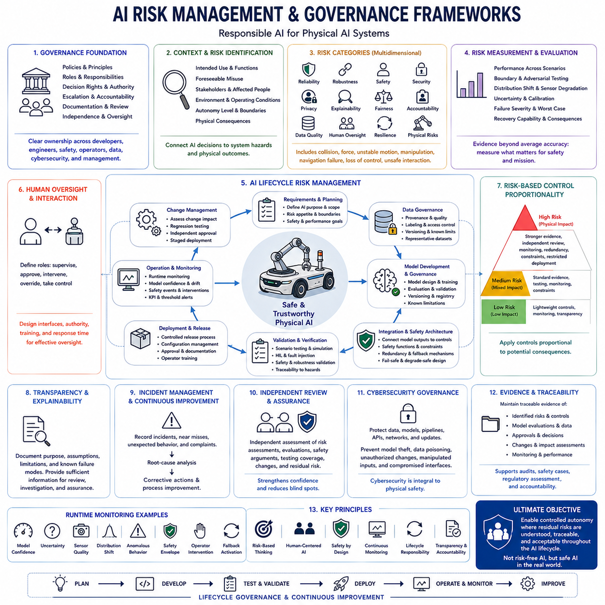{width="7.268055555555556in" height="7.268055555555556in"}

AI 위험 관리 및 거버넌스 프레임워크(AI Risk Management and Governance Frameworks)는 인공지능 시스템이 발생시키는 위험을 식별하고, 평가하고, 통제하며, 지속적으로 모니터링하기 위한 체계적인 방법을 제공한다. 물리 AI(Physical AI)에서는 AI의 의사결정이 움직임(Motion), 힘(Force), 내비게이션(Navigation), 조작(Manipulation), 인간과의 상호작용에 직접적인 영향을 줄 수 있기 때문에 거버넌스(Governance)가 특히 중요하다. 따라서 AI 위험은 정보 품질뿐만 아니라 물리적 안전(Physical Safety)과 운용상의 결과(Operational Consequences)에도 연결된다.

NIST AI 위험 관리 프레임워크(NIST AI Risk Management Framework)와 같은 프레임워크는 AI 위험 관리를 거버넌스(Governance), 상황적 이해(Contextual Understanding), 측정(Measurement), 위험 관리 활동(Risk Management Activities)을 중심으로 구성한다. 이러한 접근 방식은 보증(Assurance)을 최종적인 규제 준수 점검으로 취급하지 않고 AI 생명주기(AI Lifecycle) 전체에 책임을 내재화한다. 조직은 AI가 어디에 사용되는지, 어떤 의사결정에 영향을 미치는지, 어떤 이해관계자가 영향을 받을 수 있는지, 식별된 위험이 지속적으로 통제되고 있음을 어떤 증거로 입증할 것인지를 이해해야 한다.

거버넌스(Governance)는 책임 있는 AI(Responsible AI)를 위한 조직적 기반을 확립한다. 고영향 AI 기능(High-Impact AI Capability)을 배치하기 전에 정책, 책임, 의사결정 권한(Decision Rights), 에스컬레이션 경로(Escalation Path), 문서화 요구사항, 검토 권한(Review Authority), 책임성 메커니즘(Accountability Mechanism)을 정의해야 한다. 물리 AI에서는 고장이 AI 개발자, 로봇 엔지니어, 안전 팀, 시스템 통합자(System Integrator), 운영자, 데이터 제공자, 사이버보안 팀, 제품 관리 조직에 동시에 관련될 수 있기 때문에 특히 명확한 책임 주체가 필요하다.

위험 식별(Risk Identification)은 AI 시스템이 운용되는 상황(Context)을 이해하는 것에서 시작한다. 동일한 모델이라도 정보를 추천하는 경우, 공장 로봇을 제어하는 경우, 자율이동로봇(AMR)을 내비게이션하는 경우, 자율주행차를 제어하는 경우에는 매우 다른 위험을 발생시킬 수 있다. 따라서 의도된 사용(Intended Use), 예측 가능한 오사용(Foreseeable Misuse), 영향을 받는 사람, 환경 조건, 자율성 수준(Autonomy Level), 운용 경계(Operational Boundaries), 잘못된 의사결정으로 인한 물리적 결과를 명시적으로 정의해야 한다.

AI 위험(AI Risk)은 다차원적(Multidimensional)이기 때문에 모델 정확도(Model Accuracy)만으로 표현할 수 없다. 관련된 고려사항에는 신뢰성(Reliability), 강건성(Robustness), 안전(Safety), 보안(Security), 개인정보 보호(Privacy), 설명 가능성(Explainability), 투명성(Transparency), 책임성(Accountability), 공정성(Fairness), 데이터 품질(Data Quality), 인간 감독(Human Oversight), 복원력(Resilience)이 포함된다. 물리 AI에서는 충돌 위험(Collision Risk), 안전하지 않은 힘, 불안정한 움직임, 잘못된 조작, 내비게이션 실패, 제어 상실(Loss of Control), 주변 사람이나 기반 시설과의 부적절한 상호작용이라는 추가적인 위험 차원이 존재한다.

위험 측정(Risk Measurement)은 이러한 위험 요소들을 관찰 가능한 증거(Observable Evidence)로 변환한다. 모델 성능은 대표적인 시나리오, 어려운 경계 조건(Boundary Condition), 관련된 인구통계적 또는 환경적 변화, 적대적 조건(Adversarial Conditions), 센서 성능 저하(Sensor Degradation), 예측 가능한 분포 변화(Distribution Shift)에 걸쳐 평가되어야 한다. 평가에는 평균 성능뿐만 아니라 고장의 심각도(Failure Severity), 불확실성(Uncertainty), 보정(Calibration), 최악 조건 행동(Worst-Case Behavior), 복구 능력(Recovery Capability), 잘못된 출력이 초래하는 결과도 포함되어야 한다.

데이터 거버넌스(Data Governance)는 AI 행동이 학습, 검증, 적응(Adaptation), 평가에 사용된 데이터를 반영하기 때문에 핵심 구성요소이다. 조직은 데이터 출처(Provenance), 품질 기준, 라벨링 프로세스(Labeling Process), 접근 제어(Access Control), 버전 관리(Versioning), 데이터셋 문서화(Dataset Documentation), 알려진 한계(Known Limitations)를 관리해야 한다. 물리 AI의 데이터셋은 편리한 정상 운용 조건만을 포함하는 것이 아니라 관련 환경, 물체, 인간 행동, 센서 조건, 희귀 사건(Rare Event), 안전 중요 시나리오(Safety-Critical Scenario)를 대표해야 한다.

모델 거버넌스(Model Governance)는 이러한 통제를 학습된 AI 산출물(Trained AI Artifact)까지 확장한다. 배치되는 각각의 모델은 식별 가능한 버전, 의도된 목적, 평가 기록(Evaluation Record), 알려진 한계, 승인된 운용 조건, 의존성(Dependencies), 출시 상태(Release Status)를 가져야 한다. 모델 레지스트리(Model Registry)와 통제된 배포 프로세스(Controlled Deployment Process)는 검증되지 않은 모델이 실제 운용 로봇에 적용되는 것을 방지할 수 있다. 이는 파운데이션 모델(Foundation Model)이나 학습 정책(Learned Policy)이 여러 플랫폼과 응용 분야에서 공유될 때 더욱 중요해진다.

투명성(Transparency)과 설명 가능성(Explainability)은 이해관계자가 AI 시스템이 무엇을 수행하도록 설계되었으며 어떤 한계를 가지고 있는지를 이해할 수 있도록 함으로써 거버넌스를 지원한다. 복잡한 신경망 모델을 완전하게 해석하는 것이 항상 현실적인 것은 아니지만, 의사결정 프로세스는 엔지니어링 검토, 사고 조사(Incident Investigation), 운영자 이해, 규제 보증(Regulatory Assurance)에 충분한 정보를 제공해야 한다. 가정(Assumption)과 알려진 고장 모드(Known Failure Mode)를 문서화하는 것은 개별 예측을 설명하는 것만큼 중요할 수 있다.

인간 감독(Human Oversight)은 실제 자율성 수준과 운용 상황에 맞게 설계되어야 한다. 시스템이 인간이 대응할 수 있는 속도보다 빠르게 작동하거나 운영자가 상황을 이해할 수 없다면 단순히 명목상 사람을 루프 안에 배치(Human-in-the-Loop)하는 것만으로 효과적인 통제를 보장할 수 없다. 거버넌스는 인간이 언제 감독하고, 승인하고, 개입하고, 재정의(Override)하거나 제어권을 인수하는지를 규정해야 하며, 인터페이스, 권한, 교육, 대응 시간이 이러한 책임을 현실적으로 수행할 수 있도록 구성되어 있는지를 검증해야 한다.

물리 AI는 AI 거버넌스와 기존 안전 엔지니어링(Conventional Safety Engineering) 사이의 강력한 연결을 필요로 한다. AI 위험 평가는 모델 고장을 시스템 위험요인(System Hazard)과 연결해야 하며, 위험 분석(Hazard Analysis)은 AI 행동이 안전하지 않은 물리적 결과에 어떻게 기여할 수 있는지를 식별해야 한다. 이를 통해 데이터셋과 모델 요구사항에서부터 인식, 계획(Planning), 제어(Control), 안전 기능(Safety Function), 검증 시나리오(Validation Scenario), 그리고 시스템이 방지해야 하는 최종적인 물리적 결과까지 추적성(Traceability)을 구축할 수 있다.

고위험 AI 기능(High-Risk AI Function)은 영향이 낮은 기능보다 강력한 통제를 필요로 한다. 대시보드 정보를 선택하는 AI 모델은 조향(Steering), 제동(Braking), 로봇 움직임 또는 인간과의 근접 운용에 영향을 미치는 모델과 동일한 수준의 보증을 필요로 하지 않는다. 따라서 위험 기반 거버넌스(Risk-Based Governance)는 잠재적인 결과가 심각해질수록 더욱 강력한 증거, 독립적 검토(Independent Review), 제한된 배포(Restricted Deployment), 모니터링, 중복성(Redundancy), 폴백 메커니즘(Fallback Mechanism), 안전 제약(Safety Constraints)을 요구하는 방식으로 통제를 비례적으로 적용한다.

파운데이션 모델(Foundation Model)은 하나의 범용 모델이 초기 학습 당시 예상하지 못했던 다양한 다운스트림 응용 분야(Downstream Application)를 지원할 수 있기 때문에 추가적인 거버넌스 과제를 발생시킨다. 프롬프팅(Prompting), 파인튜닝(Fine-Tuning), 도구 사용(Tool Use), 멀티모달 입력(Multimodal Input), 플래너 및 제어기와의 통합을 통해 새로운 능력이 나타날 수 있다. 따라서 물리 AI 거버넌스는 기본 모델(Base Model)뿐만 아니라 프롬프트, 어댑터(Adapter), 인터페이스, 도구, 정책, 안전 계층(Safety Layer), 운용 제약을 포함하는 실제 배치 시스템 전체를 평가해야 한다.

변경 관리(Change Management)는 AI 시스템이 지속적으로 진화하기 때문에 필수적이다. 새로운 데이터셋, 파인튜닝, 매개변수 효율적 적응(Parameter-Efficient Adaptation), 모델 교체, 프롬프트 변경, 소프트웨어 업데이트, 센서 변경 또는 운용 영역 확대는 시스템 행동을 변화시킬 수 있다. 거버넌스는 어떤 변경이 회귀 시험(Regression Testing), 새로운 위험 평가(Renewed Risk Assessment), 독립적인 승인, 단계적 배포(Staged Deployment), 재인증(Recertification)을 필요로 하는지 정의하여 개선 과정이 기존 안전 증거(Safety Evidence)를 조용히 무효화하지 않도록 해야 한다.

런타임 모니터링(Runtime Monitoring)은 거버넌스를 실제 운용 단계까지 확장한다. 시스템은 모델 신뢰도(Model Confidence), 불확실성, 센서 품질, 분포 변화, 이상 행동(Anomalous Behavior), 정책 위반(Policy Violation), 안전 영역 위반(Safety-Envelope Violation), 운영자 개입, 폴백 활성화(Fallback Activation)를 모니터링할 수 있다. 이러한 신호는 개발 과정에서 설정한 가정이 실제 운용에서도 유효한지에 대한 운용 증거(Operational Evidence)를 제공하며, 새로운 위험이 사전에 정의된 임계값을 초과하면 운용 제한이나 시정 조치(Corrective Action)를 실행할 수 있도록 한다.

사고 관리(Incident Management)는 지속적인 개선(Continuous Improvement)에 필요한 피드백 루프(Feedback Loop)를 제공한다. AI 관련 고장, 준사고(Near Miss), 예상하지 못한 행동, 안전 개입(Safety Intervention), 사이버보안 사건, 운영자 불만은 체계적으로 기록되고 분석되어야 한다. 근본 원인 분석(Root-Cause Analysis)을 통해 문제가 데이터, 모델, 시스템 통합, 인간 상호작용, 환경 가정, 하드웨어 또는 거버넌스 프로세스 중 어디에서 발생했는지를 확인하고 보다 광범위한 시정 조치가 필요한지를 결정해야 한다.

독립적 검토(Independent Review)는 AI 기능이 중대한 물리적 결과를 발생시킬 가능성이 있을 때 신뢰도를 강화할 수 있다. 개발 팀과 분리된 검토자는 위험 평가, 모델 평가(Model Evaluation), 안전 논증(Safety Argument), 시험 커버리지(Test Coverage), 변경 결정(Change Decision), 잔여 위험(Residual Risk)을 검토할 수 있다. 독립성 자체가 엔지니어링 불확실성을 제거하지는 않지만 개발 목표, 일정 압박(Schedule Pressure), 시스템에 대한 익숙함으로 인해 중요한 취약점이 간과될 가능성을 줄일 수 있다.

사이버보안 거버넌스(Cybersecurity Governance) 역시 AI 시스템이 데이터셋, 모델 파일, 소프트웨어 파이프라인(Software Pipeline), 네트워크, API, 원격 서비스, 업데이트 메커니즘에 의존하기 때문에 통합되어야 한다. 모델 탈취(Model Theft), 오염된 데이터(Poisoned Data), 승인되지 않은 모델 교체, 조작된 센서 입력, 침해된 제어 인터페이스는 사이버 취약점을 물리적 위험으로 전환할 수 있다. 따라서 보안 통제(Security Control)는 AI 생명주기와 실제 배치된 로봇 시스템을 모두 보호해야 한다.

AI 거버넌스는 궁극적으로 시스템이 신뢰할 수 있거나 책임 있다고 선언하는 포괄적인 표현이 아니라 추적 가능한 증거(Traceable Evidence)를 요구한다. 조직은 어떤 위험을 식별했는지, 어떠한 통제를 선택했는지, 모델을 어떻게 평가했는지, 누가 배포를 승인했는지, 어떠한 한계가 남아 있는지, 변경을 어떻게 관리하는지, 실제 운용 성능을 어떻게 모니터링하는지를 보여줄 수 있어야 한다. 이러한 증거는 감사(Audit), 안전 사례(Safety Case), 규제 평가(Regulatory Assessment), 조직적 책임성(Organizational Accountability)의 기반을 형성한다.

물리 AI에서 AI 위험 관리 및 거버넌스(AI Risk Management and Governance)는 지능형 능력(Intelligent Capability)과 물리적 안전을 연결하는 생명주기 통제 계층(Lifecycle Control Layer)으로 작동해야 한다. 거버넌스는 책임을 정의하고, 위험 평가는 경계를 설정하며, 평가는 증거를 생성하고, 안전 아키텍처(Safety Architecture)는 행동을 제한하며, 모니터링은 새롭게 발생하는 문제를 탐지하고, 사고 피드백(Incident Feedback)은 지속적인 개선을 추진한다. 목표는 위험이 전혀 없는 AI가 아니라 배치 생명주기 전체에서 잔여 위험이 이해되고, 추적 가능하며, 허용 가능한 수준으로 유지되는 통제된 자율성(Controlled Autonomy)을 구현하는 것이다.

## 08.10. AI Act and Risk Based AI Regulation

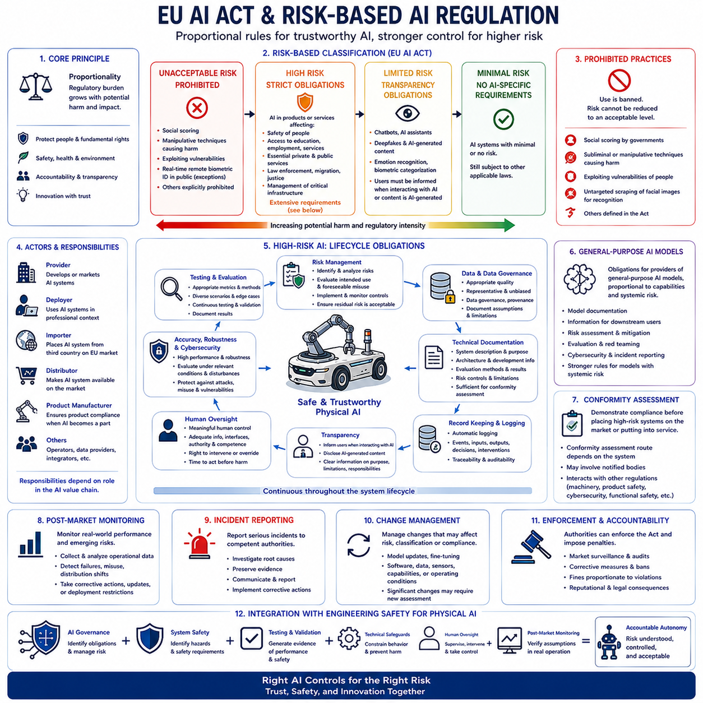{width="7.268055555555556in" height="7.268055555555556in"}

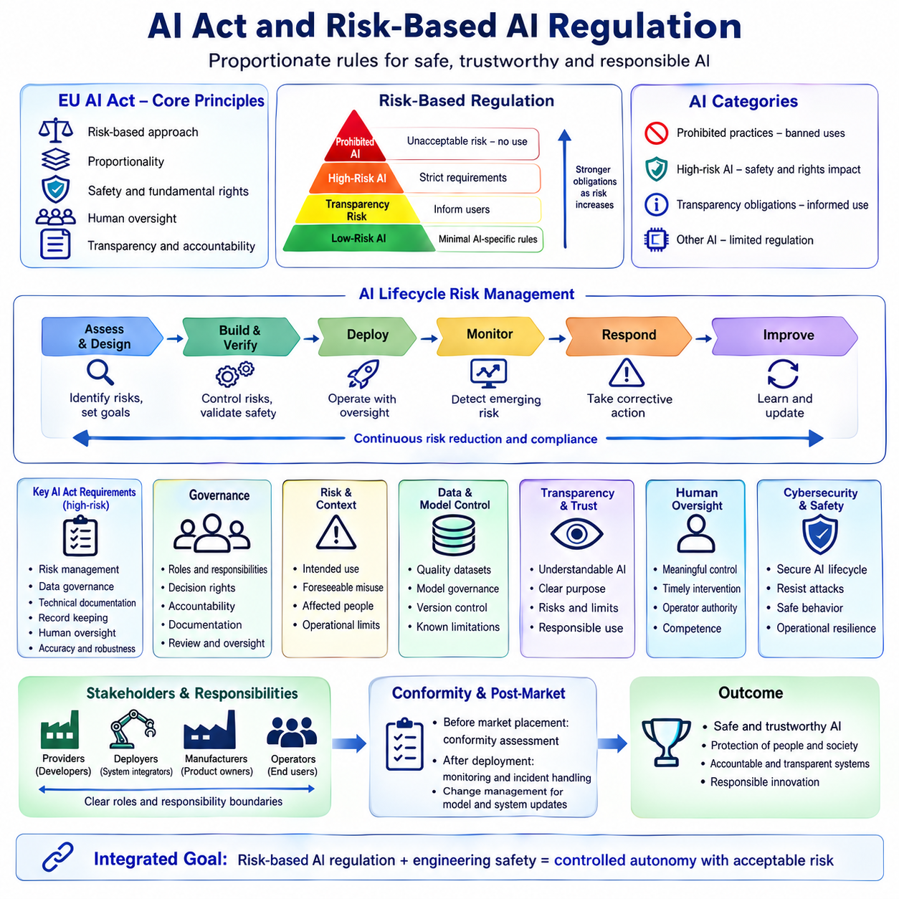{width="7.268055555555556in" height="7.268055555555556in"}

위험 기반 AI 규제(Risk-Based AI Regulation)는 모든 AI 응용 시스템에 동일한 요구사항을 적용하는 대신 인공지능 시스템이 발생시킬 수 있는 잠재적 피해(Potential Harm)에 따라 법적 의무를 구성한다. 유럽연합 AI 법(European Union AI Act)은 이러한 접근법을 대표하는 사례이다. 이 법은 AI 시스템의 목적, 배치 환경(Deployment Context), 영향을 받는 사람, 시스템 능력(Capabilities), 잠재적 결과에 따라 차등화된 규제 체계(Regulatory Treatment)를 설정한다.

핵심 원칙은 위험(Risk)과 규제 통제(Regulatory Control) 사이의 비례성(Proportionality)이다. 영향이 낮은 보조 기능에 사용되는 AI는 안전 중요 의사결정(Safety-Critical Decision)이나 기본권(Fundamental Rights)에 영향을 미치는 AI와 동일한 수준의 보증(Assurance)을 요구해서는 안 된다. 잠재적 결과가 심각해질수록 조직에는 시스템 생명주기(System Lifecycle) 전체에 걸쳐 위험 관리, 문서화, 데이터 거버넌스(Data Governance), 시험, 인간 감독(Human Oversight), 투명성(Transparency), 모니터링, 책임성(Accountability)에 대한 더욱 강력한 요구사항이 적용된다.

유럽연합 AI 법(EU AI Act)은 AI를 하나의 균일한 기술 범주로 취급하지 않고 여러 규제 범주(Regulatory Categories)로 구분한다. 기본적인 보호 원칙과 양립할 수 없다고 판단되는 특정 AI 관행은 금지(Prohibited)되며, 지정된 고위험 AI 시스템(High-Risk AI Systems)에는 광범위한 의무가 적용된다. 다른 시스템에는 주로 투명성 요구사항이 적용될 수 있으며, 많은 저위험 응용 시스템은 상대적으로 적은 AI 특화 통제를 적용받지만 여전히 다른 관련 법률의 적용을 받을 수 있다.

금지된 AI 관행(Prohibited AI Practices)은 정의된 상황에서 그 사용 자체가 허용될 수 없는 것으로 간주되기 때문에 가장 높은 수준의 규제 우려를 나타낸다. 이러한 규제의 목적은 추가적인 엔지니어링 통제를 통해 시스템을 더욱 안전하게 만드는 것이 아니라 특정 형태의 배치를 방지하는 것이다. 이는 일부 위험의 경우 단순히 모델 정확도(Model Accuracy), 시험, 모니터링 또는 기술적 보호조치(Technical Safeguards)를 향상시키는 것만으로 허용 가능한 수준까지 감소시킬 수 없다는 중요한 거버넌스 원칙(Governance Principle)을 보여준다.

고위험 분류(High-Risk Classification)는 AI가 안전 관련 제품(Safety-Related Product)의 일부가 되거나 중대한 활동에 영향을 줄 수 있기 때문에 물리 AI(Physical AI)에서 특히 중요하다. 분류는 단순히 신경망(Neural Network)이 얼마나 복잡한지에 따라 결정되는 것이 아니라 규제 환경과 의도된 목적(Intended Purpose)에 따라 결정된다. 따라서 개발자는 AI 기능이 제품에 어떻게 통합되는지, 어떠한 의사결정에 영향을 미치는지, 그 결과로 형성된 시스템이 적용 가능한 고위험 범주에 해당하는지를 판단해야 한다.

고위험 AI를 위한 위험 관리(Risk Management)는 지속적인 생명주기 프로세스(Continuous Lifecycle Process)로 작동하도록 설계된다. 조직은 알려져 있거나 합리적으로 예측 가능한 위험을 식별하고 분석하며, 의도된 사용 및 예측 가능한 오사용(Foreseeable Misuse)에서 발생하는 위험을 평가하고, 적절한 통제를 구현하며, 잔여 위험(Residual Risk)이 허용 가능한 수준으로 유지되는지를 검토해야 한다. 시험과 운용 피드백(Operational Feedback)은 새로운 위험요인, 고장 패턴(Failure Pattern), 배치 조건이 확인됨에 따라 이러한 프로세스를 지속적으로 갱신해야 한다.

데이터 및 데이터 거버넌스(Data and Data Governance)는 학습, 검증, 시험 데이터셋이 모델 행동과 후속 위험에 영향을 미치기 때문에 중요하다. 관련 데이터셋은 데이터의 출처(Origin), 준비 과정, 가정(Assumptions), 한계(Limitations), 대표성(Representativeness)을 고려하는 적절한 품질 및 거버넌스 체계에 따라 관리되어야 한다. 물리 AI에서는 환경 변화, 센서 조건, 인간 행동, 희귀 사건(Rare Events), 안전 중요 엣지 케이스(Safety-Critical Edge Cases)를 데이터에 충분히 반영해야 한다는 추가적인 과제가 존재한다.

기술 문서(Technical Documentation)는 규제 의무와 엔지니어링 증거(Engineering Evidence) 사이의 추적성(Traceability)을 구축한다. 문서는 AI 시스템, 의도된 목적, 관련 아키텍처 및 개발 정보, 평가 방법, 위험 통제(Risk Controls), 한계 및 규제 준수를 평가하는 데 필요한 기타 정보를 설명해야 한다. 복잡한 물리 AI에서는 이러한 증거가 AI 구성요소를 인식(Perception), 계획(Planning), 제어(Control), 안전 메커니즘(Safety Mechanisms), 운용 제약(Operational Constraints), 그리고 AI가 영향을 미치는 물리적 시스템과 연결해야 한다.

기록 유지 및 로깅(Record Keeping and Logging)은 배치 이후의 책임성을 지원한다. 적절한 시스템 로그(System Logs)를 활용하면 사고가 발생했을 때 어떠한 입력, 시스템 상태, 의사결정, 경고, 개입 또는 고장이 발생했는지를 재구성할 수 있다. 이는 자율 기계(Autonomous Machines)의 사고가 하나의 독립된 구성요소가 아니라 센서, AI 모델, 계획 소프트웨어, 통신 네트워크, 운영자 및 물리적 동역학(Physical Dynamics)의 상호작용에서 발생할 수 있기 때문에 특히 중요하다.

인간 감독(Human Oversight)은 고위험 응용 시스템의 또 다른 주요 요구사항이다. 감독은 명목적인 것이 아니라 실질적이어야 한다. AI 시스템을 감독하는 사람은 관련 행동을 이해하고 필요한 경우 개입할 수 있도록 충분한 정보, 권한, 역량(Competence), 인터페이스(Interface), 개입 기회를 가져야 한다. 물리 AI에서는 안전하지 않은 물리적 사건이 발생하기 전에 인간이 개입할 수 있을 만큼 시스템 동역학이 충분한 시간을 제공하는지도 추가적으로 고려해야 한다.

정확성(Accuracy), 강건성(Robustness), 사이버보안(Cybersecurity)은 부정확하거나 불안정하거나 침해된 AI 행동이 피해를 발생시킬 수 있기 때문에 서로 연결된 기술적 요구사항을 형성한다. 높은 평균 정확도만으로는 드물게 발생하는 고장이 심각한 결과를 초래할 수 있는 시스템의 충분한 보증을 확립할 수 없다. 따라서 평가는 관련 운용 조건, 예측 가능한 교란(Foreseeable Disturbances), 시스템 취약점, 분포 변화(Distribution Changes), 개별 모델 오류가 통제되지 않은 시스템 수준 행동으로 전환되는 것을 방지하는 메커니즘을 고려해야 한다.

투명성 의무(Transparency Obligations)는 사람들이 자신이 AI와 상호작용하고 있거나 AI가 생성 또는 조작한 콘텐츠를 제공받고 있다는 사실을 이해해야 하는 상황을 다룬다. 구체적인 의무는 응용 분야와 규제 범주에 따라 달라진다. 보다 넓은 의미에서 투명성은 시스템의 목적, 한계, 책임, 관련된 AI의 역할을 사용자, 운영자, 배포자(Deployer), 규제기관 및 영향을 받는 이해관계자가 이해할 수 있도록 함으로써 정보에 기반한 사용(Informed Use)을 지원한다.

AI 법(AI Act)은 다양한 다운스트림 응용 분야(Downstream Applications)를 지원할 수 있는 파운데이션 모델(Foundation Model)의 중요성이 증가하는 현실을 반영하여 범용 AI 모델(General-Purpose AI Model)에 관한 의무도 도입한다. 거버넌스에서는 모델의 능력, 문서화, 다운스트림 정보, 적용 가능한 위험 관리 책임을 고려해야 한다. 시스템적 위험(Systemic Risk)과 관련된 범용 모델에는 보다 강력한 평가, 위험 완화(Mitigation), 사고 처리(Incident Handling), 보안 조치가 요구될 수 있다.

파운데이션 모델은 하나의 범용 모델이 인식, 의미론적 추론(Semantic Reasoning), 작업 계획(Task Planning), 인간-로봇 상호작용(Human-Robot Interaction), 자율 의사결정 파이프라인(Autonomous Decision Pipeline)의 일부가 될 수 있기 때문에 물리 AI에서 독특한 과제를 발생시킨다. 따라서 규제 평가는 기본 모델(Base Model)에서 끝나서는 안 된다. 시스템 수준 위험을 결정할 때 실제 배치 구성(Deployed Configuration), 어댑터(Adapter), 프롬프트(Prompt), 도구(Tool), 제어 인터페이스(Control Interface), 안전 계층(Safety Layer), 운용 영역(Operating Domain), 물리적 결과를 함께 고려해야 한다.

규제 프레임워크(Regulatory Framework)는 AI 가치사슬(AI Value Chain)에 걸쳐 책임을 분배한다. 제공자(Provider), 배포자(Deployer), 수입자(Importer), 유통업체(Distributor), 제품 제조업체(Product Manufacturer), 기타 관련 주체는 자신의 역할에 따라 서로 다른 의무를 가질 수 있다. 이는 AI 모델을 학습하는 기업과 로봇 제조업체, 시스템 통합자(System Integrator), 플릿 운영자(Fleet Operator), 최종 응용 시스템을 배치하는 조직이 서로 다를 수 있는 로보틱스 분야에서 특히 중요하다. 따라서 명확한 책임 경계(Responsibility Boundaries)가 필수적이다.

적합성 평가(Conformity Assessment)는 특정 고위험 시스템을 시장에 출시하거나 운용에 투입하기 전에 적용 가능한 요구사항이 충족되었음을 입증하는 메커니즘을 제공한다. 구체적인 평가 경로는 시스템과 적용되는 규제 조항에 따라 달라진다. 물리 AI 제품에서는 AI 관련 적합성 활동이 기계류 안전(Machinery Safety), 제품 안전(Product Safety), 사이버보안, 기능 안전(Functional Safety), 산업별 규제 요구사항(Sector-Specific Regulatory Requirements)과 상호작용할 수 있다.

시장 출시 후 모니터링(Post-Market Monitoring)은 초기 출시 이후까지 규제 책임을 확장한다. 실제 환경에서의 배치는 개발 과정에서 충분히 반영되지 않았던 고장 모드(Failure Modes), 분포 변화, 오사용 패턴(Misuse Patterns), 환경 조건 또는 인간 상호작용을 드러낼 수 있다. 제공자는 관련 운용 정보를 수집하고 평가하는 프로세스를 구축하여 새롭게 나타나는 위험에 따라 시정 조치(Corrective Measures), 배치 제한(Deployment Restrictions), 업데이트 또는 기타 적절한 대응을 수행할 수 있어야 한다.

중대한 사고 보고(Serious Incident Reporting)는 운용 과정의 고장과 규제 감독(Regulatory Oversight) 사이의 피드백 연결을 강화한다. 보고 대상에 해당하는 사고가 발생하면 조직은 원인을 조사하고 관련 증거를 보존하며 관할 기관(Competent Authorities)과 소통하고 시정 조치를 구현해야 할 수 있다. 물리 AI에서는 소프트웨어 또는 AI 고장이 충돌, 부상, 장비 손상, 제어 상실(Loss of Control) 또는 기타 직접적으로 관찰 가능한 물리적 결과로 이어질 수 있기 때문에 이러한 과정이 특히 중요하다.

AI 시스템은 배치 이후에도 모델 업데이트(Model Update), 파인튜닝(Fine-Tuning), 소프트웨어 변경, 새로운 센서, 기능 확장 또는 운용 조건 변경을 통해 지속적으로 발전한다. 따라서 규제 거버넌스(Regulatory Governance)는 변경이 기존의 위험 분류, 적합성 증거(Conformity Evidence), 의도된 목적 또는 안전 가정(Safety Assumptions)에 영향을 미치는지를 다루어야 한다. 중대한 변경(Significant Changes)은 일상적인 소프트웨어 유지보수로 처리하는 대신 새로운 평가(Renewed Assessment)를 요구할 수 있다.

물리 AI에서 위험 기반 AI 규제(Risk-Based AI Regulation)는 궁극적으로 별도의 규제 준수 계층으로 구현되는 것이 아니라 엔지니어링 안전(Engineering Safety)과 통합되어야 한다. AI 거버넌스(AI Governance)는 규제 의무를 식별하고, 시스템 안전(System Safety)은 물리적 위험요인을 식별하며, 시험은 증거를 생성하고, 기술적 보호조치는 행동을 제한하며, 인간 감독은 추가적인 통제를 제공하고, 시장 출시 후 모니터링은 실제 운용에서 기존 가정을 검증한다. 이러한 요소들이 결합되어 고장으로 인한 잠재적 결과가 커질수록 규제 부담과 보증 수준이 함께 강화되는 책임 있는 자율성(Accountable Autonomy)을 구축한다.

## 08.11. Cybersecurity and Data Protection Requirements

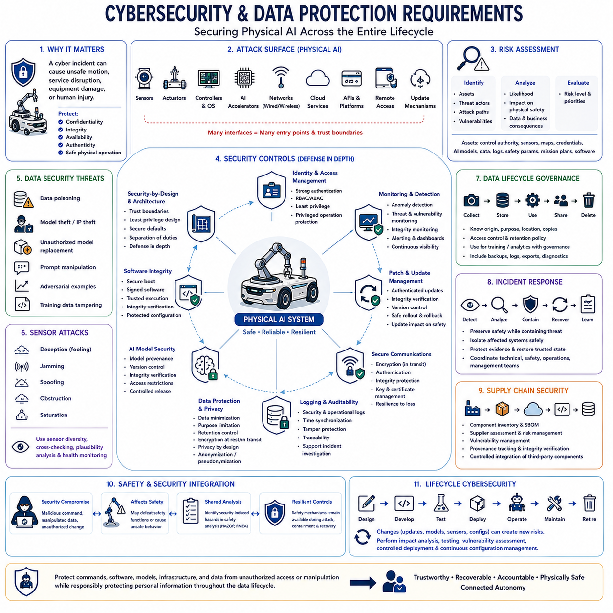{width="7.268055555555556in" height="7.268055555555556in"}

사이버보안 및 데이터 보호 요구사항(Cybersecurity and Data Protection Requirements)은 지능형 기계가 디지털 정보 처리(Digital Information Processing)와 물리적 행동(Physical Action)을 연결하기 때문에 물리 AI(Physical AI)의 핵심 요소이다. 로봇, 자율주행차, 무인항공기(UAV), 산업 시스템이 침해되면 사이버 사고(Cyber Incident)가 안전하지 않은 움직임, 서비스 중단, 장비 손상 또는 인명 피해로 전환될 수 있다. 따라서 보안은 전체 시스템 생명주기(System Lifecycle)에 걸쳐 기밀성(Confidentiality), 무결성(Integrity), 가용성(Availability), 진위성(Authenticity), 안전한 물리적 운용을 보호해야 한다.

물리 AI는 로봇이 센서, 액추에이터(Actuator), 임베디드 제어기(Embedded Controller), AI 가속기(AI Accelerator), 운영체제, 무선 네트워크, 클라우드 서비스(Cloud Service), 플릿 플랫폼(Fleet Platform), API, 원격 유지보수 도구(Remote Maintenance Tool), 소프트웨어 업데이트 메커니즘을 결합하기 때문에 기존의 공격 표면(Attack Surface)을 확장한다. 각각의 인터페이스는 공격 진입점(Entry Point)이나 신뢰 경계(Trust Boundary)가 될 수 있다. 따라서 사이버보안 엔지니어링(Cybersecurity Engineering)은 AI 모델이나 네트워크 연결을 독립된 보안 문제로 다루는 것이 아니라 전체 아키텍처를 분석해야 한다.

보안 위험 평가(Security Risk Assessment)는 중요한 자산(Asset), 잠재적 위협 행위자(Threat Actor), 공격 경로(Attack Path), 취약점(Vulnerability), 그로 인한 결과를 식별하는 것에서 시작한다. 자산에는 제어 권한(Control Authority), 센서 정보, 지도, 인증정보(Credential), AI 모델, 학습 데이터, 운용 로그(Operational Log), 안전 매개변수(Safety Parameter), 임무 계획(Mission Plan), 소프트웨어 패키지가 포함될 수 있다. 물리 AI에서는 침해가 물리적 행동을 변경하거나 보호 기능을 무력화하거나 민감한 데이터를 노출하거나 필수적인 운용을 방해할 수 있는지를 결과 분석(Consequence Analysis)에 포함해야 한다.

설계 단계부터의 보안(Security-by-Design)은 개발 이후 방어 기능을 추가하는 것이 아니라 초기 단계부터 시스템 아키텍처에 보호 기능을 통합한다. 신뢰 경계, 인증(Authentication), 권한 부여(Authorization), 권한 분리(Privilege Separation), 안전한 통신(Secure Communication), 보호된 저장소(Protected Storage), 업데이트 메커니즘, 로깅(Logging), 복구 기능(Recovery Function)을 함께 설계해야 한다. 각 구성요소에는 의도된 역할을 수행하는 데 필요한 최소한의 권한만 부여하여 개별 서비스, 프로세스, 계정 또는 장치가 침해되었을 때의 영향을 제한해야 한다.

신원 및 접근 관리(Identity and Access Management)는 누가 또는 무엇이 핵심 기능과 상호작용할 수 있는지를 통제한다. 운영자, 유지보수 엔지니어, 클라우드 서비스, 로봇, 애플리케이션, 자동화 에이전트(Automated Agent)는 서로 다른 권한을 필요로 할 수 있다. 강력한 인증과 역할 기반 또는 속성 기반 권한 부여(Role-Based or Attribute-Based Authorization)는 승인되지 않은 제어를 방지할 수 있다. 안전 매개변수 변경, 소프트웨어 설치, 임무 수정, 민감한 데이터셋 접근과 같은 특권 작업(Privileged Operation)은 특히 강력한 보호와 책임성(Accountability)을 요구한다.

안전한 통신(Secure Communication)은 로봇, 플릿 서버(Fleet Server), 엣지 시스템(Edge System), 클라우드 플랫폼, 운영자 콘솔(Operator Console), 외부 서비스 사이에서 교환되는 정보를 보호한다. 암호화(Encryption)는 기밀성을 보호할 수 있으며 인증과 무결성 메커니즘은 사칭(Impersonation)과 조작을 방지하는 데 도움을 준다. 시스템은 재전송 공격(Replay Attack), 메시지 최신성(Message Freshness), 키 관리(Key Management), 인증서 생명주기(Certificate Lifecycle), 통신 두절, 안전한 연결을 유지할 수 없는 경우의 성능 저하 운용(Degraded Operation)도 고려해야 한다.

소프트웨어 무결성(Software Integrity)은 자율 행동이 크고 지속적으로 변화하는 소프트웨어 스택(Software Stack)에 의존하기 때문에 필수적이다. 보안 부팅(Secure Boot), 서명된 소프트웨어(Signed Software), 신뢰할 수 있는 실행 체인(Trusted Execution Chain), 보호된 구성(Protected Configuration), 무결성 검증(Integrity Verification)은 승인되지 않은 코드가 기계를 제어할 가능성을 감소시킬 수 있다. 보안 메커니즘은 펌웨어와 운영체제에서부터 미들웨어(Middleware), AI 런타임(AI Runtime), 애플리케이션, 모델, 배치 과정에서 사용되는 구성 산출물(Configuration Artifact)까지 확장되어야 한다.

소프트웨어 업데이트(Software Update)는 보안 통제 수단인 동시에 보안 위험이 될 수 있다. 제품 생명주기 전체에서 취약점을 수정해야 하지만 침해되거나 잘못 배포된 업데이트는 전체 플릿에 영향을 줄 수 있다. 업데이트 시스템은 패키지를 인증하고 무결성을 검증하며 권한을 통제하고 버전을 관리하며 배포 상태를 기록하고 업데이트 실패 시 안전한 복구(Safe Recovery)를 지원해야 한다. 업데이트가 물리적 행동을 변경할 수 있는 경우 안전 영향(Safety Impact) 역시 평가해야 한다.

AI 모델 자체도 가치가 높고 보안에 민감한 자산(Security-Sensitive Asset)이다. 공격자는 모델 탈취(Model Theft), 승인되지 않은 모델 교체, 악의적인 파인튜닝(Malicious Fine-Tuning), 매개변수 변경(Parameter Modification), 프롬프트 조작(Prompt Manipulation), 모델 인터페이스 악용을 시도할 수 있다. 물리 AI에서는 조작된 모델이 인식(Perception), 계획(Planning), 내비게이션(Navigation), 제어(Control)에 영향을 줄 수 있기 때문에 그 결과가 더욱 심각하다. 따라서 모델 출처(Model Provenance), 버전 관리, 무결성 검증, 접근 제한, 통제된 출시 프로세스(Controlled Release Process)가 중요한 보안 메커니즘이 된다.

데이터 오염(Data Poisoning)은 학습, 파인튜닝 또는 적응 데이터(Adaptation Data)를 조작하여 바람직하지 않은 행동을 학습시키는 방식으로 개발 파이프라인(Development Pipeline)을 위협한다. 오염된 데이터는 전반적인 성능 저하를 발생시키거나 특정 조건에서 활성화되는 표적형 백도어(Targeted Backdoor)를 만들 수 있다. 데이터셋 출처(Dataset Provenance), 접근 제어, 무결성 검사, 검토 프로세스, 이상 탐지(Anomaly Detection), 버전 관리, 재현 가능한 학습 파이프라인(Reproducible Training Pipeline)을 통해 오염된 모델이 실제 시스템에 배치되기 전에 의심스러운 변경을 식별할 수 있다.

적대적 센서 조작(Adversarial Sensor Manipulation)은 특히 물리적인 형태의 사이버보안 위험을 발생시킨다. 카메라, 라이다(LiDAR), 레이더(Radar), GNSS, 마이크, 무선 인터페이스 및 기타 센서는 기만(Deception), 재밍(Jamming), 스푸핑(Spoofing), 차폐(Obstruction), 포화(Saturation)의 영향을 받을 수 있다. 강건한 시스템(Robust System)은 모든 센서 입력이 신뢰할 수 있다고 가정해서는 안 된다. 센서 다양성(Sensor Diversity), 교차 검증(Cross-Checking), 타당성 분석(Plausibility Analysis), 상태 모니터링(Health Monitoring), 독립적인 안전 메커니즘을 통해 조작된 환경 정보의 영향을 제한할 수 있다.

데이터 보호(Data Protection)는 개인 및 민감한 정보(Personal and Sensitive Information)가 어떻게 수집, 처리, 저장, 전송, 공유, 삭제되는지를 다룬다. 물리 AI 시스템은 이미지, 음성, 위치, 행동 패턴(Behavioral Pattern), 식별자(Identifier), 작업장 활동 또는 개인 데이터가 포함된 환경 정보를 수집할 수 있다. 조직은 의도된 기능을 위해 어떤 정보가 실제로 필요한지를 이해해야 하며, 센싱 플랫폼이 기술적으로 수집할 수 있다는 이유만으로 데이터를 수집하거나 보관해서는 안 된다.

설계 단계부터의 개인정보 보호(Privacy-by-Design)는 데이터 보호를 초기 아키텍처 및 제품 의사결정에 통합하도록 한다. 데이터 최소화(Data Minimization), 목적 제한(Purpose Limitation), 통제된 보존(Controlled Retention), 접근 제한, 안전한 저장, 적절한 익명화(Anonymization) 또는 가명처리(Pseudonymization), 투명한 처리 관행(Transparent Processing Practices)을 통해 개인정보 위험을 줄일 수 있다. 엣지 처리(Edge Processing)는 필요한 정보를 로컬에서 추출하고 필요한 결과만 공유함으로써 원시 센서 데이터(Raw Sensor Data)의 불필요한 전송을 감소시킬 수 있다.

데이터 생명주기 거버넌스(Data Lifecycle Governance)는 데이터 수집에서 삭제까지 확장되어야 한다. 조직은 데이터가 어디에서 생성되었는지, 왜 수집되었는지, 복사본이 어디에 존재하는지, 누가 접근할 수 있는지, 얼마나 오래 보관되는지, 모델 학습이나 운용 분석(Operational Analytics) 등의 목적으로 사용되는지를 파악해야 한다. 민감한 정보가 주요 운영 데이터베이스 외부에도 남아 있을 수 있으므로 백업 시스템, 개발 데이터셋, 로그, 외부로 내보낸 진단 파일(Diagnostic File)도 관리 범위에 포함해야 한다.

로깅 및 감사 가능성(Logging and Auditability)은 사이버보안과 책임성을 모두 지원한다. 보안 로그(Security Log)는 인증 시도, 구성 변경, 소프트웨어 설치, 모델 업데이트, 원격 명령(Remote Command), 특권 사용(Privilege Use), 네트워크 이상(Network Anomaly), 안전 관련 개입(Safety-Related Intervention)을 기록할 수 있다. 로그는 사고 조사(Incident Investigation)에 사용할 수 있도록 유지하면서 승인되지 않은 변경으로부터 충분히 보호되어야 한다. 물리 AI에서는 사이버 사건과 로봇 행동을 연결할 수 있는 시간 동기화된 운용 증거(Synchronized Operational Evidence)도 중요하다.

사이버보안 모니터링(Cybersecurity Monitoring)은 위협, 취약점, 공격 기법이 지속적으로 변화하기 때문에 배치 이후에도 계속되어야 한다. 런타임 모니터링(Runtime Monitoring)은 비정상적인 통신, 예상하지 못한 명령, 비정상적인 자원 사용, 무결성 실패, 반복적인 인증 시도, 구성 변경, 비정상적인 로봇 행동(Anomalous Robot Behavior)을 탐지할 수 있다. 모니터링은 탐지된 문제에 대응할 수 있는 명확한 대응 절차와 연결되어야 하며, 필요한 경우 침해된 기능을 격리(Isolation), 제한, 복구하거나 안전하게 종료할 수 있어야 한다.

물리 AI의 사고 대응(Incident Response)은 사이버보안과 물리적 안전(Physical Safety)을 함께 조정해야 한다. 침해된 시스템을 네트워크에서 분리하는 것은 정보 서비스에서는 적절할 수 있지만 항공기, 이동 중인 차량 또는 중요한 작업을 수행하는 로봇에서는 오히려 위험할 수 있다. 따라서 대응 계획은 필수적인 안전 기능을 유지하는 격리 전략(Containment Strategy), 안전한 운용 상태(Safe Operating State), 증거 보존, 신뢰할 수 있는 구성의 복원, 기술·운용·안전·관리 팀 사이의 협조를 정의해야 한다.

공급망 보안(Supply-Chain Security)은 현대 로봇 시스템이 제3자 하드웨어, 펌웨어, 운영체제, 오픈소스 라이브러리(Open-Source Library), AI 프레임워크, 사전학습 모델(Pretrained Model), 클라우드 서비스, 외부 데이터셋에 의존하기 때문에 매우 중요하다. 취약점이나 악의적인 변경은 이러한 의존 요소를 통해 유입될 수 있다. 구성요소 목록(Component Inventory), 소프트웨어 자재명세서(Software Bill of Materials, SBOM), 공급업체 평가(Supplier Assessment), 취약점 관리(Vulnerability Management), 출처 추적(Provenance Tracking), 통제된 통합(Controlled Integration)을 통해 상속된 위험(Inherited Risk)을 파악하고 관리할 수 있다.

보안 침해가 안전 기능을 무력화할 수 있는 경우 사이버보안과 기능 안전(Functional Safety)은 함께 설계되어야 한다. 악의적인 명령은 제어기 고장과 유사하게 나타날 수 있고, 조작된 센서 데이터는 충돌 회피(Collision Avoidance)를 무효화할 수 있으며, 승인되지 않은 매개변수 변경은 안전 속도 제한(Safe Speed Limit)을 변경할 수 있다. 따라서 안전 분석(Safety Analysis)은 보안으로 인해 발생하는 위험 상태(Security-Induced Hazardous Condition)를 포함해야 하며, 보안 아키텍처는 공격 탐지, 격리 및 복구 과정에서도 필수적인 보호 기능을 유지해야 한다.

물리 AI는 배치된 지능이 소프트웨어 업데이트, 모델 교체, 파인튜닝, 구성 변경, 새로운 센서, 연결성 변경을 통해 지속적으로 변화하기 때문에 생명주기 사이버보안(Lifecycle Cybersecurity)을 필요로 한다. 중요한 변경이 발생할 때마다 새로운 공격 경로가 형성되거나 기존의 보안 가정(Security Assumption)이 무효화될 수 있다. 따라서 시스템이 발전하는 동안 보증 수준을 유지하려면 보안 영향 분석(Security Impact Analysis), 회귀 시험(Regression Testing), 취약점 평가(Vulnerability Assessment), 통제된 배포(Controlled Deployment), 지속적인 구성 관리(Configuration Management)가 필요하다.

궁극적으로 사이버보안 및 데이터 보호(Cybersecurity and Data Protection)는 물리 AI 자율성(Physical AI Autonomy)을 둘러싸는 신뢰 경계(Trust Boundary)를 형성한다. 보안은 명령, 소프트웨어, 모델, 기반 시설 및 센싱이 승인되지 않은 방식으로 조작되는 것을 방지하고, 데이터 보호는 지능형 기계가 수집한 정보를 책임 있게 처리하도록 관리한다. 이러한 통제를 안전 엔지니어링(Safety Engineering), 모니터링, 사고 대응, 생명주기 거버넌스(Lifecycle Governance)와 결합함으로써 연결된 자율 시스템(Connected Autonomy)이 신뢰 가능하고, 복구 가능하며, 책임성을 갖추고, 물리적으로 안전한 상태를 유지하도록 할 수 있다.

## 08.12. Software AI and Model Change Management

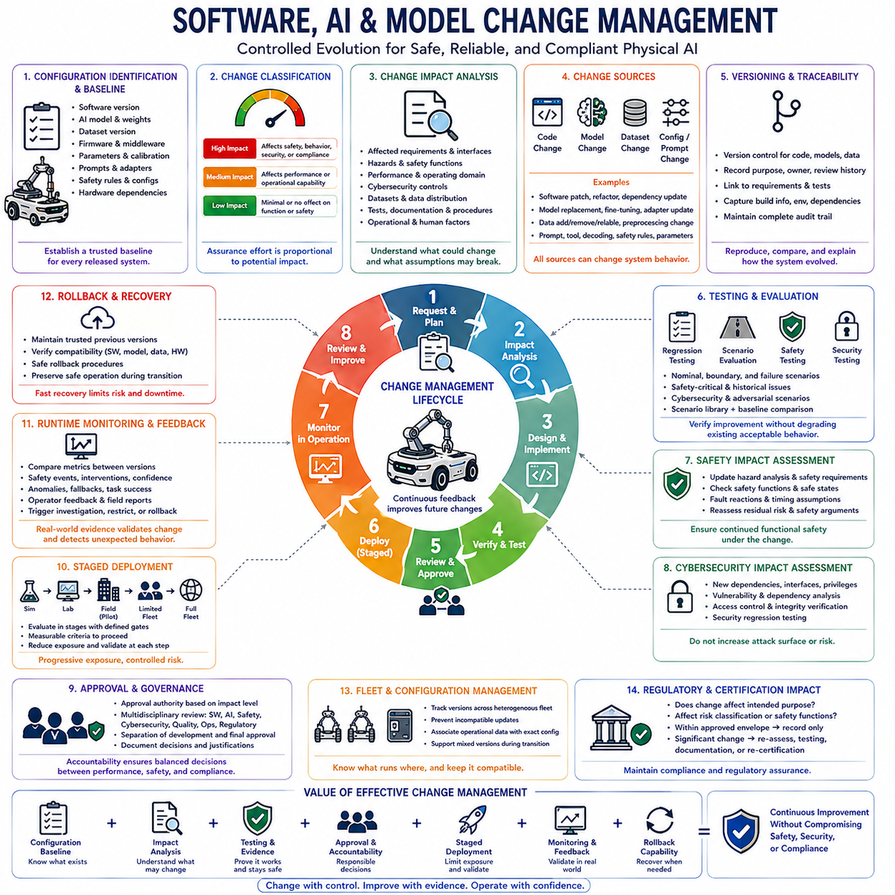{width="7.268055555555556in" height="7.268055555555556in"}

소프트웨어, AI 및 모델 변경 관리(Software, AI, and Model Change Management)는 물리 AI(Physical AI) 시스템이 설계되고 검증(Validation)되어 배치된 이후 발생하는 변경을 체계적으로 통제하는 프로세스이다. 기존 기계와 달리 지능형 시스템(Intelligent System)은 눈에 보이는 하드웨어 변경 없이도 행동이 달라질 수 있다. 소프트웨어 패치, 모델 교체, 매개변수 업데이트(Parameter Update), 프롬프트(Prompt), 데이터셋 또는 구성(Configuration) 변경은 물리적 의사결정을 변화시킬 수 있으므로 모든 중요한 변경은 잠재적인 안전, 보안 및 규제 준수 사건(Compliance Event)으로 간주해야 한다.

변경 관리(Change Management)는 완전한 구성 식별(Configuration Identification)에서 시작한다. 조직은 각각의 출시 시스템에 어떤 소프트웨어 버전, AI 모델, 데이터셋, 펌웨어(Firmware), 미들웨어(Middleware), 매개변수, 보정 파일(Calibration File), 프롬프트, 어댑터(Adapter), 안전 규칙(Safety Rule), 하드웨어 의존성(Hardware Dependency)이 포함되는지를 정확하게 파악해야 한다. 신뢰할 수 있는 구성 기준선(Configuration Baseline)이 없다면 행동을 재현하거나 사고를 조사하고, 버전을 비교하거나, 실제 배치된 로봇이 이전에 검증된 증거와 일치한다는 것을 입증하기 어려워진다.

모든 변경에 동일한 수준의 통제가 필요한 것은 아니다. 변경은 기능, 안전, 사이버보안(Cybersecurity), 성능, 운용 영역(Operating Domain), 규제 의무에 미칠 수 있는 잠재적 영향에 따라 분류되어야 한다. 문서의 단순한 수정은 영향이 거의 없을 수 있지만 인식 모델(Perception Model)을 교체하거나 모션 플래너(Motion Planner)를 수정하면 시스템 행동이 근본적으로 달라질 수 있다. 이러한 분류를 통해 잠재적 결과가 커질수록 보증 활동(Assurance Effort)의 수준도 비례하여 강화할 수 있다.

변경 영향 분석(Change Impact Analysis)은 변경 이후 기존의 어떤 가정이 더 이상 유효하지 않을 수 있는지를 판단한다. 엔지니어는 영향을 받는 요구사항, 인터페이스, 위험요인(Hazard), 안전 기능(Safety Function), 성능 한계, 사이버보안 통제, 데이터셋, 시험, 문서 및 운용 절차를 검토해야 한다. 물리 AI에서는 국부적인 모델 개선이 계획(Planning), 제어(Control), 인간 상호작용(Human Interaction), 환경 제약(Environmental Constraints)과 결합되면서 예상하지 못한 행동을 발생시킬 수 있으므로 분석 범위를 변경된 구성요소 자체에만 제한해서는 안 된다.

소프트웨어 변경(Software Change)은 요구사항에서 구현과 배포까지 체계적인 버전 관리(Version Control)와 추적성(Traceability)을 필요로 한다. 소스 코드, 빌드 구성(Build Configuration), 의존성(Dependency), 컴파일러 버전, 라이브러리, 시험 산출물(Test Artifact), 릴리스 패키지(Release Package)를 식별할 수 있어야 한다. 승인된 각각의 변경에는 목적, 책임자, 검토 이력(Review History), 검증 증거(Verification Evidence), 출시 결정(Release Decision)을 문서화하여 실제 운용 소프트웨어가 시간에 따라 어떻게 변화했는지를 재구성할 수 있어야 한다.

AI 모델 변경(AI Model Change)은 모델 행동이 소스 코드 이상의 요소에 의해 결정되기 때문에 추가적인 복잡성을 발생시킨다. 학습 데이터, 전처리(Preprocessing), 아키텍처, 초기화(Initialization), 하이퍼파라미터(Hyperparameter), 최적화 절차, 체크포인트(Checkpoint), 파인튜닝(Fine-Tuning) 방법, 어댑터, 추론 구성(Inference Configuration)이 모두 출력에 영향을 줄 수 있다. 따라서 모델 버전 관리는 단순히 파일 이름이나 배포 시각만으로 모델을 식별하는 것이 아니라 출시된 모델을 재현하거나 설명할 수 있을 정도로 충분한 출처 정보(Provenance)를 기록해야 한다.

데이터셋 변경(Dataset Change) 역시 데이터를 추가, 제거, 재라벨링(Relabeling), 필터링 또는 재균형화(Rebalancing)하는 과정에서 모델 행동이 달라질 수 있기 때문에 관리되어야 한다. 데이터셋 버전에는 출처, 준비 절차, 라벨링 규칙(Labeling Rule), 알려진 한계(Known Limitation), 학습된 모델과의 관계를 기록해야 한다. 새로운 운용 데이터(Operational Data)를 포함할 경우 조직은 이것이 분포 변화(Distribution Change), 개인정보 보호 문제(Privacy Concern), 데이터 품질 문제 또는 이전에 확인되지 않았던 안전 중요 조건(Safety-Critical Condition)을 발생시키는지를 판단해야 한다.

파인튜닝과 매개변수 효율적 적응(Parameter-Efficient Adaptation)은 전체 모델을 교체하는 것보다 작은 변경처럼 보일 수 있지만 상당한 행동 변화를 발생시킬 수 있다. LoRA 어댑터(LoRA Adapter), 프롬프트 튜닝(Prompt Tuning), 정책 적응(Policy Adaptation), 강화학습(Reinforcement Learning), 작업 특화 업데이트(Task-Specific Update)는 파운데이션 모델(Foundation Model)이 명령을 해석하거나 행동을 선택하는 방식을 변경할 수 있다. 따라서 이러한 변경은 수정된 매개변수의 개수가 아니라 실제 행동에 미치는 영향(Behavioral Impact)을 기준으로 평가해야 한다.

파운데이션 모델이나 언어 조건부 정책(Language-Conditioned Policy)이 물리 AI에 참여할 경우 프롬프트 및 구성 관리(Prompt and Configuration Management)가 중요해진다. 시스템 프롬프트(System Prompt), 도구 권한(Tool Permission), 검색 소스(Retrieval Source), 디코딩 설정(Decoding Setting), 행동 스키마(Action Schema), 안전 지침(Safety Instruction), 오케스트레이션 로직(Orchestration Logic)은 모델 가중치를 변경하지 않고도 행동에 큰 영향을 미칠 수 있다. 따라서 이러한 산출물도 기존 소프트웨어 구성요소와 마찬가지로 버전을 관리하고 검토·시험하며 실제 배치 구성과 연결해야 한다.

회귀 시험(Regression Testing)은 변경이 의도한 기능을 개선하면서 이전에 허용 가능했던 행동을 손상시키지 않는지를 검증한다. 시험 스위트(Test Suite)에는 정상 시나리오, 과거의 고장 사례, 경계 조건(Boundary Condition), 안전 중요 사례, 사이버보안 조건, 알려진 모델 취약점(Known Model Weakness)을 포함해야 한다. 물리 AI에서는 예를 들어 인식 정확도(Perception Accuracy)가 향상되었다고 해서 그 결과 생성되는 궤적, 조작 행동 또는 인간 상호작용이 계속 안전하다고 보장할 수 없으므로 시스템 수준 회귀 시험(System-Level Regression)이 필요하다.

시나리오 기반 평가(Scenario-Based Evaluation)는 평균적인 벤치마크 점수(Benchmark Score)가 드물지만 중요한 조건에서 발생하는 행동 변화를 숨길 수 있기 때문에 AI 변경에 특히 유용하다. 조직은 환경 변화, 센서 성능 저하(Sensor Degradation), 비정상적인 물체, 인간 행동, 통신 장애, 엣지 케이스(Edge Case)를 포함하는 대표적인 시나리오 라이브러리(Scenario Library)를 유지해야 한다. 안정적인 시나리오 기준선(Scenario Baseline)을 사용하여 모델 버전을 비교하면 운용 위험이 증가했는지 감소했는지에 대해 더욱 강력한 증거를 확보할 수 있다.

안전 영향 평가(Safety Impact Assessment)는 변경 관리를 기능 안전(Functional Safety) 및 시스템 안전(System Safety)과 연결한다. 변경이 위험 분석(Hazard Analysis), 안전 요구사항, 안전 기능, 안전 상태(Safe State), 고장 대응(Fault Response), 타이밍 가정(Timing Assumption), 잔여 위험(Residual Risk)에 미치는 영향을 검토해야 한다. AI 변경이 운용 영역을 확장하거나 안전 관련 행동을 수정한다면 기존 소프트웨어 인터페이스가 변경되지 않았더라도 이전의 안전 논증(Safety Argument)을 수정해야 할 수 있다.

사이버보안 영향 평가(Cybersecurity Impact Assessment) 역시 중요하다. 업데이트를 통해 새로운 의존성, 네트워크 인터페이스, 권한, 취약점 또는 공급망 구성요소(Supply-Chain Component)가 추가될 수 있기 때문이다. 새로운 AI 런타임(AI Runtime)이나 모델 서비스(Model Service)는 기능적 목적이 변하지 않더라도 공격 표면(Attack Surface)을 변경할 수 있다. 따라서 보안 관련 변경에는 취약점 분석(Vulnerability Analysis), 의존성 검토, 무결성 검증(Integrity Verification), 접근 제어 평가(Access-Control Assessment), 보안 회귀 시험(Security Regression Testing)이 함께 수행되어야 한다.

승인 권한(Approval Authority)은 변경의 중요도에 따라 달라져야 한다. 영향이 낮은 변경에는 간소화된 검토 절차를 적용할 수 있지만 안전 중요 변경(Safety-Critical Change)이나 고위험 변경에는 소프트웨어, AI, 안전, 사이버보안, 품질, 운용, 규제 전문가가 참여하는 다분야 승인(Multidisciplinary Approval)이 필요할 수 있다. 중대한 변경에 대해 개발과 최종 승인을 분리하면 성능 목표가 안전이나 규제 준수보다 우선시되는 것을 방지하기 위한 추가적인 보증을 제공할 수 있다.

단계적 배포(Staged Deployment)는 새로운 버전을 즉시 전체 플릿(Fleet)에 적용하지 않음으로써 예상하지 못한 행동의 영향을 제한한다. 새로운 버전은 먼저 시뮬레이션(Simulation)에서 평가한 후 실험실 시스템, 통제된 현장 시험(Controlled Field Trial), 제한된 운용 대상, 점진적으로 확대되는 배포 단계로 진행할 수 있다. 각 단계에서 모니터링을 수행하여 노출 범위를 확대하기 전에 증거를 확보한다. 배포 게이트(Deployment Gate)는 다음 단계로 진행하기 전에 충족해야 할 측정 가능한 조건을 정의해야 한다.

런타임 모니터링(Runtime Monitoring)은 실험실 시험만으로 모든 운용 조건을 표현할 수 없기 때문에 출시 이후에도 변경 평가를 지속한다. 조직은 버전 간 운영자 개입률(Intervention Rate), 안전 사건(Safety Event), 모델 신뢰도(Model Confidence), 이상 발생 빈도(Anomaly Frequency), 폴백 활성화(Fallback Activation), 작업 성공률, 자원 사용량, 운영자 피드백을 비교할 수 있다. 예상하지 못한 편차가 발견되면 조사하고 필요한 경우 배포 중단, 운용 제한 또는 롤백(Rollback)을 수행해야 한다.

롤백 기능(Rollback Capability)은 복원력 있는 변경 관리(Resilient Change Management)의 필수 요소이다. 조직은 신뢰할 수 있는 이전 구성(Trusted Previous Configuration)과 새로운 릴리스가 허용할 수 없는 행동을 발생시켰을 때 이를 복원할 수 있는 절차를 유지해야 한다. 롤백에서는 소프트웨어, 모델, 펌웨어, 데이터베이스, 구성 형식(Configuration Format), 하드웨어 사이의 호환성을 고려해야 한다. 물리 AI에서는 전환 과정 자체에서도 안전한 운용을 유지하여 로봇이 불일치한 상태(Inconsistent State)에 놓이지 않도록 해야 한다.

변경 관리는 대규모 로봇 배치에서 여러 버전이 동시에 운용될 수 있기 때문에 플릿 이질성(Fleet Heterogeneity)을 다루어야 한다. 서로 다른 로봇에는 상이한 하드웨어 개정판(Hardware Revision), 모델 버전, 센서 보정(Sensor Calibration), 소프트웨어 패키지가 적용될 수 있다. 플릿 관리 시스템(Fleet Management System)은 이러한 구성을 정확하게 식별하고 호환되지 않는 업데이트를 방지해야 한다. 또한 성능 비교의 의미를 유지하기 위해 운용 증거를 해당하는 정확한 구성과 연결해야 한다.

변경이 의도된 목적(Intended Purpose), 위험 분류(Risk Classification), 안전 기능, 운용 조건 또는 규제 준수 증거(Compliance Evidence)에 영향을 미치는 경우 규제 및 인증 영향(Regulatory and Certification Impact)을 평가해야 한다. 일부 변경은 승인된 구성 범위(Approved Configuration Envelope) 안에 머무를 수 있지만 보다 중대한 변경은 새로운 적합성 평가(Renewed Conformity Assessment), 추가 시험, 기술 문서 업데이트 또는 재인증(Recertification)을 요구할 수 있다. 조직은 실제 배포 전에 이를 판단하기 위한 기준을 확립해야 한다.

궁극적으로 소프트웨어, AI 및 모델 변경 관리(Software, AI, and Model Change Management)는 혁신을 방지하는 것이 아니라 통제된 진화(Controlled Evolution)를 가능하게 한다. 구성 기준선(Configuration Baseline)은 현재 시스템이 무엇인지를 확립하고, 영향 분석은 무엇이 달라질 수 있는지를 판단하며, 시험은 증거를 생성하고, 승인은 책임성(Accountability)을 확립하며, 단계적 배포는 노출을 제한하고, 모니터링은 실제 환경의 행동을 검증하며, 롤백은 복구 수단을 제공한다. 물리 AI에서 이러한 생명주기 규율(Lifecycle Discipline)은 지속적인 개선이 검증된 자율 시스템(Validated Autonomous System)을 알 수 없는 안전 상태(Unknown Safety State)로 조용히 변화시키지 않도록 보장한다.

## 08.13. Validation Evidence and Safety Case

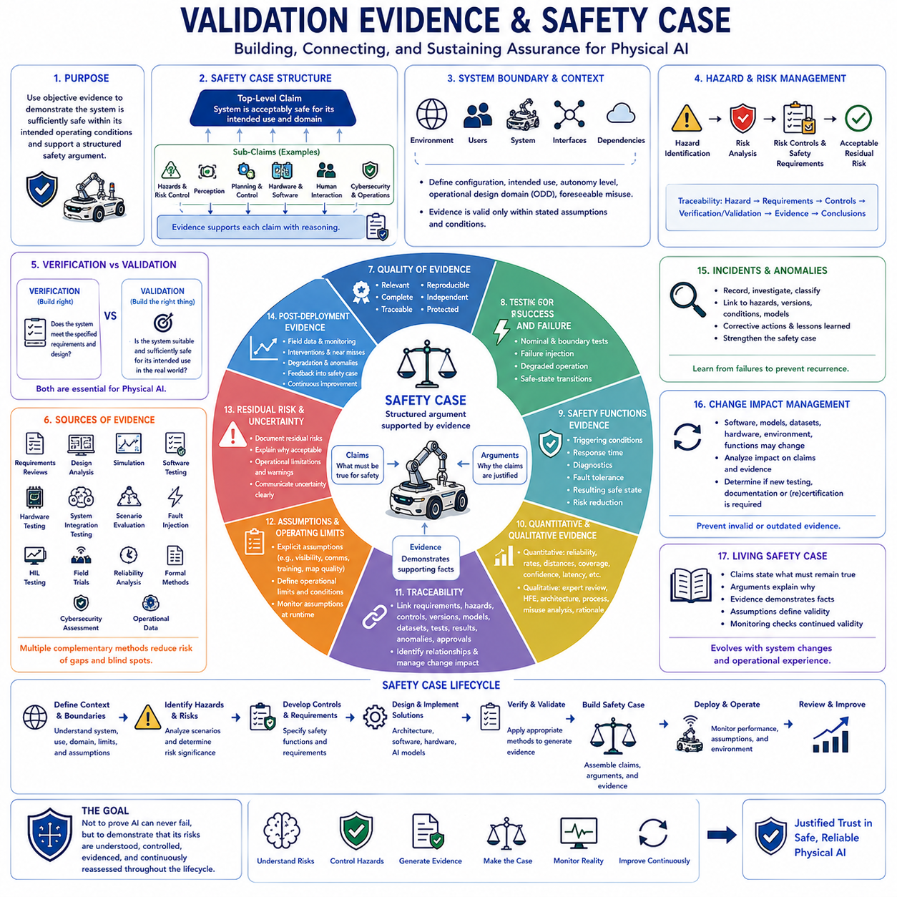{width="7.268055555555556in" height="7.268055555555556in"}

검증 증거(Validation Evidence)는 물리 AI(Physical AI) 시스템이 안전 요구사항(Safety Requirements)을 충족하고 의도된 운용 조건(Intended Operating Conditions) 내에서 허용 가능한 방식으로 행동한다는 것을 입증하기 위해 사용되는 객관적인 정보이다. 안전 사례(Safety Case)는 이러한 증거를 구조화된 논증(Structured Argument)으로 구성하여 정의된 응용 분야에서 시스템이 충분히 안전한 이유를 설명한다. 증거와 논증을 결합함으로써 안전을 단순한 엔지니어링 기대에서 검토하고, 반박하고, 추적하며, 지속적으로 유지할 수 있는 명시적인 주장(Claim)으로 전환할 수 있다.

안전 사례(Safety Case)는 단순히 시험 보고서(Test Report)를 수집하는 것이 아니다. 명확한 안전 주장(Safety Claim)을 논리적 근거(Reasoning) 및 이를 뒷받침하는 증거와 연결한다. "정의된 운용 영역에서 시스템이 허용 가능한 수준으로 안전하다"와 같은 최상위 주장(Top-Level Claim)은 위험요인(Hazard), 안전 기능(Safety Function), 인식(Perception), 계획(Planning), 제어(Control), 하드웨어, 소프트웨어, 인간 상호작용(Human Interaction), 사이버보안(Cybersecurity), 운용 절차에 관한 보다 구체적인 주장으로 분해되어야 한다. 각각의 주장은 중요도와 불확실성에 적합한 증거를 필요로 한다.

신뢰할 수 있는 안전 사례의 기반은 명확하게 정의된 시스템 경계(System Boundary)와 운용 상황(Operating Context)이다. 엔지니어는 제품 구성(Product Configuration), 의도된 사용(Intended Use), 운용 환경, 자율성 수준(Autonomy Level), 사용자, 인터페이스, 의존성(Dependencies), 예측 가능한 오사용(Foreseeable Misuse), 운용 설계 영역(Operational Design Domain)을 명시해야 한다. 이러한 경계가 없다면 로봇이 "안전하다"는 주장은 기술적 의미가 거의 없다. 안전 증거는 그것이 생성된 가정과 조건 안에서만 유효하기 때문이다.

위험 분석(Hazard Analysis)은 잠재적 피해와 필요한 검증 증거 사이의 논리적 연결을 제공한다. 식별된 위험요인은 위험 통제(Risk Controls), 안전 요구사항, 검증 또는 유효성 확인 활동(Verification or Validation Activities)으로 이어져야 한다. 증거는 각각의 중요한 위험요인이 제거되거나 감소되고, 통제되거나, 그 밖의 방법을 통해 허용 가능한 수준으로 처리되었음을 입증해야 한다. 추적성(Traceability)을 통해 검토자는 위험 시나리오에서 요구사항과 통제를 거쳐 시험 및 최종 결과에 이르는 경로를 확인할 수 있다.

검증(Verification)과 유효성 확인(Validation)은 서로 관련되어 있지만 서로 다른 역할을 수행한다. 검증은 시스템이 명시된 요구사항과 설계 정의에 따라 올바르게 구축되었는지를 판단하는 반면, 유효성 확인은 완성된 시스템이 의도된 사용 목적에 적합하고 충분히 안전한지를 판단한다. 물리 AI에서는 소프트웨어가 사양(Specification)을 정확하게 구현했더라도 그 사양 자체가 복잡한 실제 환경의 상호작용을 충분히 다루지 못할 수 있으므로 두 과정 모두 필요하다.

검증 증거(Validation Evidence)는 하나의 시험 방법만으로 모든 관련 조건에서 안전성을 입증할 수 없기 때문에 다양한 형태로 구성되어야 한다. 증거에는 요구사항 검토(Requirements Review), 설계 분석, 시뮬레이션(Simulation), 소프트웨어 시험, 하드웨어 시험, 시스템 통합 시험(System Integration Testing), 시나리오 평가, 고장 주입(Fault Injection), 하드웨어 인 더 루프 시험(Hardware-in-the-Loop Testing), 현장 시험(Field Trial), 신뢰성 분석(Reliability Analysis), 정형 기법(Formal Methods), 사이버보안 평가, 운용 데이터 등이 포함될 수 있다. 여러 상호보완적인 방법을 사용하면 하나의 기법이 가진 한계에 지나치게 의존하는 것을 줄일 수 있다.

시나리오 기반 검증(Scenario-Based Validation)은 자율 시스템의 행동이 인식, 예측(Prediction), 계획, 제어, 인간 및 환경 사이의 상호작용을 통해 나타나기 때문에 특히 중요하다. 시나리오 라이브러리(Scenario Library)는 정상 운용, 경계 조건(Boundary Conditions), 예측 가능한 오사용, 비정상적인 객체 행동, 환경 변화, 센서 성능 저하(Sensor Degradation), 통신 장애, 안전 중요 엣지 케이스(Safety-Critical Edge Cases)를 포함해야 한다. 커버리지(Coverage)는 단순히 실행된 시나리오의 개수가 아니라 위험의 중요도를 반영해야 한다.

AI 구성요소는 기존 소프트웨어 시험을 넘어서는 추가적인 증거를 필요로 한다. 모델 평가(Model Evaluation)는 정확성(Accuracy), 강건성(Robustness), 불확실성(Uncertainty), 보정(Calibration), 분포 민감도(Distribution Sensitivity), 알려진 고장 모드(Known Failure Modes), 어렵거나 익숙하지 않은 입력에서의 행동을 특성화해야 한다. 드물게 발생하는 오류가 심각한 물리적 결과를 초래할 수 있는 경우 평균적인 벤치마크 성능만으로는 충분하지 않다. 따라서 AI 증거는 모델 수준 성능을 시스템 수준의 위험요인 및 보호 메커니즘(Protective Mechanisms)과 연결해야 한다.

시험은 성공적인 정상 운용뿐만 아니라 고장 상황도 의도적으로 검토해야 한다. 고장 주입(Fault Injection)을 통해 센서 손실, 손상된 측정값(Corrupted Measurements), 프로세서 고장, 네트워크 중단, 액추에이터 성능 저하(Actuator Degradation), 타이밍 위반(Timing Violations), 위치 추정 오류(Localization Errors), 유효하지 않은 AI 출력(Invalid AI Outputs)을 발생시킬 수 있다. 목적은 정상적인 가정이 더 이상 유지되지 않을 때 진단(Diagnostics), 중복성(Redundancy), 안전 모니터(Safety Monitor), 폴백 제어기(Fallback Controller), 안전 상태 전환(Safe-State Transition)이 의도한 대로 동작하는지를 확인하는 것이다.

안전 기능(Safety Function)은 그 성능이 정의된 요구사항을 충족한다는 직접적인 증거를 필요로 한다. 비상 정지(Emergency Stopping), 보호 정지(Protective Stopping), 안전 속도 제한(Safe Speed Limits), 충돌 방지(Collision Prevention), 제동 감시(Braking Supervision), 작업공간 제한(Workspace Restrictions), 최소 위험 상태 전환(Minimum-Risk Transitions)은 작동 조건, 응답 시간(Response Time), 진단 행동, 고장 허용성(Fault Tolerance), 최종적인 물리 상태를 기준으로 평가해야 한다. 증거는 안전 기능이 단순히 작동한다는 것뿐만 아니라 위험을 충분히 감소시킨다는 것도 입증해야 한다.

신뢰할 수 있는 데이터와 적절한 모델을 사용할 수 있다면 정량적 증거(Quantitative Evidence)는 안전 논증(Safety Argument)을 강화할 수 있다. 고장률(Failure Rate), 진단 범위(Diagnostic Coverage), 정지 거리(Stopping Distance), 개입 빈도(Intervention Frequency), 신뢰도 보정(Confidence Calibration), 신뢰성 지표(Reliability Measures), 고장 탐지 지연(Fault-Detection Latency) 및 기타 측정 가능한 특성이 주장을 뒷받침할 수 있다. 그러나 가정, 데이터셋, 통계적 커버리지 또는 환경적 대표성(Environmental Representativeness)에 불확실성이 남아 있는 경우 수치적 결과가 과도한 신뢰를 만들어서는 안 된다.

통계만으로 충분하게 입증하기 어려운 특성에는 정성적 증거(Qualitative Evidence)가 필요하다. 전문가 검토(Expert Review), 구조화된 위험 분석, 아키텍처 평가(Architecture Assessment), 인간공학 평가(Human-Factors Evaluation), 설계 근거(Design Rationale), 프로세스 준수(Process Compliance), 예측 가능한 오사용 검토는 벤치마크 지표가 놓칠 수 있는 취약점을 발견할 수 있다. 강력한 안전 사례는 정량적 증거와 정성적 증거 가운데 하나만으로 충분하다고 가정하지 않고 두 종류의 증거를 함께 결합한다.

증거의 양(Evidence Quantity)만큼 증거의 품질(Evidence Quality)도 중요하다. 시험 결과는 시험 구성, 절차, 도구, 환경, 합격 기준(Acceptance Criteria), 시스템 버전이 명확한 경우에만 의미를 가진다. 증거는 현실적으로 가능한 범위에서 재현 가능(Reproducible)해야 하며 통제되지 않은 변경으로부터 보호되어야 한다. 결과가 중대한 안전 주장에 대해서는 평가 대상 기능을 구현한 팀과 핵심 평가를 수행하는 주체를 분리하는 독립성(Independence)을 통해 신뢰도를 높일 수 있다.

추적성(Traceability)은 대규모 보증 증거(Assurance Evidence)를 관리하기 위한 구조를 제공한다. 요구사항, 위험요인, 위험 통제, 소프트웨어 버전, AI 모델, 데이터셋, 시험 시나리오, 결과, 이상 현상(Anomalies), 승인(Approvals)은 식별 가능한 관계를 통해 서로 연결되어야 한다. 구성요소가 변경되면 추적성을 통해 어떤 주장과 증거가 영향을 받을 수 있는지를 판단할 수 있으며, 변경된 시스템에 오래된 검증 결과가 의도하지 않게 재사용되는 것을 방지할 수 있다.

가정(Assumptions)은 숨겨진 엔지니어링 기대가 아니라 안전 논증을 구성하는 명시적인 요소로 취급해야 한다. 안전 주장은 센서 가시성(Sensor Visibility), 통신 가용성(Communication Availability), 운영자 교육, 환경적 한계, 지도 품질(Map Quality), 페이로드 제한(Payload Restrictions), 인프라 조건에 의존할 수 있다. 운용 과정에서 이러한 가정이 위반되면 관련 증거가 더 이상 해당 주장을 뒷받침하지 못할 수 있다. 따라서 런타임 모니터링(Runtime Monitoring)을 활용하여 핵심 가정이 지속적으로 유지되는지를 관찰할 수 있다.

위험 통제를 적용한 이후에도 잔여 위험(Residual Risk)은 문서화되어야 한다. 안전 사례는 모든 위험요인이 완전히 사라졌다고 암시해서는 안 된다. 대신 어떤 위험이 남아 있는지, 왜 그것이 허용 가능한 것으로 판단되는지, 어떠한 운용 제한(Operational Limitations)이 필요한지, 사용자 또는 운영자에게 이를 어떻게 전달하는지를 설명해야 한다. 특히 AI 행동, 희귀 시나리오(Rare Scenarios), 제한적인 운용 경험으로 인해 확신이 제한되는 경우 불확실성 역시 명확하게 제시해야 한다.

운용 증거(Operational Evidence)는 시스템 배치 이후 점점 더 중요해진다. 현장 데이터(Field Data)는 개발 과정에서 충분히 반영되지 않았던 개입 패턴, 준사고(Near Misses), 예상하지 못한 환경 조건, 구성요소 성능 저하(Component Degradation), 모델 불확실성, 폴백 활성화(Fallback Activation), 새롭게 나타나는 고장 모드를 보여줄 수 있다. 배치 이후의 증거는 안전 사례에 다시 반영되어 보증 체계가 최초 출시 시점에 고정되지 않고 실제 운용 경험과 함께 발전하도록 해야 한다.

사고 및 이상 현상(Incidents and Anomalies)은 특히 가치 있는 부정적 증거(Negative Evidence)를 제공한다. 예상하지 못한 행동은 기록하고 조사하며 분류한 후 관련 위험요인, 요구사항, 모델, 소프트웨어 버전 및 운용 조건과 연결해야 한다. 시정 조치(Corrective Actions)는 추가 시험, 수정된 가정, 새로운 안전 통제 또는 변경된 운용 제한을 필요로 할 수 있다. 따라서 성숙한 안전 사례는 조직이 고장으로부터 체계적으로 학습할 수 있다는 증거까지 포함한다.

소프트웨어, AI 모델, 데이터셋, 하드웨어, 센서, 운용 환경 또는 의도된 기능(Intended Functions)의 변경은 기존 증거를 무효화할 수 있다. 변경 영향 분석(Change Impact Analysis)은 영향을 받는 안전 주장을 식별하고 기존의 유효성 확인 결과가 계속 적용 가능한지를 판단해야 한다. 중대한 변경(Significant Modifications)이 발생하면 수정된 시스템이 충분히 보증되었다고 판단하기 전에 새로운 시험, 업데이트된 문서, 수정된 위험 평가 또는 새로운 인증 활동(Renewed Certification Activities)이 필요할 수 있다.

따라서 안전 사례(Safety Case)는 인증을 위해 한 번 작성하고 끝나는 문서가 아니라 살아 있는 보증 구조(Living Assurance Structure)로 관리해야 한다. 주장(Claims)은 지속적으로 참이어야 하는 내용을 정의하고, 논증(Arguments)은 그러한 주장이 정당한 이유를 설명하며, 증거(Evidence)는 이를 뒷받침하는 사실을 입증하고, 가정(Assumptions)은 유효성의 경계를 정의하며, 모니터링은 이러한 경계가 계속 유지되는지를 판단한다. 이러한 구조를 통해 물리 AI 시스템이 학습하고 변화하며 운용 경험을 축적하더라도 안전 지식(Safety Knowledge)을 체계적으로 발전시킬 수 있다.

물리 AI에서 검증 증거 및 안전 사례(Validation Evidence and Safety Case)는 궁극적으로 지능형 능력(Intelligent Capability)과 정당화된 신뢰(Justified Trust)를 연결하는 가교를 제공한다. 시뮬레이션, 시험, 분석, 현장 증거, 런타임 모니터링, 엔지니어링 검토(Engineering Review)는 시스템이 안전하게 수행할 수 있는 범위를 입증하며, 구조화된 논증은 이러한 증거를 위험요인 및 안전 주장과 연결한다. 목표는 자율 지능(Autonomous Intelligence)이 절대로 실패하지 않는다는 것을 증명하는 것이 아니라, 그 위험이 이해되고, 통제되고, 증거로 뒷받침되며, 전체 생명주기(Lifecycle)에 걸쳐 지속적으로 재평가되고 있음을 입증하는 것이다.

## 08.14. Simulation Based and Scenario Based Assurance

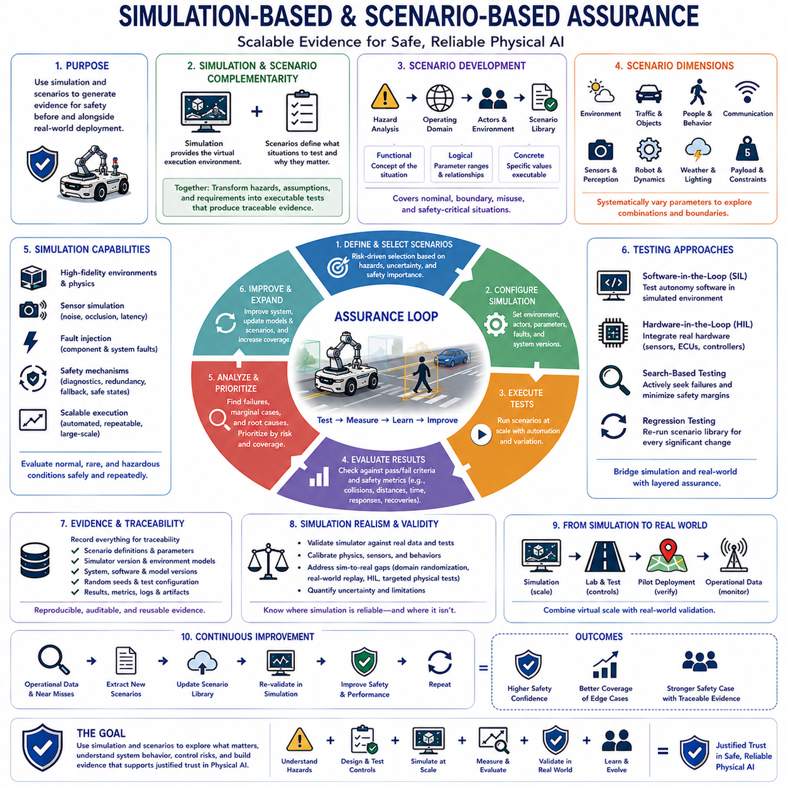{width="7.268055555555556in" height="7.268055555555556in"}

시뮬레이션 기반 보증(Simulation-Based Assurance)은 실제 환경에 배치하기 전과 배치 과정에서 가상 환경(Virtual Environment)을 활용하여 물리 AI(Physical AI)의 안전 증거(Safety Evidence)를 생성한다. 자율 로봇은 환경, 객체, 사람, 센서 조건, 고장 및 상호작용의 다양한 조합에서 운용되며, 이러한 모든 조건을 물리적 시험만으로 경제적으로 재현하기는 어렵다. 시뮬레이션은 시험 범위(Test Coverage)를 확대하면서 위험하거나 희귀하며 재현하기 어려운 상황을 통제된 조건에서 반복적으로 평가할 수 있도록 한다.

시나리오 기반 보증(Scenario-Based Assurance)은 개별 구성요소의 지표가 아니라 의미 있는 상황을 중심으로 유효성 확인(Validation)을 구성한다. 시나리오(Scenario)는 운용 환경, 참여 주체(Participating Actors), 초기 상태, 목표, 상호작용, 교란(Disturbances), 예상되는 안전 제약(Safety Constraints)을 기술한다. 이를 통해 엔지니어는 자율 시스템이 현실적인 운용 상황에 직면했을 때 인식(Perception), 예측(Prediction), 계획(Planning), 제어(Control), 안전 메커니즘(Safety Mechanisms)이 종합적으로 허용 가능한 행동을 생성하는지를 평가할 수 있다.

시뮬레이션과 시나리오 기반 보증은 서로 대체하는 관계가 아니라 상호보완적이다. 시뮬레이션은 통제된 실험을 수행할 수 있는 실행 환경(Execution Environment)을 제공하며, 시나리오는 어떤 상황을 검토해야 하고 그것이 왜 중요한지를 정의한다. 두 방법을 결합하면 위험요인(Hazards), 운용 가정(Operational Assumptions), 안전 요구사항(Safety Requirements)을 안전 사례(Safety Case)를 위한 추적 가능한 증거를 생성하는 실행 가능한 시험(Executable Tests)으로 변환하는 체계적인 방법을 구축할 수 있다.

시나리오 개발(Scenario Development)은 의도된 운용 영역(Intended Operating Domain)과 위험 분석(Hazard Analysis)에서 시작해야 한다. 환경 조건, 인프라, 로봇 능력, 인간 행동, 교통 패턴, 객체 상호작용, 통신 조건, 운용 제약이 관련 시나리오 공간(Scenario Space)을 정의한다. 이후 위험 분석 과정에서 식별된 위험 상황을 구체적인 시나리오로 변환하여 예방(Prevention), 완화(Mitigation), 폴백(Fallback), 복구(Recovery) 메커니즘이 의도한 대로 작동하는지를 시험할 수 있다.

시나리오 추상화(Scenario Abstraction)는 기능적, 논리적, 구체적 설명을 분리하여 복잡성을 관리하는 데 도움을 준다. 기능적 시나리오(Functional Scenario)는 보행자가 자율 로봇의 이동 경로에 갑자기 진입하는 상황처럼 개념적인 수준에서 상황을 설명한다. 논리적 시나리오(Logical Scenario)는 속도, 거리, 궤적, 가시성, 반응 시간 등의 매개변수 범위를 정의한다. 구체적 시나리오(Concrete Scenario)는 시뮬레이션이나 물리적 시험에서 재현 가능하게 실행할 수 있도록 특정한 매개변수 값을 선택한다.

매개변수 변화(Parameter Variation)는 수작업으로 선택된 소수의 시나리오만 시험할 경우 중요한 조합을 놓칠 수 있기 때문에 필수적이다. 위치, 속도, 마찰, 조명, 날씨, 페이로드(Payload), 센서 잡음(Sensor Noise), 통신 지연(Communication Latency), 장애물 행동, 인간 움직임 등을 체계적으로 변화시킬 수 있다. 매개변수 스윕(Parameter Sweep), 샘플링 방법, 최적화 또는 탐색 알고리즘(Search Algorithm)을 통해 시나리오 공간을 탐색하고 안전 여유(Safety Margin)가 감소하거나 시스템 행동이 예상하지 못하게 변화하는 조건을 식별할 수 있다.

희귀하고 안전에 중요한 사건(Rare and Safety-Critical Events)은 실제 환경에서 너무 드물게 발생하거나 반복적으로 재현하기에는 지나치게 위험할 수 있기 때문에 시뮬레이션에 특히 적합하다. 근접 충돌(Near Collision), 갑작스러운 장애물 출현, 센서 고장, 위치 추정 오류(Localization Error), 통신 두절, 불안정한 노면, 예상하지 못한 인간 행동, 동시 다중 고장(Simultaneous Faults)을 의도적으로 생성할 수 있다. 이를 통해 사람이나 고가의 장비를 불필요한 위험에 노출시키지 않고 반복적으로 조사할 수 있다.

고장 주입(Fault Injection)은 환경 변화뿐만 아니라 시스템 내부의 성능 저하(System Degradation)까지 시나리오 시험 범위를 확장한다. 시뮬레이션된 고장은 카메라, 라이다(LiDAR), 레이더(Radar), GNSS, 관성측정장치(IMU), 네트워크, 프로세서, 액추에이터(Actuator), 위치 추정(Localization), AI 출력 또는 타이밍 동작에 영향을 줄 수 있다. 엔지니어는 진단 기능(Diagnostics)이 고장을 식별하고 중복성(Redundancy), 안전 모니터(Safety Monitor), 폴백 제어기(Fallback Controller), 최소 위험 행동(Minimum-Risk Behavior), 안전 상태 전환(Safe-State Transition)이 고장이 허용할 수 없는 물리적 결과로 확대되는 것을 방지하는지 확인할 수 있다.

센서 시뮬레이션(Sensor Simulation)은 물리 AI의 의사결정이 인지된 정보에 크게 의존하기 때문에 중요하다. 가상 센서(Virtual Sensor)는 관련 기하 구조, 가시성, 잡음, 가림(Occlusion), 지연, 해상도, 탐지 한계(Detection Limitations), 환경 영향을 표현해야 한다. 지나치게 이상화된 센싱(Idealized Sensing)은 완벽한 가상 관측에서는 잘 작동하는 자율 시스템이 불완전한 실제 센서와 함께 배치되었을 때 실패할 수 있기 때문에 잘못된 보증 결과를 생성할 수 있다.

물리적 상호작용에 안전 주장이 의존하는 경우 물리 충실도(Physics Fidelity)도 마찬가지로 중요하다. 차량 동역학(Vehicle Dynamics), 로봇 운동학(Robot Kinematics), 액추에이터 한계, 타이어 또는 휠 동작, 접촉력(Contact Forces), 마찰, 페이로드 영향, 제동(Braking), 지형(Terrain), 충돌 응답(Collision Response)은 기동이 안전하게 유지되는지에 영향을 줄 수 있다. 따라서 시뮬레이션 충실도(Simulation Fidelity)는 무조건 최대한의 현실성을 추구하기보다 평가하려는 안전 주장에 적합한 수준으로 선택해야 한다.

모델 유효성(Model Validity)은 시뮬레이션 결과가 실제 환경의 안전 주장을 어느 정도까지 뒷받침할 수 있는지를 결정한다. 시뮬레이터(Simulator) 자체도 가정과 근사(Approximation)를 포함하는 엔지니어링 모델이다. 따라서 시뮬레이션 출력을 자동으로 기준 진실(Ground Truth)로 간주해서는 안 된다. 물리적 측정값, 알려진 기준 행동(Reference Behavior), 구성요소 시험, 현장 데이터(Field Data)와 비교하여 검증함으로써 시뮬레이터가 충분한 대표성을 갖는 영역과 불확실성 때문에 결론이 제한되는 영역을 확인할 수 있다.

시뮬레이션과 현실 사이의 격차(Simulation-to-Reality Gap)는 보증 논증(Assurance Argument)에서 명시적으로 고려해야 한다. 센서 동작, 환경 복잡성, 동역학, 인간 행동, 하드웨어 타이밍, 통신, 모델링되지 않은 교란(Unmodeled Disturbances)의 차이로 인해 실제 시스템은 시뮬레이션과 다르게 행동할 수 있다. 도메인 랜덤화(Domain Randomization), 보정된 모델(Calibrated Models), 실제 데이터 재생(Real-World Replay), 하드웨어 인 더 루프 시험(Hardware-in-the-Loop Testing), 목표 지향적 물리 시험(Targeted Physical Experiments)을 통해 이러한 차이가 존재하지 않는다고 가정하는 대신 이를 감소시키거나 정량적으로 특성화할 수 있다.

하드웨어 인 더 루프(Hardware-in-the-Loop) 및 소프트웨어 인 더 루프 시험(Software-in-the-Loop Testing)은 순수 시뮬레이션과 완전한 물리적 시험 사이의 중간 보증 계층(Intermediate Assurance Layer)을 제공한다. 소프트웨어 인 더 루프(Software-in-the-Loop)는 시뮬레이션 환경 안에서 실제 실행 가능한 자율 소프트웨어를 평가하며, 하드웨어 인 더 루프는 실제 제어기, 프로세서, 센서 또는 인터페이스를 시험 구성에 포함한다. 이러한 방법은 추상적인 시뮬레이션에서 충분히 표현되지 않는 타이밍, 통합(Integration), 계산 및 통신 문제를 발견할 수 있다.

커버리지(Coverage)는 물리 AI의 시나리오 공간이 사실상 매우 방대하기 때문에 핵심적인 과제이다. 모든 가능한 상황을 실행하는 방식으로 보증을 수행할 수는 없다. 대신 위험요인, 운용 조건, 매개변수 범위, 행동 클래스(Behavioral Classes), 환경 범주, 시스템 모드(System Modes), 고장 메커니즘을 중심으로 커버리지를 구조화해야 한다. 목표는 무한한 상태 공간(State Space)을 완전히 시험했다고 주장하는 것이 아니라 안전과 관련된 변화에 대해 정당화된 커버리지(Justified Coverage)를 입증하는 것이다.

따라서 시나리오 선택(Scenario Selection)은 위험 중심(Risk-Driven)으로 이루어져야 한다. 심각도가 높은 위험요인, 불확실한 행동, 좁은 안전 여유, 새로운 기능, 알려진 취약점(Known Weaknesses), 과거 사고와 관련된 조건에는 더 높은 시험 밀도(Test Density)를 적용해야 한다. 반면 위험이 낮고 충분히 이해된 상황은 상대적으로 적은 평가가 필요할 수 있다. 이러한 우선순위화(Prioritization)는 시뮬레이션 자원을 안전 논증과 직접 연결하며 단순히 많은 시험 횟수를 수행한 것을 의미 있는 보증으로 잘못 해석하는 것을 방지한다.

시나리오 결과가 유용한 증거가 되려면 합격 및 실패 기준(Pass and Fail Criteria)을 사전에 정의해야 한다. 기준에는 충돌 회피(Collision Avoidance), 최소 분리 거리(Minimum Separation Distance), 정지 거리, 속도 제한, 힘 제한(Force Limits), 안정성(Stability), 경로 제약(Route Constraints), 응답 시간, 개입 빈도(Intervention Frequency), 안전 상태 도달(Safe-State Achievement), 성공적인 고장 복구(Fault Recovery)가 포함될 수 있다. 명확하게 정의된 지표를 사용하면 소프트웨어와 모델 버전 간 결과를 비교할 수 있으며 시험 이후의 주관적인 해석을 줄일 수 있다.

자동화된 시나리오 실행(Automated Scenario Execution)은 수천 또는 수백만 개의 시험 변형을 일관된 방식으로 수행할 수 있게 한다. 시험 오케스트레이션(Test Orchestration)은 시뮬레이션을 구성하고, 시나리오를 실행하고, 텔레메트리(Telemetry)를 수집하고, 안전 지표를 계산하고, 고장을 식별하며, 증거를 저장할 수 있다. 자동화는 중요한 소프트웨어, 모델, 데이터셋 또는 구성 변경이 발생할 때마다 출시 전에 안정적인 안전 관련 시나리오 라이브러리를 이용해 평가할 수 있기 때문에 회귀 시험(Regression Testing)에 특히 유용하다.

탐색 기반 시험(Search-Based Testing)은 시나리오를 수동적으로 샘플링하는 대신 적극적으로 고장을 탐색할 수 있다. 최적화 알고리즘은 시나리오 매개변수를 변경하여 안전 여유를 최소화하거나, 충돌 가능성을 최대화하거나, 플래너 불안정성(Planner Instability)을 유발하거나, 안전하지 않은 행동과 관련된 조건 조합을 탐색할 수 있다. 이러한 적대적 관점(Adversarial Perspective)은 가장 유용한 검증 사례가 시스템이 허용 가능한 행동에서 허용할 수 없는 행동으로 전환되는 경계 부근에 존재하는 경우가 많기 때문에 물리 AI에서 특히 중요하다.

시뮬레이션 결과는 해당 결과를 생성한 시스템 구성(System Configuration)과 추적 가능하게 연결되어야 한다. 시나리오 정의, 시뮬레이터 버전, 환경 모델(Environment Model), AI 모델, 소프트웨어 빌드, 매개변수, 난수 시드(Random Seed), 합격 기준, 결과 텔레메트리를 기록해야 한다. 이를 통해 고장을 재현할 수 있으며 중요한 소프트웨어, 모델, 하드웨어 또는 환경 변경 이후에도 이전 구성의 증거가 잘못 재사용되는 것을 방지할 수 있다.

시뮬레이션은 개방된 물리 환경(Open Physical Environment)을 완전하게 표현할 수 없기 때문에 실제 환경 시험(Real-World Testing)은 여전히 필요하다. 통제된 실험실 시험, 시험장(Proving Ground), 파일럿 배치(Pilot Deployment), 운용 모니터링은 시뮬레이션에서 누락되거나 부정확하게 근사된 현상에 대한 증거를 제공한다. 가장 강력한 보증 전략은 대규모 시뮬레이션과 목표 지향적인 물리적 검증(Targeted Physical Validation)을 결합하고, 시뮬레이션과 실제 행동 사이의 차이를 활용하여 시스템에 대한 이해와 시뮬레이션의 신뢰성을 함께 향상시키는 것이다.

운용 데이터(Operational Data)는 배치 이후에도 시나리오 라이브러리를 지속적으로 개선할 수 있다. 준사고(Near Misses), 개입(Interventions), 예상하지 못한 객체, 환경적 교란, 센서 이상(Sensor Anomalies), 비정상적인 인간 행동, 새롭게 발견된 고장 모드는 회귀 시나리오(Regression Scenarios)로 변환할 수 있다. 이러한 방식으로 현장 경험(Field Experience)이 다시 시뮬레이션으로 피드백되어 이전에는 알려지지 않았던 상황을 향후 소프트웨어 및 모델 릴리스에서 반복적으로 시험할 수 있게 된다.

궁극적으로 시뮬레이션 기반 및 시나리오 기반 보증(Simulation-Based and Scenario-Based Assurance)은 물리 AI 안전을 위한 확장 가능한 증거 생성 엔진(Scalable Evidence Engine)을 구축한다. 위험 분석은 무엇이 중요한지를 결정하고, 시나리오는 관련 상황을 표현하며, 시뮬레이션은 통제된 실험을 실행하고, 지표는 허용 가능한 행동을 판단하며, 물리적 시험은 현실성을 검증하고, 운용 피드백은 커버리지를 지속적으로 확장한다. 목표는 실제 환경 검증을 대체하는 것이 아니라 가상 환경의 확장성(Virtual Scale)과 물리적 증거(Physical Evidence)를 결합하여 자율 시스템에 대한 정당화된 신뢰(Justified Trust)를 지원하는 지속적으로 진화하는 보증 프로세스(Continuously Evolving Assurance Process)를 구축하는 것이다.

## 08.15. Field Testing and Operational Evidence

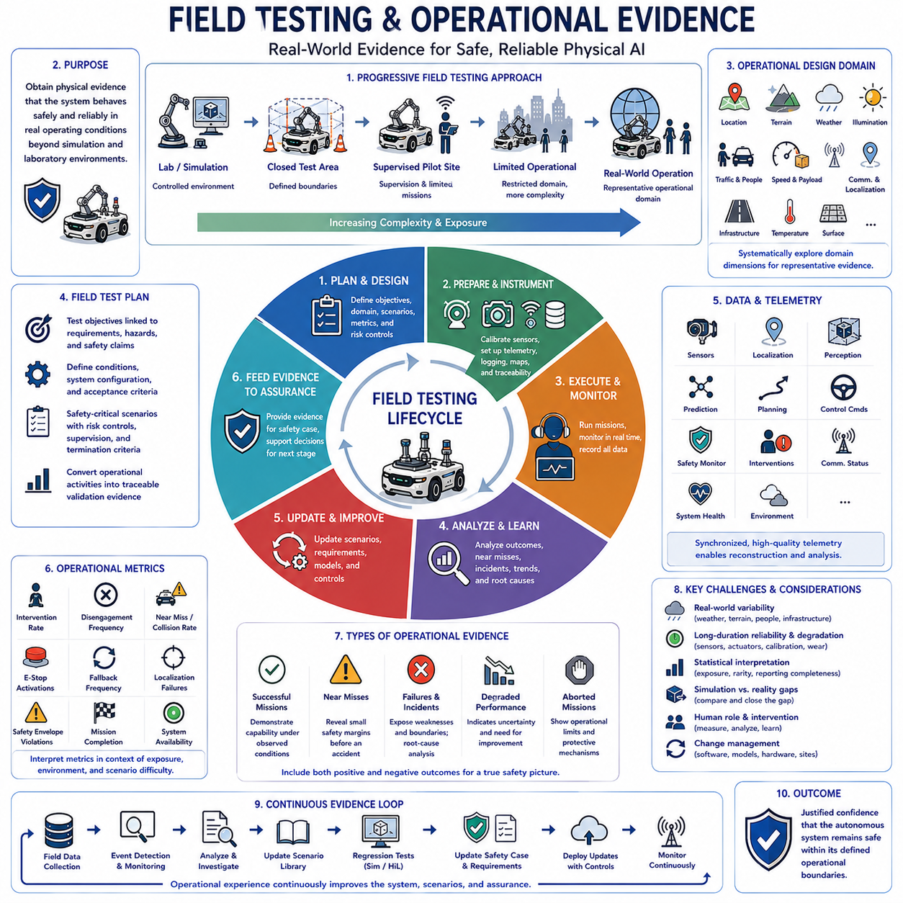{width="7.268055555555556in" height="7.268055555555556in"}

현장 시험(Field Testing)은 물리 AI(Physical AI) 시스템이 시뮬레이션 및 실험실 환경을 벗어난 실제 조건에서도 안전하고 신뢰성 있게 행동하는지를 판단하는 데 필요한 직접적인 물리적 증거(Physical Evidence)를 제공한다. 실제 운용에서는 지형, 날씨, 사람, 인프라, 센서의 불완전성, 통신 변동성, 기계적 마모(Mechanical Wear), 예상하지 못한 상호작용 등이 발생하며 이러한 요소를 모델이 완전히 재현할 수는 없다. 따라서 현장 증거(Field Evidence)는 개발 과정에서 설정한 가정이 실제 운용 조건에서도 유효한지를 검증한다.

현장 시험은 처음부터 제한 없는 자율 운용(Unrestricted Autonomous Operation)을 수행하는 것이 아니라 단계적으로 도입되어야 한다. 개발 과정은 통제된 실험실 환경에서 폐쇄형 시험 구역(Closed Test Area), 감독되는 파일럿 현장(Supervised Pilot Site), 제한된 운용 배치(Limited Operational Deployment)를 거쳐 최종적으로 대표적인 실제 환경 운용으로 발전할 수 있다. 각 단계에서는 적절한 통제를 유지하면서 환경 복잡성과 노출 수준을 높이고, 이전 단계에서 확보한 증거를 다음 단계로 진행하기 위한 근거로 활용한다.

현장 시험 계획(Field Test Plan)은 시스템 요구사항, 위험요인(Hazards), 안전 주장(Safety Claims), 운용 목표(Operational Objectives)와 직접 연결되어야 한다. 시험 목표에는 어떤 행동을 평가하는지, 어떠한 환경 및 운용 조건에서 평가하는지, 어떤 시스템 구성(System Configuration)을 사용하는지, 어떠한 합격 기준(Acceptance Criteria)을 적용하는지를 정의해야 한다. 이러한 구조는 현장 시험이 비공식적인 시연(Demonstration)에 머무르는 것을 방지하고 실제 운용 활동을 추적 가능한 검증 증거(Traceable Validation Evidence)로 전환한다.

운용 설계 영역(Operational Design Domain)은 현장 증거가 실제 배치를 지원하도록 의도된 조건의 범위를 정의한다. 관련 요소에는 위치, 지형, 도로 또는 바닥 특성, 날씨, 조도, 온도, 교통, 사람의 밀도, 통신 가용성, 위치 추정 품질(Localization Quality), 속도, 페이로드(Payload), 인프라 등이 포함될 수 있다. 시험은 한 장소에서의 성공적인 운용이 모든 미래 환경을 대표한다고 가정하지 않고 이러한 요소들을 체계적으로 탐색해야 한다.

대표성 있는 시험(Representative Testing)은 단순히 긴 운용 시간을 확보하는 것 이상의 의미를 가진다. 수천 킬로미터 또는 수천 시간의 운용 기록이 있더라도 시스템이 반복적으로 유사하고 쉬운 조건에만 노출되었다면 제한적인 보증(Assurance)만 제공할 수 있다. 따라서 증거는 시나리오 다양성(Scenario Diversity), 위험 노출(Hazard Exposure), 환경 변화, 시스템 모드(System Modes), 상호작용, 엣지 케이스(Edge Cases)를 기준으로 평가해야 한다. 운용량은 실제로 어떠한 조건을 경험했는지에 대한 이해와 결합될 때 의미 있는 증거가 된다.

안전 중요 시나리오(Safety-Critical Scenarios)는 세심하게 통제된 현장 평가를 필요로 한다. 비상 정지(Emergency Stop), 장애물 회피, 최소 분리 거리(Minimum Separation), 성능이 저하된 센싱(Degraded Sensing), 위치 추정 상실(Localization Loss), 통신 장애, 제동 행동(Braking Behavior), 폴백 운용(Fallback Operation), 최소 위험 상태 전환(Minimum-Risk Transition)은 전용 시험이 필요할 수 있다. 잠재적으로 위험한 상황은 불필요한 위험을 발생시키지 않으면서 증거를 생성할 수 있도록 적절한 격리(Containment), 감독, 시험 인프라, 사전에 정의된 종료 기준(Termination Criteria)과 함께 도입해야 한다.

계측(Instrumentation)은 단순한 관찰만으로는 자율 시스템이 특정한 방식으로 행동한 이유를 설명할 수 없기 때문에 필수적이다. 현장 시험 플랫폼은 시간 동기화된 센서 스트림(Synchronized Sensor Streams), 위치 추정, 인식 출력(Perception Outputs), 예측, 플래너 결정(Planner Decisions), 제어 명령, 안전 모니터 상태(Safety Monitor States), 운영자 개입, 통신 상태, 시스템 건전성(System Health), 관련 환경 정보를 기록해야 한다. 고품질 텔레메트리(Telemetry)를 통해 사건을 재구성하고 내부 의사결정 과정과 연결할 수 있다.

구성 추적성(Configuration Traceability)은 운용 증거가 해당 증거를 생성한 정확한 시스템과 대응하도록 보장한다. 소프트웨어 빌드(Software Build), AI 모델 버전, 데이터셋 또는 어댑터(Adapter), 펌웨어(Firmware), 센서 보정(Sensor Calibration), 하드웨어 개정판(Hardware Revision), 안전 매개변수(Safety Parameters), 지도, 프롬프트(Prompt), 구성 파일(Configuration Files)을 식별할 수 있어야 한다. 이러한 정보가 없다면 실제 배치 시스템이 검증된 구성과 동등한지를 판단할 수 없으므로 성공적인 시험 결과가 이후의 릴리스를 지원하지 못할 수 있다.

인간 감독(Human Supervision)은 단계적인 현장 시험에서 중요한 역할을 수행한다. 안전 운전자(Safety Driver), 원격 운영자(Remote Operator), 시험 엔지니어 또는 현장 감독자가 시스템 행동을 모니터링하고 사전에 정의된 조건이 발생하면 개입할 수 있다. 개입 절차(Intervention Procedures)를 문서화하여 개입 빈도와 원인을 측정 가능한 증거로 활용해야 한다. 빈번한 인간의 개입이 필요하다면 정상적인 작업 완료 지표(Task Completion Metrics)가 자율 성능의 취약점을 숨기고 있음을 나타낼 수 있다.

준사고(Near Misses)는 실제 충돌이나 부상이 발생하지 않았더라도 안전 여유(Safety Margins)가 작아진 상황을 보여주기 때문에 가치 있는 증거를 제공한다. 최소 분리 거리 위반, 비상 제동(Emergency Braking), 불안정한 궤적(Unstable Trajectories), 반복적인 재계획(Replanning), 운영자 재정의(Operator Override), 예상하지 못한 정지, 안전 모니터 활성화(Safety-Monitor Activation)는 사고가 발생하기 전에 취약점을 드러낼 수 있다. 따라서 성숙한 현장 시험 프로그램은 완료된 임무와 심각한 고장만 기록하는 것이 아니라 준사고도 체계적으로 분석한다.

운용 증거(Operational Evidence)는 긍정적 결과와 부정적 결과를 모두 포함해야 한다. 성공적인 임무는 관찰된 조건에서 시스템의 능력을 보여주지만 고장, 이상 현상(Anomalies), 개입, 성능 저하, 중단된 임무(Aborted Missions)는 시스템의 경계와 불확실성을 보여준다. 불편한 결과를 제외하면 안전 상태를 왜곡하게 된다. 보증은 시스템이 어디에서 성공하고, 어디에서 어려움을 겪으며, 고장이 어떻게 발전하고, 보호 메커니즘(Protective Mechanisms)이 그 결과를 적절하게 제한하는지를 이해하는 데 달려 있다.

환경 변동성(Environmental Variability)은 현장 시험이 필수적인 주요 이유 가운데 하나이다. 비, 먼지, 눈부심(Glare), 어둠, 반사, 진동, 불규칙한 표면, 계절 변화, 임시 장애물, 군중, 건설 작업, 전자기 간섭(Electromagnetic Interference)은 센서와 자율 시스템에 실험실의 예상과 다른 영향을 줄 수 있다. 대표적인 환경 조건에서 반복적으로 시험함으로써 정의된 운용 범위(Operational Envelope)가 실제 환경에서도 현실적인지를 확인할 수 있다.

장시간 시험(Long-Duration Testing)은 짧은 검증 과정에서는 발견하기 어려운 성능 저하 메커니즘(Degradation Mechanisms)을 확인할 수 있게 한다. 센서가 오염되거나 정렬 상태가 변할 수 있고, 배터리가 노화되며, 액추에이터가 가열되고, 타이어나 휠이 마모되고, 보정값이 드리프트(Calibration Drift)하며, 저장공간이 가득 차거나 네트워크가 혼잡해지고 계산 부하가 변화할 수 있다. 따라서 신뢰성 증거(Reliability Evidence)는 새롭게 준비된 시험 조건뿐만 아니라 장기간 운용, 유지보수 주기, 환경 노출, 현실적인 작업 부하에서 시스템을 관찰하여 확보해야 한다.

파일럿 배치(Pilot Deployment)는 엔지니어링 시험과 완전한 상용 또는 운용 배치 사이의 중간 단계를 제공한다. 제한된 수의 시스템을 특정 현장, 임무, 속도, 운용 시간 또는 사용자 그룹으로 제한하면서 집중적인 모니터링을 유지할 수 있다. 파일럿 프로그램(Pilot Program)을 통해 조직은 위험 노출을 통제하면서 현실적인 운용 증거를 수집할 수 있으며, 예상하지 못한 위험이 나타날 경우 신속하게 운용을 중단할 수 있는 능력을 유지할 수 있다.

운용 지표(Operational Metrics)는 단순한 작업 완료 여부가 아니라 안전성과 자율성 품질(Autonomy Quality)을 반영해야 한다. 유용한 지표에는 개입률(Intervention Rate), 자율 해제 빈도(Disengagement Frequency), 충돌 및 준사고 발생률, 비상 정지 활성화, 폴백 빈도(Fallback Frequency), 위치 추정 실패, 안전 영역 위반(Safety-Envelope Violations), 임무 완료율, 복구 성공률, 시스템 가용성(System Availability), 고장 탐지 지연(Fault-Detection Latency) 등이 포함될 수 있다. 잘못된 비교를 방지하려면 이러한 지표를 노출 수준과 시나리오 난이도와 함께 해석해야 한다.

운용 노출이 증가하면 통계적 증거(Statistical Evidence)의 유용성도 증가하지만 신중하게 해석해야 한다. 사고 없이 많은 운용 시간을 축적하면 신뢰도를 높일 수 있지만 관찰된 고장이 없다는 사실만으로 희귀한 위험 사건이 발생할 수 없음을 입증하지는 못한다. 따라서 운용 통계를 정량적 안전 주장(Quantitative Safety Claims)의 근거로 사용하기 전에 노출 분포(Exposure Distribution), 환경 다양성, 시나리오 빈도, 보고의 완전성(Reporting Completeness), 시스템 변경 사항을 함께 고려해야 한다.

현장 시험 결과는 시뮬레이션 및 시나리오 기반 예측(Simulation and Scenario-Based Predictions)과 비교되어야 한다. 실제 행동이 시뮬레이션에서 예상된 행동과 다르다면 이러한 차이는 부정확한 센서 모델, 불완전한 동역학(Incomplete Dynamics), 누락된 환경 요소, 비현실적인 행위자 행동(Actor Behavior), 소프트웨어 통합 효과를 보여줄 수 있다. 이러한 차이를 물리 AI 시스템과 시뮬레이션 환경 모두를 개선하는 데 활용함으로써 가상 보증(Virtual Assurance)과 물리적 증거 사이에 피드백 루프(Feedback Loop)를 구축해야 한다.

사고 조사(Incident Investigation)는 운용 과정의 고장을 엔지니어링 지식(Engineering Knowledge)으로 전환한다. 중대한 사건이 발생하면 관련 텔레메트리, 로그, 시스템 구성, 환경 조건, 운영자 행동, 물리적 증거를 보존해야 한다. 근본 원인 분석(Root-Cause Analysis)을 통해 사건이 인식, 계획, 제어, 하드웨어, 통신, 인간 상호작용, 사이버보안(Cybersecurity), 유지보수 또는 잘못된 운용 가정(Operational Assumptions) 가운데 어디에서 시작되었는지를 판단할 수 있다.

운용 증거는 회귀 시험(Regression Testing)과 안전 사례(Safety Case)에 직접 반영되어야 한다. 새롭게 발견된 시나리오는 시뮬레이션, 통제된 물리적 시험 또는 하드웨어 인 더 루프 환경(Hardware-in-the-Loop Environment)에서 재현하여 영구적인 회귀 라이브러리(Regression Library)에 추가할 수 있다. 이후 현장 경험을 바탕으로 안전 주장, 가정, 위험 분석(Hazard Analysis), 운용 제한을 갱신함으로써 보증 체계가 최초 인증이나 출시 시점에 고정되지 않고 지속적으로 발전하도록 해야 한다.

배치 후 모니터링(Post-Deployment Monitoring)은 제품 생명주기(Product Lifecycle) 전체에 걸쳐 현장 보증을 확장한다. 소프트웨어 업데이트, AI 모델 변경, 새로운 운용 현장, 다른 페이로드, 환경 변화, 하드웨어 노화(Hardware Aging)는 최초 검증 이후 시스템 행동을 변화시킬 수 있다. 지속적인 모니터링(Continuous Monitoring)을 통해 추세, 새롭게 나타나는 이상 현상, 성능 드리프트(Performance Drift), 증가하는 개입률을 식별하고 필요한 경우 조사, 유지보수, 운용 제한, 롤백(Rollback), 새로운 유효성 확인(Renewed Validation)을 수행할 수 있다.

궁극적으로 현장 시험 및 운용 증거(Field Testing and Operational Evidence)는 물리 AI의 보증 루프(Assurance Loop)를 완성한다. 시뮬레이션은 광범위한 시나리오 공간을 탐색하고, 실험실 시험은 통제된 검증(Verification)을 제공하며, 현장 운용은 이러한 결론이 실제 세계에서도 유지되는지를 확인한다. 추적 가능한 구성, 대표성 있는 노출, 텔레메트리, 사고 학습(Incident Learning), 통계적 증거, 지속적인 모니터링을 결합함으로써 조직은 자율 시스템이 정의된 운용 경계(Operational Boundaries) 안에서 지속적으로 안전하게 작동한다는 정당화된 신뢰(Justified Confidence)를 구축할 수 있다.

## 08.16. Toward Certification of Adaptive Physical AI

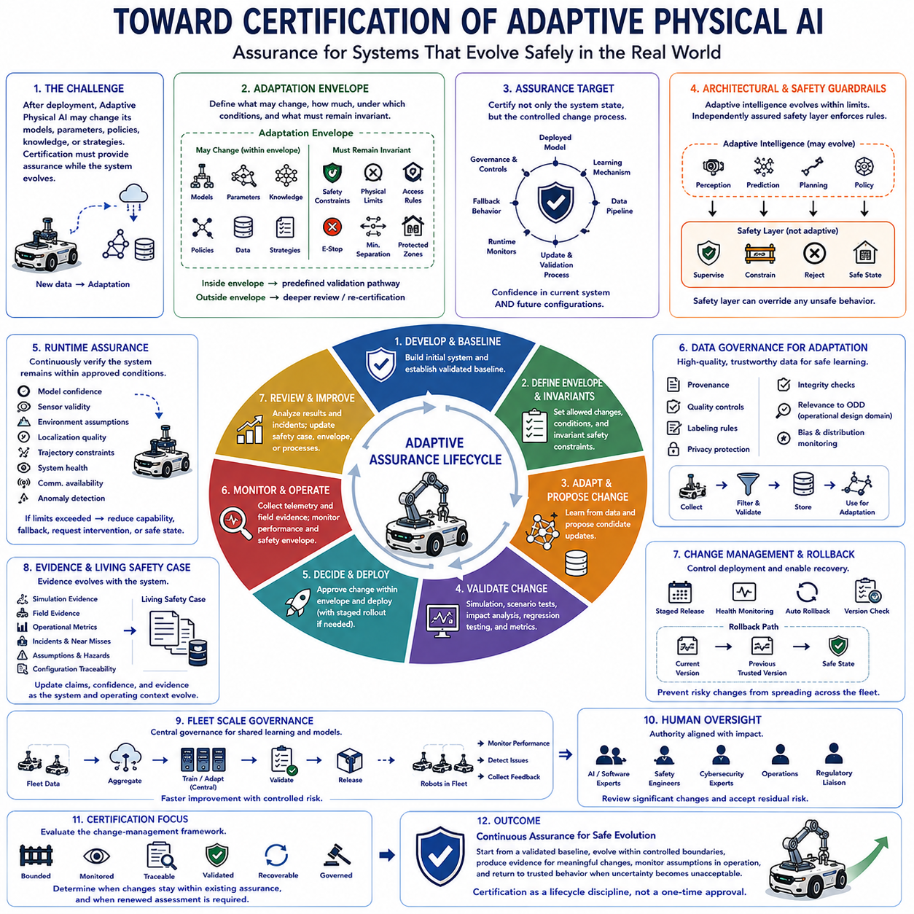{width="7.268055555555556in" height="7.268055555555556in"}{width="7.268055555555556in" height="7.268055555555556in"}

적응형 물리 AI(Adaptive Physical AI)는 개발 과정에서 평가된 행동이 배치 이후에도 동일하게 유지된다고 보장할 수 없기 때문에 인증(Certification)에 근본적인 과제를 제기한다. 기존 인증은 정의된 요구사항에 따라 시험할 수 있을 정도로 충분히 안정적인 구성(Configuration)을 전제로 한다. 그러나 적응형 시스템은 새로운 데이터가 확보됨에 따라 모델, 매개변수, 정책(Policy), 지식 또는 의사결정 전략을 변경할 수 있으므로 시스템이 진화하는 동안에도 유효성을 유지할 수 있는 보증 방법(Assurance Methods)이 필요하다.

따라서 핵심 문제는 적응(Adaptation)을 금지해야 하는지가 아니라 허용 가능한 적응의 경계를 어떻게 정의하고 통제할 것인가이다. 인증 가능한 적응형 시스템(Certifiable Adaptive System)은 무엇이 변경될 수 있는지, 어느 정도까지 변경될 수 있는지, 어떤 조건에서 변경이 허용되는지, 어떤 속성이 반드시 불변(Invariant)으로 유지되어야 하는지를 설명하는 명시적인 적응 범위(Adaptation Envelope)를 필요로 한다. 이를 통해 최초 시스템뿐만 아니라 이후의 진화를 제한하는 메커니즘까지 인증 대상으로 고려할 수 있다.

이러한 접근법은 정적인 산출물(Static Artifact)만을 인증하는 방식에서 통제된 변경 프로세스(Controlled Process of Change)를 인증하는 방식으로 보증의 초점을 이동시킨다. 보증 대상(Assurance Target)에는 배치된 모델, 학습 메커니즘(Learning Mechanism), 데이터 파이프라인(Data Pipeline), 업데이트 절차, 유효성 확인 프로세스(Validation Process), 런타임 모니터(Runtime Monitor), 폴백 행동(Fallback Behavior), 거버넌스 통제(Governance Controls)가 포함될 수 있다. 신뢰도는 현재 구성뿐만 아니라 미래의 구성이 허용 가능한 안전 영역(Safety Region)을 벗어나지 않도록 통제할 수 있는지에도 달려 있다.

적응은 잠재적인 행동 영향(Behavioral Impact)에 따라 분류되어야 한다. 안전과 직접 관련되지 않은 선호도를 업데이트하는 경우에는 제한적인 재평가만 필요할 수 있지만 인식(Perception), 계획(Planning), 제어(Control), 충돌 회피(Collision Avoidance), 인간 상호작용(Human Interaction)을 변경하면 핵심적인 안전 주장(Safety Claims)에 영향을 줄 수 있다. 이러한 분류를 통해 모든 매개변수 업데이트를 무해한 것으로 간주하거나 완전한 시스템 재설계와 동일하게 취급하는 대신 적응 유형별로 서로 다른 보증 의무(Assurance Obligations)를 적용할 수 있다.

적응 범위(Adaptation Envelope)는 매개변수, 운용 조건, 모델 계열(Model Families), 학습 방법, 데이터셋, 인터페이스, 성능 임계값(Performance Thresholds), 안전 제약(Safety Constraints)에 대한 허용 범위를 정의할 수 있다. 이 범위 안에 머무르는 변경에는 사전에 정의된 유효성 확인 경로(Validation Pathway)를 적용할 수 있으며, 범위를 초과하는 변경에는 보다 심층적인 엔지니어링 검토 또는 재인증(Renewed Certification)을 요구할 수 있다. 따라서 적응 범위는 통제된 진화(Controlled Evolution)와 실질적으로 다른 시스템(Materially Different System)을 구분하는 현실적인 경계를 형성한다.

일부 속성은 적응 여부와 관계없이 불변(Invariant)으로 유지되어야 한다. 비상 정지(Emergency Stopping), 물리적 한계(Physical Limits), 보호 영역(Protected Zones), 최대 속도 또는 힘, 최소 분리 요구사항(Minimum Separation Requirements), 접근 제어 규칙(Access-Control Rules), 독립적인 안전 메커니즘(Independent Safety Mechanisms)은 적응형 구성요소로부터 분리할 수 있다. 이러한 불변 안전 제약(Invariant Safety Constraints)은 학습 행동 주변에 안정적인 보호 계층을 형성하며 모든 미래의 AI 출력이 항상 정확하다는 것을 증명해야 하는 의존성을 감소시킨다.

아키텍처 분리(Architectural Separation)는 적응형 지능(Adaptive Intelligence)과 안전 중요 집행 기능(Safety-Critical Enforcement)을 구분함으로써 이러한 접근법을 강화할 수 있다. 인식, 예측(Prediction), 계획 또는 작업 정책(Task Policy)은 정의된 한계 안에서 진화할 수 있지만 독립적으로 보증된 안전 계층(Safety Layer)은 그 결과로 생성되는 행동을 감독한다. 안전 계층은 명령을 거부하고, 궤적을 제한하며, 운용 한계를 강제하거나, 제안된 행동이 설정된 안전 조건을 위반하는 경우 최소 위험 상태(Minimum-Risk State)를 시작할 수 있다.

런타임 보증(Runtime Assurance)은 시스템이 승인된 조건 안에 계속 머무르는지를 지속적으로 평가함으로써 인증을 실제 운용까지 확장한다. 모니터는 모델 신뢰도(Model Confidence), 센서 유효성(Sensor Validity), 환경 가정(Environmental Assumptions), 위치 추정 품질(Localization Quality), 궤적 제약(Trajectory Constraints), 시스템 건전성(System Health), 통신 가용성, 행동 이상(Behavioral Anomalies)을 관찰할 수 있다. 모니터링 조건이 검증된 한계를 벗어나면 시스템은 기능을 축소하거나 폴백 제어기(Fallback Controller)로 전환하고, 인간 개입을 요청하거나 안전 상태(Safe State)로 진입할 수 있다.

적응형 시스템은 미래 행동이 운용 경험에 직접적으로 의존할 수 있기 때문에 통제된 학습 데이터(Controlled Learning Data)도 필요하다. 적응에 사용되는 데이터에는 식별 가능한 출처(Provenance), 품질 관리(Quality Controls), 라벨링 규칙(Labeling Rules), 개인정보 보호(Privacy Protection), 무결성 검사(Integrity Checks), 의도된 운용 영역과의 관련성이 확보되어야 한다. 통제되지 않은 데이터 수집은 편향(Bias), 손상(Corruption), 분포 변화(Distribution Shift), 안전하지 않은 사례를 유입하여 시스템 행동을 이전에 검증된 가정에서 점진적으로 벗어나게 할 수 있다.

온라인 학습(Online Learning)은 시스템이 운용되는 동안 모델 업데이트가 발생할 수 있기 때문에 특히 어려운 인증 문제를 발생시킨다. 하나의 전략은 학습과 즉각적인 배포를 분리하는 것이다. 운용 데이터는 지속적으로 수집할 수 있지만 후보 모델(Candidate Model)은 통제된 환경에서 학습하거나 적응시키고 유효성 확인 이후에만 배포한다. 이를 통해 학습 능력을 유지하면서 새롭게 획득된 경험과 안전 관련 물리 행동 사이에 보증 게이트(Assurance Gate)를 구축할 수 있다.

온라인 적응(Online Adaptation)이 반드시 필요한 경우에는 훨씬 강력한 제약이 필요하다. 시스템은 변경 가능한 매개변수를 제한하고 업데이트 크기(Update Magnitude)를 한정하며 성능을 지속적으로 모니터링하고 신뢰할 수 있는 기준선(Trusted Baseline)을 유지하며 합격 기준(Acceptance Criteria)을 위반하는 변경을 자동으로 거부하거나 되돌릴 수 있다. 적응 메커니즘 자체가 안전 관련 구성요소가 되므로 시스템을 승인된 행동 범위(Approved Behavioral Envelope) 밖으로 쉽게 이동시키지 않는다는 증거가 필요하다.

점진적 유효성 확인(Incremental Validation)은 모든 변경 이후 전체 검증 프로그램을 반복하는 비용을 줄일 수 있다. 변경 영향 분석(Change Impact Analysis)은 어떤 안전 주장, 시나리오, 요구사항, 구성요소 및 증거가 영향을 받는지를 식별한다. 정당성이 있는 경우 이전에 유효했던 증거를 유지하면서 특정 적응의 결과에 초점을 맞춘 회귀 시험(Regression Testing)을 수행할 수 있다. 무엇을 합법적으로 재사용할 수 있는지를 판단하기 위해서는 추적성(Traceability)이 필수적이다.

시뮬레이션 및 시나리오 기반 시험(Simulation and Scenario-Based Testing)은 후보 적응에 대해 확장 가능한 증거를 제공할 수 있다. 각각의 새로운 모델이나 정책은 정상 조건, 알려진 고장, 안전 중요 엣지 케이스(Safety-Critical Edge Cases), 환경 변화, 고장 시나리오를 포함하는 안정적인 회귀 라이브러리(Regression Library)를 대상으로 평가할 수 있다. 탐색 기반 시험(Search-Based Testing)을 추가로 활용하면 허용 가능한 행동의 경계를 탐색하고 겉보기에는 유익한 적응이 안전 여유(Safety Margins)를 감소시키는 조건을 발견할 수 있다.

적응형 행동은 시뮬레이션만으로 완전히 예측할 수 없는 방식으로 물리 환경과 상호작용할 수 있기 때문에 현장 증거(Field Evidence)는 여전히 필요하다. 통제된 파일럿 배치(Controlled Pilot Deployment)를 통해 후보 버전을 대표적인 조건에 노출시키면서 운용 위험을 제한할 수 있다. 보다 광범위한 배포를 승인하기 전에 개입률(Intervention Rate), 준사고(Near Misses), 폴백 활성화(Fallback Activation), 이상 발생 빈도(Anomaly Frequency), 안전 범위 위반(Safety-Envelope Violations), 임무 성능을 승인된 기준선과 비교할 수 있다.

지속적인 증거 수집(Continuous Evidence Collection)은 살아 있는 안전 사례(Living Safety Case)를 가능하게 한다. 인증 증거를 출시 전에 한 번 생성되는 고정된 패키지로 취급하는 대신 소프트웨어 버전, 모델 업데이트, 현장 관찰(Field Observations), 사고, 새롭게 발견된 위험요인, 수정된 가정에 따라 안전 사례를 발전시킬 수 있다. 가능한 경우 안전 주장 자체는 안정적으로 유지하면서 적응형 시스템이 운용 경험을 축적함에 따라 이를 지원하는 증거와 신뢰도(Confidence)를 갱신한다.

살아 있는 안전 사례(Living Safety Case)를 구현하려면 강력한 구성 및 증거 추적성(Configuration and Evidence Traceability)이 필요하다. 배치된 모든 시스템은 식별 가능한 소프트웨어, 모델, 데이터셋, 보정(Calibration), 하드웨어, 안전 매개변수 및 적응 이력(Adaptation History)과 연결되어야 한다. 유효성 확인 결과는 해당 구성과 대응해야 하며 운용 사건은 그 행동을 발생시킨 정확한 버전까지 추적할 수 있어야 한다. 이러한 연결이 없다면 지속적 보증(Continuous Assurance)은 많은 데이터를 축적하더라도 의미 있는 안전 증거를 확립할 수 없다.

롤백 및 복구 메커니즘(Rollback and Recovery Mechanisms)은 적응이 예상하지 못한 행동을 발생시켰을 때 중요한 방어 수단을 제공한다. 신뢰할 수 있는 이전 구성(Trusted Previous Configuration)을 유지해야 하며 시스템은 안전하지 않은 전환 상태를 만들지 않으면서 해당 구성으로 복귀할 수 있어야 한다. 배포 플랫폼은 단계적 릴리스(Staged Release), 제한된 배포 대상, 상태 모니터링(Health Monitoring), 자동 롤백 기준(Automatic Rollback Criteria), 버전 호환성 검사(Version Compatibility Checks)를 활용하여 문제가 있는 하나의 적응이 전체 플릿(Fleet)으로 확산되는 것을 방지할 수 있다.

플릿 규모 물리 AI(Fleet-Scale Physical AI)는 로봇들이 공유된 운용 데이터로부터 학습하거나 중앙에서 개발된 모델을 제공받을 수 있기 때문에 또 다른 보증 차원을 추가한다. 집단 경험(Collective Experience)은 개선을 가속할 수 있지만 결함이 있는 모델이나 오염된 데이터셋(Contaminated Dataset)은 위험 역시 빠르게 확산시킬 수 있다. 따라서 플릿 거버넌스(Fleet Governance)는 집계(Aggregation), 학습, 유효성 확인, 출시, 모니터링, 롤백을 통제하면서 공유 지능(Shared Intelligence)과 개별 로봇 구성 사이의 명확한 관계를 유지해야 한다.

보증이 점차 자동화되더라도 인간 감독(Human Oversight)은 여전히 중요하다. 중요한 적응은 소프트웨어, AI, 안전, 사이버보안(Cybersecurity), 품질, 운용 또는 규제 전문가의 검토를 필요로 할 수 있다. 승인 권한(Approval Authority)은 단순히 변경의 기술적 크기가 아니라 잠재적인 결과에 따라 결정되어야 한다. 자동화된 유효성 확인(Automated Validation)은 확장성을 높일 수 있지만 잔여 위험(Residual Risk)을 수용하는 데 대한 책임성(Accountability)은 명확하게 할당되어야 한다.

인증 기관(Certification Authorities)과 엔지니어링 조직은 점차 변경 관리 프레임워크(Change-Management Framework) 자체를 평가해야 할 수 있다. 이 경우 증거는 전체 생명주기(Lifecycle)에 걸쳐 적응이 제한되고, 모니터링되며, 추적 가능하고, 검증되며, 복구 가능하고, 적절하게 관리된다는 것을 입증한다. 이것이 개별 시스템 버전에 대한 평가를 제거하는 것은 아니다. 대신 점진적 변경이 기존 보증 논증(Assurance Argument) 안에 유지될 수 있는 경우와 새로운 평가(Renewed Assessment)가 필요한 경우를 판단하기 위한 구조화된 기반을 제공한다.

따라서 적응형 물리 AI 인증을 향한 발전(Toward Certification of Adaptive Physical AI)은 엄격한 안전 증거를 포기하지 않으면서 정적인 규제 준수(Static Compliance)에서 지속적 보증(Continuous Assurance)으로 이동하는 것을 의미한다. 시스템은 검증된 기준선(Validated Baseline)에서 시작하고 통제된 경계 안에서만 진화하며, 중요한 변경에 대한 증거를 생성하고, 운용 과정에서 가정을 모니터링하며, 불확실성이 허용할 수 없는 수준에 도달하면 신뢰할 수 있는 행동으로 복귀한다. 인증은 더 이상 변화하지 않는 기계에 대한 일회성 승인만이 아니라 안전한 진화(Safe Evolution)를 관리하는 생명주기 규율(Lifecycle Discipline)로 확장된다.
