**Volume 10. Physical AI Safety and Alignment**


# Chapter 09. Case Studies

##  

## 09.01. Indoor AMR Safety Case

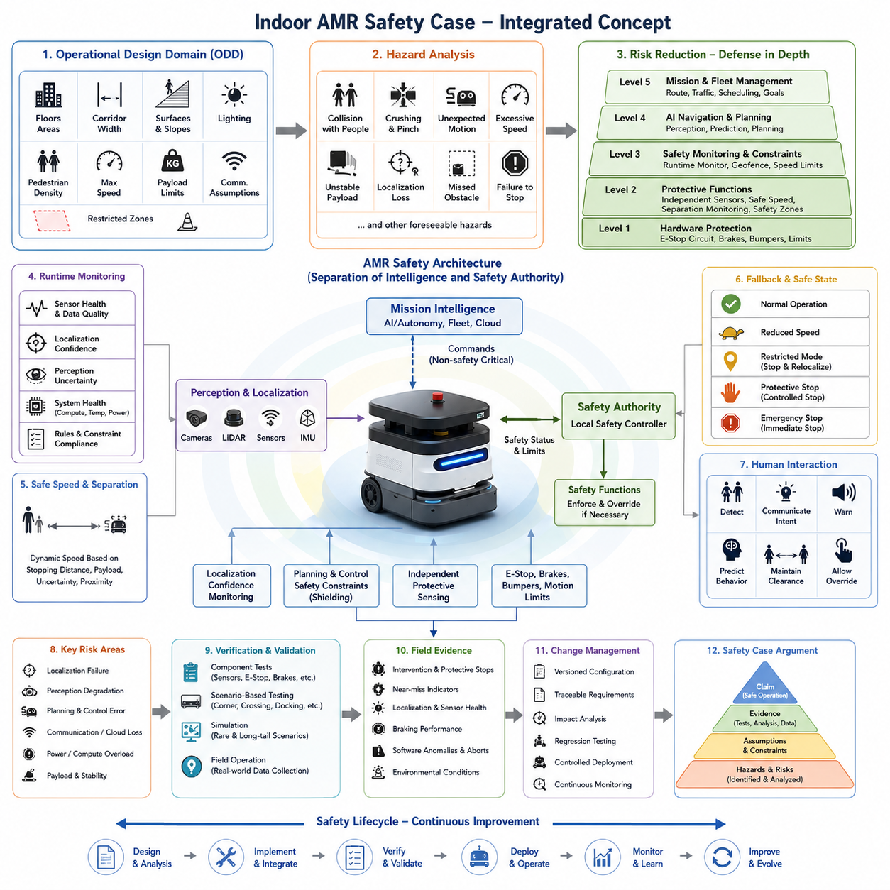{width="7.268055555555556in" height="7.268055555555556in"}

An indoor Autonomous Mobile Robot operates in a deceptively complex safety environment. Although speeds are usually lower than those of outdoor autonomous vehicles, the robot continuously shares narrow corridors, intersections, elevators, work areas, and loading zones with people and other machines. A credible safety case must therefore demonstrate that autonomous operation remains acceptably safe across normal, abnormal, and reasonably foreseeable operating conditions.

The safety case begins by defining the operational context rather than treating safety as a property of the robot alone. The Operational Design Domain includes permitted floor areas, corridor widths, surface conditions, slopes, lighting, pedestrian density, maximum speed, payload limits, communication assumptions, and restricted zones. These boundaries establish where the safety argument is valid and identify conditions that require degraded operation or mission termination.

Hazard analysis considers how physical harm can emerge from interactions among motion, perception, localization, planning, control, computation, and human behavior. Representative hazards include collision with pedestrians, crushing against walls or equipment, unexpected motion during loading, excessive speed near people, unstable payload transport, localization loss, missed obstacles, incorrect route execution, and failure to stop when the operating environment becomes unsafe.

Risk reduction is implemented through defense in depth. The autonomous navigation system may optimize routes and trajectories, but safety-critical constraints should not depend exclusively on learned perception or intelligent planning. Independent protective sensing, emergency-stop circuits, speed limits, braking supervision, safety zones, motion controllers, and runtime monitors create additional barriers capable of preventing hazardous motion when the primary autonomy stack produces an incorrect decision.

Human detection illustrates the need for this layered architecture. Cameras or AI perception may provide semantic understanding and predict pedestrian movement, while safety-rated sensing provides an independent protective function. The robot can use richer AI information to move efficiently, but entry into a protected region must trigger deterministic responses such as speed reduction, controlled stopping, or emergency intervention according to the severity and immediacy of the situation.

Safe Speed and Separation Monitoring is especially important in shared indoor environments. The allowable velocity should reflect stopping distance, braking capability, sensing coverage, localization uncertainty, payload condition, floor characteristics, and proximity to people. Instead of relying on a single fixed speed limit, the AMR can progressively transition from normal motion to reduced speed, protective stopping, and ultimately an emergency state as safety margins decrease.

Localization failures require explicit treatment because a robot that incorrectly estimates its pose can execute an otherwise valid trajectory in the wrong physical location. The system should monitor localization confidence, map consistency, sensor agreement, and unexpected pose discontinuities. When confidence falls below an acceptable threshold, aggressive navigation should be prohibited and the AMR should enter a restricted mode, stop safely, relocalize, or request human assistance.

Perception degradation presents a similar problem. Occlusion, contamination, glare, darkness, reflective surfaces, sensor blockage, hardware faults, or distribution shift can reduce environmental understanding without producing an obvious total failure. Runtime health monitoring should therefore evaluate sensor availability, data quality, timing, uncertainty, and consistency. Reduced perception capability should automatically reduce the permitted operating envelope rather than allowing unchanged autonomous behavior.

Planning and control must also be constrained independently of perception. A proposed trajectory can be checked for prohibited regions, excessive curvature, unsafe acceleration, insufficient clearance, predicted collision, or violation of speed and separation requirements before execution. Runtime shielding provides a final opportunity to reject or modify an unsafe action, allowing intelligent planning to remain flexible while preventing it from exceeding explicitly defined physical safety boundaries.

A practical AMR safety architecture separates mission intelligence from safety authority. Fleet management or AI components may assign destinations, optimize traffic, predict congestion, or generate navigation objectives, but these commands should remain subordinate to local safety mechanisms. Loss of network connectivity, cloud services, or fleet coordination must therefore not remove the robot\'s ability to detect hazards, stop safely, and maintain a minimum-risk condition.

Fallback behavior should be designed as a structured set of operational states rather than a single emergency stop. Minor uncertainty may justify reduced speed, partial sensor degradation may require restricted navigation, localization instability may require stationary relocalization, and severe safety violations may demand an immediate protective stop. Recovery should occur only after predefined conditions confirm that the hazard has disappeared and required system capabilities have been restored.

Human interaction introduces additional uncertainty because pedestrians do not follow deterministic motion models. People may suddenly change direction, emerge from blind corners, walk while distracted, intentionally approach the robot, or misunderstand its intended motion. Conservative prediction, sufficient clearance, visible and audible intent communication, and predictable stopping behavior help make the AMR understandable to nearby people rather than requiring humans to infer complex autonomous decisions.

Payload conditions must be included because the same mobile base can exhibit different safety characteristics when empty and fully loaded. Increased mass changes braking distance and collision energy, while tall or poorly secured payloads may affect stability, sensor visibility, and turning behavior. The safety envelope should therefore account for payload mass, center of gravity, dimensions, securing status, and any obstruction of sensing fields before autonomous transport begins.

Verification combines component testing with integrated scenario-based evaluation. Individual safety mechanisms can be tested through sensor fault injection, emergency-stop tests, braking measurements, localization degradation, communication loss, obstacle appearance, and computational overload. Integrated scenarios should then reproduce realistic interactions such as blind-corner encounters, corridor blockage, crossing pedestrians, dense traffic, docking operations, and recovery from temporary system failures.

Simulation extends testing beyond scenarios that can be safely or economically reproduced in facilities. Large numbers of variations can explore pedestrian trajectories, sensing errors, braking delays, localization uncertainty, obstacle configurations, and combinations of faults. Simulation evidence does not replace physical testing, but it helps expose rare interactions and long-tail conditions that would otherwise receive insufficient coverage before deployment.

Field evidence completes the argument by showing that the safety mechanisms remain effective under actual operating conditions. Useful evidence includes intervention frequency, protective-stop events, near-collision indicators, localization degradation, sensor health, braking performance, software anomalies, mission aborts, and environmental conditions. Logging should preserve enough synchronized information to reconstruct why the robot perceived a situation, selected an action, and entered or exited a safety state.

Software and AI updates require controlled change management because safety evidence applies to a particular configuration. Changes to perception models, navigation parameters, maps, planners, safety thresholds, sensor calibration, or runtime monitors can invalidate earlier assumptions. Versioned configurations, regression scenarios, traceable requirements, targeted revalidation, and controlled deployment are therefore necessary to maintain the safety case throughout the operational lifecycle.

The resulting safety case is not merely a collection of test reports. It is a structured argument connecting identified hazards to safety requirements, architectural mitigations, verification results, operational constraints, and field evidence. Each important claim should be supported by traceable evidence showing why the associated risk is controlled and what assumptions must remain true for that claim to remain valid during deployment.

For Physical AI, the central lesson of the indoor AMR case is that intelligent autonomy and safety assurance should complement rather than replace one another. AI can improve perception, prediction, planning, and operational efficiency, while deterministic constraints, independent monitoring, fallback control, and minimum-risk behavior bound the consequences of AI uncertainty. This separation allows capability to evolve without granting unrestricted authority to uncertain learned behavior.

An effective indoor AMR safety case therefore becomes a living assurance framework spanning design, deployment, monitoring, maintenance, and continuous improvement. Operational data can reveal new hazards and weak assumptions, but modifications should return through analysis, verification, and controlled release before becoming trusted behavior. Safety is maintained through an evidence-backed lifecycle in which autonomy is continuously constrained by measurable physical limits and independently enforceable protections.

실내 자율이동로봇(Autonomous Mobile Robot, AMR)은 겉보기보다 훨씬 복잡한 안전 환경에서 작동한다. 일반적으로 실외 자율주행차보다 속도는 낮지만, 좁은 복도, 교차 구역, 엘리베이터, 작업 공간, 적재 구역을 사람과 다른 기계와 지속적으로 공유한다. 따라서 신뢰할 수 있는 안전 사례(Safety Case)는 정상, 비정상 및 합리적으로 예측 가능한 운용 조건에서 자율 운용이 허용 가능한 수준의 안전성을 유지함을 입증해야 한다.

안전 사례(Safety Case)는 안전을 로봇 자체의 속성으로만 취급하지 않고 운용 환경(Operational Context)을 정의하는 것에서 시작한다. 운용설계영역(Operational Design Domain, ODD)은 허용된 바닥 영역, 복도 폭, 노면 상태, 경사도, 조명, 보행자 밀도, 최대 속도, 적재물 제한, 통신 조건 및 제한 구역을 포함한다. 이러한 경계는 안전 논증이 유효한 범위를 설정하고, 성능 저하 운용(Degraded Operation)이나 임무 종료가 필요한 조건을 식별한다.

위험 분석(Hazard Analysis)은 물리적 움직임, 인지(Perception), 위치추정(Localization), 계획(Planning), 제어(Control), 연산(Computation), 인간 행동 간의 상호작용에서 어떻게 물리적 피해가 발생할 수 있는지를 고려한다. 대표적인 위험에는 보행자와의 충돌, 벽이나 장비 사이에서의 압착, 적재 작업 중 예기치 않은 움직임, 사람 근처에서의 과도한 속도, 불안정한 적재물 운송, 위치추정 상실, 장애물 미검출, 잘못된 경로 실행, 운용 환경이 위험해졌을 때 정지하지 못하는 상황 등이 포함된다.

위험 감소(Risk Reduction)는 심층 방어(Defense in Depth)를 통해 구현된다. 자율 내비게이션 시스템(Autonomous Navigation System)은 경로와 궤적을 최적화할 수 있지만, 안전 핵심 제약조건(Safety-Critical Constraints)이 학습 기반 인지나 지능형 계획에만 의존해서는 안 된다. 독립적인 보호 센싱(Protective Sensing), 비상 정지 회로(Emergency-Stop Circuit), 속도 제한, 제동 감시, 안전 구역(Safety Zone), 모션 제어기(Motion Controller), 런타임 모니터(Runtime Monitor)는 주 자율 시스템이 잘못된 판단을 내리더라도 위험한 움직임을 방지할 수 있는 추가적인 보호 계층을 형성한다.

인간 감지(Human Detection)는 이러한 계층형 아키텍처(Layered Architecture)가 필요한 대표적인 사례이다. 카메라 또는 AI 인지(AI Perception)는 의미론적 환경 이해와 보행자 움직임 예측을 제공할 수 있으며, 안전 등급 센싱(Safety-Rated Sensing)은 독립적인 보호 기능을 제공한다. 로봇은 효율적인 이동을 위해 풍부한 AI 정보를 활용할 수 있지만, 사람이 보호 영역(Protected Region)에 진입하면 상황의 심각성과 긴급성에 따라 감속, 제어 정지 또는 비상 개입과 같은 결정론적 대응(Deterministic Response)이 실행되어야 한다.

안전 속도 및 분리 감시(Safe Speed and Separation Monitoring)는 사람이 함께 존재하는 실내 환경에서 특히 중요하다. 허용 속도는 정지 거리, 제동 능력, 센서 탐지 범위, 위치추정 불확실성, 적재 상태, 바닥 특성 및 사람과의 거리를 반영해야 한다. 하나의 고정된 속도 제한에 의존하기보다 안전 여유(Safety Margin)가 감소함에 따라 AMR이 정상 이동에서 감속, 보호 정지(Protective Stop), 최종적으로 비상 상태(Emergency State)로 단계적으로 전환할 수 있어야 한다.

위치추정 실패(Localization Failure)는 로봇이 자신의 위치를 잘못 추정할 경우 정상적으로 계산된 궤적조차 잘못된 실제 위치에서 실행할 수 있기 때문에 명시적으로 다루어야 한다. 시스템은 위치추정 신뢰도, 지도 일관성(Map Consistency), 센서 간 일치도 및 예상하지 못한 위치 변화 등을 감시해야 한다. 신뢰도가 허용 임계값 이하로 떨어지면 공격적인 내비게이션을 금지하고, AMR은 제한 운용 모드(Restricted Mode)로 전환하거나 안전하게 정지하고 재위치추정(Relocalization)을 수행하거나 사람의 지원을 요청해야 한다.

인지 성능 저하(Perception Degradation) 역시 유사한 문제를 발생시킨다. 가림(Occlusion), 오염, 눈부심, 어두운 환경, 반사 표면, 센서 차단, 하드웨어 고장 또는 분포 변화(Distribution Shift)는 명확한 전체 고장을 발생시키지 않으면서 환경 이해 능력을 저하시킬 수 있다. 따라서 런타임 상태 감시(Runtime Health Monitoring)는 센서 가용성, 데이터 품질, 타이밍, 불확실성 및 일관성을 평가해야 한다. 인지 능력이 감소하면 기존의 자율 행동을 그대로 유지하는 대신 허용되는 운용 범위(Operating Envelope)를 자동으로 축소해야 한다.

계획(Planning)과 제어(Control) 역시 인지 시스템과 독립적으로 제약되어야 한다. 제안된 궤적은 실행 전에 금지 영역 침범, 과도한 곡률, 위험한 가속도, 불충분한 안전거리, 예측 충돌 또는 속도 및 분리 요구사항 위반 여부를 검사할 수 있다. 런타임 차폐(Runtime Shielding)는 위험한 행동을 거부하거나 수정할 수 있는 최종적인 기회를 제공하며, 지능형 계획의 유연성을 유지하면서도 명시적으로 정의된 물리적 안전 경계(Physical Safety Boundary)를 넘어서는 행동을 방지한다.

실용적인 AMR 안전 아키텍처(Safety Architecture)는 임무 지능(Mission Intelligence)과 안전 권한(Safety Authority)을 분리한다. 플릿 관리(Fleet Management) 또는 AI 구성요소는 목적지를 할당하고, 교통 흐름을 최적화하며, 혼잡을 예측하거나 내비게이션 목표를 생성할 수 있지만 이러한 명령은 로컬 안전 메커니즘(Local Safety Mechanism)에 종속되어야 한다. 따라서 네트워크 연결, 클라우드 서비스 또는 플릿 협조(Fleet Coordination)가 상실되더라도 로봇의 위험 감지, 안전 정지 및 최소 위험 상태(Minimum-Risk Condition) 유지 능력은 제거되어서는 안 된다.

폴백 동작(Fallback Behavior)은 하나의 비상 정지가 아니라 구조화된 운용 상태 집합으로 설계되어야 한다. 경미한 불확실성은 감속으로 대응할 수 있고, 부분적인 센서 성능 저하는 제한된 내비게이션을 요구할 수 있으며, 위치추정 불안정은 정지 상태의 재위치추정을 필요로 할 수 있다. 심각한 안전 위반은 즉각적인 보호 정지를 요구한다. 복구(Recovery)는 위험이 제거되고 필요한 시스템 기능이 복원되었음을 사전에 정의된 조건으로 확인한 이후에만 수행되어야 한다.

인간 상호작용(Human Interaction)은 보행자가 결정론적인 움직임 모델을 따르지 않기 때문에 추가적인 불확실성을 발생시킨다. 사람은 갑자기 방향을 바꾸거나, 사각지대에서 나타나거나, 주의가 분산된 상태로 이동하거나, 의도적으로 로봇에 접근하거나, 로봇의 움직임 의도를 잘못 이해할 수 있다. 보수적인 예측(Conservative Prediction), 충분한 안전거리, 시각적·청각적 의도 전달(Intent Communication), 예측 가능한 정지 행동은 주변 사람이 복잡한 자율 의사결정을 추론하지 않아도 AMR의 행동을 이해할 수 있도록 한다.

적재 상태(Payload Condition)도 반드시 포함되어야 한다. 동일한 이동 플랫폼이라도 비어 있을 때와 최대 적재 상태에서는 서로 다른 안전 특성을 나타낼 수 있다. 증가된 질량은 제동 거리와 충돌 에너지를 변화시키며, 높거나 제대로 고정되지 않은 적재물은 안정성, 센서 시야 및 회전 동작에 영향을 줄 수 있다. 따라서 안전 영역(Safety Envelope)은 자율 운송을 시작하기 전에 적재물의 질량, 무게중심(Center of Gravity), 크기, 고정 상태 및 센서 탐지 영역의 차단 여부를 고려해야 한다.

검증(Verification)은 구성요소 시험과 통합 시나리오 기반 평가(Scenario-Based Evaluation)를 결합한다. 개별 안전 메커니즘은 센서 고장 주입(Fault Injection), 비상 정지 시험, 제동 측정, 위치추정 성능 저하, 통신 손실, 장애물 출현 및 연산 과부하 등을 통해 시험할 수 있다. 이후 통합 시나리오는 사각 교차로에서의 조우, 복도 차단, 보행자 횡단, 혼잡한 교통, 도킹 작업 및 일시적 시스템 고장 이후의 복구와 같은 현실적인 상호작용을 재현해야 한다.

시뮬레이션(Simulation)은 시설에서 안전하게 또는 경제적으로 재현하기 어려운 상황까지 시험 범위를 확장한다. 수많은 변형 시나리오를 통해 보행자 궤적, 센싱 오류, 제동 지연, 위치추정 불확실성, 장애물 구성 및 복합 고장 조건을 탐색할 수 있다. 시뮬레이션 증거(Simulation Evidence)가 실제 시험을 대체하는 것은 아니지만, 실제 배치 전에 충분히 다루기 어려운 희귀 상호작용과 롱테일 조건(Long-Tail Conditions)을 발견하는 데 도움을 준다.

현장 증거(Field Evidence)는 실제 운용 조건에서 안전 메커니즘이 지속적으로 효과를 발휘한다는 것을 보여줌으로써 안전 논증을 완성한다. 유용한 증거에는 개입 빈도, 보호 정지 이벤트, 근접 충돌 지표, 위치추정 성능 저하, 센서 상태, 제동 성능, 소프트웨어 이상, 임무 중단 및 환경 조건 등이 포함된다. 로깅(Logging)은 로봇이 상황을 어떻게 인지하고, 왜 특정 행동을 선택했으며, 어떤 이유로 안전 상태에 진입하거나 이탈했는지를 재구성할 수 있을 만큼 충분히 동기화된 정보를 보존해야 한다.

소프트웨어와 AI 업데이트는 안전 증거가 특정 시스템 구성(Configuration)에 적용되기 때문에 통제된 변경 관리(Change Management)를 필요로 한다. 인지 모델, 내비게이션 파라미터, 지도, 플래너(Planner), 안전 임계값, 센서 보정 또는 런타임 모니터의 변경은 기존의 안전 가정을 무효화할 수 있다. 따라서 버전 관리된 구성, 회귀 시나리오(Regression Scenario), 추적 가능한 요구사항, 변경 대상에 대한 재검증 및 통제된 배포가 운용 수명주기 전체에서 안전 사례를 유지하기 위해 필요하다.

최종적인 안전 사례(Safety Case)는 단순한 시험 보고서의 집합이 아니다. 이는 식별된 위험을 안전 요구사항(Safety Requirements), 아키텍처적 완화 조치, 검증 결과, 운용 제약조건 및 현장 증거와 연결하는 구조화된 논증(Structured Argument)이다. 각각의 중요한 주장은 관련 위험이 왜 통제되고 있는지, 그리고 실제 배치 과정에서 그 주장이 계속 유효하기 위해 어떠한 가정이 유지되어야 하는지를 보여주는 추적 가능한 증거로 뒷받침되어야 한다.

피지컬 AI(Physical AI)의 관점에서 실내 AMR 안전 사례가 제공하는 핵심 교훈은 지능형 자율성(Intelligent Autonomy)과 안전 보증(Safety Assurance)이 서로를 대체하는 것이 아니라 상호 보완해야 한다는 것이다. AI는 인지, 예측, 계획 및 운용 효율성을 향상시킬 수 있으며, 결정론적 제약조건, 독립 감시, 폴백 제어 및 최소 위험 행동은 AI 불확실성으로 인한 결과를 제한한다. 이러한 분리는 불확실한 학습 행동에 무제한의 권한을 부여하지 않으면서도 자율 시스템의 능력을 지속적으로 발전시킬 수 있도록 한다.

따라서 효과적인 실내 AMR 안전 사례는 설계, 배치, 모니터링, 유지보수 및 지속적인 개선을 포괄하는 살아 있는 보증 프레임워크(Living Assurance Framework)가 된다. 운용 데이터는 새로운 위험과 취약한 가정을 발견할 수 있지만, 변경된 기능은 신뢰할 수 있는 행동으로 승인되기 전에 다시 분석, 검증 및 통제된 배포 과정을 거쳐야 한다. 안전은 자율성이 측정 가능한 물리적 한계와 독립적으로 강제 가능한 보호 메커니즘에 의해 지속적으로 제한되는 증거 기반 수명주기(Evidence-Backed Lifecycle)를 통해 유지된다.

##  

## 09.02. Outdoor Autonomous Robot Safety Case

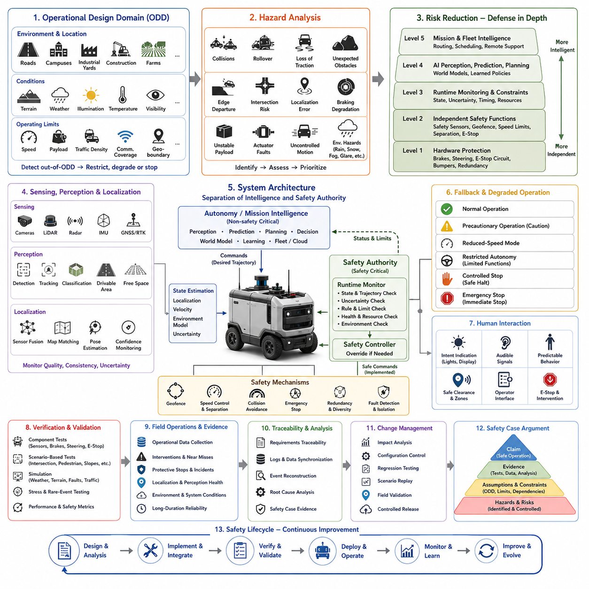{width="7.268055555555556in" height="7.268055555555556in"}

Outdoor autonomous robots extend Physical AI safety beyond the comparatively structured conditions of indoor facilities. They operate across roads, campuses, industrial yards, construction areas, farms, ports, and mixed pedestrian spaces where terrain, weather, illumination, traffic, and communication conditions can change rapidly. Their safety case must therefore demonstrate acceptable behavior under a substantially wider range of environmental uncertainty and physical exposure.

The safety argument begins with a precise Operational Design Domain, or ODD. The ODD defines permitted terrain, road types, slopes, surface conditions, weather limits, temperature ranges, visibility, illumination, traffic density, operating speed, payload, communication coverage, and geographic boundaries. Conditions outside these assumptions must be detectable so that the robot can restrict its behavior instead of continuing autonomous operation under unsupported circumstances.

Outdoor hazard analysis must combine conventional robotic hazards with environmental and mobility-specific risks. Important scenarios include collisions with pedestrians or vehicles, rollover on slopes, loss of traction, unexpected obstacles, road-edge departure, unsafe intersection entry, unstable payloads, localization errors, braking degradation, actuator faults, and uncontrolled motion. Environmental hazards such as rain, fog, snow, dust, glare, standing water, and vegetation can simultaneously affect several subsystems.

Terrain introduces risks that are less prominent in controlled indoor environments. Gravel, mud, grass, potholes, curbs, debris, drainage channels, steep gradients, and irregular surfaces can change wheel traction and vehicle stability. A safe autonomous robot should estimate traversability rather than interpreting every geometrically open region as drivable space. Terrain classification, slope estimation, clearance analysis, traction monitoring, and conservative motion limits become essential parts of the safety envelope.

Localization is another critical safety dependency. Outdoor robots may combine GNSS, RTK, LiDAR, cameras, wheel odometry, and inertial measurements, but each source has characteristic failure modes. Buildings can create GNSS multipath, vegetation can degrade satellite reception, wheel slip corrupts odometry, and repetitive environments can confuse map matching. Safety therefore depends on monitoring localization confidence and consistency rather than assuming that a continuously available pose estimate is necessarily correct.

Perception must remain reliable across substantial environmental variation. Cameras can be affected by darkness, direct sunlight, shadows, glare, rain, or contamination, while LiDAR and other ranging sensors may experience degraded returns under adverse conditions. Sensor fusion provides diversity, but fusion alone does not guarantee correctness. Runtime monitoring should identify disagreement, reduced coverage, abnormal data quality, and increasing uncertainty before perception degradation becomes hazardous motion.

Dynamic objects create an additional challenge because outdoor robots may encounter pedestrians, bicycles, cars, trucks, forklifts, animals, and other autonomous machines. Their trajectories can be uncertain and their behavior may violate expected traffic patterns. The robot should therefore combine detection and tracking with conservative prediction, time-to-collision estimation, safe separation, and defensive planning that preserves sufficient stopping and avoidance margins.

Speed management must reflect the physical environment rather than depend on a single maximum velocity. Safe speed is influenced by sensing range, reaction latency, braking distance, terrain friction, slope, payload mass, localization uncertainty, obstacle density, and visibility. As these conditions deteriorate, the permitted speed should decrease automatically. The safety architecture should always preserve enough distance and time to reach a controlled minimum-risk condition.

Planning safety requires more than collision-free path generation. A mathematically feasible path may still pass too close to a drop-off, enter unstable terrain, cross an intersection with inadequate visibility, or require braking performance unavailable on the current surface. Candidate trajectories should therefore be checked against geofences, traversability constraints, dynamic safety margins, vehicle stability limits, predicted collisions, and prohibited operating regions before commands reach the motion controller.

Runtime assurance provides an independent layer between intelligent autonomy and physical actuation. AI-based perception, prediction, world models, or learned planners may generate increasingly capable behavior, but their proposed actions should remain bounded by explicit safety constraints. A runtime monitor can supervise state, trajectory, uncertainty, timing, resource health, and environmental conditions while a safety controller overrides commands that violate the permitted operating envelope.

Communication loss must not immediately create an unsafe vehicle. Outdoor robots may depend on fleet servers, remote operators, cloud services, or wireless infrastructure for mission-level functions, yet essential collision avoidance and stopping capabilities should remain local. When connectivity deteriorates, the system can suspend new missions, reduce speed, complete only a locally safe maneuver, move to a predefined safe location, or stop while maintaining independent protective functions.

Compute and power failures also require explicit fallback strategies. Thermal throttling, processor overload, memory exhaustion, software crashes, battery degradation, actuator power faults, or sensor timing failures can gradually reduce autonomous capability. Health monitoring should detect these conditions before complete failure whenever possible. The robot can then transition through degraded operational states rather than moving directly from full autonomy to uncontrolled or undefined behavior.

A structured fallback hierarchy can include normal operation, precautionary operation, reduced-speed mode, restricted autonomy, controlled stop, and emergency stop. The appropriate response depends on the severity and immediacy of the hazard. Localization uncertainty may justify stopping for relocalization, reduced visibility may require lower speed, and a critical braking or steering fault may demand immediate termination of autonomous motion.

Human interaction remains central even when the robot is primarily designed for industrial or logistics operations. Workers and pedestrians need understandable indications of whether the robot intends to move, turn, yield, stop, or wait. Lights, displays, audible signals, predictable trajectories, conservative clearance, and accessible emergency intervention mechanisms reduce ambiguity. Remote operators should also receive sufficient diagnostic context to make safe intervention decisions.

Verification should combine controlled physical testing with scenario-based evaluation. Tests should cover braking, steering, emergency stopping, obstacle detection, localization degradation, sensor faults, communication loss, compute overload, low battery conditions, slope operation, reduced traction, and payload variation. Integrated scenarios should reproduce realistic encounters at intersections, blind corners, narrow passages, loading areas, mixed traffic zones, and transitions between different surface conditions.

Simulation is particularly valuable because outdoor operating conditions create a combinatorial scenario space that cannot be reproduced entirely through physical testing. Weather, illumination, terrain, obstacle motion, sensor noise, localization errors, traffic behavior, and system faults can be varied systematically. Rare-event testing can search for combinations in which individually tolerable uncertainties interact and produce an unsafe trajectory or insufficient safety margin.

Physical field trials remain necessary to validate assumptions that simulation cannot fully represent. Long-duration operation can expose changing friction, sensor contamination, thermal effects, communication shadows, map changes, unusual human behavior, vegetation growth, construction activity, and gradual hardware degradation. Operational evidence should capture interventions, near misses, protective stops, localization anomalies, perception uncertainty, trajectory violations, component faults, and environmental context.

Traceability connects these observations to the safety argument. Each major hazard should correspond to safety requirements, architectural controls, verification procedures, acceptance criteria, and operational evidence. Logs should preserve synchronized perception, localization, planning, control, safety-monitor, and system-health information so that abnormal events can be reconstructed. This enables engineers to distinguish environmental surprises from perception errors, planning failures, control faults, or incorrect safety assumptions.

Software, maps, AI models, and operating environments inevitably change after deployment. A new perception model, navigation policy, map revision, sensor configuration, payload, or expanded operating area can alter previously validated assumptions. Change management should therefore include impact analysis, configuration control, regression testing, scenario replay, targeted field validation, and controlled release before the modified system inherits the existing safety case.

The outdoor autonomous robot safety case ultimately demonstrates that increasing intelligence does not imply unrestricted autonomy. Learned perception, predictive world models, adaptive planning, and fleet intelligence can improve capability, but independent safety mechanisms must bound their physical authority. Safety emerges from combining intelligent adaptation with deterministic limits, runtime supervision, degraded modes, independent protective functions, and a clearly defined minimum-risk condition.

For Physical AI, this case illustrates a broader transition from fixed-machine safety toward continuous operational assurance. The robot must understand not only where it can travel, but whether current environmental, system, and uncertainty conditions still justify autonomous action. The safety case consequently becomes a living evidence framework linking ODD boundaries, hazards, runtime assurance, verification, field observations, and controlled evolution throughout the complete operational lifecycle.

실외 자율로봇(Outdoor Autonomous Robot)은 피지컬 AI(Physical AI)의 안전 범위를 비교적 구조화된 실내 시설의 조건보다 훨씬 넓은 영역으로 확장한다. 이러한 로봇은 도로, 캠퍼스, 산업 현장, 건설 구역, 농장, 항만 및 보행자와 공유하는 공간에서 운용되며, 지형, 날씨, 조명, 교통 및 통신 조건이 빠르게 변할 수 있다. 따라서 안전 사례(Safety Case)는 훨씬 광범위한 환경 불확실성과 물리적 노출 조건에서도 허용 가능한 안전 행동을 유지할 수 있음을 입증해야 한다.

안전 논증(Safety Argument)은 명확한 운용설계영역(Operational Design Domain, ODD)을 정의하는 것에서 시작한다. ODD는 허용 가능한 지형, 도로 유형, 경사도, 노면 상태, 기상 한계, 온도 범위, 가시성, 조도, 교통 밀도, 운용 속도, 적재물, 통신 범위 및 지리적 경계를 정의한다. 이러한 가정을 벗어난 조건을 시스템이 탐지할 수 있어야 하며, 지원되지 않는 상황에서 자율 운행을 계속하는 대신 로봇의 행동을 제한해야 한다.

실외 위험 분석(Hazard Analysis)은 기존 로봇의 위험과 환경 및 이동성에 특화된 위험을 함께 고려해야 한다. 주요 시나리오에는 보행자 또는 차량과의 충돌, 경사면에서의 전복, 접지력 상실, 예상하지 못한 장애물, 도로 경계 이탈, 위험한 교차로 진입, 불안정한 적재물, 위치추정 오류, 제동 성능 저하, 액추에이터 고장 및 제어되지 않은 움직임이 포함된다. 비, 안개, 눈, 먼지, 눈부심, 고인 물 및 식생과 같은 환경 위험은 여러 하위 시스템에 동시에 영향을 줄 수 있다.

지형(Terrain)은 통제된 실내 환경에서는 상대적으로 중요성이 낮았던 추가적인 위험을 발생시킨다. 자갈, 진흙, 잔디, 포트홀, 연석, 잔해, 배수로, 급경사 및 불규칙한 노면은 바퀴의 접지력과 차량 안정성을 변화시킬 수 있다. 안전한 자율로봇은 기하학적으로 비어 있는 모든 공간을 주행 가능 영역으로 판단하지 않고 주행가능성(Traversability)을 추정해야 한다. 지형 분류, 경사 추정, 여유 공간 분석, 접지력 감시 및 보수적인 운동 제한이 안전 영역(Safety Envelope)의 핵심 요소가 된다.

위치추정(Localization)은 또 다른 핵심 안전 의존 요소이다. 실외 로봇은 위성항법시스템(GNSS), 실시간 이동측위(RTK), 라이다(LiDAR), 카메라, 휠 오도메트리(Wheel Odometry) 및 관성 측정값을 결합할 수 있지만 각각의 정보원은 고유한 고장 형태를 가진다. 건물은 GNSS 다중경로(Multipath)를 발생시키고, 식생은 위성 신호 수신을 저하시키며, 바퀴 미끄러짐은 오도메트리를 왜곡하고, 반복적인 환경은 지도 정합(Map Matching)을 혼란스럽게 할 수 있다. 따라서 안전은 위치 정보가 지속적으로 제공된다는 사실보다 위치추정의 신뢰도와 일관성을 감시하는 것에 의존해야 한다.

인지(Perception)는 상당한 환경 변화에서도 신뢰성을 유지해야 한다. 카메라는 어둠, 직사광선, 그림자, 눈부심, 비 또는 오염의 영향을 받을 수 있으며, 라이다와 다른 거리 측정 센서 역시 악조건에서 성능이 저하될 수 있다. 센서 융합(Sensor Fusion)은 다양성을 제공하지만 융합 자체가 정확성을 보장하지는 않는다. 런타임 모니터링(Runtime Monitoring)은 인지 성능 저하가 위험한 움직임으로 이어지기 전에 센서 간 불일치, 탐지 범위 감소, 비정상적인 데이터 품질 및 증가하는 불확실성을 식별해야 한다.

동적 객체(Dynamic Object)는 실외 로봇이 보행자, 자전거, 자동차, 트럭, 지게차, 동물 및 다른 자율 시스템과 마주칠 수 있기 때문에 추가적인 문제를 발생시킨다. 이들의 궤적은 불확실할 수 있으며 예상되는 교통 규칙을 따르지 않을 수도 있다. 따라서 로봇은 객체 탐지 및 추적과 함께 보수적인 예측(Conservative Prediction), 충돌까지의 시간(Time-to-Collision) 추정, 안전 분리 거리 및 충분한 정지·회피 여유를 확보하는 방어적 계획(Defensive Planning)을 결합해야 한다.

속도 관리(Speed Management)는 하나의 최대 속도에만 의존하지 않고 실제 물리 환경을 반영해야 한다. 안전 속도는 센싱 거리, 반응 지연시간, 제동 거리, 지면 마찰력, 경사도, 적재물 질량, 위치추정 불확실성, 장애물 밀도 및 가시성의 영향을 받는다. 이러한 조건이 악화되면 허용 속도는 자동으로 감소해야 한다. 안전 아키텍처(Safety Architecture)는 항상 제어된 최소 위험 상태(Minimum-Risk Condition)에 도달할 수 있는 충분한 거리와 시간을 확보해야 한다.

계획 안전(Planning Safety)은 단순히 충돌이 없는 경로를 생성하는 것 이상을 요구한다. 수학적으로 실행 가능한 경로라도 낭떠러지나 경계에 지나치게 가까이 접근하거나, 불안정한 지형으로 진입하거나, 시야가 불충분한 교차로를 통과하거나, 현재 노면에서 확보할 수 없는 제동 성능을 요구할 수 있다. 따라서 후보 궤적은 모션 제어기에 명령이 전달되기 전에 지오펜스(Geofence), 주행가능성 제약, 동적 안전 여유, 차량 안정성 한계, 예측 충돌 및 금지 운용 영역을 기준으로 검사되어야 한다.

런타임 보증(Runtime Assurance)은 지능형 자율 시스템(Intelligent Autonomy)과 물리적 구동 사이에 독립적인 안전 계층을 제공한다. AI 기반 인지, 예측, 월드 모델(World Model) 또는 학습 기반 플래너(Learned Planner)는 점점 더 높은 수준의 행동 능력을 생성할 수 있지만, 이들이 제안하는 행동은 명시적인 안전 제약조건에 의해 제한되어야 한다. 런타임 모니터(Runtime Monitor)는 상태, 궤적, 불확실성, 타이밍, 시스템 자원 상태 및 환경 조건을 감시하고, 안전 제어기(Safety Controller)는 허용된 운용 범위를 위반하는 명령을 무효화할 수 있다.

통신 손실(Communication Loss)이 즉시 위험한 차량 상태를 발생시켜서는 안 된다. 실외 로봇은 임무 수준의 기능을 위해 플릿 서버(Fleet Server), 원격 운영자(Remote Operator), 클라우드 서비스 또는 무선 인프라에 의존할 수 있지만, 필수적인 충돌 회피와 정지 기능은 로컬(Local)에 유지되어야 한다. 연결 상태가 악화되면 시스템은 새로운 임무를 중단하거나, 속도를 낮추거나, 로컬에서 안전한 기동만 완료하거나, 사전에 정의된 안전 위치로 이동하거나, 독립적인 보호 기능을 유지하면서 정지할 수 있다.

연산 및 전원 고장(Compute and Power Failure)에도 명시적인 폴백 전략(Fallback Strategy)이 필요하다. 열 스로틀링(Thermal Throttling), 프로세서 과부하, 메모리 고갈, 소프트웨어 충돌, 배터리 성능 저하, 액추에이터 전원 고장 또는 센서 타이밍 오류는 자율 기능을 점진적으로 저하시킬 수 있다. 상태 감시(Health Monitoring)는 가능한 경우 완전한 고장이 발생하기 전에 이러한 조건을 탐지해야 한다. 이를 통해 로봇은 완전 자율 상태에서 제어되지 않거나 정의되지 않은 행동으로 바로 전환되는 대신 단계적인 성능 저하 운용 상태(Degraded Operational State)로 전환할 수 있다.

구조화된 폴백 계층(Fallback Hierarchy)은 정상 운용(Normal Operation), 예방적 운용(Precautionary Operation), 감속 모드(Reduced-Speed Mode), 제한 자율 모드(Restricted Autonomy), 제어 정지(Controlled Stop) 및 비상 정지(Emergency Stop)를 포함할 수 있다. 적절한 대응은 위험의 심각성과 긴급성에 따라 결정된다. 위치추정 불확실성은 재위치추정(Relocalization)을 위한 정지를 요구할 수 있고, 가시성 저하는 감속을 요구할 수 있으며, 심각한 제동 또는 조향 고장은 즉각적인 자율 이동 종료를 요구할 수 있다.

인간 상호작용(Human Interaction)은 로봇이 주로 산업 또는 물류 운용을 위해 설계된 경우에도 핵심적인 요소이다. 작업자와 보행자는 로봇이 이동, 회전, 양보, 정지 또는 대기하려는지를 쉽게 이해할 수 있어야 한다. 조명, 디스플레이, 청각 신호, 예측 가능한 궤적, 보수적인 안전거리 및 접근 가능한 비상 개입 메커니즘은 행동의 모호성을 감소시킨다. 원격 운영자 역시 안전한 개입 결정을 내릴 수 있도록 충분한 진단 정보(Diagnostic Context)를 제공받아야 한다.

검증(Verification)은 통제된 실제 시험과 시나리오 기반 평가(Scenario-Based Evaluation)를 결합해야 한다. 시험은 제동, 조향, 비상 정지, 장애물 탐지, 위치추정 성능 저하, 센서 고장, 통신 손실, 연산 과부하, 배터리 저전력 상태, 경사면 운행, 접지력 저하 및 적재물 변화를 포함해야 한다. 통합 시나리오는 교차로, 사각 코너, 좁은 통로, 적재 구역, 혼합 교통 영역 및 서로 다른 노면 조건 사이의 전환에서 발생하는 현실적인 상황을 재현해야 한다.

시뮬레이션(Simulation)은 실외 운용 조건에서 발생하는 조합적 시나리오 공간(Combinatorial Scenario Space)을 실제 시험만으로 완전히 재현할 수 없기 때문에 특히 중요하다. 날씨, 조명, 지형, 장애물 움직임, 센서 잡음, 위치추정 오류, 교통 행동 및 시스템 고장을 체계적으로 변화시킬 수 있다. 희귀 사건 시험(Rare-Event Testing)은 개별적으로는 허용 가능한 불확실성들이 상호작용하여 위험한 궤적이나 불충분한 안전 여유를 발생시키는 조합을 탐색할 수 있다.

실제 현장 시험(Field Trial)은 시뮬레이션으로 완전히 표현할 수 없는 가정을 검증하기 위해 여전히 필요하다. 장기간 운용은 변화하는 마찰력, 센서 오염, 열 영향, 통신 음영 지역, 지도 변화, 비정상적인 인간 행동, 식생 성장, 건설 활동 및 점진적인 하드웨어 성능 저하를 드러낼 수 있다. 운용 증거(Operational Evidence)는 개입, 근접 사고(Near Miss), 보호 정지, 위치추정 이상, 인지 불확실성, 궤적 위반, 구성요소 고장 및 환경 조건을 기록해야 한다.

추적성(Traceability)은 이러한 관찰 결과를 안전 논증과 연결한다. 각각의 주요 위험은 안전 요구사항(Safety Requirements), 아키텍처 제어, 검증 절차, 수용 기준(Acceptance Criteria) 및 운용 증거와 대응되어야 한다. 로그는 인지, 위치추정, 계획, 제어, 안전 모니터 및 시스템 상태 정보를 동기화하여 보존해야 하며, 이를 통해 비정상 사건을 재구성할 수 있어야 한다. 이러한 구조는 환경적 돌발 상황과 인지 오류, 계획 실패, 제어 고장 또는 잘못된 안전 가정을 구분할 수 있도록 한다.

소프트웨어, 지도, AI 모델 및 운용 환경은 실제 배치 이후에도 필연적으로 변화한다. 새로운 인지 모델, 내비게이션 정책, 지도 수정, 센서 구성, 적재물 또는 운용 영역 확대는 기존에 검증된 가정을 변경할 수 있다. 따라서 변경 관리(Change Management)는 변경 영향 분석(Impact Analysis), 구성 관리(Configuration Control), 회귀 시험(Regression Testing), 시나리오 재실행, 대상 현장 검증 및 통제된 릴리스(Controlled Release)를 포함해야 하며, 변경된 시스템이 기존 안전 사례를 승계하기 전에 이러한 과정이 수행되어야 한다.

실외 자율로봇 안전 사례(Outdoor Autonomous Robot Safety Case)는 궁극적으로 지능의 증가가 제한 없는 자율성을 의미하지 않는다는 것을 입증한다. 학습 기반 인지, 예측형 월드 모델(Predictive World Model), 적응형 계획(Adaptive Planning) 및 플릿 지능(Fleet Intelligence)은 시스템 능력을 향상시킬 수 있지만, 독립적인 안전 메커니즘은 이들의 물리적 권한을 제한해야 한다. 안전은 지능형 적응과 결정론적 한계, 런타임 감독, 성능 저하 모드, 독립적인 보호 기능 및 명확하게 정의된 최소 위험 상태를 결합함으로써 형성된다.

피지컬 AI(Physical AI)의 관점에서 이 사례는 고정된 기계 안전(Fixed-Machine Safety)에서 지속적 운용 보증(Continuous Operational Assurance)으로 전환되는 보다 광범위한 변화를 보여준다. 로봇은 단순히 어디를 이동할 수 있는지만 판단하는 것이 아니라 현재의 환경, 시스템 상태 및 불확실성 조건이 자율 행동을 계속 정당화하는지를 판단해야 한다. 따라서 안전 사례는 운용설계영역 경계, 위험, 런타임 보증, 검증, 현장 관찰 및 통제된 시스템 진화를 전체 운용 수명주기 동안 연결하는 살아 있는 증거 프레임워크(Living Evidence Framework)가 된다.

##  

## 09.03. Mobile Manipulator Safety Case

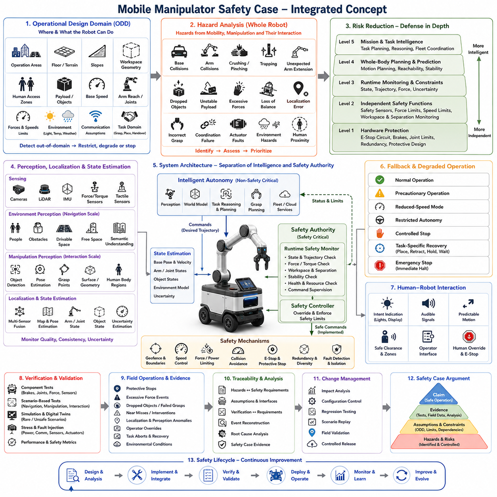{width="7.268055555555556in" height="7.268055555555556in"}

A mobile manipulator combines autonomous mobility with one or more robotic arms, creating a safety problem substantially more complex than either a conventional AMR or a stationary manipulator alone. The system can simultaneously navigate, position its base, reach into the environment, grasp objects, and interact with people. Its safety case must therefore address hazards arising from both subsystems and, critically, from their physical and computational interaction.

The safety argument begins by defining the intended operational domain and permitted tasks. Relevant boundaries include navigation areas, floor conditions, slopes, workspace geometry, human-access zones, payload characteristics, manipulator reach, base speed, joint velocity, allowable forces, environmental conditions, and communication assumptions. The task domain must also specify which objects may be grasped, transported, placed, handed over, or manipulated autonomously.

Hazard analysis must consider the complete robot rather than analyzing the mobile base and manipulator independently. Representative hazards include base collisions, arm collisions, crushing and pinching, trapping between the robot and fixed structures, unexpected arm extension during navigation, dropped objects, unstable payloads, excessive contact forces, loss of balance, localization errors, incorrect grasping, and unintended motion caused by coordination failures between the base and arm.

The manipulator dynamically changes the physical safety envelope of the robot. A retracted arm may remain within the mobile base footprint, while an extended arm can create a large moving hazard region beyond the chassis. Safety monitoring must therefore consider the instantaneous arm configuration, joint velocities, tool geometry, payload, predicted motion, and surrounding free space rather than relying only on a fixed protective zone around the mobile platform.

Whole-body stability becomes important when manipulation and mobility are combined. Extending a heavy payload changes the center of gravity and can reduce stability during acceleration, braking, turning, or operation on slopes. The controller should enforce configuration-dependent limits on base velocity, acceleration, arm extension, payload mass, and joint motion. Unsafe combinations of base dynamics and manipulator posture should be rejected before they become physical instability.

Perception must support both navigation-scale and manipulation-scale understanding. Mobile navigation requires detection of people, obstacles, traversable areas, and free space, while manipulation requires accurate estimation of objects, surfaces, grasp points, human body regions, and contact geometry. These perception functions operate at different spatial scales, but errors can propagate across them. A localization or object-pose error can transform an apparently valid manipulation trajectory into a collision.

Human proximity introduces particularly demanding constraints because the robot may intentionally approach people to deliver, receive, or manipulate objects. Human detection and tracking should therefore influence both base and arm behavior. As separation decreases, the system can progressively reduce base speed, joint speed, force, and permitted workspace. Unexpected human entry into a critical region should trigger protective behavior independently of the high-level task objective.

Force and contact monitoring provide another essential safety layer. Manipulation inherently creates physical interaction, so collision avoidance alone is insufficient. Joint torque estimation, force-torque sensing, motor current monitoring, tactile sensing, or other contact indicators can identify unexpected resistance or excessive force. When predefined limits are exceeded, the robot should stop, release force, retract where appropriate, or transition to another validated recovery behavior.

Grasping introduces risks that continue after successful object acquisition. The robot must consider whether the object is securely held, whether its estimated mass is compatible with the manipulator, whether it changes the robot\'s dimensions, and whether it can obstruct sensors or create new collision geometry. Fragile, deformable, sharp, hot, liquid-filled, or otherwise hazardous objects may require additional task-specific restrictions beyond ordinary payload limits.

Planning must coordinate the base and manipulator rather than independently generating motions that are safe in isolation. Whole-body planning should evaluate self-collision, environmental collision, human separation, stability, joint limits, reachability, payload constraints, and base accessibility. A manipulator trajectory may require the base to remain stationary, while another task may permit coordinated base-arm motion only within explicitly verified speed and configuration limits.

The separation of intelligent autonomy and safety authority remains fundamental. AI systems may interpret instructions, recognize objects, choose grasps, predict human actions, or generate complex manipulation plans, but safety-critical limits should be enforced independently. Runtime safety mechanisms can constrain joint positions, velocities, forces, base motion, workspace boundaries, separation distances, and forbidden configurations regardless of the source of the proposed action.

Runtime assurance should continuously evaluate the consistency of perception, localization, arm state, base state, object state, trajectory predictions, contact forces, computation timing, and system resources. The safety monitor should detect conditions such as unexpected object motion, excessive tracking error, uncertain localization, sensor degradation, actuator anomalies, or divergence between commanded and observed motion. Unsafe commands can then be blocked before hazardous physical interaction develops.

Fallback behavior should reflect the coupled state of the mobile manipulator. Simply stopping every actuator may not always produce the safest condition if the robot is holding an object above a person or maintaining contact with the environment. Depending on the situation, a minimum-risk response may require freezing the base, reducing arm force, maintaining a stable grasp, retracting the arm, placing an object safely, or requesting human intervention before further autonomous motion.

Communication loss and remote-service failure must also be considered. Mission planning, fleet coordination, semantic reasoning, or remote supervision may depend on external systems, but basic protective functions should remain available locally. Loss of communication should prevent unsupported task continuation while preserving collision avoidance, force limitation, stability protection, emergency stopping, and other capabilities necessary to maintain a safe physical state.

Human-robot interaction requires predictable communication because manipulation often occurs at close range. The robot should indicate when it intends to approach, reach, grasp, transfer, release, or move away. Visual indicators, audible cues, displays, motion conventions, and confirmation mechanisms can reduce ambiguity. Human override and emergency intervention should remain understandable and accessible even when the robot is executing an AI-generated multi-step task.

Verification requires testing mobility, manipulation, and their interactions. Component tests should evaluate braking, emergency stops, joint limits, force limits, collision detection, sensor failures, localization degradation, payload handling, and communication loss. Integrated scenarios should include navigation with an extended arm, manipulation near people, object handover, unexpected human intrusion, dropped-object conditions, failed grasps, base motion during manipulation, and recovery from interrupted tasks.

Simulation can systematically explore combinations that are difficult or dangerous to reproduce physically. Variations in human motion, object pose, friction, payload mass, perception error, localization uncertainty, grasp quality, actuator delay, and base-arm coordination can reveal hidden interactions. Rare-event analysis is especially valuable because mobile manipulation failures may emerge from several individually small errors that combine across perception, planning, mobility, and contact control.

Physical testing remains essential for validating contact dynamics, braking, compliance, grasp stability, sensor behavior, and human interaction. Field evidence should capture protective stops, excessive-force events, dropped objects, failed grasps, localization anomalies, trajectory interventions, near collisions, operator overrides, and task aborts. Synchronized logs should allow reconstruction of both mobile-base and manipulator behavior around every safety-relevant event.

Traceability transforms these observations into safety evidence. Hazards should be linked to explicit safety requirements, architectural controls, verification methods, acceptance criteria, and operational data. Because many hazards arise from subsystem interaction, traceability should identify assumptions crossing component boundaries, such as the maximum permitted base acceleration for a particular arm extension or the localization accuracy required for a specified manipulation task.

Software and AI changes require careful impact analysis. Updating an object detector, grasp policy, vision-language-action model, navigation planner, world model, controller, or task planner can alter behavior elsewhere in the system. Regression testing should therefore evaluate not only the modified component but also relevant base-arm interactions, safety constraints, fallback transitions, human interaction scenarios, and previously validated assumptions before controlled deployment.

The mobile manipulator safety case demonstrates why Physical AI assurance must extend beyond component-level certification. Mobility changes manipulation risk, manipulation changes vehicle dynamics, perception connects both domains, and intelligent task reasoning can influence the entire system. Safety consequently depends on architectural independence, coordinated constraints, runtime monitoring, conservative behavior under uncertainty, and validated transitions toward minimum-risk conditions.

A mature safety case becomes a continuously maintained argument connecting the operational domain, hazards, safety requirements, runtime controls, verification evidence, field observations, and configuration history. As mobile manipulators gain more general-purpose reasoning and manipulation capability, this evidence structure allows intelligence to evolve while keeping physical authority bounded by independently enforceable safety mechanisms throughout the system lifecycle.

모바일 매니퓰레이터(Mobile Manipulator)는 자율 이동 기능과 하나 이상의 로봇 팔(Robotic Arm)을 결합하기 때문에 기존 자율이동로봇(AMR)이나 고정형 매니퓰레이터(Stationary Manipulator)보다 훨씬 복잡한 안전 문제를 발생시킨다. 시스템은 이동, 베이스 위치 조정, 주변 환경으로의 팔 확장, 객체 파지 및 사람과의 상호작용을 동시에 수행할 수 있다. 따라서 안전 사례(Safety Case)는 두 하위 시스템 각각의 위험뿐만 아니라 이들 사이의 물리적·연산적 상호작용에서 발생하는 위험을 핵심적으로 다루어야 한다.

안전 논증(Safety Argument)은 의도된 운용 영역(Operational Domain)과 허용된 작업을 정의하는 것에서 시작한다. 관련 경계에는 이동 영역, 바닥 상태, 경사도, 작업 공간 형상, 인간 접근 영역, 적재물 특성, 매니퓰레이터 도달 범위, 베이스 속도, 관절 속도, 허용 힘, 환경 조건 및 통신 가정이 포함된다. 또한 작업 영역(Task Domain)은 어떤 객체를 자율적으로 파지하고, 운반하고, 배치하고, 전달하거나 조작할 수 있는지를 명확하게 정의해야 한다.

위험 분석(Hazard Analysis)은 이동 베이스(Mobile Base)와 매니퓰레이터를 독립적으로 분석하는 것이 아니라 완전한 로봇 시스템을 대상으로 수행해야 한다. 대표적인 위험에는 베이스 충돌, 로봇 팔 충돌, 압착 및 끼임, 로봇과 고정 구조물 사이에서의 갇힘, 이동 중 예상하지 못한 팔의 확장, 객체 낙하, 불안정한 적재물, 과도한 접촉력, 균형 상실, 위치추정 오류, 잘못된 파지 및 베이스와 로봇 팔 사이의 협조 실패로 인한 의도하지 않은 움직임이 포함된다.

매니퓰레이터는 로봇의 물리적 안전 영역(Physical Safety Envelope)을 동적으로 변화시킨다. 접혀 있는 로봇 팔은 이동 베이스의 차체 영역 내부에 머물 수 있지만, 확장된 로봇 팔은 차체 외부에 훨씬 넓은 이동 위험 영역을 생성할 수 있다. 따라서 안전 모니터링(Safety Monitoring)은 이동 플랫폼 주변의 고정된 보호 영역에만 의존해서는 안 되며, 순간적인 로봇 팔 구성, 관절 속도, 도구 형상, 적재물, 예측 움직임 및 주변 여유 공간을 함께 고려해야 한다.

조작과 이동이 결합되면 전신 안정성(Whole-Body Stability)이 중요해진다. 무거운 적재물을 든 상태에서 팔을 확장하면 무게중심(Center of Gravity)이 변화하고, 가속, 제동, 회전 또는 경사면 운용 중 안정성이 감소할 수 있다. 제어기는 베이스 속도, 가속도, 팔 확장 범위, 적재물 질량 및 관절 움직임에 대해 로봇 구성 상태에 따른 제한을 적용해야 한다. 베이스 동역학과 매니퓰레이터 자세의 위험한 조합은 물리적 불안정성이 발생하기 전에 거부되어야 한다.

인지(Perception)는 이동 규모와 조작 규모 모두에 대한 환경 이해를 지원해야 한다. 이동 내비게이션(Mobile Navigation)은 사람, 장애물, 주행 가능 영역 및 자유 공간을 탐지해야 하며, 조작은 객체, 표면, 파지 지점, 인체 영역 및 접촉 형상을 정확하게 추정해야 한다. 이러한 인지 기능은 서로 다른 공간적 규모에서 작동하지만 오류는 시스템 사이로 전파될 수 있다. 위치추정 또는 객체 자세(Object Pose)의 오류는 겉보기에는 유효한 조작 궤적을 실제 충돌 궤적으로 변화시킬 수 있다.

사람과의 근접성(Human Proximity)은 로봇이 객체를 전달하거나 수령하고 조작하기 위해 의도적으로 사람에게 접근할 수 있기 때문에 특히 까다로운 제약조건을 발생시킨다. 따라서 인간 감지 및 추적(Human Detection and Tracking)은 이동 베이스와 로봇 팔의 행동 모두에 영향을 주어야 한다. 사람과의 거리가 감소함에 따라 시스템은 베이스 속도, 관절 속도, 힘 및 허용 작업 영역을 단계적으로 감소시킬 수 있다. 사람이 중요 안전 영역에 예기치 않게 진입하면 상위 수준 작업 목표와 독립적으로 보호 동작이 실행되어야 한다.

힘 및 접촉 모니터링(Force and Contact Monitoring)은 또 다른 필수적인 안전 계층을 제공한다. 조작은 본질적으로 물리적 상호작용을 발생시키기 때문에 충돌 회피만으로는 충분하지 않다. 관절 토크 추정, 힘-토크 센싱(Force-Torque Sensing), 모터 전류 모니터링, 촉각 센싱(Tactile Sensing) 또는 기타 접촉 지표를 통해 예상하지 못한 저항이나 과도한 힘을 탐지할 수 있다. 사전에 정의된 한계를 초과하면 로봇은 정지하거나 힘을 해제하고, 필요한 경우 팔을 후퇴시키거나 검증된 다른 복구 행동으로 전환해야 한다.

파지(Grasping)는 객체를 성공적으로 획득한 이후에도 계속해서 위험을 발생시킨다. 로봇은 객체가 안정적으로 고정되어 있는지, 추정된 질량이 매니퓰레이터의 허용 범위와 일치하는지, 객체가 로봇의 전체 크기를 변화시키는지, 센서를 가리거나 새로운 충돌 형상을 생성하는지를 고려해야 한다. 깨지기 쉬운 물체, 변형 가능한 물체, 날카롭거나 뜨거운 물체, 액체가 들어 있는 물체 또는 기타 위험 객체에는 일반적인 적재 한계를 넘어서는 추가적인 작업별 제한이 필요할 수 있다.

계획(Planning)은 이동 베이스와 매니퓰레이터가 개별적으로 안전한 움직임을 생성하는 것이 아니라 두 시스템을 통합적으로 조정해야 한다. 전신 계획(Whole-Body Planning)은 자기 충돌(Self-Collision), 환경과의 충돌, 사람과의 분리 거리, 안정성, 관절 한계, 도달 가능성, 적재물 제약 및 베이스 접근 가능성을 평가해야 한다. 일부 매니퓰레이터 궤적에서는 베이스가 정지 상태를 유지해야 하며, 다른 작업에서는 명시적으로 검증된 속도와 구성 제한 내에서만 베이스와 팔의 협조 움직임을 허용할 수 있다.

지능형 자율성(Intelligent Autonomy)과 안전 권한(Safety Authority)의 분리는 여전히 핵심적인 원칙이다. AI 시스템은 명령을 해석하고, 객체를 인식하고, 파지 방법을 선택하고, 인간 행동을 예측하거나 복잡한 조작 계획을 생성할 수 있지만 안전 핵심 제한(Safety-Critical Limits)은 독립적으로 강제되어야 한다. 런타임 안전 메커니즘(Runtime Safety Mechanism)은 제안된 행동의 생성 주체와 관계없이 관절 위치, 속도, 힘, 베이스 움직임, 작업 공간 경계, 분리 거리 및 금지된 구성 상태를 제한할 수 있어야 한다.

런타임 보증(Runtime Assurance)은 인지, 위치추정, 로봇 팔 상태, 베이스 상태, 객체 상태, 궤적 예측, 접촉력, 연산 타이밍 및 시스템 자원의 일관성을 지속적으로 평가해야 한다. 안전 모니터(Safety Monitor)는 예상하지 못한 객체 움직임, 과도한 추적 오차, 불확실한 위치추정, 센서 성능 저하, 액추에이터 이상 또는 명령된 움직임과 실제 움직임 사이의 불일치와 같은 조건을 탐지해야 한다. 이를 통해 위험한 물리적 상호작용이 발생하기 전에 안전하지 않은 명령을 차단할 수 있다.

폴백 동작(Fallback Behavior)은 모바일 매니퓰레이터의 결합된 상태를 반영해야 한다. 로봇이 사람 위에서 객체를 들고 있거나 환경과 접촉을 유지하고 있다면 모든 액추에이터를 단순히 정지시키는 것이 항상 가장 안전한 상태를 만드는 것은 아니다. 상황에 따라 최소 위험 대응(Minimum-Risk Response)은 베이스 고정, 로봇 팔의 힘 감소, 안정적인 파지 유지, 팔 후퇴, 객체의 안전한 배치 또는 추가적인 자율 움직임 전에 사람의 개입을 요청하는 행동을 필요로 할 수 있다.

통신 손실(Communication Loss)과 원격 서비스 장애(Remote-Service Failure) 역시 고려해야 한다. 임무 계획, 플릿 협조(Fleet Coordination), 의미론적 추론(Semantic Reasoning) 또는 원격 감독은 외부 시스템에 의존할 수 있지만 기본적인 보호 기능은 로컬에서 유지되어야 한다. 통신이 손실되면 지원되지 않는 작업의 지속을 방지하면서 충돌 회피, 힘 제한, 안정성 보호, 비상 정지 및 안전한 물리 상태를 유지하는 데 필요한 기타 기능은 계속 사용할 수 있어야 한다.

인간-로봇 상호작용(Human-Robot Interaction)은 조작 작업이 사람과 가까운 거리에서 수행되는 경우가 많기 때문에 예측 가능한 의사소통을 요구한다. 로봇은 사람에게 접근하거나, 팔을 뻗거나, 객체를 파지하거나, 전달하거나, 놓거나, 물러나려는 의도를 명확하게 표시해야 한다. 시각적 표시, 청각 신호, 디스플레이, 움직임 규칙 및 확인 메커니즘은 모호성을 감소시킬 수 있다. AI가 생성한 다단계 작업을 실행하는 동안에도 인간의 재정의(Human Override)와 비상 개입은 이해하기 쉽고 접근 가능해야 한다.

검증(Verification)은 이동 기능, 조작 기능 및 이들 사이의 상호작용을 함께 시험해야 한다. 구성요소 시험은 제동, 비상 정지, 관절 한계, 힘 제한, 충돌 탐지, 센서 고장, 위치추정 성능 저하, 적재물 처리 및 통신 손실을 평가해야 한다. 통합 시나리오는 팔을 확장한 상태에서의 이동, 사람 근처에서의 조작, 객체 전달, 예상하지 못한 사람의 진입, 객체 낙하, 파지 실패, 조작 중 베이스 이동 및 중단된 작업으로부터의 복구를 포함해야 한다.

시뮬레이션(Simulation)은 실제 환경에서 재현하기 어렵거나 위험한 조건들의 조합을 체계적으로 탐색할 수 있다. 인간 움직임, 객체 자세, 마찰력, 적재물 질량, 인지 오류, 위치추정 불확실성, 파지 품질, 액추에이터 지연 및 베이스-팔 협조의 변화를 통해 숨겨진 상호작용을 발견할 수 있다. 희귀 사건 분석(Rare-Event Analysis)은 모바일 조작 시스템의 고장이 인지, 계획, 이동 및 접촉 제어에 걸쳐 개별적으로는 작은 여러 오류가 결합되면서 발생할 수 있기 때문에 특히 중요하다.

실제 시험(Physical Testing)은 접촉 동역학(Contact Dynamics), 제동, 순응성(Compliance), 파지 안정성, 센서 행동 및 인간 상호작용을 검증하는 데 필수적이다. 현장 증거(Field Evidence)는 보호 정지, 과도한 힘 발생, 객체 낙하, 파지 실패, 위치추정 이상, 궤적 개입, 근접 충돌, 운영자 재정의 및 작업 중단을 기록해야 한다. 동기화된 로그는 모든 안전 관련 이벤트 전후의 이동 베이스와 매니퓰레이터 행동을 함께 재구성할 수 있어야 한다.

추적성(Traceability)은 이러한 관찰 결과를 안전 증거(Safety Evidence)로 변환한다. 위험은 명시적인 안전 요구사항, 아키텍처 제어, 검증 방법, 수용 기준(Acceptance Criteria) 및 운용 데이터와 연결되어야 한다. 많은 위험이 하위 시스템 간의 상호작용에서 발생하기 때문에 추적성은 특정 팔 확장 상태에서 허용 가능한 최대 베이스 가속도 또는 특정 조작 작업에 필요한 위치추정 정확도와 같이 구성요소의 경계를 넘어서는 가정을 식별해야 한다.

소프트웨어 및 AI 변경에는 신중한 영향 분석(Impact Analysis)이 필요하다. 객체 탐지기(Object Detector), 파지 정책(Grasp Policy), 비전-언어-행동 모델(Vision-Language-Action Model, VLA), 내비게이션 플래너, 월드 모델(World Model), 제어기 또는 작업 플래너(Task Planner)의 업데이트는 시스템의 다른 영역에서 행동 변화를 발생시킬 수 있다. 따라서 회귀 시험(Regression Testing)은 수정된 구성요소뿐만 아니라 관련 베이스-팔 상호작용, 안전 제약조건, 폴백 전환, 인간 상호작용 시나리오 및 기존에 검증된 가정까지 평가한 후 통제된 배포를 수행해야 한다.

모바일 매니퓰레이터 안전 사례(Mobile Manipulator Safety Case)는 피지컬 AI 보증(Physical AI Assurance)이 왜 구성요소 수준의 인증을 넘어 확장되어야 하는지를 보여준다. 이동성은 조작 위험을 변화시키고, 조작은 차량 동역학을 변화시키며, 인지는 두 영역을 연결하고, 지능형 작업 추론은 전체 시스템에 영향을 줄 수 있다. 따라서 안전은 아키텍처 독립성(Architectural Independence), 협조된 제약조건, 런타임 모니터링, 불확실성에서의 보수적 행동 및 최소 위험 상태로의 검증된 전환에 의존한다.

성숙한 안전 사례(Safety Case)는 운용 영역, 위험, 안전 요구사항, 런타임 제어, 검증 증거, 현장 관찰 및 구성 이력을 연결하는 지속적으로 유지되는 논증이 된다. 모바일 매니퓰레이터가 더욱 범용적인 추론과 조작 능력을 획득함에 따라 이러한 증거 구조(Evidence Structure)는 시스템의 지능을 지속적으로 발전시키면서도 물리적 권한(Physical Authority)을 전체 시스템 수명주기 동안 독립적으로 강제 가능한 안전 메커니즘의 경계 안에 유지할 수 있도록 한다.

##  

## 09.04. Industrial Manipulator AI Safety Case

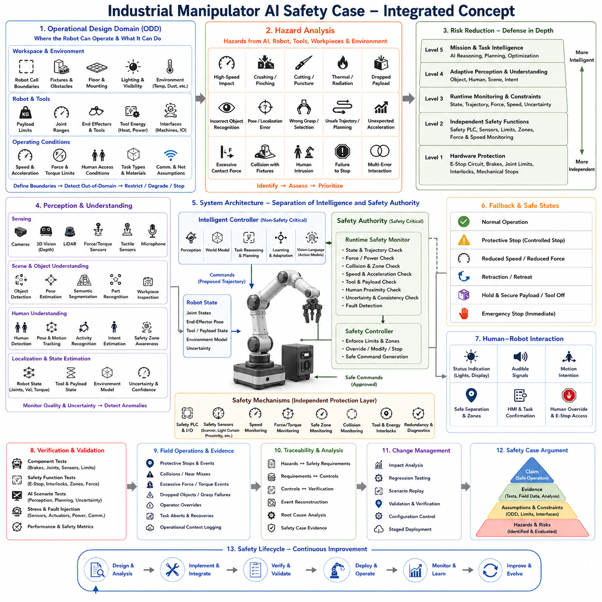{width="7.268055555555556in" height="7.268055555555556in"}

An AI-enabled industrial manipulator combines the high force, speed, precision, and repeatability of industrial robotics with perception, learning, adaptive planning, and autonomous decision-making. This combination expands capability but also changes the safety problem. The robot may alter trajectories, select objects, adapt motions, or respond to environmental changes in ways that cannot be represented completely by a fixed sequence of deterministic commands.

The safety case begins by defining the intended application and operational boundaries. These include the robot workspace, permitted tasks, tools, workpieces, payload limits, joint ranges, velocity and force limits, human-access conditions, environmental assumptions, and interfaces with surrounding machinery. AI functions must also have explicit boundaries describing which decisions they may make autonomously and which safety-critical decisions remain outside their authority.

Traditional industrial robot hazards remain fundamental. High-speed links can create impact hazards, joints can generate crushing and shearing zones, tools can introduce cutting or thermal hazards, and heavy payloads can produce severe consequences if released unexpectedly. AI does not eliminate these hazards. Instead, adaptive behavior can change when and where exposure occurs, requiring the safety analysis to consider both physical hazards and uncertainty in autonomous decision-making.

Hazard analysis should therefore examine failures across perception, reasoning, planning, control, and physical execution. Examples include incorrect object recognition, inaccurate pose estimation, selection of an inappropriate grasp, unsafe trajectory generation, unexpected acceleration, excessive contact force, dropped workpieces, collision with fixtures, human intrusion, and failure to stop. Interactions between several small errors can be more dangerous than a single obvious component failure.

The physical workspace should be divided according to risk and permitted interaction. Traditional fenced cells can isolate hazardous motion, while collaborative applications may allow controlled human access under specific operating conditions. Safety zones can dynamically restrict speed, force, reach, or permitted trajectories as people approach. AI perception may enrich human awareness, but safety-critical protective functions should not depend exclusively on a learned model whose failure characteristics are uncertain.

Human detection illustrates the principle of safety independence. Vision systems may identify workers, estimate poses, recognize activities, and predict intentions, enabling intelligent cooperation. However, independent protective sensing or validated safety mechanisms should retain authority to slow or stop hazardous motion. Rich semantic understanding can improve productivity, while deterministic safety barriers limit the consequences when AI perception becomes uncertain or incorrect.

Manipulator state monitoring must cover joint position, velocity, torque, motor current, tool state, payload, commanded trajectory, and measured motion. Unexpected differences between commanded and observed behavior can indicate actuator faults, controller instability, collisions, calibration errors, or mechanical degradation. Runtime monitoring can detect these deviations and initiate protective responses before they develop into uncontrolled high-energy motion.

Force and power limitation become particularly important when physical interaction with people or uncertain objects is permitted. Joint torque sensing, force-torque sensors, motor current estimation, compliant control, and contact detection can constrain interaction energy. Limits should reflect robot configuration, effective mass, tool geometry, body region exposure, task context, and operating speed rather than treating a single force threshold as universally sufficient.

AI-based perception creates additional uncertainty because industrial environments can change despite appearing highly structured. Lighting variations, reflective surfaces, occlusion, contamination, new workpiece variants, tool changes, clutter, and camera displacement can shift input distributions. Confidence estimation, sensor consistency checks, out-of-distribution monitoring, and explicit uncertainty handling should prevent uncertain perception from being silently converted into confident physical action.

AI planning requires similar supervision. A learned planner, foundation model, or vision-language-action system may generate a plausible manipulation sequence that violates workspace restrictions, process constraints, or safety assumptions. Proposed actions should therefore pass through independent validation before execution. Joint limits, collision constraints, prohibited zones, speed limits, force limits, tool restrictions, and task-specific rules can form an enforceable safety envelope around intelligent planning.

Runtime assurance provides the architectural mechanism for maintaining this separation. The AI controller proposes actions according to task objectives, while an independent safety monitor evaluates whether the resulting state or trajectory remains within validated constraints. If an action violates the safety envelope, a safety controller can reject, modify, or terminate it. Physical authority is therefore constrained even when the intelligence producing the action becomes increasingly general.

Tooling introduces hazards that extend beyond robot motion. Grippers can pinch, welding equipment can generate heat and radiation, cutting tools can cause severe injury, and process tools may contain stored pneumatic, hydraulic, or electrical energy. The safety case must therefore include tool state, energy isolation, attachment integrity, process interlocks, and tool-specific operating restrictions as part of the complete robotic system rather than treating the arm alone.

Workpiece handling introduces another dynamic source of risk. Payload mass, geometry, center of gravity, grasp quality, surface friction, and structural strength affect safe acceleration and trajectory limits. A poorly grasped object can become a projectile even when the manipulator itself remains within its nominal operating envelope. Grasp verification and payload-aware motion constraints should therefore continue after object acquisition and throughout transport and placement.

Fallback behavior should reflect the physical state of the robot and process. Immediate power removal is not always the safest response if the manipulator is supporting a heavy object, holding a hazardous tool, or interacting with process equipment. Depending on the hazard, the minimum-risk condition may require controlled stopping, maintaining holding torque, disabling tool energy, reducing contact force, retracting from a person, securing a payload, or transferring control to an operator.

Emergency stopping remains necessary but should be distinguished from controlled protective responses. A protective stop may preserve power while safely halting motion and maintaining state, whereas an emergency stop addresses conditions requiring rapid hazard reduction. Restart must never occur merely because the triggering signal disappears. Preconditions such as workspace clearance, system health, safe robot configuration, and deliberate authorization should be verified before motion resumes.

Human-robot collaboration requires predictable robot behavior in addition to physical protection. Workers should understand whether the robot intends to approach, grasp, wait, hand over an object, or resume operation. Visual indicators, audible signals, displays, standardized motion cues, and confirmation interfaces reduce ambiguity. Human override should remain available where appropriate, and AI-generated actions should never prevent access to independent emergency intervention mechanisms.

Verification must test both deterministic safety functions and AI-dependent behavior. Traditional tests can measure stopping performance, joint limits, protective zones, force limits, interlocks, and emergency-stop response. AI-focused scenarios should examine perception errors, unfamiliar objects, occlusion, ambiguous instructions, unusual human behavior, planning failures, model uncertainty, timing delays, and combinations of faults that could cause the intelligent controller to request unsafe motion.

Simulation and scenario-based assurance can extend coverage beyond practical physical testing. Digital environments can vary human position, object geometry, sensor noise, lighting, payload properties, controller delays, and AI confidence while injecting faults into perception or planning. Large-scale scenario exploration is especially useful for discovering long-tail combinations where individually acceptable deviations interact and overcome assumptions made during conventional component-level testing.

Physical validation remains indispensable because contact dynamics, structural compliance, tool behavior, friction, vibration, calibration drift, and human reactions are difficult to reproduce perfectly in simulation. Field evidence should record protective stops, collisions or near misses, excessive-force events, dropped objects, AI interventions, perception anomalies, operator overrides, task aborts, and unexpected trajectories together with synchronized system context.

Traceability connects each identified hazard to safety requirements, architectural mechanisms, verification evidence, and operational observations. This relationship becomes particularly important for AI because model behavior can depend on data, configuration, and operating context. Safety evidence should identify not only software versions but also model versions, calibration states, relevant datasets, operating assumptions, safety parameters, and interfaces that define the validated system configuration.

AI and software updates require controlled change management. Replacing a perception model, grasp policy, planner, VLA model, or inference pipeline can modify robot behavior even when mechanical hardware remains unchanged. Impact analysis should determine which safety assumptions may have changed, followed by regression testing, scenario replay, targeted physical validation, configuration control, and staged deployment before the updated system is accepted for production operation.

The industrial manipulator AI safety case demonstrates that advanced intelligence should remain functionally separated from ultimate safety authority. AI can increase flexibility, semantic understanding, adaptation, and productivity, while independent monitoring and deterministic constraints limit its physical consequences. This architecture allows increasingly capable models to influence what the robot attempts without granting them unrestricted authority over how physical energy is applied.

A mature safety case therefore becomes a living assurance framework connecting physical hazards, AI uncertainty, safety requirements, runtime controls, verification results, operational evidence, and configuration history. As industrial manipulators evolve from programmed automation toward adaptive Physical AI, safety must evolve from validating fixed motion sequences toward continuously assuring that changing intelligent behavior remains inside independently enforceable physical boundaries.

AI 기반 산업용 매니퓰레이터(AI-Enabled Industrial Manipulator)는 산업용 로봇의 높은 힘, 속도, 정밀도 및 반복성과 인지(Perception), 학습(Learning), 적응형 계획(Adaptive Planning), 자율적 의사결정(Autonomous Decision-Making)을 결합한다. 이러한 결합은 시스템의 능력을 확장하지만 안전 문제의 특성도 변화시킨다. 로봇은 고정된 결정론적 명령 시퀀스만으로 완전히 표현하기 어려운 방식으로 궤적을 변경하고, 객체를 선택하며, 움직임을 적응시키거나 환경 변화에 대응할 수 있다.

안전 사례(Safety Case)는 의도된 적용 분야와 운용 경계(Operational Boundaries)를 정의하는 것에서 시작한다. 여기에는 로봇 작업 공간, 허용 작업, 도구, 작업물, 적재 한계, 관절 범위, 속도 및 힘 제한, 인간 접근 조건, 환경 가정 및 주변 기계와의 인터페이스가 포함된다. AI 기능 역시 어떤 결정을 자율적으로 수행할 수 있으며 어떤 안전 핵심 의사결정(Safety-Critical Decision)이 AI의 권한 밖에 있는지를 명확하게 정의해야 한다.

기존 산업용 로봇의 위험은 여전히 기본적인 안전 문제이다. 고속으로 움직이는 링크(Link)는 충격 위험을 발생시킬 수 있고, 관절은 압착 및 전단 영역을 형성할 수 있으며, 도구는 절단이나 열적 위험을 발생시킬 수 있다. 또한 무거운 적재물이 예기치 않게 떨어질 경우 심각한 결과를 초래할 수 있다. AI가 이러한 위험을 제거하는 것은 아니다. 오히려 적응형 행동은 위험 노출의 시점과 위치를 변화시킬 수 있으므로 안전 분석은 물리적 위험과 자율 의사결정의 불확실성을 함께 고려해야 한다.

따라서 위험 분석(Hazard Analysis)은 인지, 추론(Reasoning), 계획, 제어 및 물리적 실행 전반에서 발생하는 실패를 검토해야 한다. 대표적인 사례에는 잘못된 객체 인식, 부정확한 자세 추정(Pose Estimation), 부적절한 파지 선택, 위험한 궤적 생성, 예상하지 못한 가속, 과도한 접촉력, 작업물 낙하, 설비와의 충돌, 사람의 작업 영역 침입 및 정지 실패 등이 포함된다. 여러 개의 작은 오류가 상호작용하는 경우 하나의 명확한 구성요소 고장보다 더 위험한 결과를 발생시킬 수 있다.

물리적 작업 공간(Physical Workspace)은 위험 수준과 허용되는 상호작용에 따라 구분되어야 한다. 기존의 펜스형 로봇 셀(Fenced Robot Cell)은 위험한 움직임을 사람으로부터 격리할 수 있으며, 협동 작업(Collaborative Application)에서는 특정 운용 조건에서 제한적인 인간 접근을 허용할 수 있다. 사람이 접근함에 따라 안전 구역(Safety Zone)은 속도, 힘, 도달 범위 또는 허용 궤적을 동적으로 제한할 수 있다. AI 인지는 인간에 대한 이해를 향상시킬 수 있지만 안전 핵심 보호 기능은 고장 특성이 불확실한 학습 모델에만 의존해서는 안 된다.

인간 감지(Human Detection)는 안전 독립성(Safety Independence)의 원칙을 잘 보여준다. 비전 시스템(Vision System)은 작업자를 식별하고, 자세를 추정하고, 활동을 인식하며, 의도를 예측함으로써 지능적인 협업을 가능하게 할 수 있다. 그러나 독립적인 보호 센싱(Protective Sensing) 또는 검증된 안전 메커니즘은 위험한 움직임을 감속하거나 정지시킬 수 있는 권한을 유지해야 한다. 풍부한 의미론적 이해(Semantic Understanding)는 생산성을 향상시키고, 결정론적 안전 장벽(Deterministic Safety Barrier)은 AI 인지가 불확실하거나 잘못되었을 때 발생할 수 있는 결과를 제한한다.

매니퓰레이터 상태 모니터링(Manipulator State Monitoring)은 관절 위치, 속도, 토크, 모터 전류, 도구 상태, 적재물, 명령 궤적 및 실제 측정된 움직임을 포함해야 한다. 명령된 행동과 관측된 행동 사이의 예상하지 못한 차이는 액추에이터 고장, 제어기 불안정, 충돌, 보정 오류 또는 기계적 성능 저하를 나타낼 수 있다. 런타임 모니터링(Runtime Monitoring)은 이러한 편차를 탐지하여 제어되지 않는 고에너지 움직임으로 발전하기 전에 보호 대응을 시작할 수 있다.

사람 또는 불확실한 객체와 물리적 상호작용이 허용되는 경우 힘 및 동력 제한(Force and Power Limitation)이 특히 중요하다. 관절 토크 센싱, 힘-토크 센서(Force-Torque Sensor), 모터 전류 추정, 순응 제어(Compliant Control) 및 접촉 감지는 상호작용 에너지를 제한하는 데 활용될 수 있다. 안전 한계는 하나의 힘 임계값을 모든 상황에 동일하게 적용하기보다 로봇 구성, 유효 질량(Effective Mass), 도구 형상, 노출되는 신체 부위, 작업 상황 및 운용 속도를 반영해야 한다.

AI 기반 인지(AI-Based Perception)는 산업 환경이 구조적으로 보이더라도 변화할 수 있기 때문에 추가적인 불확실성을 발생시킨다. 조명 변화, 반사 표면, 가림(Occlusion), 오염, 새로운 작업물 종류, 도구 변경, 복잡한 작업 공간 및 카메라 위치 변화는 입력 데이터의 분포를 변화시킬 수 있다. 신뢰도 추정(Confidence Estimation), 센서 일관성 검사, 분포 외 감지(Out-of-Distribution Monitoring) 및 명시적인 불확실성 처리를 통해 불확실한 인지 결과가 높은 확신을 가진 물리적 행동으로 직접 변환되는 것을 방지해야 한다.

AI 계획(AI Planning) 역시 유사한 감독을 필요로 한다. 학습 기반 플래너(Learned Planner), 파운데이션 모델(Foundation Model) 또는 비전-언어-행동 시스템(Vision-Language-Action System, VLA)이 생성한 조작 시퀀스가 겉보기에는 타당하더라도 작업 공간 제한, 공정 제약 또는 안전 가정을 위반할 수 있다. 따라서 제안된 행동은 실행 전에 독립적인 검증을 통과해야 한다. 관절 한계, 충돌 제약, 금지 영역, 속도 제한, 힘 제한, 도구 제한 및 작업별 규칙은 지능형 계획을 둘러싸는 강제 가능한 안전 영역(Safety Envelope)을 구성할 수 있다.

런타임 보증(Runtime Assurance)은 이러한 분리를 유지하기 위한 아키텍처적 메커니즘을 제공한다. AI 제어기(AI Controller)는 작업 목표에 따라 행동을 제안하고, 독립적인 안전 모니터(Safety Monitor)는 그 결과로 생성되는 상태나 궤적이 검증된 제약조건 내에 있는지를 평가한다. 행동이 안전 영역을 위반하면 안전 제어기(Safety Controller)는 이를 거부, 수정 또는 종료할 수 있다. 따라서 행동을 생성하는 지능이 점점 범용화되더라도 물리적 권한(Physical Authority)은 제한된다.

툴링(Tooling)은 로봇 움직임 자체를 넘어서는 위험을 발생시킨다. 그리퍼(Gripper)는 끼임을 발생시킬 수 있고, 용접 장비는 열과 방사 위험을 만들 수 있으며, 절삭 도구는 심각한 부상을 초래할 수 있다. 또한 공정 도구는 공압, 유압 또는 전기 형태의 저장 에너지를 포함할 수 있다. 따라서 안전 사례는 로봇 팔만을 대상으로 하지 않고 도구 상태, 에너지 격리(Energy Isolation), 장착 건전성, 공정 인터록(Process Interlock) 및 도구별 운용 제한을 전체 로봇 시스템의 일부로 포함해야 한다.

작업물 취급(Workpiece Handling)은 또 다른 동적인 위험 요소이다. 적재물의 질량, 형상, 무게중심, 파지 품질, 표면 마찰 및 구조적 강도는 안전한 가속도와 궤적 한계에 영향을 준다. 매니퓰레이터 자체가 정상적인 운용 영역 내에 있더라도 제대로 파지되지 않은 객체는 투사체처럼 움직일 수 있다. 따라서 파지 검증(Grasp Verification)과 적재물 인지형 운동 제약(Payload-Aware Motion Constraints)은 객체 획득 이후에도 운반 및 배치가 완료될 때까지 지속되어야 한다.

폴백 동작(Fallback Behavior)은 로봇과 공정의 물리적 상태를 반영해야 한다. 매니퓰레이터가 무거운 객체를 지지하거나, 위험한 도구를 들고 있거나, 공정 장비와 상호작용하고 있다면 즉시 전원을 제거하는 것이 항상 가장 안전한 대응은 아니다. 위험 상황에 따라 최소 위험 상태(Minimum-Risk Condition)는 제어 정지, 유지 토크 유지, 도구 에너지 차단, 접촉력 감소, 사람으로부터의 후퇴, 적재물 고정 또는 운영자에게 제어권을 이전하는 행동을 요구할 수 있다.

비상 정지(Emergency Stop)는 반드시 필요하지만 제어된 보호 대응(Controlled Protective Response)과 구분되어야 한다. 보호 정지(Protective Stop)는 전원을 유지하면서 움직임을 안전하게 정지시키고 상태를 유지할 수 있는 반면, 비상 정지는 신속한 위험 감소가 필요한 상황을 대상으로 한다. 정지를 발생시킨 신호가 사라졌다는 이유만으로 자동 재시작해서는 안 된다. 움직임을 재개하기 전에 작업 공간의 안전 확인, 시스템 상태, 안전한 로봇 구성 및 의도적인 재가동 승인 등의 조건을 확인해야 한다.

인간-로봇 협업(Human-Robot Collaboration)은 물리적 보호뿐만 아니라 예측 가능한 로봇 행동을 요구한다. 작업자는 로봇이 접근하려는지, 파지하려는지, 대기하려는지, 객체를 전달하려는지 또는 운용을 재개하려는지를 이해할 수 있어야 한다. 시각적 표시, 청각 신호, 디스플레이, 표준화된 움직임 신호 및 확인 인터페이스는 모호성을 줄인다. 필요한 경우 인간 재정의(Human Override)를 사용할 수 있어야 하며, AI가 생성한 행동이 독립적인 비상 개입 메커니즘에 대한 접근을 방해해서는 안 된다.

검증(Verification)은 결정론적 안전 기능과 AI 의존 행동을 모두 시험해야 한다. 기존 시험은 정지 성능, 관절 한계, 보호 영역, 힘 제한, 인터록 및 비상 정지 반응을 측정할 수 있다. AI 중심 시나리오는 인지 오류, 익숙하지 않은 객체, 가림, 모호한 명령, 비정상적인 인간 행동, 계획 실패, 모델 불확실성, 타이밍 지연 및 지능형 제어기가 위험한 움직임을 요청하게 만들 수 있는 복합 고장을 검토해야 한다.

시뮬레이션 및 시나리오 기반 보증(Simulation and Scenario-Based Assurance)은 실제 시험에서 구현하기 어려운 영역까지 검증 범위를 확장할 수 있다. 디지털 환경에서 사람 위치, 객체 형상, 센서 잡음, 조명, 적재물 특성, 제어 지연 및 AI 신뢰도를 변화시키면서 인지 또는 계획 기능에 고장을 주입할 수 있다. 대규모 시나리오 탐색은 개별적으로 허용 가능한 편차들이 상호작용하여 기존 구성요소 수준 시험의 가정을 무너뜨리는 롱테일 조합(Long-Tail Combination)을 발견하는 데 특히 유용하다.

물리적 검증(Physical Validation)은 접촉 동역학, 구조적 순응성, 도구 행동, 마찰, 진동, 보정 드리프트(Calibration Drift) 및 인간의 반응을 시뮬레이션에서 완벽하게 재현하기 어렵기 때문에 필수적이다. 현장 증거(Field Evidence)는 보호 정지, 충돌 또는 근접 사고, 과도한 힘 발생, 객체 낙하, AI 개입, 인지 이상, 운영자 재정의, 작업 중단 및 예상하지 못한 궤적을 동기화된 시스템 상황 정보와 함께 기록해야 한다.

추적성(Traceability)은 식별된 각각의 위험을 안전 요구사항, 아키텍처 메커니즘, 검증 증거 및 운용 관찰 결과와 연결한다. AI의 경우 모델 행동이 데이터, 구성 및 운용 상황에 따라 달라질 수 있기 때문에 이러한 관계는 특히 중요하다. 안전 증거는 소프트웨어 버전뿐만 아니라 모델 버전, 보정 상태, 관련 데이터셋, 운용 가정, 안전 파라미터 및 검증된 시스템 구성을 정의하는 인터페이스까지 식별해야 한다.

AI 및 소프트웨어 업데이트에는 통제된 변경 관리(Controlled Change Management)가 필요하다. 인지 모델, 파지 정책, 플래너, VLA 모델 또는 추론 파이프라인(Inference Pipeline)을 교체하면 기계적 하드웨어가 변경되지 않더라도 로봇 행동이 달라질 수 있다. 영향 분석(Impact Analysis)을 통해 어떤 안전 가정이 변경되었는지 판단하고, 이후 회귀 시험(Regression Testing), 시나리오 재실행, 대상 물리 검증, 구성 관리 및 단계적 배포(Staged Deployment)를 수행한 후 업데이트된 시스템을 생산 운용에 승인해야 한다.

산업용 매니퓰레이터 AI 안전 사례(Industrial Manipulator AI Safety Case)는 고도화된 지능과 최종적인 안전 권한이 기능적으로 분리되어야 한다는 것을 보여준다. AI는 유연성, 의미론적 이해, 적응성 및 생산성을 향상시킬 수 있지만 독립적인 모니터링과 결정론적 제약조건은 AI 행동이 초래할 수 있는 물리적 결과를 제한한다. 이러한 아키텍처는 더욱 강력한 모델이 로봇이 무엇을 시도할지에 영향을 줄 수 있도록 하면서도 물리적 에너지를 어떻게 적용할지에 대한 무제한적인 권한은 부여하지 않는다.

따라서 성숙한 안전 사례(Safety Case)는 물리적 위험, AI 불확실성, 안전 요구사항, 런타임 제어, 검증 결과, 운용 증거 및 구성 이력을 연결하는 살아 있는 보증 프레임워크(Living Assurance Framework)가 된다. 산업용 매니퓰레이터가 프로그래밍된 자동화(Programmed Automation)에서 적응형 피지컬 AI(Adaptive Physical AI)로 발전함에 따라 안전 역시 고정된 움직임 시퀀스를 검증하는 방식에서 변화하는 지능형 행동이 독립적으로 강제 가능한 물리적 경계 안에 계속 유지되는지를 지속적으로 보증하는 방식으로 발전해야 한다.

##  

## 09.05. Quadruped Robot Safety Case

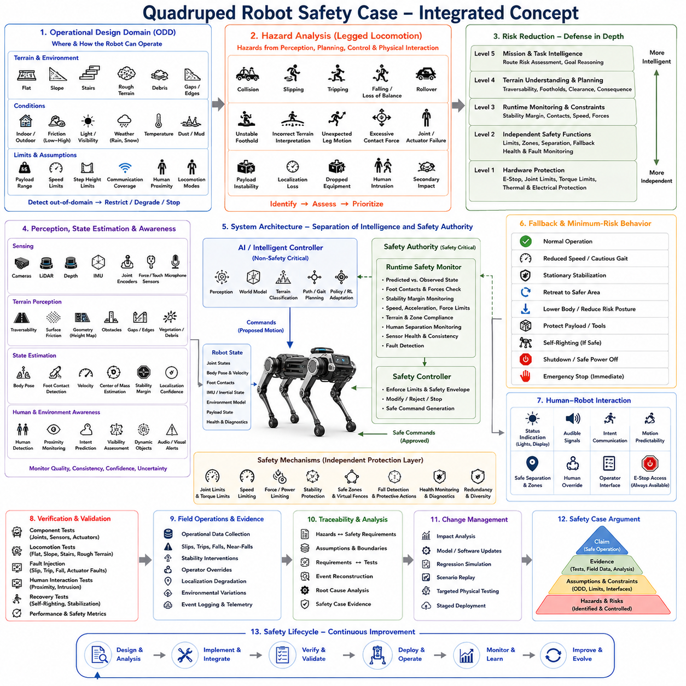{width="7.268055555555556in" height="7.268055555555556in"}

A quadruped robot introduces a distinctive Physical AI safety problem because locomotion depends on continuous dynamic balance rather than a permanently stable wheeled base. The robot must coordinate multiple articulated legs while perceiving terrain, selecting footholds, controlling contact forces, and maintaining body stability. A perception, planning, or control error can therefore produce not only navigation failure but also loss of balance, falling, uncontrolled contact, or secondary hazards to nearby people and equipment.

The safety case begins by defining the Operational Design Domain for legged locomotion. Relevant boundaries include terrain type, slope, stair geometry, surface friction, obstacle height, gaps, payload, environmental conditions, visibility, human proximity, communication coverage, and permitted locomotion modes. The ODD should distinguish ordinary walking from higher-risk behaviors such as stair climbing, stepping over obstacles, traversing irregular terrain, or operating near edges and drop-offs.

Hazard analysis must account for both conventional robotic hazards and locomotion-specific failure modes. Important hazards include collision, slipping, tripping, falling, rollover, unstable footholds, unexpected leg motion, excessive contact force, joint failure, payload instability, localization loss, and incorrect terrain interpretation. A falling quadruped can also create hazards beyond its normal footprint because its body, legs, payload, or attached equipment may strike nearby people or structures.

Terrain understanding is a safety-critical capability because geometric accessibility does not guarantee stable traversal. Loose gravel, wet surfaces, mud, stairs, debris, vegetation, gaps, moving surfaces, and deformable ground can invalidate assumptions used by the locomotion controller. Terrain perception should estimate traversability, surface geometry, friction-related uncertainty, foothold quality, clearance, and potential fall consequences before the robot commits to difficult locomotion.

Foothold selection creates a direct connection between perception and physical stability. A visually plausible foothold may be mechanically unsafe because it is slippery, weak, moving, too small, or incorrectly estimated. The system should therefore evaluate foothold confidence and maintain sufficient alternatives whenever possible. Increasing uncertainty should lead to shorter steps, lower body motion, reduced speed, replanning, retreat, or refusal to enter terrain whose support characteristics cannot be established safely.

Dynamic stability must be monitored continuously rather than assumed from a planned gait. Body orientation, joint states, foot contacts, ground reaction forces, inertial measurements, commanded motion, and estimated center of mass provide evidence about the current stability margin. Unexpected contact loss, excessive body tilt, actuator saturation, or divergence between expected and measured motion can indicate an emerging fall and should trigger rapid stabilization or protective behavior.

Leg and joint motion creates additional human interaction risks. Unlike a wheeled robot whose hazardous motion is concentrated around its chassis, a quadruped repeatedly swings articulated limbs through changing volumes. Feet may strike people, legs can create trapping or pinching regions, and recovery motions can be fast and difficult to predict. Human proximity should therefore constrain gait, step length, joint velocity, body speed, and allowable recovery actions.

Payloads and mounted equipment can significantly alter locomotion safety. Sensors, manipulators, communication equipment, cargo, or other modules change total mass, inertia, center of gravity, body dimensions, and fall consequences. The locomotion system should account for payload configuration when calculating stability and motion limits. Payload movement or poor mounting can create dynamic disturbances even when the underlying terrain would otherwise be safely traversable.

Perception and localization require diversity because quadrupeds frequently operate where conventional navigation assumptions degrade. Cameras, LiDAR, IMUs, joint encoders, contact sensing, GNSS, or other modalities may contribute complementary information. Runtime monitoring should evaluate sensor health, timing, consistency, localization confidence, terrain-model quality, and distribution shift so that degraded environmental understanding produces conservative locomotion rather than unchanged behavior.

Planning must consider the consequences of failure, not merely whether a route is theoretically traversable. A narrow path beside a drop-off may be geometrically feasible but unacceptable if localization or foothold uncertainty is high. Safety-aware planning should account for terrain difficulty, stability margins, recovery space, fall direction, human proximity, communication conditions, and availability of alternative routes when evaluating candidate trajectories.

The separation of intelligent autonomy and safety authority remains fundamental. AI may classify terrain, predict traversability, select routes, reason about missions, or adapt locomotion strategies, but independently enforceable limits should constrain physical execution. Runtime safety mechanisms can supervise body velocity, joint limits, stability margins, terrain boundaries, human separation, actuator health, and forbidden regions regardless of whether commands originate from classical planning or learned models.

Runtime assurance should compare predicted and observed behavior throughout locomotion. Expected foot contacts can be compared with measured contact events, predicted body motion with inertial measurements, and commanded joint trajectories with actual joint states. Increasing disagreement can reveal slipping, unexpected terrain, actuator faults, inaccurate models, or external disturbances. The robot can then reduce motion authority before these deviations develop into unrecoverable instability.

Fall prevention is important, but the safety architecture must also assume that some falls cannot be avoided. Protective strategies may include reducing speed, selecting a safer fall direction, lowering body height, retracting vulnerable equipment, stopping hazardous tools, or protecting payloads when instability becomes unrecoverable. The objective shifts from preserving locomotion to minimizing injury, damage, and secondary hazards when continued upright operation is no longer achievable.

Recovery after a fall requires its own safety logic. Automatically standing up can create large and unpredictable limb motions, particularly in confined spaces or near people. Before initiating self-righting, the robot should assess body orientation, nearby obstacles, human proximity, available clearance, actuator condition, and payload state. If safe recovery cannot be established, the system should remain in a stable state and request human or remote assistance.

Fallback behavior should therefore form a hierarchy rather than relying solely on emergency stopping. Reduced speed may address moderate uncertainty, cautious gait may handle degraded terrain confidence, stationary stabilization may respond to unexpected disturbances, retreat may be appropriate near unsafe terrain, and controlled shutdown may be necessary after critical faults. Each transition should correspond to measurable conditions and a defined minimum-risk objective.

Communication loss must not remove essential local safety capability. Remote operators, fleet systems, or cloud intelligence may support mission planning and supervision, but balance control, obstacle response, stability monitoring, actuator protection, and emergency behavior require local execution. When external communication disappears, the quadruped should complete only actions that remain locally safe and otherwise stop, retreat, or move to a predefined minimum-risk condition.

Human interaction requires clear communication because legged motion may be less predictable to nearby people than wheeled navigation. Body orientation, stepping motions, lights, audible signals, displays, or other interfaces can communicate intent. The robot should avoid sudden gait changes near people and maintain conservative separation. Human override and emergency intervention should remain available without depending on the same AI components responsible for autonomous locomotion.

Verification must combine component, locomotion, and integrated scenario testing. Relevant tests include joint faults, actuator saturation, emergency stopping, slipping, missed footholds, sensor degradation, localization errors, communication loss, payload variation, stair traversal, slopes, uneven terrain, and human intrusion. Testing should also examine transitions between stable walking, degraded locomotion, stabilization, falling, shutdown, and recovery.

Simulation is particularly useful for quadruped safety because dangerous locomotion failures can damage hardware and are difficult to reproduce repeatedly. Terrain geometry, friction, compliance, sensor noise, actuator delay, payload distribution, external disturbances, and foothold errors can be systematically varied. Large-scale simulation can identify combinations that reduce stability margins and reveal rare interactions between perception, locomotion planning, and low-level control.

Physical field testing remains essential because real contact dynamics, surface properties, structural compliance, actuator heating, mechanical wear, and environmental variability are difficult to model perfectly. Operational evidence should record slips, trips, falls, near falls, emergency actions, stability interventions, failed footholds, excessive contact forces, actuator anomalies, localization degradation, human interventions, and successful or unsuccessful recovery attempts.

Traceability connects these events to the safety argument. Hazards should map to explicit requirements, safety mechanisms, test scenarios, acceptance criteria, and operational evidence. Important assumptions such as maximum slope, minimum friction, payload configuration, required localization confidence, acceptable stability margin, and permitted recovery clearance should be recorded so that changes in operating conditions can be recognized as changes to the validated safety case.

Software, learned locomotion policies, terrain models, and hardware configurations require controlled change management. Updating a gait controller, perception network, world model, reinforcement-learning policy, planner, or payload configuration can alter stability behavior in unexpected ways. Impact analysis, regression simulation, scenario replay, targeted physical testing, configuration control, and staged deployment should precede unrestricted operational use.

The quadruped safety case demonstrates that Physical AI safety must address both intelligent decision uncertainty and dynamic physical stability. Increasing autonomy can improve terrain understanding, mission reasoning, and adaptability, but every high-level decision eventually becomes forces applied through articulated contacts with the environment. Independent monitoring and enforceable constraints must therefore limit how uncertain intelligence can influence those physical interactions.

A mature quadruped safety case becomes a living assurance framework connecting the ODD, terrain uncertainty, locomotion hazards, stability constraints, runtime assurance, fallback behavior, verification, field evidence, and configuration history. As legged robots move into increasingly complex environments, safety depends not on guaranteeing that the robot will never stumble or fall, but on detecting deteriorating conditions early, preserving recoverability, and minimizing consequences when failures occur.

4족 보행 로봇(Quadruped Robot)은 이동이 영구적으로 안정된 바퀴형 베이스(Wheeled Base)가 아니라 지속적인 동적 균형(Dynamic Balance)에 의존하기 때문에 피지컬 AI(Physical AI)에 독특한 안전 문제를 제기한다. 로봇은 지형을 인지하고, 발 디딤 위치(Foothold)를 선택하며, 접촉력을 제어하고, 몸체 안정성을 유지하면서 여러 개의 관절형 다리를 동시에 조정해야 한다. 따라서 인지, 계획 또는 제어 오류는 단순한 내비게이션 실패뿐만 아니라 균형 상실, 전도, 제어되지 않은 접촉 또는 주변 사람과 장비에 대한 2차 위험으로 이어질 수 있다.

안전 사례(Safety Case)는 보행 이동(Legged Locomotion)을 위한 운용설계영역(Operational Design Domain, ODD)을 정의하는 것에서 시작한다. 관련 경계에는 지형 유형, 경사도, 계단 형상, 노면 마찰력, 장애물 높이, 틈새, 적재물, 환경 조건, 가시성, 사람과의 근접성, 통신 범위 및 허용된 이동 모드가 포함된다. ODD는 일반 보행과 계단 오르기, 장애물 넘기, 불규칙 지형 통과 또는 가장자리와 낭떠러지 주변 운용과 같은 고위험 행동을 구분해야 한다.

위험 분석(Hazard Analysis)은 일반적인 로봇 위험과 보행 이동에 특화된 고장 형태를 모두 고려해야 한다. 주요 위험에는 충돌, 미끄러짐, 걸려 넘어짐, 전도, 불안정한 발 디딤, 예상하지 못한 다리 움직임, 과도한 접촉력, 관절 고장, 적재물 불안정, 위치추정 상실 및 잘못된 지형 해석이 포함된다. 4족 보행 로봇이 넘어지면 몸체, 다리, 적재물 또는 장착 장비가 주변 사람이나 구조물에 충돌할 수 있으므로 정상적인 로봇 점유 영역을 넘어서는 위험을 발생시킬 수 있다.

지형 이해(Terrain Understanding)는 기하학적으로 접근 가능하다는 사실이 안정적인 이동을 보장하지 않기 때문에 안전 핵심 기능(Safety-Critical Capability)이다. 느슨한 자갈, 젖은 표면, 진흙, 계단, 잔해, 식생, 틈새, 움직이는 표면 및 변형 가능한 지면은 보행 제어기(Locomotion Controller)가 사용하는 가정을 무효화할 수 있다. 지형 인지는 어려운 이동을 시작하기 전에 주행가능성(Traversability), 표면 형상, 마찰 관련 불확실성, 발 디딤 품질, 여유 공간 및 잠재적인 전도 결과를 추정해야 한다.

발 디딤 위치 선택(Foothold Selection)은 인지와 물리적 안정성을 직접적으로 연결한다. 시각적으로 적절해 보이는 발 디딤 위치도 미끄럽거나, 약하거나, 움직이거나, 지나치게 작거나, 잘못 추정되었다면 기계적으로 안전하지 않을 수 있다. 따라서 시스템은 발 디딤 신뢰도(Foothold Confidence)를 평가하고 가능한 경우 충분한 대안을 유지해야 한다. 불확실성이 증가하면 보폭 축소, 몸체 움직임 감소, 감속, 재계획(Replanning), 후퇴 또는 지지 특성을 안전하게 확인할 수 없는 지형으로의 진입 거부로 이어져야 한다.

동적 안정성(Dynamic Stability)은 계획된 보행 패턴(Gait)이 존재한다는 이유로 가정해서는 안 되며 지속적으로 모니터링해야 한다. 몸체 자세, 관절 상태, 발 접촉, 지면 반력(Ground Reaction Force), 관성 측정값, 명령된 움직임 및 추정 무게중심(Center of Mass)은 현재의 안정성 여유(Stability Margin)를 판단하는 근거를 제공한다. 예상하지 못한 접촉 상실, 과도한 몸체 기울기, 액추에이터 포화 또는 예상 움직임과 실제 움직임 사이의 편차는 전도 위험을 나타낼 수 있으며 신속한 안정화 또는 보호 동작을 유발해야 한다.

다리와 관절의 움직임은 사람과의 상호작용에서 추가적인 위험을 발생시킨다. 위험한 움직임이 주로 차체 주변에 집중되는 바퀴형 로봇과 달리 4족 보행 로봇은 관절형 다리를 지속적으로 변화하는 공간으로 스윙(Swing)한다. 발이 사람과 충돌할 수 있고 다리가 끼임이나 압착 영역을 만들 수 있으며, 자세 복구 움직임은 빠르고 예측하기 어려울 수 있다. 따라서 사람과의 근접성은 보행 패턴, 보폭, 관절 속도, 몸체 속도 및 허용 가능한 복구 동작을 제한해야 한다.

적재물과 장착 장비(Payloads and Mounted Equipment)는 보행 안전성을 크게 변화시킬 수 있다. 센서, 매니퓰레이터, 통신 장비, 화물 또는 기타 모듈은 전체 질량, 관성, 무게중심, 몸체 크기 및 전도 시 결과를 변화시킨다. 보행 시스템은 안정성과 움직임 한계를 계산할 때 적재 구성을 고려해야 한다. 적재물의 움직임이나 불완전한 장착은 기본 지형 자체는 안전하게 통과할 수 있는 경우에도 동적인 외란(Dynamic Disturbance)을 발생시킬 수 있다.

인지 및 위치추정(Perception and Localization)은 4족 보행 로봇이 기존 내비게이션 가정이 약화되는 환경에서 자주 운용되기 때문에 다양한 센서 정보가 필요하다. 카메라, 라이다(LiDAR), 관성측정장치(IMU), 관절 인코더, 접촉 센싱, 위성항법시스템(GNSS) 등의 센서가 상호 보완적인 정보를 제공할 수 있다. 런타임 모니터링(Runtime Monitoring)은 센서 상태, 타이밍, 일관성, 위치추정 신뢰도, 지형 모델 품질 및 분포 변화(Distribution Shift)를 평가하여 환경 이해가 저하되었을 때 기존 행동을 유지하는 대신 보수적인 이동을 수행하도록 해야 한다.

계획(Planning)은 단순히 경로가 이론적으로 통과 가능한지만 판단하는 것이 아니라 실패했을 때의 결과까지 고려해야 한다. 낭떠러지 옆의 좁은 경로는 기하학적으로 이동 가능하더라도 위치추정 또는 발 디딤 불확실성이 높다면 허용할 수 없을 수 있다. 안전 인지형 계획(Safety-Aware Planning)은 후보 궤적을 평가할 때 지형 난이도, 안정성 여유, 복구 공간, 전도 방향, 사람과의 근접성, 통신 상태 및 대체 경로의 존재 여부를 고려해야 한다.

지능형 자율성(Intelligent Autonomy)과 안전 권한(Safety Authority)의 분리는 여전히 핵심적인 원칙이다. AI는 지형을 분류하고, 주행가능성을 예측하고, 경로를 선택하고, 임무를 추론하거나 보행 전략을 적응시킬 수 있지만 독립적으로 강제 가능한 제한이 물리적 실행을 제약해야 한다. 런타임 안전 메커니즘(Runtime Safety Mechanism)은 명령이 기존 플래너 또는 학습 모델 중 어디에서 생성되었는지와 관계없이 몸체 속도, 관절 한계, 안정성 여유, 지형 경계, 사람과의 분리 거리, 액추에이터 상태 및 금지 영역을 감독할 수 있어야 한다.

런타임 보증(Runtime Assurance)은 보행 과정 전체에서 예측된 행동과 실제 관측된 행동을 비교해야 한다. 예상된 발 접촉은 실제 접촉 이벤트와 비교하고, 예측된 몸체 움직임은 관성 측정값과 비교하며, 명령된 관절 궤적은 실제 관절 상태와 비교할 수 있다. 불일치가 증가하면 미끄러짐, 예상하지 못한 지형, 액추에이터 고장, 부정확한 모델 또는 외부 외란을 나타낼 수 있다. 로봇은 이러한 편차가 회복 불가능한 불안정성으로 발전하기 전에 움직임 권한(Motion Authority)을 감소시킬 수 있어야 한다.

전도 방지(Fall Prevention)는 중요하지만 안전 아키텍처(Safety Architecture)는 일부 전도를 피할 수 없다는 상황도 가정해야 한다. 보호 전략에는 감속, 더 안전한 전도 방향 선택, 몸체 높이 감소, 취약 장비 수납, 위험 도구 정지 또는 불안정성이 회복 불가능해질 때 적재물을 보호하는 행동이 포함될 수 있다. 이 단계에서 목표는 보행을 유지하는 것에서 정상적인 직립 운용을 더 이상 유지할 수 없을 때 부상, 손상 및 2차 위험을 최소화하는 것으로 전환된다.

전도 이후의 복구(Recovery After a Fall)에는 별도의 안전 로직이 필요하다. 자동으로 일어서는 자기 복구(Self-Righting)는 특히 제한된 공간이나 사람 근처에서 크고 예측하기 어려운 다리 움직임을 발생시킬 수 있다. 자기 복구를 시작하기 전에 로봇은 몸체 자세, 주변 장애물, 사람과의 근접성, 사용 가능한 여유 공간, 액추에이터 상태 및 적재물 상태를 평가해야 한다. 안전한 복구 조건을 확보할 수 없다면 안정된 상태를 유지하면서 사람 또는 원격 운영자의 지원을 요청해야 한다.

따라서 폴백 동작(Fallback Behavior)은 비상 정지에만 의존하지 않고 계층 구조를 형성해야 한다. 감속은 중간 수준의 불확실성에 대응할 수 있고, 주의 보행(Cautious Gait)은 지형 신뢰도 저하에 대응할 수 있으며, 정지 상태 안정화(Stationary Stabilization)는 예상하지 못한 외란에 대응할 수 있다. 위험 지형 주변에서는 후퇴가 적절할 수 있으며, 심각한 고장 이후에는 제어 종료(Controlled Shutdown)가 필요할 수 있다. 각각의 전환은 측정 가능한 조건과 정의된 최소 위험 목표(Minimum-Risk Objective)에 대응해야 한다.

통신 손실(Communication Loss)이 필수적인 로컬 안전 기능을 제거해서는 안 된다. 원격 운영자, 플릿 시스템(Fleet System) 또는 클라우드 지능(Cloud Intelligence)은 임무 계획과 감독을 지원할 수 있지만 균형 제어, 장애물 대응, 안정성 모니터링, 액추에이터 보호 및 비상 행동은 로컬에서 실행되어야 한다. 외부 통신이 사라지면 4족 보행 로봇은 로컬에서 안전성이 확보된 행동만 완료하고, 그렇지 않은 경우 정지하거나 후퇴하거나 사전에 정의된 최소 위험 상태로 이동해야 한다.

인간 상호작용(Human Interaction)은 보행형 움직임이 주변 사람에게 바퀴형 내비게이션보다 예측하기 어려울 수 있기 때문에 명확한 의사소통을 요구한다. 몸체 방향, 발걸음 동작, 조명, 청각 신호, 디스플레이 또는 기타 인터페이스를 통해 로봇의 의도를 전달할 수 있다. 로봇은 사람 주변에서 갑작스러운 보행 패턴 변화를 피하고 보수적인 분리 거리를 유지해야 한다. 인간 재정의(Human Override)와 비상 개입은 자율 보행을 담당하는 동일한 AI 구성요소에 의존하지 않고 사용할 수 있어야 한다.

검증(Verification)은 구성요소 시험, 보행 시험 및 통합 시나리오 시험을 결합해야 한다. 관련 시험에는 관절 고장, 액추에이터 포화, 비상 정지, 미끄러짐, 발 디딤 실패, 센서 성능 저하, 위치추정 오류, 통신 손실, 적재물 변화, 계단 이동, 경사면, 불규칙 지형 및 사람의 갑작스러운 진입 등이 포함된다. 또한 안정적인 보행, 성능 저하 이동, 자세 안정화, 전도, 시스템 종료 및 복구 사이의 상태 전환도 시험해야 한다.

시뮬레이션(Simulation)은 위험한 보행 실패가 하드웨어를 손상시킬 수 있고 반복적으로 재현하기 어렵기 때문에 4족 보행 로봇의 안전성 검증에 특히 유용하다. 지형 형상, 마찰, 순응성(Compliance), 센서 잡음, 액추에이터 지연, 적재물 분포, 외부 외란 및 발 디딤 오류를 체계적으로 변화시킬 수 있다. 대규모 시뮬레이션은 안정성 여유를 감소시키는 조합을 식별하고 인지, 보행 계획 및 저수준 제어(Low-Level Control) 사이에서 발생하는 희귀한 상호작용을 발견할 수 있다.

실제 현장 시험(Physical Field Testing)은 실제 접촉 동역학, 표면 특성, 구조적 순응성, 액추에이터 발열, 기계적 마모 및 환경 변동성을 완벽하게 모델링하기 어렵기 때문에 필수적이다. 운용 증거(Operational Evidence)는 미끄러짐, 걸림, 전도, 전도 직전 상황, 비상 동작, 안정성 개입, 발 디딤 실패, 과도한 접촉력, 액추에이터 이상, 위치추정 성능 저하, 인간 개입 및 성공하거나 실패한 복구 시도를 기록해야 한다.

추적성(Traceability)은 이러한 이벤트를 안전 논증(Safety Argument)과 연결한다. 위험은 명시적인 요구사항, 안전 메커니즘, 시험 시나리오, 수용 기준(Acceptance Criteria) 및 운용 증거와 연결되어야 한다. 최대 경사도, 최소 마찰력, 적재물 구성, 요구되는 위치추정 신뢰도, 허용 가능한 안정성 여유 및 복구에 필요한 최소 여유 공간과 같은 중요한 가정을 기록함으로써 운용 조건의 변화가 검증된 안전 사례의 변경임을 식별할 수 있어야 한다.

소프트웨어, 학습 기반 보행 정책(Learned Locomotion Policy), 지형 모델 및 하드웨어 구성에는 통제된 변경 관리(Controlled Change Management)가 필요하다. 보행 제어기, 인지 네트워크, 월드 모델(World Model), 강화학습 정책(Reinforcement-Learning Policy), 플래너 또는 적재 구성을 업데이트하면 예상하지 못한 방식으로 안정성 행동이 변화할 수 있다. 영향 분석, 회귀 시뮬레이션(Regression Simulation), 시나리오 재실행, 대상 물리 시험, 구성 관리 및 단계적 배포(Staged Deployment)를 거친 후에 제한 없는 실제 운용을 허용해야 한다.

4족 보행 로봇 안전 사례(Quadruped Robot Safety Case)는 피지컬 AI 안전이 지능형 의사결정의 불확실성과 동적 물리 안정성(Dynamic Physical Stability)을 모두 다루어야 한다는 것을 보여준다. 자율성 향상은 지형 이해, 임무 추론 및 적응성을 개선할 수 있지만 모든 상위 수준 의사결정은 결국 관절형 다리가 환경과 접촉하면서 발생시키는 물리적 힘으로 변환된다. 따라서 독립적인 모니터링과 강제 가능한 제약조건은 불확실한 지능이 이러한 물리적 상호작용에 미칠 수 있는 영향을 제한해야 한다.

성숙한 4족 보행 로봇 안전 사례는 운용설계영역(ODD), 지형 불확실성, 보행 위험, 안정성 제약조건, 런타임 보증, 폴백 행동, 검증, 현장 증거 및 구성 이력을 연결하는 살아 있는 보증 프레임워크(Living Assurance Framework)가 된다. 보행 로봇이 점점 더 복잡한 환경으로 확장될수록 안전의 핵심은 로봇이 절대로 미끄러지거나 넘어지지 않는 것을 보장하는 것이 아니라, 악화되는 조건을 조기에 감지하고 회복 가능성(Recoverability)을 유지하며 실패가 발생했을 때 그 결과를 최소화하는 데 있다.

##  

## 09.06. Humanoid Robot Safety Case

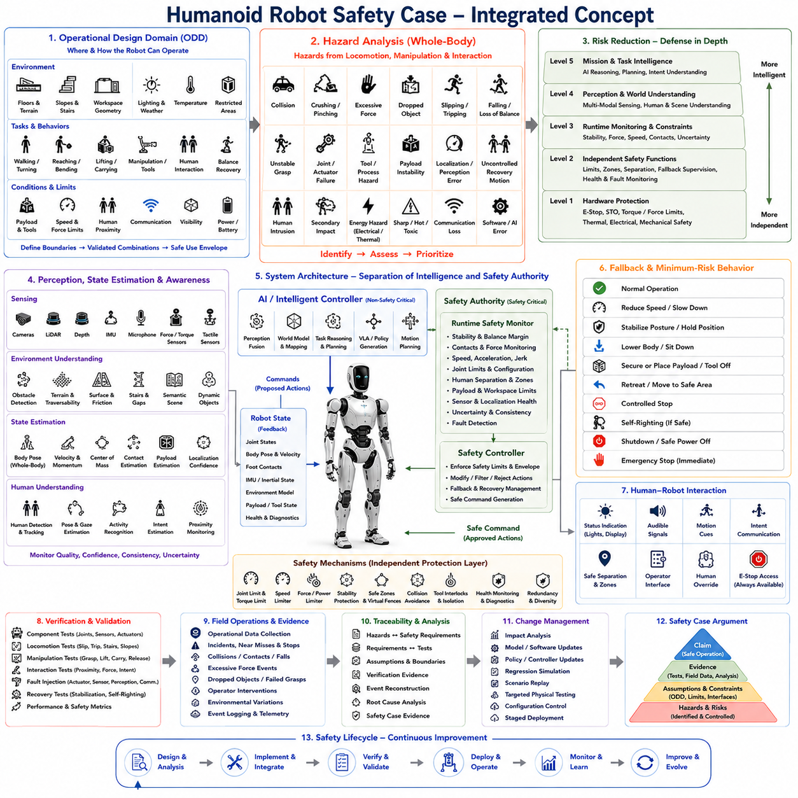{width="7.268055555555556in" height="7.268055555555556in"}

A humanoid robot creates one of the most demanding safety cases in Physical AI because it combines dynamic locomotion, whole-body manipulation, human-scale reach, substantial actuator power, and increasingly general autonomous intelligence. Unlike robots designed around a single constrained task, a humanoid may walk, turn, reach, lift, carry, manipulate tools, recover balance, and interact directly with people. Safety must therefore address continuously changing whole-body physical authority.

The safety case begins with a clearly bounded Operational Design Domain. Relevant conditions include permitted floors and terrain, slopes, stairs, workspace geometry, environmental conditions, payloads, tools, locomotion modes, manipulation tasks, human proximity, speed, force, communication availability, and restricted areas. The ODD should also define which combinations of walking, reaching, carrying, tool use, and human interaction have actually been validated for autonomous execution.

Hazard analysis must consider the humanoid as an integrated articulated system rather than separately evaluating its legs, arms, torso, and hands. Hazards include collision, crushing, pinching, excessive contact force, unstable grasping, dropped objects, slipping, tripping, falling, uncontrolled recovery motion, joint faults, localization errors, and unsafe tool operation. Failures can propagate across the body because a manipulation disturbance may destabilize locomotion and a balance correction may create an arm collision.

Whole-body stability is fundamental because many humanoid tasks continuously change the center of mass and support configuration. Walking, bending, reaching, lifting, pushing, carrying, or using tools alters balance margins and ground reaction forces. Safety monitoring should therefore consider body pose, support contacts, joint states, momentum, center-of-mass motion, payload configuration, and external forces rather than assuming that a planned posture remains dynamically stable during execution.

A humanoid fall has consequences that differ from those of smaller or lower-profile robots. The body can strike people, furniture, machinery, or infrastructure across a large volume, while carried objects or tools can create secondary impacts. Fall prevention should therefore be complemented by fall consequence mitigation. When balance becomes unrecoverable, the robot may need to reduce momentum, protect nearby humans, control fall direction, release hazardous energy, or move vulnerable equipment into safer configurations.

Human proximity is particularly important because humanoids are designed to operate in spaces originally created for people. Their human-like size and reach allow them to approach workstations, doors, shelves, equipment, and coworkers, but also create overlapping physical workspaces. Safety constraints should dynamically regulate walking speed, arm velocity, contact force, reach, and permitted motions according to separation distance, task context, body configuration, and uncertainty.

Perception must support whole-body interaction at several spatial scales. Navigation requires understanding free space, terrain, stairs, obstacles, and people, while manipulation requires accurate object pose, surface geometry, grasp points, tools, and human body regions. Humanoid behavior also benefits from semantic scene understanding and activity recognition. Errors at any scale can propagate into physical action, making confidence, consistency, and uncertainty monitoring essential parts of the safety architecture.

Human understanding should not be treated as equivalent to safety-rated human protection. AI may estimate pose, gaze, motion, activity, or intent to improve cooperation, but these predictions remain uncertain. Independent protective mechanisms should retain authority to constrain hazardous motion. Semantic intelligence can help the humanoid anticipate human behavior, while validated safety functions establish physical limits that remain effective when the AI interpretation is incomplete or incorrect.

Manipulation introduces risks throughout the complete object-handling cycle. The robot must verify that an object can be grasped, lifted, carried, and released without exceeding payload, stability, force, or workspace constraints. Object mass, geometry, center of gravity, fragility, temperature, sharpness, and grasp quality may change the acceptable motion envelope. A successful grasp is therefore not the end of safety evaluation but the beginning of payload-dependent whole-body supervision.

Tool use extends the safety problem beyond the humanoid\'s own actuators. A tool may introduce cutting, thermal, electrical, pneumatic, impact, or stored-energy hazards. The safety case should define which tools are permitted, how they are identified, how attachment is verified, which operating states are allowed, and how tool energy is isolated. Intelligent task planning should never bypass independent tool interlocks or process-specific safety constraints.

Planning must coordinate locomotion, posture, manipulation, and interaction as a single whole-body problem. A hand trajectory that appears collision-free may require an unstable torso posture, while a safe walking path may become unsafe when carrying a large object that blocks perception. Candidate actions should therefore be evaluated for collision, stability, reachability, joint limits, human separation, payload constraints, visibility, contact forces, and recovery options before physical execution.

The separation of intelligent autonomy and safety authority becomes especially important as humanoids adopt foundation models, world models, and Vision-Language-Action systems. These models may interpret natural-language instructions and generate complex multi-step behaviors, but they should not possess unrestricted physical authority. Independent mechanisms must enforce joint, speed, force, workspace, stability, tool, and human-separation limits regardless of how sophisticated the task reasoning becomes.

Runtime assurance provides continuous supervision between intelligent decisions and physical execution. The system can compare commanded and measured joint motion, expected and observed contacts, predicted and measured body dynamics, planned and actual object motion, and estimated versus observed environmental state. Growing disagreement may indicate perception error, slipping, unexpected contact, actuator degradation, incorrect payload estimation, or model failure and should reduce permitted autonomy.

Contact and force monitoring are essential because humanoids may intentionally touch people, objects, doors, furniture, tools, or industrial equipment. Joint torque sensing, force-torque sensors, tactile sensing, motor-current monitoring, and compliant control can identify unexpected resistance or excessive interaction energy. Responses can include slowing, stopping, reducing force, releasing contact, modifying posture, or retreating according to the task and the physical consequences of each option.

Fallback behavior must account for whole-body configuration rather than relying on a universal emergency stop. A humanoid carrying a heavy object, standing on stairs, maintaining balance after a disturbance, or holding a powered tool may require different minimum-risk responses. Appropriate actions can include reducing speed, stabilizing posture, securing or placing a payload, disabling tool energy, retreating, sitting or lowering the body, controlled stopping, or requesting human assistance.

Emergency stopping remains an essential independent protection, but stopping articulated motion must consider stability. Abruptly removing actuator effort can itself create a fall in some configurations. The safety architecture should distinguish protective stopping, controlled stabilization, safe torque behavior, and emergency intervention according to the hazard. Restart should require verification of robot posture, surrounding clearance, system health, tool state, and deliberate authorization.

Fall recovery and self-righting require dedicated safety logic because recovery can involve large, rapid movements of the arms, legs, and torso. Before attempting to stand, the humanoid should evaluate its orientation, available clearance, nearby people, obstacles, payloads, tools, actuator health, and environmental support. When safe autonomous recovery cannot be demonstrated, maintaining a stable state and requesting assistance may be preferable to attempting an uncertain self-righting maneuver.

Communication loss should not remove essential local safety functions. Cloud services, fleet systems, remote operators, or external AI may support semantic reasoning and mission coordination, but balance control, collision avoidance, force limitation, actuator protection, protective stopping, and emergency functions must remain locally available. Loss of connectivity should reduce mission capability rather than compromise the robot\'s ability to reach and maintain a minimum-risk condition.

Human-robot interaction also requires behavioral predictability. A humanoid\'s human-like morphology can encourage people to interpret its movements socially, creating expectations that may exceed its actual understanding. Clear lights, sounds, displays, deliberate motion cues, conservative approach behavior, and explicit task confirmation can reduce ambiguity. The robot should communicate limitations as clearly as intentions and should avoid movements that unexpectedly invade human personal or working space.

Verification must combine locomotion, manipulation, interaction, and whole-body scenario testing. Relevant tests include slipping, tripping, balance disturbances, joint faults, failed grasps, dropped objects, excessive contact forces, perception degradation, localization errors, human intrusion, tool faults, communication loss, and emergency intervention. Tests should also evaluate transitions among walking, reaching, carrying, stabilization, protective stopping, falling, shutdown, and recovery.

Simulation is especially valuable because the humanoid\'s high-dimensional body creates an enormous scenario space. Human motion, terrain, friction, payload, object pose, sensor error, actuator delay, contact conditions, and task sequences can be systematically varied. Large-scale simulation and fault injection can reveal rare combinations where individually manageable uncertainties interact across perception, reasoning, locomotion, manipulation, and control to create unsafe whole-body behavior.

Physical testing remains indispensable for validating contact dynamics, balance recovery, structural compliance, actuator behavior, grasp stability, tool interaction, and human responses. Operational evidence should record falls, near falls, collisions, excessive-force events, protective stops, dropped objects, failed grasps, operator interventions, AI command rejections, perception anomalies, tool faults, and recovery attempts with synchronized whole-system telemetry.

Traceability should connect every significant hazard with requirements, independent controls, verification procedures, acceptance criteria, and operational evidence. For humanoids, assumptions crossing subsystem boundaries are particularly important. Required floor friction, payload limits, balance margins, localization confidence, human separation, tool state, model version, and permitted combinations of locomotion and manipulation should remain identifiable within the validated configuration.

AI, software, hardware, and learned-policy updates require controlled change management. Updating a perception model, world model, VLA system, locomotion policy, manipulation policy, controller, tool, or payload configuration can alter behavior throughout the body. Impact analysis, regression simulation, scenario replay, targeted physical validation, configuration control, and staged deployment should therefore precede unrestricted use of a modified humanoid system.

The humanoid safety case demonstrates the central challenge of advanced Physical AI: increasingly general intelligence is connected to an increasingly general physical body. Reasoning may become flexible and adaptive, but physical consequences remain governed by forces, momentum, contact, stability, and human vulnerability. Safety therefore requires independent mechanisms that continuously constrain how intelligent decisions are translated into whole-body physical action.

A mature humanoid safety case becomes a living assurance framework connecting the ODD, whole-body hazards, AI uncertainty, dynamic stability, human interaction, runtime assurance, fallback behavior, verification, field evidence, and configuration history. The objective is not to assume perfect perception or flawless reasoning, but to ensure that uncertainty is detected, physical authority remains bounded, recoverability is preserved, and failures progress toward controlled minimum-risk outcomes.

휴머노이드 로봇(Humanoid Robot)은 동적 보행(Dynamic Locomotion), 전신 조작(Whole-Body Manipulation), 인간 수준의 도달 범위, 상당한 액추에이터 출력 및 점점 더 범용화되는 자율 지능(Autonomous Intelligence)을 결합하기 때문에 피지컬 AI(Physical AI)에서 가장 까다로운 안전 사례 중 하나를 형성한다. 단일한 제한 작업을 중심으로 설계된 로봇과 달리 휴머노이드는 걷기, 회전, 뻗기, 들어 올리기, 운반, 도구 조작, 균형 회복 및 사람과의 직접적인 상호작용을 수행할 수 있다. 따라서 안전은 지속적으로 변화하는 전신의 물리적 권한(Whole-Body Physical Authority)을 다루어야 한다.

안전 사례(Safety Case)는 명확하게 한정된 운용설계영역(Operational Design Domain, ODD)을 정의하는 것에서 시작한다. 관련 조건에는 허용되는 바닥과 지형, 경사면, 계단, 작업 공간 형상, 환경 조건, 적재물, 도구, 보행 모드, 조작 작업, 사람과의 근접성, 속도, 힘, 통신 가용성 및 제한 구역이 포함된다. ODD는 또한 걷기, 팔 뻗기, 운반, 도구 사용 및 인간 상호작용의 어떤 조합이 실제로 자율 실행을 위해 검증되었는지를 정의해야 한다.

위험 분석(Hazard Analysis)은 다리, 팔, 몸통 및 손을 개별적으로 평가하는 대신 휴머노이드를 하나의 통합된 관절형 시스템(Articulated System)으로 고려해야 한다. 위험에는 충돌, 압착, 끼임, 과도한 접촉력, 불안정한 파지, 객체 낙하, 미끄러짐, 걸림, 전도, 제어되지 않은 복구 동작, 관절 고장, 위치추정 오류 및 위험한 도구 작동 등이 포함된다. 조작 중 발생한 외란이 보행 안정성을 무너뜨리거나 균형 회복 동작이 팔의 충돌을 발생시키는 것처럼 고장은 신체 전체에 걸쳐 전파될 수 있다.

전신 안정성(Whole-Body Stability)은 많은 휴머노이드 작업이 무게중심(Center of Mass)과 지지 상태를 지속적으로 변화시키기 때문에 핵심적인 요소이다. 걷기, 몸 굽히기, 팔 뻗기, 들어 올리기, 밀기, 운반 또는 도구 사용은 균형 여유(Balance Margin)와 지면 반력(Ground Reaction Force)을 변화시킨다. 따라서 안전 모니터링은 계획된 자세가 실행 중에도 동적으로 안정적이라고 가정하기보다 몸체 자세, 지지 접촉, 관절 상태, 운동량, 무게중심 움직임, 적재물 구성 및 외력을 함께 고려해야 한다.

휴머노이드의 전도(Fall)는 소형 또는 낮은 차체를 가진 로봇과 다른 결과를 발생시킨다. 몸체가 넓은 공간에 걸쳐 사람, 가구, 기계 또는 기반시설과 충돌할 수 있으며, 운반 중인 객체나 도구가 2차 충격을 발생시킬 수도 있다. 따라서 전도 방지(Fall Prevention)는 전도 결과 완화(Fall Consequence Mitigation)와 함께 고려되어야 한다. 균형 회복이 불가능해지면 로봇은 운동량을 감소시키고, 주변 사람을 보호하며, 전도 방향을 제어하고, 위험 에너지를 제거하거나 취약한 장비를 더 안전한 상태로 전환해야 할 수 있다.

인간 근접성(Human Proximity)은 휴머노이드가 원래 사람을 위해 설계된 공간에서 운용되기 때문에 특히 중요하다. 인간과 유사한 크기와 도달 범위는 작업대, 문, 선반, 장비 및 동료 작업자에게 접근할 수 있도록 하지만 동시에 사람과 로봇의 물리적 작업 공간을 중첩시킨다. 따라서 안전 제약조건은 분리 거리, 작업 상황, 신체 구성 및 불확실성에 따라 보행 속도, 팔 속도, 접촉력, 도달 범위 및 허용 움직임을 동적으로 제한해야 한다.

인지(Perception)는 여러 공간 규모에서 전신 상호작용(Whole-Body Interaction)을 지원해야 한다. 내비게이션은 자유 공간, 지형, 계단, 장애물 및 사람을 이해해야 하며, 조작은 정확한 객체 자세, 표면 형상, 파지 지점, 도구 및 인체 영역을 인식해야 한다. 휴머노이드 행동은 의미론적 장면 이해(Semantic Scene Understanding)와 활동 인식(Activity Recognition)의 도움도 받을 수 있다. 어떤 규모에서든 발생한 오류는 물리적 행동으로 전파될 수 있으므로 신뢰도, 일관성 및 불확실성 모니터링이 안전 아키텍처의 필수 요소가 된다.

인간 이해(Human Understanding)를 안전 등급의 인간 보호(Safety-Rated Human Protection)와 동일하게 취급해서는 안 된다. AI는 협업을 개선하기 위해 사람의 자세, 시선, 움직임, 활동 또는 의도를 추정할 수 있지만 이러한 예측에는 불확실성이 존재한다. 독립적인 보호 메커니즘(Independent Protective Mechanism)은 위험한 움직임을 제한할 수 있는 권한을 유지해야 한다. 의미론적 지능(Semantic Intelligence)은 휴머노이드가 인간 행동을 예측하도록 지원할 수 있지만, 검증된 안전 기능은 AI의 해석이 불완전하거나 잘못되더라도 유효한 물리적 한계를 설정해야 한다.

조작(Manipulation)은 객체 취급의 전체 주기에 걸쳐 위험을 발생시킨다. 로봇은 객체가 적재 한계, 안정성, 힘 또는 작업 공간 제약을 초과하지 않으면서 파지, 인양, 운반 및 해제될 수 있는지를 검증해야 한다. 객체의 질량, 형상, 무게중심, 취약성, 온도, 날카로움 및 파지 품질은 허용 가능한 움직임 영역(Motion Envelope)을 변화시킬 수 있다. 따라서 성공적인 파지는 안전 평가의 종료가 아니라 적재물 의존형 전신 감독(Payload-Dependent Whole-Body Supervision)의 시작이다.

도구 사용(Tool Use)은 안전 문제를 휴머노이드 자체의 액추에이터를 넘어 확장한다. 도구는 절단, 열, 전기, 공압, 충격 또는 저장 에너지와 관련된 위험을 발생시킬 수 있다. 안전 사례는 어떤 도구가 허용되는지, 도구를 어떻게 식별하는지, 장착 상태를 어떻게 검증하는지, 어떤 작동 상태가 허용되는지, 도구 에너지를 어떻게 격리하는지를 정의해야 한다. 지능형 작업 계획(Intelligent Task Planning)은 독립적인 도구 인터록(Tool Interlock)이나 공정별 안전 제약조건을 우회해서는 안 된다.

계획(Planning)은 보행, 자세, 조작 및 상호작용을 하나의 전신 문제로 통합하여 조정해야 한다. 충돌이 없어 보이는 손의 궤적이 불안정한 몸통 자세를 요구할 수 있으며, 안전한 보행 경로도 큰 객체를 운반하여 센서 시야가 가려지면 위험해질 수 있다. 따라서 후보 행동은 물리적 실행 전에 충돌, 안정성, 도달 가능성, 관절 한계, 사람과의 분리 거리, 적재물 제약, 가시성, 접촉력 및 복구 가능성을 기준으로 평가되어야 한다.

지능형 자율성(Intelligent Autonomy)과 안전 권한(Safety Authority)의 분리는 휴머노이드에 파운데이션 모델(Foundation Model), 월드 모델(World Model), 비전-언어-행동 시스템(Vision-Language-Action System, VLA)이 적용될수록 더욱 중요해진다. 이러한 모델은 자연어 명령을 해석하고 복잡한 다단계 행동을 생성할 수 있지만 무제한적인 물리적 권한을 가져서는 안 된다. 작업 추론이 아무리 고도화되더라도 독립적인 메커니즘이 관절, 속도, 힘, 작업 공간, 안정성, 도구 및 인간 분리 거리의 한계를 강제해야 한다.

런타임 보증(Runtime Assurance)은 지능형 의사결정과 물리적 실행 사이에서 지속적인 감독 기능을 제공한다. 시스템은 명령된 관절 움직임과 측정된 움직임, 예상 접촉과 실제 접촉, 예측된 몸체 동역학과 측정된 동역학, 계획된 객체 움직임과 실제 객체 움직임, 추정된 환경 상태와 관측된 환경 상태를 비교할 수 있다. 불일치가 증가하면 인지 오류, 미끄러짐, 예상하지 못한 접촉, 액추에이터 성능 저하, 잘못된 적재물 추정 또는 모델 실패를 의미할 수 있으며 허용되는 자율성을 감소시켜야 한다.

접촉 및 힘 모니터링(Contact and Force Monitoring)은 휴머노이드가 사람, 객체, 문, 가구, 도구 또는 산업 장비와 의도적으로 접촉할 수 있기 때문에 필수적이다. 관절 토크 센싱, 힘-토크 센서(Force-Torque Sensor), 촉각 센싱(Tactile Sensing), 모터 전류 모니터링 및 순응 제어(Compliant Control)를 통해 예상하지 못한 저항이나 과도한 상호작용 에너지를 탐지할 수 있다. 대응 행동에는 작업과 각 선택의 물리적 결과에 따라 감속, 정지, 힘 감소, 접촉 해제, 자세 수정 또는 후퇴가 포함될 수 있다.

폴백 동작(Fallback Behavior)은 모든 상황에 동일한 비상 정지를 적용하기보다 전신 구성(Whole-Body Configuration)을 고려해야 한다. 무거운 객체를 운반하거나, 계단 위에 서 있거나, 외란 이후 균형을 유지하거나, 동력 도구를 들고 있는 휴머노이드는 서로 다른 최소 위험 대응(Minimum-Risk Response)을 요구할 수 있다. 적절한 행동에는 감속, 자세 안정화, 적재물 고정 또는 안전한 배치, 도구 에너지 차단, 후퇴, 앉기 또는 몸체 낮추기, 제어 정지 및 사람에게 지원을 요청하는 행동이 포함될 수 있다.

비상 정지(Emergency Stop)는 필수적인 독립 보호 기능이지만 관절형 움직임을 정지할 때에는 안정성을 고려해야 한다. 일부 자세에서는 액추에이터 출력을 갑자기 제거하는 것 자체가 전도를 발생시킬 수 있다. 따라서 안전 아키텍처(Safety Architecture)는 위험에 따라 보호 정지(Protective Stop), 제어된 안정화(Controlled Stabilization), 안전 토크 동작(Safe Torque Behavior) 및 비상 개입을 구분해야 한다. 재시작 전에는 로봇 자세, 주변 여유 공간, 시스템 상태, 도구 상태 및 의도적인 재가동 승인을 검증해야 한다.

전도 복구(Fall Recovery)와 자기 복구(Self-Righting)에는 전용 안전 로직이 필요하다. 복구 과정에서는 팔, 다리 및 몸통이 크고 빠르게 움직일 수 있기 때문이다. 일어서기를 시도하기 전에 휴머노이드는 자신의 자세, 사용 가능한 여유 공간, 주변 사람, 장애물, 적재물, 도구, 액추에이터 상태 및 환경의 지지 조건을 평가해야 한다. 안전한 자율 복구를 입증할 수 없다면 불확실한 자기 복구를 시도하기보다 안정적인 상태를 유지하면서 지원을 요청하는 것이 적절할 수 있다.

통신 손실(Communication Loss)이 필수적인 로컬 안전 기능을 제거해서는 안 된다. 클라우드 서비스, 플릿 시스템(Fleet System), 원격 운영자 또는 외부 AI는 의미론적 추론과 임무 조정을 지원할 수 있지만 균형 제어, 충돌 회피, 힘 제한, 액추에이터 보호, 보호 정지 및 비상 기능은 로컬에서 계속 사용할 수 있어야 한다. 연결 손실은 로봇의 최소 위험 상태 도달 및 유지 능력을 훼손하는 것이 아니라 임무 수행 능력을 감소시키는 방향으로 작용해야 한다.

인간-로봇 상호작용(Human-Robot Interaction)은 행동의 예측 가능성(Behavioral Predictability)도 요구한다. 휴머노이드의 인간과 유사한 형태는 사람들이 로봇의 움직임을 사회적으로 해석하도록 유도하여 실제 로봇의 이해 능력을 넘어서는 기대를 형성할 수 있다. 명확한 조명, 소리, 디스플레이, 의도적인 움직임 신호, 보수적인 접근 행동 및 명시적인 작업 확인은 이러한 모호성을 감소시킬 수 있다. 로봇은 자신의 의도뿐만 아니라 한계도 명확하게 전달하고 사람의 개인 공간이나 작업 공간을 예기치 않게 침범하는 움직임을 피해야 한다.

검증(Verification)은 보행, 조작, 상호작용 및 전신 시나리오 시험을 결합해야 한다. 관련 시험에는 미끄러짐, 걸림, 균형 외란, 관절 고장, 파지 실패, 객체 낙하, 과도한 접촉력, 인지 성능 저하, 위치추정 오류, 사람의 갑작스러운 진입, 도구 고장, 통신 손실 및 비상 개입이 포함된다. 또한 걷기, 팔 뻗기, 운반, 안정화, 보호 정지, 전도, 시스템 종료 및 복구 사이의 상태 전환도 평가해야 한다.

시뮬레이션(Simulation)은 휴머노이드의 고차원 신체(High-Dimensional Body)가 매우 방대한 시나리오 공간을 형성하기 때문에 특히 중요하다. 인간 움직임, 지형, 마찰, 적재물, 객체 자세, 센서 오류, 액추에이터 지연, 접촉 조건 및 작업 시퀀스를 체계적으로 변화시킬 수 있다. 대규모 시뮬레이션과 고장 주입(Fault Injection)은 개별적으로 관리 가능한 불확실성이 인지, 추론, 보행, 조작 및 제어 전반에서 상호작용하여 위험한 전신 행동을 생성하는 희귀 조합을 발견할 수 있다.

물리적 시험(Physical Testing)은 접촉 동역학, 균형 복구, 구조적 순응성, 액추에이터 행동, 파지 안정성, 도구 상호작용 및 인간 반응을 검증하기 위해 반드시 필요하다. 운용 증거(Operational Evidence)는 전도, 전도 직전 상황, 충돌, 과도한 힘 발생, 보호 정지, 객체 낙하, 파지 실패, 운영자 개입, AI 명령 거부, 인지 이상, 도구 고장 및 복구 시도를 전체 시스템의 동기화된 텔레메트리(Synchronized Whole-System Telemetry)와 함께 기록해야 한다.

추적성(Traceability)은 모든 중요한 위험을 요구사항, 독립적인 제어, 검증 절차, 수용 기준(Acceptance Criteria) 및 운용 증거와 연결해야 한다. 휴머노이드에서는 하위 시스템 경계를 넘어서는 가정이 특히 중요하다. 요구되는 바닥 마찰력, 적재 한계, 균형 여유, 위치추정 신뢰도, 인간 분리 거리, 도구 상태, 모델 버전 및 허용되는 보행과 조작의 조합이 검증된 시스템 구성(Validated Configuration) 내에서 명확하게 식별되어야 한다.

AI, 소프트웨어, 하드웨어 및 학습 정책(Learned Policy)의 업데이트에는 통제된 변경 관리(Controlled Change Management)가 필요하다. 인지 모델, 월드 모델, VLA 시스템, 보행 정책, 조작 정책, 제어기, 도구 또는 적재물 구성을 변경하면 신체 전체의 행동이 달라질 수 있다. 따라서 변경된 휴머노이드 시스템을 제한 없이 사용하기 전에 영향 분석(Impact Analysis), 회귀 시뮬레이션(Regression Simulation), 시나리오 재실행, 대상 물리 검증, 구성 관리(Configuration Control) 및 단계적 배포(Staged Deployment)를 수행해야 한다.

휴머노이드 안전 사례(Humanoid Safety Case)는 고도화된 피지컬 AI의 핵심 과제를 보여준다. 점점 더 범용적인 지능이 점점 더 범용적인 물리적 신체와 연결되는 것이다. 추론은 유연하고 적응적으로 발전할 수 있지만 물리적 결과는 여전히 힘, 운동량, 접촉, 안정성 및 인간의 신체적 취약성에 의해 결정된다. 따라서 안전을 위해서는 지능형 의사결정이 전신의 물리적 행동으로 변환되는 방식을 지속적으로 제한하는 독립적인 안전 메커니즘이 필요하다.

성숙한 휴머노이드 안전 사례는 운용설계영역(ODD), 전신 위험(Whole-Body Hazards), AI 불확실성, 동적 안정성, 인간 상호작용, 런타임 보증, 폴백 행동, 검증, 현장 증거 및 구성 이력을 연결하는 살아 있는 보증 프레임워크(Living Assurance Framework)가 된다. 목표는 완벽한 인지나 오류 없는 추론을 가정하는 것이 아니라 불확실성을 탐지하고, 물리적 권한을 제한된 범위 안에 유지하며, 복구 가능성(Recoverability)을 보존하고, 실패가 발생하더라도 시스템이 제어된 최소 위험 결과(Controlled Minimum-Risk Outcome)로 진행하도록 보장하는 것이다.

##  

## 09.07. Autonomous Aerial Robot Safety Case

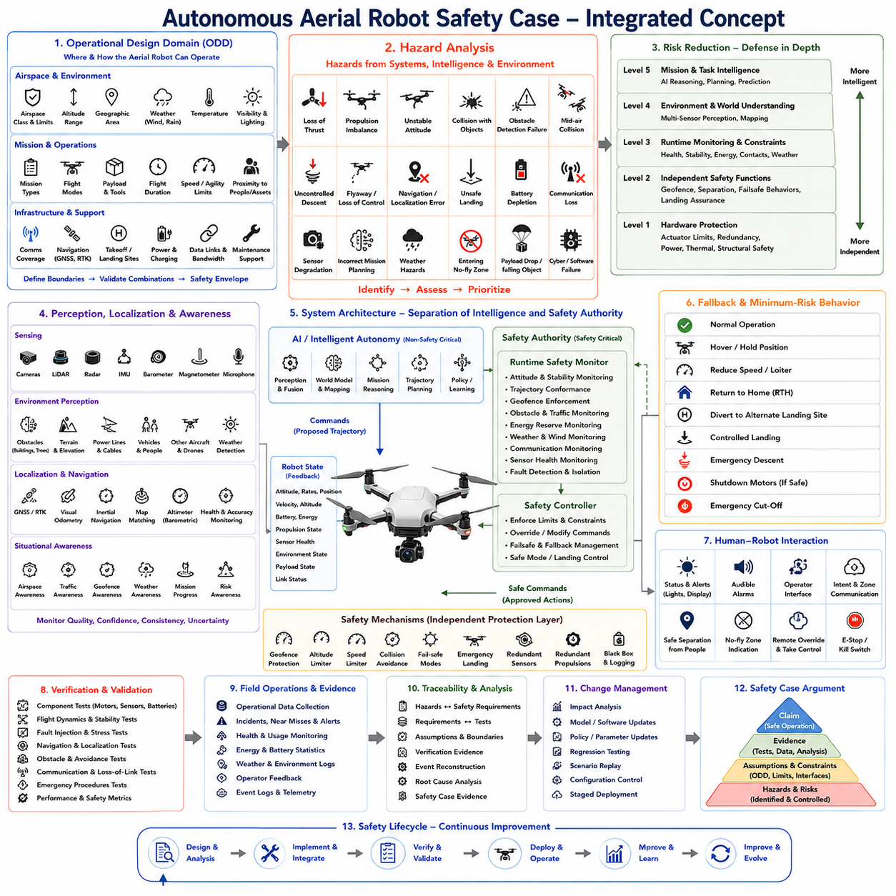{width="7.268055555555556in" height="7.268055555555556in"}

An autonomous aerial robot presents a demanding Physical AI safety problem because safe operation depends on continuously maintaining controlled flight while perception, navigation, planning, communication, propulsion, and energy systems operate under changing environmental conditions. Unlike ground robots, many failures cannot be handled by simply stopping in place. Loss of control can immediately create falling, collision, flyaway, or impact hazards affecting people, property, infrastructure, and other aircraft.

The safety case begins by defining a precise Operational Design Domain for flight. Relevant boundaries include permitted airspace, altitude, geographic area, terrain, obstacle density, weather, wind, precipitation, temperature, visibility, illumination, communication coverage, navigation availability, payload, flight duration, and proximity to people or structures. The ODD should also define validated mission types such as inspection, mapping, delivery, surveillance, or autonomous infrastructure monitoring.

Hazard analysis must address both conventional aircraft hazards and failures introduced by autonomous intelligence. Important scenarios include loss of thrust, propulsion imbalance, unstable attitude, collision, uncontrolled descent, flyaway, navigation error, obstacle-detection failure, unsafe landing, battery depletion, communication loss, sensor degradation, incorrect mission planning, and entry into prohibited airspace. Combinations of small failures may be particularly important because flight safety depends on several tightly coupled subsystems.

Flight stability is a fundamental safety requirement. The system must continuously monitor attitude, angular rates, velocity, altitude, actuator commands, propulsion state, and estimated external disturbances. Differences between expected and measured vehicle dynamics can indicate motor degradation, propeller damage, payload movement, wind disturbance, controller instability, or sensor failure. Safety mechanisms should respond before the remaining control authority becomes insufficient to maintain stable flight.

Propulsion health requires special attention because thrust directly determines whether the robot can remain airborne. Motor speed, current, temperature, vibration, commanded thrust, and observed vehicle response can provide indicators of propulsion degradation. Depending on vehicle architecture, detected faults may require thrust redistribution, reduced maneuvering, mission termination, immediate landing, or deployment of an independent emergency system rather than continued nominal operation.

Energy management is also safety-critical because an aerial robot requires sufficient energy not merely to continue its mission but to terminate it safely. Battery state of charge, voltage, temperature, current demand, predicted consumption, wind conditions, distance to landing sites, and reserve requirements should be considered together. Mission planning must preserve an explicit safety reserve so that unexpected delays or environmental disturbances do not transform normal battery depletion into an emergency.

Perception supports obstacle avoidance, landing, navigation, and environmental understanding. Cameras, LiDAR, radar, depth sensors, or other modalities may detect buildings, vegetation, cables, terrain, vehicles, people, and other aircraft. However, rain, fog, darkness, glare, motion blur, reflective surfaces, thin obstacles, or sensor contamination can reduce performance. Runtime monitoring should identify reduced perception quality and restrict flight behavior as uncertainty increases.

Localization and navigation require comparable supervision. GNSS, RTK, visual-inertial odometry, inertial navigation, barometric altitude, magnetometers, and map-based localization may provide complementary estimates, but each has characteristic failure modes. Multipath, signal blockage, magnetic interference, visual degradation, drift, or corrupted measurements can produce plausible but incorrect states. Navigation confidence should therefore be evaluated through consistency and redundancy rather than simple sensor availability.

Geofencing provides an important independent constraint on autonomous mission execution. The robot should remain within approved horizontal and vertical operating regions while respecting prohibited zones, altitude restrictions, infrastructure boundaries, and mission-specific exclusion areas. Intelligent planners may optimize routes within these limits, but they should not possess unrestricted authority to redefine safety boundaries. Boundary violations or unreliable localization should trigger predefined protective responses.

Trajectory planning must consider more than geometric collision avoidance. Wind, vehicle dynamics, energy reserve, visibility, communication quality, obstacle uncertainty, emergency landing availability, and separation from people or infrastructure can affect whether a route is acceptably safe. A shorter trajectory may be less desirable than a route offering greater clearance, better localization, stronger communication, or more opportunities for controlled landing if conditions deteriorate.

Dynamic obstacle management becomes critical when the operating environment includes birds, other drones, cranes, vehicles, or aircraft. Detection alone is insufficient because relative motion and future conflict must be estimated quickly. The autonomous system should maintain conservative separation margins, predict collision risk, and select avoidance maneuvers that remain within flight-dynamic, geofence, energy, and airspace constraints while avoiding the creation of a second hazard.

Weather creates uncertainty across multiple safety functions simultaneously. Wind and gusts affect stability and energy consumption, rain can degrade sensing and propulsion, temperature influences battery performance, and fog or low illumination reduces visibility. Environmental monitoring should therefore be connected directly to flight authorization and runtime limits. When conditions approach validated boundaries, the system should reduce mission scope, return, divert, land, or refuse launch.

The separation of intelligent autonomy and safety authority remains fundamental. AI may interpret mission objectives, identify inspection targets, understand scenes, predict obstacles, or optimize routes, but independent mechanisms should retain authority over fundamental flight constraints. Altitude, geofence, attitude, speed, propulsion health, energy reserve, separation, and emergency-state limits should remain enforceable regardless of whether proposed actions originate from classical algorithms, learned policies, or foundation models.

Runtime assurance provides continuous supervision between autonomous planning and flight execution. It can monitor vehicle state, trajectory conformance, localization confidence, perception quality, propulsion health, energy reserve, communication status, weather conditions, and computational timing. When the system approaches the validated safety envelope, the runtime supervisor should reduce autonomous authority and transition toward predefined degraded or minimum-risk behavior.

Fallback behavior must recognize that an aerial robot usually cannot remain stationary indefinitely. Depending on the failure and environment, appropriate responses may include hovering, reducing speed, holding position, returning to a safe location, diverting to an alternate landing site, performing a controlled landing, or executing an emergency descent. The safest response depends on remaining propulsion, navigation confidence, energy, altitude, nearby people, terrain, and available landing areas.

Communication loss requires explicit treatment because remote supervision may disappear while the vehicle remains airborne. Essential stabilization, navigation monitoring, obstacle response, geofence enforcement, energy management, and emergency behavior should remain available onboard. A lost link should activate a validated autonomous procedure rather than leave behavior undefined. Return, hold, land, or another response should be selected according to mission context and current safety conditions.

Emergency landing capability is a central part of minimum-risk planning. Suitable landing areas should be evaluated according to terrain, obstacle clearance, human presence, vehicle state, and remaining energy. A location considered acceptable during normal planning may become unreachable after propulsion or navigation degradation. The robot should therefore maintain awareness of feasible emergency options throughout flight rather than searching for them only after a critical failure occurs.

Payloads alter flight dynamics and consequence severity. Payload mass, center of gravity, aerodynamic properties, attachment integrity, power consumption, and potential hazards must be included in the validated configuration. A shifting or detached payload can destabilize flight or create a separate falling-object hazard. Payload-aware limits should therefore affect acceleration, maneuvering, flight duration, landing strategy, and emergency responses throughout the mission.

Human safety extends beyond direct collision avoidance because an aerial robot can create risk from altitude. Safe operation should consider flight over people, rotor exposure, falling components, payload release, noise, and emergency landing trajectories. Ground-risk assessment should influence route planning and operating altitude so that failures preferentially occur over areas where potential consequences are lower and emergency recovery options are better.

Verification should combine component tests, flight tests, fault injection, and scenario-based evaluation. Relevant cases include propulsion degradation, sensor faults, GNSS loss, localization drift, communication interruption, low energy, excessive wind, obstacle encounters, geofence approach, computational overload, payload variation, and emergency landing. Transitions from nominal flight through degraded operation to return, diversion, landing, or emergency response require explicit validation.

Simulation is particularly valuable because many aerial failure scenarios are unsafe or expensive to reproduce repeatedly. Wind fields, sensor noise, navigation errors, propulsion faults, battery degradation, communication loss, moving obstacles, and environmental conditions can be systematically varied. Large-scale simulation can reveal rare combinations where individually manageable uncertainties interact and reduce control, navigation, or recovery margins below acceptable levels.

Physical flight testing remains indispensable because aerodynamic effects, vibration, propulsion behavior, electromagnetic interference, weather, battery performance, and sensor characteristics cannot be modeled perfectly. Operational evidence should record unstable flight events, emergency landings, navigation anomalies, obstacle interventions, communication losses, energy warnings, propulsion faults, geofence events, operator interventions, and autonomous mission aborts with synchronized telemetry.

Traceability connects each significant hazard to safety requirements, architectural controls, verification methods, acceptance criteria, and operational evidence. Critical assumptions such as maximum wind, minimum energy reserve, permitted altitude, localization confidence, payload configuration, communication dependency, obstacle-detection capability, and emergency landing requirements should remain explicitly associated with the validated system configuration and mission envelope.

Software and AI updates require controlled change management because modifications to perception, navigation, world models, planners, learned flight policies, or mission reasoning can alter physical behavior without changing the airframe. Impact analysis, regression simulation, scenario replay, targeted flight testing, configuration control, and staged deployment should establish that previously validated safety assumptions remain applicable before unrestricted operational release.

The autonomous aerial robot safety case demonstrates that Physical AI safety must preserve control authority and recovery options under uncertainty. Advanced intelligence can improve perception, navigation, prediction, and mission adaptation, but flight ultimately depends on finite energy, aerodynamic stability, propulsion, environmental conditions, and physical separation. Independent safety mechanisms must therefore bound intelligent behavior before uncertainty becomes unrecoverable physical motion.

A mature aerial robot safety case becomes a living assurance framework connecting the ODD, flight hazards, environmental uncertainty, vehicle health, runtime assurance, fallback strategies, verification, field evidence, and configuration history. The objective is not to assume that every fault can be prevented, but to detect degradation early, preserve sufficient control and energy margins, maintain feasible recovery paths, and guide failures toward controlled minimum-risk outcomes.

자율 비행 로봇(Autonomous Aerial Robot)은 변화하는 환경 조건에서 인지(Perception), 항법(Navigation), 계획(Planning), 통신(Communication), 추진(Propulsion) 및 에너지 시스템이 작동하는 동안 지속적으로 제어된 비행을 유지해야 하므로 까다로운 피지컬 AI(Physical AI) 안전 문제를 제기한다. 지상 로봇과 달리 많은 고장은 단순히 제자리에서 정지하는 것으로 처리할 수 없다. 제어 상실은 즉시 추락, 충돌, 비행 이탈(Flyaway) 또는 충격 위험으로 이어져 사람, 재산, 기반시설 및 다른 항공기에 영향을 줄 수 있다.

안전 사례(Safety Case)는 비행을 위한 정확한 운용설계영역(Operational Design Domain, ODD)을 정의하는 것에서 시작한다. 관련 경계에는 허용 공역, 고도, 지리적 영역, 지형, 장애물 밀도, 기상, 바람, 강수, 온도, 가시성, 조명, 통신 범위, 항법 가용성, 적재물, 비행시간 및 사람이나 구조물과의 근접성이 포함된다. ODD는 검사, 매핑, 배송, 감시 또는 자율 기반시설 모니터링과 같이 검증된 임무 유형도 정의해야 한다.

위험 분석(Hazard Analysis)은 기존 항공기의 위험과 자율 지능(Autonomous Intelligence)에 의해 추가되는 고장을 모두 다루어야 한다. 주요 시나리오에는 추력 상실, 추진력 불균형, 불안정한 자세, 충돌, 제어되지 않은 하강, 비행 이탈, 항법 오류, 장애물 탐지 실패, 위험한 착륙, 배터리 고갈, 통신 손실, 센서 성능 저하, 잘못된 임무 계획 및 금지 공역 진입 등이 포함된다. 비행 안전은 여러 개의 밀접하게 결합된 하위 시스템에 의존하기 때문에 작은 고장들의 조합이 특히 중요할 수 있다.

비행 안정성(Flight Stability)은 기본적인 안전 요구사항이다. 시스템은 자세, 각속도, 속도, 고도, 액추에이터 명령, 추진 상태 및 추정된 외부 외란을 지속적으로 모니터링해야 한다. 예상된 기체 동역학과 실제 측정값의 차이는 모터 성능 저하, 프로펠러 손상, 적재물 이동, 바람에 의한 외란, 제어기 불안정 또는 센서 고장을 나타낼 수 있다. 안전 메커니즘은 안정적인 비행을 유지하기 위한 잔여 제어 권한(Remaining Control Authority)이 부족해지기 전에 대응해야 한다.

추진 시스템 상태(Propulsion Health)는 추력이 로봇의 비행 유지 여부를 직접 결정하기 때문에 특별한 주의가 필요하다. 모터 속도, 전류, 온도, 진동, 명령 추력 및 관측된 기체 반응은 추진 성능 저하를 나타내는 지표가 될 수 있다. 기체 아키텍처에 따라 탐지된 고장은 정상 운용을 계속하는 대신 추력 재분배, 기동 제한, 임무 종료, 즉시 착륙 또는 독립적인 비상 시스템 작동을 요구할 수 있다.

에너지 관리(Energy Management) 역시 안전 핵심 기능이다. 비행 로봇은 단순히 임무를 계속하기 위한 에너지뿐만 아니라 임무를 안전하게 종료하기 위한 충분한 에너지를 확보해야 한다. 배터리 충전 상태(State of Charge), 전압, 온도, 전류 요구량, 예상 소비량, 바람 조건, 착륙 지점까지의 거리 및 예비 에너지 요구사항을 함께 고려해야 한다. 임무 계획은 예상하지 못한 지연이나 환경 외란으로 인해 정상적인 배터리 소모가 비상 상황으로 전환되지 않도록 명시적인 안전 예비량(Safety Reserve)을 유지해야 한다.

인지(Perception)는 장애물 회피, 착륙, 항법 및 환경 이해를 지원한다. 카메라, 라이다(LiDAR), 레이더(Radar), 깊이 센서 또는 기타 센서는 건물, 식생, 케이블, 지형, 차량, 사람 및 다른 항공기를 탐지할 수 있다. 그러나 비, 안개, 어둠, 눈부심, 모션 블러(Motion Blur), 반사 표면, 가느다란 장애물 또는 센서 오염은 성능을 저하시킬 수 있다. 런타임 모니터링(Runtime Monitoring)은 인지 품질 저하를 탐지하고 불확실성이 증가함에 따라 비행 행동을 제한해야 한다.

위치추정 및 항법(Localization and Navigation)에도 이에 상응하는 감독이 필요하다. 위성항법시스템(GNSS), 실시간 이동측위(RTK), 시각-관성 오도메트리(Visual-Inertial Odometry), 관성항법(Inertial Navigation), 기압 고도계, 자력계 및 지도 기반 위치추정은 상호 보완적인 추정값을 제공할 수 있지만 각각 고유한 고장 형태가 있다. 다중경로, 신호 차단, 자기 간섭, 시각 정보 저하, 드리프트 또는 손상된 측정값은 그럴듯하지만 잘못된 상태를 생성할 수 있다. 따라서 항법 신뢰도는 단순한 센서 가용성이 아니라 일관성과 중복성(Redundancy)을 통해 평가해야 한다.

지오펜싱(Geofencing)은 자율 임무 실행에 대한 중요한 독립 제약조건을 제공한다. 로봇은 승인된 수평 및 수직 운용 영역 내에 머물면서 금지 구역, 고도 제한, 기반시설 경계 및 임무별 제외 영역을 준수해야 한다. 지능형 플래너(Intelligent Planner)는 이러한 한계 내부에서 경로를 최적화할 수 있지만 안전 경계를 임의로 재정의할 수 있는 무제한 권한을 가져서는 안 된다. 경계 위반이나 신뢰할 수 없는 위치추정이 발생하면 사전에 정의된 보호 대응이 실행되어야 한다.

궤적 계획(Trajectory Planning)은 기하학적 충돌 회피만을 고려해서는 안 된다. 바람, 기체 동역학, 에너지 예비량, 가시성, 통신 품질, 장애물 불확실성, 비상 착륙 가능성 및 사람이나 기반시설과의 분리 거리는 경로가 충분히 안전한지를 결정한다. 짧은 궤적보다 더 넓은 여유 공간, 더 신뢰할 수 있는 위치추정, 더 안정적인 통신 또는 상황 악화 시 제어된 착륙 기회를 더 많이 제공하는 경로가 안전 측면에서 우수할 수 있다.

동적 장애물 관리(Dynamic Obstacle Management)는 운용 환경에 조류, 다른 드론, 크레인, 차량 또는 항공기가 존재할 때 중요해진다. 단순한 탐지만으로는 충분하지 않으며 상대적인 움직임과 미래의 충돌 가능성을 신속하게 추정해야 한다. 자율 시스템은 보수적인 분리 여유를 유지하고 충돌 위험을 예측하며, 새로운 2차 위험을 발생시키지 않으면서 비행 동역학, 지오펜스, 에너지 및 공역 제약조건을 준수하는 회피 기동을 선택해야 한다.

기상(Weather)은 여러 안전 기능에 동시에 불확실성을 발생시킨다. 바람과 돌풍은 안정성과 에너지 소비에 영향을 주고, 비는 센싱과 추진 성능을 저하시킬 수 있으며, 온도는 배터리 성능에 영향을 주고, 안개나 낮은 조도는 가시성을 감소시킨다. 따라서 환경 모니터링(Environmental Monitoring)은 비행 승인 및 런타임 제한과 직접 연결되어야 한다. 조건이 검증된 경계에 접근하면 시스템은 임무 범위를 축소하거나, 복귀하거나, 우회하거나, 착륙하거나, 이륙 자체를 거부해야 한다.

지능형 자율성(Intelligent Autonomy)과 안전 권한(Safety Authority)의 분리는 핵심 원칙이다. AI는 임무 목표를 해석하고, 검사 대상을 식별하고, 장면을 이해하고, 장애물을 예측하거나 경로를 최적화할 수 있지만 기본적인 비행 제약에 대한 권한은 독립적인 메커니즘이 유지해야 한다. 고도, 지오펜스, 자세, 속도, 추진 상태, 에너지 예비량, 분리 거리 및 비상 상태의 한계는 제안된 행동이 기존 알고리즘, 학습 정책 또는 파운데이션 모델(Foundation Model)에서 생성되는지와 관계없이 강제될 수 있어야 한다.

런타임 보증(Runtime Assurance)은 자율 계획과 비행 실행 사이에서 지속적인 감독을 제공한다. 시스템은 기체 상태, 궤적 준수, 위치추정 신뢰도, 인지 품질, 추진 상태, 에너지 예비량, 통신 상태, 기상 조건 및 연산 타이밍을 모니터링할 수 있다. 시스템이 검증된 안전 영역(Safety Envelope)에 접근하면 런타임 감독기(Runtime Supervisor)는 자율 권한을 감소시키고 사전에 정의된 성능 저하 상태 또는 최소 위험 행동(Minimum-Risk Behavior)으로 전환해야 한다.

폴백 동작(Fallback Behavior)은 비행 로봇이 일반적으로 한 위치에 무기한 정지해 있을 수 없다는 특성을 고려해야 한다. 고장과 환경 조건에 따라 적절한 대응에는 호버링(Hovering), 감속, 위치 유지, 안전 위치로 복귀, 대체 착륙 지점으로의 우회, 제어 착륙 또는 비상 하강이 포함될 수 있다. 가장 안전한 대응은 남아 있는 추진 능력, 항법 신뢰도, 에너지, 고도, 주변 사람, 지형 및 사용 가능한 착륙 영역에 따라 달라진다.

통신 손실(Communication Loss)은 기체가 계속 비행하는 동안 원격 감독이 사라질 수 있기 때문에 명시적으로 다루어야 한다. 필수적인 안정화, 항법 모니터링, 장애물 대응, 지오펜스 강제, 에너지 관리 및 비상 행동은 기체 내부에서 계속 사용할 수 있어야 한다. 통신 연결 상실은 행동이 정의되지 않은 상태를 만드는 것이 아니라 검증된 자율 절차를 활성화해야 한다. 복귀, 위치 유지, 착륙 또는 기타 대응은 임무 상황과 현재의 안전 조건에 따라 선택되어야 한다.

비상 착륙 능력(Emergency Landing Capability)은 최소 위험 계획(Minimum-Risk Planning)의 핵심 요소이다. 적절한 착륙 영역은 지형, 장애물 여유, 사람의 존재, 기체 상태 및 남은 에너지를 기준으로 평가해야 한다. 정상적인 계획에서는 적절했던 위치도 추진 또는 항법 성능이 저하된 이후에는 도달할 수 없게 될 수 있다. 따라서 로봇은 심각한 고장이 발생한 이후에야 착륙 장소를 탐색하는 것이 아니라 비행 전체에 걸쳐 실행 가능한 비상 대안을 지속적으로 파악해야 한다.

적재물(Payload)은 비행 동역학과 사고 결과의 심각성을 변화시킨다. 적재물의 질량, 무게중심, 공기역학적 특성, 장착 건전성, 전력 소비 및 잠재적인 위험성이 검증된 시스템 구성에 포함되어야 한다. 적재물이 이동하거나 분리되면 비행이 불안정해지거나 별도의 낙하물 위험(Falling-Object Hazard)을 발생시킬 수 있다. 따라서 적재물 인지형 제한(Payload-Aware Limits)은 임무 전체에서 가속, 기동, 비행시간, 착륙 전략 및 비상 대응에 영향을 주어야 한다.

인간 안전(Human Safety)은 비행 로봇이 고도에서 위험을 발생시킬 수 있으므로 직접적인 충돌 회피를 넘어 확장된다. 안전한 운용은 사람 상공 비행, 회전익 노출, 구성요소 낙하, 적재물 방출, 소음 및 비상 착륙 궤적을 고려해야 한다. 지상 위험 평가(Ground-Risk Assessment)는 경로 계획과 운용 고도에 반영되어 고장이 발생하더라도 잠재적인 결과가 상대적으로 작고 비상 복구 가능성이 높은 영역을 우선하도록 해야 한다.

검증(Verification)은 구성요소 시험, 실제 비행 시험, 고장 주입(Fault Injection) 및 시나리오 기반 평가(Scenario-Based Evaluation)를 결합해야 한다. 관련 사례에는 추진 성능 저하, 센서 고장, GNSS 상실, 위치추정 드리프트, 통신 중단, 낮은 에너지 상태, 과도한 바람, 장애물 조우, 지오펜스 접근, 연산 과부하, 적재물 변화 및 비상 착륙이 포함된다. 정상 비행에서 성능 저하 운용을 거쳐 복귀, 우회, 착륙 또는 비상 대응으로 전환되는 과정도 명시적으로 검증해야 한다.

시뮬레이션(Simulation)은 많은 비행 고장 시나리오가 실제 환경에서 반복적으로 재현하기에는 위험하거나 비용이 많이 들기 때문에 특히 중요하다. 풍장(Wind Field), 센서 잡음, 항법 오류, 추진 고장, 배터리 성능 저하, 통신 손실, 이동 장애물 및 환경 조건을 체계적으로 변화시킬 수 있다. 대규모 시뮬레이션은 개별적으로 관리 가능한 불확실성들이 상호작용하여 제어, 항법 또는 복구 여유를 허용 가능한 수준 이하로 감소시키는 희귀한 조합을 발견할 수 있다.

실제 비행 시험(Physical Flight Testing)은 공기역학적 영향, 진동, 추진 시스템 행동, 전자기 간섭, 기상, 배터리 성능 및 센서 특성을 완벽하게 모델링할 수 없기 때문에 필수적이다. 운용 증거(Operational Evidence)는 불안정 비행, 비상 착륙, 항법 이상, 장애물 회피 개입, 통신 손실, 에너지 경고, 추진 고장, 지오펜스 이벤트, 운영자 개입 및 자율 임무 중단을 동기화된 텔레메트리(Synchronized Telemetry)와 함께 기록해야 한다.

추적성(Traceability)은 각각의 중요한 위험을 안전 요구사항, 아키텍처 제어, 검증 방법, 수용 기준(Acceptance Criteria) 및 운용 증거와 연결한다. 최대 허용 풍속, 최소 에너지 예비량, 허용 고도, 위치추정 신뢰도, 적재물 구성, 통신 의존성, 장애물 탐지 능력 및 비상 착륙 요구사항과 같은 핵심 가정은 검증된 시스템 구성과 임무 영역(Mission Envelope)에 명시적으로 연결되어 있어야 한다.

소프트웨어 및 AI 업데이트에는 통제된 변경 관리(Controlled Change Management)가 필요하다. 인지, 항법, 월드 모델(World Model), 플래너, 학습 기반 비행 정책(Learned Flight Policy) 또는 임무 추론을 수정하면 기체 자체를 변경하지 않더라도 물리적 행동이 달라질 수 있다. 따라서 제한 없는 운용을 승인하기 전에 영향 분석(Impact Analysis), 회귀 시뮬레이션(Regression Simulation), 시나리오 재실행, 대상 비행 시험, 구성 관리(Configuration Control) 및 단계적 배포(Staged Deployment)를 통해 기존에 검증된 안전 가정이 계속 유효한지 확인해야 한다.

자율 비행 로봇 안전 사례(Autonomous Aerial Robot Safety Case)는 피지컬 AI 안전이 불확실한 상황에서도 제어 권한(Control Authority)과 복구 선택지(Recovery Options)를 보존해야 한다는 것을 보여준다. 고도화된 지능은 인지, 항법, 예측 및 임무 적응 능력을 향상시킬 수 있지만 실제 비행은 유한한 에너지, 공기역학적 안정성, 추진 능력, 환경 조건 및 물리적 분리 거리에 의해 결정된다. 따라서 독립적인 안전 메커니즘은 불확실성이 회복 불가능한 물리적 움직임으로 발전하기 전에 지능형 행동을 제한해야 한다.

성숙한 자율 비행 로봇 안전 사례는 운용설계영역(ODD), 비행 위험, 환경 불확실성, 기체 상태, 런타임 보증, 폴백 전략, 검증, 현장 증거 및 구성 이력을 연결하는 살아 있는 보증 프레임워크(Living Assurance Framework)가 된다. 목표는 모든 고장을 예방할 수 있다고 가정하는 것이 아니라 성능 저하를 조기에 탐지하고, 충분한 제어 및 에너지 여유를 보존하며, 실행 가능한 복구 경로를 유지하고, 고장이 발생하더라도 시스템을 제어된 최소 위험 결과(Controlled Minimum-Risk Outcome)로 유도하는 것이다.

##  

## 09.08. VLA Based Robot Safety Case

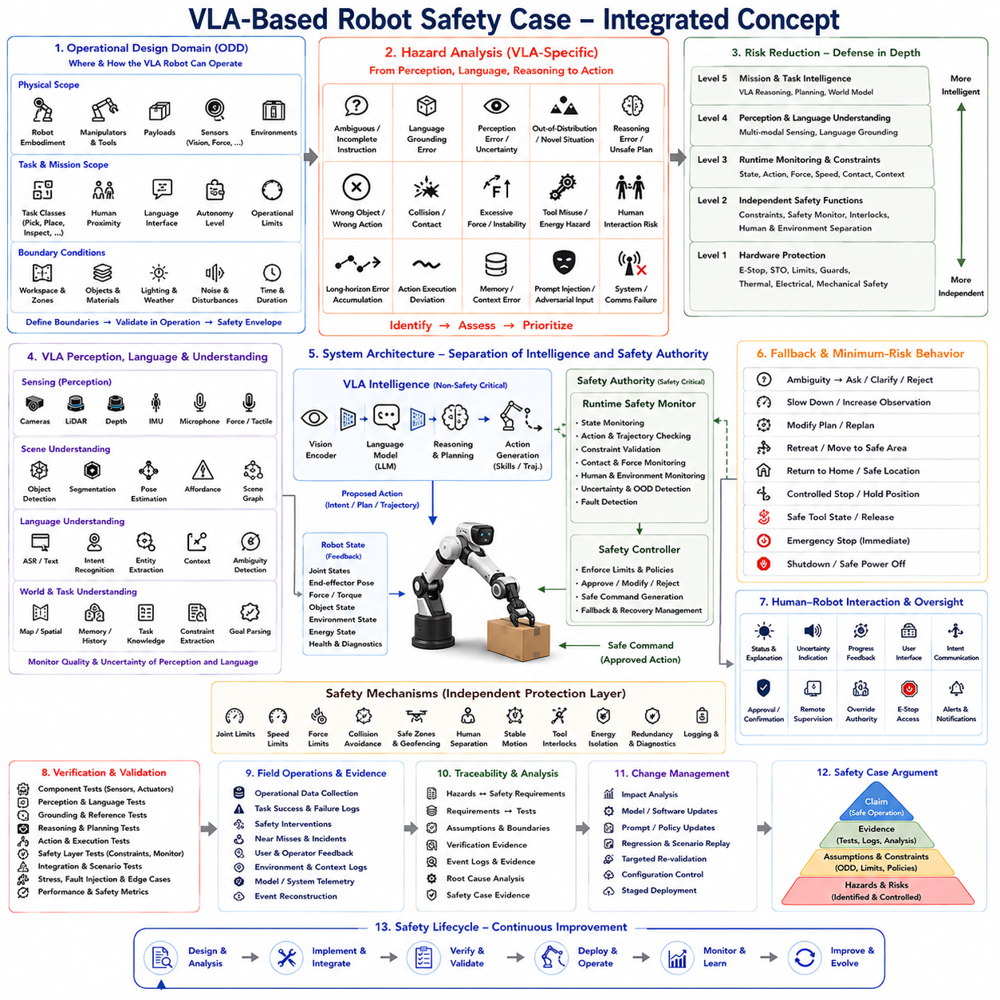{width="7.268055555555556in" height="7.268055555555556in"}

A Vision-Language-Action system connects visual perception, language understanding, reasoning, and physical action within a unified robot intelligence architecture. This integration enables robots to interpret open-ended instructions and generalize across tasks, but it also creates new safety dependencies. Errors in scene understanding, linguistic interpretation, reasoning, or action generation can propagate directly into physical behavior, making end-to-end assurance essential.

The safety case begins by defining the operational boundaries within which the VLA model is permitted to control the robot. These boundaries include robot embodiment, sensors, manipulators, tools, payloads, environments, task classes, human proximity, language interfaces, and physical operating limits. The system must distinguish between capabilities demonstrated during validation and behaviors that merely appear possible because of the model\'s generalization ability.

Natural-language instructions introduce ambiguity that conventional robot programs normally avoid. Commands may omit objects, locations, constraints, timing, or safety assumptions, while different expressions may describe the same intended task. The VLA system should identify ambiguous or incomplete instructions before converting them into physical actions. When confidence is insufficient, clarification, rejection, or conservative interpretation is safer than silently selecting an uncertain intent.

Language grounding connects symbolic instructions to physical entities in the environment. A command such as moving "that box" requires the robot to associate linguistic references with the correct perceived object, location, and action. Grounding errors can therefore cause interaction with the wrong object or workspace. Object identity, spatial relationships, affordances, task context, and confidence should be checked before the robot commits to consequential manipulation.

Visual perception introduces another source of uncertainty because VLA behavior depends strongly on what the model believes it sees. Occlusion, lighting changes, reflective surfaces, clutter, unfamiliar objects, sensor contamination, and distribution shift can produce incorrect scene representations. Perception confidence and sensor consistency should be monitored so that uncertain observations do not automatically become high-confidence physical commands.

The VLA model may also encounter situations that differ significantly from its training distribution. Novel tools, unusual object arrangements, unfamiliar environments, unexpected human behavior, or previously unseen task combinations can produce plausible actions without reliable competence. Out-of-distribution detection, novelty estimation, uncertainty monitoring, and explicit capability boundaries should therefore influence whether autonomous execution is allowed.

Reasoning errors are especially important because an action sequence can be semantically plausible while physically unsafe. A model may choose the correct object and goal but overlook instability, collision risk, payload limits, prohibited areas, or human presence. Safety evaluation must therefore occur independently of the model\'s internal reasoning. A convincing explanation or high language confidence cannot substitute for verification of physical constraints.

Long-horizon tasks create additional risk because small errors can accumulate across multiple actions. A VLA system may perform perception, navigation, grasping, transport, placement, tool use, and verification within a single instruction. Each action changes the world state on which later decisions depend. Runtime execution should therefore repeatedly observe, verify, and replan rather than assuming that an initially generated multi-step plan remains valid throughout the task.

Action generation must be separated from action authorization. The VLA model may propose semantic goals, skills, trajectories, poses, or low-level commands depending on the architecture, but a safety layer should determine whether those outputs are physically permissible. Joint limits, velocity limits, force constraints, collision boundaries, workspace restrictions, human separation, stability requirements, and tool rules should remain independently enforceable.

This separation creates a fundamental distinction between intelligence authority and safety authority. The VLA system can decide what action may help accomplish the task, while an independent safety mechanism determines whether and how that action may physically occur. Increasing model capability should expand reasoning and task flexibility without automatically expanding unrestricted access to motors, actuators, tools, or hazardous energy.

A runtime safety monitor can evaluate proposed actions before and during execution. Pre-execution checks can reject trajectories or skills that violate known constraints, while continuous monitoring can compare expected and observed robot states. Unexpected contact, trajectory deviation, excessive force, unstable motion, perception changes, or human intrusion can invalidate an action that was considered acceptable when execution began.

World models can strengthen VLA safety by predicting the consequences of candidate actions before physical execution. The system may estimate future object states, collisions, reachability, stability, or human interactions and compare alternative actions. However, predicted futures remain model-dependent and uncertain. World-model predictions should therefore provide additional safety evidence rather than replacing independent physical constraints and runtime monitoring.

Human interaction requires particular attention because language makes robots easier to command while potentially creating unrealistic expectations about comprehension. Users may assume that a robot understands implicit social rules, contextual knowledge, or safety requirements that were never stated. The system should communicate uncertainty, request clarification when necessary, indicate rejected actions, and avoid presenting fluent linguistic behavior as proof of reliable physical understanding.

Prompt injection and adversarial instructions become physical safety concerns when language can influence robot behavior. Instructions embedded in visual scenes, external messages, task descriptions, or untrusted data may attempt to redirect the model away from authorized objectives. Command provenance, access control, instruction hierarchy, input filtering, and policy enforcement should prevent untrusted linguistic content from obtaining physical authority.

Tool use further increases the consequences of VLA errors. A model capable of selecting and operating tools may interact with cutting, thermal, electrical, pneumatic, or mechanically powerful equipment. Tool identification, attachment verification, permitted-use rules, energy isolation, operating-state monitoring, and task-specific interlocks should remain outside unrestricted model control. Semantic understanding alone is insufficient evidence that a tool can be used safely.

Memory and context management also affect safety. VLA systems may use previous observations, task histories, maps, user instructions, or episodic memory to maintain context across long tasks. Incorrect, outdated, or mismatched memory can influence current actions even when present perception is accurate. Safety-critical decisions should therefore verify relevant assumptions against current robot and environmental state rather than trusting stored context without confirmation.

Fallback behavior should correspond to the type and severity of uncertainty. Moderate ambiguity may require slower execution or additional observation, while unresolved object identity may require clarification. Loss of localization, unsafe contact, excessive force, contradictory commands, or safety-monitor violations may require stopping, retreating, releasing a task, or entering a minimum-risk state. Fallback transitions should be deterministic even when the primary policy is learned.

Emergency intervention must remain independent of the VLA reasoning process. Operators or safety systems should be able to stop or constrain physical behavior even if the model continues to predict that its action is correct. Emergency stop, protective stop, safe torque functions, actuator inhibition, tool-energy isolation, and remote override should not depend on the same model whose behavior may have triggered the hazardous condition.

Verification must examine the complete perception-language-action chain rather than evaluating model accuracy alone. Tests should include ambiguous commands, incorrect references, unfamiliar objects, visual occlusion, conflicting instructions, unsafe requests, changing environments, human intrusion, sensor degradation, action deviations, and long-horizon task failures. The central question is whether model errors remain bounded before they become hazardous physical outcomes.

Scenario-based evaluation is especially valuable because the number of possible combinations of language, scenes, tasks, and robot states is extremely large. Simulation can systematically vary instructions, object arrangements, human behavior, sensor quality, physical constraints, and model uncertainty. Adversarial and rare scenarios can expose situations in which individually reasonable perception and reasoning outputs combine into unsafe action sequences.

Physical validation remains essential because simulated success cannot fully represent contact dynamics, friction, compliance, payload variation, actuator behavior, human responses, or sensor imperfections. Field testing should record rejected commands, safety-layer interventions, unexpected actions, perception failures, excessive-force events, collisions or near misses, operator overrides, task aborts, and transitions into degraded or minimum-risk states.

Traceability becomes challenging because VLA behavior depends not only on conventional software but also on model weights, training data, prompts, context, decoding parameters, perception inputs, safety policies, and robot configuration. The safety case should identify the validated combination of these elements and connect significant hazards to requirements, controls, tests, evidence, assumptions, and acceptance criteria.

Model updates require controlled change management because even improvements in general benchmark performance can alter physical behavior in unexpected ways. Changes to the VLA model, vision encoder, language model, action decoder, prompts, fine-tuning data, adapters, safety filters, or inference parameters should trigger impact analysis, regression evaluation, scenario replay, targeted physical testing, configuration control, and staged deployment.

Operational monitoring should continue after deployment because real-world use will expose task combinations and environmental conditions not represented completely during development. Logs should capture instructions, observations, model outputs, safety interventions, robot states, uncertainty indicators, operator actions, and outcomes. These records support event reconstruction, root-cause analysis, model improvement, and expansion or restriction of the validated operational envelope.

The VLA-based robot safety case demonstrates that general-purpose intelligence should not imply general-purpose physical authority. VLA models can provide semantic understanding, task generalization, reasoning, and flexible skill composition, while independent safety mechanisms constrain the physical consequences of their decisions. The more general the intelligence becomes, the more important it is to maintain explicit boundaries between proposed behavior and authorized action.

A mature VLA safety case therefore becomes a living assurance framework connecting language grounding, perception uncertainty, reasoning, action generation, physical constraints, runtime assurance, human oversight, verification, operational evidence, and controlled model evolution. The objective is not to prove that the VLA model will always reason correctly, but to ensure that uncertain or incorrect reasoning cannot freely propagate into hazardous physical action.

비전-언어-행동 시스템(Vision-Language-Action System, VLA)은 시각 인지(Visual Perception), 언어 이해(Language Understanding), 추론(Reasoning) 및 물리적 행동(Physical Action)을 하나의 통합된 로봇 지능 아키텍처(Robot Intelligence Architecture) 안에서 연결한다. 이러한 통합은 로봇이 개방형 명령(Open-Ended Instruction)을 해석하고 다양한 작업으로 일반화할 수 있게 하지만 새로운 안전 의존성도 만든다. 장면 이해, 언어 해석, 추론 또는 행동 생성에서 발생한 오류가 물리적 행동으로 직접 전파될 수 있으므로 종단간 보증(End-to-End Assurance)이 필수적이다.

안전 사례(Safety Case)는 VLA 모델이 로봇을 제어하도록 허용되는 운용 경계(Operational Boundaries)를 정의하는 것에서 시작한다. 이러한 경계에는 로봇 형태(Embodiment), 센서, 매니퓰레이터, 도구, 적재물, 환경, 작업 종류, 인간 근접성, 언어 인터페이스 및 물리적 운용 한계가 포함된다. 시스템은 검증 과정에서 실제로 입증된 능력과 모델의 일반화 능력으로 인해 단순히 가능해 보이는 행동을 명확하게 구분해야 한다.

자연어 명령(Natural-Language Instruction)은 기존의 로봇 프로그램이 일반적으로 회피하는 모호성(Ambiguity)을 발생시킨다. 명령에는 객체, 위치, 제약조건, 타이밍 또는 안전 가정이 생략될 수 있으며 서로 다른 표현이 동일한 의도된 작업을 의미할 수도 있다. VLA 시스템은 모호하거나 불완전한 명령이 물리적 행동으로 변환되기 전에 이를 식별해야 한다. 신뢰도가 충분하지 않다면 불확실한 의도를 임의로 선택하기보다 명확화(Clarification), 거부 또는 보수적인 해석을 수행하는 것이 더 안전하다.

언어 그라운딩(Language Grounding)은 상징적인 명령을 실제 환경의 물리적 개체와 연결한다. 예를 들어 "저 상자(that box)"를 이동하라는 명령을 수행하려면 로봇이 언어적 지시 대상을 올바른 객체, 위치 및 행동과 연결해야 한다. 따라서 그라운딩 오류는 잘못된 객체나 작업 공간과의 상호작용으로 이어질 수 있다. 로봇이 중요한 조작을 시작하기 전에 객체 식별, 공간 관계, 어포던스(Affordance), 작업 상황 및 신뢰도를 확인해야 한다.

시각 인지(Visual Perception)는 VLA의 행동이 모델이 무엇을 보고 있다고 판단하는지에 크게 의존하기 때문에 또 다른 불확실성의 원인이 된다. 가림(Occlusion), 조명 변화, 반사 표면, 복잡한 환경, 익숙하지 않은 객체, 센서 오염 및 분포 변화(Distribution Shift)는 잘못된 장면 표현(Scene Representation)을 생성할 수 있다. 불확실한 관측 결과가 자동으로 높은 신뢰도의 물리적 명령으로 변환되지 않도록 인지 신뢰도와 센서 일관성을 모니터링해야 한다.

VLA 모델은 학습 분포(Training Distribution)와 크게 다른 상황을 마주할 수도 있다. 새로운 도구, 비정상적인 객체 배치, 익숙하지 않은 환경, 예상하지 못한 인간 행동 또는 이전에 경험하지 않은 작업 조합에서는 신뢰할 수 있는 수행 능력이 없음에도 그럴듯한 행동을 생성할 수 있다. 따라서 분포 외 감지(Out-of-Distribution Detection), 신규성 추정(Novelty Estimation), 불확실성 모니터링 및 명시적인 능력 경계(Capability Boundaries)가 자율 실행 허용 여부에 영향을 주어야 한다.

추론 오류(Reasoning Error)는 행동 시퀀스가 의미론적으로 타당하면서도 물리적으로는 위험할 수 있기 때문에 특히 중요하다. 모델이 올바른 객체와 목표를 선택하더라도 불안정성, 충돌 위험, 적재 한계, 금지 영역 또는 사람의 존재를 간과할 수 있다. 따라서 안전 평가는 모델 내부의 추론과 독립적으로 수행되어야 한다. 설득력 있는 설명이나 높은 언어적 신뢰도가 물리적 제약조건에 대한 검증을 대신할 수는 없다.

장기 작업(Long-Horizon Task)은 여러 행동에 걸쳐 작은 오류가 누적될 수 있기 때문에 추가적인 위험을 발생시킨다. VLA 시스템은 하나의 명령 안에서 인지, 내비게이션, 파지, 운반, 배치, 도구 사용 및 검증을 수행할 수 있다. 각각의 행동은 이후의 의사결정이 의존하는 세계 상태(World State)를 변화시킨다. 따라서 런타임 실행(Runtime Execution)은 처음 생성한 다단계 계획이 전체 작업 동안 계속 유효하다고 가정하지 않고 반복적으로 관측하고, 검증하고, 재계획(Replanning)해야 한다.

행동 생성(Action Generation)은 행동 승인(Action Authorization)과 분리되어야 한다. VLA 모델은 아키텍처에 따라 의미론적 목표, 스킬(Skill), 궤적, 자세 또는 저수준 명령을 제안할 수 있지만 안전 계층(Safety Layer)이 이러한 출력의 물리적 허용 여부를 결정해야 한다. 관절 한계, 속도 한계, 힘 제약조건, 충돌 경계, 작업 공간 제한, 인간 분리 거리, 안정성 요구사항 및 도구 규칙은 독립적으로 강제 가능해야 한다.

이러한 분리는 지능 권한(Intelligence Authority)과 안전 권한(Safety Authority) 사이의 근본적인 차이를 형성한다. VLA 시스템은 어떤 행동이 작업 달성에 도움이 되는지를 결정할 수 있지만 독립적인 안전 메커니즘은 해당 행동이 물리적으로 실행될 수 있는지, 그리고 어떤 방식으로 실행되어야 하는지를 결정한다. 모델 능력의 향상은 추론과 작업 유연성을 확대해야 하지만 모터, 액추에이터, 도구 또는 위험 에너지에 대한 무제한 접근 권한까지 자동으로 확대해서는 안 된다.

런타임 안전 모니터(Runtime Safety Monitor)는 제안된 행동을 실행 전과 실행 중에 평가할 수 있다. 실행 전 검사(Pre-Execution Check)는 알려진 제약조건을 위반하는 궤적이나 스킬을 거부할 수 있으며, 지속적인 모니터링은 예상된 로봇 상태와 실제 관측된 상태를 비교할 수 있다. 예상하지 못한 접촉, 궤적 편차, 과도한 힘, 불안정한 움직임, 인지 변화 또는 사람의 진입은 실행 시작 시에는 허용되었던 행동을 더 이상 유효하지 않게 만들 수 있다.

월드 모델(World Model)은 물리적 실행 전에 후보 행동의 결과를 예측함으로써 VLA 안전성을 강화할 수 있다. 시스템은 미래 객체 상태, 충돌, 도달 가능성, 안정성 또는 인간과의 상호작용을 추정하고 대안 행동들을 비교할 수 있다. 그러나 예측된 미래 상태 역시 모델에 의존하며 불확실성을 가진다. 따라서 월드 모델 예측은 독립적인 물리적 제약조건과 런타임 모니터링을 대체하는 것이 아니라 추가적인 안전 증거(Safety Evidence)를 제공해야 한다.

인간 상호작용(Human Interaction)은 언어를 통해 로봇을 쉽게 명령할 수 있게 되는 동시에 로봇의 이해 능력에 대한 비현실적인 기대를 형성할 수 있기 때문에 특별한 주의가 필요하다. 사용자는 명시적으로 전달하지 않은 사회적 규칙, 상황적 지식 또는 안전 요구사항까지 로봇이 이해한다고 가정할 수 있다. 시스템은 불확실성을 전달하고, 필요한 경우 명확화를 요청하며, 거부된 행동을 표시하고, 유창한 언어 행동을 신뢰할 수 있는 물리적 이해의 증거처럼 표현하지 않아야 한다.

프롬프트 인젝션(Prompt Injection)과 적대적 명령(Adversarial Instruction)은 언어가 로봇 행동에 영향을 줄 수 있는 경우 물리적 안전 문제가 된다. 시각적 장면, 외부 메시지, 작업 설명 또는 신뢰할 수 없는 데이터에 포함된 명령이 모델을 승인된 목표에서 벗어나도록 유도할 수 있다. 명령 출처(Command Provenance), 접근 제어(Access Control), 명령 계층(Instruction Hierarchy), 입력 필터링 및 정책 강제를 통해 신뢰할 수 없는 언어 콘텐츠가 물리적 권한을 획득하지 못하도록 해야 한다.

도구 사용(Tool Use)은 VLA 오류의 결과를 더욱 심각하게 만든다. 도구를 선택하고 작동할 수 있는 모델은 절단, 열, 전기, 공압 또는 강력한 기계적 장비와 상호작용할 수 있다. 도구 식별, 장착 검증, 허용 사용 규칙, 에너지 격리(Energy Isolation), 작동 상태 모니터링 및 작업별 인터록(Interlock)은 모델의 무제한 제어 권한 밖에 있어야 한다. 의미론적 이해만으로 도구를 안전하게 사용할 수 있다는 증거가 될 수는 없다.

메모리 및 컨텍스트 관리(Memory and Context Management) 역시 안전에 영향을 준다. VLA 시스템은 장시간 작업에서 상황을 유지하기 위해 이전 관측, 작업 이력, 지도, 사용자 명령 또는 에피소드 메모리(Episodic Memory)를 활용할 수 있다. 잘못되었거나 오래되었거나 현재 상황과 일치하지 않는 메모리는 현재의 인지가 정확하더라도 행동에 영향을 줄 수 있다. 따라서 안전 핵심 의사결정은 저장된 컨텍스트를 검증 없이 신뢰하지 않고 현재 로봇 및 환경 상태와 관련 가정을 다시 확인해야 한다.

폴백 동작(Fallback Behavior)은 불확실성의 유형과 심각도에 대응해야 한다. 중간 수준의 모호성은 더 느린 실행이나 추가 관측을 요구할 수 있으며, 객체 식별 문제가 해결되지 않으면 명확화가 필요할 수 있다. 위치추정 상실, 위험한 접촉, 과도한 힘, 상충되는 명령 또는 안전 모니터 위반은 정지, 후퇴, 작업 해제 또는 최소 위험 상태(Minimum-Risk State)로의 전환을 요구할 수 있다. 기본 정책이 학습 기반이더라도 폴백 전환은 결정론적(Deterministic)이어야 한다.

비상 개입(Emergency Intervention)은 VLA 추론 과정과 독립적으로 유지되어야 한다. 모델이 자신의 행동이 올바르다고 계속 판단하더라도 운영자 또는 안전 시스템은 물리적 행동을 정지하거나 제한할 수 있어야 한다. 비상 정지(Emergency Stop), 보호 정지(Protective Stop), 안전 토크 기능(Safe Torque Function), 액추에이터 억제(Actuator Inhibition), 도구 에너지 격리 및 원격 재정의(Remote Override)는 위험 상황을 발생시켰을 가능성이 있는 동일한 모델에 의존해서는 안 된다.

검증(Verification)은 단순히 모델 정확도를 평가하는 것이 아니라 전체 인지-언어-행동 체인(Perception-Language-Action Chain)을 검토해야 한다. 시험에는 모호한 명령, 잘못된 참조, 익숙하지 않은 객체, 시각적 가림, 상충되는 명령, 위험한 요청, 변화하는 환경, 사람의 진입, 센서 성능 저하, 행동 편차 및 장기 작업 실패가 포함되어야 한다. 핵심적인 질문은 모델 오류가 위험한 물리적 결과로 전환되기 전에 제한될 수 있는가이다.

시나리오 기반 평가(Scenario-Based Evaluation)는 가능한 언어, 장면, 작업 및 로봇 상태의 조합이 매우 많기 때문에 특히 유용하다. 시뮬레이션(Simulation)은 명령, 객체 배치, 인간 행동, 센서 품질, 물리적 제약조건 및 모델 불확실성을 체계적으로 변화시킬 수 있다. 적대적 시나리오(Adversarial Scenario)와 희귀 시나리오(Rare Scenario)는 개별적으로는 합리적인 인지와 추론 결과가 결합되어 위험한 행동 시퀀스를 생성하는 상황을 발견할 수 있다.

물리적 검증(Physical Validation)은 시뮬레이션에서의 성공만으로 접촉 동역학, 마찰, 순응성(Compliance), 적재물 변화, 액추에이터 행동, 인간 반응 또는 센서의 불완전성을 완전히 표현할 수 없기 때문에 필수적이다. 현장 시험은 거부된 명령, 안전 계층 개입, 예상하지 못한 행동, 인지 실패, 과도한 힘 발생, 충돌 또는 근접 사고, 운영자 재정의, 작업 중단 및 성능 저하 상태나 최소 위험 상태로의 전환을 기록해야 한다.

추적성(Traceability)은 VLA 행동이 기존 소프트웨어뿐만 아니라 모델 가중치(Model Weights), 학습 데이터, 프롬프트(Prompt), 컨텍스트, 디코딩 파라미터(Decoding Parameters), 인지 입력, 안전 정책 및 로봇 구성에 의존하기 때문에 더욱 복잡해진다. 안전 사례는 이러한 요소들의 검증된 조합을 식별하고 주요 위험을 요구사항, 제어, 시험, 증거, 가정 및 수용 기준(Acceptance Criteria)과 연결해야 한다.

모델 업데이트(Model Update)에는 통제된 변경 관리(Controlled Change Management)가 필요하다. 일반적인 벤치마크 성능이 향상되더라도 실제 물리적 행동은 예상하지 못한 방향으로 변화할 수 있기 때문이다. VLA 모델, 비전 인코더(Vision Encoder), 언어 모델(Language Model), 행동 디코더(Action Decoder), 프롬프트, 미세조정 데이터(Fine-Tuning Data), 어댑터(Adapter), 안전 필터 또는 추론 파라미터의 변경은 영향 분석, 회귀 평가, 시나리오 재실행, 대상 물리 시험, 구성 관리 및 단계적 배포(Staged Deployment)를 거쳐야 한다.

운용 모니터링(Operational Monitoring)은 실제 환경에서 개발 과정에 완전히 포함되지 않았던 작업 조합과 환경 조건이 나타날 수 있기 때문에 배포 이후에도 지속되어야 한다. 로그에는 명령, 관측, 모델 출력, 안전 개입, 로봇 상태, 불확실성 지표, 운영자 행동 및 결과가 기록되어야 한다. 이러한 기록은 이벤트 재구성(Event Reconstruction), 근본 원인 분석(Root-Cause Analysis), 모델 개선 및 검증된 운용 영역(Validated Operational Envelope)의 확대 또는 축소를 지원한다.

VLA 기반 로봇 안전 사례(VLA-Based Robot Safety Case)는 범용 지능(General-Purpose Intelligence)이 범용적인 물리적 권한(General-Purpose Physical Authority)을 의미해서는 안 된다는 것을 보여준다. VLA 모델은 의미론적 이해, 작업 일반화, 추론 및 유연한 스킬 구성(Skill Composition)을 제공할 수 있지만 독립적인 안전 메커니즘은 이러한 의사결정이 초래할 수 있는 물리적 결과를 제한한다. 지능이 더욱 범용화될수록 제안된 행동과 승인된 행동 사이에 명확한 경계를 유지하는 것이 더욱 중요해진다.

성숙한 VLA 안전 사례는 언어 그라운딩, 인지 불확실성, 추론, 행동 생성, 물리적 제약조건, 런타임 보증(Runtime Assurance), 인간 감독(Human Oversight), 검증, 운용 증거 및 통제된 모델 진화(Controlled Model Evolution)를 연결하는 살아 있는 보증 프레임워크(Living Assurance Framework)가 된다. 목표는 VLA 모델이 항상 올바르게 추론한다는 것을 증명하는 것이 아니라 불확실하거나 잘못된 추론이 위험한 물리적 행동으로 자유롭게 전파되지 못하도록 보장하는 것이다.

##  

## 09.09. World Model Based Planning Safety Case

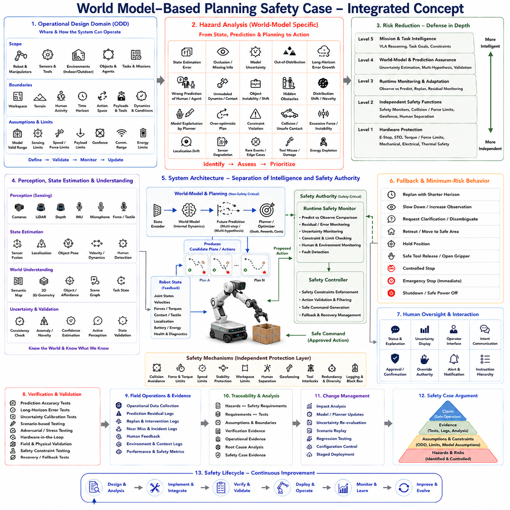{width="7.268055555555556in" height="7.268055555555556in"}

A world-model-based planning system allows a robot to predict how the environment may evolve under alternative actions before committing to physical execution. Instead of reacting only to current observations, the robot constructs an internal representation of objects, agents, geometry, dynamics, and task state, then simulates possible futures. This predictive capability can improve safety, but incorrect imagined futures can also produce confidently unsafe plans.

The safety case begins by defining the operational domain in which the world model has sufficient predictive validity. Relevant boundaries include robot embodiment, sensors, environments, object classes, interaction types, terrain, human activity, time horizon, action space, payloads, tools, and environmental dynamics. A model validated for structured indoor manipulation should not automatically be assumed reliable for unfamiliar outdoor terrain or rapidly changing human environments.

World-model uncertainty is a central safety concern because the predicted future is an estimate rather than a direct observation. Errors can arise from incomplete sensing, inaccurate state estimation, unknown dynamics, hidden objects, stochastic events, or limitations in learned representations. The planner should therefore distinguish between likely predictions and uncertain possibilities rather than treating a single predicted trajectory as a guaranteed description of the future.

State representation determines which aspects of the physical world can influence planning. If the latent state omits friction, object stability, human presence, payload condition, or another safety-relevant variable, predictions may appear internally consistent while ignoring real hazards. Safety analysis should therefore examine not only prediction accuracy but also whether the representation preserves the physical and semantic information required for safe decisions.

Action-conditioned prediction creates a direct relationship between proposed behavior and imagined consequences. The model may estimate how moving, grasping, pushing, turning, accelerating, or interacting with an object changes future states. Safety depends on whether these predicted transitions remain valid across the intended action range. Actions outside well-supported regions should receive higher uncertainty or be rejected rather than extrapolated with unjustified confidence.

Long-horizon prediction introduces compounding error. A small state error at one prediction step can influence the next predicted state and gradually produce a future that diverges significantly from reality. Planning should therefore account for prediction horizon and uncertainty growth. Near-term predictions may support detailed control decisions, while distant predictions should generally be treated more conservatively and revised as new observations become available.

Multi-hypothesis prediction is important when the future depends on uncertain human or environmental behavior. A person may stop, continue walking, turn, or enter the robot\'s path, while an object may remain stable or shift after contact. Safety-aware planning should evaluate several plausible futures and their consequences rather than optimizing exclusively for the most probable prediction. Low-probability but high-consequence outcomes may still require avoidance.

Prediction error becomes particularly dangerous when the planner optimizes aggressively against imperfections in the world model. A planning algorithm may discover actions that appear highly effective in simulation because they exploit unrealistic model behavior. Physical execution can then fail even though the predicted reward is high. Constraints, uncertainty penalties, conservative objectives, and independent validation should prevent optimization from converting model weaknesses into hazardous actions.

World-model planning should therefore separate task optimization from safety authorization. The planner may search imagined futures for actions that achieve mission objectives, but proposed actions should pass through independently enforceable safety constraints before execution. Collision limits, speed, force, stability, workspace boundaries, human separation, tool restrictions, geofences, and actuator limits should not depend solely on the world model\'s predicted safety.

Runtime assurance closes the loop between imagined and observed reality. During execution, the system should compare predicted state transitions with actual sensor observations and robot telemetry. Differences in object motion, human behavior, contact, robot dynamics, localization, or environmental state provide evidence that the current world model is becoming unreliable. Increasing prediction error should reduce planning authority and trigger observation, replanning, or fallback behavior.

Model predictive operation can improve recoverability because plans are repeatedly updated rather than executed open-loop. After each action or short sequence, new observations can update the internal state and future predictions. This receding-horizon approach allows the robot to respond when reality differs from expectation. Safety depends on maintaining sufficiently frequent observation and replanning so that deviations are detected before recovery options disappear.

Perception and state estimation remain fundamental because the quality of prediction depends on the quality of the current state. Occlusion, sensor degradation, localization error, incorrect object pose, or missed human presence can initialize the world model incorrectly. Sensor consistency checks, uncertainty estimation, state validation, and active perception should therefore precede consequential planning when the current world state is insufficiently known.

Active perception can itself become part of safe planning. Instead of immediately manipulating an uncertain object or entering a partially observed area, the robot may move a camera, change viewpoint, slow down, inspect the environment, or gather additional sensor information. Planning can therefore optimize not only task progress but also information gain, allowing uncertainty to be reduced before physical commitment to actions with potentially irreversible consequences.

Human prediction requires particular caution because human behavior is neither fully deterministic nor completely observable. A world model may predict trajectories, poses, intentions, or interaction responses, but these estimates should not be interpreted as guarantees. Conservative separation, multiple behavioral hypotheses, independent human detection, and protective stopping remain necessary even when learned prediction provides highly accurate average performance.

Physical interaction presents another challenge because contact dynamics can be difficult to model precisely. Friction, compliance, deformation, grasp quality, surface conditions, and payload properties may cause real outcomes to differ from predicted ones. Manipulation plans should therefore combine model-based anticipation with force monitoring, tactile feedback, compliant control, and physical limits so that unexpected contact does not escalate into excessive force or instability.

Rare events and distribution shift can invalidate otherwise accurate predictions. Novel objects, unusual terrain, unexpected weather, equipment changes, sensor contamination, or abnormal human behavior may place the system outside the world model\'s training experience. Novelty detection and out-of-distribution monitoring should influence planning confidence, while uncertain situations should trigger reduced speed, additional observation, alternative plans, or refusal to proceed autonomously.

The relationship between the world model and task reward must also be examined. A planner optimized only for efficiency, speed, or task completion may select actions with insufficient safety margin even when predictions are accurate. Safety-aware objectives should incorporate uncertainty, recoverability, clearance, energy reserve, stability, human proximity, and failure consequences. Safety should remain a constraint on optimization rather than merely another reward term that can be traded away.

Fallback behavior should reflect both prediction confidence and physical state. Moderate model disagreement may require slower motion or shorter planning horizons, while persistent divergence may require stopping and rebuilding the state estimate. Severe localization loss, unexpected contact, unstable motion, human intrusion, or inability to identify a safe future may require retreat, controlled shutdown, or transition to a predefined minimum-risk state.

Emergency protection must remain independent of predictive reasoning. A world model may incorrectly predict that an action remains safe even as physical conditions deteriorate. Protective stops, actuator limits, collision monitoring, force limits, stability protection, geofencing, and emergency intervention should therefore operate without requiring agreement from the predictive model. Prediction can enhance safety awareness but should not possess final authority over hazardous physical energy.

Verification must evaluate prediction quality together with planning consequences. Average prediction error alone is insufficient because some small errors can produce major changes in selected actions. Testing should examine state estimation errors, hidden obstacles, unusual dynamics, human behavior variation, contact uncertainty, long prediction horizons, model exploitation, distribution shift, and situations where several plausible futures require different safety responses.

Counterfactual and scenario-based testing are particularly valuable because world models are explicitly designed to evaluate alternative futures. Simulation can compare predicted trajectories with known outcomes while systematically varying initial states, actions, disturbances, and uncertainty. Adversarial planning tests can search for cases where the planner exploits prediction errors, while rare-event scenarios can measure whether conservative constraints remain effective when the model is wrong.

Physical validation remains essential because prediction quality ultimately matters in the real world. Experiments should measure discrepancies between predicted and observed state transitions under representative motion, manipulation, terrain, payload, and human-interaction conditions. Logs should capture predictions, uncertainty estimates, selected plans, rejected alternatives, safety interventions, actual outcomes, replanning events, near misses, and minimum-risk transitions.

Traceability should connect hazards not only to safety controls but also to world-model assumptions. Relevant configuration evidence includes model version, training data, state representation, prediction horizon, supported action space, uncertainty method, planner parameters, safety constraints, sensor configuration, and validated operating conditions. This allows a change in prediction architecture or planning strategy to be recognized as a potential change to the safety argument.

Model and planner updates require controlled change management because improved predictive metrics do not necessarily imply safer planning. A new model may predict average trajectories more accurately while changing uncertainty calibration or introducing exploitable errors. Regression testing should therefore evaluate both predictive performance and downstream action selection, followed by scenario replay, safety-constraint testing, targeted physical validation, and staged deployment.

Operational monitoring should continuously collect evidence about prediction reliability after deployment. Prediction residuals, uncertainty calibration, planner interventions, fallback frequency, unfamiliar states, safety-monitor activations, and actual task outcomes can reveal where the validated model assumptions are weakening. This evidence can support retraining, revised constraints, new scenarios, or deliberate expansion and contraction of the approved operational domain.

The world-model-based planning safety case demonstrates that prediction is valuable precisely because it allows consequences to be considered before action, but predicted futures must never be confused with physical truth. Safe Physical AI requires uncertainty-aware imagination combined with observation, independent constraints, runtime comparison, and recoverability. The planner should remain prepared to abandon its imagined future whenever reality provides contradictory evidence.

A mature safety case therefore forms a closed assurance loop connecting perception, state estimation, world modeling, uncertainty, imagined futures, planning, independent safety authorization, physical execution, observation, and replanning. The objective is not to build a world model that is never wrong, but to ensure that prediction errors are detected early, planning authority contracts with uncertainty, and physical behavior remains bounded by independently enforceable safety mechanisms.

월드 모델 기반 계획 시스템(World-Model-Based Planning System)은 로봇이 물리적으로 행동을 실행하기 전에 대안 행동에 따라 환경이 어떻게 변화할지를 예측할 수 있도록 한다. 로봇은 현재 관측에만 반응하는 대신 객체, 에이전트, 기하학적 구조, 동역학 및 작업 상태에 대한 내부 표현(Internal Representation)을 구성하고 가능한 미래를 시뮬레이션한다. 이러한 예측 능력은 안전성을 향상시킬 수 있지만 잘못 상상된 미래(Imagined Future)는 높은 확신을 가진 위험한 계획을 생성할 수도 있다.

안전 사례(Safety Case)는 월드 모델(World Model)이 충분한 예측 유효성(Predictive Validity)을 갖는 운용 영역(Operational Domain)을 정의하는 것에서 시작한다. 관련 경계에는 로봇 형태(Embodiment), 센서, 환경, 객체 종류, 상호작용 유형, 지형, 인간 활동, 예측 시간 범위, 행동 공간(Action Space), 적재물, 도구 및 환경 동역학이 포함된다. 구조화된 실내 조작 환경에서 검증된 모델을 익숙하지 않은 야외 지형이나 빠르게 변화하는 인간 환경에서도 자동으로 신뢰할 수 있다고 가정해서는 안 된다.

월드 모델 불확실성(World-Model Uncertainty)은 예측된 미래가 직접적인 관측이 아니라 추정값이기 때문에 핵심적인 안전 문제이다. 오류는 불완전한 센싱, 부정확한 상태 추정, 알려지지 않은 동역학, 가려진 객체, 확률적 사건 또는 학습된 표현의 한계로부터 발생할 수 있다. 따라서 플래너(Planner)는 하나의 예측 궤적을 보장된 미래로 취급하기보다 가능성이 높은 예측과 불확실한 가능성을 구분해야 한다.

상태 표현(State Representation)은 물리적 세계의 어떤 요소가 계획에 영향을 줄 수 있는지를 결정한다. 잠재 상태(Latent State)가 마찰, 객체 안정성, 사람의 존재, 적재물 상태 또는 기타 안전 관련 변수를 포함하지 않는다면 예측은 실제 위험을 무시하면서도 내부적으로 일관되어 보일 수 있다. 따라서 안전 분석은 단순한 예측 정확도뿐만 아니라 표현이 안전한 의사결정에 필요한 물리적·의미론적 정보를 보존하는지도 검토해야 한다.

행동 조건부 예측(Action-Conditioned Prediction)은 제안된 행동과 상상된 결과(Imagined Consequence)를 직접 연결한다. 모델은 이동, 파지, 밀기, 회전, 가속 또는 객체와의 상호작용이 미래 상태를 어떻게 변화시키는지 추정할 수 있다. 안전성은 이러한 예측된 상태 전이가 의도된 행동 범위에서 유효한지에 달려 있다. 충분히 검증되지 않은 영역의 행동은 근거 없는 높은 확신으로 외삽(Extrapolation)하기보다 더 높은 불확실성을 부여하거나 거부해야 한다.

장기 예측(Long-Horizon Prediction)은 누적 오류(Compounding Error)를 발생시킨다. 한 예측 단계의 작은 상태 오류가 다음 예측 상태에 영향을 미치면서 실제와 크게 다른 미래를 점진적으로 생성할 수 있다. 따라서 계획에서는 예측 시간 범위와 불확실성 증가를 함께 고려해야 한다. 단기 예측은 세부적인 제어 의사결정을 지원할 수 있지만 먼 미래에 대한 예측은 일반적으로 더 보수적으로 취급하고 새로운 관측을 확보할 때마다 수정해야 한다.

다중 가설 예측(Multi-Hypothesis Prediction)은 미래가 불확실한 인간 행동이나 환경 변화에 의존할 때 중요하다. 사람은 멈추거나, 계속 걷거나, 방향을 바꾸거나, 로봇의 경로로 들어올 수 있으며 객체도 접촉 이후 안정된 상태를 유지하거나 움직일 수 있다. 안전 인지형 계획(Safety-Aware Planning)은 가장 가능성이 높은 하나의 예측만 최적화하기보다 여러 개의 가능한 미래와 그 결과를 평가해야 한다. 발생 확률이 낮더라도 결과가 심각한 상황은 회피가 필요할 수 있다.

플래너가 월드 모델의 불완전성을 공격적으로 활용하도록 최적화될 경우 예측 오류(Prediction Error)는 특히 위험해진다. 계획 알고리즘은 비현실적인 모델 행동을 이용하기 때문에 시뮬레이션에서 매우 효과적으로 보이는 행동을 발견할 수 있다. 이 경우 예측 보상은 높더라도 실제 물리적 실행은 실패할 수 있다. 제약조건, 불확실성 페널티(Uncertainty Penalty), 보수적 목적함수 및 독립적 검증을 통해 최적화 과정이 모델의 약점을 위험한 행동으로 변환하지 못하도록 해야 한다.

따라서 월드 모델 기반 계획(World-Model Planning)은 작업 최적화(Task Optimization)와 안전 승인(Safety Authorization)을 분리해야 한다. 플래너는 상상된 미래를 탐색하여 임무 목표를 달성하는 행동을 찾을 수 있지만 제안된 행동은 실행 전에 독립적으로 강제 가능한 안전 제약조건을 통과해야 한다. 충돌 한계, 속도, 힘, 안정성, 작업 공간 경계, 인간 분리 거리, 도구 제한, 지오펜스(Geofence) 및 액추에이터 한계는 월드 모델이 예측한 안전성에만 의존해서는 안 된다.

런타임 보증(Runtime Assurance)은 상상된 현실과 실제로 관측된 현실 사이의 루프를 닫는다. 실행 중 시스템은 예측된 상태 전이와 실제 센서 관측 및 로봇 텔레메트리(Telemetry)를 비교해야 한다. 객체 움직임, 인간 행동, 접촉, 로봇 동역학, 위치추정 또는 환경 상태의 차이는 현재 월드 모델의 신뢰성이 저하되고 있음을 나타낸다. 예측 오류가 증가하면 계획 권한(Planning Authority)을 감소시키고 추가 관측, 재계획(Replanning) 또는 폴백 동작(Fallback Behavior)을 실행해야 한다.

모델 예측 기반 운용(Model Predictive Operation)은 계획을 개방 루프(Open-Loop) 방식으로 실행하지 않고 반복적으로 업데이트하기 때문에 복구 가능성(Recoverability)을 향상시킬 수 있다. 각각의 행동 또는 짧은 행동 시퀀스 이후 새로운 관측을 통해 내부 상태와 미래 예측을 갱신할 수 있다. 이러한 이동 지평선 방식(Receding-Horizon Approach)을 통해 현실이 예상과 달라졌을 때 대응할 수 있다. 안전을 위해서는 복구 선택지가 사라지기 전에 편차를 감지할 수 있을 정도로 충분히 빈번한 관측과 재계획이 유지되어야 한다.

인지 및 상태 추정(Perception and State Estimation)은 예측 품질이 현재 상태의 품질에 의존하기 때문에 기본적인 요소이다. 가림(Occlusion), 센서 성능 저하, 위치추정 오류, 잘못된 객체 자세 또는 사람 탐지 실패는 처음부터 월드 모델을 잘못된 상태로 초기화할 수 있다. 따라서 현재 세계 상태를 충분히 파악하지 못한 경우 중요한 계획을 수행하기 전에 센서 일관성 검사, 불확실성 추정, 상태 검증 및 능동 인지(Active Perception)를 수행해야 한다.

능동 인지(Active Perception)는 그 자체로 안전 계획(Safe Planning)의 일부가 될 수 있다. 불확실한 객체를 즉시 조작하거나 부분적으로만 관측된 영역에 진입하는 대신 로봇은 카메라를 이동하고, 관점을 변경하고, 감속하고, 환경을 검사하거나 추가적인 센서 정보를 수집할 수 있다. 따라서 계획은 작업 진행뿐만 아니라 정보 획득량(Information Gain)도 최적화하여 되돌리기 어려운 결과를 초래할 수 있는 행동을 물리적으로 실행하기 전에 불확실성을 감소시킬 수 있다.

인간 예측(Human Prediction)은 인간 행동이 완전히 결정론적이지도 않고 완전히 관측 가능하지도 않기 때문에 특별한 주의가 필요하다. 월드 모델은 인간의 궤적, 자세, 의도 또는 상호작용 반응을 예측할 수 있지만 이러한 추정값을 보장된 결과로 해석해서는 안 된다. 학습 기반 예측이 평균적으로 매우 높은 성능을 제공하더라도 보수적인 분리 거리, 복수의 행동 가설, 독립적인 인간 감지 및 보호 정지(Protective Stop)가 여전히 필요하다.

물리적 상호작용(Physical Interaction)은 접촉 동역학(Contact Dynamics)을 정확하게 모델링하기 어렵다는 또 다른 문제를 제기한다. 마찰, 순응성(Compliance), 변형, 파지 품질, 표면 상태 및 적재물 특성으로 인해 실제 결과가 예측과 달라질 수 있다. 따라서 조작 계획은 모델 기반 예측과 힘 모니터링, 촉각 피드백(Tactile Feedback), 순응 제어(Compliant Control) 및 물리적 한계를 결합하여 예상하지 못한 접촉이 과도한 힘이나 불안정성으로 확대되지 않도록 해야 한다.

희귀 사건(Rare Event)과 분포 변화(Distribution Shift)는 일반적으로 정확한 예측도 무효화할 수 있다. 새로운 객체, 특이한 지형, 예상하지 못한 기상, 장비 변경, 센서 오염 또는 비정상적인 인간 행동은 시스템을 월드 모델의 학습 경험 밖으로 이동시킬 수 있다. 신규성 감지(Novelty Detection)와 분포 외 모니터링(Out-of-Distribution Monitoring)은 계획 신뢰도에 영향을 주어야 하며 불확실한 상황에서는 감속, 추가 관측, 대안 계획 또는 자율 진행 거부가 실행되어야 한다.

월드 모델과 작업 보상(Task Reward) 사이의 관계도 검토해야 한다. 효율성, 속도 또는 작업 완료만을 기준으로 최적화된 플래너는 예측이 정확하더라도 충분한 안전 여유(Safety Margin)가 없는 행동을 선택할 수 있다. 안전 인지형 목적함수(Safety-Aware Objective)는 불확실성, 복구 가능성, 여유 거리, 에너지 예비량, 안정성, 인간 근접성 및 실패 결과를 고려해야 한다. 안전은 다른 보상을 위해 희생할 수 있는 단순한 보상 항목이 아니라 최적화 자체를 제한하는 제약조건으로 유지되어야 한다.

폴백 동작(Fallback Behavior)은 예측 신뢰도와 실제 물리적 상태를 모두 반영해야 한다. 중간 수준의 모델 불일치는 감속이나 더 짧은 계획 지평선(Planning Horizon)을 요구할 수 있으며, 지속적인 편차는 정지와 상태 추정의 재구성을 요구할 수 있다. 심각한 위치추정 상실, 예상하지 못한 접촉, 불안정한 움직임, 사람의 진입 또는 안전한 미래를 식별할 수 없는 상황에서는 후퇴, 제어 종료(Controlled Shutdown) 또는 사전에 정의된 최소 위험 상태(Minimum-Risk State)로 전환해야 할 수 있다.

비상 보호(Emergency Protection)는 예측 추론(Predictive Reasoning)과 독립적으로 유지되어야 한다. 실제 물리적 조건이 악화되는 상황에서도 월드 모델은 행동이 안전하다고 잘못 예측할 수 있다. 따라서 보호 정지, 액추에이터 한계, 충돌 모니터링, 힘 제한, 안정성 보호, 지오펜싱 및 비상 개입은 예측 모델의 동의를 필요로 하지 않고 작동해야 한다. 예측은 안전 인식을 강화할 수 있지만 위험한 물리적 에너지에 대한 최종 권한을 가져서는 안 된다.

검증(Verification)은 예측 품질과 계획 결과를 함께 평가해야 한다. 평균 예측 오류만으로는 충분하지 않다. 일부 작은 예측 오류가 선택되는 행동을 크게 변화시킬 수 있기 때문이다. 시험은 상태 추정 오류, 가려진 장애물, 비정상적인 동역학, 인간 행동 변화, 접촉 불확실성, 장기 예측, 모델 약점 활용(Model Exploitation), 분포 변화 및 여러 개의 가능한 미래가 서로 다른 안전 대응을 요구하는 상황을 포함해야 한다.

반사실적 시험(Counterfactual Testing)과 시나리오 기반 시험(Scenario-Based Testing)은 월드 모델이 본질적으로 대안적인 미래를 평가하도록 설계되기 때문에 특히 유용하다. 시뮬레이션(Simulation)은 초기 상태, 행동, 외란 및 불확실성을 체계적으로 변화시키면서 예측 궤적과 알려진 결과를 비교할 수 있다. 적대적 계획 시험(Adversarial Planning Test)은 플래너가 예측 오류를 악용하는 상황을 탐색할 수 있으며 희귀 사건 시나리오는 모델이 잘못되었을 때도 보수적인 제약조건이 유효한지를 평가할 수 있다.

물리적 검증(Physical Validation)은 궁극적으로 예측 품질이 실제 세계에서 의미를 갖기 때문에 필수적이다. 실험은 대표적인 움직임, 조작, 지형, 적재물 및 인간 상호작용 조건에서 예측된 상태 전이와 실제 관측된 상태 전이 사이의 차이를 측정해야 한다. 로그에는 예측, 불확실성 추정값, 선택된 계획, 거부된 대안, 안전 개입, 실제 결과, 재계획 이벤트, 근접 사고(Near Miss) 및 최소 위험 상태 전환이 기록되어야 한다.

추적성(Traceability)은 위험을 안전 제어뿐만 아니라 월드 모델의 가정(World-Model Assumptions)과도 연결해야 한다. 관련 구성 증거(Configuration Evidence)에는 모델 버전, 학습 데이터, 상태 표현, 예측 시간 범위, 지원되는 행동 공간, 불확실성 평가 방법, 플래너 파라미터, 안전 제약조건, 센서 구성 및 검증된 운용 조건이 포함된다. 이를 통해 예측 아키텍처나 계획 전략의 변경을 안전 논증(Safety Argument)의 잠재적인 변경으로 식별할 수 있다.

모델 및 플래너 업데이트(Model and Planner Update)에는 통제된 변경 관리(Controlled Change Management)가 필요하다. 향상된 예측 성능 지표가 반드시 더 안전한 계획을 의미하지는 않기 때문이다. 새로운 모델은 평균 궤적을 더 정확하게 예측하면서도 불확실성 보정(Uncertainty Calibration)을 변화시키거나 플래너가 악용할 수 있는 새로운 오류를 만들 수 있다. 따라서 회귀 시험(Regression Testing)은 예측 성능과 하위 행동 선택을 함께 평가하고, 이후 시나리오 재실행, 안전 제약 시험, 대상 물리 검증 및 단계적 배포(Staged Deployment)를 수행해야 한다.

운용 모니터링(Operational Monitoring)은 배포 이후에도 예측 신뢰성에 관한 증거를 지속적으로 수집해야 한다. 예측 잔차(Prediction Residual), 불확실성 보정, 플래너 개입, 폴백 발생 빈도, 익숙하지 않은 상태, 안전 모니터 활성화 및 실제 작업 결과를 통해 검증된 모델 가정이 약화되는 영역을 발견할 수 있다. 이러한 증거는 재학습(Retraining), 제약조건 수정, 새로운 시험 시나리오 추가 또는 승인된 운용 영역의 의도적인 확대와 축소를 지원할 수 있다.

월드 모델 기반 계획 안전 사례(World-Model-Based Planning Safety Case)는 행동 전에 결과를 고려할 수 있다는 점에서 예측이 매우 가치 있지만 예측된 미래를 물리적 현실(Physical Truth)과 혼동해서는 안 된다는 것을 보여준다. 안전한 피지컬 AI(Safe Physical AI)는 불확실성을 고려하는 상상(Uncertainty-Aware Imagination)을 실제 관측, 독립적인 제약조건, 런타임 비교 및 복구 가능성과 결합해야 한다. 현실에서 상상된 미래와 모순되는 증거가 나타나는 즉시 플래너는 기존 예측을 포기할 준비가 되어 있어야 한다.

성숙한 안전 사례는 인지, 상태 추정, 월드 모델링(World Modeling), 불확실성, 상상된 미래, 계획, 독립적인 안전 승인, 물리적 실행, 관측 및 재계획을 연결하는 폐쇄형 보증 루프(Closed Assurance Loop)를 형성한다. 목표는 절대로 틀리지 않는 월드 모델을 구축하는 것이 아니라 예측 오류를 조기에 탐지하고, 불확실성이 증가할수록 계획 권한을 축소하며, 물리적 행동이 독립적으로 강제 가능한 안전 메커니즘(Independently Enforceable Safety Mechanisms)의 경계 안에 계속 유지되도록 보장하는 것이다.

##  

## 09.10. Heterogeneous Fleet Safety Case

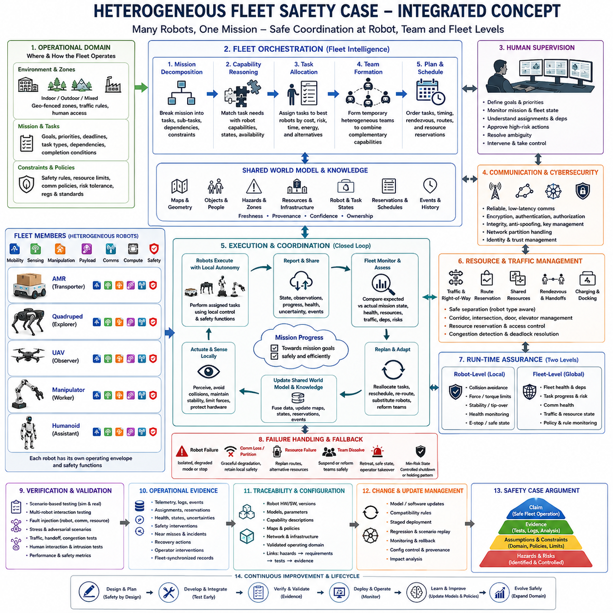{width="7.268055555555556in" height="7.268055555555556in"}

A heterogeneous fleet safety case addresses the risks created when robots with different embodiments, capabilities, operating envelopes, and failure modes cooperate as one coordinated Physical AI system. An AMR, quadruped, UAV, manipulator, and humanoid may individually satisfy their own safety constraints while still creating unsafe interactions at fleet level. Assurance must therefore cover both robot-local safety and hazards emerging from coordination, shared resources, and collective decisions.

The safety case begins by defining the operational domain of the fleet rather than only the domains of individual robots. It must describe environments, zones, missions, traffic rules, infrastructure, communication conditions, human access, shared resources, and permitted combinations of robot types. Each robot retains an embodiment-specific operating envelope, while fleet orchestration must ensure that assigned tasks and coordinated behaviors remain inside those individual envelopes.

Heterogeneity creates asymmetric hazards because robots differ in mobility, sensing, manipulation, payload, communication, computation, and safety capability. A UAV may observe areas inaccessible to an AMR, while a quadruped may traverse terrain unsuitable for wheeled platforms and a manipulator may introduce contact hazards absent from an observer robot. Fleet-level reasoning must understand these differences rather than treating all robots as interchangeable agents.

Capability descriptions provide a foundation for safe task allocation. Each robot should expose machine-readable information describing embodiment, mobility, sensing, payload, manipulation, communication, computation, operational constraints, safety limits, and current state. Fleet intelligence can then compare mission requirements with available capabilities. An incorrect or outdated capability description can become a safety hazard if it causes a task to be assigned to a robot that cannot safely perform it.

Task allocation must therefore consider risk as well as efficiency. Selecting the fastest or nearest robot is insufficient when terrain compatibility, payload limits, sensor coverage, energy reserve, tool availability, human proximity, or recovery capability differ among platforms. Assignment should verify that required capabilities are available under current conditions and preserve alternatives when a robot failure could otherwise leave the mission in an unsafe or unrecoverable state.

Temporary team formation introduces additional dependencies. Heterogeneous robots may combine complementary capabilities, such as a UAV providing aerial perception while a quadruped explores terrain and an AMR transports equipment. The safety case must examine whether one robot\'s action depends critically on another robot\'s sensing, timing, communication, or positioning. Loss of a supporting member should trigger reassessment rather than allowing dependent robots to continue under invalid assumptions.

Shared world knowledge enables coordinated operation by combining maps, objects, people, hazards, zones, resources, robot states, task states, reservations, infrastructure, events, and historical information. This shared representation can improve fleet awareness, but stale or conflicting information can also propagate risk across multiple robots. Every safety-relevant shared state should therefore include freshness, provenance, confidence, and ownership information sufficient to judge whether it remains suitable for decision-making.

Distributed perception creates both strength and uncertainty. Different robots observe the same environment from different viewpoints and with different sensors, producing opportunities for cross-validation but also conflicting interpretations. Fleet fusion should not convert disagreement into artificial certainty. When robots disagree about a hazard, human location, traversability, obstacle, or resource state, conservative arbitration or additional observation may be preferable to automatically selecting one estimate.

Traffic management becomes a fleet-level safety function when multiple robots share corridors, intersections, doors, elevators, landing zones, work cells, or narrow passages. Route reservation, right-of-way, priority rules, safe separation, and congestion management must account for embodiment differences. Separation suitable between two slow AMRs may be inadequate when one participant is a UAV, quadruped, humanoid, or robot carrying a hazardous payload.

Shared infrastructure creates further coordination hazards. Charging stations, docking points, elevators, doors, tools, storage areas, work cells, communication networks, and utilities may become contested resources. Reservations and availability information should prevent incompatible simultaneous access and unsafe handoffs. Resource failure must also be considered because a blocked elevator, unavailable charger, or inaccessible docking station may invalidate routes, energy assumptions, or recovery plans.

Rendezvous and handoff operations require explicit safety coordination because robots with different kinematics and sensing characteristics enter close proximity. Transfer of objects, tools, information, or responsibility should occur only when identity, pose, readiness, payload state, and task state are mutually consistent. Timeout, disagreement, communication loss, or unexpected motion should abort the handoff and return both participants to independently safe conditions.

Fleet communication is safety-relevant but should not become a single dependency for local protection. Network latency, packet loss, congestion, partitioning, or complete disconnection can produce inconsistent fleet state. Robots must retain local collision avoidance, stability protection, force limitation, emergency behavior, and other embodiment-specific safety functions. Fleet coordination should degrade gracefully while essential local autonomy remains available during intermittent connectivity.

A hybrid control architecture is therefore particularly appropriate for heterogeneous fleets. Fast physical control and immediate safety responses remain local, while broader mission decomposition, capability reasoning, task allocation, scheduling, and resource optimization can occur at fleet level. Authority should be placed where the necessary information and timing are available. Loss of fleet intelligence should reduce coordination performance rather than remove the ability of individual robots to remain safe.

Fleet orchestration must itself be bounded by independent safety authority. An intelligent orchestrator may decompose missions, form teams, allocate tasks, optimize schedules, and replan after failures, but it should not override embodiment-specific safety constraints. A fleet command requesting an unsafe speed, payload, terrain traversal, tool operation, flight region, or human interaction should be rejected locally even if that command is globally optimal according to mission objectives.

Runtime assurance must operate at both robot and fleet levels. Local monitors evaluate physical state, perception, actuators, stability, force, energy, and immediate hazards, while fleet monitoring tracks robot health, task progress, uncertainty, communication, shared resources, traffic, and coordination dependencies. Combining these levels enables the system to recognize when a locally healthy robot is participating in a globally unsafe configuration.

Execution should therefore form a continuous monitoring and adaptation loop. Robots execute assigned tasks with local autonomy, report progress and observations, and update health and uncertainty. Fleet intelligence compares actual conditions with expected mission state and may replan, reassign, reschedule, substitute robots, or reform teams. Recovery is not simply restarting failed execution but restructuring coordination around the capabilities that remain safely available.

Robot failure must be treated as a change in fleet topology and capability, not merely as an isolated component fault. If an observer UAV fails, another robot may lose environmental information; if a relay robot disappears, communication coverage may fragment; if a transporter becomes unavailable, downstream tasks may become impossible. Dependency-aware monitoring should identify which assumptions and assignments become invalid whenever a fleet member is degraded or removed.

Fallback behavior should exist at multiple scopes. An individual robot may slow, stop, retreat, land, stabilize, release a task, or enter a minimum-risk state. A team may suspend coordinated execution or dissolve, while the fleet may reallocate tasks, reserve alternative resources, change routes, or reduce mission scope. The response should prevent a local degradation from cascading into increasingly unsafe collective behavior.

Deadlock and congestion deserve explicit safety treatment because locally reasonable decisions can create globally undesirable patterns. Multiple robots may wait for one another, block escape routes, compete for charging resources, or enter narrow spaces that prevent safe recovery. Fleet policies should detect these patterns and preserve priority rules, escape paths, resource margins, and controlled mechanisms for breaking coordination deadlocks.

Human interaction must be considered across the fleet rather than robot by robot. A person may be simultaneously approached by an AMR, observed by a UAV, and working near a manipulator. Individually acceptable actions can combine into excessive workload, restricted escape space, confusing behavior, or cumulative physical risk. Shared human-state awareness and fleet-level separation policies should prevent independent robots from creating unsafe aggregate interactions.

Human supervision remains important for defining mission goals, priorities, and acceptable risk, particularly when the fleet encounters ambiguity or novel conditions. Operators should be able to monitor mission state, understand robot assignments and dependencies, approve high-risk actions, and intervene when necessary. Fleet interfaces should expose uncertainty and degraded states rather than presenting a simplified appearance of coordination when underlying information is inconsistent.

Cybersecurity and identity become safety concerns because coordinated robots exchange commands, maps, capability descriptions, reservations, and model updates. Robot identity, authentication, authorization, encrypted communication, integrity protection, and provenance should prevent an unauthorized or compromised participant from influencing fleet behavior. A robot that cannot establish trusted identity or configuration should not automatically receive the same coordination authority as a validated fleet member.

Verification must extend beyond testing each robot independently. Scenario testing should examine simultaneous operations, conflicting routes, communication partitions, robot failures, delayed state updates, resource contention, incorrect capability descriptions, handoff failures, localization disagreement, congestion, human intrusion, and emergency responses. The key question is whether interactions among individually acceptable behaviors can generate unacceptable fleet-level outcomes.

Simulation is especially valuable because fleet complexity grows rapidly with robot number, embodiment diversity, task dependencies, and environmental dynamics. Large-scale scenarios can vary fleet composition, communication topology, resource availability, traffic density, failure timing, and human behavior. Testing should deliberately search for emergent hazards, including situations where locally optimal decisions produce globally unsafe congestion, dependency, or coordination patterns.

Physical fleet testing remains necessary because communication performance, sensing interference, traffic behavior, handoffs, shared-resource access, and human reactions cannot be represented perfectly in simulation. Operational evidence should capture robot states, assignments, reservations, communications, safety interventions, near misses, task reallocations, deadlocks, resource conflicts, failures, recovery actions, and operator interventions with synchronized fleet-wide timing.

Traceability must connect fleet hazards to both common and embodiment-specific requirements. Safety evidence should identify robot hardware, software, AI models, capability descriptions, safety parameters, network configuration, fleet policies, maps, orchestration software, and infrastructure versions. This configuration knowledge is essential because the same orchestration policy may produce different risk when fleet composition or individual robot capabilities change.

Software and AI change management becomes particularly challenging when different fleet members operate different versions during deployment. Model signing, version registration, compatibility rules, staged deployment, monitoring, and rollback should prevent incompatible updates from creating unsafe coordination. Operational evidence must remain associated with the exact configurations running on each robot so that fleet behavior can be reconstructed after an incident.

The heterogeneous fleet safety case demonstrates that collective capability creates collective risk as well as collective intelligence. Different embodiments provide complementary mobility, sensing, manipulation, and interaction capabilities, allowing the fleet to accomplish missions beyond any single robot. Yet coordination also introduces dependencies, shared-state errors, resource conflicts, communication failures, and emergent behaviors that cannot be addressed solely through individual robot certification.

A mature heterogeneous fleet safety case therefore becomes a living assurance framework connecting robot-local safety, capability models, shared world knowledge, orchestration, communication, traffic management, resource coordination, runtime assurance, human supervision, verification, operational evidence, and configuration management. Its central objective is to ensure that many robots with different capabilities can behave as one coordinated system without allowing fleet-level intelligence to exceed the independently validated physical safety authority of its members.

이기종 플릿 안전 사례(Heterogeneous Fleet Safety Case)는 서로 다른 형태(Embodiment), 능력, 운용 범위 및 고장 형태를 가진 로봇들이 하나의 통합된 피지컬 AI(Physical AI) 시스템으로 협력할 때 발생하는 위험을 다룬다. AMR, 4족 보행 로봇(Quadruped), 무인항공기(UAV), 매니퓰레이터(Manipulator), 휴머노이드(Humanoid)는 각각 자체 안전 제약조건을 만족하더라도 플릿 수준에서는 위험한 상호작용을 만들 수 있다. 따라서 보증(Assurance)은 로봇 로컬 안전뿐만 아니라 협업, 공유 자원 및 집단 의사결정에서 발생하는 위험까지 포함해야 한다.

안전 사례(Safety Case)는 개별 로봇의 운용 영역만이 아니라 전체 플릿의 운용 영역(Operational Domain)을 정의하는 것에서 시작한다. 여기에는 환경, 구역, 임무, 교통 규칙, 기반시설, 통신 조건, 인간 접근, 공유 자원 및 허용되는 로봇 유형의 조합이 포함되어야 한다. 각 로봇은 형태별 운용 범위(Embodiment-Specific Operating Envelope)를 유지하며, 플릿 오케스트레이션(Fleet Orchestration)은 할당된 작업과 협조 행동이 각 로봇의 개별 운용 범위 안에 있도록 보장해야 한다.

이질성(Heterogeneity)은 로봇마다 이동성, 센싱, 조작, 적재 능력, 통신, 연산 능력 및 안전 기능이 다르기 때문에 비대칭적 위험(Asymmetric Hazard)을 발생시킨다. UAV는 AMR이 접근할 수 없는 영역을 관측할 수 있고, 4족 보행 로봇은 바퀴형 플랫폼이 이동하기 어려운 지형을 통과할 수 있으며, 매니퓰레이터는 관측 로봇에는 없는 접촉 위험을 발생시킬 수 있다. 따라서 플릿 수준의 추론은 모든 로봇을 상호 교환 가능한 에이전트(Interchangeable Agent)로 취급하지 않고 이러한 차이를 이해해야 한다.

능력 기술(Capability Description)은 안전한 작업 할당(Task Allocation)의 기반을 제공한다. 각 로봇은 형태, 이동성, 센싱, 적재 능력, 조작, 통신, 연산, 운용 제약조건, 안전 한계 및 현재 상태를 설명하는 기계 판독 가능 정보(Machine-Readable Information)를 제공해야 한다. 플릿 지능(Fleet Intelligence)은 이를 통해 임무 요구사항과 사용 가능한 능력을 비교할 수 있다. 잘못되거나 오래된 능력 정보는 안전하게 수행할 수 없는 작업을 특정 로봇에 할당하게 만들 수 있으므로 그 자체가 안전 위험이 될 수 있다.

따라서 작업 할당은 효율성뿐만 아니라 위험(Risk)도 고려해야 한다. 지형 적합성, 적재 한계, 센서 범위, 에너지 예비량, 도구 가용성, 인간 근접성 또는 복구 능력이 플랫폼마다 다르다면 가장 빠르거나 가장 가까운 로봇을 선택하는 것만으로는 충분하지 않다. 작업 할당은 현재 조건에서 필요한 능력을 사용할 수 있는지 검증하고, 하나의 로봇 고장으로 임무가 위험하거나 복구 불가능한 상태에 빠지지 않도록 대안을 유지해야 한다.

임시 팀 구성(Temporary Team Formation)은 추가적인 의존성을 발생시킨다. 예를 들어 UAV가 공중 인지를 제공하고, 4족 보행 로봇이 지형을 탐색하며, AMR이 장비를 운반하는 방식으로 서로 다른 로봇이 보완적인 능력을 결합할 수 있다. 안전 사례는 한 로봇의 행동이 다른 로봇의 센싱, 타이밍, 통신 또는 위치에 핵심적으로 의존하는지를 검토해야 한다. 지원 역할을 수행하는 구성원이 사라질 경우 의존 관계에 있는 로봇이 잘못된 가정 아래 계속 작업하지 않도록 상황을 재평가해야 한다.

공유 세계 지식(Shared World Knowledge)은 지도, 객체, 사람, 위험, 구역, 자원, 로봇 상태, 작업 상태, 예약, 기반시설, 이벤트 및 과거 정보를 통합함으로써 협조 운용을 가능하게 한다. 이러한 공유 표현(Shared Representation)은 플릿의 상황 인식을 향상시키지만 오래되거나 상충되는 정보가 여러 로봇에 위험을 전파할 수도 있다. 따라서 안전과 관련된 모든 공유 상태에는 의사결정에 계속 사용할 수 있는지를 판단할 수 있도록 최신성(Freshness), 출처(Provenance), 신뢰도 및 소유권 정보가 포함되어야 한다.

분산 인지(Distributed Perception)는 강점과 불확실성을 동시에 발생시킨다. 서로 다른 로봇이 서로 다른 관점과 센서를 통해 동일한 환경을 관측하면 교차 검증(Cross-Validation)의 기회가 생기지만 상충되는 해석도 발생할 수 있다. 플릿 융합(Fleet Fusion)은 이러한 불일치를 인위적인 확신으로 변환해서는 안 된다. 위험, 사람의 위치, 주행가능성, 장애물 또는 자원 상태에 대해 로봇 간 판단이 다를 경우 하나의 추정값을 자동으로 선택하기보다 보수적인 중재(Conservative Arbitration) 또는 추가 관측이 적절할 수 있다.

교통 관리(Traffic Management)는 여러 로봇이 복도, 교차로, 문, 엘리베이터, 착륙 구역, 작업 셀 또는 좁은 통로를 공유할 때 플릿 수준의 안전 기능이 된다. 경로 예약(Route Reservation), 통행 우선권(Right-of-Way), 우선순위 규칙, 안전 분리 및 혼잡 관리는 로봇 형태의 차이를 고려해야 한다. 느린 AMR 두 대 사이에서 적절한 분리 거리가 UAV, 4족 보행 로봇, 휴머노이드 또는 위험한 적재물을 운반하는 로봇이 참여하는 경우에는 충분하지 않을 수 있다.

공유 기반시설(Shared Infrastructure)은 추가적인 협조 위험을 발생시킨다. 충전소, 도킹 지점, 엘리베이터, 문, 도구, 저장 구역, 작업 셀, 통신 네트워크 및 유틸리티는 경쟁 자원(Contested Resource)이 될 수 있다. 예약과 가용성 정보는 서로 양립할 수 없는 동시 접근과 위험한 인계(Handoff)를 방지해야 한다. 또한 엘리베이터 차단, 충전기 사용 불가 또는 도킹 지점 접근 불가와 같은 자원 고장이 경로, 에너지 가정 또는 복구 계획을 무효화할 수 있으므로 이에 대한 고려도 필요하다.

랑데부 및 인계 작업(Rendezvous and Handoff Operation)은 서로 다른 운동학적 특성과 센싱 능력을 가진 로봇들이 가까운 거리로 접근하기 때문에 명시적인 안전 협조가 필요하다. 객체, 도구, 정보 또는 책임의 이전은 로봇의 식별 정보, 자세, 준비 상태, 적재물 상태 및 작업 상태가 상호 일치할 때만 수행되어야 한다. 시간 초과, 상태 불일치, 통신 손실 또는 예상하지 못한 움직임이 발생하면 인계를 중단하고 두 로봇 모두 독립적으로 안전한 상태로 복귀해야 한다.

플릿 통신(Fleet Communication)은 안전과 관련되지만 로컬 보호(Local Protection)를 위한 단일 의존성이 되어서는 안 된다. 네트워크 지연, 패킷 손실, 혼잡, 네트워크 분할(Network Partition) 또는 완전한 연결 단절은 일관되지 않은 플릿 상태를 만들 수 있다. 각 로봇은 로컬 충돌 회피, 안정성 보호, 힘 제한, 비상 행동 및 기타 형태별 안전 기능을 유지해야 한다. 플릿 협조 기능은 간헐적인 연결 상태에서도 필수 로컬 자율성이 유지되면서 점진적으로 성능이 저하(Graceful Degradation)되어야 한다.

따라서 하이브리드 제어 아키텍처(Hybrid Control Architecture)는 이기종 플릿에 특히 적합하다. 빠른 물리 제어와 즉각적인 안전 대응은 로컬에 유지하고, 보다 광범위한 임무 분해, 능력 추론, 작업 할당, 스케줄링 및 자원 최적화는 플릿 수준에서 수행할 수 있다. 필요한 정보와 시간적 요구조건이 존재하는 위치에 권한을 배치해야 한다. 플릿 지능의 상실은 개별 로봇의 안전 유지 능력을 제거하는 것이 아니라 협조 성능을 감소시키는 방향으로 작용해야 한다.

플릿 오케스트레이션(Fleet Orchestration) 자체도 독립적인 안전 권한(Safety Authority)에 의해 제한되어야 한다. 지능형 오케스트레이터(Intelligent Orchestrator)는 임무를 분해하고, 팀을 구성하고, 작업을 할당하고, 일정을 최적화하며, 고장 이후 재계획할 수 있지만 형태별 안전 제약조건을 무시해서는 안 된다. 안전하지 않은 속도, 적재물, 지형 통과, 도구 작동, 비행 영역 또는 인간 상호작용을 요구하는 플릿 명령은 임무 관점에서 전역적으로 최적이더라도 로컬에서 거부되어야 한다.

런타임 보증(Runtime Assurance)은 로봇과 플릿의 두 수준에서 모두 작동해야 한다. 로컬 모니터(Local Monitor)는 물리적 상태, 인지, 액추에이터, 안정성, 힘, 에너지 및 즉각적인 위험을 평가하고, 플릿 모니터링(Fleet Monitoring)은 로봇 상태, 작업 진행, 불확실성, 통신, 공유 자원, 교통 및 협조 의존성을 추적한다. 이러한 두 수준을 결합하면 로컬에서는 정상적인 로봇이 전역적으로 위험한 구성(Global Unsafe Configuration)에 참여하고 있는 상황을 식별할 수 있다.

따라서 실행은 지속적인 모니터링 및 적응 루프(Continuous Monitoring and Adaptation Loop)를 형성해야 한다. 로봇은 로컬 자율성을 이용해 할당된 작업을 실행하고 진행 상황과 관측 결과를 보고하며 상태 및 불확실성을 업데이트한다. 플릿 지능은 실제 조건과 예상된 임무 상태를 비교하여 재계획, 재할당, 재스케줄링, 로봇 대체 또는 팀 재구성을 수행할 수 있다. 복구(Recovery)는 단순히 실패한 실행을 다시 시작하는 것이 아니라 안전하게 사용할 수 있는 잔여 능력을 중심으로 협조 구조를 재구성하는 과정이다.

로봇 고장(Robot Failure)은 단순히 하나의 구성요소 고장으로 처리하는 것이 아니라 플릿 토폴로지(Fleet Topology)와 능력의 변화로 취급해야 한다. 관측 UAV가 고장 나면 다른 로봇이 환경 정보를 잃을 수 있고, 중계 로봇이 사라지면 통신 범위가 분할될 수 있으며, 운송 로봇을 사용할 수 없게 되면 후속 작업을 수행할 수 없게 될 수 있다. 의존성 인지형 모니터링(Dependency-Aware Monitoring)은 플릿 구성원이 성능 저하되거나 제거될 때 어떤 가정과 작업 할당이 더 이상 유효하지 않은지를 식별해야 한다.

폴백 동작(Fallback Behavior)은 여러 범위에서 존재해야 한다. 개별 로봇은 감속, 정지, 후퇴, 착륙, 안정화, 작업 해제 또는 최소 위험 상태(Minimum-Risk State)로 전환할 수 있다. 팀은 협조 실행을 일시 중지하거나 해체할 수 있으며, 전체 플릿은 작업을 재할당하고, 대체 자원을 예약하고, 경로를 변경하거나 임무 범위를 축소할 수 있다. 이러한 대응은 하나의 로컬 성능 저하가 점점 더 위험한 집단 행동으로 연쇄적으로 확대되는 것을 방지해야 한다.

교착 상태 및 혼잡(Deadlock and Congestion)은 로컬에서는 합리적인 의사결정들이 전역적으로 바람직하지 않은 패턴을 만들 수 있기 때문에 명시적인 안전 대상으로 다루어야 한다. 여러 로봇이 서로를 기다리거나, 탈출 경로를 막거나, 충전 자원을 경쟁하거나, 안전한 복구를 방해하는 좁은 공간에 진입할 수 있다. 플릿 정책은 이러한 패턴을 탐지하고 우선순위 규칙, 탈출 경로, 자원 여유 및 협조 교착 상태를 해소하기 위한 제어된 메커니즘을 유지해야 한다.

인간 상호작용(Human Interaction)은 개별 로봇 단위가 아니라 전체 플릿 관점에서도 고려되어야 한다. 한 사람이 AMR의 접근을 받는 동시에 UAV에 의해 관측되고 매니퓰레이터 근처에서 작업할 수 있다. 각각의 행동이 개별적으로 허용 가능하더라도 결합될 경우 과도한 작업 부담, 제한된 탈출 공간, 혼란스러운 행동 또는 누적된 물리적 위험을 만들 수 있다. 공유 인간 상태 인식(Shared Human-State Awareness)과 플릿 수준의 분리 정책을 통해 독립적인 로봇들이 위험한 집합적 상호작용을 만들지 않도록 해야 한다.

인간 감독(Human Supervision)은 특히 플릿이 모호하거나 새로운 상황을 만났을 때 임무 목표, 우선순위 및 허용 가능한 위험을 정의하는 데 중요하다. 운영자는 임무 상태를 모니터링하고, 로봇의 작업 할당과 의존성을 이해하며, 고위험 행동을 승인하고, 필요한 경우 개입할 수 있어야 한다. 플릿 인터페이스(Fleet Interface)는 내부 정보가 불일치하는 상황에서도 협조가 정상적으로 이루어지는 것처럼 단순화하여 표현하기보다 불확실성과 성능 저하 상태를 명확하게 표시해야 한다.

사이버보안 및 신원(Cybersecurity and Identity)은 협조하는 로봇들이 명령, 지도, 능력 기술, 예약 및 모델 업데이트를 교환하기 때문에 안전 문제로 이어진다. 로봇 신원, 인증(Authentication), 권한 부여(Authorization), 암호화 통신, 무결성 보호(Integrity Protection) 및 출처 정보는 승인되지 않았거나 침해된 구성원이 플릿 행동에 영향을 주는 것을 방지해야 한다. 신뢰할 수 있는 신원이나 구성을 확인할 수 없는 로봇에 검증된 플릿 구성원과 동일한 협조 권한을 자동으로 부여해서는 안 된다.

검증(Verification)은 각각의 로봇을 독립적으로 시험하는 수준을 넘어 확장되어야 한다. 시나리오 시험은 동시 운용, 경로 충돌, 통신 분할, 로봇 고장, 지연된 상태 업데이트, 자원 경쟁, 잘못된 능력 기술, 인계 실패, 위치추정 불일치, 혼잡, 인간 진입 및 비상 대응을 검토해야 한다. 핵심적인 질문은 개별적으로 허용 가능한 행동들의 상호작용이 플릿 수준에서 허용할 수 없는 결과를 생성할 수 있는가이다.

시뮬레이션(Simulation)은 로봇 수, 형태의 다양성, 작업 의존성 및 환경 동역학이 증가하면서 플릿의 복잡성이 빠르게 증가하기 때문에 특히 유용하다. 대규모 시나리오는 플릿 구성, 통신 토폴로지, 자원 가용성, 교통 밀도, 고장 발생 시점 및 인간 행동을 변화시킬 수 있다. 시험은 로컬에서 최적인 의사결정이 전역적으로 위험한 혼잡, 의존성 또는 협조 패턴을 생성하는 상황을 포함하여 창발적 위험(Emergent Hazard)을 의도적으로 탐색해야 한다.

실제 플릿 시험(Physical Fleet Testing)은 통신 성능, 센싱 간섭, 교통 행동, 인계, 공유 자원 접근 및 인간 반응을 시뮬레이션에서 완벽하게 표현할 수 없기 때문에 필요하다. 운용 증거(Operational Evidence)는 로봇 상태, 작업 할당, 예약, 통신, 안전 개입, 근접 사고(Near Miss), 작업 재할당, 교착 상태, 자원 충돌, 고장, 복구 행동 및 운영자 개입을 플릿 전체에 동기화된 시간 정보와 함께 기록해야 한다.

추적성(Traceability)은 플릿 위험을 공통 요구사항과 형태별 요구사항 모두에 연결해야 한다. 안전 증거(Safety Evidence)는 로봇 하드웨어, 소프트웨어, AI 모델, 능력 기술, 안전 파라미터, 네트워크 구성, 플릿 정책, 지도, 오케스트레이션 소프트웨어 및 기반시설 버전을 식별해야 한다. 동일한 오케스트레이션 정책이라도 플릿 구성이나 개별 로봇의 능력이 변화하면 서로 다른 위험을 발생시킬 수 있으므로 이러한 구성 정보가 필수적이다.

소프트웨어 및 AI 변경 관리(Change Management)는 배포 과정에서 서로 다른 플릿 구성원이 서로 다른 버전을 운용할 수 있기 때문에 특히 복잡해진다. 모델 서명(Model Signing), 버전 등록, 호환성 규칙, 단계적 배포(Staged Deployment), 모니터링 및 롤백(Rollback)을 통해 호환되지 않는 업데이트가 위험한 협조 행동을 만들지 않도록 해야 한다. 사고 이후 플릿 행동을 재구성할 수 있도록 운용 증거는 각 로봇에서 실제 실행되고 있었던 정확한 구성과 연결되어야 한다.

이기종 플릿 안전 사례(Heterogeneous Fleet Safety Case)는 집단 능력(Collective Capability)이 집단 지능(Collective Intelligence)뿐만 아니라 집단 위험(Collective Risk)도 발생시킨다는 것을 보여준다. 서로 다른 형태는 상호 보완적인 이동성, 센싱, 조작 및 상호작용 능력을 제공하여 단일 로봇으로는 수행할 수 없는 임무를 플릿이 수행하도록 한다. 그러나 협조는 개별 로봇의 안전 인증만으로는 해결할 수 없는 의존성, 공유 상태 오류, 자원 충돌, 통신 고장 및 창발적 행동(Emergent Behavior)도 발생시킨다.

성숙한 이기종 플릿 안전 사례는 로봇 로컬 안전(Robot-Local Safety), 능력 모델(Capability Model), 공유 세계 지식, 오케스트레이션, 통신, 교통 관리, 자원 협조, 런타임 보증, 인간 감독, 검증, 운용 증거 및 구성 관리를 연결하는 살아 있는 보증 프레임워크(Living Assurance Framework)가 된다. 핵심 목표는 서로 다른 능력을 가진 많은 로봇들이 하나의 협조 시스템으로 행동하도록 하면서도 플릿 수준의 지능(Fleet-Level Intelligence)이 각 구성원의 독립적으로 검증된 물리적 안전 권한(Physical Safety Authority)을 넘어서는 것을 방지하는 것이다.

##  

## 09.11. Runtime Assurance Case Study

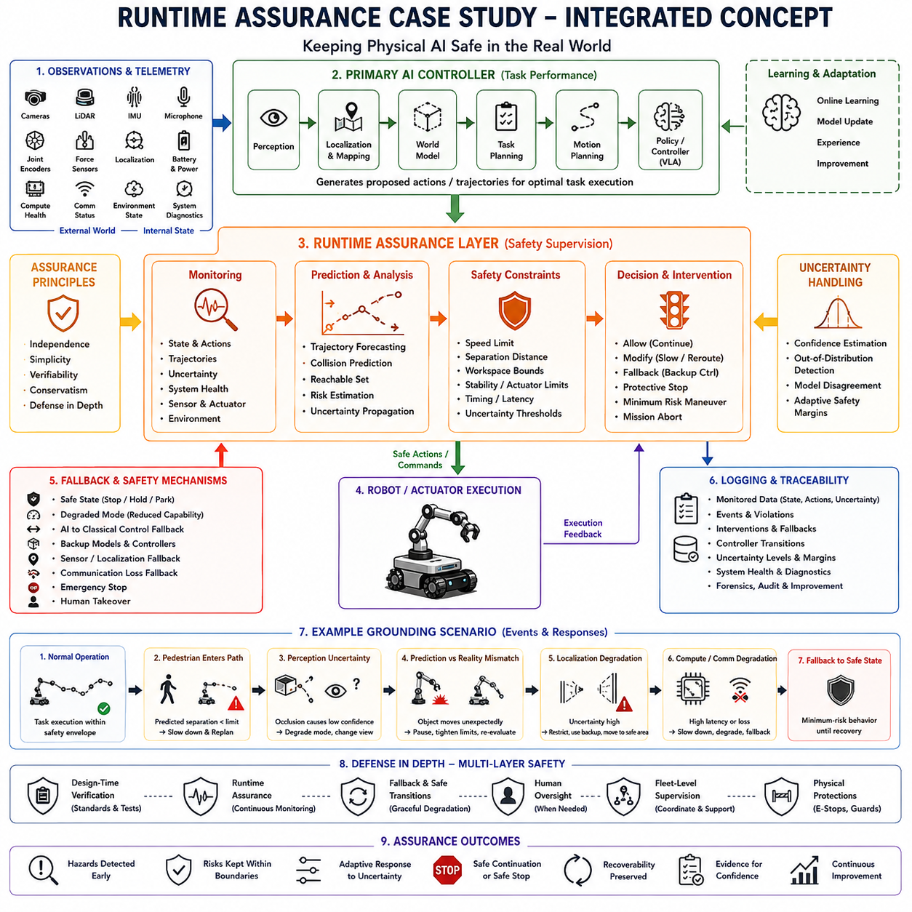{width="7.268055555555556in" height="7.268055555555556in"}

Runtime assurance provides a practical safety architecture for Physical AI systems whose primary controllers may be complex, adaptive, learned, or difficult to verify exhaustively before deployment. Instead of assuming that perception, world models, planners, VLA policies, or learned controllers will always behave correctly, an independent supervision layer continuously evaluates their outputs and the physical system state. Its purpose is to keep execution inside a validated safety envelope even when the primary intelligence becomes uncertain or degraded.

Consider a mobile manipulation robot operating autonomously in a mixed human workspace. Its primary AI controller combines perception, localization, a world model, task planning, motion planning, and a learned manipulation policy. The controller is optimized for task performance, adaptation, and efficiency, while a separate runtime assurance layer is responsible for monitoring safety-relevant conditions and deciding whether proposed actions may actually reach the actuators.

The case study begins with observations from cameras, LiDAR, joint encoders, force sensors, localization, battery monitoring, compute diagnostics, communication interfaces, and environmental sensing. These signals describe both the external world and internal robot condition. Runtime assurance does not merely observe the AI output; it combines proposed actions with independent evidence about robot state, sensor validity, actuator health, environmental conditions, and system resources.

During nominal operation, the AI controller proposes a trajectory for navigating toward a workstation and manipulating an object. The runtime monitor checks current and predicted states against active operational boundaries. These include speed, acceleration, separation distance, workspace limits, stability, actuator constraints, timing, localization quality, and uncertainty thresholds. If sufficient safety margin exists, the action is authorized and execution proceeds without unnecessary interference.

The first abnormal event occurs when a pedestrian unexpectedly enters the robot\'s projected path. Although the planner has already produced a valid trajectory, the runtime monitor detects that future separation will approach the permitted boundary. Rather than waiting for an actual violation, predictive checking estimates whether the commanded trajectory will remain inside the safety envelope. The assurance layer reduces speed and requests replanning while preserving enough distance for controlled intervention.

This illustrates an important property of runtime assurance: intervention should begin before a hazardous state is reached. Safety margins represent remaining room for correction, not merely binary safe or unsafe labels. As the robot approaches a boundary, the supervisor can progressively reduce speed, increase separation, restrict acceleration, shorten planning horizons, or disable uncertain capabilities. More severe boundary conditions lead to stronger intervention.

After the pedestrian clears the route, the robot resumes its mission and approaches the manipulation station. A second abnormal condition appears when visual confidence decreases because part of the target object becomes occluded. The learned policy still proposes a grasp, but runtime model-health monitoring observes degraded input validity and increased uncertainty. The system therefore prevents the uncertain perception result from automatically becoming an unrestricted physical action.

The assurance architecture evaluates multiple health indicators rather than relying on one confidence score. Input validity, distribution shift, out-of-distribution indicators, uncertainty, calibration, model disagreement, temporal consistency, prediction error, behavioral checks, contextual signals, and resource usage can contribute to an overall model-health state. This state can progress from normal through degraded conditions toward severely degraded or unavailable operation.

Because perception remains partially usable, the system initially selects degraded operation rather than an immediate emergency stop. Manipulator speed is reduced, safety margins are increased, and the robot changes viewpoint to gather additional observations. If confidence returns to an acceptable range, the task can continue. This graded response preserves productivity while ensuring that declining model reliability produces more conservative physical behavior instead of unchanged autonomy.

The third event demonstrates disagreement between prediction and reality. During object manipulation, the world model predicts that the object will remain stable, but force sensing and visual feedback indicate unexpected movement. Runtime assurance compares predicted state transitions with actual observations and identifies increasing residual error. The discrepancy suggests that friction, grasp quality, object mass, or another physical assumption represented by the model may be incorrect.

The supervisor responds by restricting the current action rather than allowing the planner to continue based on its original prediction. Motion is slowed, force limits are tightened, and the manipulation sequence is paused for state reassessment. If a new observation supports a stable configuration, the system may replan. If disagreement persists, control can transition to a conservative backup behavior that releases or safely places the object.

This transition demonstrates the distinction between the primary controller and safety authority. The primary AI is responsible for high-performance behavior, while the assurance layer retains the ability to allow, modify, reject, or replace proposed actions. Safety authority should remain sufficiently independent that a failure in the primary model does not simultaneously invalidate the mechanism intended to detect and contain that failure.

A fourth event occurs when localization quality begins to deteriorate near a visually repetitive corridor. The robot can still estimate its approximate position, but uncertainty grows beyond the range assumed by normal navigation. Runtime assurance identifies that the safety envelope must become more conservative as localization reliability decreases. Speed and route options are restricted, while larger clearance from obstacles and humans is required.

If localization degradation continues, the system can switch to an alternative sensor combination or backup localization method. When reliable navigation cannot be restored, the robot transitions from mission-oriented autonomy to minimum-risk behavior. Depending on the environment, this may involve moving to a known safe area, stopping in a protected location, requesting remote assistance, or maintaining only the minimum autonomy required to avoid creating additional hazards.

The fifth event concerns computation rather than perception or navigation. The AI stack experiences increased inference latency because of computational overload. A trajectory may still be geometrically valid, but delayed perception and control can make previously acceptable safety margins inadequate. Runtime assurance therefore monitors timing and system health as first-class safety variables. Excessive latency can trigger slower motion, simplified models, reduced capabilities, backup control, or protective stopping.

Communication failure is handled similarly through graceful degradation. Loss of cloud connectivity or fleet coordination should not disable local collision avoidance, actuator protection, stability monitoring, or emergency functions. The robot continues only with capabilities that remain independently supported onboard. Tasks requiring unavailable external information are suspended, while local safety functions preserve a controlled state until communication returns or another recovery strategy is selected.

Fallback is therefore not a single emergency action but a hierarchy of responses. The architecture may continue normally, modify commands, operate in degraded mode, switch to a backup controller, use alternative sensors, request human supervision, execute a minimum-risk maneuver, abort the mission, or activate emergency stopping. The selected response depends on the detected fault, remaining system capability, environmental context, and available recovery margin.

An AI-to-classical-control transition is particularly useful when learned intelligence becomes unreliable but a simpler verified behavior remains available. A sophisticated navigation or manipulation policy may be disabled while a deterministic controller performs controlled braking, holds position, retreats along a validated path, or moves toward a predefined safe state. The backup controller need not reproduce full mission capability; its purpose is to preserve safety and recoverability.

Human takeover provides another layer of defense but should not be treated as instantaneous. Communication latency, operator awareness, interface quality, and the time required to understand the situation affect whether intervention is feasible. Runtime assurance must therefore maintain safe behavior while waiting for assistance. Human supervision complements autonomous fallback rather than replacing the need for onboard protection and minimum-risk behavior.

Throughout these events, the runtime assurance layer records monitored variables, uncertainty levels, boundary margins, detected violations, controller decisions, interventions, fallback transitions, and resulting robot states. Logging makes each safety intervention reconstructable. This evidence supports incident analysis, model improvement, verification of monitor effectiveness, and evaluation of whether the operational envelope or intervention thresholds should be changed.

The case study also demonstrates why independence and simplicity are valuable assurance principles. The primary AI may contain large neural models and complex planning logic, while the safety monitor should use mechanisms that are sufficiently understandable and verifiable for their assigned safety responsibilities. Runtime assurance does not need to reproduce the intelligence of the primary controller; it needs reliable evidence that proposed behavior remains inside explicitly defined constraints.

Verification must test both detection and intervention. Fault injection can introduce perception degradation, localization drift, actuator anomalies, model disagreement, compute overload, communication loss, unexpected obstacles, and unsafe proposed trajectories. Testing should determine whether monitors detect each condition early enough, whether thresholds provide adequate safety margin, whether controller transitions occur correctly, and whether fallback actions actually lead toward safe states.

False alarms and missed detections must also be evaluated. Excessively sensitive monitors can repeatedly interrupt useful operation, while insensitive monitors may permit hazardous behavior to continue. Threshold design therefore requires evidence connecting uncertainty, prediction error, system health, and physical risk. The objective is not maximum intervention frequency but reliable intervention before the remaining recovery margin becomes insufficient.

Scenario-based simulation allows thousands of variations in pedestrian motion, obstacle placement, sensor quality, localization error, model confidence, communication delay, actuator performance, and computational load. Rare combinations can be deliberately generated to identify interactions that ordinary testing may miss. Physical experiments then validate whether simulated detection thresholds and fallback responses remain effective under real sensing, contact, timing, and actuator behavior.

Operational evidence closes the assurance lifecycle. Near misses, safety-envelope approaches, degraded-mode entries, backup-controller activations, protective stops, operator interventions, and unexpected model behavior reveal whether assumptions made during development remain valid. Repeated interventions in a particular environment may indicate distribution shift, inadequate sensing, poorly calibrated uncertainty, or an operational domain that should be restricted until corrective action is completed.

Changes to the primary AI must not silently invalidate runtime assurance. A new perception model, world model, planner, VLA policy, or controller can change output distributions, timing, uncertainty characteristics, and failure modes. Regression testing should therefore verify that existing monitors still detect relevant hazards and that safety thresholds remain appropriate. Monitor configuration itself should be versioned, traceable, and subject to controlled change management.

The runtime assurance case study demonstrates a central principle of Physical AI safety: advanced intelligence can remain flexible while physical authority remains bounded. The primary controller is permitted to innovate, optimize, predict, and adapt within an approved envelope, but independent supervision continuously checks whether reality still supports those actions. When uncertainty or degradation increases, autonomy contracts before physical risk becomes unacceptable.

A mature implementation therefore forms a closed safety loop: observe the robot and environment, evaluate state and uncertainty, predict safety-relevant consequences, compare them with operational boundaries, authorize or modify actions, execute through protected actuators, observe the outcome, and repeat. When this loop can no longer establish adequate safety margin, the system transitions through degraded operation toward fallback or a minimum-risk state rather than continuing uncertain intelligent behavior.

런타임 보증(Runtime Assurance)은 기본 제어기(Primary Controller)가 복잡하거나, 적응형이거나, 학습 기반이거나, 배포 전에 완전하게 검증하기 어려운 피지컬 AI(Physical AI) 시스템을 위한 실용적인 안전 아키텍처(Safety Architecture)를 제공한다. 인지, 월드 모델(World Model), 플래너(Planner), VLA 정책 또는 학습 기반 제어기가 항상 올바르게 작동한다고 가정하는 대신 독립적인 감독 계층(Independent Supervision Layer)이 출력과 물리 시스템 상태를 지속적으로 평가한다. 목적은 기본 지능이 불확실하거나 성능이 저하되더라도 실행을 검증된 안전 영역(Safety Envelope) 내부에 유지하는 것이다.

인간과 로봇이 함께 사용하는 혼합 작업 공간(Mixed Human Workspace)에서 자율적으로 운용되는 모바일 매니퓰레이션 로봇(Mobile Manipulation Robot)을 고려할 수 있다. 기본 AI 제어기(Primary AI Controller)는 인지, 위치추정, 월드 모델, 작업 계획, 모션 계획 및 학습 기반 조작 정책(Learned Manipulation Policy)을 결합한다. 기본 제어기는 작업 성능, 적응성 및 효율성을 최적화하고, 별도의 런타임 보증 계층은 안전 관련 조건을 모니터링하면서 제안된 행동이 실제 액추에이터까지 전달될 수 있는지를 결정한다.

이 사례 연구(Case Study)는 카메라, 라이다(LiDAR), 관절 인코더(Joint Encoder), 힘 센서, 위치추정, 배터리 모니터링, 연산 진단(Compute Diagnostics), 통신 인터페이스 및 환경 센싱에서 얻는 관측으로 시작한다. 이러한 신호는 외부 세계와 로봇 내부 상태를 모두 나타낸다. 런타임 보증은 단순히 AI 출력만 관찰하는 것이 아니라 제안된 행동을 로봇 상태, 센서 유효성, 액추에이터 상태, 환경 조건 및 시스템 자원에 관한 독립적인 증거와 결합하여 평가한다.

정상 운용(Nominal Operation) 중 AI 제어기는 작업 스테이션으로 이동하여 객체를 조작하기 위한 궤적(Trajectory)을 제안한다. 런타임 모니터(Runtime Monitor)는 현재 상태와 예측 상태를 활성화된 운용 경계(Operational Boundaries)와 비교한다. 여기에는 속도, 가속도, 분리 거리, 작업 공간 한계, 안정성, 액추에이터 제약조건, 타이밍, 위치추정 품질 및 불확실성 임계값이 포함된다. 충분한 안전 여유(Safety Margin)가 존재하면 행동이 승인되고 불필요한 개입 없이 실행이 진행된다.

첫 번째 비정상 이벤트(Abnormal Event)는 보행자가 로봇의 예상 이동 경로에 갑자기 진입하면서 발생한다. 플래너가 이미 유효한 궤적을 생성했더라도 런타임 모니터는 미래의 분리 거리가 허용된 경계에 접근할 것임을 탐지한다. 실제 위반이 발생할 때까지 기다리는 대신 예측 검사(Predictive Checking)를 통해 명령된 궤적이 안전 영역 내부에 유지될지를 평가한다. 보증 계층은 제어된 개입에 충분한 거리를 유지하면서 속도를 낮추고 재계획(Replanning)을 요청한다.

이는 런타임 보증의 중요한 특성을 보여준다. 개입은 위험 상태에 실제로 도달하기 전에 시작되어야 한다. 안전 여유는 단순한 안전 또는 위험의 이진 분류(Binary Classification)가 아니라 수정할 수 있는 남은 여유를 의미한다. 로봇이 경계에 접근하면 감독기(Supervisor)는 점진적으로 속도를 낮추고, 분리 거리를 확대하고, 가속도를 제한하고, 계획 지평선(Planning Horizon)을 단축하거나 불확실한 기능을 비활성화할 수 있다. 더욱 심각한 경계 조건에서는 더 강력한 개입이 수행된다.

보행자가 경로를 벗어난 후 로봇은 임무를 재개하고 조작 작업 스테이션에 접근한다. 두 번째 비정상 조건은 목표 객체의 일부가 가려져 시각 신뢰도(Visual Confidence)가 감소할 때 발생한다. 학습 정책은 여전히 파지를 제안하지만 런타임 모델 상태 모니터링(Runtime Model-Health Monitoring)은 입력 유효성 저하와 불확실성 증가를 감지한다. 이에 따라 시스템은 불확실한 인지 결과가 자동으로 제한 없는 물리적 행동으로 변환되는 것을 방지한다.

보증 아키텍처(Assurance Architecture)는 하나의 신뢰도 점수에만 의존하지 않고 여러 상태 지표(Health Indicators)를 평가한다. 입력 유효성, 분포 변화(Distribution Shift), 분포 외 지표(Out-of-Distribution Indicator), 불확실성, 보정(Calibration), 모델 불일치(Model Disagreement), 시간적 일관성, 예측 오류, 행동 검사, 상황 신호(Contextual Signal) 및 자원 사용량 등이 전체적인 모델 상태(Model-Health State)에 기여할 수 있다. 이러한 상태는 정상에서 성능 저하를 거쳐 심각한 성능 저하 또는 사용 불가능 상태까지 진행될 수 있다.

인지 기능이 부분적으로 계속 사용 가능하기 때문에 시스템은 즉각적인 비상 정지 대신 먼저 성능 저하 운용(Degraded Operation)을 선택한다. 매니퓰레이터 속도를 낮추고, 안전 여유를 확대하며, 로봇은 추가 관측을 확보하기 위해 시점을 변경한다. 신뢰도가 허용 가능한 범위로 회복되면 작업을 계속할 수 있다. 이러한 단계적 대응(Graded Response)은 모델 신뢰성이 감소할수록 동일한 수준의 자율성을 유지하는 대신 더 보수적인 물리 행동으로 전환하면서 생산성을 보존한다.

세 번째 이벤트는 예측과 현실 사이의 불일치(Disagreement Between Prediction and Reality)를 보여준다. 객체 조작 중 월드 모델은 객체가 안정적으로 유지될 것으로 예측하지만 힘 센싱과 시각 피드백은 예상하지 못한 움직임을 나타낸다. 런타임 보증은 예측된 상태 전이와 실제 관측을 비교하여 증가하는 잔차 오류(Residual Error)를 식별한다. 이러한 차이는 모델이 표현하는 마찰, 파지 품질, 객체 질량 또는 기타 물리적 가정이 잘못되었을 가능성을 의미한다.

감독기는 플래너가 기존 예측을 기반으로 계속 진행하도록 허용하는 대신 현재 행동을 제한한다. 움직임을 감속하고, 힘 한계를 강화하며, 상태 재평가를 위해 조작 시퀀스를 일시 정지한다. 새로운 관측 결과가 안정적인 구성을 뒷받침하면 시스템은 재계획할 수 있다. 불일치가 지속되면 객체를 해제하거나 안전하게 내려놓는 보수적인 백업 행동(Backup Behavior)으로 제어를 전환할 수 있다.

이러한 전환은 기본 제어기(Primary Controller)와 안전 권한(Safety Authority)의 차이를 보여준다. 기본 AI는 고성능 행동을 담당하지만 보증 계층은 제안된 행동을 허용, 수정, 거부 또는 대체할 수 있는 능력을 유지한다. 기본 모델의 고장이 해당 고장을 탐지하고 제한하도록 설계된 메커니즘까지 동시에 무효화하지 않도록 안전 권한은 충분한 독립성(Independence)을 유지해야 한다.

네 번째 이벤트는 시각적으로 반복되는 복도 근처에서 위치추정 품질(Localization Quality)이 저하되기 시작하면서 발생한다. 로봇은 여전히 대략적인 위치를 추정할 수 있지만 불확실성이 정상 내비게이션에서 가정한 범위를 넘어 증가한다. 런타임 보증은 위치추정 신뢰성이 감소할수록 안전 영역이 더욱 보수적으로 변경되어야 함을 판단한다. 속도와 경로 선택지를 제한하고 장애물 및 사람으로부터 더 넓은 여유 거리를 요구한다.

위치추정 성능 저하가 계속되면 시스템은 대체 센서 조합이나 백업 위치추정 방법(Backup Localization Method)으로 전환할 수 있다. 신뢰할 수 있는 내비게이션을 복원할 수 없는 경우 로봇은 임무 지향 자율성(Mission-Oriented Autonomy)에서 최소 위험 행동(Minimum-Risk Behavior)으로 전환한다. 환경에 따라 알려진 안전 영역으로 이동하거나, 보호된 위치에서 정지하거나, 원격 지원을 요청하거나, 추가 위험을 발생시키지 않는 데 필요한 최소 수준의 자율성만 유지할 수 있다.

다섯 번째 이벤트는 인지나 항법이 아니라 연산(Computation)과 관련된다. AI 스택(AI Stack)은 연산 과부하로 인해 추론 지연(Inference Latency)이 증가한다. 궤적 자체는 여전히 기하학적으로 유효할 수 있지만 지연된 인지와 제어는 기존에 허용되던 안전 여유를 불충분하게 만들 수 있다. 따라서 런타임 보증은 타이밍과 시스템 상태를 핵심 안전 변수로 모니터링한다. 과도한 지연은 감속, 단순화된 모델 사용, 기능 축소, 백업 제어 또는 보호 정지(Protective Stop)를 유발할 수 있다.

통신 고장(Communication Failure) 역시 점진적 성능 저하(Graceful Degradation)를 통해 처리한다. 클라우드 연결이나 플릿 협조(Fleet Coordination)가 상실되더라도 로컬 충돌 회피, 액추에이터 보호, 안정성 모니터링 또는 비상 기능이 비활성화되어서는 안 된다. 로봇은 온보드(Onboard)에서 독립적으로 지원되는 기능만을 이용해 계속 운용한다. 사용할 수 없는 외부 정보가 필요한 작업은 중단하고 로컬 안전 기능을 통해 통신이 복구되거나 다른 복구 전략이 선택될 때까지 제어된 상태를 유지한다.

따라서 폴백(Fallback)은 하나의 비상 행동이 아니라 대응 계층(Hierarchy of Responses)으로 구성된다. 아키텍처는 정상 운용 지속, 명령 수정, 성능 저하 모드 운용, 백업 제어기로 전환, 대체 센서 사용, 인간 감독 요청, 최소 위험 기동(Minimum-Risk Maneuver), 임무 중단 또는 비상 정지를 선택할 수 있다. 선택되는 대응은 탐지된 고장, 남아 있는 시스템 능력, 환경 상황 및 사용 가능한 복구 여유(Recovery Margin)에 따라 달라진다.

학습 기반 지능이 신뢰할 수 없게 되었지만 더 단순하고 검증된 행동을 사용할 수 있는 경우 AI에서 고전적 제어로의 전환(AI-to-Classical-Control Transition)이 특히 유용하다. 고도화된 내비게이션이나 조작 정책을 비활성화하고 결정론적 제어기(Deterministic Controller)가 제어된 제동, 위치 유지, 검증된 경로를 통한 후퇴 또는 사전에 정의된 안전 상태로의 이동을 수행할 수 있다. 백업 제어기는 전체 임무 능력을 재현할 필요가 없으며 안전성과 복구 가능성을 보존하는 것이 목적이다.

인간 인수 제어(Human Takeover)는 또 다른 방어 계층을 제공하지만 즉각적으로 이루어진다고 가정해서는 안 된다. 통신 지연, 운영자의 상황 인식, 인터페이스 품질 및 상황을 이해하는 데 필요한 시간이 실제 개입 가능성에 영향을 준다. 따라서 런타임 보증은 지원을 기다리는 동안에도 안전 행동을 유지해야 한다. 인간 감독은 자율 폴백을 보완하지만 온보드 보호와 최소 위험 행동의 필요성을 대체하지 않는다.

이러한 이벤트 전체에서 런타임 보증 계층은 모니터링 변수, 불확실성 수준, 경계 여유, 탐지된 위반, 제어기 결정, 개입, 폴백 전환 및 그 결과로 나타난 로봇 상태를 기록한다. 로깅(Logging)을 통해 각각의 안전 개입을 재구성할 수 있다. 이러한 증거는 사고 분석, 모델 개선, 모니터 효과 검증 및 운용 영역이나 개입 임계값을 변경해야 하는지에 대한 평가를 지원한다.

이 사례 연구는 독립성(Independence)과 단순성(Simplicity)이 중요한 보증 원칙이라는 점도 보여준다. 기본 AI에는 대규모 신경망 모델과 복잡한 계획 로직이 포함될 수 있지만 안전 모니터는 할당된 안전 책임에 대해 충분히 이해하고 검증할 수 있는 메커니즘을 사용해야 한다. 런타임 보증은 기본 제어기의 지능을 그대로 재현할 필요가 없으며, 제안된 행동이 명시적으로 정의된 제약조건 내부에 유지된다는 신뢰할 수 있는 증거를 제공하면 된다.

검증(Verification)은 탐지와 개입을 모두 시험해야 한다. 고장 주입(Fault Injection)을 통해 인지 성능 저하, 위치추정 드리프트, 액추에이터 이상, 모델 불일치, 연산 과부하, 통신 손실, 예상하지 못한 장애물 및 위험한 제안 궤적을 발생시킬 수 있다. 시험에서는 모니터가 각 조건을 충분히 조기에 탐지하는지, 임계값이 적절한 안전 여유를 제공하는지, 제어기 전환이 정확하게 이루어지는지, 폴백 행동이 실제로 안전 상태로 이어지는지를 평가해야 한다.

오경보(False Alarm)와 미탐지(Missed Detection) 역시 평가해야 한다. 지나치게 민감한 모니터는 유용한 운용을 반복적으로 중단할 수 있고, 둔감한 모니터는 위험한 행동이 계속되도록 허용할 수 있다. 따라서 임계값 설계(Threshold Design)는 불확실성, 예측 오류, 시스템 상태 및 물리적 위험 사이의 관계를 뒷받침하는 증거를 필요로 한다. 목표는 개입 빈도를 최대화하는 것이 아니라 남은 복구 여유가 불충분해지기 전에 신뢰성 있게 개입하는 것이다.

시나리오 기반 시뮬레이션(Scenario-Based Simulation)을 통해 보행자 움직임, 장애물 배치, 센서 품질, 위치추정 오류, 모델 신뢰도, 통신 지연, 액추에이터 성능 및 연산 부하를 수천 가지 조합으로 변화시킬 수 있다. 일반적인 시험에서 발견하기 어려운 상호작용을 식별하기 위해 희귀한 조합도 의도적으로 생성할 수 있다. 이후 물리적 실험을 통해 시뮬레이션에서 설정된 탐지 임계값과 폴백 대응이 실제 센싱, 접촉, 타이밍 및 액추에이터 행동에서도 효과적인지를 검증한다.

운용 증거(Operational Evidence)는 보증 수명주기(Assurance Lifecycle)를 완성한다. 근접 사고(Near Miss), 안전 영역 접근, 성능 저하 모드 진입, 백업 제어기 활성화, 보호 정지, 운영자 개입 및 예상하지 못한 모델 행동은 개발 단계에서 설정된 가정이 계속 유효한지를 보여준다. 특정 환경에서 반복적으로 개입이 발생한다면 분포 변화, 불충분한 센싱, 잘못 보정된 불확실성 또는 수정 조치가 완료될 때까지 제한해야 하는 운용 영역의 존재를 의미할 수 있다.

기본 AI의 변경이 런타임 보증을 조용히 무효화해서는 안 된다. 새로운 인지 모델, 월드 모델, 플래너, VLA 정책 또는 제어기는 출력 분포, 타이밍, 불확실성 특성 및 고장 형태를 변화시킬 수 있다. 따라서 회귀 시험(Regression Testing)을 통해 기존 모니터가 관련 위험을 계속 탐지할 수 있는지, 안전 임계값이 여전히 적절한지를 검증해야 한다. 모니터 구성 자체도 버전 관리되고 추적 가능해야 하며 통제된 변경 관리(Controlled Change Management)의 대상이 되어야 한다.

런타임 보증 사례 연구(Runtime Assurance Case Study)는 피지컬 AI 안전의 핵심 원칙을 보여준다. 고도화된 지능은 유연성을 유지할 수 있지만 물리적 권한(Physical Authority)은 제한된 상태로 유지되어야 한다. 기본 제어기는 승인된 영역 내부에서 혁신, 최적화, 예측 및 적응할 수 있지만 독립적인 감독은 현실이 이러한 행동을 계속 뒷받침하는지를 지속적으로 확인한다. 불확실성이나 성능 저하가 증가하면 물리적 위험이 허용할 수 없는 수준에 도달하기 전에 자율 권한(Autonomy Authority)을 축소한다.

성숙한 구현은 따라서 폐쇄형 안전 루프(Closed Safety Loop)를 형성한다. 로봇과 환경을 관측하고, 상태와 불확실성을 평가하고, 안전 관련 결과를 예측하고, 이를 운용 경계와 비교하고, 행동을 승인하거나 수정하고, 보호된 액추에이터를 통해 실행하며, 결과를 다시 관측하는 과정을 반복한다. 이 루프가 더 이상 충분한 안전 여유를 입증할 수 없게 되면 시스템은 불확실한 지능형 행동을 계속하는 대신 성능 저하 운용을 거쳐 폴백 또는 최소 위험 상태(Minimum-Risk State)로 전환한다.

##  

## 09.12. End to End Physical AI Safety Architecture

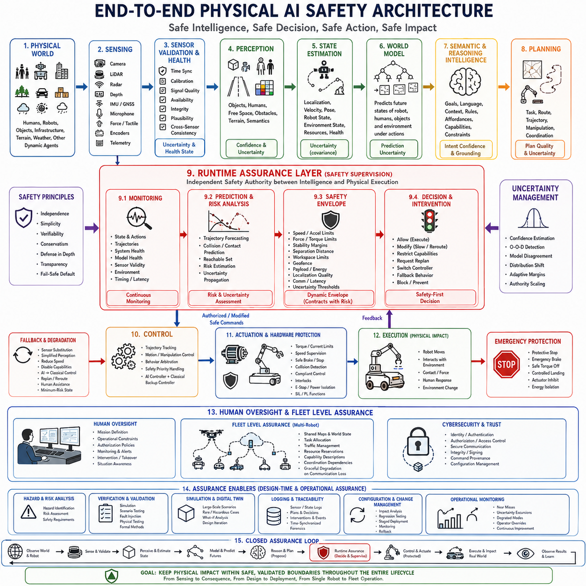{width="7.268055555555556in" height="7.268055555555556in"}

An end-to-end Physical AI safety architecture treats safety as a continuous system property spanning sensing, perception, cognition, planning, control, actuation, communication, and operational supervision. Safety cannot be assigned to a single component because hazardous behavior can emerge from interactions among individually functional subsystems. The architecture therefore establishes coordinated protection from environmental observation through physical execution and post-operation learning.

The architecture begins with the physical world, where humans, robots, infrastructure, objects, terrain, weather, and other dynamic agents create continuously changing operating conditions. Sensors provide the first digital representation of this environment through cameras, LiDAR, radar, depth sensing, IMUs, GNSS, force sensing, tactile sensing, encoders, microphones, and system telemetry. Safety depends on both sufficient sensing coverage and explicit awareness of sensor limitations.

Sensor inputs pass through validation and health monitoring before being trusted by higher intelligence. Timestamp consistency, calibration status, signal quality, communication integrity, sensor availability, plausibility, and cross-sensor agreement provide evidence about whether observations remain usable. A failed or degraded sensor should not silently propagate incorrect information upward. Instead, uncertainty and degradation states must accompany observations throughout the architecture.

Perception transforms validated observations into representations of objects, humans, free space, obstacles, terrain, semantic regions, robot state, and environmental relationships. Because learned perception is probabilistic, every important interpretation should be associated with confidence and uncertainty. Independent safety functions may use simpler or redundant perception paths so that failure of a sophisticated AI perception model does not simultaneously eliminate basic hazard detection.

State estimation combines perception, localization, robot telemetry, maps, memory, and temporal information into an operational representation of the current world. This representation must preserve safety-relevant variables such as position, velocity, stability, human proximity, payload state, energy reserve, actuator condition, and environmental constraints. Incorrect state estimation can make otherwise valid planning unsafe, so uncertainty must remain visible rather than being hidden behind a single best estimate.

A world model extends state estimation from understanding the present toward predicting possible futures. It estimates how the robot, humans, objects, and environment may evolve under alternative actions. These imagined futures support anticipatory safety by exposing potential collisions, instability, blocked routes, unsafe contacts, or task failures before execution. Predictions remain hypotheses, however, and must never be treated as equivalent to direct physical observation.

Semantic and reasoning intelligence interprets mission objectives, language instructions, task context, affordances, rules, and relationships. Foundation models and VLA systems can provide powerful generalization and flexible task understanding, but their outputs remain proposals rather than unrestricted commands. Ambiguous instructions, unsupported capabilities, contradictory goals, unfamiliar situations, or uncertain grounding should reduce authority and trigger clarification, conservative interpretation, or rejection.

Planning converts goals and estimated world state into candidate tasks, routes, trajectories, manipulations, and coordinated actions. The planner may evaluate multiple predicted futures and optimize efficiency, mission success, energy, time, or task quality. Safety must remain a constraint on this optimization rather than merely another reward. A high-value plan cannot justify violating validated limits for collision risk, stability, force, speed, workspace, or human separation.

The architecture therefore separates intelligence authority from safety authority. AI components may perceive, predict, reason, optimize, and propose actions, while an independent safety layer determines whether those actions may physically occur. This boundary prevents increasing AI capability from automatically producing increasing physical authority. The most intelligent component in the system does not need to be the component with final control over hazardous energy.

Runtime assurance forms the central supervisory barrier between intelligent decision-making and physical execution. It continuously evaluates proposed actions, current state, predicted consequences, uncertainty, model health, sensor validity, system timing, and remaining safety margins. Depending on the result, it can authorize execution, modify commands, restrict capabilities, request replanning, switch controllers, invoke fallback behavior, or prevent execution entirely.

Safety envelopes translate validated assumptions into enforceable runtime boundaries. These may include speed and acceleration limits, force and torque limits, stability margins, geofences, workspace restrictions, human separation, obstacle clearance, payload constraints, battery reserves, communication requirements, localization quality, inference latency, and uncertainty thresholds. The active envelope can contract dynamically when environmental or system confidence decreases.

Control converts authorized plans into commands for steering, locomotion, joints, manipulators, tools, and other actuators. Learned controllers may provide adaptive and high-performance behavior, while deterministic or conventionally verified controllers can provide safety-critical fallback functions. Control arbitration ensures that safety commands have priority when primary AI behavior conflicts with protective constraints or when model reliability becomes insufficient.

Actuator-level protection provides another independent barrier close to physical energy. Motor current limits, torque limits, safe braking, joint limits, speed supervision, collision detection, compliant control, safe torque functions, interlocks, emergency stops, and power isolation constrain what the hardware can physically do. These mechanisms remain important even when all higher-level AI components appear healthy because software assurance alone cannot eliminate every hazardous failure.

Execution closes the perception-action loop by changing the real environment. The resulting robot motion, contact, object movement, human response, and system state are observed again through sensors and telemetry. Runtime assurance compares expected and actual outcomes to detect prediction errors, control deviations, unexpected contact, localization drift, or environmental change. Every physical action therefore becomes new evidence for determining whether continued autonomy remains justified.

Uncertainty management connects all layers rather than existing as an isolated AI feature. Sensor uncertainty, perception confidence, state-estimation covariance, world-model prediction error, planner uncertainty, model disagreement, distribution shift, and system-health indicators should influence operational authority. As uncertainty increases, the system can shorten planning horizons, reduce speed, enlarge separation margins, gather more information, restrict tasks, or transition toward safer modes.

Fallback and graceful degradation provide structured responses when nominal operation cannot be maintained. The system may substitute sensors, simplify perception, reduce speed, disable selected capabilities, switch from AI to classical control, replan around unavailable resources, request human assistance, or enter a minimum-risk state. Degradation should remove capability progressively while preserving essential safety functions rather than causing an abrupt transition from full autonomy to uncontrolled failure.

Emergency protection addresses situations in which normal recovery is no longer sufficient. Protective stopping, emergency braking, safe torque off, controlled landing, actuator inhibition, energy isolation, or other embodiment-specific responses must remain available independently of the primary AI reasoning chain. Emergency mechanisms should place the physical system in the safest achievable condition without requiring the failing intelligence to recognize or approve its own failure.

Human oversight surrounds rather than replaces autonomous safety mechanisms. Operators define missions, operational constraints, authorization policies, and acceptable risk while monitoring degraded conditions and exceptional events. Human takeover may be appropriate for situations outside validated autonomy, but the robot must remain safe during communication delays and operator response time. Interfaces should clearly expose uncertainty, health, interventions, and reasons for restricted operation.

For multi-robot systems, the architecture extends from robot-local assurance to fleet-level assurance. Shared maps, world states, task allocation, traffic management, resource reservations, capability descriptions, and coordination dependencies create additional hazards. Fleet intelligence may optimize collective behavior, but each robot retains local safety authority. Loss of communication or orchestration should degrade coordination without removing collision avoidance, stability protection, or minimum-risk behavior.

Cybersecurity forms part of the safety architecture because compromised information can produce hazardous physical behavior. Identity, authentication, authorization, secure communication, model integrity, software signing, command provenance, access control, and configuration management protect the chain from sensor data to actuator command. Untrusted instructions or corrupted shared state should never acquire physical authority simply because they enter an AI reasoning pipeline.

Design-time assurance establishes the evidence supporting runtime boundaries. Hazard analysis, risk assessment, safety requirements, architecture analysis, simulation, scenario testing, fault injection, formal methods where appropriate, hardware testing, AI evaluation, and physical validation define what has been demonstrated. Runtime assurance then protects these validated assumptions during operation rather than attempting to compensate for an undefined or inadequately tested system.

Verification must examine complete causal chains from perception error to physical consequence. Testing should include sensor faults, occlusion, localization drift, distribution shift, ambiguous language, world-model errors, unsafe plans, controller anomalies, communication loss, compute overload, actuator faults, human intrusion, and combinations of failures. The essential question is whether each credible failure can be detected, contained, tolerated, or converted into a safe transition before unacceptable harm occurs.

Simulation and digital twins provide scalable environments for evaluating rare and hazardous scenarios that cannot be repeatedly created in physical testing. Large scenario spaces can vary environment, humans, robot configuration, sensor quality, AI uncertainty, communication, timing, and component failures. Simulation evidence must ultimately be connected to physical validation because contact dynamics, sensing imperfections, actuator behavior, and human responses may differ from modeled assumptions.

Logging and traceability connect operational behavior back to the safety argument. Sensor states, model versions, uncertainty, plans, safety decisions, actuator commands, interventions, faults, fallback transitions, human actions, and outcomes should be recorded with synchronized timing. This enables reconstruction of why the system acted, which safeguards operated, and whether the validated configuration was actually deployed when an event occurred.

Configuration and change management preserve assurance as Physical AI evolves. Updates to sensors, models, training data, prompts, world models, planners, controllers, safety thresholds, hardware, network configuration, or fleet policies can alter system behavior and invalidate previous evidence. Impact analysis, regression testing, scenario replay, targeted physical validation, staged deployment, monitoring, and rollback should accompany safety-relevant changes.

Operational monitoring transforms deployment into a continuing source of assurance evidence. Near misses, uncertainty excursions, repeated replanning, degraded-mode entries, safety interventions, operator overrides, model disagreements, unexpected environments, and recovery outcomes reveal where development assumptions remain valid or begin to weaken. This evidence supports corrective actions and controlled expansion or restriction of the approved operational envelope.

The architecture therefore creates defense in depth across sensing, intelligence, supervision, control, hardware, operations, and human governance. No single AI model, safety monitor, sensor, controller, or operator is expected to prevent every hazardous event. Instead, overlapping barriers reduce the probability that one error can propagate through the entire system and become uncontrolled physical harm.

A mature end-to-end Physical AI safety architecture ultimately forms a closed assurance loop connecting the physical world, sensing, perception, state estimation, world modeling, reasoning, planning, runtime assurance, protected control, actuation, observation, fallback, and operational learning. Its objective is not to prove that intelligent systems never make mistakes, but to ensure that errors, uncertainty, and degradation remain bounded before they can become unacceptable physical consequences.

종단간 피지컬 AI 안전 아키텍처(End-to-End Physical AI Safety Architecture)는 안전을 센싱(Sensing), 인지(Perception), 인식 및 추론(Cognition and Reasoning), 계획(Planning), 제어(Control), 구동(Actuation), 통신(Communication), 운용 감독(Operational Supervision)에 걸쳐 지속적으로 유지되어야 하는 시스템 속성(System Property)으로 다룬다. 위험한 행동은 개별적으로 정상인 하위 시스템들의 상호작용에서도 발생할 수 있으므로 안전을 하나의 구성요소에만 맡길 수 없다. 따라서 이 아키텍처는 환경 관측에서 물리적 실행과 운용 후 학습까지 연결되는 전체 과정에 걸쳐 협조된 보호 체계를 구축한다.

아키텍처는 인간, 로봇, 기반시설, 객체, 지형, 기상 및 기타 동적 에이전트(Dynamic Agent)가 지속적으로 변화하는 운용 조건을 형성하는 물리적 세계(Physical World)에서 시작한다. 센서는 카메라, 라이다(LiDAR), 레이더(Radar), 깊이 센싱(Depth Sensing), 관성측정장치(IMU), 위성항법시스템(GNSS), 힘 센싱(Force Sensing), 촉각 센싱(Tactile Sensing), 인코더, 마이크 및 시스템 텔레메트리(System Telemetry)를 통해 환경의 첫 번째 디지털 표현을 제공한다. 안전은 충분한 센싱 범위뿐만 아니라 센서 한계에 대한 명시적인 인식에도 의존한다.

센서 입력은 상위 지능 계층에서 신뢰하기 전에 검증 및 상태 모니터링(Validation and Health Monitoring)을 거쳐야 한다. 타임스탬프 일관성, 보정 상태, 신호 품질, 통신 무결성, 센서 가용성, 타당성 및 센서 간 일치성은 관측을 계속 사용할 수 있는지에 대한 증거를 제공한다. 고장 나거나 성능이 저하된 센서가 잘못된 정보를 상위 계층으로 조용히 전달해서는 안 된다. 대신 불확실성과 성능 저하 상태가 관측 정보와 함께 아키텍처 전체에 전달되어야 한다.

인지(Perception)는 검증된 관측을 객체, 인간, 자유 공간, 장애물, 지형, 의미 영역(Semantic Region), 로봇 상태 및 환경 관계에 대한 표현으로 변환한다. 학습 기반 인지는 확률적이므로 중요한 해석에는 신뢰도와 불확실성이 함께 연결되어야 한다. 독립적인 안전 기능은 더 단순하거나 중복된 인지 경로(Redundant Perception Path)를 사용할 수 있으며, 이를 통해 고도화된 AI 인지 모델의 고장이 기본적인 위험 탐지 능력까지 동시에 제거하지 않도록 해야 한다.

상태 추정(State Estimation)은 인지, 위치추정, 로봇 텔레메트리, 지도, 메모리 및 시간 정보를 결합하여 현재 세계에 대한 운용 표현(Operational Representation)을 구성한다. 이 표현은 위치, 속도, 안정성, 인간 근접성, 적재물 상태, 에너지 예비량, 액추에이터 상태 및 환경 제약조건과 같은 안전 관련 변수를 보존해야 한다. 잘못된 상태 추정은 정상적인 계획조차 위험하게 만들 수 있으므로 불확실성을 하나의 최적 추정값(Best Estimate) 뒤에 숨기지 않고 명시적으로 유지해야 한다.

월드 모델(World Model)은 상태 추정을 현재의 이해에서 가능한 미래의 예측으로 확장한다. 월드 모델은 대안 행동에 따라 로봇, 인간, 객체 및 환경이 어떻게 변화할 수 있는지를 추정한다. 이러한 상상된 미래(Imagined Future)는 실제 실행 전에 잠재적인 충돌, 불안정성, 차단된 경로, 위험한 접촉 또는 작업 실패를 드러내어 선제적 안전(Anticipatory Safety)을 지원한다. 그러나 예측은 어디까지나 가설이므로 직접적인 물리적 관측과 동일한 것으로 취급해서는 안 된다.

의미론적 지능 및 추론 지능(Semantic and Reasoning Intelligence)은 임무 목표, 언어 명령, 작업 상황, 어포던스(Affordance), 규칙 및 관계를 해석한다. 파운데이션 모델(Foundation Model)과 비전-언어-행동 시스템(Vision-Language-Action System, VLA)은 강력한 일반화와 유연한 작업 이해를 제공할 수 있지만 그 출력은 무제한적인 명령이 아니라 제안으로 유지되어야 한다. 모호한 명령, 지원되지 않는 능력, 상충되는 목표, 익숙하지 않은 상황 또는 불확실한 그라운딩(Grounding)은 권한을 축소하고 명확화, 보수적 해석 또는 거부를 유발해야 한다.

계획(Planning)은 목표와 추정된 세계 상태를 후보 작업, 경로, 궤적, 조작 및 협조 행동으로 변환한다. 플래너(Planner)는 여러 개의 예측된 미래를 평가하고 효율성, 임무 성공, 에너지, 시간 또는 작업 품질을 최적화할 수 있다. 그러나 안전은 단순한 추가 보상이 아니라 이러한 최적화를 제한하는 제약조건으로 유지되어야 한다. 높은 가치를 가진 계획이라도 충돌 위험, 안정성, 힘, 속도, 작업 공간 또는 인간 분리 거리에 대한 검증된 한계를 위반하는 것을 정당화할 수 없다.

따라서 아키텍처는 지능 권한(Intelligence Authority)과 안전 권한(Safety Authority)을 분리한다. AI 구성요소는 인지하고, 예측하고, 추론하고, 최적화하며 행동을 제안할 수 있지만 독립적인 안전 계층(Independent Safety Layer)이 해당 행동의 물리적 실행 가능 여부를 결정한다. 이러한 경계는 AI 능력의 증가가 자동으로 물리적 권한의 증가로 이어지는 것을 방지한다. 시스템에서 가장 지능적인 구성요소가 위험 에너지(Hazardous Energy)에 대한 최종 제어권까지 가질 필요는 없다.

런타임 보증(Runtime Assurance)은 지능형 의사결정과 물리적 실행 사이에 위치하는 핵심 감독 장벽(Supervisory Barrier)을 형성한다. 제안된 행동, 현재 상태, 예측된 결과, 불확실성, 모델 상태, 센서 유효성, 시스템 타이밍 및 남아 있는 안전 여유를 지속적으로 평가한다. 평가 결과에 따라 실행을 승인하거나, 명령을 수정하거나, 기능을 제한하거나, 재계획을 요청하거나, 제어기를 전환하거나, 폴백 동작(Fallback Behavior)을 실행하거나, 실행 자체를 완전히 차단할 수 있다.

안전 영역(Safety Envelope)은 검증된 가정을 런타임에서 강제할 수 있는 경계로 변환한다. 여기에는 속도 및 가속도 한계, 힘과 토크 한계, 안정성 여유, 지오펜스(Geofence), 작업 공간 제한, 인간 분리 거리, 장애물 여유 거리, 적재물 제약조건, 배터리 예비량, 통신 요구사항, 위치추정 품질, 추론 지연(Inference Latency) 및 불확실성 임계값 등이 포함될 수 있다. 환경이나 시스템 신뢰도가 감소하면 활성 안전 영역은 동적으로 축소될 수 있다.

제어(Control)는 승인된 계획을 조향, 이동, 관절, 매니퓰레이터, 도구 및 기타 액추에이터를 위한 명령으로 변환한다. 학습 기반 제어기(Learned Controller)는 적응성과 높은 성능을 제공할 수 있으며, 결정론적 또는 전통적으로 검증된 제어기는 안전 핵심 폴백 기능을 제공할 수 있다. 제어 중재(Control Arbitration)는 기본 AI 행동이 보호 제약조건과 충돌하거나 모델 신뢰성이 불충분해지는 경우 안전 명령이 우선권을 갖도록 보장한다.

액추에이터 수준 보호(Actuator-Level Protection)는 물리적 에너지에 가까운 위치에서 또 하나의 독립적인 장벽을 제공한다. 모터 전류 제한, 토크 제한, 안전 제동, 관절 한계, 속도 감독, 충돌 감지, 순응 제어(Compliant Control), 안전 토크 기능(Safe Torque Function), 인터록(Interlock), 비상 정지 및 전원 격리(Power Isolation)는 하드웨어가 물리적으로 수행할 수 있는 행동을 제한한다. 모든 상위 AI 구성요소가 정상으로 보이더라도 소프트웨어 보증만으로 모든 위험한 고장을 제거할 수 없기 때문에 이러한 메커니즘은 중요하다.

실행(Execution)은 실제 환경을 변화시킴으로써 인지-행동 루프(Perception-Action Loop)를 닫는다. 그 결과로 발생한 로봇 움직임, 접촉, 객체 이동, 인간 반응 및 시스템 상태는 센서와 텔레메트리를 통해 다시 관측된다. 런타임 보증은 예상 결과와 실제 결과를 비교하여 예측 오류, 제어 편차, 예상하지 못한 접촉, 위치추정 드리프트 또는 환경 변화를 탐지한다. 따라서 모든 물리적 행동은 자율성을 계속 허용할 수 있는지를 판단하기 위한 새로운 증거가 된다.

불확실성 관리(Uncertainty Management)는 독립적인 하나의 AI 기능으로 존재하는 것이 아니라 모든 계층을 연결한다. 센서 불확실성, 인지 신뢰도, 상태 추정 공분산(State-Estimation Covariance), 월드 모델 예측 오류, 플래너 불확실성, 모델 불일치, 분포 변화 및 시스템 상태 지표가 운용 권한에 영향을 주어야 한다. 불확실성이 증가하면 시스템은 계획 지평선을 단축하고, 속도를 낮추고, 분리 여유를 확대하고, 추가 정보를 수집하고, 작업을 제한하거나 더 안전한 모드로 전환할 수 있다.

폴백 및 점진적 성능 저하(Fallback and Graceful Degradation)는 정상 운용을 유지할 수 없을 때 구조화된 대응을 제공한다. 시스템은 센서를 대체하고, 인지를 단순화하고, 속도를 낮추고, 일부 기능을 비활성화하고, AI 제어에서 고전적 제어(Classical Control)로 전환하고, 사용할 수 없는 자원을 우회하여 재계획하고, 인간 지원을 요청하거나 최소 위험 상태(Minimum-Risk State)로 진입할 수 있다. 성능 저하는 완전한 자율성에서 통제 불가능한 고장으로 갑자기 전환되는 대신 필수 안전 기능을 유지하면서 단계적으로 능력을 제거해야 한다.

비상 보호(Emergency Protection)는 정상적인 복구만으로 더 이상 충분하지 않은 상황을 처리한다. 보호 정지(Protective Stop), 비상 제동, 안전 토크 차단(Safe Torque Off), 제어 착륙, 액추에이터 억제, 에너지 격리 또는 기타 형태별 대응(Embodiment-Specific Response)은 기본 AI 추론 체인과 독립적으로 사용 가능해야 한다. 비상 메커니즘은 고장 난 지능이 자신의 고장을 스스로 인식하거나 승인할 필요 없이 물리 시스템을 달성 가능한 가장 안전한 상태로 전환해야 한다.

인간 감독(Human Oversight)은 자율 안전 메커니즘을 대체하는 것이 아니라 이를 둘러싸는 역할을 한다. 운영자는 임무, 운용 제약조건, 권한 정책 및 허용 가능한 위험을 정의하면서 성능 저하 조건과 예외 이벤트를 모니터링한다. 검증된 자율성 범위를 벗어나는 상황에서는 인간 인수 제어(Human Takeover)가 적절할 수 있지만 통신 지연과 운영자 대응 시간 동안에도 로봇은 안전해야 한다. 인터페이스는 불확실성, 상태, 개입 및 운용 제한의 이유를 명확하게 표시해야 한다.

다중 로봇 시스템(Multi-Robot System)의 경우 아키텍처는 로봇 로컬 보증(Robot-Local Assurance)에서 플릿 수준 보증(Fleet-Level Assurance)으로 확장된다. 공유 지도, 세계 상태, 작업 할당, 교통 관리, 자원 예약, 능력 기술 및 협조 의존성이 추가적인 위험을 발생시킨다. 플릿 지능(Fleet Intelligence)은 집단 행동을 최적화할 수 있지만 각 로봇은 로컬 안전 권한을 유지한다. 통신이나 오케스트레이션이 상실되어도 충돌 회피, 안정성 보호 및 최소 위험 행동은 유지되면서 협조 기능만 성능이 저하되어야 한다.

사이버보안(Cybersecurity)은 손상된 정보가 위험한 물리적 행동을 발생시킬 수 있기 때문에 안전 아키텍처의 일부를 구성한다. 신원, 인증(Authentication), 권한 부여(Authorization), 보안 통신, 모델 무결성(Model Integrity), 소프트웨어 서명, 명령 출처(Command Provenance), 접근 제어 및 구성 관리는 센서 데이터에서 액추에이터 명령까지의 전체 체인을 보호한다. 신뢰할 수 없는 명령이나 손상된 공유 상태가 AI 추론 파이프라인에 입력되었다는 이유만으로 물리적 권한을 획득해서는 안 된다.

설계 단계 보증(Design-Time Assurance)은 런타임 경계를 뒷받침하는 증거를 구축한다. 위험 분석(Hazard Analysis), 위험 평가(Risk Assessment), 안전 요구사항, 아키텍처 분석, 시뮬레이션, 시나리오 시험, 고장 주입(Fault Injection), 필요한 경우 형식 기법(Formal Methods), 하드웨어 시험, AI 평가 및 물리적 검증을 통해 무엇이 실제로 입증되었는지를 정의한다. 런타임 보증은 정의되지 않았거나 충분히 시험되지 않은 시스템을 보완하는 것이 아니라 이러한 검증된 가정을 실제 운용 중에 보호한다.

검증(Verification)은 인지 오류에서 물리적 결과까지 이어지는 전체 인과 체인(Causal Chain)을 검토해야 한다. 시험에는 센서 고장, 가림(Occlusion), 위치추정 드리프트, 분포 변화(Distribution Shift), 모호한 언어, 월드 모델 오류, 위험한 계획, 제어기 이상, 통신 손실, 연산 과부하, 액추에이터 고장, 인간 진입 및 복합 고장이 포함되어야 한다. 핵심 질문은 각각의 신뢰 가능한 고장을 허용할 수 없는 피해가 발생하기 전에 탐지하고, 제한하고, 허용하거나, 안전한 전환으로 변환할 수 있는가이다.

시뮬레이션 및 디지털 트윈(Simulation and Digital Twin)은 물리적 시험에서 반복적으로 구현하기 어렵거나 위험한 희귀 시나리오를 확장 가능한 환경에서 평가할 수 있도록 한다. 대규모 시나리오 공간에서 환경, 인간, 로봇 구성, 센서 품질, AI 불확실성, 통신, 타이밍 및 구성요소 고장을 변화시킬 수 있다. 그러나 접촉 동역학, 센싱의 불완전성, 액추에이터 행동 및 인간 반응은 모델의 가정과 다를 수 있으므로 시뮬레이션 증거는 최종적으로 물리적 검증과 연결되어야 한다.

로깅 및 추적성(Logging and Traceability)은 실제 운용 행동을 안전 논증(Safety Argument)과 다시 연결한다. 센서 상태, 모델 버전, 불확실성, 계획, 안전 의사결정, 액추에이터 명령, 개입, 고장, 폴백 전환, 인간 행동 및 결과를 동기화된 시간 정보와 함께 기록해야 한다. 이를 통해 시스템이 왜 특정 행동을 수행했는지, 어떤 안전장치가 작동했는지, 그리고 이벤트 발생 당시 실제로 검증된 구성이 배포되어 있었는지를 재구성할 수 있다.

구성 및 변경 관리(Configuration and Change Management)는 피지컬 AI가 진화하는 동안 보증을 유지한다. 센서, 모델, 학습 데이터, 프롬프트, 월드 모델, 플래너, 제어기, 안전 임계값, 하드웨어, 네트워크 구성 또는 플릿 정책의 업데이트는 시스템 행동을 변화시키고 기존 증거를 무효화할 수 있다. 안전 관련 변경에는 영향 분석, 회귀 시험(Regression Testing), 시나리오 재실행, 대상 물리 검증, 단계적 배포(Staged Deployment), 모니터링 및 롤백(Rollback)이 수반되어야 한다.

운용 모니터링(Operational Monitoring)은 배포 환경을 지속적인 보증 증거의 원천으로 전환한다. 근접 사고(Near Miss), 불확실성 임계 초과, 반복적인 재계획, 성능 저하 모드 진입, 안전 개입, 운영자 재정의, 모델 불일치, 예상하지 못한 환경 및 복구 결과를 통해 개발 단계의 가정이 계속 유효한지 또는 약화되고 있는지를 파악할 수 있다. 이러한 증거는 시정 조치와 승인된 운용 영역의 통제된 확대 또는 축소를 지원한다.

따라서 이 아키텍처는 센싱, 지능, 감독, 제어, 하드웨어, 운용 및 인간 거버넌스(Human Governance)에 걸쳐 심층 방어(Defense in Depth)를 형성한다. 하나의 AI 모델, 안전 모니터, 센서, 제어기 또는 운영자가 모든 위험한 사건을 방지할 것으로 기대하지 않는다. 대신 서로 중첩되는 여러 보호 장벽이 하나의 오류가 전체 시스템을 통과하여 통제되지 않은 물리적 피해로 발전할 가능성을 감소시킨다.

성숙한 종단간 피지컬 AI 안전 아키텍처는 궁극적으로 물리적 세계, 센싱, 인지, 상태 추정, 월드 모델링(World Modeling), 추론, 계획, 런타임 보증, 보호된 제어(Protected Control), 구동, 관측, 폴백 및 운용 학습(Operational Learning)을 연결하는 폐쇄형 보증 루프(Closed Assurance Loop)를 형성한다. 그 목적은 지능형 시스템이 절대로 실수하지 않는다는 것을 증명하는 것이 아니라 오류, 불확실성 및 성능 저하가 허용할 수 없는 물리적 결과로 발전하기 전에 제한된 상태로 유지되도록 보장하는 것이다.
